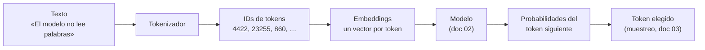

# 01. Representación del lenguaje

Este documento resuelve la primera pregunta de toda la guía: cómo un programa que sólo opera con
números llega a trabajar con texto. Todo lo que viene después —atención, entrenamiento, inferencia,
RAG (*Retrieval-Augmented Generation*)— se construye sobre las tres piezas que acá se definen: el
*token*, el vocabulario y el *embedding*.

**Antes de leer**: ninguno — es el primer documento temático de la ruta; conviene tener a mano
[`Marco-De-Referencia.md`](Marco-De-Referencia.md) (IAM-M1) para los identificadores ESC/CTX/ACT y
el glosario.
**Anterior**: [`Marco-De-Referencia.md`](Marco-De-Referencia.md) ·
**Siguiente**: [`02-Arquitectura-Transformer.md`](02-Arquitectura-Transformer.md).
Convenciones del cuerpo: [`Convenciones.md`](Convenciones.md) (citado §2, ejemplos §3, cifras §4).

## Índice

1. [Definición](#1-definición)
2. [Aplicación por escenario](#2-aplicación-por-escenario)
3. [Ejemplos concretos](#3-ejemplos-concretos)
4. [Bloque didáctico](#4-bloque-didáctico)
5. [Criterios de calidad](#5-criterios-de-calidad)
6. [Anexo: lista de verificación del presupuesto de tokens](#6-anexo-lista-de-verificación-del-presupuesto-de-tokens)
7. [Referencias](#referencias)

---

## 1. Definición

### 1.1 El problema que esta capa resuelve

Un modelo de lenguaje es, por dentro, una función matemática: recibe números, multiplica matrices,
devuelve números. En esa función no existe ninguna operación que reciba una palabra. Entre el texto
que alguien escribe y los números que el modelo procesa hay una capa de traducción, y esa capa
es el tema de este documento. Se compone de dos transformaciones encadenadas: primero el texto se
parte en unidades discretas llamadas *tokens*, cada una con un número de identificación fijo;
después cada identificador se convierte en un vector de cientos o miles de dimensiones, el
*embedding*, que es lo que la red procesa de verdad.



El diagrama marca también la frontera de este documento: la mecánica interna del modelo es el tema
de [`02-Arquitectura-Transformer.md`](02-Arquitectura-Transformer.md), y la elección del token de
salida, de [`03-Del-Modelo-Base-Al-Asistente.md`](03-Del-Modelo-Base-Al-Asistente.md). Acá importa
todo lo que pasa antes de que la red toque el dato y el límite físico que esa representación impone:
la ventana de contexto.

### 1.2 *Token*, tokenizador y vocabulario

**Un *token* es la unidad mínima en que el modelo segmenta el texto, y no coincide con la palabra**
(Sennrich et al., 2016). Puede ser una palabra entera, un pedazo de palabra, un signo de puntuación
o un espacio pegado al comienzo de la palabra que sigue.

*Cómo se aplica*: tomá cualquier frase, pasala por el tokenizador del modelo y contá las piezas que
devuelve; el [ejemplo 1](#31-ejemplo-1--ver-los-tokens-de-un-texto-real) hace exactamente eso en
cuatro líneas de Python. *Un caso*: la frase «El modelo no lee palabras: lee tokens.» produce 9
tokens donde hay 7 palabras, y «Hidroelectricidad rioplatense» —2 palabras— produce también 9,
porque el tokenizador parte lo infrecuente en pedazos (`'H'`, `'id'`, `'roe'`, `'lectric'`,
`'idad'`, …). La relación tokens/palabra no es fija: depende del texto y del vocabulario.

El **tokenizador** es el componente que hace esa conversión en los dos sentidos: texto → lista de
IDs al entrar, lista de IDs → texto al salir. El algoritmo dominante es BPE (*Byte Pair Encoding*,
codificación por pares de bytes): se parte de los caracteres sueltos y se fusionan, de forma
iterativa, los pares más frecuentes del corpus de entrenamiento hasta alcanzar un tamaño de
vocabulario prefijado (Sennrich et al., 2016). La consecuencia práctica es que lo frecuente queda
como token entero y lo raro se parte en subpalabras. Las variantes a nivel de byte, como la de
GPT-2, garantizan además que **ningún texto queda afuera**: en el peor caso, una secuencia inédita
se representa byte a byte (Radford et al., 2019). Otros ecosistemas usan SentencePiece, que aplica
la misma idea sin depender de espacios como separador (Kudo y Richardson, 2018).

El **vocabulario** es el conjunto cerrado de tokens que un modelo conoce: una tabla que asigna a
cada token un ID entero. Su tamaño se fija al entrenar el tokenizador y no cambia después, y según
la familia va de decenas de miles de entradas (los 32 000 del trabajo fundacional de subpalabras;
Sennrich et al., 2016) a varios cientos de miles (el nombre del vocabulario `o200k_base` del
ejemplo 1 alude a su tamaño; OpenAI, s. f.). Dos propiedades importan al lector:

- **El tokenizador es parte del modelo.** Cada familia entrena el suyo; los IDs de un vocabulario
  no significan nada en otro. Un texto no «tiene» una cantidad de tokens en abstracto: la tiene
  respecto de un tokenizador concreto.
- **La conversión es exacta y reversible.** Tokenizar y des-tokenizar devuelve el texto original,
  byte a byte. No hay pérdida en esta capa; la interpretación llega después.

### 1.3 *Embedding*: del símbolo al espacio geométrico

Un ID de token sigue siendo un símbolo arbitrario: que al token de «gato» le toque un número y al
de «perro» otro no dice nada del parentesco entre ambos. **El *embedding* resuelve eso: es un
vector numérico denso que representa un texto en un espacio donde la cercanía geométrica refleja
afinidad semántica**
(Mikolov et al., 2013; Reimers y Gurevych, 2019).

La imagen mental que conviene retener: un *embedding* es la **posición de un texto en un mapa de
significados**. En ese mapa, «gato» y «perro» quedan cerca, «gato» y «notebook» lejos, y las
direcciones también significan: los modelos de la familia word2vec mostraron que el vector de
«rey» menos «hombre» más «mujer» cae cerca de «reina» (Mikolov et al., 2013).

*Cómo se aplica*: dados dos vectores, medí el ángulo entre ellos con la similitud coseno de §1.4;
si no tenés los vectores, generalos con un modelo de embeddings y medí después. El
[ejemplo 3](#33-ejemplo-3--similitud-coseno-a-mano) corre esa operación sobre vectores juguete de
tres dimensiones. *Un caso*: con dimensiones inventadas [animal, tecnología, tamaño], «gato» contra
«perro» da 0,972 y «gato» contra «notebook» da 0,024 — el número reproduce la intuición.

Hay dos usos del término que esta guía distingue desde ahora, porque confundirlos cuesta caro
después:

| Uso | Qué vectoriza | Dónde vive |
| --- | --- | --- |
| *Embedding* de entrada del modelo | Cada token, como primera capa de la red; se aprende durante el entrenamiento | Este documento y [`02-Arquitectura-Transformer.md`](02-Arquitectura-Transformer.md) |
| Modelo de *embeddings* | Frases o documentos enteros, con un modelo dedicado, para buscar por significado | [`09-Bases-Vectoriales-Y-RAG.md`](09-Bases-Vectoriales-Y-RAG.md) |

El primero es un mecanismo interno; el segundo, una herramienta que el lector va a operar cuando
indexe un corpus propio (ESC-03).

### 1.4 Similitud coseno

**La similitud coseno mide la cercanía entre dos vectores por el ángulo que forman, no por su
longitud** (Reimers y Gurevych, 2019). La fórmula cabe en una línea, conforme al contrato de
profundidad de [`Convenciones.md`](Convenciones.md) §5:

> sim(A, B) = (A · B) / (‖A‖ × ‖B‖) — el producto punto de los vectores, dividido por el producto
> de sus normas (sus longitudes).

El resultado cae entre −1 y 1: 1 es «apuntan igual», 0 es «no tienen que ver», −1 es «apuntan
opuesto». En la práctica con embeddings de texto casi todo cae entre 0 y 1, y el valor absoluto
importa menos que el **orden** que induce: la similitud coseno sirve para rankear candidatos, no
para leerse como porcentaje de igualdad.

*Cómo se aplica*: implementá la fórmula —son tres sumas y una división, sin bibliotecas— y
ordená los candidatos de mayor a menor; el [ejemplo 3](#33-ejemplo-3--similitud-coseno-a-mano) lo
hace completo. *Un caso*: en la salida del ejemplo 3, «elefante» da 0,743 contra «gato»; menos que
«perro» (0,972), mucho más que «servidor» (0,061). El ranking es la información útil.

### 1.5 Ventana de contexto

**La ventana de contexto es la cantidad máxima de tokens que el modelo procesa en una pasada, y la
entrada y la salida la comparten** (Vaswani et al., 2017). No es una memoria que se llena y se
vacía: es el tamaño del escritorio. Todo lo que el modelo «ve» al generar el token siguiente —el
*prompt* del sistema, la conversación previa, los documentos inyectados, lo ya generado— tiene que
caber ahí al mismo tiempo. Lo que no cabe no existe para el modelo, aunque se haya escrito tres
mensajes atrás.

*Cómo se aplica*: antes de mandar una tarea, contá los tokens de todo lo que entra (el
[ejemplo 2](#32-ejemplo-2--contar-tokens-vs-contar-palabras) muestra cómo), sumá el largo esperado
de la salida, y compará contra la ventana configurada; el anexo de §6 convierte esa cuenta en lista
de verificación. *Un caso*: con una ventana de 8192 tokens, un contexto de sistema de 900, un
documento inyectado de 6500 y una conversación de 600, quedan 192 tokens para la respuesta — la
tarea va a salir trunca, y el síntoma visible es una respuesta cortada a mitad de frase, no un
error.

Dos precisiones que evitan confusiones frecuentes. Primera: la ventana publicada por la familia del
modelo y la ventana configurada en el motor de inferencia pueden diferir — los motores suelen
arrancar con un valor menor para ahorrar memoria, porque el costo en RAM de la ventana crece con su
tamaño (la mecánica de ese costo, la caché KV, se trata en
[`08-Inferencia-Local.md`](08-Inferencia-Local.md)). Segunda: ventana más grande no significa
atención pareja; qué hace el modelo con lo que tiene adentro es tema de la arquitectura
([`02-Arquitectura-Transformer.md`](02-Arquitectura-Transformer.md)).

### 1.6 Qué no es esta capa

La tokenización no es comprensión: es segmentación más tabla de búsqueda, determinista y
reversible. Los embeddings de entrada no son «la memoria» del modelo ni una base de conocimiento
consultable: son coordenadas aprendidas. Y contar tokens no mide calidad ni dificultad de una
tarea; mide espacio y, en CTX-04, costo. Quien busque dónde ocurre el «razonamiento» tiene que
seguir a los documentos [02](02-Arquitectura-Transformer.md) y
[03](03-Del-Modelo-Base-Al-Asistente.md): acá todavía no pasó nada inteligente, y esa es
precisamente la gracia — esta capa se puede entender por completo.

---

## 2. Aplicación por escenario

Los identificadores ESC/CTX/ACT son los del catálogo de
[`Marco-De-Referencia.md`](Marco-De-Referencia.md).

**ESC-01 — Entender y elegir un modelo.** Dos columnas de cualquier ficha de modelo se leen con
este documento: el tamaño del vocabulario y la ventana de contexto. La ventana decide qué tareas
son viables (resumir un contrato de 60 páginas exige una ventana que lo contenga, o una estrategia
de troceo); el vocabulario explica diferencias de eficiencia entre lenguas — un modelo cuyo
vocabulario se entrenó con poco castellano gasta más tokens por frase en castellano, y eso es más
lento y, por API, más caro. El criterio comparativo concreto por familia vive en la tabla de
referencia de [`11-Panorama-Y-Ecosistema-Abierto.md`](11-Panorama-Y-Ecosistema-Abierto.md).

**ESC-02 — Montar y servir localmente.** La ventana configurada en el motor es uno de los
parámetros que más memoria mueve. Al servir un modelo el operador (ACT-03) decide ese valor, y la
cuenta de este documento —cuánto entra, cuánto sale— es el dato de entrada de esa decisión. El
procedimiento está en [`08-Inferencia-Local.md`](08-Inferencia-Local.md); en CTX-03 los ejemplos de
esa guía corren contra `$OLLAMA_HOST`.

**ESC-03 — Preguntarle a un corpus propio (RAG).** Este escenario usa las dos piezas del documento
a la vez: los documentos se parten en fragmentos cuyo tamaño se mide en tokens, cada fragmento se
vectoriza con un modelo de embeddings, y la recuperación rankea por similitud coseno. Quien
entendió §1.3 y §1.4 ya tiene la mitad conceptual del pipeline;
[`09-Bases-Vectoriales-Y-RAG.md`](09-Bases-Vectoriales-Y-RAG.md) es el dueño de los laboratorios.

**ESC-04 — Adaptar un modelo a un dominio.** Los datasets de ajuste fino se presupuestan en
tokens: el costo de una pasada de entrenamiento es proporcional a los tokens procesados, y los
ejemplos que exceden la ventana del entrenamiento se truncan en silencio, que es la forma más cara
de perder datos. La cuenta del [ejemplo 2](#32-ejemplo-2--contar-tokens-vs-contar-palabras) aplica
tal cual; el proceso completo vive en [`06-Ajuste-Fino-Y-Alineacion.md`](06-Ajuste-Fino-Y-Alineacion.md).

**ESC-05 — Evaluar y comparar con evidencia.** Dos comparaciones honestas exigen condiciones
comparables, y los tokens son parte de las condiciones: mismo presupuesto de contexto, mismas
entradas, y conciencia de que dos modelos con tokenizadores distintos no procesan «la misma
cantidad» ante el mismo texto. El evaluador (ACT-04) encuentra el protocolo en
[`07-Evaluacion-Y-Metricas.md`](07-Evaluacion-Y-Metricas.md).

**ESC-06 — Más de una modalidad.** Las imágenes y el audio también entran al modelo como
secuencias de tokens —visuales o acústicos— que consumen ventana de contexto igual que los de
texto. Qué cambia y qué se conserva respecto de lo visto acá se trata en
[`10-Multimodalidad-Y-Generacion-No-Textual.md`](10-Multimodalidad-Y-Generacion-No-Textual.md).

**ESC-07 — Integrar en una aplicación.** El integrador (ACT-02) hereda todo lo anterior vía API:
presupuestar tokens de entrada y salida, truncar o resumir historial, y medir consumo. La
integración .NET se referencia a la guía 16 del repositorio
([`Dot-Net-Integration-AI-Layer-Guide`](../Dot-Net-Integration-AI-Layer-Guide/Dot-Net-Integration-AI-Layer-Guide.md)),
que no se duplica acá.

Por contexto, lo que cambia es el precio del mismo concepto. En CTX-01 y CTX-02 la ventana cuesta
memoria propia; en CTX-03, memoria del banco compartido que el operador raciona entre usuarios; en
CTX-04 cada token de entrada y de salida se factura, y contar tokens pasa de higiene técnica a
control de gastos. En CTX-05 el conteo local (como el del ejemplo 2) es además la única opción: el
texto no puede salir a un servicio externo ni para contarse. En CTX-06, fijar la versión del
tokenizador es parte de la reproducibilidad del pipeline, por la misma razón por la que los
ejemplos de §3 fijan la suya.

---

## 3. Ejemplos concretos

Este documento es dueño de tres laboratorios operables, conforme al mapa de laboratorios del caso
(expediente 0001, folio 011 §4) y al patrón de [`Convenciones.md`](Convenciones.md) §3. Los tres
corren en **CTX-01** (CPU, sin GPU, sin red una vez instaladas las dependencias) y no usan el banco
de inferencia, por lo que el paso 0 de verificación no aplica. Salida validada el 2026-11-07 con
Python 3.12.16 y tiktoken 0.9.0 en un contenedor `python:3.12-slim`; cualquier Python ≥ 3.9 local
sirve.

Preparación común (una sola vez):

```bash
python3 -m venv .venv-iam01
. .venv-iam01/bin/activate
pip install tiktoken==0.9.0
```

La versión va fijada por regla de la casa ([`Convenciones.md`](Convenciones.md) §3.2). tiktoken es
el tokenizador BPE de código abierto de OpenAI (OpenAI, s. f.); se elige para estos laboratorios
por instalarse sin descargar modelos, pero lo que muestra vale para cualquier tokenizador BPE —
el de la familia del banco incluido.

### 3.1 Ejemplo 1 — ver los tokens de un texto real

Qué demuestra: la unidad real del modelo no es la palabra (§1.2); lo frecuente queda entero y lo
infrecuente se parte.

```python
# lab1_tokenizar.py
import tiktoken

enc = tiktoken.get_encoding("o200k_base")   # vocabulario de la familia GPT-4o

for texto in [
    "El modelo no lee palabras: lee tokens.",
    "Hidroelectricidad rioplatense",
]:
    ids = enc.encode(texto)
    print(f"Texto    : {texto!r}")
    print(f"Tokens   : {len(ids)}")
    print(f"IDs      : {ids}")
    print("Piezas   :", [enc.decode([i]) for i in ids])
    print("Ida y vuelta exacta:", enc.decode(ids) == texto)
    print()
```

```text
$ python lab1_tokenizar.py
Texto    : 'El modelo no lee palabras: lee tokens.'
Tokens   : 9
IDs      : [4422, 23255, 860, 89465, 43619, 25, 89465, 20290, 13]
Piezas   : ['El', ' modelo', ' no', ' lee', ' palabras', ':', ' lee', ' tokens', '.']
Ida y vuelta exacta: True

Texto    : 'Hidroelectricidad rioplatense'
Tokens   : 9
IDs      : [39, 315, 44083, 27833, 2120, 10274, 467, 8100, 1603]
Piezas   : ['H', 'id', 'roe', 'lectric', 'idad', ' ri', 'op', 'lat', 'ense']
Ida y vuelta exacta: True
```

Tres observaciones sobre la salida. Las palabras frecuentes salen como un token con el espacio
adosado adelante (`' modelo'`), y « lee» aparece dos veces con el mismo ID 89465: misma pieza,
misma entrada del vocabulario. «Hidroelectricidad rioplatense» se parte en nueve pedazos que no
respetan sílabas ni morfemas — BPE corta por frecuencia estadística, no por gramática. Y la ida y
vuelta da `True` en ambos casos: la capa es reversible, como afirma §1.2.

La salida de este laboratorio es **determinista**: mismo texto, misma versión de tiktoken, mismos
IDs — si difiere, lo primero a revisar es la versión instalada (`pip show tiktoken`) y el nombre
del vocabulario pedido. Un vocabulario distinto (`cl100k_base`, por ejemplo) da otros IDs y, según
el texto, otra cantidad — con estas dos frases el conteo queda casualmente en 9 pero los IDs
cambian todos; con las muestras del ejemplo 2 también se mueve el conteo (el castellano pasa de
24 a 27 tokens). No es un error, es la demostración de que el conteo depende del tokenizador.

### 3.2 Ejemplo 2 — contar tokens vs. contar palabras

Qué demuestra: la relación tokens/palabra varía con la clase de texto (§1.2), y por qué un
presupuesto en «palabras» no sirve para dimensionar contexto ni costos.

```python
# lab2_conteo.py
import tiktoken

enc = tiktoken.get_encoding("o200k_base")

muestras = {
    "castellano": (
        "La biblioteca municipal abre los martes por la tarde y presta "
        "hasta tres libros por socio durante catorce días corridos."
    ),
    "inglés": (
        "The public library opens on Tuesday afternoons and lends up to "
        "three books per member for fourteen consecutive days."
    ),
    "código": (
        "def contar(palabras):\n"
        "    return {p: palabras.count(p) for p in set(palabras)}"
    ),
    "raro": "Supercalifragilisticoespialidoso electroencefalografista",
}

print(f"{'muestra':<12} {'palabras':>8} {'tokens':>7} {'tokens/palabra':>15}")
for nombre, texto in muestras.items():
    palabras = len(texto.split())
    tokens = len(enc.encode(texto))
    print(f"{nombre:<12} {palabras:>8} {tokens:>7} {tokens/palabras:>15.2f}")
```

```text
$ python lab2_conteo.py
muestra      palabras  tokens  tokens/palabra
castellano         20      24            1.20
inglés             19      20            1.05
código              9      23            2.56
raro                2      15            7.50
```

<details>
<summary>Protocolo de la cifra</summary>

- **Cifra**: relación tokens/palabra por clase de texto — 1,20 (castellano), 1,05 (inglés),
  2,56 (código), 7,50 (palabras infrecuentes)
- **Modelo**: no aplica — se mide el tokenizador solo, vocabulario `o200k_base`
- **Motor**: tiktoken 0.9.0 sobre Python 3.12.16
- **Parámetros**: no aplica — la tokenización es determinista, sin muestreo
- **Semilla**: no aplica, por lo mismo
- **Entrada / dataset**: las cuatro cadenas transcriptas en el código de arriba
- **Contexto de hardware**: CTX-01 (CPU x86-64; el resultado no depende del hardware)
- **Fecha de la corrida**: 2026-11-07
</details>

Las cifras valen para **estas muestras y este vocabulario**: son una demostración del fenómeno, no
constantes del idioma. La dirección del fenómeno sí es general y tiene causa conocida: los
vocabularios BPE se entrenan sobre corpus donde el inglés abunda, así que el inglés comprime mejor;
el código paga cada símbolo y cada indentación; una palabra que el corpus casi no vio se
pulveriza. La consecuencia operativa: todo presupuesto de contexto, de dataset (ESC-04) o de
facturación (CTX-04) se hace contando tokens con el tokenizador del modelo que se va a usar, nunca
contando palabras ni multiplicando por una constante de otro idioma. Para los modelos servidos por
el banco, la API devuelve el conteo real de cada pedido (campos `prompt_eval_count` y `eval_count`;
el laboratorio dueño está en [`08-Inferencia-Local.md`](08-Inferencia-Local.md)).

### 3.3 Ejemplo 3 — similitud coseno a mano

Qué demuestra: la operación completa de §1.4 sobre vectores lo bastante chicos para verificarla
con calculadora; que la cercanía geométrica reproduce la afinidad semántica cuando las dimensiones
significan algo.

Los vectores son **juguete, de tres dimensiones inventadas** ([animal, tecnología, tamaño-grande]),
elegidas a mano para que el resultado sea inspeccionable. Un modelo real de embeddings produce
cientos de dimensiones que nadie etiquetó; la operación es idéntica.

```python
# lab3_coseno.py
import math

def coseno(a, b):
    punto = sum(x * y for x, y in zip(a, b))
    norma_a = math.sqrt(sum(x * x for x in a))
    norma_b = math.sqrt(sum(y * y for y in b))
    return punto / (norma_a * norma_b)

# Vectores juguete de 3 dimensiones inventadas:
# [animal, tecnología, tamaño-grande]
vectores = {
    "gato":        [0.9, 0.0, 0.1],
    "perro":       [0.9, 0.1, 0.3],
    "elefante":    [0.8, 0.0, 0.9],
    "notebook":    [0.0, 0.9, 0.2],
    "servidor":    [0.0, 0.9, 0.6],
}

consulta = "gato"
print(f"Similitud coseno contra {consulta!r}:")
for nombre, v in vectores.items():
    if nombre == consulta:
        continue
    print(f"  {nombre:<10} {coseno(vectores[consulta], v):.3f}")
```

```text
$ python lab3_coseno.py
Similitud coseno contra 'gato':
  perro      0.972
  elefante   0.743
  notebook   0.024
  servidor   0.061
```

El ranking que induce la salida —perro, elefante, servidor, notebook— es la información que un
sistema de recuperación usa: «dame los más parecidos a la consulta». Vale la pena mirar el tercer
puesto: «servidor» (0,061) supera apenas a «notebook» (0,024) porque comparte con «gato» un poco
de la dimensión tamaño; con vectores de verdad esos empates de cola son la zona donde la
recuperación falla, y por eso el pipeline RAG no se queda con un solo vecino
([`09-Bases-Vectoriales-Y-RAG.md`](09-Bases-Vectoriales-Y-RAG.md)).

La salida es determinista y no depende de versiones: el script usa sólo la biblioteca estándar. Si
difiere, el texto del script no es el transcripto. Un ejercicio que paga el rato que lleva:
verificá a mano el 0,972 de «perro» — producto punto 0,84; normas √0,82 y √0,91; 0,84 / (0,9055 ×
0,9539) ≈ 0,972.

---

## 4. Bloque didáctico

**Pregunta** — ¿Por qué el mismo texto «mide» distinto según el modelo, y cuál de las medidas es la
correcta?
**Criterio que forma** — Tratar todo conteo de tokens como relativo a un tokenizador concreto, y
exigir que cualquier cifra «en tokens» declare con cuál se midió.
**Respuesta explicativa** — No hay medida correcta en abstracto. Cada familia entrena su
vocabulario sobre su corpus, y el mismo párrafo puede dar 110 tokens en una y 140 en otra. Para
presupuestar contexto o costo, la única cuenta que vale es la del tokenizador del modelo que va a
procesar el texto. Una comparación entre modelos que fije «1000 tokens de entrada» iguala el campo
sólo en apariencia.
**Reenvío** — [Ejemplo 2](#32-ejemplo-2--contar-tokens-vs-contar-palabras) (cambiar `o200k_base`
por `cl100k_base` y ver moverse el conteo: el castellano pasa de 24 a 27 tokens) y §1.2.

**Pregunta** — Un modelo grande falla al contar las letras de «electroencefalografista». ¿Qué dice
eso de su representación, y qué no dice?
**Criterio que forma** — Distinguir las fallas que nacen de la tokenización de las que nacen del
modelo, antes de culpar a uno u otro.
**Respuesta explicativa** — El modelo nunca vio las letras: recibió la palabra partida en pedazos
(con `o200k_base` y tiktoken 0.9.0: `'elect'`, `'ro'`, `'ence'`, `'fal'`, `'ograf'`, `'ista'`),
cada uno convertido en un ID. Contar letras exige deshacer una
segmentación a la que el modelo no tiene acceso. La falla informa sobre la representación, no
sobre la «inteligencia»; y al revés, un acierto en esa tarea suele venir de memorización, no de
percepción. El mismo razonamiento explica por qué operaciones aritméticas con números largos o
juegos de palabras letra a letra son tareas frágiles.
**Reenvío** — §1.2 y la salida de «Hidroelectricidad rioplatense» en el
[ejemplo 1](#31-ejemplo-1--ver-los-tokens-de-un-texto-real).

**Pregunta** — Una conversación larga empieza a «olvidar» lo del principio. ¿Qué se llenó, y qué
decisión hay que tomar?
**Criterio que forma** — Diagnosticar el desborde de la ventana de contexto y elegir entre las
estrategias reales: ampliar la ventana (pagando memoria), truncar, resumir o recuperar
selectivamente.
**Respuesta explicativa** — No se llenó una memoria: se superó el tamaño de la pasada. El motor
descarta o trunca lo más viejo, y el modelo genera como si eso nunca se hubiera escrito. Ampliar la
ventana cuesta memoria en proporción creciente, así que no siempre es la respuesta; resumir el
historial gasta tokens para ahorrar tokens, y recuperar sólo lo relevante de un almacén externo es
exactamente el pipeline RAG.
**Reenvío** — §1.5 y el anexo de §6 para la cuenta;
[`08-Inferencia-Local.md`](08-Inferencia-Local.md) para el costo de memoria;
[`09-Bases-Vectoriales-Y-RAG.md`](09-Bases-Vectoriales-Y-RAG.md) para la recuperación selectiva.

**Pregunta** — Dos fragmentos dan similitud coseno 0,91. ¿Dicen lo mismo?
**Criterio que forma** — Leer la similitud como ranking relativo dentro de un mismo espacio de
embeddings, nunca como porcentaje de equivalencia entre textos.
**Respuesta explicativa** — 0,91 significa que, en el espacio del modelo de embeddings usado, esos
fragmentos quedaron cerca — hablan de lo mismo, usan registro parecido, o el corpus de
entrenamiento los asoció. Pueden afirmar cosas opuestas sobre el mismo tema: «el contrato se
renueva» y «el contrato no se renueva» comparten casi todo el vocabulario. La similitud recupera
candidatos; decidir qué dicen es trabajo del modelo generativo o del lector, aguas abajo.
**Reenvío** — §1.4, el ranking del [ejemplo 3](#33-ejemplo-3--similitud-coseno-a-mano) y el
diagnóstico por etapas de [`09-Bases-Vectoriales-Y-RAG.md`](09-Bases-Vectoriales-Y-RAG.md).

---

## 5. Criterios de calidad

Los artefactos donde el lector va a ejercer esta capa — un informe de elección (ESC-01), un
presupuesto de contexto, un diseño de troceo para RAG — delatan enseguida si el uso es sólido o
pobre:

| Versión sólida | Versión pobre |
| --- | --- |
| Toda cifra «en tokens» declara el tokenizador y su versión | «El documento tiene unos 3000 tokens», sin decir según quién |
| El presupuesto de ventana suma entrada **y** salida esperada, con margen | Se presupuesta sólo el *prompt* y la respuesta sale trunca «sin explicación» |
| La estimación por idioma/clase de texto se midió sobre muestras propias | Se aplica una constante tokens-por-palabra tomada de otro idioma u otra fuente |
| La similitud coseno se usa para rankear dentro de un mismo espacio, y los umbrales se calibran con el corpus propio | Se compara un 0,8 de un modelo de embeddings con un 0,8 de otro, o se lee como «80 % iguales» |
| Las fallas se diagnostican por capa: ¿es tokenización, ventana o modelo? | Todo síntoma se atribuye al modelo y se «arregla» cambiando de modelo |

La primera y la última fila son las que más discriminan en la práctica: declarar el instrumento de
medición y diagnosticar por capa son los dos hábitos que este documento deja instalados si cumplió
su trabajo.

---

## 6. Anexo: lista de verificación del presupuesto de tokens

Para cualquier tarea que mande texto a un modelo — un *prompt* suelto, una conversación, un
pipeline. Cada pregunta trae el porqué; las respuestas se anotan antes de correr, no después.

- [ ] **¿Con qué tokenizador se cuenta?** El del modelo destino, con versión fijada. Si se cuenta
      con otro (como tiktoken sobre un modelo ajeno), se declara como estimación.
- [ ] **¿Cuánto mide la entrada completa?** Sistema + historial + documentos inyectados + pregunta.
      Lo que no se contó también ocupa lugar.
- [ ] **¿Cuánto se espera de salida?** La ventana la comparten entrada y salida (§1.5); una salida
      larga se reserva explícitamente.
- [ ] **¿Entra todo en la ventana configurada, con margen?** La configurada en el motor, no la
      publicada en la ficha del modelo — suelen diferir
      ([`08-Inferencia-Local.md`](08-Inferencia-Local.md)).
- [ ] **¿Qué pasa si no entra?** Decisión explícita entre truncar, resumir o recuperar
      selectivamente, tomada antes de que el motor decida solo.
- [ ] **En CTX-04: ¿cuánto cuesta?** Tokens de entrada y de salida por su tarifa; el conteo local
      previo evita la sorpresa en la factura.
- [ ] **En CTX-05: ¿el conteo es local?** El texto no sale ni para contarse; tiktoken u otro
      tokenizador local resuelven (ejemplo 2).

---

## Referencias

Citado autor-año (APA 7.ª edición) conforme a [`Convenciones.md`](Convenciones.md) §2. Consulta
web de la documentación de herramientas: 2026-11-07.

- Kudo, T., y Richardson, J. (2018). SentencePiece: A simple and language independent subword
  tokenizer and detokenizer for neural text processing. *EMNLP (System Demonstrations)*.
  arXiv:1808.06226
- Mikolov, T., Chen, K., Corrado, G., y Dean, J. (2013). Efficient estimation of word
  representations in vector space. arXiv:1301.3781
- OpenAI. (s. f.). *tiktoken* [repositorio de código]. GitHub.
  https://github.com/openai/tiktoken (consultada el 2026-11-07)
- Radford, A., Wu, J., Child, R., Luan, D., Amodei, D., y Sutskever, I. (2019). *Language models
  are unsupervised multitask learners*. OpenAI.
- Reimers, N., y Gurevych, I. (2019). Sentence-BERT: Sentence embeddings using Siamese
  BERT-networks. *EMNLP*. arXiv:1908.10084
- Sennrich, R., Haddow, B., y Birch, A. (2016). Neural machine translation of rare words with
  subword units. *ACL*. arXiv:1508.07909
- Vaswani, A., et al. (2017). Attention is all you need. *NeurIPS 30*. arXiv:1706.03762
- Expediente 0001 «Guía de estudio IA-Model» (2026), folio 011 §2 y §4 — alcance del núcleo 01 y
  mapa de laboratorios que este documento instancia.
