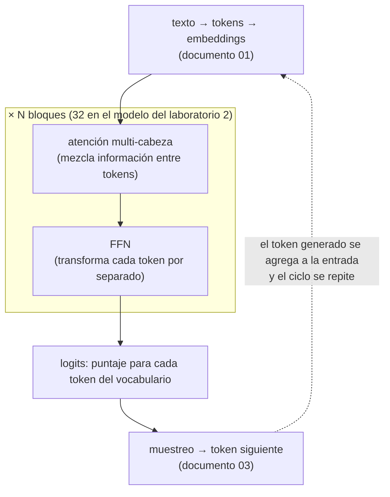

# 02. Arquitectura Transformer y variantes

Este documento abre la caja del modelo: qué máquina hay detrás de la predicción del token
siguiente, por qué casi todo el parque vigente comparte esa máquina, y qué significan las
variantes —*decoder-only*, codificación de posición, MoE (mezcla de expertos), atención
agrupada— que aparecen en
cualquier ficha técnica. Al cerrar, el lector puede leer la ficha arquitectónica de un modelo
real y decidir qué le dice y qué no.

**Antes de leer**: [01 — Representación del lenguaje](01-Representacion-Del-Lenguaje.md)
(*token*, *embedding*, ventana de contexto: acá se usan sin volver a definirlos).
**Anterior**: [01 — Representación del lenguaje](01-Representacion-Del-Lenguaje.md) ·
**Siguiente**: [03 — Del modelo base al asistente](03-Del-Modelo-Base-Al-Asistente.md).
Convenciones del cuerpo: [Convenciones.md](Convenciones.md) (citado §2, ejemplos §3, cifras §4).

## Índice

1. [Definición](#1-definición)
2. [Aplicación por escenario](#2-aplicación-por-escenario)
3. [Ejemplos concretos](#3-ejemplos-concretos)
4. [Bloque didáctico](#4-bloque-didáctico)
5. [Criterios de calidad](#5-criterios-de-calidad)
6. [Anexo: lista de verificación para leer una ficha arquitectónica](#6-anexo-lista-de-verificación-para-leer-una-ficha-arquitectónica)
7. [Referencias](#referencias)

---

## 1. Definición

### 1.1 El problema que el *transformer* resuelve

Un modelo de lenguaje necesita que cada palabra se interprete a la luz de las demás. En «el
banco cerró por la crecida del río», la palabra «banco» sólo se resuelve mirando «río», que
está a seis posiciones. Las arquitecturas anteriores al *transformer* procesaban el texto en
orden, token a token, arrastrando un resumen comprimido de lo ya visto: las dependencias
largas se degradaban y, peor para la práctica, el procesamiento secuencial no se podía
paralelizar en el hardware moderno.

**_Transformer_.** Arquitectura de red neuronal que reemplaza la recurrencia por atención:
cada token de la ventana calcula directamente cuánto le importa cada uno de los otros, todos
a la vez (Vaswani et al., 2017).

- **Icono** (la imagen mental): una mesa de reunión donde todos los participantes se escuchan
  entre sí en simultáneo, en lugar de un teléfono descompuesto donde el mensaje pasa de uno en
  uno.
- **Ancla** (la operación): ante cualquier modelo de lenguaje actual, pedí su ficha y buscá
  tres números — cantidad de bloques (*layers*), dimensión del *embedding* y cabezas de
  atención. Si están, es un *transformer* o un derivado directo; el laboratorio 2 de §3 hace
  exactamente eso contra un modelo real.

Qué **no** es: no es sinónimo de «modelo de IA». Los generadores de imagen por difusión usan
otro proceso generativo (lo trata [10 — Multimodalidad](10-Multimodalidad-Y-Generacion-No-Textual.md)),
y empiezan a circular híbridos que mezclan atención con otros mecanismos de secuencia (§1.7).
Tampoco es un modelo concreto: es el plano; GPT, Qwen o Llama son edificios construidos con
ese plano, cada uno con sus dimensiones.

### 1.2 Atención: la pieza central

**Atención.** Mecanismo por el que cada token pondera su relación con los demás tokens de la
ventana y se recompone como mezcla de ellos (Vaswani et al., 2017).

La intuición primero. Cada token llega a la capa de atención convertido en vector (su
*embedding*, documento 01). De ese vector se derivan tres proyecciones con roles distintos:

| Proyección | Pregunta que encarna | Analogía |
| --- | --- | --- |
| Q (*query*) | «¿Qué estoy buscando?» | La consulta que tipeás en un buscador |
| K (*key*) | «¿Qué ofrezco para que me encuentren?» | El título de la página indexada |
| V (*value*) | «¿Qué contenido aporto si me eligen?» | El cuerpo de la página |

El puntaje entre dos tokens es el producto punto entre la Q de uno y la K del otro: una
medida de afinidad, pariente directa de la similitud coseno del documento 01. Los puntajes de
cada fila pasan por una softmax que los convierte en pesos positivos que suman 1, y la salida
de cada token es la suma de los V de todos, ponderada por esos pesos. La fórmula completa
cabe en una línea: **Atención(Q, K, V) = softmax(Q·Kᵀ / √d) · V**, donde d es la dimensión de
las proyecciones y la división por √d sólo evita que los puntajes crezcan con la dimensión y
saturen la softmax (Vaswani et al., 2017).

- **Icono**: un resaltador que, para cada palabra que leés, marca con más o menos intensidad
  las palabras anteriores que la explican.
- **Ancla**: calculá una matriz de atención con diez líneas de numpy y mirá qué fila pondera
  a qué columna. Es el laboratorio 1 de §3; no requiere modelo ni red.

En la práctica la atención es «multi-cabeza» (*multi-head attention*, MHA): el mismo cálculo
corre varias veces en paralelo con proyecciones distintas, y cada cabeza se especializa en un
tipo de relación (concordancia, correferencia, posición relativa). Las salidas se concatenan.
Dieciséis mesas de reunión simultáneas sobre la misma frase, cada una discutiendo otro
aspecto.

### 1.3 El bloque y la pila

La atención sola no alcanza: mezcla información entre tokens, pero no la transforma en
profundidad. El bloque *transformer* completo alterna dos sub-capas — la atención y una red
*feed-forward* (FFN) que procesa cada token por separado con dos capas densas — y envuelve
cada una con conexiones residuales y normalización, que son los andamios que permiten apilar
decenas de bloques sin que el entrenamiento se degrade (Vaswani et al., 2017). El modelo es
esa pila: el token entra como *embedding*, atraviesa N bloques idénticos en forma (no en
pesos) y sale como una distribución de probabilidad sobre el vocabulario entero: los
*logits* de los que el muestreo (documento 03) elige el token siguiente.



Dónde viven los parámetros: casi todos en las matrices de proyección de la atención y, sobre
todo, en las FFN. Ese reparto explica dos cosas que vuelven después: por qué el ajuste fino
eficiente apunta a las proyecciones de atención
([06 — Ajuste fino](06-Ajuste-Fino-Y-Alineacion.md)) y por qué MoE ataca justamente la FFN
(§1.6).

### 1.4 *Decoder-only* y la máscara causal

El diseño original de 2017 traía dos mitades: un codificador que leía la frase de entrada
completa y un decodificador que generaba la traducción. El parque actual de modelos de
lenguaje se quedó con la segunda mitad sola.

**_Decoder-only_.** Variante del *transformer* reducida al decodificador: una sola pila de
bloques donde cada token sólo puede atender a los tokens anteriores, y el modelo se usa para
una única tarea — predecir el siguiente (Brown et al., 2020).

La restricción «sólo mirar atrás» se implementa con la **máscara causal**: antes de la
softmax, los puntajes hacia posiciones futuras se fijan en −∞, con lo que su peso queda en
cero exacto. Eso convierte al modelo en autoregresivo: genera un token, lo agrega a la
entrada, y vuelve a empezar.

- **Icono**: escribir con la hoja tapada de la mitad para abajo — se decide la palabra
  siguiente viendo sólo lo ya escrito.
- **Ancla**: en la matriz del laboratorio 1, verificá que el triángulo superior sea todo
  ceros. Si un peso apareciera por encima de la diagonal, el modelo estaría copiando el
  futuro y su entrenamiento sería trampa.

¿Por qué ganó esta variante? Una sola tarea (predecir el siguiente token) sirve a la vez de
objetivo de entrenamiento sobre texto crudo sin etiquetar y de mecanismo de generación, y
escala: con suficientes parámetros y datos, el mismo modelo resuelve tareas para las que
nunca fue entrenado explícitamente (Brown et al., 2020). Las otras dos ramas de la familia no
desaparecieron, pero quedaron en nichos: *encoder-only* (tipo BERT; Devlin et al., 2019) para
clasificar y producir *embeddings* — reaparece en
[09 — Bases vectoriales y RAG](09-Bases-Vectoriales-Y-RAG.md) —, y *encoder-decoder* (tipo
T5; Raffel et al., 2020) para transformaciones texto a texto.

### 1.5 Posición: el ingrediente que la atención no trae

La atención tiene una propiedad incómoda: es indiferente al orden. Si se permutan los tokens
de entrada, los pesos se permutan igual y nada en el mecanismo distingue «perro muerde
hombre» de «hombre muerde perro». El orden hay que inyectarlo.

**Codificación de posición.** Información de orden que se suma o aplica a las
representaciones para que la atención distinga posiciones (Vaswani et al., 2017). El diseño
original sumaba al *embedding* de cada token un vector fijo construido con senos y cosenos;
el estándar de facto actual es **RoPE** (*Rotary Position Embedding*): en lugar de sumar un
vector, rota las proyecciones Q y K un ángulo proporcional a la posición, con lo que el
producto punto entre dos tokens pasa a depender de su **distancia relativa** y no de sus
posiciones absolutas (Su et al., 2024).

- **Icono**: las agujas de un reloj — cada token avanza la aguja un paso fijo, y el ángulo
  entre dos agujas dice cuán lejos están entre sí, se mire desde donde se mire.
- **Ancla**: en la ficha del laboratorio 2, buscá las claves `rope.*` (dimensión y
  `freq_base`). Una `freq_base` alta respecto del diseño original es la marca registrada de
  los modelos extendidos a ventanas largas: girar las agujas más despacio deja distinguir
  posiciones mucho más lejanas.

La codificación de posición es lo que ata la ventana de contexto (documento 01) a la
arquitectura: un modelo distingue posiciones hasta donde su esquema de posición alcanza, y
las técnicas de extensión de contexto son, en buena parte, manipulaciones de RoPE.

### 1.6 MoE: no todos los parámetros trabajan en cada token

**MoE (mezcla de expertos, *Mixture of Experts*).** Variante que reemplaza la FFN única de
cada bloque por muchas FFN paralelas («expertos») más un enrutador que, para cada token,
activa sólo unas pocas (Shazeer et al., 2017; Fedus et al., 2022).

El efecto es desacoplar dos números que en un modelo denso van juntos: la **capacidad**
(parámetros totales, que determinan cuánto «sabe» el modelo y cuánta memoria ocupa) y el
**costo por token** (parámetros activos, que determinan el cómputo de cada paso). Mixtral
8×7B lo mostró en el ecosistema abierto: 47 B de parámetros totales con unos 13 B activos
por token (Jiang et al., 2024).

- **Icono**: un hospital con 256 especialistas en plantilla donde cada paciente ve sólo a 8;
  la nómina completa define qué puede tratar el hospital, los 8 definen lo que cuesta la
  consulta.
- **Ancla**: ante una etiqueta con dos cifras tipo `35b-a3b`, leé «35 B totales, 3 B activos»
  y derivá las dos consecuencias por separado — la memoria la dictan los totales (los 256
  expertos viven cargados), la velocidad la dictan los activos. El laboratorio 2 inspecciona
  un MoE real del banco y muestra dónde están `expert_count` y `expert_used_count` en la
  ficha.

La trampa de lectura más común con MoE es comparar parámetros totales contra parámetros de
un modelo denso como si midieran lo mismo. No lo hacen: un MoE de 35 B totales / 3 B activos
ocupa memoria de 35 B pero computa como 3 B; su calidad queda entre ambos y se mide, no se
deduce ([07 — Evaluación y métricas](07-Evaluacion-Y-Metricas.md)).

### 1.7 Variantes de atención y el borde del mapa

Dos variantes más aparecen en casi toda ficha moderna, ambas motivadas por la memoria de
inferencia. Durante la generación, el modelo guarda las K y V ya calculadas de todos los
tokens previos — la caché KV — para no recomputarlas en cada paso; en ventanas largas esa
caché domina el consumo de memoria (el costo operativo lo desarrolla
[08 — Inferencia local](08-Inferencia-Local.md), dueño del término). Para achicarla se
reduce la cantidad de cabezas K/V: **MQA** (*multi-query attention*) comparte un único par
K/V entre todas las cabezas de consulta (Shazeer, 2019) y **GQA** (*grouped-query
attention*) toma el punto medio — grupos de cabezas Q comparten cada par K/V — con calidad
casi intacta (Ainslie et al., 2023). En la ficha se ve como dos números distintos:
`head_count` y `head_count_kv`; 16 cabezas Q contra 4 KV significa GQA con grupos de 4 y una
caché cuatro veces menor que la de MHA pura.

El borde del mapa: la atención completa cuesta, en cómputo y memoria, proporcional al
cuadrado del largo de la secuencia, y esa factura empuja a explorar mecanismos de costo
lineal, como los modelos de espacio de estados (SSM, *state space models*; Gu y Dao, 2023).
En el parque real ya no son una promesa: la ficha del modelo del laboratorio 2 declara
bloques de tipo SSM intercalados con atención completa cada cuatro capas. Criterio de esta
guía: el lector no necesita dominar los SSM — necesita reconocer en una ficha cuándo el
modelo que tiene delante ya no es un *transformer* puro, y saber que la mecánica de las
secciones anteriores sigue describiendo las capas de atención que el híbrido conserva.

---

## 2. Aplicación por escenario

Los identificadores ESC-NN y CTX-NN son los del
[marco de referencia](Marco-De-Referencia.md). Este tema cruza cuatro escenarios de lleno y
dos por reenvío.

**ESC-01 — Entender y elegir un modelo.** Es el escenario natal de este documento: la ficha
arquitectónica es la mitad de la decisión. Parámetros totales contra activos (¿es MoE?),
bloques y dimensión (¿qué tan grande es de verdad?), `context_length` declarado (¿la ventana
alcanza para mi tarea?), GQA (¿cuánta memoria de caché va a pedir?). La otra mitad —licencia,
familia, cifras comparativas— vive en
[11 — Panorama y ecosistema abierto](11-Panorama-Y-Ecosistema-Abierto.md), único documento
que mantiene cifras de modelos concretos. Por CTX cambia qué número manda: en CTX-01 (CPU,
8–16 GB) el filtro duro son los parámetros totales que entran en RAM; en CTX-02 (GPU de
consumo), la VRAM contra totales más caché; en CTX-04 (API de terceros) la arquitectura es
opaca y sólo queda la ventana y el precio por token.

**ESC-02 — Montar y servir localmente.** La arquitectura fija el presupuesto de memoria
antes de descargar nada: pesos (totales × bytes por parámetro según cuantización) más caché
KV (crece con la ventana usada y se achica con GQA). El procedimiento de montar, descargar y
medir es de [08 — Inferencia local](08-Inferencia-Local.md); este documento aporta el
vocabulario para entender por qué un MoE de 35 B no entra en un equipo donde «3 B activos»
sonaba liviano.

**ESC-04 — Adaptar un modelo a un dominio.** Saber dónde viven los parámetros orienta el
ajuste: LoRA (*Low-Rank Adaptation*) adosa matrices de bajo rango justamente a las
proyecciones de atención
(documento [06](06-Ajuste-Fino-Y-Alineacion.md)). Quien entiende §1.3 entiende por qué se
puede ajustar un modelo tocando una fracción mínima de sus pesos.

**ESC-05 — Evaluar y comparar.** La arquitectura define qué comparaciones son legítimas:
denso de 7 B contra MoE de 35b-a3b no es «chico contra grande» sino dos puntos distintos del
plano capacidad/costo, y el veredicto exige medir
([07 — Evaluación y métricas](07-Evaluacion-Y-Metricas.md)).

**ESC-03 y ESC-06 — por reenvío.** Los *embeddings* para búsqueda salen de la rama
*encoder* (§1.4) y se aplican en [09 — RAG](09-Bases-Vectoriales-Y-RAG.md); los modelos de
visión y lenguaje acoplan otra entrada al mismo tronco *decoder-only*, y qué cambia y qué no
lo trata [10 — Multimodalidad](10-Multimodalidad-Y-Generacion-No-Textual.md).

---

## 3. Ejemplos concretos

Dos laboratorios operables, de los que este documento es dueño (mapa de laboratorios del
cuerpo). El patrón que cumplen —contexto, versiones, salida real, qué hacer si difiere— es el
de [Convenciones.md §3](Convenciones.md).

### 3.1 Laboratorio 1 — La atención a mano, en numpy

**Contexto**: CTX-01 (CPU, sin GPU, sin red: no toca ningún modelo). **Requisitos**:
`python3` y `numpy` (corrido con Python 3.11.2 y numpy 1.24.2). **Objetivo**: calcular una
matriz de atención causal completa sobre una frase de juguete y ver con los propios ojos las
piezas de §1.2–§1.4: Q/K/V, puntajes, máscara, softmax, mezcla.

Guardá esto como `atencion_juguete.py`:

```python
# Atención escalada por producto punto, a mano, sobre una frase de juguete.
# Reproducible: numpy con semilla fija; sin modelo, sin red, sin GPU.
import numpy as np

np.random.seed(42)
np.set_printoptions(precision=2, suppress=True)

tokens = ["el", "gato", "negro", "duerme", "la", "siesta"]
n, d = len(tokens), 4          # 6 tokens, embeddings de dimensión 4

# 1. Embeddings de juguete (en un modelo real salen de la tabla aprendida)
X = np.random.randn(n, d)

# 2. Proyecciones aprendibles: acá, matrices aleatorias fijas
Wq, Wk, Wv = (np.random.randn(d, d) for _ in range(3))
Q, K, V = X @ Wq, X @ Wk, X @ Wv

# 3. Puntajes: ¿cuánto se parece lo que busco (Q) a lo que ofrece cada token (K)?
scores = Q @ K.T / np.sqrt(d)

# 4. Máscara causal (decoder-only): nadie mira tokens futuros
mask = np.triu(np.ones((n, n), dtype=bool), k=1)
scores[mask] = -np.inf

# 5. Softmax fila a fila: los puntajes se vuelven pesos que suman 1
pesos = np.exp(scores - scores.max(axis=1, keepdims=True))
pesos = pesos / pesos.sum(axis=1, keepdims=True)

# 6. Salida: cada token es ahora una mezcla ponderada de los valores (V)
salida = pesos @ V

print("Pesos de atención (fila = quién mira, columna = a quién):")
print("         " + "  ".join(f"{t:>6}" for t in tokens))
for t, fila in zip(tokens, pesos):
    print(f"{t:>8} " + "  ".join(f"{p:6.2f}" for p in fila))

print("\nSalida para 'duerme' (mezcla de los V de 'el gato negro duerme'):")
print(salida[3])
print("\nVerificación: cada fila de pesos suma", pesos.sum(axis=1))
```

Corrida real (2026-11-07, CTX-01):

```text
$ python3 atencion_juguete.py
Pesos de atención (fila = quién mira, columna = a quién):
             el    gato   negro  duerme      la  siesta
      el   1.00    0.00    0.00    0.00    0.00    0.00
    gato   0.01    0.99    0.00    0.00    0.00    0.00
   negro   0.62    0.08    0.30    0.00    0.00    0.00
  duerme   0.00    0.00    0.00    1.00    0.00    0.00
      la   0.02    0.00    0.00    0.98    0.00    0.00
  siesta   0.01    0.00    0.01    0.97    0.01    0.00

Salida para 'duerme' (mezcla de los V de 'el gato negro duerme'):
[-0.89 -1.7   2.12 -0.07]

Verificación: cada fila de pesos suma [1. 1. 1. 1. 1. 1.]
```

Qué mirar en la salida, en orden:

1. **El triángulo superior es cero**: la máscara causal de §1.4 funcionando. «gato» no pesa
   nada sobre «el», porque cuando el modelo procesó «el» todavía no existía «gato».
2. **Cada fila suma 1**: la softmax reparte un presupuesto fijo de atención; atender más a un
   token es atender menos a otro.
3. **Los pesos concretos no «entienden» nada**: las proyecciones son aleatorias, así que la
   fila de «siesta» cargando 0,97 sobre «duerme» es azar de la semilla, no gramática. En un
   modelo entrenado, estas mismas matrices — y sólo el entrenamiento las distingue de las
   nuestras — producen los patrones de concordancia y correferencia que describe §1.2. El
   mecanismo es idéntico; los pesos aprendidos son la diferencia.

Si difiere: con la misma semilla (42) y versiones iguales, la salida es determinista y debe
coincidir dígito a dígito; acá no hay muestreo. Otra versión de numpy puede alterar decimales
finales sin tocar la estructura (triángulo en cero, filas que suman 1). Si la estructura no
se cumple, el error está en la copia del script, no en el entorno.

Para extender (opcional): cambiá la semilla y verificá que la estructura sobrevive al cambio
de pesos; agregá una segunda «cabeza» con otras Wq/Wk/Wv y compará los patrones — eso es,
literalmente, la atención multi-cabeza de §1.2.

### 3.2 Laboratorio 2 — Leer la arquitectura de un modelo real con `ollama show`

**Contexto**: CTX-03 (banco de inferencia en `$OLLAMA_HOST`; en CTX-01 funciona igual contra
un Ollama local). **Requisitos**: cliente `ollama`, o `curl` para la variante por API.
**Objetivo**: extraer de un modelo servido la ficha arquitectónica completa y leerla con el
vocabulario de §1: bloques, dimensiones, GQA, posición, MoE.

Paso 0 — verificar el banco (el procedimiento completo es de
[08 — Inferencia local](08-Inferencia-Local.md), que es su documento dueño):

```bash
curl -s "${OLLAMA_HOST:-http://localhost:11434}/api/tags" >/dev/null \
  && echo "banco accesible" || echo "banco NO accesible: revisá OLLAMA_HOST"
```

Paso 1 — la ficha del modelo chico de referencia:

```bash
ollama show qwen3.5:4b
```

**[Ilustrativo — no verificado en el banco]** — el puesto de verificación llega al banco
sólo por API y no tiene el cliente `ollama` instalado; el paso 2 verifica la misma ficha,
cruda, contra el banco real. Con el cliente a mano, `ollama show` formatea un subconjunto de
esas mismas claves (arquitectura, parámetros, ventana, cuantización).

Paso 2 — la misma información, cruda y completa, por API (es lo que `ollama show` formatea):

```bash
curl -s "${OLLAMA_HOST:-http://localhost:11434}/api/show" \
  -d '{"model":"qwen3.5:4b"}' | python3 -m json.tool | grep -E \
  'architecture|parameter_count|block_count|embedding_length|head_count|context_length|rope|expert|quantization' -i
```

Corrida real (2026-11-07, banco CTX-03; etiqueta `qwen3.5:4b`, digest `d8b0f5e9760c` según
`/api/tags`):

```text
        "quantization_level": "Q4_K_M"
        "general.architecture": "qwen35",
        "general.parameter_count": 4205751296,
        "general.quantization_version": 2,
        "qwen35.attention.head_count": 16,
        "qwen35.attention.head_count_kv": 4,
        "qwen35.block_count": 32,
        "qwen35.context_length": 262144,
        "qwen35.embedding_length": 2560,
        "qwen35.rope.dimension_count": 64,
        "qwen35.rope.dimension_sections": null,
        "qwen35.rope.freq_base": 10000000,
        "clip.vision.attention.head_count": 16,
        "clip.vision.block_count": 24,
        "clip.vision.embedding_length": 1024,
        "general.architecture": "clip",
        "general.parameter_count": 333514240,
        "general.quantization_version": 2,
```

El segundo bloque `general.architecture: "clip"` no es el modelo de lenguaje: es el
proyector de visión que acompaña al modelo (este `qwen3.5:4b` es multimodal; el acople lo
trata [10 — Multimodalidad](10-Multimodalidad-Y-Generacion-No-Textual.md)). La lectura
arquitectónica de este documento aplica al primer bloque.

Paso 3 — repetir contra un MoE del banco y comparar fichas:

```bash
curl -s "${OLLAMA_HOST:-http://localhost:11434}/api/show" \
  -d '{"model":"qwen3.5:35b-a3b"}' | python3 -m json.tool | grep -E \
  'architecture|parameter_count|block_count|embedding_length|head_count|context_length|expert|ssm\.|full_attention' -i
```

Corrida real (2026-11-07, banco CTX-03; etiqueta `qwen3.5:35b-a3b`, digest `72aac7c28be8`
según `/api/tags`; se omiten las líneas `clip.*` del proyector de visión):

```text
        "general.architecture": "qwen35moe",
        "general.parameter_count": 34660610688,
        "qwen35moe.attention.head_count": 16,
        "qwen35moe.attention.head_count_kv": 2,
        "qwen35moe.block_count": 40,
        "qwen35moe.context_length": 262144,
        "qwen35moe.embedding_length": 2048,
        "qwen35moe.expert_count": 256,
        "qwen35moe.expert_feed_forward_length": 512,
        "qwen35moe.expert_shared_feed_forward_length": 512,
        "qwen35moe.expert_used_count": 8,
        "qwen35moe.full_attention_interval": 4,
        "qwen35moe.ssm.conv_kernel": 4,
        "qwen35moe.ssm.group_count": 16,
        "qwen35moe.ssm.inner_size": 4096,
        "qwen35moe.ssm.state_size": 128,
        "qwen35moe.ssm.time_step_rank": 32,
```

Cómo leer lo que devuelve, clave por clave, con el mapa a las secciones de este documento:

| Clave de la ficha | Qué es | Sección |
| --- | --- | --- |
| `general.architecture` | La familia arquitectónica del plano | §1.1 |
| `general.parameter_count` | Parámetros totales (capacidad y memoria) | §1.6 |
| `block_count` | N: cuántos bloques apila el modelo | §1.3 |
| `embedding_length` | Dimensión del vector que atraviesa la pila | §1.3 |
| `attention.head_count` / `head_count_kv` | Cabezas Q contra cabezas KV: si difieren, hay GQA, y el cociente es el tamaño del grupo | §1.7 |
| `context_length` | Ventana máxima que la codificación de posición soporta | §1.5 |
| `rope.freq_base`, `rope.dimension_count` | Parámetros de RoPE; `freq_base` alta delata ventana extendida | §1.5 |
| `expert_count` / `expert_used_count` | Sólo en MoE: expertos totales y activos por token | §1.6 |
| `quantization_level` | Precisión de los pesos descargados (la desarrolla el documento [08](08-Inferencia-Local.md)) | — |
| `ssm.*`, `full_attention_interval` | Si aparecen, el modelo no es un *transformer* puro: capas de otro mecanismo intercaladas con atención completa | §1.7 |

Dos lecturas para hacer en el momento, con la salida adelante:

- En el paso 2, dividí `head_count` por `head_count_kv`: ese cociente es el grupo de GQA y la
  proporción en que la caché KV se achicó respecto de MHA. Después contrastá
  `parameter_count` contra la etiqueta («4b»): la etiqueta redondea, la ficha no.
- En el paso 3, verificá la lectura de la etiqueta `35b-a3b` de §1.6: `parameter_count` cerca
  de 35 B (los totales, los que piden memoria) y `expert_used_count` sobre `expert_count`
  como fracción activa. Si además aparece `full_attention_interval`, estás ante el híbrido
  del borde del mapa de §1.7: anotá cada cuántas capas conserva atención completa.

Si difiere: estas fichas son metadatos del archivo GGUF descargado — no hay muestreo ni azar;
dos corridas sobre el mismo modelo y digest devuelven lo mismo. Una diferencia real significa
otro modelo u otra versión de la etiqueta: compará el digest (lo da `/api/tags`, o
`ollama list` con el cliente) y, si la etiqueta se movió, tratalo como cambio de versión
([Convenciones.md §3.2](Convenciones.md)). Si ninguna de las etiquetas de este laboratorio
existe en tu banco, elegí cualquier otra de `ollama list`: la lectura de la tabla de claves
vale igual, con los nombres prefijados por la arquitectura que tengas delante.

### 3.3 Laboratorios de otros documentos que este tema usa

Se citan, no se repiten: tokenización y *embeddings* sobre texto real, en
[01 — Representación del lenguaje](01-Representacion-Del-Lenguaje.md); descarga, servido y
medición de velocidad y memoria, en [08 — Inferencia local](08-Inferencia-Local.md); los
efectos del muestreo sobre la salida, en
[03 — Del modelo base al asistente](03-Del-Modelo-Base-Al-Asistente.md).

---

## 4. Bloque didáctico

**Pregunta 1 — ¿Por qué el *transformer* desplazó a las arquitecturas recurrentes?**
**Criterio que forma**: distinguir las dos ventajas (acceso directo entre posiciones y
paralelización) y no atribuir la victoria a «es más inteligente».
**Respuesta**: porque la atención le da a cada token acceso directo a todos los anteriores —
sin degradar dependencias largas por el camino — y porque ese cálculo es un producto de
matrices que el hardware moderno paraleliza, lo que abarató entrenar con corpus enormes. La
segunda razón pesó tanto como la primera: la arquitectura ganadora fue la que mejor se llevó
con el hardware disponible.
**Reenvío**: §1.1 y §1.2; la economía del entrenamiento, en
[05 — Preentrenamiento](05-Preentrenamiento-Y-Leyes-De-Escala.md).

**Pregunta 2 — Si la atención deja mirar todos los tokens, ¿por qué el modelo no «hace
trampa» mirando la respuesta durante el entrenamiento?**
**Criterio que forma**: entender la máscara causal como condición de honestidad del objetivo
autoregresivo, no como detalle de implementación.
**Respuesta**: por la máscara causal — los puntajes hacia posiciones futuras se fijan en −∞ y
su peso queda en cero. Así, predecir el token i+1 usa exactamente la información que habrá
disponible al generar: el entrenamiento ensaya la misma situación que la inferencia.
**Reenvío**: §1.4, y el triángulo de ceros del laboratorio 1 (§3.1), donde la máscara se ve.

**Pregunta 3 — En la ficha de un modelo aparece `head_count: 16` y `head_count_kv: 4`. ¿Qué
decidió el fabricante y qué te importa a vos?**
**Criterio que forma**: traducir un par de claves crudas a una consecuencia operativa de
memoria.
**Respuesta**: eligió GQA con grupos de 4 — cada 4 cabezas de consulta comparten un par K/V.
Al lector le importa porque la caché KV, que crece con cada token de la ventana en uso, queda
en un cuarto de lo que pediría MHA: más contexto utilizable en la misma memoria, con una
pérdida de calidad que la literatura midió como marginal.
**Reenvío**: §1.7; la medición de memoria real, en
[08 — Inferencia local](08-Inferencia-Local.md).

**Pregunta 4 — Un colega descarta un MoE `35b-a3b` porque «35 B jamás entra en mi GPU» y
otro lo descarga porque «son sólo 3 B». ¿Quién tiene razón?**
**Criterio que forma**: aplicar la separación capacidad/costo antes de opinar de un MoE.
**Respuesta**: el primero, en lo que afirma de memoria — los 35 B viven cargados, el enrutador
elige entre expertos presentes. El segundo acierta sólo en velocidad: el cómputo por token es
el de ~3 B activos. Un MoE se evalúa con dos números a la vez; con uno solo, cualquiera de
las dos conclusiones es errada.
**Reenvío**: §1.6 y el paso 3 del laboratorio 2 (§3.2), que lee esas dos cifras de una ficha
real.

**Pregunta 5 — ¿Alcanza con este documento para saber si un modelo «es bueno»?**
**Criterio que forma**: delimitar qué decide la arquitectura y qué no — el antídoto contra
elegir modelos por ficha.
**Respuesta**: no. La arquitectura fija el costo (memoria, velocidad, ventana) y la forma del
espacio de capacidad; la calidad concreta la determinan los datos y el entrenamiento, y sólo
se conoce midiendo. Dos modelos de ficha casi idéntica rinden distinto; la ficha descarta
candidatos imposibles, la evaluación elige entre los posibles.
**Reenvío**: §2 (ESC-01 y ESC-05); el método de medición, en
[07 — Evaluación y métricas](07-Evaluacion-Y-Metricas.md); las cifras comparativas vigentes,
en [11 — Panorama](11-Panorama-Y-Ecosistema-Abierto.md).

---

## 5. Criterios de calidad

El artefacto que este tema le deja al lector es una **lectura arquitectónica**: el juicio que
escribe o defiende sobre un modelo a partir de su ficha. Una lectura buena se distingue de
una pobre así:

| Una lectura buena | Una lectura pobre |
| --- | --- |
| Cita la ficha real (claves y valores de `ollama show` o del informe técnico), con etiqueta y digest | Repite la etiqueta de marketing («es un 4B») sin abrir la ficha |
| Separa capacidad de costo: totales y activos, pesos y caché, cada uno con su consecuencia | Usa «tamaño» como número único y compara MoE contra denso sin aclarar qué compara |
| Deriva consecuencias operativas para un CTX concreto («en CTX-01 la caché a 32 k tokens no entra») | Enumera claves sin traducirlas a ninguna decisión |
| Declara el límite del método: la ficha acota, no rankea; el veredicto de calidad reenvía a una medición | Deduce calidad de la arquitectura («tiene más capas, es mejor») |
| Distingue qué partes del modelo son atención estándar y qué partes son variante o híbrido, y marca lo no verificado | Asume *transformer* puro porque «todos lo son» |

Prueba rápida sobre una lectura propia: tapá las conclusiones y dejá sólo los datos citados
— si otro lector con este documento llega a las mismas conclusiones, la lectura está
sostenida por la ficha; si necesita adivinar, hay afirmaciones sin respaldo.

---

## 6. Anexo: lista de verificación para leer una ficha arquitectónica

Para usar con `ollama show <modelo>` o con el informe técnico del fabricante, en orden. Cada
ítem remite a la sección que lo explica.

- [ ] **Identidad**: etiqueta exacta y digest anotados — sin esto, la lectura no es
      reproducible ([Convenciones.md §3.2](Convenciones.md)).
- [ ] **Familia** (`general.architecture`): ¿*transformer* *decoder-only* puro, MoE, o
      aparecen claves de otro mecanismo (`ssm.*`)? (§1.4, §1.6, §1.7)
- [ ] **Tamaño real** (`parameter_count`): contrastado contra la etiqueta; en MoE, totales
      **y** activos, nunca uno solo (§1.6).
- [ ] **Pila** (`block_count`, `embedding_length`, `feed_forward_length`): las dimensiones
      del edificio (§1.3).
- [ ] **Atención** (`head_count` vs `head_count_kv`): ¿MHA, GQA o MQA? Cociente = grupo =
      factor de ahorro de caché (§1.7).
- [ ] **Posición** (`context_length`, `rope.*`): ventana declarada y esquema que la sostiene;
      ventana enorme con RoPE extendido se verifica con una prueba, no se da por buena (§1.5).
- [ ] **Precisión** (`quantization_level`): qué variante de pesos se descargó — el costo de
      esa reducción lo trata [08 — Inferencia local](08-Inferencia-Local.md).
- [ ] **Conclusión escrita**: dos o tres frases que pasen la prueba de §5 — datos citados,
      consecuencia por CTX, límite declarado.

---

## Referencias

Citado autor-año (APA 7.ª) conforme a [Convenciones.md §2](Convenciones.md). Identificadores
arXiv verificados contra el conocimiento de referencia del redactor el 2026-11-07; URL de la
forma `https://arxiv.org/abs/<id>`.

- Ainslie, J., Lee-Thorp, J., de Jong, M., Zemlyanskiy, Y., Lebrón, F., y Sanghai, S. (2023).
  GQA: Training generalized multi-query transformer models from multi-head checkpoints.
  *EMNLP*. arXiv:2305.13245
- Brown, T., et al. (2020). Language models are few-shot learners. *NeurIPS 33*.
  arXiv:2005.14165
- Devlin, J., Chang, M.-W., Lee, K., y Toutanova, K. (2019). BERT: Pre-training of deep
  bidirectional transformers for language understanding. *NAACL*. arXiv:1810.04805
- Fedus, W., Zoph, B., y Shazeer, N. (2022). Switch Transformers: Scaling to trillion
  parameter models with simple and efficient sparsity. *JMLR, 23*. arXiv:2101.03961
- Gu, A., y Dao, T. (2023). Mamba: Linear-time sequence modeling with selective state spaces.
  arXiv:2312.00752
- Jiang, A. Q., et al. (2024). Mixtral of experts. arXiv:2401.04088
- Raffel, C., et al. (2020). Exploring the limits of transfer learning with a unified
  text-to-text transformer. *JMLR, 21*. arXiv:1910.10683
- Shazeer, N. (2019). Fast transformer decoding: One write-head is all you need.
  arXiv:1911.02150
- Shazeer, N., Mirhoseini, A., Maziarz, K., Davis, A., Le, Q., Hinton, G., y Dean, J. (2017).
  Outrageously large neural networks: The sparsely-gated mixture-of-experts layer. *ICLR*.
  arXiv:1701.06538
- Su, J., Ahmed, M., Lu, Y., Pan, S., Bo, W., y Liu, Y. (2024). RoFormer: Enhanced
  transformer with rotary position embedding. *Neurocomputing, 568*. arXiv:2104.09864
- Vaswani, A., et al. (2017). Attention is all you need. *NeurIPS 30*. arXiv:1706.03762
- Expediente 0001 «Guía de estudio IA-Model» (2026), folio 011 §2 y §4 — alcance del núcleo
  02 y mapa de laboratorios que este documento instancia.
