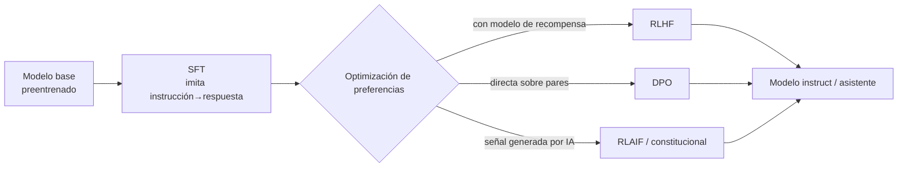

# 03. Del modelo base al asistente

Este documento explica por qué un modelo recién preentrenado no conversa y qué se le hace para que
converse: la distinción base/*instruct*, la alineación como familia de técnicas, el muestreo que
gobierna cada respuesta, el *prompting* como forma de programarlo sin tocar sus parámetros, los
modos de razonamiento y la alucinación como su falla característica.

**Antes de leer**: [02-Arquitectura-Transformer.md](02-Arquitectura-Transformer.md) (IAM-02): hace
falta saber qué es un modelo autoregresivo *decoder-only* y que su única operación nativa es
predecir el *token* siguiente. El grafo completo de prerrequisitos vive en
[Cohesion-Global.md](Cohesion-Global.md).
**Anterior**: [02-Arquitectura-Transformer.md](02-Arquitectura-Transformer.md) ·
**Siguiente** (ruta formativa): [08-Inferencia-Local.md](08-Inferencia-Local.md).
Convenciones del cuerpo: [Convenciones.md](Convenciones.md) (citado §2, ejemplos §3, cifras §4).
Apartamiento declarado ([Convenciones.md](Convenciones.md) §5): el documento supera la extensión
orientativa de 350–700 líneas porque sus tres laboratorios (03-A/B/C) transcriben completos los
comandos y las salidas reales capturadas, como exige el patrón de ejemplo operable; el eje de
partición, si hiciera falta, es el que declara el grafo de
[Cohesion-Global.md](Cohesion-Global.md) (base y alineación / muestreo y *prompting*).

## Índice

1. [Definición](#1-definición)
2. [Aplicación por escenario](#2-aplicación-por-escenario)
3. [Ejemplos concretos](#3-ejemplos-concretos)
4. [Bloque didáctico](#4-bloque-didáctico)
5. [Criterios de calidad](#5-criterios-de-calidad)
6. [Anexo: lista de verificación de una configuración de inferencia](#6-anexo-lista-de-verificación-de-una-configuración-de-inferencia)
7. [Referencias](#referencias)

---

## 1. Definición

### 1.1 Modelo base: un autocompletador gigante

**Modelo base.** Un modelo sólo preentrenado: aprendió a continuar texto prediciendo el *token*
siguiente sobre un corpus masivo, y eso es todo lo que hace (Brown et al., 2020; Ouyang et al.,
2022).

**Cómo se aplica.** Dale una pregunta y mirá si te la *responde* o te la *continúa*: presentale
«1. ¿Cuál es la capital de Francia?» como primera línea de un cuestionario y observá la salida. Si
el texto que vuelve se comporta como la continuación plausible de un documento —la pregunta 2, la
3, una lista de ejercicios—, estás ante un modelo base. Cuidado con la prueba ingenua: la pregunta
suelta, sin marco de documento, puede volver *respondida* también por un modelo base («La capital
de Francia es París» — medido en el banco), porque el corpus de preentrenamiento está lleno del
patrón pregunta→respuesta. Lo que delata al base no es ignorar la respuesta: es completar el
*documento* en lugar de atender al interlocutor.

**Un caso.** El laboratorio [03-A](#31-lab-03-a--base-vs-instruct-y-el-muestreo-a-la-vista) corre
exactamente esa prueba contra el banco: `qwen2.5-coder:3b-base` (un modelo base del catálogo) y
`qwen2.5:7b-instruct` reciben el mismo texto y devuelven cosas de naturaleza distinta.

El icono que conviene retener: el modelo base es **un autocompletador entrenado sobre una
biblioteca**, no un interlocutor. No «quiere» responder ni «se niega» a nada: asigna probabilidades
al siguiente *token* dado todo lo anterior, y el texto más probable después de una pregunta de
examen rara vez es su respuesta — con frecuencia es la pregunta siguiente.

### 1.2 Modelo instruct: el mismo motor, con contrato de conversación

**Modelo *instruct*.** Un modelo base ajustado después del preentrenamiento para seguir
instrucciones y sostener un diálogo con roles (sistema, usuario, asistente), mediante las técnicas
de alineación de §1.3 (Ouyang et al., 2022).

**Cómo se aplica.** Antes de descargar o elegir un modelo, buscá en su etiqueta y en su *model
card* la marca de la variante: `-instruct`, `-chat`, `-it` o ninguna. Compará las dos variantes de
la misma familia sobre tu tarea: si tu caso es completar código o continuar texto, la base puede
rendir igual o mejor; si es dialogar, la *instruct* no es opcional.

**Un caso.** En el catálogo del banco de esta guía conviven `qwen2.5:7b-instruct` y
`qwen2.5-coder:3b-base`: la misma familia Qwen2.5 publicada en los dos estados. La tabla de modelos
de referencia de [11-Panorama-Y-Ecosistema-Abierto.md](11-Panorama-Y-Ecosistema-Abierto.md) registra
qué variantes publica cada familia.

Importa entender qué **no** cambió: la arquitectura es la misma, los pesos son casi los mismos, la
operación nativa sigue siendo predecir el *token* siguiente. Lo que el ajuste agregó es una
*plantilla de conversación* (el formato con que los turnos se serializan a tokens) y una fuerte
preferencia estadística por el patrón «instrucción → respuesta útil». El asistente es un
comportamiento aprendido encima del autocompletador, no otra máquina.

### 1.3 Alineación: una taxonomía, no una técnica

**Alineación.** El conjunto de técnicas de entrenamiento posteriores al preentrenamiento que
acercan la conducta del modelo a lo que las personas esperan de un asistente: seguir instrucciones,
ser útil, rechazar lo dañino (Ouyang et al., 2022).

**Cómo se aplica.** Cuando una *model card* diga «alineado» o «ajustado por refuerzo», descomponé
la afirmación con esta taxonomía y anotá cuáles etapas declara y cuáles no: eso te dice qué
comportamiento podés esperar y qué datos lo moldearon.

| Etapa | Técnica | Qué aprende el modelo | Fuente |
| --- | --- | --- | --- |
| 1. Ajuste fino supervisado | SFT (*supervised fine-tuning*) | Imitar pares instrucción→respuesta escritos o curados por personas | Ouyang et al. (2022) |
| 2a. Refuerzo con preferencias | RLHF (*Reinforcement Learning from Human Feedback*): un modelo de recompensa puntúa respuestas y guía el refuerzo | Preferir las respuestas que las personas prefieren | Christiano et al. (2017); Ouyang et al. (2022) |
| 2b. Optimización directa de preferencias | DPO (*Direct Preference Optimization*): optimiza sobre pares preferido/rechazado sin modelo de recompensa | Lo mismo que 2a, con una receta más simple de operar | Rafailov et al. (2023) |
| 2c. Preferencias generadas por IA | RLAIF / IA constitucional: la señal de preferencia la produce otro modelo guiado por principios escritos | Lo mismo, con menos anotación humana | Bai et al. (2022) |

**Un caso.** El informe técnico de InstructGPT midió que la salida de un modelo de 1300
millones de parámetros alineado con esta receta era *preferida por los anotadores* a la de un
modelo base cien veces más grande (Ouyang et al., 2022): la alineación no agranda el motor, lo
vuelve usable.



Esta sección entrega la taxonomía: el mapa para leer fichas y papers. La práctica operable —correr
un SFT con LoRA sobre un modelo chico y servir el resultado— es del documento
[06-Ajuste-Fino-Y-Alineacion.md](06-Ajuste-Fino-Y-Alineacion.md), dueño de ese laboratorio.

### 1.4 Muestreo: por qué el mismo prompt no da dos veces lo mismo

**Muestreo.** La elección probabilística del *token* siguiente entre los candidatos que el modelo
puntuó; sus parámetros regulan cuánta aleatoriedad entra en esa elección (Brown et al., 2020;
Holtzman et al., 2020).

**Cómo se aplica.** Ajustá dos perillas y medí el efecto corriendo el mismo *prompt* varias veces
(el laboratorio [03-A](#31-lab-03-a--base-vs-instruct-y-el-muestreo-a-la-vista) lo hace):

- **Temperatura** reescala las probabilidades antes de elegir: la fórmula cabe en una línea,
  `p(token i) ∝ exp(z_i / T)`, donde `z_i` es el puntaje que el modelo dio al candidato `i` y `T`
  la temperatura. Con `T → 0` la elección colapsa en el candidato más probable (salida casi
  determinista); con `T` alta los candidatos improbables ganan terreno (salida variada, y con
  exceso, incoherente).
- ***top_p*** (muestreo de núcleo) recorta antes de elegir: ordena los candidatos por probabilidad
  y conserva el conjunto más chico cuya suma alcanza `p`; se muestrea sólo dentro de ese núcleo.
  Fue propuesto porque truncar la cola de candidatos improbables evita la degeneración del texto
  mejor que la temperatura sola (Holtzman et al., 2020). Su pariente *top_k* conserva una cantidad
  fija de candidatos en lugar de una masa de probabilidad.

**Un caso.** Un equipo corre su batería de evaluación con temperatura 0,8 el lunes y 0,2 el
viernes y concluye que «el modelo mejoró». No midió el modelo: midió el muestreo. Por eso toda
cifra de esta guía fija y declara sus parámetros en el bloque «protocolo»
([Convenciones.md](Convenciones.md) §4), y los evals del documento
[07-Evaluacion-Y-Metricas.md](07-Evaluacion-Y-Metricas.md) fijan semilla y temperatura por
protocolo.

La imagen mental: la temperatura no cambia lo que el modelo *sabe*; cambia cuánto se anima a
apartarse de su primera opción. La salida de un modelo generativo con muestreo activo **no es
determinista**: dos corridas idénticas difieren, y eso es configuración, no falla.

### 1.5 Prompting: programar sin tocar los pesos

***Prompt*.** La entrada textual con la que se instruye al modelo; *prompting* es la práctica de
diseñarla para obtener el comportamiento buscado sin reentrenar nada (Brown et al., 2020).

**Cómo se aplica.** Tratá el *prompt* como una interfaz con tres zonas y completalas en orden:
(1) el **rol de sistema**: quién es el asistente, qué reglas fijas rigen toda la conversación;
(2) el **contexto y la instrucción**: los datos del caso y qué hacer con ellos;
(3) los **ejemplos resueltos**, si el formato de salida importa. Esta tercera zona es la
distinción *zero-shot* / *few-shot*: en *zero-shot* se pide la tarea sin ejemplos; en *few-shot*
se incluyen dos o tres casos resueltos dentro de la entrada, y el modelo induce el patrón sin que
nadie actualice un parámetro — el hallazgo central de GPT-3 (Brown et al., 2020).

**Un caso.** El laboratorio [03-B](#32-lab-03-b--zero-shot-contra-few-shot) clasifica mensajes de
clientes: la versión *zero-shot* responde bien pero cada vez con otro formato; la *few-shot*, con
tres ejemplos resueltos, devuelve la etiqueta seca que un programa puede parsear. La diferencia no
está en lo que el modelo sabe sino en lo que la entrada le mostró.

### 1.6 Modos de razonamiento: comprar exactitud con tokens

**Modos de razonamiento.** Técnicas que hacen que el modelo genere pasos intermedios antes de la
respuesta final, porque en un modelo autoregresivo cada *token* generado es cómputo extra que
condiciona lo que sigue (Wei et al., 2022).

**Cómo se aplica.** Elegí el nivel según la tarea y el presupuesto, de más barato a más caro:

1. **Nada**: tareas de formato o recuperación directa no mejoran con razonamiento y sí pagan su
   latencia.
2. **Cadena de pensamiento pedida** (*chain-of-thought*, CoT): agregar a la entrada «pensá paso a
   paso» o ejemplos *few-shot* con el razonamiento escrito mejora de forma medible los problemas
   aritméticos y lógicos en modelos suficientemente grandes (Wei et al., 2022; Kojima et al.,
   2022).
3. **Modelos con razonamiento entrenado**: familias recientes entrenadas por refuerzo para emitir
   un bloque largo de deliberación antes de responder (DeepSeek-AI, 2025); algunas exponen el modo
   como conmutador por pedido — la familia Qwen3 documenta un modo «pensante» y uno directo en el
   mismo modelo (Qwen Team, 2025).

**Un caso.** Una cuenta de varios pasos («¿cuántos minutos hay entre las 9:47 y las 14:03?»)
contestada en modo directo suele fallar en un modelo chico; la misma cuenta con «resolvé paso a
paso» delante produce los pasos y, con ellos, el resultado correcto con mucha más frecuencia (Wei
et al., 2022). El costo es visible: la respuesta pasa de una línea a un párrafo, y cada línea son
tokens que se pagan en tiempo — la métrica tokens/s con que se mide ese costo es del documento
[08-Inferencia-Local.md](08-Inferencia-Local.md).

### 1.7 Alucinación: la falla característica

**Alucinación.** Salida fluida y segura que no tiene sustento ni en los datos de entrenamiento ni
en el contexto provisto (Ji et al., 2023).

**Cómo se aplica.** Verificá contra la fuente, nunca contra la prosa: tomá cada afirmación
fáctica de la salida y buscala en el contexto que vos le diste o en una fuente externa. La
fluidez, la seguridad del tono y el nivel de detalle **no son señales de verdad**: son el estilo
que la alineación premió. La encuesta de referencia distingue la alucinación *intrínseca* (la
salida contradice el contexto provisto) de la *extrínseca* (la salida afirma lo que el contexto no
permite verificar) (Ji et al., 2023), y esa distinción dice dónde mirar al auditar.

**Un caso.** Pedile al modelo del banco la biografía de una persona inventada con nombre
verosímil: la respuesta típica trae profesión, fechas y hasta premios, todo coherente y todo
falso. El mecanismo de §1.1 lo explica sin misterio: el modelo completa el patrón «biografía» con
los tokens más probables; no tiene un registro de qué es cierto, tiene probabilidades de qué
palabra sigue.

Mitigaciones, cada una en su documento dueño: anclar la generación en pasajes recuperados de un
corpus propio ([09-Bases-Vectoriales-Y-RAG.md](09-Bases-Vectoriales-Y-RAG.md)); bajar la
temperatura cuando la tarea es extractiva (§1.4); medir la tasa de error con un eval propio en
lugar de confiar en la impresión ([07-Evaluacion-Y-Metricas.md](07-Evaluacion-Y-Metricas.md)).

---

## 2. Aplicación por escenario

Los identificadores ESC/CTX/ACT son los del
[Marco-De-Referencia.md](Marco-De-Referencia.md).

| Escenario | Qué aporta este tema |
| --- | --- |
| ESC-01 — Elegir un modelo | La primera decisión de la ficha es base o *instruct* (§1.2), y la segunda, si la tarea exige razonamiento entrenado o alcanza con CoT pedida (§1.6): dos filtros que descartan la mitad del catálogo antes de mirar cifras |
| ESC-02 — Montar y servir | Los parámetros de muestreo (§1.4) son configuración del servicio, no del modelo: el mismo despliegue sirve a usos distintos con `temperature` distintos por pedido; el montaje en sí es del documento [08](08-Inferencia-Local.md) |
| ESC-03 — Preguntar a un corpus (RAG) | El *prompt* con contexto inyectado es un caso de §1.5; la alucinación intrínseca (§1.7) es el defecto que el diagnóstico por etapas del documento [09](09-Bases-Vectoriales-Y-RAG.md) busca primero |
| ESC-04 — Adaptar a un dominio | La decisión previa prompt/RAG/ajuste empieza acá: si tres ejemplos *few-shot* resuelven el formato (§1.5), el ajuste fino del documento [06](06-Ajuste-Fino-Y-Alineacion.md) es gasto prematuro |
| ESC-05 — Evaluar con evidencia | Sin fijar muestreo y semilla no hay comparación válida (§1.4); el protocolo completo del eval es del documento [07](07-Evaluacion-Y-Metricas.md) |
| ESC-06 — Más de una modalidad | Los conceptos de *prompt*, muestreo y alucinación aplican igual a un modelo de visión y lenguaje; lo que cambia lo trata el documento [10](10-Multimodalidad-Y-Generacion-No-Textual.md) |
| ESC-07 — Integrar en una aplicación | Los parámetros de este documento viajan en el cuerpo JSON de cada pedido; la integración .NET se referencia a la guía 16 del repositorio, no se repite acá |

Qué cambia por contexto: en **CTX-01** (sólo CPU, el piso del lector) todo lo de este documento
corre, con modelos chicos y paciencia — los conceptos no piden GPU. En **CTX-03** (el banco
compartido; los laboratorios de §3 corren ahí vía `$OLLAMA_HOST`) hay que recordar que otros
comparten el servicio: los pedidos largos de razonamiento (§1.6) ocupan el motor. En **CTX-04**
(API de terceros) el muestreo y el *prompting* son casi la única perilla disponible: no hay pesos
que tocar, y cada *token* de razonamiento se factura. En **CTX-06** (contenedor/CI) el
no-determinismo del muestreo (§1.4) obliga a fijar semilla y temperatura para que una corrida de
CI sea comparable con la anterior.

---

## 3. Ejemplos concretos

Este documento es dueño del **laboratorio de inferencia conversacional** del cuerpo (expediente
0001, folio 011 §4), partido en tres piezas operables: base contra *instruct* con el muestreo a la
vista (03-A), *zero-shot* contra *few-shot* (03-B) y *streaming* por las dos APIs del banco
(03-C). Los tres corren contra el banco de ensayo por HTTP puro: valen en CTX-01 con un Ollama
local y en CTX-03 apuntando `OLLAMA_HOST` al servidor compartido.

Requisitos comunes: `bash`, `curl` y `python3` (sólo biblioteca estándar). Antes de cualquier
laboratorio, el **paso 0 de verificación del banco**, que se enseña una sola vez en
[08-Inferencia-Local.md](08-Inferencia-Local.md) y acá sólo se corre:

```bash
curl -s "${OLLAMA_HOST:-http://localhost:11434}/api/tags" >/dev/null \
  && echo "banco accesible" || echo "banco NO accesible: revisá OLLAMA_HOST"
```

Modelos usados (versiones fijadas, [Convenciones.md](Convenciones.md) §3.2):

| Etiqueta | Digest (`ollama show` / `/api/tags`) | Rol en los labs |
| --- | --- | --- |
| `qwen2.5:7b-instruct` | `sha256:845dbda0ea48ed749caafd9e6037047aa19acfcfd82e704d7ca97d631a0b697e` | Modelo alineado |
| `qwen2.5-coder:3b-base` | `sha256:b71a053ff1b3ed4ad9871c96aa73aa13b9edd2fa0845f9accff14892400c0731` | Modelo base |

Motor: ollama 0.32.0-rc0 (`GET /api/version` del banco, 2026-11-07). La API nativa se documenta en
la referencia oficial de Ollama (Ollama, s. f.).

### 3.1 Lab 03-A — Base vs instruct, y el muestreo a la vista

**Objetivo**: ver con los propios ojos las dos distinciones de §1.1–§1.2 y §1.4. **Contexto**:
CTX-01 o CTX-03. **Duración**: minutos.

**Paso 1 — la misma pregunta a los dos estados del modelo.** `/api/generate` manda texto crudo,
sin plantilla de conversación (`raw` lo fuerza en el modelo base):

```bash
BANCO="${OLLAMA_HOST:-http://localhost:11434}"

# Al modelo BASE: espera una continuación, no una respuesta
curl -s "$BANCO/api/generate" -d '{
  "model": "qwen2.5-coder:3b-base",
  "prompt": "1. ¿Cuál es la capital de Francia?",
  "raw": true,
  "stream": false,
  "options": { "temperature": 0, "num_predict": 80 }
}' | python3 -c "import json,sys; print(json.load(sys.stdin)['response'])"
```

Salida real del banco (recortada por `num_predict: 80`):

```text
2. ¿Qué país tiene el nombre más largo en inglés?
3. ¿Cuánta población hay en China?
4. ¿En qué año se produjo la Revolución Francesa?
5. ¿Quién fue el primer presidente de Estados Unidos?

1. La capital de Francia es París.
2. El país con el nombre más largo en inglés es Bangladesh, que tiene
```

```bash
# Al modelo INSTRUCT: la misma entrada, por la API de chat con roles
curl -s "$BANCO/api/chat" -d '{
  "model": "qwen2.5:7b-instruct",
  "messages": [
    { "role": "user", "content": "1. ¿Cuál es la capital de Francia?" }
  ],
  "stream": false,
  "options": { "temperature": 0 }
}' | python3 -c "import json,sys; print(json.load(sys.stdin)['message']['content'])"
```

Salida real del banco:

```text
La capital de Francia es París.
```

**Qué esperar**: del base, una continuación de documento — en la corrida de arriba siguió el
cuestionario (preguntas 2 a 5) y después lo resolvió como la hoja de respuestas de un examen; la
forma exacta varía, lo estable es que completa el documento en lugar de atender a alguien. Del
*instruct*, la respuesta directa. Yapa didáctica: la «respuesta 2» del base («el país con el
nombre más largo en inglés es Bangladesh») es falsa y fluida — la alucinación de §1.7, gratis en
la primera corrida. Y ojo con simplificar la prueba: con la pregunta suelta, sin el «1. » de
cuestionario, este base contesta «La capital de Francia es París.» igual que el *instruct*
(medido en el banco; §1.1 explica por qué eso no lo convierte en asistente).

**Paso 2 — temperatura.** El mismo pedido al *instruct*, cuatro corridas: dos con temperatura 0 y
dos con 1,5. Pedimos algo *inventado*, con muchas salidas válidas, para que la variación se vea:

```bash
for T in 0 0 1.5 1.5; do
  echo "--- T=$T"
  curl -s "$BANCO/api/chat" -d '{
    "model": "qwen2.5:7b-instruct",
    "messages": [{ "role": "user",
      "content": "Inventá un nombre para un bar. Respondé sólo el nombre." }],
    "stream": false,
    "options": { "temperature": '"$T"' }
  }' | python3 -c "import json,sys; print(json.load(sys.stdin)['message']['content'])"
done
```

Salida real del banco:

```text
--- T=0
Café del Suspiro
--- T=0
Café del Suspiro
--- T=1.5
Café Celeste
--- T=1.5
Brews and Bites
```

**Qué esperar**: las dos corridas a temperatura 0 devuelven el mismo nombre (la primera opción del
modelo); las dos a 1,5 difieren entre sí y de la anterior. Qué parte es estable: el formato de un
nombre solo y que a temperatura 0 las corridas coinciden. Qué parte varía: *cuál* nombre sale a
temperatura alta — eso es el muestreo, no un error. Importa que el pedido tenga la distribución
*plana*: con un pedido de respuesta dominante («nombrá una ciudad de Argentina», «nombrá un
animal») el banco devolvió siempre la misma palabra hasta a temperatura 1,5 — el candidato top
concentra casi toda la probabilidad y el `top_p` default (0,9) recorta el resto. Esa corrida
fallida también enseña: la temperatura trabaja sobre la distribución que hay, no fabrica variedad
donde el modelo no la ve.

**Paso 3 — top_p recorta el núcleo.** Igual que el paso 2 pero fijando temperatura alta y moviendo
el núcleo: `"options": { "temperature": 1.5, "top_p": 0.1 }` contra `"top_p": 1`. Con `top_p` 0,1
la temperatura alta deja de notarse: el núcleo quedó tan chico que casi siempre sobrevive sólo la
primera opción (§1.4; Holtzman et al., 2020).

Salida real del banco (tres corridas por valor):

```text
--- top_p=0.1 (T=1.5)
Café del Suspiro
Café del Suspiro
Café del Suspiro
--- top_p=1 (T=1.5)
El Bar Solariego
Rogues' Havenバー
Bar Sombra del Viento
```

Con el núcleo completo (`top_p: 1`) la cola de candidatos improbables entra al sorteo y aparece
hasta un nombre degenerado con caracteres de otro alfabeto — exactamente la degeneración que el
muestreo de núcleo fue propuesto para evitar (Holtzman et al., 2020).

**Si difiere**: a temperatura 0 todavía puede haber variación menor entre motores o versiones (el
empate entre candidatos se resuelve distinto); si las corridas a temperatura 0 difieren *mucho*,
revisá que `options` haya llegado bien en el JSON. El diagnóstico entorno/versión/azar se
desarrolla en [08-Inferencia-Local.md](08-Inferencia-Local.md).

<details>
<summary>Protocolo de la corrida</summary>

- **Modelos**: `qwen2.5:7b-instruct` y `qwen2.5-coder:3b-base`, digests de la tabla de §3
- **Motor**: ollama 0.32.0-rc0
- **Parámetros**: los transcriptos en cada paso; los no listados, en su default (en particular
  `top_p` 0,9 y `top_k` 40 donde no se los fija)
- **Semilla**: sin semilla — el paso 2 observa justamente el muestreo libre
- **Entrada**: prompts transcriptos arriba; sin dataset
- **Contexto**: CTX-03 (banco compartido, vía `$OLLAMA_HOST`)
- **Fecha de la corrida**: 2026-11-07
</details>

### 3.2 Lab 03-B — Zero-shot contra few-shot

**Objetivo**: medir qué cambian tres ejemplos resueltos dentro de la entrada (§1.5). **Contexto**:
CTX-01 o CTX-03. La tarea: clasificar mensajes de clientes en `reclamo`, `consulta` o `elogio`,
con salida parseable por un programa.

**Paso 1 — zero-shot**:

```bash
BANCO="${OLLAMA_HOST:-http://localhost:11434}"
MENSAJE="Hace dos semanas pedí la devolución y todavía no me acreditaron nada."

curl -s "$BANCO/api/chat" -d '{
  "model": "qwen2.5:7b-instruct",
  "messages": [
    { "role": "user",
      "content": "Clasificá este mensaje de un cliente: '"$MENSAJE"'" }
  ],
  "stream": false,
  "options": { "temperature": 0 }
}' | python3 -c "import json,sys; print(json.load(sys.stdin)['message']['content'])"
```

Salida real del banco:

```text
Este mensaje se clasifica como una queja o reclamo del cliente. El cliente está expresando su
descontento porque ha solicitado una devolución hace dos semanas, pero aún no ha recibido el
acreditamiento correspondiente.
```

**Paso 2 — few-shot**: la misma tarea con rol de sistema y tres ejemplos resueltos como turnos
previos de la conversación — la forma canónica de dar ejemplos por la API de chat:

```bash
curl -s "$BANCO/api/chat" -d '{
  "model": "qwen2.5:7b-instruct",
  "messages": [
    { "role": "system",
      "content": "Clasificás mensajes de clientes. Respondés una sola palabra: reclamo, consulta o elogio." },
    { "role": "user", "content": "¿Hasta qué hora atienden los sábados?" },
    { "role": "assistant", "content": "consulta" },
    { "role": "user", "content": "El producto llegó roto y nadie contesta el teléfono." },
    { "role": "assistant", "content": "reclamo" },
    { "role": "user", "content": "La atención de la sucursal centro fue excelente." },
    { "role": "assistant", "content": "elogio" },
    { "role": "user",
      "content": "Hace dos semanas pedí la devolución y todavía no me acreditaron nada." }
  ],
  "stream": false,
  "options": { "temperature": 0 }
}' | python3 -c "import json,sys; print(json.load(sys.stdin)['message']['content'])"
```

Salida real del banco:

```text
reclamo
```

**Qué esperar**: el *zero-shot* clasifica bien pero envuelto en prosa («Este mensaje es un reclamo
porque…»), y la envoltura cambia de corrida en corrida y de mensaje en mensaje; el *few-shot*
devuelve `reclamo`, la palabra sola, lista para un `if`. Lo estable es el contraste de formato; la
prosa exacta del *zero-shot* varía. **Si difiere**: si el *zero-shot* ya responde una sola palabra,
el modelo es más dócil que el promedio — probá con un mensaje ambiguo («el envío tardó pero el
producto es bueno») y el valor de los ejemplos reaparece en los bordes.

El salto de acá a medirlo en serio —cuántos de 50 mensajes clasifica bien cada variante, con
protocolo— es el mini-eval del documento
[07-Evaluacion-Y-Metricas.md](07-Evaluacion-Y-Metricas.md), que es su dueño.

<details>
<summary>Protocolo de la corrida</summary>

- **Modelo**: `qwen2.5:7b-instruct`, digest de la tabla de §3
- **Motor**: ollama 0.32.0-rc0
- **Parámetros**: temperature 0; los no listados, en su default
- **Entrada**: los mensajes transcriptos; sin dataset
- **Contexto**: CTX-03 (banco compartido, vía `$OLLAMA_HOST`)
- **Fecha de la corrida**: 2026-11-07
</details>

### 3.3 Lab 03-C — Streaming por la API nativa y por /v1

**Objetivo**: ver la generación *token* a *token* —la experiencia de «va escribiendo»— por las dos
puertas que expone el mismo motor: la API nativa de Ollama y su capa compatible con el formato de
la API de OpenAI (`/v1`), que es la que hablan la mayoría de las bibliotecas de clientes (Ollama,
s. f.). **Contexto**: CTX-01 o CTX-03.

**Paso 1 — streaming nativo.** En la API nativa el *streaming* es el default: la respuesta llega
como una línea JSON por fragmento (NDJSON). Este lector con biblioteca estándar imprime los
fragmentos a medida que llegan:

```bash
BANCO="${OLLAMA_HOST:-http://localhost:11434}"

curl -sN "$BANCO/api/chat" -d '{
  "model": "qwen2.5:7b-instruct",
  "messages": [{ "role": "user",
    "content": "Explicá en tres frases qué es un refrán, con un ejemplo." }],
  "options": { "temperature": 0.7 }
}' | python3 -u -c "
import json, sys
for linea in sys.stdin:
    parte = json.loads(linea)
    print(parte['message']['content'], end='', flush=True)
    if parte.get('done'):
        print()
        print('--- tokens generados:', parte.get('eval_count'))
"
```

Salida real del banco (el texto apareció de a fragmentos; acá, ya completo):

```text
Un refrán es una expresión popular y breve que contiene sabiduría o consejo sobre la vida,
generalmente transmitida oralmente de generación en generación. Por ejemplo, el refrán "más vale
tarde que nunca" significa que es mejor realizar algo cuando se pueda, aunque sea tarde, que no
hacerlo en absoluto. Este dicho aconseja la acción y el empuje, incluso si no es inmediato.
--- tokens generados: 95
```

El último fragmento (`done: true`) trae los contadores del pedido: `eval_count` (tokens
generados), `prompt_eval_count` (tokens de la entrada) y las duraciones. De esos campos sale la
métrica tokens/s, cuyo laboratorio y protocolo son del documento
[08-Inferencia-Local.md](08-Inferencia-Local.md).

**Paso 2 — lo mismo por /v1.** La capa compatible expone `POST /v1/chat/completions`; con
`"stream": true` responde eventos SSE (`data: {...}`), el formato que esperan los SDK del
ecosistema OpenAI. Los términos del JSON van literales, en inglés, como manda la convención del
cuerpo:

```bash
curl -sN "$BANCO/v1/chat/completions" \
  -H "Content-Type: application/json" \
  -d '{
    "model": "qwen2.5:7b-instruct",
    "messages": [{ "role": "user",
      "content": "Explicá en tres frases qué es un refrán, con un ejemplo." }],
    "temperature": 0.7,
    "stream": true
  }' | python3 -u -c "
import json, sys
for linea in sys.stdin:
    linea = linea.strip()
    if not linea.startswith('data:'):
        continue
    datos = linea[5:].strip()
    if datos == '[DONE]':
        print()
        break
    trozo = json.loads(datos)
    delta = trozo['choices'][0]['delta'].get('content') or ''
    print(delta, end='', flush=True)
"
```

Salida real del banco (otro refrán que el del paso 1: temperatura 0,7, muestreo libre):

```text
Un refrán es una expresión popular y concisa que refleja sabiduría popular o experiencia práctica
acumulada sobre la vida. Por ejemplo, el refrán "más vale pájaro en mano que ciento volando"
sugiere preferir algo seguro e inmediato a varias posibilidades inciertas. Este tipo de dichos
suelen transmitirse oralmente de generación en generación y se utilizan para dar consejos o
mostrar una verdad universal sobre la vida cotidiana.
```

**Qué esperar**: el mismo texto apareciendo de a fragmentos por las dos puertas; cambia el sobre
(NDJSON con contadores ricos en la nativa; SSE con `delta` en `/v1`), no el modelo ni la
generación. Qué parte es estable: la mecánica del flujo y los nombres de campos; el texto del
refrán varía entre corridas porque la temperatura es 0,7. **Si difiere**: un proxy intermedio que
almacene en búfer puede «destrenzar» el goteo y entregar todo junto — probá directo contra el
motor; y si `/v1` devuelve 404, la versión del motor es anterior a la capa compatible (paso 0 y
diagnóstico en [08-Inferencia-Local.md](08-Inferencia-Local.md)).

<details>
<summary>Protocolo de la corrida</summary>

- **Modelo**: `qwen2.5:7b-instruct`, digest de la tabla de §3
- **Motor**: ollama 0.32.0-rc0 (API nativa y capa /v1 del mismo proceso)
- **Parámetros**: temperature 0.7; stream activo; los no listados, en su default
- **Semilla**: sin semilla — muestreo libre, declarado
- **Entrada**: prompt transcripto; sin dataset
- **Contexto**: CTX-03 (banco compartido, vía `$OLLAMA_HOST`)
- **Fecha de la corrida**: 2026-11-07
</details>

---

## 4. Bloque didáctico

**Pregunta** — ¿Por qué un modelo base «no entiende» una pregunta directa, si fue entrenado sobre
millones de preguntas y respuestas?
**Criterio que forma** — Distinguir capacidad de comportamiento: saber cuándo una falla se arregla
alineando (o eligiendo la variante *instruct*) y cuándo falta capacidad de verdad.
**Respuesta explicativa** — El modelo base sí «vio» preguntas y respuestas, pero su objetivo fue
siempre continuar texto, nunca responder a alguien. La capacidad de responder suele estar en los
pesos; lo que falta es el contrato de conversación que la alineación instala (§1.2–§1.3). Por eso
un *instruct* chico puede ser más útil que un base enorme (Ouyang et al., 2022).
**Reenvío** — [§1.1](#11-modelo-base-un-autocompletador-gigante) y el paso 1 del
[lab 03-A](#31-lab-03-a--base-vs-instruct-y-el-muestreo-a-la-vista).

**Pregunta** — Corriste dos veces el mismo *prompt* y salieron respuestas distintas: ¿el modelo
está roto?
**Criterio que forma** — Decidir cuándo el no-determinismo es aceptable (creatividad, variedad) y
cuándo hay que eliminarlo (extracción, CI, evaluación), y saber con qué perilla.
**Respuesta explicativa** — No: el muestreo elige probabilísticamente el *token* siguiente, y con
temperatura mayor que 0 dos corridas legítimamente difieren (§1.4). Para una tarea extractiva o
una comparación se fija temperatura 0 (o baja) y semilla, y se declara en el protocolo; para
generación creativa la variación es la función, no el defecto.
**Reenvío** — Pasos 2 y 3 del [lab 03-A](#31-lab-03-a--base-vs-instruct-y-el-muestreo-a-la-vista) y
[Convenciones.md](Convenciones.md) §4.

**Pregunta** — ¿Cuándo conviene *few-shot* y cuándo pasar directamente a ajuste fino?
**Criterio que forma** — Ordenar las intervenciones por costo: *prompt* → ejemplos → RAG → ajuste,
y no pagar la siguiente sin agotar la anterior.
**Respuesta explicativa** — Tres ejemplos en la entrada cuestan minutos y cero entrenamiento, y
resuelven la mayoría de los problemas de formato y de criterio de borde (§1.5). El ajuste fino
cuesta datos, cómputo y mantenimiento, y recién se justifica cuando los ejemplos ya no mejoran la
tasa de acierto medida — medida, no intuida.
**Reenvío** — [Lab 03-B](#32-lab-03-b--zero-shot-contra-few-shot); la medición es del documento
[07](07-Evaluacion-Y-Metricas.md) y el ajuste, del [06](06-Ajuste-Fino-Y-Alineacion.md).

**Pregunta** — ¿Activar el razonamiento mejora siempre la respuesta?
**Criterio que forma** — Presupuestar el razonamiento: elegir el nivel de §1.6 por tipo de tarea y
costo por *token*, no por fe.
**Respuesta explicativa** — No. En tareas de varios pasos la cadena de pensamiento mejora de forma
medible (Wei et al., 2022); en tareas de formato o recuperación directa sólo agrega latencia y
costo, y un razonamiento largo puede incluso «hablarse a sí mismo» hasta una respuesta peor. La
decisión es por tarea, y se verifica con un eval, no con una anécdota.
**Reenvío** — [§1.6](#16-modos-de-razonamiento-comprar-exactitud-con-tokens) y el documento
[07](07-Evaluacion-Y-Metricas.md).

**Pregunta** — La respuesta vino detallada, segura y bien escrita: ¿eso la hace confiable?
**Criterio que forma** — Desacoplar fluidez de veracidad: auditar salidas por fuente, no por tono.
**Respuesta explicativa** — No. La alineación premió el estilo seguro y útil; la alucinación hereda
ese estilo con contenido sin sustento (§1.7). La única auditoría válida es contra el contexto
provisto o una fuente externa; la mitigación estructural es anclar la generación en pasajes
recuperados y medir la tasa de error.
**Reenvío** — [§1.7](#17-alucinación-la-falla-característica) y los documentos
[09](09-Bases-Vectoriales-Y-RAG.md) y [07](07-Evaluacion-Y-Metricas.md).

---

## 5. Criterios de calidad

Cómo se distingue una configuración de inferencia conversacional buena de una pobre — el artefacto
de este tema es esa configuración: modelo elegido, parámetros de muestreo y *prompt*.

- **La variante del modelo es deliberada.** La configuración nombra base o *instruct* y por qué;
  «el que estaba» no es un motivo. Versión pobre: un modelo base detrás de una interfaz de chat.
- **El muestreo está declarado y responde a la tarea.** Temperatura y *top_p* figuran explícitos
  (aunque sean los defaults) y son coherentes con el uso: baja para extraer, media para redactar.
  Versión pobre: parámetros heredados de otro caso y nunca revisados, o cifras comparadas entre
  corridas con muestreos distintos.
- **El prompt tiene las tres zonas y las muestra.** Rol de sistema, instrucción con contexto y
  ejemplos si el formato importa (§1.5), versionado como cualquier otro artefacto del proyecto.
  Versión pobre: una instrucción de una línea que «suele andar» y nadie sabe por qué.
- **El razonamiento tiene presupuesto.** Si está activo, hay un motivo por tipo de tarea y una
  medición del costo; versión pobre: razonamiento siempre encendido «por las dudas».
- **La salida se valida contra fuente, no contra tono.** Hay un mecanismo —aunque sea manual— que
  contrasta afirmaciones con el contexto o con datos; versión pobre: se publica lo que «suena
  bien».
- **Lo medido lleva protocolo.** Toda cifra que la configuración invoque (acierto, tokens/s)
  cumple [Convenciones.md](Convenciones.md) §4; versión pobre: «anda mejor» sin corrida que lo
  respalde.

---

## 6. Anexo: lista de verificación de una configuración de inferencia

Para revisar antes de dar por buena una configuración conversacional (cada ítem reenvía a la
sección que lo fundamenta):

- [ ] ¿El modelo es la variante correcta para el uso — *instruct* para dialogar, base sólo con
      motivo declarado? (§1.2)
- [ ] ¿Sé qué etapas de alineación declara su *model card*, o al menos que no lo sé? (§1.3)
- [ ] ¿Temperatura y *top_p* están explícitos y elegidos por la tarea? (§1.4)
- [ ] ¿Las corridas que deben ser reproducibles fijan semilla y temperatura, y las creativas
      aceptan variación a sabiendas? (§1.4)
- [ ] ¿El *prompt* separa rol de sistema, instrucción y ejemplos, y está versionado? (§1.5)
- [ ] ¿Probé *few-shot* antes de pedir ajuste fino? (§1.5; documento
      [06](06-Ajuste-Fino-Y-Alineacion.md))
- [ ] ¿El modo de razonamiento está encendido sólo donde paga su costo? (§1.6)
- [ ] ¿Hay una verificación de salidas contra fuente para las afirmaciones fácticas? (§1.7)
- [ ] ¿Las cifras que afirmo llevan su bloque «protocolo»? ([Convenciones.md](Convenciones.md) §4)

---

## Referencias

Citado autor-año (APA 7.ª edición) conforme a [Convenciones.md](Convenciones.md) §2. Consultas web
de este documento: 2026-11-07.

- Bai, Y., et al. (2022). Constitutional AI: Harmlessness from AI feedback. arXiv:2212.08073.
  https://arxiv.org/abs/2212.08073
- Brown, T., et al. (2020). Language models are few-shot learners. *NeurIPS 33*. arXiv:2005.14165.
  https://arxiv.org/abs/2005.14165
- Christiano, P., Leike, J., Brown, T., Martic, M., Legg, S., y Amodei, D. (2017). Deep
  reinforcement learning from human preferences. *NeurIPS 30*. arXiv:1706.03741.
  https://arxiv.org/abs/1706.03741
- DeepSeek-AI. (2025). DeepSeek-R1: Incentivizing reasoning capability in LLMs via reinforcement
  learning. arXiv:2501.12948. https://arxiv.org/abs/2501.12948
- Holtzman, A., Buys, J., Du, L., Forbes, M., y Choi, Y. (2020). The curious case of neural text
  degeneration. *ICLR*. arXiv:1904.09751. https://arxiv.org/abs/1904.09751
- Ji, Z., et al. (2023). Survey of hallucination in natural language generation. *ACM Computing
  Surveys, 55*(12). https://doi.org/10.1145/3571730
- Kojima, T., Gu, S. S., Reid, M., Matsuo, Y., e Iwasawa, Y. (2022). Large language models are
  zero-shot reasoners. *NeurIPS 35*. arXiv:2205.11916. https://arxiv.org/abs/2205.11916
- Ollama. (s. f.). *Documentación oficial de la API* (API nativa y compatibilidad OpenAI).
  https://docs.ollama.com (consultada el 2026-11-07)
- Ouyang, L., et al. (2022). Training language models to follow instructions with human feedback.
  *NeurIPS 35*. arXiv:2203.02155. https://arxiv.org/abs/2203.02155
- Qwen Team. (2025). *Qwen3 Technical Report*. arXiv:2505.09388.
  https://arxiv.org/abs/2505.09388
- Rafailov, R., et al. (2023). Direct preference optimization: Your language model is secretly a
  reward model. *NeurIPS 36*. arXiv:2305.18290. https://arxiv.org/abs/2305.18290
- Wei, J., et al. (2022). Chain-of-thought prompting elicits reasoning in large language models.
  *NeurIPS 35*. arXiv:2201.11903. https://arxiv.org/abs/2201.11903
- Expediente 0001 «Guía de estudio IA-Model» (2026): folio 011 (veredicto del jurado, §2 núcleo 03
  y §4 mapa de laboratorios) — origen de las decisiones editoriales marcadas «expediente 0001».
