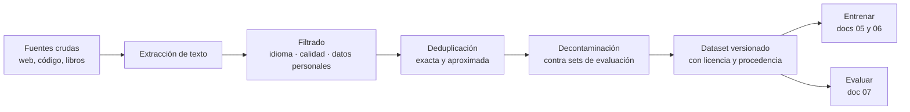

# 04. Datos y corpus

Todo lo que un modelo sabe salió de sus datos. Este documento enseña a reconocer los formatos en
que viven los datasets, a limpiarlos y deduplicarlos antes de usarlos, a detectar la contaminación
que invalida una evaluación, y a responder la pregunta que el curador de datos (ACT-05) se hace
antes que ninguna otra: ¿qué dato entra, y con qué derecho?

**Antes de leer**: [03. Del modelo base al asistente](03-Del-Modelo-Base-Al-Asistente.md) — ahí se
explica qué es un par instrucción→respuesta y por qué la alineación los necesita.
**Anterior** (ruta formativa): [08. Inferencia local](08-Inferencia-Local.md) · **Siguiente**:
[05. Preentrenamiento y leyes de escala](05-Preentrenamiento-Y-Leyes-De-Escala.md).
Convenciones del cuerpo: [Convenciones.md](Convenciones.md) (citado §2, ejemplos §3, cifras §4).

## Índice

1. [Definición](#1-definición)
2. [Aplicación por escenario](#2-aplicación-por-escenario)
3. [Ejemplos concretos](#3-ejemplos-concretos)
4. [Bloque didáctico](#4-bloque-didáctico)
5. [Criterios de calidad](#5-criterios-de-calidad)
6. [Anexo: lista de verificación del curador](#6-anexo-lista-de-verificación-del-curador)
7. [Referencias](#referencias)

---

## 1. Definición

### 1.1 Corpus y dataset

**Corpus.** El conjunto de texto crudo del que un modelo aprende: páginas web, libros, código,
foros. Se mide en tokens — el corpus de preentrenamiento de un modelo actual se cuenta en billones
(*trillions* en inglés) — y su composición explica buena parte de lo que el modelo sabe y de lo
que ignora (Gao et al., 2020; Penedo et al., 2024).

**Cómo se aplica.** Ante un modelo que falla en un dominio, preguntate primero qué había de ese
dominio en su corpus. La *model card* y el informe técnico del modelo suelen declarar la mezcla
(web, código, matemática, idiomas); si el dominio no aparece, la falla no es un misterio sino una
consecuencia.

**Un caso.** The Pile, uno de los primeros corpus abiertos documentados, declara sus 22 fuentes y
el peso de cada una: 825 GiB donde PubMed, GitHub y arXiv conviven con subtítulos y foros (Gao et
al., 2020). Un modelo entrenado sobre esa mezcla responde mejor sobre biomedicina en inglés que
sobre derecho argentino, y la tabla de composición lo anticipaba.

**Dataset** (*conjunto de datos*). Colección estructurada de ejemplos para entrenar o evaluar: a
diferencia del corpus crudo, cada ejemplo tiene forma — campos con nombre, un esquema que se
repite (Lee et al., 2022). El corpus es la materia prima; el dataset, la pieza ya cortada para un
uso: preentrenar, ajustar o medir.

**Cómo se aplica.** Abrí el archivo y buscá el esquema: ¿qué campos tiene cada ejemplo y cuál es
la unidad? Si no podés nombrar los campos, tenés un corpus, no un dataset, y te falta el paso de
estructurarlo. El laboratorio 1 de este documento ejecuta exactamente esa verificación sobre un
dataset propio.

**Un caso.** El dataset de Alpaca: 52.000 ejemplos, cada uno con los campos `instruction`, `input`
y `output` (Taori et al., 2023). Quien conoce el esquema puede escribir el suyo con la misma forma
y ajustarlo con las mismas herramientas; quien solo tiene los textos sueltos, todavía no.

### 1.2 Los formatos en que viven los datasets

Tres familias cubren casi todo lo que el lector va a encontrar:

| Familia | Formato típico | Dónde se usa |
| --- | --- | --- |
| Texto crudo | `.txt`, HTML extraído, un documento por archivo o separados por delimitador | Corpus de preentrenamiento (doc [05](05-Preentrenamiento-Y-Leyes-De-Escala.md)) |
| Registros por línea | **JSONL**: un objeto JSON válido por línea, UTF-8 (JSON Lines, s. f.) | Datasets de instrucciones y de evaluación; la *lingua franca* del ajuste fino |
| Columnar binario | **Parquet**, Arrow | Datasets grandes distribuidos por Hugging Face; eficiente para leer columnas sueltas (Hugging Face, s. f.) |

JSONL merece el lugar central que este documento le da: es texto plano — se versiona en git, se
inspecciona con `head`, se procesa línea a línea sin cargar el archivo entero — y a la vez cada
línea es un objeto con esquema. La especificación cabe en tres reglas: codificación UTF-8 sin BOM — la marca
opcional de orden de bytes al inicio del archivo —, un valor JSON válido por línea, salto de
línea como separador (JSON Lines, s. f.). La biblioteca
`datasets` de Hugging Face lo carga directo, igual que CSV y Parquet (Hugging Face, s. f.).

Sobre esa base física se montan los **esquemas de instrucción**, que son convención y no formato:
el esquema Alpaca (`instruction`/`input`/`output`; Taori et al., 2023) para pares sueltos, y los
esquemas conversacionales con lista de mensajes `role`/`content` para diálogos de varias vueltas.
Cómo consume esos esquemas el ajuste fino — plantillas de chat incluidas — lo enseña el documento
[06. Ajuste fino y alineación](06-Ajuste-Fino-Y-Alineacion.md); acá importa saber reconocerlos y
producirlos bien formados.

### 1.3 Limpieza y deduplicación

Un corpus recién extraído de la web trae basura: *boilerplate* de navegación (el texto repetido de
menús y pies de página), páginas generadas, texto en idiomas no deseados, datos personales y,
sobre todo, repeticiones. Los pipelines de los corpus abiertos documentan la secuencia con la que
la combaten — extracción, filtrado por idioma y calidad, deduplicación, filtrado de datos
personales — y muestran con ablaciones (corridas comparativas que quitan una etapa por vez) que
cada etapa mueve la calidad del modelo resultante (Penedo et al., 2024; Soldaini et al., 2024).



**Deduplicación** (*deduplication*). Limpieza que elimina las repeticiones del corpus o del
dataset. No es prolijidad: un modelo entrenado sobre datos deduplicados memoriza diez veces menos
texto literal y alcanza la misma calidad en menos pasos (Lee et al., 2022); la memorización
literal, además de desperdiciar capacidad, es un riesgo de privacidad demostrado — hay ataques que
extraen del modelo texto que estaba en su entrenamiento (Carlini et al., 2021).

**Cómo se aplica.** Dos pasadas, en este orden. Primero la **exacta**: normalizá cada ejemplo
(minúsculas, espacios colapsados, Unicode a forma canónica) y calculá un hash; dos hashes iguales
son el mismo ejemplo aunque el texto difiera en mayúsculas o espacios. Después la **aproximada**:
medí la similitud entre pares. La medida es la similitud de Jaccard sobre n-gramas — secuencias
de n palabras consecutivas —: los n-gramas que dos textos comparten, divididos por el total de
n-gramas distintos entre ambos; su versión escalable es MinHash (Broder, 1997). Revisá a mano los
pares que superan el umbral, porque ahí la decisión ya no es mecánica.

**Un caso.** El laboratorio 2 corre la pasada exacta sobre el mini-dataset de este documento y
caza dos duplicados, uno de ellos camuflado con mayúsculas y espacios de más; el laboratorio 3
corre la aproximada y encuentra el tercero, reescrito con otras palabras. Los tres estaban
plantados a propósito: el lector sabe qué debe encontrar y verifica que su corrida lo encuentre.

**Contaminación** (*contamination*). Presencia de datos de evaluación dentro de los datos de
entrenamiento. Un modelo que vio las preguntas del examen no demuestra capacidad al responderlas:
demuestra memoria, y la métrica queda invalidada sin aviso (Lee et al., 2022; Sainz et al., 2023).

**Cómo se aplica.** Antes de evaluar, cruzá el dataset de entrenamiento contra el set de
evaluación con la misma técnica de la deduplicación aproximada: n-gramas compartidos entre cada
ejemplo de entrenamiento y cada ítem del benchmark. Todo solapamiento por encima del umbral se
elimina del entrenamiento o invalida el ítem — una de las dos, nunca ninguna.

**Un caso.** El laboratorio 3 cruza el mini-dataset contra un mini-benchmark de tres preguntas y
encuentra que un ejemplo de entrenamiento contiene, literal, una pregunta del benchmark con su
respuesta (Jaccard 1,00). Si ese dataset ajustara un modelo, la evaluación daría esa pregunta por
sabida y el resultado mentiría. Qué hace la contaminación con los benchmarks públicos — que llevan
años filtrándose a los corpus web — lo desarrolla el documento
[07. Evaluación y métricas](07-Evaluacion-Y-Metricas.md).

### 1.4 Licencias y procedencia

**Procedencia** (*provenance*). La cadena documentada que va de cada dato a su origen: de dónde
salió, con qué licencia, por qué transformaciones pasó. La industria la registra en dos artefactos
simétricos: la *datasheet* del dataset (Gebru et al., 2021) y la *model card* del modelo (Mitchell
et al., 2019 — su lectura guiada es un laboratorio del documento
[11. Panorama y ecosistema abierto](11-Panorama-Y-Ecosistema-Abierto.md)).

**Cómo se aplica.** Antes de incorporar un dataset, contestá tres preguntas sobre su ficha: ¿de
dónde salieron los datos?, ¿qué licencia los cubre?, ¿qué usos permite esa licencia — comercial,
derivados, redistribución? Si la ficha no las contesta, el dato es un pasivo: una auditoría a gran
escala encontró que más del 70 % de los datasets públicos examinados tenían licencia sin
especificar o mal etiquetada en las plataformas que los redistribuyen (Longpre et al., 2023).

**Un caso.** El dataset de Alpaca se descarga libremente, pero sus datos llevan licencia
CC BY-NC 4.0 — solo uso no comercial — porque fueron generados con un modelo de OpenAI bajo
términos que prohíben competir comercialmente (Taori et al., 2023). Quien lo usa para ajustar un
modelo de su empresa tiene un problema legal que la facilidad de la descarga no insinuaba: la
operación de las tres preguntas lo detecta en un minuto.

La misma disciplina rige para los **pesos**: «pesos abiertos» significa que se descargan y ejecutan
localmente, con la licencia que sea, y no implica *open source* — la definición de la OSI exige
libertades sobre pesos, código **y** datos, y la mayoría del parque descargable no califica (Open
Source Initiative, 2024). La distinción término a término vive en el glosario del
[Marco de referencia](Marco-De-Referencia.md) (§5.2), y el análisis familia por familia, con la
licencia de cada una, en la tabla de modelos de referencia del documento
[11](11-Panorama-Y-Ecosistema-Abierto.md). Lo que este documento fija es la práctica: la licencia
de los pesos, la del código y la de los datos son tres contratos distintos que se leen por
separado, y un dataset propio declara su licencia en cada ejemplo o en su ficha — nunca la deja
implícita.

---

## 2. Aplicación por escenario

Los escenarios y contextos son los del [Marco de referencia](Marco-De-Referencia.md). Este tema
cruza cuatro escenarios; en todos, quien decide es el curador de datos (ACT-05).

| Escenario | Qué aporta este tema | Qué cambia por contexto |
| --- | --- | --- |
| ESC-01 — Elegir un modelo | Leer la procedencia declarada: qué corpus alimentó al modelo y con qué licencia quedaron los pesos (§1.4) | En CTX-04 (API de terceros) no hay pesos que auditar, pero los términos de uso del servicio ocupan el lugar de la licencia |
| ESC-03 — Preguntarle a un corpus propio (RAG) | El corpus que se indexa exige la misma curaduría que uno de entrenamiento: limpieza, deduplicación y derecho a usar cada documento | En CTX-05 (datos sensibles) la limpieza suma el filtrado de datos personales antes de indexar; el troceo del corpus lo enseña el [doc 09](09-Bases-Vectoriales-Y-RAG.md) |
| ESC-04 — Adaptar un modelo a un dominio | El dataset de instrucciones bien formado, deduplicado y con licencia clara es el insumo del ajuste fino; los laboratorios de este documento lo producen | En CTX-06 (contenedor/CI) el dataset se versiona como artefacto junto al código: mismo hash de entrada, mismo resultado |
| ESC-05 — Evaluar con evidencia | La decontaminación previa (§1.3) es la condición de validez de cualquier métrica; sin ella el [doc 07](07-Evaluacion-Y-Metricas.md) mide memoria, no capacidad | En todo contexto: el cruce entrenamiento↔evaluación se corre antes de cada eval, no una vez en la vida del dataset |

Los tres laboratorios corren en CTX-01 (CPU, sin GPU, sin red): la curaduría de datos es la etapa
más barata de todo el ciclo de un modelo, y la que más caro cobra saltearse.

---

## 3. Ejemplos concretos

Los tres laboratorios siguen el patrón de ejemplo operable de [Convenciones.md](Convenciones.md)
§3 y son propiedad de este documento. Corren en **CTX-01** con Python 3.11 de serie — sin
bibliotecas externas, sin red, sin banco de inferencia — en cualquier directorio de trabajo.
Entorno de validación: el del frontmatter. Las salidas son de corridas reales; los scripts son
deterministas, así que la salida del lector debe coincidir exactamente (si difiere, la causa es de
entorno — versión de Python o archivo mal copiado — nunca de azar: acá no hay muestreo).

El insumo compartido es un **mini-dataset de instrucciones versionable**: doce ejemplos en JSONL
con el esquema `id` / `instruccion` / `respuesta` / `fuente` / `licencia`, escritos para esta guía
y declarados CC-BY-4.0. Cuatro de los doce son defectos plantados a propósito — dos duplicados
exactos (uno camuflado), un casi-duplicado y un ejemplo contaminado — para que cada laboratorio
tenga algo real que encontrar. Se materializa así:

```bash
cat > mini-dataset.jsonl <<'EOF'
{"id": "ds-001", "instruccion": "Explicá qué es un token en un modelo de lenguaje.", "respuesta": "Un token es la unidad mínima en que el modelo segmenta el texto; no coincide con la palabra: «tokenización» puede partirse en varios tokens.", "fuente": "propia", "licencia": "CC-BY-4.0"}
{"id": "ds-002", "instruccion": "¿Qué diferencia hay entre un modelo base y un modelo instruct?", "respuesta": "El modelo base sólo completa texto; el instruct fue alineado con pares instrucción→respuesta y por eso dialoga y sigue consignas.", "fuente": "propia", "licencia": "CC-BY-4.0"}
{"id": "ds-003", "instruccion": "Definí ventana de contexto en una frase.", "respuesta": "Es la cantidad máxima de tokens que el modelo procesa en una pasada, sumando entrada y salida.", "fuente": "propia", "licencia": "CC-BY-4.0"}
{"id": "ds-004", "instruccion": "¿Qué es la cuantización de un modelo?", "respuesta": "Es reducir la precisión numérica de los pesos para que el modelo ocupe menos memoria y corra más rápido, con una pérdida de calidad medible.", "fuente": "propia", "licencia": "CC-BY-4.0"}
{"id": "ds-005", "instruccion": "Explicá qué es un token en un modelo de lenguaje.", "respuesta": "Un token es la unidad mínima en que el modelo segmenta el texto; no coincide con la palabra: «tokenización» puede partirse en varios tokens.", "fuente": "propia", "licencia": "CC-BY-4.0"}
{"id": "ds-006", "instruccion": "  explicá qué es un TOKEN en un modelo de lenguaje. ", "respuesta": "Un token es la unidad mínima en que el modelo segmenta  el texto; no coincide con la palabra: «tokenización» puede partirse en varios tokens.", "fuente": "propia", "licencia": "CC-BY-4.0"}
{"id": "ds-007", "instruccion": "Explicame qué es un token en un modelo de lenguaje moderno.", "respuesta": "Un token es la unidad mínima en que el modelo segmenta el texto y no coincide con la palabra: «tokenización» puede partirse en varios tokens distintos.", "fuente": "propia", "licencia": "CC-BY-4.0"}
{"id": "ds-008", "instruccion": "¿Para qué sirve la temperatura en el muestreo?", "respuesta": "Regula la aleatoriedad al elegir el token siguiente: baja, el modelo repite lo más probable; alta, arriesga opciones menos probables.", "fuente": "propia", "licencia": "CC-BY-4.0"}
{"id": "ds-009", "instruccion": "¿Qué mide la perplejidad de un modelo sobre un texto?", "respuesta": "Mide cuán «sorprendido» queda el modelo ante ese texto; deriva de la pérdida y menor es mejor.", "fuente": "propia", "licencia": "CC-BY-4.0"}
{"id": "ds-010", "instruccion": "¿Qué es RAG y qué problema resuelve?", "respuesta": "Es un pipeline que recupera pasajes de un corpus propio y los inyecta al prompt antes de generar: el modelo responde con fuentes que no estaban en sus pesos.", "fuente": "propia", "licencia": "CC-BY-4.0"}
{"id": "ds-011", "instruccion": "¿Qué significa que un modelo tenga pesos abiertos?", "respuesta": "Que sus pesos se descargan y ejecutan localmente, con la licencia que sea; no implica que el modelo sea open source según la OSAID.", "fuente": "propia", "licencia": "CC-BY-4.0"}
{"id": "ds-012", "instruccion": "¿Cuál es la capital de Francia?", "respuesta": "La capital de Francia es París.", "fuente": "propia", "licencia": "CC-BY-4.0"}
EOF
```

### 3.1 Laboratorio 1 — Validar el dataset: esquema y JSON línea a línea

**Objetivo**: verificar que cada línea del dataset es JSON válido, cumple el esquema y no repite
identificadores — el control de entrada que todo pipeline serio corre antes de tocar los datos.
**Prerrequisito**: el archivo `mini-dataset.jsonl` de arriba. **Contexto**: CTX-01.

```python
# validar.py — valida un dataset JSONL: una línea = un JSON con el esquema esperado
import json, sys

CAMPOS = {"id", "instruccion", "respuesta", "fuente", "licencia"}
ruta = sys.argv[1] if len(sys.argv) > 1 else "mini-dataset.jsonl"
validas, errores, ids = 0, [], set()

with open(ruta, encoding="utf-8") as f:
    for n, linea in enumerate(f, start=1):
        linea = linea.strip()
        if not linea:
            continue
        try:
            ej = json.loads(linea)
        except json.JSONDecodeError as e:
            errores.append(f"línea {n}: JSON inválido ({e.msg})")
            continue
        faltan = CAMPOS - ej.keys()
        if faltan:
            errores.append(f"línea {n}: faltan campos {sorted(faltan)}")
            continue
        if ej["id"] in ids:
            errores.append(f"línea {n}: id repetido {ej['id']}")
            continue
        ids.add(ej["id"])
        validas += 1

print(f"ejemplos válidos: {validas}")
print(f"errores: {len(errores)}")
for e in errores:
    print(f"  - {e}")
```

```bash
python3 validar.py mini-dataset.jsonl
```

Salida esperada (corrida real, 2026-11-07, Python 3.11.2):

```text
ejemplos válidos: 12
errores: 0
```

El dataset pasa limpio porque sus defectos plantados son de contenido, no de forma: los
laboratorios 2 y 3 existen para esos. Para ver al validador trabajar, agregale dos líneas rotas —
una sin el campo `respuesta`, otra con el JSON sin cerrar — y volvé a correrlo:

```bash
cp mini-dataset.jsonl roto.jsonl
printf '%s\n' \
  '{"id": "ds-013", "instruccion": "Pregunta sin respuesta", "fuente": "propia", "licencia": "CC-BY-4.0"}' \
  '{"id": "ds-014", "instruccion": "JSON sin cerrar"' >> roto.jsonl
python3 validar.py roto.jsonl
```

Salida esperada (corrida real, mismo entorno):

```text
ejemplos válidos: 12
errores: 2
  - línea 13: faltan campos ['respuesta']
  - línea 14: JSON inválido (Expecting ',' delimiter)
```

<details>
<summary>Protocolo de la cifra</summary>

- **Cifra**: 12 ejemplos válidos, 0 errores (sobre `roto.jsonl`: 12 válidos, 2 errores)
- **Entrada / dataset**: `mini-dataset.jsonl` del heredoc de §3 (12 ejemplos, CC-BY-4.0)
- **Herramienta**: Python 3.11.2, biblioteca estándar
- **Semilla**: no aplica (proceso determinista, sin muestreo)
- **Contexto de hardware**: CTX-01 (CPU x86-64, 16 GB)
- **Fecha de la corrida**: 2026-11-07
</details>

**Si difiere**: un error de JSON en las primeras doce líneas delata una copia defectuosa del
heredoc — el bloque `cat <<'EOF'` de §3 — por comillas tipográficas convertidas o una línea
partida por el editor; los mensajes exactos del
`JSONDecodeError` pueden variar entre versiones de Python, el conteo no.

### 3.2 Laboratorio 2 — Deduplicación exacta con normalización

**Objetivo**: eliminar duplicados exactos aplicando la operación de §1.3 — normalizar y hashear —
y comprobar que la normalización caza también al duplicado camuflado. **Prerrequisito**:
laboratorio 1 en verde. **Contexto**: CTX-01.

```python
# dedup.py — deduplicación exacta tras normalizar: minúsculas, espacios colapsados, Unicode NFC
import hashlib, json, re, sys, unicodedata

def normalizar(texto: str) -> str:
    texto = unicodedata.normalize("NFC", texto)
    texto = texto.casefold()
    texto = re.sub(r"\s+", " ", texto).strip()
    return texto

ruta = sys.argv[1] if len(sys.argv) > 1 else "mini-dataset.jsonl"
vistos, unicos, duplicados = {}, [], []

with open(ruta, encoding="utf-8") as f:
    for linea in f:
        if not linea.strip():
            continue
        ej = json.loads(linea)
        clave = normalizar(ej["instruccion"]) + "\n" + normalizar(ej["respuesta"])
        huella = hashlib.sha256(clave.encode("utf-8")).hexdigest()
        if huella in vistos:
            duplicados.append((ej["id"], vistos[huella]))
        else:
            vistos[huella] = ej["id"]
            unicos.append(ej)

print(f"ejemplos de entrada: {len(unicos) + len(duplicados)}")
print(f"únicos tras deduplicar: {len(unicos)}")
for dup, original in duplicados:
    print(f"  - {dup} duplica a {original}")

with open("mini-dataset.dedup.jsonl", "w", encoding="utf-8") as f:
    for ej in unicos:
        f.write(json.dumps(ej, ensure_ascii=False) + "\n")
```

```bash
python3 dedup.py mini-dataset.jsonl
```

Salida esperada (corrida real, 2026-11-07, Python 3.11.2):

```text
ejemplos de entrada: 12
únicos tras deduplicar: 10
  - ds-005 duplica a ds-001
  - ds-006 duplica a ds-001
```

<details>
<summary>Protocolo de la cifra</summary>

- **Cifra**: 12 ejemplos de entrada, 10 únicos tras deduplicar (ds-005 y ds-006 duplican a ds-001)
- **Entrada / dataset**: `mini-dataset.jsonl` del laboratorio 1 (12 ejemplos, CC-BY-4.0)
- **Herramienta**: Python 3.11.2, biblioteca estándar
- **Semilla**: no aplica (proceso determinista, sin muestreo)
- **Contexto de hardware**: CTX-01 (CPU x86-64, 16 GB)
- **Fecha de la corrida**: 2026-11-07
</details>

Dos capturas en una corrida. `ds-005` es la copia literal de `ds-001`: la hubiera encontrado
cualquier comparación. `ds-006` es la misma pregunta con mayúsculas cambiadas, espacios dobles y
relleno al borde — un hash sobre el texto crudo la dejaba pasar, y la normalización previa es lo
que la entrega. Ese es el orden que importa: **normalizar primero, hashear después**. Notá qué no
encontró: `ds-007`, la reescritura con otras palabras, sobrevive a cualquier hash porque ningún
hash de texto distinto colisiona a propósito; para esa hace falta el laboratorio 3.

**Si difiere**: un conteo distinto de duplicados indica que el heredoc se copió alterando espacios
(algunos editores colapsan los dobles espacios de `ds-006`, y entonces el camuflaje desaparece
antes de tiempo). El archivo `mini-dataset.dedup.jsonl` que queda escrito es la entrada del
laboratorio 3.

### 3.3 Laboratorio 3 — Casi-duplicados y contaminación por n-gramas

**Objetivo**: aplicar la misma medida — similitud de Jaccard sobre n-gramas de palabras — a los
dos problemas que el hash no resuelve: los casi-duplicados dentro del dataset y la contaminación
contra un set de evaluación. **Prerrequisito**: `mini-dataset.dedup.jsonl` del laboratorio 2.
**Contexto**: CTX-01.

El mini-benchmark contra el que se cruza, tres preguntas con su respuesta esperada:

```bash
cat > mini-eval.jsonl <<'EOF'
{"id": "ev-01", "pregunta": "¿Cuál es la capital de Francia?", "respuesta_esperada": "La capital de Francia es París."}
{"id": "ev-02", "pregunta": "¿Qué regula la temperatura en el muestreo de un modelo?", "respuesta_esperada": "La aleatoriedad con que se elige el token siguiente."}
{"id": "ev-03", "pregunta": "¿Cuántos bits usa el formato de cuantización Q4_K_M por peso, aproximadamente?", "respuesta_esperada": "Alrededor de 4,85 bits por peso."}
EOF
```

```python
# solapamiento.py — casi-duplicados dentro del dataset y contaminación contra un set de evaluación,
# por similitud de Jaccard sobre n-gramas de palabras (n=3)
import itertools, json, re, sys, unicodedata

N = 3                  # tamaño del n-grama, en palabras
UMBRAL_CASI_DUP = 0.5  # dentro del dataset
UMBRAL_CONTAM = 0.35   # contra el set de evaluación

def ngramas(texto: str) -> set:
    texto = unicodedata.normalize("NFC", texto).casefold()
    palabras = re.findall(r"\w+", texto)
    return {tuple(palabras[i:i + N]) for i in range(len(palabras) - N + 1)}

def jaccard(a: set, b: set) -> float:
    if not a or not b:
        return 0.0
    return len(a & b) / len(a | b)

ruta = sys.argv[1] if len(sys.argv) > 1 else "mini-dataset.dedup.jsonl"
dataset = [json.loads(l) for l in open(ruta, encoding="utf-8") if l.strip()]
evaluacion = [json.loads(l) for l in open("mini-eval.jsonl", encoding="utf-8") if l.strip()]

print("— casi-duplicados dentro del dataset —")
for a, b in itertools.combinations(dataset, 2):
    s = jaccard(ngramas(a["instruccion"] + " " + a["respuesta"]),
                ngramas(b["instruccion"] + " " + b["respuesta"]))
    if s >= UMBRAL_CASI_DUP:
        print(f"  {a['id']} ~ {b['id']}: Jaccard {s:.2f}")

print("— contaminación contra el set de evaluación —")
for ej in dataset:
    for ev in evaluacion:
        s = jaccard(ngramas(ej["instruccion"] + " " + ej["respuesta"]),
                    ngramas(ev["pregunta"] + " " + ev["respuesta_esperada"]))
        if s >= UMBRAL_CONTAM:
            print(f"  {ej['id']} solapa con {ev['id']}: Jaccard {s:.2f}")
```

```bash
python3 solapamiento.py mini-dataset.dedup.jsonl
```

Salida esperada (corrida real, 2026-11-07, Python 3.11.2):

```text
— casi-duplicados dentro del dataset —
  ds-001 ~ ds-007: Jaccard 0.68
— contaminación contra el set de evaluación —
  ds-012 solapa con ev-01: Jaccard 1.00
```

<details>
<summary>Protocolo de la cifra</summary>

- **Cifra**: Jaccard 0,68 (ds-001 ~ ds-007) y Jaccard 1,00 (ds-012 contra ev-01)
- **Parámetros**: n-gramas de 3 palabras; umbrales 0,5 (casi-duplicados) y 0,35 (contaminación)
- **Entrada / dataset**: `mini-dataset.dedup.jsonl` del laboratorio 2 (10 ejemplos) y `mini-eval.jsonl` de arriba (3 preguntas)
- **Herramienta**: Python 3.11.2, biblioteca estándar
- **Semilla**: no aplica (proceso determinista, sin muestreo)
- **Contexto de hardware**: CTX-01 (CPU x86-64, 16 GB)
- **Fecha de la corrida**: 2026-11-07
</details>

Las dos capturas que faltaban. `ds-007` — la reescritura que el hash no vio — comparte el 68 % de
sus trigramas con `ds-001`: por encima del umbral, a revisión humana, y acá la decisión correcta
es eliminarlo porque no agrega información. Y `ds-012` reproduce literal la pregunta `ev-01` del
benchmark con su respuesta: Jaccard 1,00, contaminación de libro. Un modelo ajustado con este
dataset «acertaría» esa pregunta del eval sin que el acierto diga nada de su capacidad.

Los umbrales (0,5 y 0,35) son criterio de esta guía para textos de este tamaño, no constantes de
la industria: con ejemplos tan cortos, un trigrama compartido pesa mucho, y el lector debe
esperar recalibrarlos sobre sus propios datos — bajarlos aumenta capturas y falsos positivos,
subirlos lo contrario. A escala real la comparación de todos los pares es inviable y se reemplaza
por MinHash, que aproxima la misma similitud de Jaccard sin comparar todo contra todo (Broder,
1997; Lee et al., 2022): la operación que el lector acaba de ejecutar es la misma, cambia la
ingeniería.

**Si difiere**: valores de Jaccard distintos con el mismo archivo indican una copia alterada;
revisá primero el laboratorio 1. Un `FileNotFoundError` sobre `mini-dataset.dedup.jsonl` significa
que el laboratorio 2 no se corrió en este directorio.

---

## 4. Bloque didáctico

**Pregunta** — ¿Por qué JSONL y no un único JSON con una lista de ejemplos adentro?
**Criterio que forma** — Elegir el formato de un dataset por sus propiedades operativas, no por
familiaridad.
**Respuesta explicativa** — Un JSON único exige cargar y parsear el archivo entero para tocar un
ejemplo; JSONL se procesa línea a línea con memoria constante, se versiona con diffs legibles (un
ejemplo nuevo es una línea nueva), sobrevive a un corte a la mitad (las líneas completas siguen
siendo válidas) y se inspecciona con las herramientas de texto de siempre. Por eso es el formato
de intercambio de los datasets de instrucciones, mientras que Parquet gana cuando el volumen pide
lectura columnar.
**Reenvío** — El validador del [laboratorio 1](#31-laboratorio-1--validar-el-dataset-esquema-y-json-línea-a-línea)
explota exactamente esa propiedad: falla por línea, no por archivo.

**Pregunta** — Tu dataset tiene dos ejemplos con el mismo texto salvo mayúsculas. ¿Los va a
encontrar un hash SHA-256 de cada ejemplo?
**Criterio que forma** — Entender que la deduplicación exacta vale lo que vale su normalización.
**Respuesta explicativa** — No: el hash de «TOKEN» y el de «token» no se parecen en nada, porque
un hash criptográfico cambia por completo ante un bit distinto. La igualdad que te interesa — «es
el mismo ejemplo» — la define la normalización que apliques antes de hashear: minúsculas, espacios
colapsados, Unicode canónico. Decidir qué normaliza y qué no (¿acentos?, ¿puntuación?) es decidir
qué cuenta como duplicado, y es una decisión de curaduría, no de código.
**Reenvío** — `ds-006` en el [laboratorio 2](#32-laboratorio-2--deduplicación-exacta-con-normalización):
sin `casefold()` y sin colapsar espacios, sobrevive.

**Pregunta** — Un modelo saca 95 % en un benchmark público. ¿Qué tenés que descartar antes de
creerle?
**Criterio que forma** — Tratar toda métrica como sospechosa de contaminación hasta verificar lo
contrario.
**Respuesta explicativa** — Que los ítems del benchmark no estuvieran en los datos de
entrenamiento. Los benchmarks públicos circulan por la web desde hace años y los corpus se
extraen de la web: el solapamiento es la condición por defecto, no la excepción (Sainz et al.,
2023). La verificación es la de §1.3 — n-gramas compartidos entre entrenamiento y evaluación — y
cuando el corpus de entrenamiento no es público, ni siquiera podés correrla: esa imposibilidad
también es información sobre cuánto confiar.
**Reenvío** — `ds-012` contra `ev-01` en el [laboratorio 3](#33-laboratorio-3--casi-duplicados-y-contaminación-por-n-gramas);
el efecto sobre benchmarks reales, en el [doc 07](07-Evaluacion-Y-Metricas.md).

**Pregunta** — Encontraste en Hugging Face un dataset perfecto para tu dominio y se descarga sin
pedir nada. ¿Qué falta verificar?
**Criterio que forma** — Separar «puedo descargarlo» de «puedo usarlo para esto».
**Respuesta explicativa** — Su licencia y su procedencia: qué permite (uso comercial, derivados,
redistribución) y de dónde salieron los datos — un dataset generado con la salida de un modelo
comercial puede heredar restricciones que su página no destaca, como el CC BY-NC de Alpaca. La
descarga libre no es una licencia; la auditoría de Longpre et al. (2023) muestra que la etiqueta
de licencia de la plataforma se equivoca o falta en la mayoría de los casos, así que la fuente de
verdad es la ficha original del dataset, no el campo de la plataforma.
**Reenvío** — Las tres preguntas de [§1.4](#14-licencias-y-procedencia) y la lista de verificación
del [anexo](#6-anexo-lista-de-verificación-del-curador).

---

## 5. Criterios de calidad

Un dataset bien curado se distingue de uno pobre por marcas verificables:

| Criterio | Versión buena | Versión pobre |
| --- | --- | --- |
| Esquema | Declarado y validado mecánicamente; toda línea lo cumple | «Se entiende mirando el archivo»; excepciones silenciosas |
| Duplicados | Pasadas exacta y aproximada corridas, con registro de qué se eliminó y por qué | «Lo revisé a ojo»; duplicados camuflados intactos |
| Contaminación | Cruce contra cada set de evaluación que se vaya a usar, antes de cada eval | El cruce no se corrió, o se corrió una vez y el eval cambió |
| Licencia | Declarada por ejemplo o en la ficha, verificada contra la fuente original | Heredada implícitamente de la plataforma de descarga |
| Procedencia | Cada transformación documentada: el dataset se puede regenerar desde las fuentes | El archivo final es lo único que existe |
| Versionado | El dataset es un artefacto con historia: cambiarlo deja diff y fecha | Se edita en el lugar; nadie sabe qué versión entrenó qué |

La prueba más barata de todas: pedile a quien entrega el dataset que regenere una cifra suya —
cuántos ejemplos, cuántos duplicados eliminados — desde las fuentes. Si no puede, la procedencia
es decorativa.

---

## 6. Anexo: lista de verificación del curador

Antes de aceptar un dataset — propio o ajeno — en un entrenamiento, un índice RAG o una
evaluación, el curador (ACT-05) recorre:

- [ ] **Esquema**: campos declarados; un validador mecánico lo confirma línea a línea
      (laboratorio 1). *¿Podés nombrar los campos sin abrir el archivo?*
- [ ] **Codificación**: UTF-8 sin BOM; un JSON válido por línea si es JSONL (JSON Lines, s. f.).
- [ ] **Deduplicación exacta** corrida con normalización declarada (laboratorio 2).
      *¿Qué decidiste que cuenta como «el mismo ejemplo»?*
- [ ] **Deduplicación aproximada** corrida con umbral declarado y pares límite revisados a mano
      (laboratorio 3). *¿Quién miró los casos dudosos?*
- [ ] **Decontaminación**: cruce contra todos los sets de evaluación previstos, re-ejecutable
      (laboratorio 3). *¿Se vuelve a correr cuando cambia el eval?*
- [ ] **Licencia**: leída en la fuente original, no en la etiqueta de la plataforma; compatible
      con el uso previsto — comercial o no, derivados o no (Longpre et al., 2023).
- [ ] **Procedencia**: origen y transformaciones documentados al nivel de una *datasheet* (Gebru
      et al., 2021). *¿Se puede regenerar el dataset desde las fuentes?*
- [ ] **Datos personales y sensibles**: filtrado corrido si la fuente puede contenerlos;
      obligatorio en CTX-05.
- [ ] **Versionado**: el dataset tiene identidad (hash o versión) y el entrenamiento o eval que
      lo consuma la registra (CTX-06).

---

## Referencias

Citado autor-año (APA 7.ª edición) conforme a [Convenciones.md](Convenciones.md) §2. Consultas
web: 2026-11-07.

- Broder, A. Z. (1997). On the resemblance and containment of documents. *Proceedings of
  Compression and Complexity of SEQUENCES 1997*. IEEE.
- Carlini, N., et al. (2021). Extracting training data from large language models. *30th USENIX
  Security Symposium*. arXiv:2012.07805
- Gao, L., et al. (2020). The Pile: An 800GB dataset of diverse text for language modeling.
  arXiv:2101.00027
- Gebru, T., et al. (2021). Datasheets for datasets. *Communications of the ACM, 64*(12).
  arXiv:1803.09010
- Hugging Face. (s. f.). *Load — Datasets documentation*.
  https://huggingface.co/docs/datasets/loading (consultada el 2026-11-07)
- JSON Lines. (s. f.). *JSON Lines format specification*. https://jsonlines.org (consultada el
  2026-11-07)
- Lee, K., et al. (2022). Deduplicating training data makes language models better. *ACL*.
  arXiv:2107.06499
- Longpre, S., et al. (2023). The Data Provenance Initiative: A large scale audit of dataset
  licensing & attribution in AI. arXiv:2310.16787
- Mitchell, M., et al. (2019). Model cards for model reporting. *FAT\**. arXiv:1810.03993
- Open Source Initiative. (2024). *The Open Source AI Definition 1.0*.
  https://opensource.org/ai/open-source-ai-definition
- Penedo, G., et al. (2024). The FineWeb datasets: Decanting the web for the finest text data at
  scale. arXiv:2406.17557
- Sainz, O., et al. (2023). NLP evaluation in trouble: On the need to measure LLM data
  contamination for each benchmark. *Findings of EMNLP*. arXiv:2310.18018
- Soldaini, L., et al. (2024). Dolma: An open corpus of three trillion tokens for language model
  pretraining research. *ACL*. arXiv:2402.00159
- Taori, R., et al. (2023). *Stanford Alpaca: An instruction-following LLaMA model* [repositorio].
  GitHub. https://github.com/tatsu-lab/stanford_alpaca (consultada el 2026-11-07)
- Expediente 0001 «Guía de estudio IA-Model» (2026): folio 011 §2 (alcance del núcleo 04) y §4
  (estructura y mapa de laboratorios) — origen de las decisiones editoriales de este documento.
