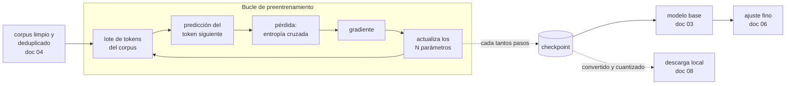

# 05. Preentrenamiento y leyes de escala

Este documento explica de dónde sale un modelo de lenguaje antes de que nadie lo descargue: el
preentrenamiento como un único juego de predicción jugado billones de veces, la pérdida y la
perplejidad como el marcador de ese juego, los *checkpoints* como sus fotografías, y las leyes de
escala como la contabilidad que decide cuánto cuesta jugarlo. Incluye una demo juguete que
preentrena un modelo real —diminuto— en tu CPU, con su curva de pérdida medida.

**Antes de leer**: [04-Datos-Y-Corpus.md](04-Datos-Y-Corpus.md) — acá se asume que ya sabés qué es
un corpus, qué lo contamina y por qué se deduplica (el grafo de prerrequisitos vive en
[Cohesion-Global.md](Cohesion-Global.md)).
**Anterior**: [04-Datos-Y-Corpus.md](04-Datos-Y-Corpus.md) · **Siguiente**:
[06-Ajuste-Fino-Y-Alineacion.md](06-Ajuste-Fino-Y-Alineacion.md).
Convenciones del cuerpo: [Convenciones.md](Convenciones.md) (citado §2, ejemplos §3, cifras §4).

## Índice

1. [Definición](#1-definición)
2. [Aplicación por escenario](#2-aplicación-por-escenario)
3. [Ejemplos concretos](#3-ejemplos-concretos)
4. [Bloque didáctico](#4-bloque-didáctico)
5. [Criterios de calidad](#5-criterios-de-calidad)
6. [Anexo: cómo leer la sección de preentrenamiento de un informe técnico](#6-anexo-cómo-leer-la-sección-de-preentrenamiento-de-un-informe-técnico)
7. [Referencias](#referencias)

---

## 1. Definición

### 1.1 Preentrenamiento: un solo juego, jugado billones de veces

**Preentrenamiento** (*pre-training*). Entrenamiento inicial de un modelo de lenguaje sobre un
corpus masivo, con un único objetivo: predecir el *token* siguiente dado todo lo anterior. De ahí
sale el **modelo base** que [03-Del-Modelo-Base-Al-Asistente.md](03-Del-Modelo-Base-Al-Asistente.md)
convierte en asistente.

La imagen mental: una persona que lee todo el texto del mundo con la página tapada, destapando una
palabra por vez, y apostando antes de destapar. Nunca hace otra cosa. No estudia gramática, no
memoriza fichas de hechos, no recibe pares pregunta-respuesta: apuesta, destapa, mide cuánto se
equivocó y ajusta. La operación que esta definición te deja hacer: ante cualquier capacidad que un
modelo exhiba —traducir, resumir, programar—, preguntate qué textos del corpus vuelven *útil*
predecir el token siguiente en esa tarea. Si la respuesta es «muchos», la capacidad puede emerger
del preentrenamiento sin que nadie la haya enseñado; esa es la observación central de la era GPT
(Radford et al., 2019; Brown et al., 2020).

Qué **no** es: el preentrenamiento no produce un asistente (el modelo base completa texto, no
conversa: distinción del documento 03), no es algo que el lector de esta guía vaya a ejecutar a
escala real (ver la economía en §1.5 y §3.2), y no es la etapa donde se «agrega» conocimiento
puntual a un modelo existente — para eso están el ajuste fino
([06-Ajuste-Fino-Y-Alineacion.md](06-Ajuste-Fino-Y-Alineacion.md)) y RAG (*Retrieval-Augmented
Generation*, [09-Bases-Vectoriales-Y-RAG.md](09-Bases-Vectoriales-Y-RAG.md)).

### 1.2 El objetivo autoregresivo

**Objetivo autoregresivo** (*autoregressive objective*). La tarea de entrenamiento: maximizar la
probabilidad que el modelo asigna al token verdadero en cada posición del corpus, condicionado a
todos los anteriores.

La fórmula, en una línea y con los símbolos nombrados: para una secuencia de tokens
`x₁ … x_T`, el modelo maximiza `Σₜ log p(xₜ | x₁ … xₜ₋₁)` — la suma, sobre cada posición `t`, del
logaritmo de la probabilidad que el modelo le dio al token que efectivamente vino (Bengio et al.,
2003; Brown et al., 2020). Todo lo demás de este documento es consecuencia de esa línea.

Dos propiedades hacen de este objetivo el motor económico del campo:

- **No necesita etiquetas.** Cada texto trae su propia respuesta correcta: el token siguiente. Un
  corpus de billones de tokens es, automáticamente, un conjunto de billones de ejercicios
  corregidos — por eso el preentrenamiento puede consumir la web entera mientras que el ajuste
  fino supervisado se mide en miles de ejemplos (la frontera exacta es del documento 06).
- **Es el mismo juego que la inferencia.** Generar texto es ejecutar la misma predicción, token a
  token, muestreando de la distribución en lugar de compararla con un original (el muestreo y la
  temperatura son del documento 03). Entrenamiento e inferencia difieren en qué se hace con la
  predicción, no en la predicción misma.

La operación para el lector: agarrá cualquier frase, tapala desde algún punto y tratá de seguirla
vos. Acabás de ejecutar el objetivo autoregresivo a mano; la demo de §3.1 hace exactamente eso
1.543 veces por época, con un modelo de 441 parámetros.

### 1.3 Pérdida y perplejidad: el marcador del juego

**Pérdida** (*loss*). Número que mide, en promedio, cuán equivocadas fueron las apuestas del
modelo; entrenar es hacerlo bajar. Para el objetivo autoregresivo la pérdida estándar es la
**entropía cruzada**: el promedio de `−log p(token verdadero)` sobre las posiciones evaluadas
(Bengio et al., 2003).

**Perplejidad** (*perplexity*). La misma información en una escala legible:
`perplejidad = exp(pérdida)`. Se lee como «entre cuántas opciones equiprobables duda el modelo en
cada paso» (Jelinek et al., 1977). La operación: ante una perplejidad publicada, convertila en esa
frase. Perplejidad 4,6 → «el modelo duda como si tuviera 4,6 continuaciones igual de probables».
Un modelo que no aprendió nada sobre un vocabulario de `V` símbolos tiene perplejidad exactamente
`V` — la demo de §3.1 lo muestra: con 21 caracteres en el vocabulario, la perplejidad inicial
medida es 21,0, y el entrenamiento la baja a 4,64.

Tres advertencias que después reaparecen como criterio:

1. La perplejidad depende del **tokenizador** y del **corpus de evaluación**: comparar
   perplejidades de dos modelos con vocabularios distintos, o medidas sobre textos distintos, no
   dice nada (el porqué del tokenizador es del documento 01; el uso correcto de la métrica, del
   [07-Evaluacion-Y-Metricas.md](07-Evaluacion-Y-Metricas.md)).
2. Pérdida más baja significa mejor **predicción del corpus**, no mayor utilidad, veracidad ni
   seguridad de un asistente: esas se evalúan de otra forma (documento 07).
3. La pérdida tiene un **piso**: la incertidumbre real del lenguaje. Ni el modelo perfecto llega a
   pérdida cero, porque el texto genuinamente podría seguir de varias maneras.

### 1.4 Checkpoints: fotografías de los parámetros

***Checkpoint***. Fotografía completa de los parámetros del modelo en un punto del entrenamiento,
guardada en disco. La imagen mental: la partida guardada de un videojuego — no un resumen de la
partida, la partida entera, lista para seguir jugando desde ahí.

La operación que habilita es triple, y las tres caras le importan a este cuerpo:

| Uso del checkpoint | Quién lo ejerce | Dónde se trata |
| --- | --- | --- |
| **Reanudar**: un entrenamiento de semanas sobrevive a cortes porque recomienza del último checkpoint, no de cero | quien entrena | §3.1, paso 6 de la demo |
| **Publicar**: los «pesos abiertos» que descargás *son* un checkpoint — el final, convertido de formato | quien publica y quien descarga | formatos y cuantización en [08-Inferencia-Local.md](08-Inferencia-Local.md) |
| **Bifurcar**: el ajuste fino arranca de un checkpoint ajeno en lugar de entrenar de cero | quien adapta | [06-Ajuste-Fino-Y-Alineacion.md](06-Ajuste-Fino-Y-Alineacion.md) |

Esa segunda fila es el puente conceptual de esta guía: cuando el documento 08 descarga un modelo
con `ollama pull`, lo que viaja por la red es el checkpoint final de un preentrenamiento que costó
lo que §1.5 contabiliza — reempaquetado y cuantizado, pero la misma fotografía.

### 1.5 Leyes de escala y la economía del preentrenamiento

**Leyes de escala** (*scaling laws*). Relaciones empíricas, sorprendentemente regulares, entre la
pérdida final y los tres recursos del preentrenamiento: parámetros del modelo (`N`), tokens de
entrenamiento (`D`) y cómputo total (`C`). Kaplan et al. (2020) midieron que la pérdida cae como
una ley de potencias al crecer cada recurso, y que el cómputo de entrenar un transformer se
aproxima con una cuenta de una línea: `C ≈ 6 · N · D` operaciones de punto flotante — seis FLOPs
por parámetro por token visto.

La operación: esa cuenta se hace con cualquier calculadora, y §3.2 la convierte en un script que
podés correr con tus propios supuestos. Hacerla una vez cambia la lectura de todo informe técnico:
los tamaños de modelo y de corpus dejan de ser cifras de marketing y pasan a ser el presupuesto.

El segundo resultado es el que reorganizó la industria. Con un presupuesto de cómputo fijo, ¿modelo
más grande o más datos? Hoffmann et al. (2022) midieron que los modelos de la generación anterior
estaban **sobredimensionados y subentrenados**: el óptimo asigna los recursos de forma pareja, con
la regla práctica de **unos 20 tokens de entrenamiento por parámetro** (`D ≈ 20 · N`). Su
demostración fue Chinchilla: 70 mil millones de parámetros y 1,4 billones de tokens que, con el
mismo cómputo, superó a un modelo cuatro veces más grande entrenado con menos datos. Para calibrar
el contraste: GPT-3 tenía 175 mil millones de parámetros y se entrenó con unos 300 mil millones de
tokens (Brown et al., 2020) — menos de 2 tokens por parámetro.

Y la tercera vuelta de tuerca, que explica el parque de modelos que esta guía opera: el óptimo de
Chinchilla minimiza la pérdida **por costo de entrenamiento**, que se paga una vez. Quien va a
servir el modelo millones de veces prefiere pagar entrenamiento de más para obtener un modelo más
chico e igual de capaz, porque la inferencia se paga siempre: los modelos tipo LLaMA se entrenaron
deliberadamente mucho más allá de los 20 tokens por parámetro por esa razón, declarada en su
informe (Touvron et al., 2023). Los modelos chicos y muy entrenados que corren en tu CPU
(documento 08) existen por esta decisión económica; las cifras concretas del parque vigente viven
en la tabla de referencia de
[11-Panorama-Y-Ecosistema-Abierto.md](11-Panorama-Y-Ecosistema-Abierto.md), no acá.

El ciclo completo, de corpus a checkpoint publicado:



---

## 2. Aplicación por escenario

Este tema cruza tres escenarios del [marco de referencia](Marco-De-Referencia.md). En los tres el
lector usa el preentrenamiento como **conocimiento de fondo para decidir**, nunca como actividad a
ejecutar a escala real — y eso mismo es la primera lección del tema.

### 2.1 ESC-01 — Entender y elegir un modelo

La ficha de un modelo (*model card*, documento 11) declara parámetros y tokens de entrenamiento.
Con §1.5 esas dos cifras se vuelven legibles: `D/N` te dice si el modelo es de la familia
«Chinchilla-óptimo» o de la familia «sobreentrenado para inferencia barata», y `6·N·D` te da el
orden de magnitud de lo que costó — una señal de cuánta ingeniería hay detrás que ninguna demo
puede fingir. Qué cambia por contexto: en CTX-01 y CTX-02 (equipo propio) el tamaño `N` domina la
decisión porque fija la memoria de inferencia (la cuenta exacta es del documento 08); en CTX-04
(API de terceros) `N` suele ni publicarse y la elección se decide por evaluación (ESC-05).

### 2.2 ESC-04 — Adaptar un modelo a un dominio

La decisión previa de ESC-04 —prompt, RAG o ajuste fino— tiene un cuarto camino que este documento
existe para descartar con fundamento: preentrenar desde cero. La calculadora de §3.2 lo vuelve
cuantitativo: aun un modelo chico por los estándares actuales exige una escala de cómputo, datos
limpios (documento 04) e ingeniería que no se parece en nada al resto de esta guía. La regla
práctica que queda: **el preentrenamiento se hereda, no se repite** — se elige un checkpoint ajeno
(ESC-01) y se adapta (documento 06). En CTX-05 (datos sensibles) esta regla tiene un matiz: heredar
un checkpoint implica heredar su corpus con sus sesgos y su procedencia, y la ficha del modelo es
la única ventana a ese corpus (documentos 04 y 11).

### 2.3 ESC-05 — Evaluar, comparar y decidir con evidencia

La perplejidad es la métrica madre: barata, automática y continua, es la primera señal de que un
entrenamiento progresa — y por las advertencias de §1.3, insuficiente para comparar modelos
distintos o declarar calidad de asistente. Saber qué mide (y contra qué corpus, con qué
tokenizador) es el prerrequisito para no dejarse impresionar por una cifra suelta; el uso correcto
y las métricas que sí comparan viven en [07-Evaluacion-Y-Metricas.md](07-Evaluacion-Y-Metricas.md).
En cualquier CTX, una perplejidad sin su corpus de evaluación declarado se descarta como evidencia:
regla transversal del cuerpo ([Convenciones.md](Convenciones.md) §4).

---

## 3. Ejemplos concretos

Este documento es dueño de dos laboratorios operables; ningún otro documento los duplica. Ninguno
de los dos toca el banco de inferencia: todo corre local, en python puro, sin instalar nada — por
eso acá no aparece el paso 0 de verificación del banco (se enseña en
[08-Inferencia-Local.md](08-Inferencia-Local.md)). Contexto: **CTX-01** (CPU, sin GPU); versiones:
python 3.11.2; no interviene ningún modelo descargado, por lo que no hay etiqueta ni digest que
fijar.

### 3.1 Laboratorio IAM-05-L1 — Preentrenar un modelo juguete en tu CPU

**Qué demuestra**: el ciclo completo de §1 —objetivo autoregresivo, pérdida que baja, perplejidad,
checkpoint, reanudación— sobre un modelo tan chico que todo pasa delante de tus ojos en un segundo.
El modelo predice el **carácter** siguiente (un carácter = un token: el tokenizador más simple
posible) usando sólo el carácter anterior, con una tabla de 21×21 logits: 441 parámetros. Es la
misma mecánica que un modelo de miles de millones de parámetros, con dos diferencias honestas que
se discuten al final.

**Precondiciones**: python 3 en el PATH. Nada más.

Guardá esto como `lab_preentrenamiento.py`:

```python
# Demo juguete de preentrenamiento: modelo de lenguaje a nivel de caracter,
# objetivo autoregresivo de orden 1 (bigrama), python puro, CPU.
# Guia IA-Model, documento 05. No requiere ninguna biblioteca externa.
import json
import math
import random

random.seed(42)

# --- 1. Corpus minimo (el "internet" de esta demo) -------------------------
CORPUS = (
    "el modelo aprende a predecir el caracter siguiente. "
    "entrenar es minimizar la perdida. "
    "la perdida mide la sorpresa del modelo ante el texto real. "
    "menos perdida es menos sorpresa y mejor modelo. "
) * 8  # repetido para alargar la "epoca" sin cambiar la distribucion

# --- 2. Tokenizador de juguete: un caracter = un token ---------------------
vocab = sorted(set(CORPUS))
V = len(vocab)
a_indice = {c: i for i, c in enumerate(vocab)}
datos = [a_indice[c] for c in CORPUS]
print(f"corpus: {len(datos)} tokens | vocabulario: {V} caracteres")

# --- 3. El modelo: una tabla de logits W[previo][siguiente] -----------------
# p(siguiente | previo) = softmax(W[previo]). Son V*V parametros.
W = [[0.0] * V for _ in range(V)]
print(f"parametros: {V * V}")


def softmax(fila):
    m = max(fila)
    e = [math.exp(x - m) for x in fila]
    s = sum(e)
    return [x / s for x in e]


def perdida_media():
    """Cross-entropy media del objetivo autoregresivo sobre todo el corpus."""
    total = 0.0
    for t in range(len(datos) - 1):
        p = softmax(W[datos[t]])[datos[t + 1]]
        total += -math.log(p)
    return total / (len(datos) - 1)


def muestrear(n=60):
    """Genera texto token a token, muestreando de p(siguiente | previo)."""
    i = a_indice["e"]
    salida = ["e"]
    for _ in range(n - 1):
        p = softmax(W[i])
        i = random.choices(range(V), weights=p)[0]
        salida.append(vocab[i])
    return "".join(salida)


# --- 4. Preentrenamiento: descenso por gradiente sobre la cross-entropy ----
LR = 0.5
EPOCAS = 30
print(f"\nantes de entrenar  | loss {perdida_media():.4f} "
      f"| perplexity {math.exp(perdida_media()):.1f}")
print(f"muestra sin entrenar: {muestrear()!r}\n")

for epoca in range(1, EPOCAS + 1):
    for t in range(len(datos) - 1):
        previo, objetivo = datos[t], datos[t + 1]
        p = softmax(W[previo])
        for j in range(V):  # gradiente: p - 1{j == objetivo}
            W[previo][j] -= LR * (p[j] - (1.0 if j == objetivo else 0.0))
    if epoca in (1, 2, 3, 5, 10, 20, 30):
        loss = perdida_media()
        print(f"epoca {epoca:>2} | loss {loss:.4f} | "
              f"perplexity {math.exp(loss):.2f}")

# --- 5. Checkpoint: fotografia de los parametros ---------------------------
with open("checkpoint_bigrama.json", "w") as f:
    json.dump({"vocab": vocab, "W": W, "epoca": EPOCAS}, f)
print("\ncheckpoint guardado: checkpoint_bigrama.json "
      f"({len(json.dumps(W)) // 1024} KiB)")

print(f"muestra entrenada:   {muestrear()!r}")

# --- 6. Reanudar desde el checkpoint (lo que hace un entrenamiento real) ----
with open("checkpoint_bigrama.json") as f:
    foto = json.load(f)
W = foto["W"]
loss = perdida_media()
print(f"reanudado de la epoca {foto['epoca']} | loss {loss:.4f} "
      f"| perplexity {math.exp(loss):.2f}  (identica: la foto es completa)")
```

Y corrélo:

```bash
python3 lab_preentrenamiento.py
```

**Salida esperada** (corrida real del 2026-11-07; con la semilla fijada en 42, los números se
reproducen exactos — sólo el texto de las muestras variaría si cambiás la semilla):

```text
corpus: 1544 tokens | vocabulario: 21 caracteres
parametros: 441

antes de entrenar  | loss 3.0445 | perplexity 21.0
muestra sin entrenar: 'ep edsrx.j dm dpndot triczi.auotsnzinuoxor dg.daepiideypocsc'

epoca  1 | loss 1.6341 | perplexity 5.12
epoca  2 | loss 1.5780 | perplexity 4.85
epoca  3 | loss 1.5615 | perplexity 4.77
epoca  5 | loss 1.5494 | perplexity 4.71
epoca 10 | loss 1.5410 | perplexity 4.67
epoca 20 | loss 1.5370 | perplexity 4.65
epoca 30 | loss 1.5357 | perplexity 4.64

checkpoint guardado: checkpoint_bigrama.json (8 KiB)
muestra entrenada:   'elorerer a l trdelodejo. s exte desa modir prela miza meso. '
reanudado de la epoca 30 | loss 1.5357 | perplexity 4.64  (identica: la foto es completa)
```

<details>
<summary>Protocolo de las cifras</summary>

- **Cifras**: pérdida 3,0445 → 1,5357; perplejidad 21,0 → 4,64; duración total de la corrida
  1,1 s (`time`, real)
- **Modelo**: bigrama de 441 parámetros definido en el propio script (sin modelo descargado:
  no hay etiqueta ni digest que declarar)
- **Motor**: python 3.11.2, sin bibliotecas externas
- **Parámetros**: LR 0,5 · 30 épocas · corpus y vocabulario los del script
- **Semilla**: 42 (`random.seed`)
- **Entrada / dataset**: el corpus de 1.544 caracteres embebido en el script, licencia propia de
  esta guía
- **Contexto de hardware**: CTX-01 (CPU x86-64, 16 GB)
- **Fecha de la corrida**: 2026-11-07
</details>

**Qué leer en esa salida** — las cuatro ideas de §1, ahora medidas:

1. **La perplejidad inicial es exactamente el tamaño del vocabulario** (21,0): el modelo sin
   entrenar duda entre todo por igual. Primer uso de la operación de §1.3.
2. **La curva de pérdida cae rápido y se aplana**: de 3,04 a 1,63 en una época, y después 29
   épocas para rascar de 1,63 a 1,54. Ese piso no es un defecto: es la incertidumbre real del
   corpus visto por un modelo que sólo mira un carácter atrás. La forma —caída brusca, cola
   larga— es la misma que vas a ver en cualquier curva de preentrenamiento real.
3. **El texto muestreado pasa de ruido a «castellano fonético»**: `'elorerer a l trdelodejo…'` ya
   tiene vocales y consonantes alternadas y palabras cortas, todo lo que un bigrama puede
   aprender. Para frases hace falta más contexto: esa es exactamente la motivación de la atención
   del documento 02, vista desde abajo.
4. **El checkpoint reanuda con pérdida idéntica**: la fotografía es completa. Probá borrar el
   campo `"W"` del JSON y vas a ver qué significa un checkpoint corrupto.

**Si tu salida difiere**: con otra versión de python los números deberían coincidir igual (la
aritmética es determinista y la semilla está fijada); si cambiaste corpus, semilla o LR, difieren
todos — eso es divergencia por parámetros, no un error. El diagnóstico general de divergencias
está en [Convenciones.md](Convenciones.md) §3.2.

**Las dos diferencias honestas con el preentrenamiento real**: (a) el modelo real condiciona en
miles de tokens de contexto con atención (documento 02), no en uno; (b) el corpus real se ve una
sola vez o poco más — a esa escala el dato nuevo abunda y repetir épocas sobreajusta (Hoffmann et
al., 2022; la calidad del corpus es del documento 04). Todo lo demás —objetivo, pérdida,
gradiente, checkpoint— es lo mismo que acabás de correr.

### 3.2 Laboratorio IAM-05-L2 — La cuenta de la escala: `C ≈ 6·N·D`

**Qué demuestra**: que la economía del preentrenamiento es una cuenta de almacén, y que hacerla
una vez te vacuna contra el «entrenemos nuestro propio modelo». Usa las dos aproximaciones de
§1.5: `C ≈ 6·N·D` (Kaplan et al., 2020) y `D ≈ 20·N` (Hoffmann et al., 2022).

**Precondiciones**: python 3. Guardá esto como `lab_economia.py`:

```python
# Calculadora de leyes de escala y economia del preentrenamiento.
# Guia IA-Model, documento 05. Python puro, CPU.
# Aproximaciones usadas (ver las citas en el documento):
#   C ~ 6 * N * D          (FLOPs de entrenamiento; Kaplan et al., 2020)
#   D_opt ~ 20 * N         (regla practica de Chinchilla; Hoffmann et al., 2022)

def fmt(x):
    for umbral, suf in ((1e24, "YFLOPs"), (1e21, "ZFLOPs"), (1e18, "EFLOPs")):
        if x >= umbral:
            return f"{x / umbral:,.1f} {suf}"
    return f"{x:.2e} FLOPs"


# SUPUESTO declarado: rendimiento sostenido por acelerador durante el
# entrenamiento (no el pico de catalogo). Ajustalo a tu hardware.
FLOPS_SOSTENIDOS = 4e14          # 400 TFLOP/s sostenidos por acelerador
HORA_ACELERADOR_USD = 2.0        # SUPUESTO: precio horario de alquiler

print(f"{'N (params)':>12} | {'D = 20N (tokens)':>17} | {'C = 6ND':>12} |"
      f" {'horas-acelerador':>16} | {'costo (USD)':>12}")
print("-" * 84)
for n_mm in (0.001, 0.1, 1, 7, 70):          # en miles de millones (B)
    N = n_mm * 1e9
    D = 20 * N
    C = 6 * N * D
    horas = C / FLOPS_SOSTENIDOS / 3600
    costo = horas * HORA_ACELERADOR_USD
    print(f"{n_mm:>10}B | {D:>15,.0f} | {fmt(C):>12} |"
          f" {horas:>16,.0f} | {costo:>12,.0f}")

# La demo juguete del laboratorio 1, en la misma formula:
N_demo, D_demo = 441, 1543 * 30               # params; tokens x epocas
print(f"\ndemo juguete: C = 6*{N_demo}*{D_demo} = "
      f"{6 * N_demo * D_demo:.1e} FLOPs "
      "(una laptop hace eso en una fraccion de segundo)")
```

```bash
python3 lab_economia.py
```

**Salida esperada** (corrida real del 2026-11-07; determinista, sin azar):

```text
  N (params) |  D = 20N (tokens) |      C = 6ND | horas-acelerador |  costo (USD)
------------------------------------------------------------------------------------
     0.001B |      20,000,000 | 1.20e+14 FLOPs |                0 |            0
       0.1B |   2,000,000,000 |   1.2 EFLOPs |                1 |            2
         1B |  20,000,000,000 | 120.0 EFLOPs |               83 |          167
         7B | 140,000,000,000 |   5.9 ZFLOPs |            4,083 |        8,167
        70B | 1,400,000,000,000 | 588.0 ZFLOPs |          408,333 |      816,667

demo juguete: C = 6*441*46290 = 1.2e+08 FLOPs (una laptop hace eso en una fraccion de segundo)
```

<details>
<summary>Protocolo de las cifras</summary>

- **Cifras**: las de la tabla impresa; son aritmética sobre dos aproximaciones citadas
  (`C ≈ 6·N·D`, `D ≈ 20·N`) y dos **supuestos declarados en el script** (400 TFLOP/s sostenidos
  por acelerador; 2 USD la hora), no mediciones de un entrenamiento real
- **Modelo**: no interviene ninguno
- **Motor**: python 3.11.2, sin bibliotecas externas
- **Semilla**: no aplica — cálculo determinista
- **Entrada / dataset**: no aplica — los tamaños `N` de la tabla son entradas hipotéticas elegidas
  para cubrir cinco órdenes de magnitud
- **Contexto de hardware**: CTX-01 (el script corre en cualquier CPU; lo calculado es hardware
  ajeno)
- **Fecha de la corrida**: 2026-11-07
</details>

**Qué leer en esa salida**: las horas-acelerador crecen con `N²` (porque `D` crece con `N`): cada
salto de 10× en parámetros multiplica el cómputo por 100. La fila de 7B —un modelo chico para los
estándares del parque actual— ya exige miles de horas-acelerador *si todo sale bien a la primera*,
y la cuenta excluye deliberadamente lo que más cuesta en la práctica: corridas fallidas,
experimentos previos, el armado del corpus (documento 04) y la infraestructura. Es una **cota
inferior** para formar intuición, no un presupuesto. Jugá con los dos supuestos: la conclusión de
§2.2 —el preentrenamiento se hereda, no se repite— sobrevive a cualquier valor realista.

**Si tu salida difiere**: cambiaste los supuestos (es la idea) o la lista de tamaños; el formato
de los miles puede variar con la configuración regional de tu python.

---

## 4. Bloque didáctico

**Pregunta** — ¿Por qué «predecir el token siguiente» puede producir capacidades que nadie enseñó
explícitamente?
**Criterio que forma** — Distinguir qué conviene esperar del preentrenamiento y qué exige etapas
posteriores, en lugar de tratar al modelo como una caja mágica o como una base de datos.
**Respuesta** — Porque predecir bien el token siguiente en un corpus que contiene traducciones,
código corregido y explicaciones obliga a representar internamente lo que esos textos comparten:
para completar «la capital de Francia es», la predicción correcta *es* el hecho. La capacidad
emerge donde el corpus la vuelve útil para predecir (Radford et al., 2019; Brown et al., 2020) —
y por el mismo argumento, lo que el corpus no contiene o contiene mal, el modelo lo alucina
(documento 03).
**Reenvío** — §1.2, y la operación de «tapar la frase»; la demo de §3.1 muestra la versión mínima:
el bigrama «aprende» la fonotáctica del castellano sin que nadie la programara.

**Pregunta** — Un informe publica «perplejidad 3,2» para un modelo y «4,1» para otro. ¿Cuál es
mejor?
**Criterio que forma** — Exigir las condiciones de una métrica antes de aceptar su número: la
pregunta correcta no es «¿cuánto dio?» sino «¿sobre qué corpus, con qué tokenizador?».
**Respuesta** — No se sabe. Si los dos modelos usan tokenizadores distintos, sus perplejidades
viven en escalas distintas (dudan entre unidades distintas); si se midieron sobre corpus
distintos, miden textos distintos. Sólo con tokenizador y corpus de evaluación idénticos la
comparación dice algo — y aun entonces dice «predice mejor ese corpus», no «es mejor asistente».
**Reenvío** — §1.3 y sus tres advertencias; el uso correcto en
[07-Evaluacion-Y-Metricas.md](07-Evaluacion-Y-Metricas.md).

**Pregunta** — Con presupuesto fijo, ¿conviene un modelo más grande o más tokens de entrenamiento?
**Criterio que forma** — Leer el par `(N, D)` de cualquier ficha de modelo como una decisión
económica con dos óptimos distintos: el de entrenar y el de servir.
**Respuesta** — Para minimizar pérdida por cómputo de entrenamiento, equilibrado: unos 20 tokens
por parámetro (Hoffmann et al., 2022). Pero si el modelo se va a servir masivamente, conviene
violar ese óptimo hacia los datos: un modelo más chico y sobreentrenado iguala capacidad y cobra
menos en cada inferencia (Touvron et al., 2023). Un `D/N` muy mayor a 20 en una ficha dice «este
modelo fue diseñado para que la inferencia te salga barata».
**Reenvío** — §1.5; corré §3.2 con tus propios supuestos; el costo de servir, en
[08-Inferencia-Local.md](08-Inferencia-Local.md).

**Pregunta** — ¿Por qué esta guía dedica un documento al preentrenamiento si ningún lector va a
preentrenar?
**Criterio que forma** — Decidir con fundamento la pregunta recurrente de ESC-04 («¿y si
entrenamos nuestro propio modelo?») y leer críticamente lo que el mercado publica.
**Respuesta** — Porque todo lo que el lector sí hace hereda de esta etapa: el modelo que descarga
es un checkpoint de preentrenamiento (§1.4), su precio y su tamaño salen de las leyes de escala
(§1.5), sus sesgos salen del corpus (documento 04) y su adaptación arranca donde el
preentrenamiento terminó (documento 06). Entender la etapa que no vas a ejecutar es lo que vuelve
racionales las etapas que sí.
**Reenvío** — §2.2 y la calculadora de §3.2, que convierte ese «no lo hagas» en una cuenta propia.

---

## 5. Criterios de calidad

El lector de este tema juzga o produce dos artefactos: la lectura del preentrenamiento de un
modelo ajeno y la presentación de una curva de pérdida.

**Una lectura del preentrenamiento de un modelo ajeno** (ESC-01) es buena cuando extrae el par
`(N, D)` y lo interpreta —cociente `D/N`, orden de magnitud de `6·N·D`, corpus declarado con su
corte temporal y su procedencia— y es pobre cuando repite adjetivos de la ficha («masivo»,
«de última generación») sin ninguna cifra interpretada. La lista de verificación del anexo
materializa este criterio.

**Una curva de pérdida** (la tuya de §3.1, o una publicada) está bien presentada cuando declara
contra qué datos se midió (¿datos de entrenamiento o datos apartados?), con qué tokenizador, y
muestra la escala completa desde el valor inicial; es sospechosa cuando el eje está recortado para
exagerar una mejora marginal, cuando mezcla curvas de corpus distintos en la misma escala, o
cuando reporta la pérdida sobre los mismos datos ya vistos como si fuera generalización — la
versión a escala de la contaminación del documento 04.

Y el criterio negativo que resume §2: un plan técnico que proponga preentrenar desde cero sin
haber hecho la cuenta de §3.2 ni haber descartado ajuste fino y RAG con motivo, está mal
fundamentado — cualquiera sea su presupuesto.

---

## 6. Anexo: cómo leer la sección de preentrenamiento de un informe técnico

Lista de verificación comentada, para aplicar sobre la ficha o el informe técnico de cualquier
modelo que estés evaluando (ESC-01). Cada pregunta, con qué hacer con la respuesta:

- [ ] **¿Declara `N` (parámetros) y `D` (tokens de entrenamiento)?** Si falta `D`, el informe
      omite la mitad de la economía del modelo; buscala en el paper, no en la página de marketing.
- [ ] **¿Cuánto da `D/N`?** Cerca de 20: entrenado al óptimo de cómputo. Muy por encima:
      diseñado para inferencia barata (§1.5). Muy por debajo: diseño viejo o informe incompleto.
- [ ] **¿Cuánto da `6·N·D`?** Compará el orden de magnitud contra la tabla de §3.2: te dice qué
      clase de operación industrial respalda al modelo.
- [ ] **¿Describe el corpus?** Composición, idiomas, corte temporal, filtrado y deduplicación
      (los criterios para juzgar esa descripción son del documento 04). «Datos de alta calidad»
      sin desglose no es una descripción.
- [ ] **¿La pérdida/perplejidad reportada declara su corpus de evaluación y su tokenizador?** Si
      no, no la uses para comparar (§1.3).
- [ ] **¿Qué checkpoint publica?** ¿El final, intermedios, base e *instruct*? Un modelo que
      publica checkpoints intermedios habilita investigación de la dinámica de entrenamiento; uno
      que sólo publica el *instruct* no te deja heredar el base (documento 06).
- [ ] **¿Con qué licencia publica esos pesos?** La respuesta —y la diferencia entre pesos abiertos
      y *open source*— se evalúa con [11-Panorama-Y-Ecosistema-Abierto.md](11-Panorama-Y-Ecosistema-Abierto.md).

---

## Referencias

Citado autor-año (APA 7.ª edición) conforme a [Convenciones.md](Convenciones.md) §2. Consultas:
2026-11-07.

- Bengio, Y., Ducharme, R., Vincent, P., y Jauvin, C. (2003). A neural probabilistic language
  model. *Journal of Machine Learning Research, 3*, 1137–1155.
- Brown, T., et al. (2020). Language models are few-shot learners. *NeurIPS 33*. arXiv:2005.14165
- Hoffmann, J., et al. (2022). Training compute-optimal large language models. arXiv:2203.15556
- Jelinek, F., Mercer, R. L., Bahl, L. R., y Baker, J. K. (1977). Perplexity—a measure of the
  difficulty of speech recognition tasks. *Journal of the Acoustical Society of America, 62*(S1).
- Kaplan, J., et al. (2020). Scaling laws for neural language models. arXiv:2001.08361
- Radford, A., Wu, J., Child, R., Luan, D., Amodei, D., y Sutskever, I. (2019). *Language models
  are unsupervised multitask learners*. OpenAI. https://cdn.openai.com/better-language-models/language_models_are_unsupervised_multitask_learners.pdf
  (consultada el 2026-11-07)
- Touvron, H., et al. (2023). LLaMA: Open and efficient foundation language models.
  arXiv:2302.13971
- Expediente 0001 «Guía de estudio IA-Model» (2026), folio 011 — alcance de este núcleo y mapa de
  laboratorios.
