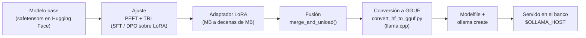
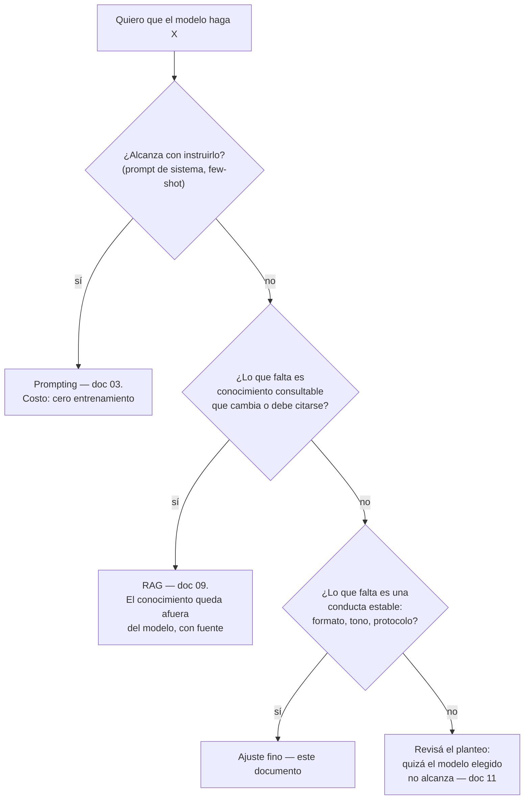

# 06. Ajuste fino y alineación

Este documento resuelve una pregunta que el documento 05 deja abierta: ya existe un modelo
preentrenado que completa texto — ¿cómo se lo lleva a comportarse como uno quiere, con el hardware
que uno tiene? El camino va del ajuste fino supervisado a la alineación por preferencias, y termina
con el modelo ajustado servido en el motor de inferencia.

**Antes de leer**: [05 — Preentrenamiento y leyes de escala](05-Preentrenamiento-Y-Leyes-De-Escala.md).
**Anterior**: [05 — Preentrenamiento y leyes de escala](05-Preentrenamiento-Y-Leyes-De-Escala.md) ·
**Siguiente**: [07 — Evaluación y métricas](07-Evaluacion-Y-Metricas.md).
Convenciones del cuerpo: [Convenciones.md](Convenciones.md) (citado §2, ejemplos §3, cifras §4).
Apartamiento declarado ([Convenciones.md](Convenciones.md) §5): el documento supera la extensión
orientativa de 350–700 líneas porque sus laboratorios 6.A y 6.B transcriben completos los
corredores, comandos y salidas reales capturadas, como exige el patrón de ejemplo operable; el
eje de partición, si hiciera falta, es el que declara el grafo de
[Cohesion-Global.md](Cohesion-Global.md) (ajuste fino supervisado operable / alineación por
preferencias).

## Índice

1. [Definición](#1-definición)
2. [Aplicación por escenario](#2-aplicación-por-escenario)
3. [Ejemplos concretos](#3-ejemplos-concretos)
4. [Bloque didáctico](#4-bloque-didáctico)
5. [Criterios de calidad](#5-criterios-de-calidad)
6. [Anexo: lista de verificación de un ajuste](#6-anexo-lista-de-verificación-de-un-ajuste)
7. [Referencias](#referencias)

---

## 1. Definición

### 1.1 Ajuste fino

**Ajuste fino** (*fine-tuning*). Entrenamiento posterior de un modelo ya preentrenado sobre datos
de una tarea o dominio: se parte de los parámetros que dejó el preentrenamiento y se los sigue
moviendo, con la misma mecánica de descenso por gradiente del documento 05, pero sobre un
dataset chico y elegido (Hu et al., 2022).

**Cómo se aplica.** Compará los dos presupuestos: el preentrenamiento de Qwen2.5 consumió del
orden de 18 billones (10¹²) de *tokens* (Qwen Team, 2025); un ajuste fino típico consume entre
cientos y decenas de miles de ejemplos. Si tu problema necesita que el modelo *sepa* algo que no
está en sus pesos, estás en el territorio del documento 05 o del RAG
([09](09-Bases-Vectoriales-Y-RAG.md)); si necesita que *se comporte* distinto con lo que ya sabe
— formato, tono, vocabulario de un dominio, obediencia a un protocolo —, estás acá.

**Un caso.** El laboratorio 6.B de este documento toma `Qwen2.5-0.5B-Instruct`, que responde
preguntas generales en estilo genérico, y con 20 ejemplos le impone el estilo del «asistente del
taller»: respuestas de una o dos frases con la terminología del glosario de esta guía. El modelo no
aprende hechos nuevos; aprende una conducta.

Lo que no es: el ajuste fino no es una base de conocimiento. Meter hechos por ajuste fino es
posible pero frágil — el modelo los mezcla, los olvida y no puede citarlos —, y la decisión
prompt / RAG / ajuste de §2 existe precisamente para no pagar un entrenamiento donde alcanzaba
un *prompt*.

### 1.2 SFT: la forma supervisada

**SFT** (ajuste fino supervisado, *supervised fine-tuning*). Ajuste fino con pares
instrucción→respuesta: el modelo ve la conversación completa y la pérdida — la misma entropía
cruzada por *token* del documento 05 — se calcula sobre lo que debía responder (Ouyang et al.,
2022). Es el primer paso con que un modelo base se vuelve modelo *instruct*
([03](03-Del-Modelo-Base-Al-Asistente.md)), y también el mecanismo con que un modelo *instruct*
se especializa en un dominio.

La evidencia sobre SFT apunta en una dirección incómoda para el reflejo de «más datos»: con un
modelo base fuerte, mil ejemplos cuidadosamente curados alcanzaron para alinear un modelo de 65B
con calidad competitiva (Zhou et al., 2023), y el experimento fundacional de Alpaca instruyó un
modelo de 7B con 52.000 ejemplos generados (Taori et al., 2023). En SFT la calidad y la
diversidad del dato pesan más que su volumen; el laboratorio 6.A trabaja esa curaduría a escala
de juguete.

### 1.3 LoRA y QLoRA: ajustar sin tocar los pesos

**LoRA** (*Low-Rank Adaptation*). Ajuste fino eficiente que congela los pesos originales y
entrena, adosadas a ciertas matrices del modelo, dos matrices chicas A y B cuyo producto —de
rango bajo `r`— se suma al peso original al aplicar el modelo (Hu et al., 2022).

**Cómo se aplica.** Contá parámetros antes de entrenar. Para una matriz de `d_in × d_out`, LoRA
entrena `r × (d_in + d_out)` parámetros en lugar de `d_in × d_out`. El cálculo del laboratorio
6.B da, para `Qwen2.5-0.5B` con `r = 8` sobre las cuatro proyecciones de atención, 1.081.344
parámetros entrenables: el 0,22 % del modelo. Esa cuenta decide si el ajuste cabe en tu hardware
y cuánto pesa el artefacto resultante (el **adaptador**: de unos MB a unas decenas de MB contra
el GB del modelo; el del laboratorio 6.B, medido, pesa 4,4 MB en float32).

**Un caso.** Hu et al. (2022) reportan que en GPT-3 175B LoRA redujo los parámetros entrenables
10.000 veces y la memoria de GPU 3 veces, con calidad igual o mejor que el ajuste completo en sus
bancos de prueba. La contracara también está medida: frente al ajuste completo, LoRA aprende algo
menos de la tarea nueva y olvida bastante menos de lo que el modelo ya sabía (Biderman et al.,
2024) — un intercambio que suele convenirle a quien ajusta un modelo chico para un dominio.

**QLoRA** lleva la misma idea un paso más allá: el modelo base se carga cuantizado a 4 bits (tipo
NF4, con doble cuantización) y los adaptadores LoRA se entrenan encima, en precisión alta
(Dettmers et al., 2023). Su ganancia es memoria de GPU — el trabajo original ajustó un modelo de
65B en una sola GPU de 48 GB —, de modo que QLoRA tiene sentido en CTX-02; en CTX-01, sin GPU, no
hay memoria de GPU que ahorrar y el camino es LoRA sobre el modelo sin cuantizar, como hace el
laboratorio 6.B.

### 1.4 Alineación: RLHF y DPO

**Alineación por preferencias.** Segunda etapa del ajuste: ya no se le muestra al modelo *la*
respuesta correcta (eso fue SFT) sino pares de respuestas donde una es preferida sobre la otra, y
se optimiza para que el modelo se incline hacia la preferida (Christiano et al., 2017; Ouyang et
al., 2022).

**Cómo se aplica.** Mirá qué forma tiene tu señal de calidad. Si podés escribir la respuesta
correcta, es SFT. Si sólo podés decir «esta respuesta es mejor que aquella» — tono, inocuidad,
utilidad, estilo: juicios comparativos sin una única respuesta correcta —, es alineación por
preferencias.

Dos mecanismos dominan:

- **RLHF** (*Reinforcement Learning from Human Feedback*): se entrena primero un **modelo de
  recompensa** que puntúa respuestas imitando la preferencia humana, y luego se optimiza el modelo
  por refuerzo —típicamente PPO (Schulman et al., 2017)— contra esa recompensa, con una penalidad
  que le impide alejarse demasiado del modelo de partida (Ouyang et al., 2022). Es el procedimiento
  con que se construyó InstructGPT y la receta clásica de los asistentes comerciales (Bai et al.,
  2022); también es un sistema de varias piezas, costoso y delicado de estabilizar.
- **DPO** (*Direct Preference Optimization*): demuestra que, bajo el mismo planteo, el modelo de
  recompensa se puede eliminar — el propio modelo de lenguaje «es secretamente un modelo de
  recompensa» — y el problema se resuelve con una pérdida de clasificación directa sobre los pares
  elegida/rechazada, contra un modelo de referencia congelado (Rafailov et al., 2023). Una sola
  pasada de entrenamiento, sin refuerzo, con un hiperparámetro central (`beta`, la fuerza con que
  se le permite desviarse de la referencia).

**Un caso.** Para distinguirlos en los papeles: el *Qwen3 Technical Report* describe su
*post-training* como etapas de SFT seguidas de aprendizaje por refuerzo (Qwen Team, 2025);
muchos modelos abiertos chicos, en cambio, publican variantes alineadas sólo con DPO sobre
datasets públicos de preferencias. Cuando leas una *model card* ([11](11-Panorama-Y-Ecosistema-Abierto.md)),
buscá esa frase: te dice cuánta infraestructura hubo detrás de la alineación.

### 1.5 La cadena completa, de los pesos al servicio

Acá aparece una restricción de herramientas que esta guía fija de una vez (decisión EM-01 del
expediente de la guía): **Ollama no entrena** — su documentación cubre importar y servir modelos,
no ajustarlos (Ollama, s. f.) —, de modo que el ajuste vive en el ecosistema Hugging Face y el
resultado viaja hacia el motor de inferencia:



Las piezas: **PEFT** (*Parameter-Efficient Fine-Tuning*) es la biblioteca de Hugging Face que
implementa LoRA y sus parientes (Hugging Face, 2026a); **TRL** aporta los entrenadores
`SFTTrainer` y `DPOTrainer` que orquestan el ajuste, con integración directa con PEFT (Hugging
Face, 2026b); **llama.cpp** convierte los pesos desde **safetensors** — el formato en que Hugging
Face distribuye los pesos de los modelos — al GGUF que consume el motor, y los cuantiza
([08](08-Inferencia-Local.md) trata ambos formatos y la cuantización en profundidad); **Ollama** importa el
GGUF con un Modelfile y lo sirve (Ollama, s. f.). El laboratorio 6.B recorre la cadena entera.

---

## 2. Aplicación por escenario

El escenario dueño de este documento es **ESC-04** (adaptar un modelo a un dominio), y su primera
regla es que el ajuste es la **tercera** opción, no la primera. El catálogo del
[marco de referencia](Marco-De-Referencia.md) lo dice en la propia definición del escenario: «con
la decisión prompt/RAG/ajuste antes».



El orden no es dogma sino cuenta de costos: cada paso hacia abajo agrega entrenamiento, datos
curados y una evaluación propia que mantener. Un ajuste que un *prompt* de sistema resolvía es
deuda técnica entrenada.

Qué cambia por contexto:

| CTX | Qué significa para el ajuste |
| --- | --- |
| CTX-01 (CPU, 8–16 GB) | LoRA sobre modelos chicos (≤1.5B) es viable; lento pero real. QLoRA no aporta (su ganancia es memoria de GPU). El laboratorio 6.B corre acá |
| CTX-02 (GPU de consumo) | El territorio natural de QLoRA: modelos de 7–14B cuantizados a 4 bits con adaptadores encima (Dettmers et al., 2023) |
| CTX-03 (banco compartido) | El banco **sirve** el resultado, no entrena: la cadena de §1.5 termina con `ollama create` contra `$OLLAMA_HOST`, y subir modelos es decisión del operador (ACT-03) |
| CTX-05 (datos sensibles) | El ajuste fino es la vía que mantiene los datos adentro: el dataset nunca sale del equipo, a diferencia del ajuste vía API de terceros (CTX-04) |
| CTX-06 (contenedor / CI) | El adaptador es el artefacto a versionar: chico, comparable por diff entre fechas y datasets; el modelo base se fija por digest |

Los otros escenarios tocan este documento de costado: **ESC-01** (elegir modelo) necesita saber si
la licencia del base permite derivar y redistribuir — en la familia Qwen2.5 casi todos los
tamaños abiertos son Apache-2.0, incluidos `0.5B` y `1.5B`; las excepciones son `3B` y `72B`,
publicados bajo licencias propias (Qwen Team, 2025; verificado contra la API de Hugging Face el
2026-11-07); el detalle por familia vive en
[11](11-Panorama-Y-Ecosistema-Abierto.md) —; **ESC-05** (evaluar con evidencia) es la otra mitad
de cualquier ajuste serio: sin medición antes/después no se sabe si el ajuste mejoró algo
([07](07-Evaluacion-Y-Metricas.md)); y **ESC-02** (montar y servir) recibe el producto final
([08](08-Inferencia-Local.md)).

El actor de este documento es el estudiante-lector (ACT-01) asumiendo el rol de ajustador, como lo
define el marco; cuando el resultado se sube al banco compartido interviene el operador (ACT-03), y
qué datos entran al dataset con qué derecho es la pregunta del curador (ACT-05), tratada en
[04](04-Datos-Y-Corpus.md).

---

## 3. Ejemplos concretos

Este documento es dueño del laboratorio de ajuste de la guía (expediente 0001, folio 011 §4):
nadie más lo duplica, los demás documentos lo citan. Son dos laboratorios operables más una
variante y un ejemplo ilustrativo; el patrón que cumplen (contexto, versiones, salida, qué hacer
si difiere) es el §3 de [Convenciones.md](Convenciones.md).

Versiones fijadas de toda la sección, verificadas en PyPI el 2026-11-07: `transformers 5.22.2`,
`trl 1.17.1`, `peft 0.21.2`, `datasets 5.1.0`, `accelerate 1.15.0`, `torch 2.15.0`;
llama.cpp release `v0.9.0` (2026-11-04). Modelo base: `Qwen/Qwen2.5-0.5B-Instruct`
(licencia Apache-2.0; Qwen Team, 2025).

### 3.1 Laboratorio 6.A — construir y validar un dataset de SFT (operable, CTX-01)

Un ajuste vale lo que vale su dataset, así que el primer laboratorio no entrena nada: construye y
valida el insumo. El formato es el conversacional de TRL — una línea JSON por ejemplo, con la
lista `messages` de turnos `system`/`user`/`assistant` —, que `SFTTrainer` consume aplicando
automáticamente la plantilla de chat del modelo (Hugging Face, 2026b).

El dataset de juguete: 20 pares pregunta→respuesta que le imponen al modelo el estilo «asistente
del taller» (respuestas de una o dos frases, terminología del glosario de esta guía). Generarlo
con un script, en lugar de escribir el JSONL a mano, deja la curaduría versionable:

```python
# construye_dataset.py — genera taller_sft.jsonl (fragmento: 5 de los 20 pares)
import json

SYSTEM = ("Sos el asistente del taller: respondés en una o dos frases, "
          "en español, con la terminología de la guía.")
pares = [
    ("¿Qué es LoRA?",
     "Un ajuste fino eficiente: entrena matrices chicas adosadas al modelo "
     "sin tocar los pesos originales."),
    ("¿Qué es SFT?",
     "Ajuste fino supervisado: se entrena con pares instrucción→respuesta "
     "escritos o curados por personas."),
    ("¿Ollama sirve para entrenar modelos?",
     "No: Ollama sólo sirve modelos ya entrenados; el ajuste se hace con la "
     "cadena de Hugging Face."),
    ("¿Qué es un adaptador?",
     "El artefacto que produce LoRA: las matrices entrenadas, chicas y "
     "separables del modelo base."),
    ("¿Qué es el olvido catastrófico?",
     "La pérdida de capacidades generales al ajustar sobre un dominio "
     "angosto; se mide evaluando antes y después."),
    # … 15 pares más en la misma forma
]
with open("taller_sft.jsonl", "w", encoding="utf-8") as f:
    for usuario, asistente in pares:
        f.write(json.dumps({"messages": [
            {"role": "system", "content": SYSTEM},
            {"role": "user", "content": usuario},
            {"role": "assistant", "content": asistente},
        ]}, ensure_ascii=False) + "\n")
print(f"taller_sft.jsonl: {len(pares)} ejemplos escritos")
```

Antes de entrenar, validar: que cada línea sea JSON, que cada ejemplo tenga su lista `messages`,
que los roles sean los tres válidos y que el último turno sea del `assistant` (es lo que el
entrenamiento debe imitar). Un validador mínimo:

```python
# valida_dataset.py — uso: python3 valida_dataset.py taller_sft.jsonl
import json, sys

ruta = sys.argv[1]
filas, errores = 0, []
for n, linea in enumerate(open(ruta, encoding="utf-8"), start=1):
    linea = linea.strip()
    if not linea:
        continue
    filas += 1
    try:
        ej = json.loads(linea)
    except json.JSONDecodeError as e:
        errores.append(f"línea {n}: JSON inválido ({e})"); continue
    msgs = ej.get("messages")
    if not isinstance(msgs, list) or len(msgs) < 2:
        errores.append(f"línea {n}: falta la lista 'messages' con al menos 2 turnos"); continue
    if msgs[-1].get("role") != "assistant":
        errores.append(f"línea {n}: el último turno debe ser 'assistant'")
    for i, m in enumerate(msgs):
        if m.get("role") not in ("system", "user", "assistant"):
            errores.append(f"línea {n}: rol desconocido '{m.get('role')}' en el turno {i}")
        if not isinstance(m.get("content"), str) or not m["content"].strip():
            errores.append(f"línea {n}: turno {i} sin 'content' textual")

print(f"{filas} ejemplos leídos; {len(errores)} errores")
for e in errores:
    print(" -", e)
sys.exit(1 if errores else 0)
```

Salida de la corrida real (determinista: validación, no generación):

```text
$ python3 construye_dataset.py && python3 valida_dataset.py taller_sft.jsonl
taller_sft.jsonl: 20 ejemplos escritos
20 ejemplos leídos; 0 errores
```

<details>
<summary>Protocolo de la cifra</summary>

- **Cifra**: 20 ejemplos válidos, 0 errores de formato
- **Entrada / dataset**: `taller_sft.jsonl` generado por el script transcripto (20 pares)
- **Herramienta**: Python 3.11.2, biblioteca estándar
- **Semilla**: no aplica (proceso determinista, sin muestreo)
- **Contexto de hardware**: CTX-01 (CPU x86-64, 16 GB)
- **Fecha de la corrida**: 2026-11-07
</details>

Si difiere: un error acá es siempre de datos, no de entorno — el validador corre con la biblioteca
estándar en cualquier Python ≥3.8. Corregí la línea que señala y volvé a correr.

A escala real cambia el volumen, no el método: los datasets públicos de SFT tienen el mismo
formato con miles de filas, y la curaduría — deduplicar, filtrar, verificar licencias — es el
oficio del documento [04](04-Datos-Y-Corpus.md).

### 3.2 Laboratorio 6.B — receta LoRA completa: de los pesos de HF al banco (operable, CTX-01 declarado)

La receta entera, paso a paso, sobre `Qwen/Qwen2.5-0.5B-Instruct`. Corre en CTX-01; el
entrenamiento en CPU es lento (la medición va en el paso 2). Estado de verificación (2026-11-07):
pasos 0–4 corridos de punta a punta en CTX-01 — el entrenamiento, en versión reducida por el tope
de tiempo del banco de verificación —; los pasos 5–6 (servir en el banco) quedan ilustrativos
porque crear modelos en el banco compartido es decisión del operador (ACT-03).

**Paso 0 — verificar el banco** (se enseña en [08](08-Inferencia-Local.md) y acá se cita):

```bash
curl -s "${OLLAMA_HOST:-http://localhost:11434}/api/tags" >/dev/null \
  && echo "banco accesible" || echo "banco NO accesible: revisá OLLAMA_HOST"
```

**Paso 1 — entorno con versiones fijadas:**

```bash
python3 -m venv .venv && source .venv/bin/activate
pip install "torch==2.15.0" --index-url https://download.pytorch.org/whl/cpu
pip install "transformers==5.22.2" "trl==1.17.1" "peft==0.21.2" \
            "datasets==5.1.0" "accelerate==1.15.0"
```

(La variante `whl/cpu` de torch instala la rueda sin CUDA, varios GB más liviana; en CTX-02 se
omite ese `--index-url`.)

**Paso 2 — entrenar el adaptador LoRA con SFT:**

```python
# entrena_lora.py
import torch
from datasets import load_dataset
from peft import LoraConfig
from trl import SFTConfig, SFTTrainer

dataset = load_dataset("json", data_files="taller_sft.jsonl", split="train")

trainer = SFTTrainer(
    model="Qwen/Qwen2.5-0.5B-Instruct",
    train_dataset=dataset,
    peft_config=LoraConfig(
        r=8,                   # rango de las matrices LoRA
        lora_alpha=16,         # escala del aporte del adaptador
        lora_dropout=0.05,
        target_modules=["q_proj", "k_proj", "v_proj", "o_proj"],
    ),
    args=SFTConfig(
        output_dir="salida-lora",
        num_train_epochs=3,
        per_device_train_batch_size=2,
        gradient_accumulation_steps=4,
        learning_rate=1e-4,    # con adaptadores se usa un LR mayor que en ajuste completo
        logging_steps=5,
        seed=42,
        max_length=512,
        use_cpu=True,          # CTX-01; en CTX-02, quitar esta línea
        model_init_kwargs={"dtype": torch.float32},
    ),
)
trainer.train()
trainer.save_model("salida-lora/final")   # guarda SOLO el adaptador
```

Dos decisiones del script merecen su porqué. `learning_rate=1e-4` sigue la recomendación de la
documentación de TRL para adaptadores — sólo se aprenden parámetros nuevos, así que tolera una
tasa mayor que el `2e-5` por defecto del SFT completo (Hugging Face, 2026b). Y `target_modules`
apunta a las cuatro proyecciones de atención, la elección del trabajo original de LoRA (Hu et
al., 2022); agregar las capas MLP sube capacidad y costo, y para esta escala no hace falta.

Cuántos parámetros se entrenan se calcula antes de correr, con la aritmética de LoRA y la
configuración publicada del modelo (`hidden 896`, 24 capas, 14 cabezas de consulta y 2 KV de 64;
Qwen Team, 2025):

```python
# cuenta_lora.py
hidden, capas, head_dim, q_heads, kv_heads, r = 896, 24, 64, 14, 2, 8
dims = {
    "q_proj": (hidden, q_heads * head_dim),   # 896 -> 896
    "k_proj": (hidden, kv_heads * head_dim),  # 896 -> 128
    "v_proj": (hidden, kv_heads * head_dim),  # 896 -> 128
    "o_proj": (q_heads * head_dim, hidden),   # 896 -> 896
}
por_capa = sum(r * (d_in + d_out) for d_in, d_out in dims.values())
total = por_capa * capas
print(f"por capa: {por_capa} · total en {capas} capas: {total:,}")
print(f"fracción del modelo (≈494M parámetros): {total/494_000_000:.4%}")
```

```text
$ python3 cuenta_lora.py
por capa: 45056 · total en 24 capas: 1,081,344
fracción del modelo (≈494M parámetros): 0.2189%
```

<details>
<summary>Protocolo de la cifra</summary>

- **Cifra**: 1.081.344 parámetros entrenables (0,22 % de ≈494M)
- **Modelo**: Qwen/Qwen2.5-0.5B-Instruct — dimensiones de su configuración publicada (Qwen Team, 2025)
- **Herramienta**: Python 3.11.2; cálculo cerrado `r × (d_in + d_out)` por matriz (Hu et al., 2022)
- **Semilla**: no aplica (aritmética determinista)
- **Contexto de hardware**: CTX-01
- **Fecha de la corrida**: 2026-11-07
</details>

Duración del entrenamiento: la corrida completa (9 pasos de optimización, 3 épocas) quedó
**[Ilustrativo — no verificado en el banco]** porque excede el tope de ~10 minutos por corrida
del banco de verificación: en el intento real (CTX-01 compartido con otras cargas, ~1,2 núcleos
efectivos para el proceso), 10 minutos no alcanzaron para completar ni el primer paso de
optimización. Lo que sí se corrió entero es una **corrida reducida** — el mismo script con
`max_steps=3`, `per_device_train_batch_size=1`, `gradient_accumulation_steps=1`,
`logging_steps=1` —, que entrena y guarda el adaptador; su salida real:

```text
$ python entrena_lora_reducido.py   # corrida reducida; la completa excede el tope del banco
{'loss': '4.481', 'grad_norm': '9.988', 'learning_rate': '0.0001', 'mean_token_accuracy': '0.3457', 'num_tokens': '82', 'epoch': '0.05'}
{'loss': '5.221', 'grad_norm': '7.007', 'learning_rate': '6.667e-05', 'mean_token_accuracy': '0.3086', 'num_tokens': '164', 'epoch': '0.1'}
{'loss': '4.618', 'grad_norm': '5.16', 'learning_rate': '3.333e-05', 'mean_token_accuracy': '0.3766', 'num_tokens': '242', 'epoch': '0.15'}
{'train_runtime': '380.3', 'train_samples_per_second': '0.008', 'train_steps_per_second': '0.008', 'train_loss': '4.773', 'epoch': '0.15'}
```

<details>
<summary>Protocolo de la cifra</summary>

- **Cifra**: 380,3 s para 3 pasos de 1 ejemplo (~127 s por micro-lote); loss por paso 4,481 / 5,221 / 4,618
- **Entrada / dataset**: `taller_sft.jsonl` (20 ejemplos del laboratorio 6.A); semilla 42
- **Herramienta**: trl 1.17.1, transformers 5.22.2, peft 0.21.2, torch 2.15.0+cpu, Python 3.11.2
- **Contexto de hardware**: CTX-01 compartido (8 núcleos nominales, ~1,2 efectivos por carga ajena)
- **Fecha de la corrida**: 2026-11-07
</details>

Tres pasos de a un ejemplo no imponen el estilo del taller (la loss apenas se mueve y es ruidosa:
cada paso ve un solo ejemplo); muestran que la mecánica corre y cuánto cuesta cada paso. A ese
ritmo medido, los 72 micro-lotes de la corrida completa proyectan horas en ese banco compartido;
en un CTX-01 dedicado, la referencia sigue siendo la estimación de decenas de minutos a una hora
para 20 ejemplos × 3 épocas sobre 0.5B en float32.

**Paso 3 — fusionar el adaptador con el modelo base:**

```python
# fusiona.py
from peft import AutoPeftModelForCausalLM
from transformers import AutoTokenizer

model = AutoPeftModelForCausalLM.from_pretrained("salida-lora/final")
model = model.merge_and_unload()          # suma B·A a los pesos y descarta el andamiaje PEFT
model.save_pretrained("taller-qwen-fusionado")
AutoTokenizer.from_pretrained("Qwen/Qwen2.5-0.5B-Instruct") \
    .save_pretrained("taller-qwen-fusionado")
```

La fusión produce un modelo común y corriente en safetensors, que es lo que la conversión a GGUF
espera. (llama.cpp también convierte adaptadores sueltos con `convert_lora_to_gguf.py`, pero la
vía fusionada es la que menos supuestos le pide al motor.)

**Paso 4 — convertir a GGUF y cuantizar:**

```bash
git clone --branch v0.9.0 --depth 1 https://github.com/ggml-org/llama.cpp
pip install -r llama.cpp/requirements.txt
python llama.cpp/convert_hf_to_gguf.py taller-qwen-fusionado \
    --outfile taller-qwen-0.5b-q8_0.gguf --outtype q8_0
```

Dos tropiezos medidos en la corrida de verificación (2026-11-07). Primero:
`pip install -r llama.cpp/requirements.txt` **pisa las versiones fijadas del paso 1** (en la
corrida real degradó `torch` 2.15.0→2.11.0 y `transformers` 5.22.2→4.57.6 dentro del mismo
venv); como la conversión es el último paso que usa Python, el orden de la receta sobrevive,
pero si vas a volver a entrenar, instalá los requisitos de llama.cpp en un venv aparte. Segundo:
al reescribir el tokenizador, el `save_pretrained` de transformers 5.22.2 deja
`extra_special_tokens` como lista, y el transformers 4.57.6 que fijan esos requisitos no la lee —
la conversión corta con `AttributeError: 'list' object has no attribute 'keys'`. El remedio
verificado: copiar al directorio fusionado los archivos del tokenizador del modelo base original
(`tokenizer_config.json`, `tokenizer.json`, `vocab.json`, `merges.txt`, del *snapshot* de
Hugging Face) en lugar de los reescritos por la fusión, y recién entonces convertir.

`--outtype q8_0` cuantiza a 8 bits en el mismo paso de conversión, sin compilar nada; para los
tipos K (`Q4_K_M` y compañía) hace falta la herramienta `llama-quantize` compilada, sobre un GGUF
convertido primero a F32/BF16 (ggml-org, 2026). Para 0.5B el Q8_0 (~500 MB) es suficiente y la
pérdida por cuantización, tema del documento [08](08-Inferencia-Local.md), se mantiene mínima.

**Paso 5 — importar al banco y servir:**

El Modelfile mínimo declara de qué archivo salen los pesos y qué plantilla de chat usa el modelo.
Para no escribir la plantilla a mano, se copia la de la misma familia ya montada en el banco:

```bash
ollama show --modelfile qwen2.5:7b-instruct   # contra $OLLAMA_HOST; imprime TEMPLATE y stops
```

```text
# Modelfile
FROM ./taller-qwen-0.5b-q8_0.gguf
# TEMPLATE: pegar acá la de `ollama show --modelfile qwen2.5:7b-instruct`
# (plantilla ChatML de la familia Qwen2.5 — arranca con {{- if .Messages }} y arma los turnos
#  con <|im_start|>/<|im_end|> —, verificada en el banco el 2026-11-07 vía `POST /api/show`;
#  en el banco ese modelfile trae TEMPLATE y SYSTEM, sin PARAMETER stop: los cortes los
#  resuelve la propia plantilla)
```

```bash
ollama create taller-qwen -f Modelfile        # el cliente respeta $OLLAMA_HOST
ollama run taller-qwen "¿Qué es un adaptador?"
```

En CTX-03 crear modelos en el banco es una decisión del operador (ACT-03): pedí permiso antes de
ocupar su disco. La importación por Modelfile es el procedimiento documentado de Ollama, que
además no re-cuantiza GGUF al importar (Ollama, s. f.).

**Paso 6 — comparar antes y después.** La comparación justa es contra el mismo 0.5B sin ajustar,
no contra otro modelo del banco: convertí también el base descargado (el mismo
`convert_hf_to_gguf.py` del paso 4, sobre el directorio del modelo original) y crealo como
`taller-qwen-base`. Después, la misma pregunta a los dos:

```bash
for m in taller-qwen-base taller-qwen; do
  echo "== $m =="
  curl -s "${OLLAMA_HOST:-http://localhost:11434}/api/chat" -d '{
    "model": "'"$m"'", "stream": false,
    "options": {"temperature": 0, "seed": 42},
    "messages": [{"role": "user", "content": "¿Ollama sirve para entrenar modelos?"}]
  }' | python3 -c "import json,sys; print(json.load(sys.stdin)['message']['content'])"
done
```

**[Ilustrativo — no verificado en el banco]** — crear modelos en el banco compartido es decisión
del operador (ACT-03), como fija la fila CTX-03 de §2, y el mandato de la corrida de verificación
de este documento no permitía subirle modelos: la comparación servida queda para una corrida con
banco propio. Lo estable sigue siendo el contraste de estilo (el ajustado debe responder en una o
dos frases con la terminología del glosario); el texto exacto varía. De la cadena previa sí quedó
verificado el 2026-11-07: la fusión del paso 3 produce un modelo que genera texto coherente
(transformers 5.22.2, decodificación voraz, CTX-01), el GGUF Q8_0 del paso 4 pesa 531.067.904
bytes (~506 MiB: el «~500 MB» anunciado), y la plantilla que pide el paso 5 es la ChatML de la
familia, confirmada contra el banco por `POST /api/show`. El contraste de estilo en sí exige la
corrida completa de entrenamiento, que excede el tope del banco de verificación (ver paso 2).

Esta comparación de dos salidas es un juicio a ojo; el juicio con protocolo — un eval propio
corrido sobre el modelo antes y después del ajuste — es el laboratorio del documento
[07](07-Evaluacion-Y-Metricas.md).

**Variante QLoRA (CTX-02).** Con GPU, el mismo `entrena_lora.py` se vuelve QLoRA agregando la
configuración de cuantización del modelo base — TRL la combina con `peft_config` exactamente para
esto (Hugging Face, 2026b):

```python
from transformers import BitsAndBytesConfig
trainer = SFTTrainer(
    model="Qwen/Qwen2.5-1.5B-Instruct",       # con GPU ya entra el 1.5B
    quantization_config=BitsAndBytesConfig(
        load_in_4bit=True,
        bnb_4bit_quant_type="nf4",            # el tipo de 4 bits de QLoRA
        bnb_4bit_use_double_quant=True,
        bnb_4bit_compute_dtype=torch.bfloat16,
    ),
    peft_config=LoraConfig(r=8, lora_alpha=16,
                           target_modules=["q_proj", "k_proj", "v_proj", "o_proj"]),
    train_dataset=dataset,
    args=SFTConfig(output_dir="salida-qlora", learning_rate=1e-4, seed=42),
)
```

Tras entrenar, el camino es el mismo: fusionar (la fusión recarga el base sin cuantizar),
convertir, servir. En CTX-01 esta variante no corre: la cuantización NF4 de bitsandbytes está
construida para memoria de GPU, que es lo que QLoRA ahorra (Dettmers et al., 2023).

### 3.3 Ejemplo **[ilustrativo]** — DPO de juguete y el costo real de la alineación

Se lee, no se corre en este cuerpo: muestra la forma de un entrenamiento por preferencias y la
magnitud de los de verdad. Un dataset de preferencias tiene tres campos por fila — el *prompt*, la
respuesta elegida y la rechazada (Hugging Face, 2026c):

```json
{"prompt":   [{"role": "user", "content": "¿Qué es LoRA?"}],
 "chosen":   [{"role": "assistant", "content": "Un ajuste fino eficiente: entrena matrices chicas adosadas al modelo sin tocar los pesos originales."}],
 "rejected": [{"role": "assistant", "content": "LoRA es una técnica muy interesante del fascinante mundo de la IA que seguramente te va a encantar…"}]}
```

Y el entrenamiento es un espejo del SFT con otra pérdida y un hiperparámetro nuevo:

```python
from trl import DPOConfig, DPOTrainer
trainer = DPOTrainer(
    model="salida-lora/final-fusionado",       # se alinea el modelo YA pasado por SFT
    train_dataset=preferencias,
    peft_config=LoraConfig(r=8, lora_alpha=16),
    args=DPOConfig(output_dir="salida-dpo", beta=0.1, learning_rate=1e-5, seed=42),
)
```

`beta` regula cuánto puede desviarse el modelo de su referencia: más alto, más conservador
(Rafailov et al., 2023; Hugging Face, 2026c). Orden de magnitud real: los datasets públicos de
preferencias usados para alinear modelos abiertos rondan las decenas de miles de pares (el
UltraFeedback binarizado que usan los ejemplos oficiales de TRL tiene ~60.000), y un RLHF completo
como el de InstructGPT sumó, además de los pares, el entrenamiento de un modelo de recompensa y
una fase de PPO con generación continua (Ouyang et al., 2022) — infraestructura de otro orden, que
excede el banco CPU de esta guía. Tiempos: no hay cifra propia que ofrecer sin fabricarla; como
referencia, QLoRA reporta el ajuste por preferencias de un 65B en menos de 24 horas sobre una GPU
de 48 GB (Dettmers et al., 2023), y de ahí hacia abajo escala con el tamaño del modelo.

---

## 4. Bloque didáctico

**Pregunta** — ¿Prompt, RAG o ajuste fino: cómo decido sin probar los tres?
**Criterio que forma** — Clasificar el déficit del modelo antes de elegir la herramienta: falta de
instrucción, falta de conocimiento consultable o falta de conducta estable.
**Respuesta explicativa** — Escribí tres o cuatro casos de entrada y salida deseada, y preguntate
qué le falta al modelo para resolverlos. Si con la instrucción correcta en el *prompt* los
resuelve, no hay nada que entrenar. Si necesita hechos que cambian o que hay que citar con
fuente, el conocimiento tiene que quedar fuera de los pesos: RAG. Sólo cuando el déficit es de
conducta — formato, tono, protocolo, vocabulario — y persiste con buen *prompting*, el ajuste
fino paga su costo.
**Reenvío** — El diagrama de decisión de [§2](#2-aplicación-por-escenario).

**Pregunta** — ¿Por qué LoRA en vez de ajustar todos los pesos, si el ajuste completo aprende más?
**Criterio que forma** — Elegir método de ajuste contando parámetros, memoria y lo que se está
dispuesto a olvidar.
**Respuesta explicativa** — El ajuste completo mueve los 494 millones de parámetros del 0.5B y
exige memoria para el optimizador de todos ellos; LoRA mueve un millón y deja el resto congelado.
La evidencia muestra el intercambio: LoRA aprende algo menos de la tarea nueva pero degrada mucho
menos las capacidades generales del modelo (Biderman et al., 2024). Para especializar un modelo
chico que además debe seguir conversando de todo, ese es el lado bueno del trato — y el adaptador
de decenas de MB se versiona y se comparte sin mover el modelo entero.
**Reenvío** — La cuenta de parámetros corrida en el [laboratorio 6.B](#32-laboratorio-6b--receta-lora-completa-de-los-pesos-de-hf-al-banco-operable-ctx-01-declarado).

**Pregunta** — ¿Qué me da DPO que no me diera SFT, si los dos entrenan con ejemplos?
**Criterio que forma** — Distinguir el tipo de señal de supervisión: respuesta correcta contra
preferencia entre respuestas.
**Respuesta explicativa** — SFT necesita que alguien escriba *la* respuesta buena; DPO sólo
necesita que alguien elija entre dos. Hay cualidades — naturalidad, inocuidad, no irse por las
ramas — para las que nadie puede redactar la respuesta óptima pero cualquiera reconoce la mejor de
dos. DPO convierte ese juicio comparativo en gradiente directamente, sin el modelo de recompensa
ni el bucle de refuerzo del RLHF (Rafailov et al., 2023). El orden práctico es SFT primero (que el
modelo sepa responder) y preferencias después (que responda como se prefiere).
**Reenvío** — El formato de pares y el papel de `beta` en el [ejemplo ilustrativo de §3.3](#33-ejemplo-ilustrativo--dpo-de-juguete-y-el-costo-real-de-la-alineación).

**Pregunta** — Ajusté el modelo y en mi tarea anda mejor. ¿Terminé?
**Criterio que forma** — Exigirle a todo ajuste una medición de lo que pudo romper, no sólo de lo
que debía mejorar.
**Respuesta explicativa** — Un ajuste angosto puede degradar lo general: es el olvido catastrófico,
y no se ve mirando sólo la tarea del dataset. El cierre honesto de un ajuste mide dos cosas, antes
y después: un eval propio de la tarea (¿mejoró?) y una batería general corta (¿qué se rompió?). Si
la segunda cae más de lo que la primera sube, el remedio suele ser menos épocas, menos tasa de
aprendizaje o un dataset más diverso — no un modelo más grande.
**Reenvío** — El paso 6 del [laboratorio 6.B](#32-laboratorio-6b--receta-lora-completa-de-los-pesos-de-hf-al-banco-operable-ctx-01-declarado)
es la versión a ojo; el eval con protocolo es el laboratorio de [07](07-Evaluacion-Y-Metricas.md).

**Pregunta** — ¿Por qué la guía entrena con Hugging Face si todo lo demás corre en Ollama?
**Criterio que forma** — Ubicar cada herramienta en su etapa del ciclo de vida del modelo.
**Respuesta explicativa** — Son oficios distintos sobre el mismo artefacto. Ollama es un motor de
inferencia: carga pesos ya entrenados, en GGUF, y los sirve; su documentación cubre importar,
ejecutar y compartir, no entrenar (Ollama, s. f.). El entrenamiento necesita gradientes,
optimizadores y acceso a los pesos en precisión alta: eso vive en PyTorch y la cadena
transformers/PEFT/TRL. La frontera es el formato: safetensors mientras se entrena, GGUF para
servir, y `convert_hf_to_gguf.py` es el puente (ggml-org, 2026).
**Reenvío** — El diagrama de la cadena en [§1.5](#15-la-cadena-completa-de-los-pesos-al-servicio).

---

## 5. Criterios de calidad

Cómo se distingue un ajuste fino bien hecho de uno pobre — aplicables al propio laboratorio 6.B y
a cualquier ajuste real:

| Criterio | Versión buena | Versión pobre |
| --- | --- | --- |
| Justificación | La decisión prompt/RAG/ajuste está tomada y documentada; el ajuste ataca un déficit de conducta | Se entrenó «porque ajustar es lo serio»; un *prompt* de sistema lograba lo mismo |
| Dataset | Curado, validado, con procedencia y licencia declaradas ([04](04-Datos-Y-Corpus.md)); calidad sobre volumen (Zhou et al., 2023) | Volcado sin filtrar; ejemplos contradictorios o con la respuesta en el estilo equivocado |
| Reproducibilidad | Versiones fijadas, semilla declarada, hiperparámetros en el repositorio junto al dataset | «Corrió en mi máquina» con la última versión de todo y sin registro de la corrida |
| Medición | Eval antes/después de la tarea **y** control de lo general (olvido), con protocolo ([07](07-Evaluacion-Y-Metricas.md)) | Dos o tres prompts a ojo sobre el modelo nuevo solamente |
| Artefactos | Adaptador chico versionado aparte del base (fijado por digest); el GGUF final con su receta de construcción | Un GGUF suelto sin forma de saber de qué base, dataset ni parámetros salió |
| Licencias | El base permite derivar y el dataset permite entrenar; ambas citadas | Derivado publicado de un base cuya licencia lo prohíbe |

Dos de estas filas concentran la diferencia entre el aficionado y el oficio: la **medición** —
un ajuste sin eval antes/después no es un resultado, es una anécdota — y la **reproducibilidad**,
que es lo único que vuelve al ajuste un artefacto de ingeniería y no un golpe de suerte. El resto
se degrada en silencio; estas dos avisan.

---

## 6. Anexo: lista de verificación de un ajuste

Para recorrer antes, durante y después de cualquier ajuste fino; cada ítem remite a la sección que
lo desarrolla.

- [ ] La decisión prompt/RAG/ajuste está tomada con el diagrama de [§2](#2-aplicación-por-escenario) y anotada con su motivo.
- [ ] El modelo base está elegido con licencia que permite derivar, y fijado por etiqueta y digest ([Convenciones §3.2](Convenciones.md)).
- [ ] El dataset pasa el validador del [laboratorio 6.A](#31-laboratorio-6a--construir-y-validar-un-dataset-de-sft-operable-ctx-01): formato, roles, último turno del asistente.
- [ ] Procedencia y licencia de cada fuente del dataset declaradas ([04](04-Datos-Y-Corpus.md)).
- [ ] Una porción del dataset quedó apartada para evaluar: no se entrena con ella.
- [ ] Método elegido por contexto: LoRA en CTX-01, QLoRA en CTX-02; parámetros entrenables contados antes de correr ([§3.2](#32-laboratorio-6b--receta-lora-completa-de-los-pesos-de-hf-al-banco-operable-ctx-01-declarado)).
- [ ] Versiones de bibliotecas fijadas y semilla declarada en la configuración.
- [ ] Eval de la tarea corrido sobre el modelo base **antes** de entrenar (la línea de base).
- [ ] Entrenado; la pérdida bajó y el log de la corrida quedó guardado.
- [ ] Fusión → GGUF → Modelfile → `ollama create`, con la plantilla de chat de la familia ([§3.2, pasos 3–5](#32-laboratorio-6b--receta-lora-completa-de-los-pesos-de-hf-al-banco-operable-ctx-01-declarado)).
- [ ] Eval de la tarea y control de lo general corridos sobre el ajustado; comparados con la línea de base ([07](07-Evaluacion-Y-Metricas.md)).
- [ ] Adaptador, dataset, configuración y receta del GGUF versionados juntos (CTX-06).
- [ ] Si el resultado va al banco compartido: acuerdo previo con el operador (ACT-03).

---

## Referencias

Citado autor-año (APA 7.ª edición) conforme a [Convenciones.md](Convenciones.md) §2. Consultas web
de este documento: 2026-11-07.

- Bai, Y., et al. (2022). Training a helpful and harmless assistant with reinforcement learning
  from human feedback. arXiv:2204.05862. https://arxiv.org/abs/2204.05862
- Biderman, D., et al. (2024). LoRA learns less and forgets less. *TMLR*. arXiv:2405.09673.
  https://arxiv.org/abs/2405.09673
- Christiano, P., Leike, J., Brown, T., Martic, M., Legg, S., y Amodei, D. (2017). Deep
  reinforcement learning from human preferences. *NeurIPS 30*. arXiv:1706.03741
- Dettmers, T., Pagnoni, A., Holtzman, A., y Zettlemoyer, L. (2023). QLoRA: Efficient finetuning
  of quantized LLMs. *NeurIPS 36*. arXiv:2305.14314
- ggml-org. (2026). *llama.cpp — quantize tool* (release v0.9.0, 2026-11-04). GitHub.
  https://github.com/ggml-org/llama.cpp/blob/master/tools/quantize/README.md (consultada el
  2026-11-07)
- Hu, E. J., Shen, Y., Wallis, P., Allen-Zhu, Z., Li, Y., Wang, S., Wang, L., y Chen, W. (2022).
  LoRA: Low-rank adaptation of large language models. *ICLR*. arXiv:2106.09685
- Hugging Face. (2026a). *PEFT — Parameter-Efficient Fine-Tuning* (v0.21.2).
  https://huggingface.co/docs/peft (consultada el 2026-11-07)
- Hugging Face. (2026b). *TRL — SFT Trainer* (v1.17.1).
  https://huggingface.co/docs/trl/sft_trainer (consultada el 2026-11-07)
- Hugging Face. (2026c). *TRL — DPO Trainer* (v1.17.1).
  https://huggingface.co/docs/trl/dpo_trainer (consultada el 2026-11-07)
- Ollama. (s. f.). *Importing models*. https://docs.ollama.com/import (consultada el 2026-11-07)
- Ouyang, L., et al. (2022). Training language models to follow instructions with human feedback.
  *NeurIPS 35*. arXiv:2203.02155
- Qwen Team. (2025). *Qwen2.5 Technical Report*. arXiv:2412.15115.
  https://arxiv.org/abs/2412.15115
- Qwen Team. (2025). *Qwen3 Technical Report*. arXiv:2505.09388
- Rafailov, R., Sharma, A., Mitchell, E., Ermon, S., Manning, C. D., y Finn, C. (2023). Direct
  preference optimization: Your language model is secretly a reward model. *NeurIPS 36*.
  arXiv:2305.18290
- Schulman, J., Wolski, F., Dhariwal, P., Radford, A., y Klimov, O. (2017). Proximal policy
  optimization algorithms. arXiv:1707.06347
- Taori, R., et al. (2023). *Alpaca: A strong, replicable instruction-following model*. Stanford
  CRFM. https://crfm.stanford.edu/2023/03/13/alpaca.html
- Zhou, C., et al. (2023). LIMA: Less is more for alignment. *NeurIPS 36*. arXiv:2305.11206
