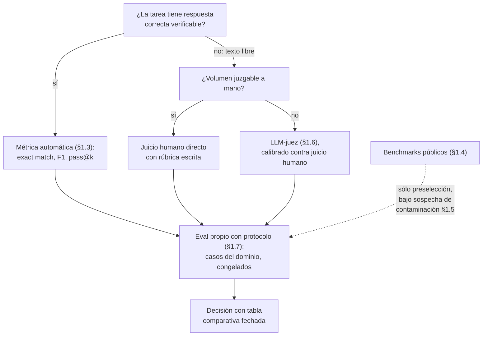

# 07. Evaluación y métricas de calidad

Este documento enseña a medir un modelo en lugar de opinar sobre él: la perplejidad como métrica
intrínseca y sus límites, las métricas de tarea que puntúan salidas contra referencias, los
*benchmarks* públicos con su contaminación y su caducidad, el LLM-juez con sus sesgos conocidos, y
el *eval* propio con protocolo — la herramienta que al final decide, porque mide la tarea que a uno
le importa y no la de otro.

**Antes de leer**: [03-Del-Modelo-Base-Al-Asistente.md](03-Del-Modelo-Base-Al-Asistente.md)
(IAM-03): hace falta entender el muestreo y por qué sin fijar temperatura y semilla no hay dos
corridas comparables; y [06-Ajuste-Fino-Y-Alineacion.md](06-Ajuste-Fino-Y-Alineacion.md) (IAM-06):
evaluar es la única forma de saber si un ajuste fino mejoró algo. El grafo completo de
prerrequisitos vive en [Cohesion-Global.md](Cohesion-Global.md).
**Anterior**: [06-Ajuste-Fino-Y-Alineacion.md](06-Ajuste-Fino-Y-Alineacion.md) ·
**Siguiente** (ruta formativa): [09-Bases-Vectoriales-Y-RAG.md](09-Bases-Vectoriales-Y-RAG.md).
Convenciones del cuerpo: [Convenciones.md](Convenciones.md) (citado §2, ejemplos §3, cifras §4).
Apartamiento declarado: el documento supera la extensión orientativa de 350–700 líneas porque sus
dos laboratorios embeben corredores y datos completos (~160 líneas que el patrón de ejemplo
operable exige transcriptas); la prosa se mantiene dentro del contrato de profundidad.

## Índice

1. [Definición](#1-definición)
2. [Aplicación por escenario](#2-aplicación-por-escenario)
3. [Ejemplos concretos](#3-ejemplos-concretos)
4. [Bloque didáctico](#4-bloque-didáctico)
5. [Criterios de calidad](#5-criterios-de-calidad)
6. [Anexo: plantilla de protocolo de un eval propio](#6-anexo-plantilla-de-protocolo-de-un-eval-propio)
7. [Referencias](#referencias)

---

## 1. Definición

### 1.1 Evaluar es medir con protocolo

**Evaluación de un modelo.** Procedimiento que convierte la pregunta «¿qué tan bien funciona este
modelo?» en una cifra reproducible: entradas fijadas, salidas obtenidas bajo condiciones
declaradas y una regla de puntaje decidible (Liang et al., 2022).

**Cómo se aplica.** Antes de aceptar cualquier cifra de calidad —propia o ajena— reconstruí sus
cuatro piezas: qué entradas se usaron, con qué parámetros corrió el modelo, qué regla convirtió
cada salida en puntos y quién eligió los casos. Si alguna de las cuatro no se puede contestar, la
cifra no es una medición: es una anécdota con decimales.

**Un caso.** «Probé el modelo nuevo y anda mejor» no sobrevive la prueba: ¿qué entradas?, las que
el autor recordó ese día; ¿qué parámetros?, los que estaban puestos; ¿qué regla de puntaje?, su
impresión. El laboratorio [07-A](#32-lab-07-a--mini-eval-propio-dos-modelos-del-banco-un-protocolo)
convierte exactamente esa frase en una medición: diez casos fijos, temperatura 0, coincidencia
exacta, dos modelos del banco frente a frente.

La distinción que organiza todo el documento: hay métricas **intrínsecas**, que miden al modelo
contra el lenguaje mismo (la perplejidad, §1.2), y métricas **de tarea**, que lo miden contra un
trabajo concreto con respuestas correctas o preferencias humanas (§1.3 en adelante). Las primeras
son baratas y generales; las segundas son las que pagan las decisiones.

### 1.2 Perplejidad: la métrica intrínseca y sus límites

La definición normativa de **perplejidad** vive en
[05-Preentrenamiento-Y-Leyes-De-Escala.md](05-Preentrenamiento-Y-Leyes-De-Escala.md), porque nace
de la pérdida de entrenamiento: es la exponencial de la pérdida promedio por *token*,
`PPL = exp(−(1/N) · Σ log p(tokenᵢ))`, donde `p(tokenᵢ)` es la probabilidad que el modelo asignó
al *token* correcto en la posición `i` (Jelinek et al., 1977; Hoffmann et al., 2022). La intuición
cabe en una imagen: una perplejidad de 6 dice que, en promedio, el modelo estaba tan indeciso ante
cada *token* como si eligiera al azar entre 6 opciones igualmente plausibles. Menos indecisión,
mejor modelo del lenguaje — sobre **ese** texto.

El cálculo es tan corto que conviene hacerlo una vez a mano. Ejemplo operable (CTX-01, Python
3.11.2, sólo biblioteca estándar; corrido el 2026-11-07, salida determinista):

```python
import math

# Probabilidad que cada modelo asignó al token correcto, posición por posición,
# sobre la misma frase de 6 tokens: "el banco de ensayo responde rápido"
modelo_a = [0.42, 0.61, 0.55, 0.08, 0.37, 0.50]   # modelo afinado al dominio
modelo_b = [0.42, 0.30, 0.20, 0.02, 0.11, 0.25]   # modelo genérico

def perplejidad(probs):
    n = len(probs)
    log_sum = sum(math.log(p) for p in probs)
    return math.exp(-log_sum / n)

for nombre, probs in [("modelo A", modelo_a), ("modelo B", modelo_b)]:
    print(f"{nombre}: perplejidad = {perplejidad(probs):.2f}")
```

```text
modelo A: perplejidad = 2.80
modelo B: perplejidad = 6.45
```

Las probabilidades de entrada son sintéticas (el mecanismo para extraerlas de un modelo real es
materia del documento [05](05-Preentrenamiento-Y-Leyes-De-Escala.md)); la aritmética es la real.
Nótese el *token* 4: una sola posición muy improbable (0,08 contra 0,02) arrastra el promedio
geométrico entero — la perplejidad castiga fuerte las sorpresas grandes.

Sus dos límites definen cuándo sirve y cuándo engaña:

1. **Sólo compara con el mismo tokenizador y el mismo texto.** La perplejidad se promedia por
   *token*, y qué es un *token* lo decide el vocabulario de cada modelo
   ([01-Representacion-Del-Lenguaje.md](01-Representacion-Del-Lenguaje.md)): dos modelos que parten
   el mismo texto en pedazos distintos producen cifras no comparables entre sí. Comparar la
   perplejidad de dos familias distintas sin normalizar es el error clásico.
2. **Mide predicción, no utilidad.** Un modelo puede predecir texto con soltura y seguir siendo
   inútil para la tarea: la alineación que lo vuelve asistente
   ([03](03-Del-Modelo-Base-Al-Asistente.md) §1.3) no optimiza perplejidad. Para decidir entre
   modelos para un trabajo concreto, la perplejidad es a lo sumo un filtro temprano.

### 1.3 Métricas de tarea: puntuar salidas contra referencias

Cuando la tarea tiene salidas correctas conocidas, la evaluación se automatiza con una métrica de
tarea. Las que el lector va a cruzar primero:

| Métrica | Qué compara | Operación de puntaje | Tarea típica | Fuente |
| --- | --- | --- | --- | --- |
| Coincidencia exacta (*exact match*) | Salida contra respuesta de referencia, literal | 1 si son idénticas (tras normalizar), 0 si no | Extracción, respuestas cortas, clasificación | Rajpurkar et al. (2016) |
| *Accuracy* (exactitud) | Proporción de casos correctos | aciertos / total | Opción múltiple, clasificación | Hendrycks et al. (2021) |
| F1 | Solapamiento parcial entre salida y referencia | Media armónica de precisión y *recall* sobre los *tokens* compartidos | Respuestas donde el parcial vale algo | Rajpurkar et al. (2016) |
| BLEU | N-gramas de la salida presentes en referencias | Precisión de n-gramas con penalidad por brevedad | Traducción | Papineni et al. (2002) |
| ROUGE | N-gramas de las referencias cubiertos por la salida | *Recall* de n-gramas (ROUGE-N) o subsecuencia común (ROUGE-L) | Resumen | Lin (2004) |
| pass@k | Código generado contra batería de pruebas | ¿Alguna de k muestras pasa todos los tests? | Generación de código | Chen et al. (2021) |

La elección entre ellas es menos libre de lo que parece: la decide la **forma de la respuesta
correcta**. Respuesta única y corta → coincidencia exacta, la más dura y la más decidible.
Respuesta con partes rescatables → F1. Texto libre con referencias humanas → BLEU/ROUGE, sabiendo
que miden solapamiento superficial de palabras, no significado: un resumen excelente con sinónimos
puntúa bajo, y uno que copia frases puntúa alto. Código → pass@k, la única de la tabla que ejecuta
la salida en lugar de compararla.

Dos reglas prácticas que valen para todas. Primera: la normalización es parte de la métrica — si
antes de comparar se quitan mayúsculas, tildes o puntuación, eso se declara, porque cambia la
cifra. Segunda: toda métrica automática mide un sustituto de lo que importa, y un sustituto que se
convierte en objetivo deja de medir — es la ley de Goodhart aplicada a modelos: «cuando una medida
se vuelve meta, deja de ser una buena medida» (Strathern, 1997). Los *benchmarks* de §1.4 son el
caso de estudio de esa ley.

### 1.4 Benchmarks públicos: para qué sirven de verdad

***Benchmark*.** Batería estandarizada de pruebas —casos fijos, métrica fija, protocolo publicado—
que permite comparar modelos distintos sobre el mismo terreno (Hendrycks et al., 2021).

**Cómo se aplica.** Usá el *benchmark* para **preseleccionar**, nunca para decidir: tomá las
cifras publicadas como un filtro grueso que descarta modelos claramente fuera de rango para la
capacidad que mide, y resolvé la decisión final con un eval propio (§1.7) sobre tu tarea. Antes de
citar una cifra, verificá tres cosas: con qué protocolo se midió (¿*few-shot* de a cuántos?, ¿qué
normalización?), de qué fecha es el modelo respecto del *benchmark* (§1.5) y si la tarea medida se
parece a la tuya en algo más que el nombre.

**Un caso.** Un modelo publica MMLU 85 y otro MMLU 79. MMLU (*Massive Multitask Language
Understanding*) es opción múltiple académica en inglés (Hendrycks et al., 2021); si la tarea del
lector es extraer fechas de correos en español, esos 6 puntos no predicen nada medible. El
laboratorio [07-A](#32-lab-07-a--mini-eval-propio-dos-modelos-del-banco-un-protocolo) muestra el
contraste con dos modelos del banco: la cifra que decide sale de los propios diez casos, no de la
tabla pública.

Los nombres que aparecen en toda *model card*, con lo que miden de verdad:

| *Benchmark* | Mide | Forma | Fuente |
| --- | --- | --- | --- |
| MMLU | Conocimiento académico multitarea (57 materias) | Opción múltiple, *accuracy* | Hendrycks et al. (2021) |
| GSM8K | Razonamiento aritmético escolar en varios pasos | Problema → número final, coincidencia exacta | Cobbe et al. (2021) |
| HellaSwag | Sentido común: elegir la continuación plausible | Opción múltiple, *accuracy* | Zellers et al. (2019) |
| HumanEval | Generación de código funcional | 164 funciones con tests, pass@k | Chen et al. (2021) |

Un marco como HELM (*Holistic Evaluation of Language Models*) amplió el enfoque: no una cifra sino
una matriz de escenarios × métricas —exactitud, calibración, robustez, sesgo— midiendo todos los
modelos en las mismas condiciones (Liang et al., 2022). Y herramientas como `lm-evaluation-harness`
(EleutherAI, s. f.) permiten correr estos *benchmarks* sobre modelos propios: las tablas públicas
se pueden auditar, no sólo leer.

### 1.5 Contaminación y caducidad: por qué las cifras envejecen mal

Este apartado es contenido de primera clase del documento, no una advertencia al pie (decisión
EM-06 del expediente 0001): quien no entiende la contaminación lee las tablas públicas al revés.

La **contaminación** —presencia de datos de evaluación dentro del corpus de entrenamiento— tiene
su definición normativa en [04-Datos-Y-Corpus.md](04-Datos-Y-Corpus.md) como problema de higiene
del corpus (Lee et al., 2022). Acá importa su efecto sobre las cifras: un modelo que vio los casos
del *benchmark* durante el entrenamiento no resuelve la tarea, la **recuerda**, y la métrica deja
de medir capacidad para medir memoria. El mecanismo es inevitable a escala: los *benchmarks*
públicos viven en la web, los corpus de preentrenamiento se recolectan de la web, y cada nueva
generación de modelos se entrena con más web que la anterior. Por eso todo *benchmark* público
tiene fecha de vencimiento desde que se publica.

El caso mejor documentado: Zhang et al. (2024) reescribieron GSM8K desde cero —mismos tipos de
problema, enunciados nuevos, dificultad calibrada— y midieron la caída. Varios modelos perdieron
hasta 13 puntos de exactitud frente a problemas que diferían de los públicos sólo en no haber sido
vistos; otros no cayeron casi nada. La diferencia entre ambos grupos no es ruido: es la medida de
cuánto de la cifra original era memoria. Sainz et al. (2023) sistematizan el problema y piden lo
que esta guía adopta como criterio: toda cifra de *benchmark* se reporta junto con la evidencia de
contaminación disponible, o se lee con esa sospecha.

Cómo opera el lector ante una cifra pública — tres verificaciones en orden de costo:

1. **Fechas**: si el *benchmark* es anterior al corte de datos del modelo, asumí exposición
   posible; la *model card* ([11-Panorama-Y-Ecosistema-Abierto.md](11-Panorama-Y-Ecosistema-Abierto.md))
   a veces declara qué baterías se filtraron del corpus.
2. **Variantes renovadas**: buscá si existe una versión regenerada del *benchmark* (el patrón de
   Zhang et al., 2024) y comparás la caída del modelo entre la vieja y la nueva.
3. **Casos propios**: la verificación definitiva es un puñado de casos que no existen en la web
   porque los escribiste vos — exactamente lo que arma el laboratorio
   [07-A](#32-lab-07-a--mini-eval-propio-dos-modelos-del-banco-un-protocolo).

A la contaminación se suma la **saturación**: cuando los mejores modelos superan el 90 % de un
*benchmark*, el techo está tan cerca que las diferencias restantes se vuelven ruido de protocolo,
y la comunidad migra a baterías más duras. Las dos fuerzas juntas explican la regla de vigencia de
esta guía: las cifras comparativas de modelos concretos viven sólo en la tabla fechada del
documento [11](11-Panorama-Y-Ecosistema-Abierto.md), nunca en los documentos estables
([Convenciones.md](Convenciones.md) §6).

### 1.6 LLM-juez: un modelo que evalúa a otro, bajo sospecha controlada

**LLM-juez** (*LLM-as-a-judge*). Uso de un modelo de lenguaje como evaluador de las salidas de
otro: recibe la consigna, una o dos respuestas y una rúbrica, y emite un veredicto —puntaje o
preferencia— que reemplaza al anotador humano en escala (Zheng et al., 2023).

**Cómo se aplica.** Usalo donde la métrica automática no llega (texto libre, sin respuesta única)
y el volumen hace inviable juzgar todo a mano, pero nunca sin **calibrarlo primero**: juzgá vos un
subconjunto con la misma rúbrica, medí el acuerdo entre tu veredicto y el del juez, y sólo si el
acuerdo es alto delegale el resto. Y correlo siempre dos veces por par, con el orden de las
respuestas invertido: si el veredicto cambia con el orden, lo que medís es el sesgo del juez, no
la calidad de las respuestas.

**Un caso.** Zheng et al. (2023) validaron el método sobre MT-Bench y Chatbot Arena: GPT-4 como
juez acordó con las preferencias humanas por encima del 80 % — comparable al acuerdo de los
humanos entre sí. El laboratorio
[07-B](#33-lab-07-b--llm-juez-contrastado-con-el-juicio-del-lector) reproduce el protocolo en
miniatura sobre el banco: un modelo de 14B juzga los pares que producen dos modelos más chicos, y
el lector contrasta cada veredicto con el propio.

Los sesgos documentados del juez, que la rúbrica y el protocolo deben neutralizar (Zheng et al.,
2023):

| Sesgo | Qué hace el juez | Contramedida |
| --- | --- | --- |
| De posición | Prefiere la respuesta que aparece primera (o última), sea cual sea | Juzgar cada par dos veces con orden invertido; si el ganador cambia, registrar empate |
| De verbosidad | Prefiere la respuesta más larga aunque agregue relleno | Rúbrica explícita: «la longitud no es mérito»; verificar con pares donde la corta es mejor |
| De autopreferencia | Puntúa mejor el estilo de su propia familia de modelos | Juez de familia distinta a los evaluados, o varios jueces |
| De capacidad | No puede juzgar lo que no sabe resolver (matemática, código) | Para tareas verificables, métrica automática (§1.3), no juez |

El complemento a escala humana existe y conviene conocerlo: Chatbot Arena recolecta preferencias
de miles de usuarios sobre pares de respuestas anónimas y las convierte en un ranking Elo (Chiang
et al., 2024). Es la referencia contra la que se calibran los jueces automáticos — y vale lo mismo
que un *benchmark*: mide la preferencia promedio de su público, no la tarea del lector.

### 1.7 El eval propio: la herramienta que decide

***Eval*.** Batería de evaluación diseñada por el propio equipo para su propia tarea: casos
elegidos del dominio real, métrica decidible fijada de antemano y protocolo reproducible, versionada
junto al sistema que evalúa (Chiang et al., 2024; Liang et al., 2022).

**Cómo se aplica.** Construilo en cuatro pasos, en este orden: (1) juntá 10–50 casos reales de tu
tarea, incluyendo los difíciles y los que salieron mal en el pasado, cada uno con su respuesta
esperada; (2) elegí la métrica según la forma de la respuesta (§1.3) y escribí la regla de
normalización; (3) fijá el protocolo —modelo con digest, parámetros, semilla o temperatura 0,
fecha— como lo exige [Convenciones.md](Convenciones.md) §4; (4) corré todos los candidatos sobre
los mismos casos y decidí con la tabla. Desde entonces, cada cambio de modelo, de *prompt* o de
versión se valida corriendo el eval de nuevo: es la batería de regresión del sistema.

**Un caso.** El laboratorio [07-A](#32-lab-07-a--mini-eval-propio-dos-modelos-del-banco-un-protocolo)
es ese procedimiento completo en treinta líneas de Python: diez casos de extracción de fechas,
coincidencia exacta, temperatura 0 y dos modelos del banco comparados con protocolo. Chico como
es, ya decide algo real: cuál de los dos modelos conviene para esa tarea concreta.

Dos advertencias que separan un eval útil de uno decorativo. Los casos **se congelan**: si después
de ver los resultados se ajusta el *prompt* mirando los casos del eval, el eval se convirtió en
conjunto de entrenamiento y hace falta un lote nuevo de casos reservados — es la contaminación de
§1.5 reproducida en miniatura, en la propia mesa. Y la métrica **se decide antes de correr**:
elegirla después, con los resultados a la vista, es elegir la que favorece la conclusión deseada
(la inversión que prohíbe la regla de evidencias de esta casa).

El mapa completo de decisión, que resume el documento:



---

## 2. Aplicación por escenario

Los identificadores ESC/CTX/ACT son los del [Marco-De-Referencia.md](Marco-De-Referencia.md). Este
documento es la caja de herramientas de ACT-04, el evaluador: el actor que decide el veredicto
comparativo con evidencia.

| Escenario | Qué aporta este tema |
| --- | --- |
| ESC-01 — Elegir un modelo | El orden de lectura de una ficha: *benchmarks* como filtro grueso (§1.4), sospecha de contaminación (§1.5) y eval propio como árbitro final (§1.7); la elección guiada completa es del documento [11](11-Panorama-Y-Ecosistema-Abierto.md) |
| ESC-02 — Montar y servir | Las métricas de este documento miden calidad; las de servicio (tokens/s, memoria, latencia) son del documento [08](08-Inferencia-Local.md) — la frontera es decisión EM-05 del expediente. Un despliegue se acepta cuando pasa las dos |
| ESC-03 — Preguntar a un corpus (RAG) | El diagnóstico por etapas del documento [09](09-Bases-Vectoriales-Y-RAG.md) necesita un eval por etapa: recuperación (¿el pasaje correcto llegó?) y generación (¿la respuesta usó el pasaje?) se miden por separado, con las técnicas de §1.3 y §1.6 |
| ESC-04 — Adaptar a un dominio | El eval propio se construye **antes** del ajuste fino del documento [06](06-Ajuste-Fino-Y-Alineacion.md): sin medición base no hay forma de saber si el ajuste mejoró, empeoró o no hizo nada |
| ESC-05 — Evaluar con evidencia | El escenario entero es este documento: de la cifra anecdótica al protocolo (§1.1), con el laboratorio 07-A como forma mínima completa |
| ESC-06 — Más de una modalidad | Las ideas viajan (métrica de tarea, juez, eval propio); las baterías cambian — la evaluación de modelos de visión y lenguaje se trata en el documento [10](10-Multimodalidad-Y-Generacion-No-Textual.md) |
| ESC-07 — Integrar en una aplicación | El eval propio corre en CI como batería de regresión del componente de IA; la integración .NET se referencia a la guía 16 del repositorio, no se repite acá |

Qué cambia por contexto: en **CTX-01** (sólo CPU) todo el documento corre — un eval de decenas de
casos a temperatura 0 es de las cargas más livianas de la guía, y la lentitud por caso se paga una
vez. En **CTX-03** (el banco compartido, donde corren los laboratorios de §3 vía `$OLLAMA_HOST`)
conviene correr los evals fuera de las horas de uso intenso: 10 casos × 2 modelos × 2 pasadas del
juez son decenas de pedidos seguidos. En **CTX-04** (API de terceros) cada caso del eval cuesta
dinero y el modelo remoto puede cambiar sin aviso bajo la misma etiqueta: el eval pasa de
herramienta de elección a alarma de deriva, corrida periódicamente. En **CTX-06** (contenedor/CI)
el eval es la compuerta de despliegue natural, con una condición: semilla y temperatura fijadas,
porque una batería no determinista en CI produce rojos aleatorios que nadie investiga.

---

## 3. Ejemplos concretos

Este documento es dueño de los dos laboratorios de medición del cuerpo (expediente 0001, folio 011
§4, «medir»): el mini-eval propio con protocolo (07-A) y el LLM-juez contrastado con juicio humano
(07-B). Los laboratorios de los temas vecinos se citan, no se repiten: la mecánica de inferencia y
el paso 0 en [08-Inferencia-Local.md](08-Inferencia-Local.md), el muestreo a la vista en
[03-Del-Modelo-Base-Al-Asistente.md](03-Del-Modelo-Base-Al-Asistente.md) §3.1, y la perplejidad
extraída de un modelo real en
[05-Preentrenamiento-Y-Leyes-De-Escala.md](05-Preentrenamiento-Y-Leyes-De-Escala.md).

Requisitos comunes: `bash`, `curl` y `python3` (sólo biblioteca estándar). Los dos laboratorios
corren contra el banco por HTTP: valen en CTX-01 con un Ollama local y en CTX-03 apuntando
`OLLAMA_HOST` al servidor compartido. Antes de empezar, el **paso 0 de verificación del banco**,
que se enseña en [08-Inferencia-Local.md](08-Inferencia-Local.md) y acá sólo se corre:

```bash
curl -s "${OLLAMA_HOST:-http://localhost:11434}/api/tags" >/dev/null \
  && echo "banco accesible" || echo "banco NO accesible: revisá OLLAMA_HOST"
```

Modelos usados (versiones fijadas, [Convenciones.md](Convenciones.md) §3.2):

| Etiqueta | Digest (`ollama show` / `/api/tags`) | Rol en los labs |
| --- | --- | --- |
| `qwen2.5:7b-instruct` | `sha256:845dbda0ea48ed749caafd9e6037047aa19acfcfd82e704d7ca97d631a0b697e` | Candidato A (7B) |
| `qwen3.5:4b` | `sha256:d8b0f5e9760cd1682034f292d7ef72ec46f432149be0df7574bf2d6e92e38c04` | Candidato B (4B, generación posterior) |
| `qwen2.5:14b-instruct` | `sha256:7cdf5a0187d5c58cc5d369b255592f7841d1c4696d45a8c8a9489440385b22f6` | Juez del lab 07-B |

Motor: ollama 0.32.0-rc0 (`GET /api/version` del banco, 2026-11-07). La API se documenta en la
referencia oficial de Ollama (Ollama, s. f.). El par de candidatos está elegido a propósito: 7B de
una generación contra 4B de la siguiente — ni el tamaño ni la fecha deciden solos quién gana, por
eso se mide.

### 3.1 Los archivos de casos

Los dos laboratorios trabajan sobre archivos de datos propios, un caso por línea en JSON. Primero
el del mini-eval — `casos.jsonl`, diez extracciones de fecha con respuesta única en formato ISO
(la variedad es deliberada: formatos numéricos, meses en palabras, un ordinal y un caso con
trampa, el año bisiesto del caso 7):

```json
{"entrada": "La factura vence el 3 de marzo de 2026.", "esperado": "2026-03-03"}
{"entrada": "Nos vemos el 14/07/2025 en la oficina.", "esperado": "2025-07-14"}
{"entrada": "El contrato se firmó el primero de enero de 2024.", "esperado": "2024-01-01"}
{"entrada": "Entrega estimada: 28-02-2026.", "esperado": "2026-02-28"}
{"entrada": "El pago se acreditó el 5 de noviembre del 2025.", "esperado": "2025-11-05"}
{"entrada": "Audiencia fijada para el 30 de abril de 2026 a las 10.", "esperado": "2026-04-30"}
{"entrada": "Vence el último día de febrero de 2024.", "esperado": "2024-02-29"}
{"entrada": "El 9/8/2025 se renovó la póliza.", "esperado": "2025-08-09"}
{"entrada": "La obra terminó el 31 de diciembre de 2023.", "esperado": "2023-12-31"}
{"entrada": "Turno reprogramado para el 17 de junio de 2026.", "esperado": "2026-06-17"}
```

Y el del juez — `preguntas.jsonl`, seis consignas abiertas sin respuesta única, elegidas para que
un humano pueda preferir con fundamento:

```json
{"pregunta": "Explicá en no más de tres frases por qué el cielo se ve azul."}
{"pregunta": "¿Qué conviene para procesar datos sensibles: un modelo local o una API de terceros? Justificá en un párrafo."}
{"pregunta": "Resumí en una sola frase qué hace un tokenizador."}
{"pregunta": "Explicá la diferencia entre memoria RAM y disco para alguien sin conocimientos técnicos, en un párrafo."}
{"pregunta": "Redactá el asunto de un correo que avise que la reunión del lunes pasa al martes."}
{"pregunta": "Dá una regla mnemotécnica en español para recordar el orden de los planetas del sistema solar."}
```

> **Errata asentada**: la consigna del caso 6 dice «Dá»; la grafía correcta es «Da» (imperativo
> monosílabo, sin tilde). El bloque queda tal como está porque es la entrada exacta de las
> corridas verificadas del lab 07-B: la errata se corrige acá y en el `preguntas.jsonl` del
> lector la próxima vez que ese laboratorio se recorra por otro motivo (expediente 0001,
> ronda 2: un defecto de forma se asienta como errata con condición de recorrida, no fuerza
> una recorrida).

### 3.2 Lab 07-A — Mini-eval propio: dos modelos del banco, un protocolo

**Objetivo**: construir y correr el eval de §1.7 completo — casos congelados, métrica decidible,
protocolo fijado, tabla comparativa que decide. **Contexto**: CTX-01 o CTX-03. **Duración**:
minutos con el modelo residente; en un banco compartido que recarga modelos por pedido puede
llegar a la media hora (ver el protocolo al pie).

La tarea es extracción de fecha a formato `AAAA-MM-DD`: respuesta única y corta, así que la
métrica es coincidencia exacta (§1.3) con una sola normalización declarada, el recorte de espacios
en los bordes. Temperatura 0 en todos los pedidos: un eval mide al modelo, no al azar del muestreo
([03](03-Del-Modelo-Base-Al-Asistente.md) §1.4).

**Paso 1 — guardar el corredor.** `mini_eval.py`, junto a `casos.jsonl`:

```python
#!/usr/bin/env python3
"""Mini-eval propio: corre los casos de casos.jsonl contra los modelos
que se pasen por argumento y reporta coincidencia exacta por modelo.
Sólo biblioteca estándar. Uso:
    python3 mini_eval.py qwen2.5:7b-instruct qwen3.5:4b
"""
import json
import os
import sys
import urllib.request

BANCO = os.environ.get("OLLAMA_HOST", "http://localhost:11434")
CONSIGNA = (
    "Extraé la fecha mencionada en el texto del usuario y respondé "
    "SOLO esa fecha en formato AAAA-MM-DD, sin ninguna otra palabra."
)

def preguntar(modelo, texto):
    pedido = {
        "model": modelo,
        "messages": [
            {"role": "system", "content": CONSIGNA},
            {"role": "user", "content": texto},
        ],
        "stream": False,
        "options": {"temperature": 0},
    }
    req = urllib.request.Request(
        f"{BANCO}/api/chat",
        data=json.dumps(pedido).encode(),
        headers={"Content-Type": "application/json"},
    )
    with urllib.request.urlopen(req) as r:
        return json.load(r)["message"]["content"].strip()

def main():
    modelos = sys.argv[1:]
    if len(modelos) < 2:
        sys.exit("uso: mini_eval.py <modelo-1> <modelo-2> [...]")
    with open("casos.jsonl", encoding="utf-8") as f:
        casos = [json.loads(linea) for linea in f if linea.strip()]

    aciertos = {m: 0 for m in modelos}
    print(f"{'#':>2}  {'esperado':<10}  " + "  ".join(f"{m:<22}" for m in modelos))
    for i, caso in enumerate(casos, 1):
        fila = []
        for m in modelos:
            salida = preguntar(m, caso["entrada"])
            ok = salida == caso["esperado"]
            aciertos[m] += ok
            fila.append(f"{salida[:18]:<18} {'OK' if ok else '--'}")
        print(f"{i:>2}  {caso['esperado']:<10}  " + "  ".join(f"{c:<22}" for c in fila))

    print("\nResultado (coincidencia exacta):")
    for m in modelos:
        print(f"  {m:<24} {aciertos[m]}/{len(casos)}  = {aciertos[m]/len(casos):.0%}")

if __name__ == "__main__":
    main()
```

**Paso 2 — correr la comparación**:

```bash
python3 mini_eval.py qwen2.5:7b-instruct qwen3.5:4b
```

```text
 #  esperado    qwen2.5:7b-instruct     qwen3.5:4b
 1  2026-03-03  2026-03-03         OK   2026-03-03         OK
 2  2025-07-14  2025-07-14         OK   2025-07-14         OK
 3  2024-01-01  2024-01-01         OK   2024-01-01         OK
 4  2026-02-28  2026-02-28         OK   2026-02-28         OK
 5  2025-11-05  2025-11-05         OK   2025-11-05         OK
 6  2026-04-30  2026-04-30         OK   2026-04-30         OK
 7  2024-02-29  2024-02-29         OK   2024-02-29         OK
 8  2025-08-09  2025-08-09         OK   2025-08-09         OK
 9  2023-12-31  2023-12-31         OK   2023-12-31         OK
10  2026-06-17  2026-06-17         OK   2026-06-17         OK

Resultado (coincidencia exacta):
  qwen2.5:7b-instruct      10/10  = 100%
  qwen3.5:4b               10/10  = 100%
```

La corrida real salió 10/10 para ambos candidatos — incluido el bisiesto del caso 7. Un empate
perfecto también es un resultado: dice que **esta** batería ya no separa a estos dos modelos, y
que para distinguirlos hace falta endurecer los casos (ambigüedad, fechas relativas, ruido),
exactamente como manda §1.7: el eval evoluciona con los candidatos que enfrenta.

**Qué esperar**: una fila por caso con la salida de cada modelo y su veredicto, y al final la
tabla comparativa con la fracción de aciertos de cada uno. Qué parte es estable: a temperatura 0,
corridas repetidas devuelven (casi siempre) las mismas salidas y la misma tabla. Qué parte varía:
cuál modelo gana y por cuánto — eso es justamente lo que se mide, y puede cambiar con otra versión
de los pesos. Mirá las fallas una por una: en un eval chico, **qué** casos pierde cada modelo
informa más que el total (¿los formatos numéricos?, ¿el ordinal?, ¿el bisiesto del caso 7, que
exige calcular en vez de copiar?).

**Paso 3 — romper el eval para entenderlo.** Repetí la corrida con `"temperature": 1` en
`options`. Si las cifras bailan entre corridas, acabás de ver por qué el protocolo fija el
muestreo: la diferencia entre 7/10 y 9/10 puede ser azar, no calidad.

**Si difiere**: con 0/10 en ambos modelos, el sospechoso es el transporte, no los modelos —
verificá el paso 0 y que las etiquetas existan en `GET /api/tags`. Fallos aislados con salidas
casi correctas («2026-03-3», una frase alrededor de la fecha) son el comportamiento real que la
coincidencia exacta castiga: anotalos, porque la decisión entre endurecer el *prompt* o relajar la
normalización es tuya y el eval sólo la hace visible. El diagnóstico entorno/versión/azar general
está en [08-Inferencia-Local.md](08-Inferencia-Local.md).

<details>
<summary>Protocolo de la corrida</summary>

- **Cifra**: `qwen2.5:7b-instruct` 10/10, `qwen3.5:4b` 10/10 (coincidencia exacta)
- **Modelos**: `qwen2.5:7b-instruct` y `qwen3.5:4b`, digests de la tabla de §3
- **Motor**: ollama 0.32.0-rc0
- **Parámetros**: temperature 0; los no listados, en su default
- **Semilla**: innecesaria a temperatura 0 (determinista salvo empates del motor)
- **Entrada / dataset**: `casos.jsonl` transcripto en §3.1 (10 casos, obra propia de esta guía)
- **Contexto de hardware**: CTX-03 (banco compartido, sólo CPU)
- **Fecha de la corrida**: 2026-11-07
- **Duración observada**: ~29 min de pared en CTX-03 — el corredor alterna los dos modelos en
  cada caso y el servidor mantenía un solo modelo residente, así que cada pedido pagó una
  recarga; con el modelo ya cargado (CTX-01, un solo candidato por tanda) son minutos
</details>

### 3.3 Lab 07-B — LLM-juez, contrastado con el juicio del lector

**Objetivo**: montar el protocolo de §1.6 completo — un juez con rúbrica, doble pasada con orden
invertido para cazar el sesgo de posición, y el contraste con juicio humano que decide si el juez
merece confianza. **Contexto**: CTX-01 o CTX-03 (el juez de 14B pide paciencia en CPU sola).
**Duración**: la parte humana, 10–15 minutos — esa parte es el laboratorio; la generación de
pares puede estirarse mucho más en CPU sola (ver el aviso del paso 2), y el juicio del juez toma
pocos minutos.

Las seis consignas de `preguntas.jsonl` no tienen respuesta única: acá la coincidencia exacta no
existe y empieza el territorio del juez. Candidatos y juez son los de la tabla de §3; el juez es
de la misma familia que un candidato, así que el sesgo de autopreferencia (§1.6) queda declarado
como límite de este montaje — en uno real se elige juez de familia ajena.

**Paso 1 — guardar el corredor.** `juez.py`, junto a `preguntas.jsonl`:

```python
#!/usr/bin/env python3
"""LLM-juez por comparación de a pares, con inversión de orden para
detectar sesgo de posición. Sólo biblioteca estándar. Uso:
    python3 juez.py            # fase 1: genera respuestas de A y B
    python3 juez.py --juzgar   # fase 2: el juez vota cada par, dos veces
"""
import json
import os
import sys
import urllib.request

BANCO = os.environ.get("OLLAMA_HOST", "http://localhost:11434")
MODELO_A = "qwen2.5:7b-instruct"
MODELO_B = "qwen3.5:4b"
JUEZ = "qwen2.5:14b-instruct"
RUBRICA = (
    "Sos un evaluador. Vas a ver una consigna y dos respuestas, A y B. "
    "Juzgá cuál cumple mejor la consigna por exactitud, claridad y ajuste "
    "a lo pedido. La longitud no es mérito por sí sola. "
    "Respondé SOLO una letra: A o B."
)

def pedir(modelo, mensajes):
    pedido = {"model": modelo, "messages": mensajes, "stream": False,
              "options": {"temperature": 0}}
    req = urllib.request.Request(
        f"{BANCO}/api/chat",
        data=json.dumps(pedido).encode(),
        headers={"Content-Type": "application/json"},
    )
    with urllib.request.urlopen(req) as r:
        return json.load(r)["message"]["content"].strip()

def generar():
    with open("preguntas.jsonl", encoding="utf-8") as f:
        preguntas = [json.loads(l)["pregunta"] for l in f if l.strip()]
    salidas = []
    for p in preguntas:
        salidas.append({
            "pregunta": p,
            "a": pedir(MODELO_A, [{"role": "user", "content": p}]),
            "b": pedir(MODELO_B, [{"role": "user", "content": p}]),
        })
    with open("respuestas.json", "w", encoding="utf-8") as f:
        json.dump(salidas, f, ensure_ascii=False, indent=2)
    print(f"{len(salidas)} pares guardados en respuestas.json — "
          "leelos y anotá tu preferencia ANTES de correr --juzgar")

def votar(pregunta, primera, segunda):
    texto = (f"Consigna: {pregunta}\n\nRespuesta A:\n{primera}\n\n"
             f"Respuesta B:\n{segunda}\n\n¿Cuál es mejor? Respondé A o B.")
    voto = pedir(JUEZ, [{"role": "system", "content": RUBRICA},
                        {"role": "user", "content": texto}])
    return voto[:1].upper()

def juzgar():
    with open("respuestas.json", encoding="utf-8") as f:
        pares = json.load(f)
    print(f"{'#':>2}  {'A primero':>9}  {'B primero':>9}  {'consistente':>11}  veredicto")
    for i, par in enumerate(pares, 1):
        # Pasada 1: la respuesta del modelo A se presenta como "A"
        v1 = votar(par["pregunta"], par["a"], par["b"])
        gana1 = MODELO_A if v1 == "A" else MODELO_B
        # Pasada 2: orden invertido; "A" ahora es la respuesta del modelo B
        v2 = votar(par["pregunta"], par["b"], par["a"])
        gana2 = MODELO_B if v2 == "A" else MODELO_A
        consistente = gana1 == gana2
        veredicto = gana1 if consistente else "EMPATE (sesgo de posición)"
        print(f"{i:>2}  {gana1[:9]:>9}  {gana2[:9]:>9}  {str(consistente):>11}  {veredicto}")

if __name__ == "__main__":
    juzgar() if "--juzgar" in sys.argv else generar()
```

**Paso 2 — generar los pares**:

```bash
python3 juez.py
```

```text
6 pares guardados en respuestas.json — leelos y anotá tu preferencia ANTES de correr --juzgar
```

Aviso de tiempos: en esta fase `qwen3.5:4b` razona antes de responder (es un modelo con
*pensamiento*), y en CPU sola eso convierte seis consignas abiertas en una espera larga — la
corrida de referencia tomó ~46 minutos en el banco compartido. Es el momento de ir preparando el
papel del paso 3.

**Paso 3 — juzgar a mano, antes que el juez.** Abrí `respuestas.json` y, para cada uno de los
seis pares, anotá en papel cuál respuesta preferís y por qué, usando la misma rúbrica del script:
exactitud, claridad, ajuste a lo pedido, sin premiar longitud. El orden importa: juzgar después de
ver los votos del juez contamina tu veredicto — es el efecto ancla aplicado a vos, no al modelo.

**Paso 4 — soltar al juez y medir el acuerdo**:

```bash
python3 juez.py --juzgar
```

```text
 #  A primero  B primero  consistente  veredicto
 1  qwen3.5:4  qwen3.5:4         True  qwen3.5:4b
 2  qwen3.5:4  qwen2.5:7        False  EMPATE (sesgo de posición)
 3  qwen2.5:7  qwen2.5:7         True  qwen2.5:7b-instruct
 4  qwen3.5:4  qwen3.5:4         True  qwen3.5:4b
 5  qwen2.5:7  qwen2.5:7         True  qwen2.5:7b-instruct
 6  qwen3.5:4  qwen3.5:4         True  qwen3.5:4b
```

La corrida real trajo el fenómeno completo: cinco veredictos sobrevivieron a la inversión de
orden y el par 2 no — el sesgo de posición de §1.6 se presentó solo, sin que hiciera falta
buscarlo.

Con la tabla a la vista, contá dos cosas. **Consistencia del juez**: ¿en cuántos de los 6 pares el
veredicto sobrevivió a la inversión de orden? Cada fila `EMPATE (sesgo de posición)` es el sesgo
de §1.6 fotografiado en vivo. **Acuerdo juez-humano**: sobre los pares consistentes, ¿en cuántos
el juez votó como vos? Como criterio de lectura — con acuerdo de 5–6 sobre 6, el juez es delegable
para esta tarea y esta rúbrica; con 3 o menos, su veredicto no vale más que una moneda, y escalar
una moneda a mil casos sólo produce ruido con formato de tabla.

**Qué esperar**: algún empate por posición es resultado normal con un juez de 14B, no un fallo del
laboratorio; los trabajos de referencia lo midieron hasta en jueces mucho más grandes (Zheng et
al., 2023). Qué parte es estable: el formato de la tabla y que la doble pasada detecta
inconsistencias reales. Qué parte varía: los veredictos concretos, de corrida en corrida y de
versión en versión — son juicio de un modelo, no verdad de referencia.

**Si difiere**: si el juez devuelve algo distinto de una letra (una explicación, un «depende»),
endurecé el cierre de la rúbrica o recortá con más agresividad en `votar()` — los modelos chicos
siguen el formato con menos disciplina. Si todos los veredictos caen del mismo lado sin importar
el contenido, sospechá primero del sesgo de posición y recién después de una diferencia real de
calidad entre candidatos.

<details>
<summary>Protocolo de la corrida</summary>

- **Cifra**: consistencia del juez 5/6 pares (un `EMPATE (sesgo de posición)`, el par 2);
  veredictos consistentes: 3 para `qwen3.5:4b`, 2 para `qwen2.5:7b-instruct`
- **Modelos**: candidatos `qwen2.5:7b-instruct` y `qwen3.5:4b`; juez `qwen2.5:14b-instruct` — digests de la tabla de §3
- **Motor**: ollama 0.32.0-rc0
- **Parámetros**: temperature 0 en generación y en el juez; los no listados, en su default
- **Semilla**: innecesaria a temperatura 0 (determinista salvo empates del motor)
- **Entrada / dataset**: `preguntas.jsonl` transcripto en §3.1 (6 consignas, obra propia de esta guía)
- **Contexto de hardware**: CTX-03 (banco compartido, sólo CPU)
- **Fecha de la corrida**: 2026-11-07
- **Duración observada**: generación de pares ~46 min (el candidato 4B razona antes de responder);
  doble pasada del juez, ~3 min
- **Juicio humano de contraste**: el del lector, sobre los mismos pares y con la misma rúbrica (paso 3); esta corrida no publica un acuerdo de referencia porque el contraste es el ejercicio
</details>

---

## 4. Bloque didáctico

**Pregunta** — ¿Por qué un modelo con mejor MMLU puede ser peor para tu tarea?
**Criterio que forma** — Leer rankings públicos como preselección, nunca como veredicto.
**Respuesta explicativa** — MMLU mide opción múltiple académica en inglés con un protocolo fijo;
tu tarea tiene otro idioma, otro formato y otra distribución de casos. La correlación entre ambas
cosas existe a grandes rasgos y se rompe justo donde la decisión se vuelve fina: entre dos modelos
razonables, los puntos de *benchmark* no predicen cuál extrae mejor tus fechas. A eso se suma que
la cifra pública puede estar inflada por contaminación, y la tuya no, porque tus casos no están en
la web.
**Reenvío** — §1.4 y §1.5; el laboratorio [07-A](#32-lab-07-a--mini-eval-propio-dos-modelos-del-banco-un-protocolo)
es la contraprueba en diez casos.

**Pregunta** — ¿Cuándo una perplejidad menor no significa un modelo mejor?
**Criterio que forma** — Verificar la comparabilidad de una métrica antes de leer su valor.
**Respuesta explicativa** — En dos situaciones que cubren casi todos los usos ingenuos: cuando los
modelos no comparten tokenizador (la cifra se promedia por *token*, y los *tokens* son distintos)
y cuando el texto de medición no se parece a la tarea (predecir bien Wikipedia no es extraer bien
fechas). La perplejidad compara versiones del mismo modelo sobre el mismo texto; cruzar familias
con ella es comparar temperaturas medidas en escalas distintas.
**Reenvío** — §1.2, con el cálculo a mano; la definición normativa en el documento
[05](05-Preentrenamiento-Y-Leyes-De-Escala.md).

**Pregunta** — ¿Qué tendría que pasar para que dejes de creer en una cifra de *benchmark*?
**Criterio que forma** — Tratar la contaminación como hipótesis por defecto, no como escándalo
excepcional.
**Respuesta explicativa** — Basta con que el *benchmark* sea público y anterior al corte de datos
del modelo: a partir de ahí la exposición es posible y la cifra mide una mezcla indeterminada de
capacidad y memoria. La caída medida frente a variantes regeneradas —hasta 13 puntos en el caso de
GSM8K— es el tamaño documentado de esa mezcla. La cifra no se descarta: se degrada de «capacidad
demostrada» a «cota superior optimista», y la decisión se muda a casos que el modelo no pudo haber
visto.
**Reenvío** — §1.5, con las tres verificaciones en orden de costo.

**Pregunta** — ¿Cuándo delegarías en un LLM-juez y cuándo no?
**Criterio que forma** — Delegar sólo lo calibrado: el juez se audita antes de usarse, no después.
**Respuesta explicativa** — Delegá cuando la tarea es de texto libre, el volumen no se puede
juzgar a mano y mediste primero el acuerdo juez-humano sobre una muestra con la misma rúbrica. No
delegues cuando la tarea tiene respuesta verificable (ahí la métrica automática es más barata y no
tiene sesgos), cuando el juez es de la misma familia que un candidato sin contrapeso, ni cuando el
veredicto cambia al invertir el orden de las respuestas — un juez inconsistente a escala no agrega
evaluación, multiplica un sesgo.
**Reenvío** — §1.6 y el laboratorio [07-B](#33-lab-07-b--llm-juez-contrastado-con-el-juicio-del-lector),
donde ese acuerdo se mide en seis pares.

**Pregunta** — ¿Qué diferencia un eval propio de «probar el modelo un rato»?
**Criterio que forma** — Exigir las cuatro piezas de una medición antes de aceptar una conclusión,
también a uno mismo.
**Respuesta explicativa** — Las mismas acciones —mandar entradas, mirar salidas— con tres
diferencias de protocolo: los casos están fijados de antemano (los mismos para todos los
candidatos, congelados contra el ajuste oportunista), la regla de puntaje se decidió antes de ver
resultados, y las condiciones quedaron registradas para que la corrida se repita. Probar un rato
produce impresiones que no se pueden comparar ni reproducir; el eval produce una tabla que otro
puede rehacer y refutar. La distancia entre ambos es media hora de trabajo.
**Reenvío** — §1.7 y §1.1; el anexo de §6 es la lista de control para cruzarla.

---

## 5. Criterios de calidad

Cómo se distingue una evaluación buena de una pobre — aplicable a la propia y a la que publica un
tercero:

| Dimensión | Versión buena | Versión pobre |
| --- | --- | --- |
| Casos | Del dominio real, con los difíciles adentro, congelados antes de ajustar nada | Elegidos a mano después de ver qué le sale bien al modelo favorito |
| Métrica | Decidida antes de correr, con la normalización declarada | Elegida después, entre varias, la que mejor cuenta la historia deseada |
| Protocolo | Modelo con digest, parámetros, temperatura/semilla y fecha — la corrida se puede repetir | «Probamos ambos modelos y el nuevo anduvo mejor» |
| Comparación | Todos los candidatos sobre los mismos casos, mismas condiciones | Cada modelo medido en momentos y condiciones distintas |
| Cifras ajenas | Citadas con protocolo y sospecha de contaminación declarada | Puntos de *benchmark* copiados de la *model card* como verdad |
| Juez automático | Calibrado contra juicio humano, doble pasada con orden invertido | Un solo voto del juez, sin contraste, escalado a miles de casos |
| Lectura del resultado | Fallas examinadas caso por caso; el total es el resumen, no el análisis | Sólo el porcentaje final, sin mirar qué se pierde |
| Vigencia | Tabla fechada, re-corrida ante cambio de modelo, versión o *prompt* | Cifra de hace seis meses citada como actual |

La señal más barata de las ocho: pedí el protocolo. Una evaluación seria lo tiene escrito —esta
guía lo exige como bloque junto a cada cifra ([Convenciones.md](Convenciones.md) §4)—; una pobre
responde con adjetivos.

---

## 6. Anexo: plantilla de protocolo de un eval propio

Lista de control para diseñar y registrar un eval conforme a §1.7, comentada campo por campo. Se
completa **antes** de la primera corrida; lo que quede sin completar es una decisión pendiente,
no un detalle.

```markdown
## Protocolo del eval: <nombre de la tarea>

### Diseño (se congela antes de correr)
- [ ] Tarea: <qué hace el modelo, en una frase con verbo>
- [ ] Casos: <archivo versionado, cantidad, de dónde salieron>
      <!-- ¿Incluye los casos difíciles y los fallos históricos? ¿Están congelados? -->
- [ ] Respuesta esperada por caso: <formato exacto>
- [ ] Métrica: <exact match | F1 | pass@k | juez con rúbrica | …>
      <!-- Elegida por la forma de la respuesta (§1.3), no por el resultado que da -->
- [ ] Normalización antes de comparar: <recortes, mayúsculas, tildes — o "ninguna">
- [ ] Umbral de decisión: <qué resultado dispara qué acción>
      <!-- Sin umbral previo, cualquier cifra se racionaliza después -->

### Condiciones de corrida (bloque protocolo de Convenciones.md §4)
- [ ] Modelos candidatos: <etiqueta + digest de cada uno>
- [ ] Motor y versión: <p. ej. ollama X.Y.Z>
- [ ] Parámetros: <temperature, top_p, num_ctx; los no listados, en default>
- [ ] Semilla: <valor, o "temperatura 0">
- [ ] Contexto de hardware: <CTX del marco de referencia>
- [ ] Fecha de la corrida: <AAAA-MM-DD>

### Si hay juez automático (§1.6)
- [ ] Juez: <etiqueta + digest; familia distinta de los candidatos, o declarar por qué no>
- [ ] Rúbrica transcripta: <el texto exacto que recibe el juez>
- [ ] Doble pasada con orden invertido: <sí; los inconsistentes se registran como empate>
- [ ] Calibración: <acuerdo juez-humano medido sobre N casos, con fecha>

### Registro del resultado
- [ ] Tabla comparativa: <todos los candidatos, mismos casos, misma corrida>
- [ ] Fallas examinadas: <qué casos pierde cada candidato y qué patrón forman>
- [ ] Decisión tomada y su umbral: <qué se eligió y contra qué criterio previo>
- [ ] Disparadores de re-corrida: <cambio de modelo, de prompt, de versión del motor>
```

---

## Referencias

Citado autor-año (APA 7.ª edición) conforme a [Convenciones.md](Convenciones.md) §2. Consultas
web: 2026-11-07.

- Chen, M., et al. (2021). Evaluating large language models trained on code. arXiv:2107.03374
- Chiang, W.-L., et al. (2024). Chatbot Arena: An open platform for evaluating LLMs by human
  preference. arXiv:2403.04132
- Cobbe, K., et al. (2021). Training verifiers to solve math word problems. arXiv:2110.14168
- EleutherAI. (s. f.). *lm-evaluation-harness*. GitHub.
  https://github.com/EleutherAI/lm-evaluation-harness (consultada el 2026-11-07)
- Hendrycks, D., et al. (2021). Measuring massive multitask language understanding. *ICLR*.
  arXiv:2009.03300
- Hoffmann, J., et al. (2022). Training compute-optimal large language models. arXiv:2203.15556
- Jelinek, F., Mercer, R. L., Bahl, L. R., y Baker, J. K. (1977). Perplexity—a measure of the
  difficulty of speech recognition tasks. *Journal of the Acoustical Society of America, 62*(S1)
- Lee, K., et al. (2022). Deduplicating training data makes language models better. *ACL*.
  arXiv:2107.06499
- Liang, P., et al. (2022). Holistic evaluation of language models. arXiv:2211.09110
- Lin, C.-Y. (2004). ROUGE: A package for automatic evaluation of summaries. *Text Summarization
  Branches Out* (ACL)
- Ollama. (s. f.). *Documentación oficial de la API*. https://docs.ollama.com/api (consultada el
  2026-11-07)
- Papineni, K., Roukos, S., Ward, T., y Zhu, W.-J. (2002). BLEU: A method for automatic evaluation
  of machine translation. *ACL*
- Rajpurkar, P., Zhang, J., Lopyrev, K., y Liang, P. (2016). SQuAD: 100,000+ questions for machine
  comprehension of text. *EMNLP*. arXiv:1606.05250
- Sainz, O., et al. (2023). NLP evaluation in trouble: On the need to measure LLM data
  contamination for each benchmark. *Findings of EMNLP*. arXiv:2310.18018
- Strathern, M. (1997). «Improving ratings»: Audit in the British university system. *European
  Review, 5*(3)
- Zellers, R., et al. (2019). HellaSwag: Can a machine really finish your sentence? *ACL*.
  arXiv:1905.07830
- Zhang, H., et al. (2024). A careful examination of large language model performance on grade
  school arithmetic. arXiv:2405.00332
- Zheng, L., et al. (2023). Judging LLM-as-a-judge with MT-Bench and Chatbot Arena. *NeurIPS 36*.
  arXiv:2306.05685
- Expediente 0001 «Guía de estudio IA-Model» (2026): folio 011 (veredicto del jurado) — decisiones
  EM-05, EM-06 y el mapa de laboratorios citados en este documento.
