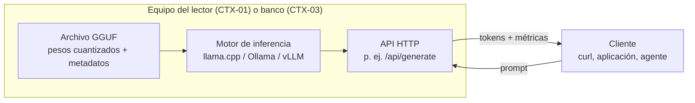

# 08. Inferencia local: motores y cuantización

Este documento convierte al lector en operador: qué software carga los pesos de un modelo y lo
sirve (el motor de inferencia), en qué formato viajan esos pesos (GGUF), por qué un modelo de
miles de millones de parámetros entra en una computadora común (cuantización), cuánta memoria va
a pedir antes de descargarlo, y con qué métricas se juzga un despliegue ya servido. Acá se montan,
descargan y sirven los modelos que el resto de la guía usa; acá se enseña, una sola vez, el paso 0
de verificación del banco que todos los demás laboratorios citan.

**Antes de leer**: [02-Arquitectura-Transformer.md](02-Arquitectura-Transformer.md) (IAM-02) para
saber qué son los parámetros, la atención y la ventana de contexto, y
[03-Del-Modelo-Base-Al-Asistente.md](03-Del-Modelo-Base-Al-Asistente.md) (IAM-03) para distinguir
base de *instruct* y entender el muestreo. El grafo completo vive en
[Cohesion-Global.md](Cohesion-Global.md).
**Anterior**: [03-Del-Modelo-Base-Al-Asistente.md](03-Del-Modelo-Base-Al-Asistente.md) ·
**Siguiente** (ruta formativa): [04-Datos-Y-Corpus.md](04-Datos-Y-Corpus.md).
Convenciones del cuerpo: [Convenciones.md](Convenciones.md) (citado §2, ejemplos §3, cifras §4).
Apartamiento declarado ([Convenciones.md](Convenciones.md) §5): el documento supera la extensión
orientativa de 350–700 líneas porque sus laboratorios 08-A/B/C transcriben completos los comandos
y las salidas reales capturadas, como exige el patrón de ejemplo operable; el eje de partición,
si hiciera falta, es el que declara el grafo de [Cohesion-Global.md](Cohesion-Global.md)
(motores, formatos y cuantización / operación del banco y métricas de servicio).

## Índice

1. [Definición](#1-definición)
2. [Aplicación por escenario](#2-aplicación-por-escenario)
3. [Ejemplos concretos](#3-ejemplos-concretos)
4. [Bloque didáctico](#4-bloque-didáctico)
5. [Criterios de calidad](#5-criterios-de-calidad)
6. [Anexo: lista de verificación para montar y servir](#6-anexo-lista-de-verificación-para-montar-y-servir)
7. [Referencias](#referencias)

---

## 1. Definición

### 1.1 Inferencia e inferencia local

**Inferencia.** Ejecutar un modelo ya entrenado para obtener salidas: los parámetros no cambian,
sólo se usan (Qwen Team, 2025). Inferencia **local** es hacerlo en hardware que uno controla
—la propia máquina o un servidor de la red propia—, con los pesos descargados, en lugar de
consumir la API de un tercero.

**Cómo se aplica.** Antes de encarar cualquier tarea con un modelo, contestá una pregunta:
¿adónde viaja mi texto? Trazá el recorrido del *prompt* desde que lo escribís hasta que vuelve la
respuesta. Si en ningún tramo sale de tu red, la inferencia es local; si pasa por el servidor de
un proveedor, no lo es, por mucho que el cliente corra en tu terminal.

**Un caso.** El banco de ensayo de esta guía es un servidor Ollama en la red local (CTX-03 del
[marco de referencia](Marco-De-Referencia.md)): los prompts de los laboratorios viajan hasta
`$OLLAMA_HOST`, se procesan ahí y vuelven; nada sale a internet. El mismo ejercicio contra un
proveedor comercial recorre el camino inverso: el texto cruza la red pública y los pesos nunca se
ven. Esa diferencia de recorrido es exactamente lo que CTX-05 (datos sensibles, sin salida a
internet) convierte en requisito.

### 1.2 El motor de inferencia

**Motor de inferencia.** El software que carga los pesos en memoria, ejecuta la pasada del
*transformer* para cada *token* y expone el modelo detrás de una API: llama.cpp, Ollama y vLLM
son los tres que esta guía trata (ggml-org, s. f.-b; Ollama, s. f.; Kwon et al., 2023).

**Cómo se aplica.** Separá mentalmente las tres piezas de todo despliegue y nombralas para tu
caso: el **archivo de pesos** (qué sabe el modelo), el **motor** (qué tan rápido y en qué hardware
corre) y el **cliente** (quién consume la API). Se cambian por separado: el mismo GGUF corre en
llama.cpp o detrás de Ollama; el mismo cliente HTTP habla con Ollama o con vLLM si la API es
compatible. Si no podés decir cuál de las tres piezas es responsable de un problema, todavía no
entendiste tu despliegue.

**Un caso.** En el laboratorio [08-A](#31-lab-08-a--montar-el-acceso-descargar-y-servir) las tres
piezas quedan a la vista: el GGUF de `qwen2.5:7b-instruct` (pesos), el servidor Ollama 0.32.0-rc0
del banco (motor) y `curl` desde la máquina del lector (cliente). Cambiar el modelo no toca el
motor ni el cliente: sólo el primer argumento.



La tabla compara los tres motores por lo que decide la elección. Las celdas describen el diseño de
cada proyecto según su documentación oficial, consultada el 2026-11-07; ninguna afirma cifras de
rendimiento, que dependen del despliegue y se miden con el protocolo de §1.5.

| Criterio | llama.cpp | Ollama | vLLM |
| --- | --- | --- | --- |
| Qué es | Biblioteca y ejecutables en C/C++ para inferencia de modelos de lenguaje (ggml-org, s. f.-b) | Servidor y gestor de modelos que empaqueta llama.cpp como motor con registro propio de modelos (Ollama, s. f.) | Biblioteca de servicio para producción con PagedAttention y *continuous batching* (Kwon et al., 2023; vLLM, s. f.) |
| Hardware objetivo | CPU primero; GPU opcional descargando capas (*offload*) | El de llama.cpp: CPU sola o CPU+GPU de consumo | GPU de servidor o de consumo alta; la CPU no es su caso |
| Formato de pesos | GGUF | GGUF (su registro los distribuye así) | *Safetensors* del ecosistema Hugging Face; cuantizaciones GPTQ/AWQ, soporte GGUF limitado |
| Concurrencia | Un proceso, lotes chicos | Cola de solicitudes; paralelismo limitado configurable | *Continuous batching*: decenas de clientes simultáneos sin reiniciar lotes |
| API | Servidor HTTP propio (`llama-server`), compatible con la API de OpenAI | API propia (`/api/generate`, `/api/chat`, `/api/tags`…) y compatibilidad OpenAI | Servidor compatible con la API de OpenAI |
| Gestión de modelos | Manual: el usuario consigue el GGUF | `ollama pull` descarga por etiqueta y digest desde su registro | Descarga desde Hugging Face por nombre de repositorio |
| Dónde brilla | Control fino y hardware mínimo (CTX-01) | Operación simple de uno o pocos usuarios (CTX-01 a CTX-03) | Servir a muchos clientes a la vez con GPU (CTX-02/CTX-03 con carga) |

Criterio de esta guía: los tres resuelven el mismo problema con supuestos distintos de hardware y
concurrencia; la elección se razona en el [bloque didáctico](#4-bloque-didáctico), pregunta 3. El
banco usa Ollama como **medio** de los ejemplos, no como veredicto sobre el espacio de motores
([Convenciones.md](Convenciones.md) §3.3).

### 1.3 GGUF: los pesos como un archivo

**GGUF.** Formato binario de archivo del ecosistema ggml/llama.cpp que empaqueta, en una sola
pieza, los tensores del modelo —habitualmente ya cuantizados— y sus metadatos como pares
clave-valor: arquitectura, dimensiones, tokenizador, licencia (ggml-org, s. f.-a).

**Cómo se aplica.** Interrogá al archivo antes de confiar en él: pedí sus metadatos (`ollama show`
contra el banco, o el lector de GGUF de llama.cpp sobre un archivo suelto) y verificá tres campos
contra lo que creés tener: `general.parameter_count` (¿es el tamaño que esperaba?),
`quantization_level` (¿qué precisión compré?) y `general.license` (¿puedo usarlo para esto?). Un
GGUF que no declara lo que esperás no es el modelo que creés que descargaste.

**Un caso.** `ollama show qwen3.5:4b` contra el banco devuelve `general.parameter_count:
4205751296`, `quantization_level: Q4_K_M` y `general.license: apache-2.0`, más la arquitectura
completa (capas, cabezas, ventana). Los tres campos contestan las tres preguntas sin descargar
nada extra: los metadatos viajan dentro del mismo archivo que los pesos. El laboratorio
[08-A](#31-lab-08-a--montar-el-acceso-descargar-y-servir) repite la operación paso a paso.

El detalle que importa del diseño: el GGUF es **autodescriptivo**. Un motor nuevo puede cargar un
modelo que no conocía leyendo los metadatos del propio archivo, y un agente puede auditar un
modelo (tamaño, licencia, tokenizador) sin ejecutarlo. La cadena que produce estos archivos desde
un modelo ajustado —Hugging Face → conversión → GGUF → servido— es propiedad del documento
[06-Ajuste-Fino-Y-Alineacion.md](06-Ajuste-Fino-Y-Alineacion.md) y no se repite acá.

### 1.4 Cuantización: precisión por memoria

**Cuantización.** Reducir la precisión numérica con que se almacenan los parámetros —de 16 bits
por peso a 8, 5, 4 o menos— para que el modelo ocupe menos memoria y se lea más rápido, aceptando
una pérdida de calidad medible (Dettmers y Zettlemoyer, 2023).

**Cómo se aplica.** Calculá antes de descargar: multiplicá los parámetros del modelo por los bits
por peso (bpw) del esquema y dividí por 8; eso da los bytes de los pesos. Compará contra tu RAM
descontando el sistema y la caché KV (§1.5; el cálculo completo, en el laboratorio
[08-C](#33-lab-08-c--estimar-la-memoria-antes-de-descargar)). Si no entra, bajá de esquema o de
tamaño de modelo; si entra holgado, considerá subir de esquema antes que de tamaño.

**Un caso.** Un modelo de 7,6 mil millones de parámetros pesa 14,19 GiB en F16: no entra en una
máquina de 16 GiB con sistema operativo y navegador abiertos. El mismo modelo en Q4_K_M ocupa
4,36 GiB de archivo y deja lugar de sobra para la caché KV: ésa es la diferencia entre «no corre»
y «corre» en CTX-01, y la corrida completa del cálculo está en el laboratorio
[08-C](#33-lab-08-c--estimar-la-memoria-antes-de-descargar).

Tres precisiones sobre el mecanismo:

- **Se cuantiza por bloques, no peso a peso.** Los esquemas GGML agrupan pesos (bloques de 32 o
  superbloques de 256) y guardan por bloque una escala en precisión alta más los pesos en
  precisión baja; por eso los bpw nominales no son enteros: Q4_0 son 4,5 bpw exactos (18 bytes
  por bloque de 32), Q8_0 son 8,5, Q6_K son 6,5625 (ggml-org, s. f.-a; ggml-org, s. f.-b). Los
  esquemas con sufijo `_M` como Q4_K_M son mezclas: capas sensibles en más bits, el resto en
  menos.
- **La pérdida no es lineal.** La evidencia empírica sobre familias y tamaños ubica alrededor de
  4 bits el punto de mejor compromiso entre bits totales y calidad: para un presupuesto fijo de
  memoria conviene, en general, un modelo más grande cuantizado a ~4 bits antes que uno más chico
  en 8 o 16 (Dettmers y Zettlemoyer, 2023). Por debajo de ~3 bits la degradación se acelera. Cómo
  medir esa pérdida sobre la propia tarea es materia de
  [07-Evaluacion-Y-Metricas.md](07-Evaluacion-Y-Metricas.md).
- **GGUF no es el único ecosistema.** GPTQ (Frantar et al., 2023) y AWQ (Lin et al., 2024)
  cuantizan para inferencia en GPU y son los formatos que vLLM consume con naturalidad; QLoRA usa
  la cuantización a 4 bits para **entrenar** sobre hardware modesto y pertenece a
  [06-Ajuste-Fino-Y-Alineacion.md](06-Ajuste-Fino-Y-Alineacion.md) (Dettmers et al., 2023).

### 1.5 La memoria y las métricas de servicio

**Caché KV.** Memoria donde el motor guarda las claves y valores de atención de los tokens ya
procesados, para no recalcularlos en cada token nuevo; crece linealmente con la ventana ocupada y
es el segundo consumidor de memoria después de los pesos (Vaswani et al., 2017; Pope et al.,
2023).

**Cómo se aplica.** Calculá su costo por token para tu modelo: 2 (claves y valores) × capas ×
cabezas KV × dimensión de cabeza × 2 bytes (f16). Multiplicá por la ventana que pensás usar y
sumalo a los pesos: ésa es la memoria real del despliegue. El dato de cabezas KV sale de los
metadatos del GGUF (§1.3); si es menor que el total de cabezas, el modelo usa atención agrupada
(GQA, *grouped-query attention*), que existe precisamente para achicar esta caché (Ainslie et
al., 2023).

**Un caso.** `qwen2.5:7b-instruct` declara 28 capas, 28 cabezas de atención pero sólo 4 cabezas
KV, con dimensión 128: la caché cuesta 56 KiB por token — 0,44 GiB con ventana de 8192 y 1,75 GiB
con 32 768. Sin GQA (28 cabezas KV) serían siete veces esas cifras y la ventana larga no entraría
en CTX-01. La corrida está en el laboratorio
[08-C](#33-lab-08-c--estimar-la-memoria-antes-de-descargar).

**Tokens por segundo.** Métrica de servicio: cuántos tokens genera por segundo un despliegue
concreto —modelo, cuantización, motor, hardware y parámetros fijados— durante la fase de
generación (Ollama, s. f.).

**Cómo se aplica.** Medila, nunca la cites de memoria: pedile al motor una generación con entrada
y longitud fijas y dividí los tokens generados por el tiempo de generación que el propio motor
reporta (en Ollama, `eval_count / eval_duration`). Repetí tres veces y quedate con la mediana.
Separá siempre las dos fases que el motor también separa: el **procesamiento del prompt**
(*prefill*: `prompt_eval_count` / `prompt_eval_duration`), que procesa la entrada en paralelo, y
la **generación** (*decode*), que produce de a un token. Son cuellos de botella distintos: la
generación está limitada por el ancho de banda de memoria —cada token obliga a releer todos los
pesos—, no por la capacidad de cálculo (Pope et al., 2023).

**Un caso.** El laboratorio [08-B](#32-lab-08-b--medir-tokenss-en-el-banco) corre exactamente esa
medición contra el banco y deja la cifra con su protocolo. La métrica que falta acá —el tiempo
hasta el primer token, que el usuario interactivo percibe más que el caudal— se deriva en el
mismo laboratorio del tiempo de *prefill*: el **TTFT** (*time to first token*, tiempo hasta el
primer token).

Qué **no** es esta sección: un ranking de modelos. Toda comparación entre modelos concretos del
ecosistema vive en la tabla de referencia de
[11-Panorama-Y-Ecosistema-Abierto.md](11-Panorama-Y-Ecosistema-Abierto.md), la única pieza
fechada de la guía.

---

## 2. Aplicación por escenario

Los identificadores ESC/CTX/ACT son los del [marco de referencia](Marco-De-Referencia.md).

**ESC-02 — Montar y servir un modelo localmente.** Es el escenario que este documento realiza de
punta a punta: verificar el acceso (paso 0), descargar por etiqueta, interrogar el GGUF, servir y
medir. Los laboratorios de §3 son su materialización. Lo que cambia por contexto: en CTX-01 el
motor corre en la misma máquina (`localhost`) y la restricción dominante es la RAM, por lo que la
estimación del laboratorio 08-C va **antes** de la descarga; en CTX-03 el motor ya corre en el
banco y la restricción pasa a ser la red y la concurrencia con otros usuarios — quien decide qué
modelos hay y cuánta memoria se les dedica es ACT-03, no el lector; en CTX-06 el modelo es un
artefacto versionado más: la etiqueta con digest (la huella criptográfica que identifica al
archivo exacto) del laboratorio 08-A es lo que un `Dockerfile` o
una CI fija para que la imagen sea reproducible.

**ESC-01 — Entender y elegir un modelo.** Este documento aporta la mitad material de la decisión:
con los metadatos del GGUF (§1.3) y la estimación de memoria (laboratorio 08-C), el lector
descarta en minutos los candidatos que no entran en su hardware, antes de mirar ninguna métrica
de calidad. La otra mitad —qué familia, qué licencia, qué cifras comparativas— vive en
[11-Panorama-Y-Ecosistema-Abierto.md](11-Panorama-Y-Ecosistema-Abierto.md).

**ESC-05 — Evaluar, comparar y decidir con evidencia.** Las métricas de servicio de §1.5 son la
pata operativa de toda comparación: dos modelos sólo se comparan en tokens/s bajo el mismo
protocolo (mismo motor, misma cuantización, misma entrada, misma ventana). El diseño de los evals
de calidad es de [07-Evaluacion-Y-Metricas.md](07-Evaluacion-Y-Metricas.md); este documento
aporta el protocolo de medición de la parte de servicio.

**ESC-04 — Adaptar un modelo a un dominio.** El resultado de un ajuste fino termina acá: el
adaptador exportado a GGUF se sirve con los mismos comandos del laboratorio 08-A. La cadena de
producción (PEFT/TRL → conversión → GGUF) es del documento
[06-Ajuste-Fino-Y-Alineacion.md](06-Ajuste-Fino-Y-Alineacion.md).

**ESC-03 y ESC-06** consumen lo montado: el pipeline RAG (*Retrieval-Augmented Generation*) de
[09-Bases-Vectoriales-Y-RAG.md](09-Bases-Vectoriales-Y-RAG.md) pega contra el mismo endpoint, y
el modelo de visión del banco que usa
[10-Multimodalidad-Y-Generacion-No-Textual.md](10-Multimodalidad-Y-Generacion-No-Textual.md) se
descarga y verifica igual que cualquier otro.

**ESC-07 — Integrar en una aplicación.** La API que este documento deja servida es el contrato
que consume ACT-02; la integración .NET se trata en la guía 16 del repositorio
([`Dot-Net-Integration-AI-Layer-Guide`](../Dot-Net-Integration-AI-Layer-Guide/Dot-Net-Integration-AI-Layer-Guide.md)):
referencia, no duplicación.

En CTX-05 (datos sensibles) todo lo anterior vale con una restricción extra: la descarga del
modelo es el único paso que requiere internet; servido una vez, el flujo completo de §1.1 ocurre
sin salida, y verificarlo es parte de la lista del [anexo](#6-anexo-lista-de-verificación-para-montar-y-servir).
En CTX-04 (API de terceros) este documento no aplica: no hay pesos propios que montar — el
criterio para esa frontera lo da el bloque didáctico, pregunta 4.

---

## 3. Ejemplos concretos

Los tres laboratorios siguen el patrón de [Convenciones.md](Convenciones.md) §3. Los dos primeros
pegan contra el banco (CTX-03, reproducibles en CTX-01 con un Ollama local); el tercero corre en
CTX-01 puro, sin red. Entorno de referencia: Ollama 0.32.0-rc0 en el banco; cliente con `curl` y
`python3`. Variable de acceso:

```bash
export OLLAMA_HOST="${OLLAMA_HOST:-http://localhost:11434}"
```

### 3.1 Lab 08-A — Montar el acceso, descargar y servir

**Objetivo**: dejar un modelo verificado y servido, identificado por etiqueta y digest.
**Prerrequisitos**: `curl` y, para los subcomandos de consola, el cliente `ollama` instalado; red
hasta el banco. **Dueño**: este documento; los demás citan.

**Paso 0 — verificar el acceso al banco.** Todo laboratorio de la guía que use el banco empieza
acá (y los demás documentos citan este paso, no lo copian):

```bash
curl -s "${OLLAMA_HOST:-http://localhost:11434}/api/tags" >/dev/null \
  && echo "banco accesible" || echo "banco NO accesible: revisá OLLAMA_HOST"
```

Si responde «banco NO accesible», el diagnóstico es de red o de variable, no del modelo: revisá
el valor de `OLLAMA_HOST`, que el servidor esté arriba (en CTX-01, `ollama serve`) y que ningún
cortafuegos corte el puerto 11434.

**Paso 1 — inventario: qué modelos ya hay.**

```bash
curl -s "$OLLAMA_HOST/api/tags" | python3 -m json.tool | grep -E '"name"|"parameter_size"|"quantization_level"'
```

Salida en el banco (2026-11-07, recortada: 11 modelos en total):

```text
            "name": "qwen3-coder:30b",
                "parameter_size": "30.5B",
                "quantization_level": "Q4_K_M",
            "name": "gpt-oss:20b",
                "parameter_size": "20.9B",
                "quantization_level": "MXFP4",
            ...
            "name": "qwen2.5:7b-instruct",
                "parameter_size": "7.6B",
                "quantization_level": "Q4_K_M",
            ...
            "name": "qwen3.5:4b",
                "parameter_size": "4.2B",
                "quantization_level": "Q4_K_M",
```

Cada entrada es una etiqueta (`familia:variante`) con su tamaño de parámetros y su cuantización.
En CTX-03 este inventario lo decide ACT-03: si el modelo que buscás no está, se pide, no se
descarga por la fuerza en un servidor ajeno.

**Paso 2 — descargar por etiqueta.** En CTX-01 (tu máquina) o con acuerdo de ACT-03 en el banco:

```bash
ollama pull qwen2.5:7b-instruct
```

**[ilustrativo — no verificado en el banco]**: en el banco de la guía los modelos los administra
ACT-03 y este paso no debe correrse contra un servidor ajeno (el modelo ya figura en el
inventario del paso 1); en CTX-01 el comando corre tal cual y muestra el progreso de descarga de
cada capa con su digest.

La descarga es reanudable y verifica integridad por digest. La etiqueta sola (`qwen2.5:7b-instruct`)
es un puntero que el registro puede mover; el digest que muestra el paso 3 es la identidad
inmutable del artefacto — la diferencia importa en CTX-06, donde se fija el digest.

**Paso 3 — interrogar el GGUF.** Con el cliente de consola instalado alcanza
`ollama show qwen2.5:7b-instruct`; la misma información sale por la API (y es la forma que
funciona desde cualquier máquina con `curl`):

```bash
curl -s "$OLLAMA_HOST/api/show" -d '{"model": "qwen2.5:7b-instruct"}' | python3 -c "
import json, sys
r = json.load(sys.stdin)
print('details:', json.dumps(r['details']))
for k, v in sorted(r['model_info'].items()):
    if not isinstance(v, list):
        print(f'{k}: {v}')
"
```

Salida en el banco (2026-11-07, recortada a los campos que esta sección manda auditar):

```text
details: {"parent_model": "", "format": "gguf", "family": "qwen2", "families": ["qwen2"], "parameter_size": "7.6B", "quantization_level": "Q4_K_M"}
general.architecture: qwen2
general.license: apache-2.0
general.parameter_count: 7615616512
qwen2.attention.head_count: 28
qwen2.attention.head_count_kv: 4
qwen2.block_count: 28
qwen2.context_length: 32768
qwen2.embedding_length: 3584
```

Verificá contra lo esperado los campos de §1.3: cantidad de parámetros, `quantization_level`,
licencia, ventana de contexto (`context_length`) y las cabezas KV que alimenta el laboratorio
08-C. Este es el momento de la auditoría: después de servir ya nadie vuelve a mirar los metadatos.

**Paso 4 — servir y comprobar qué está cargado.** La primera solicitud carga el modelo a memoria;
`/api/ps` muestra qué hay cargado, cuánta memoria ocupa y cuándo expira:

```bash
curl -s "$OLLAMA_HOST/api/generate" -d '{
  "model": "qwen2.5:7b-instruct",
  "prompt": "Respondé con una sola palabra: ¿capital de Francia?",
  "stream": false
}' | python3 -m json.tool

curl -s "$OLLAMA_HOST/api/ps" | python3 -m json.tool   # con el CLI: ollama ps
```

Salida en el banco (2026-11-07; primera solicitud tras una pausa, recortada — el arreglo
`context` y los campos repetidos se omiten):

```text
{
    "model": "qwen2.5:7b-instruct",
    "response": "París",
    "done": true,
    "done_reason": "stop",
    "total_duration": 35167092547,
    "load_duration": 34245894819,
    "prompt_eval_count": 42,
    "prompt_eval_duration": 669309000,
    "eval_count": 3,
    "eval_duration": 250304000
}
{
    "models": [
        {
            "name": "qwen2.5:7b-instruct",
            "size": 6915411148,
            "digest": "845dbda0ea48ed749caafd9e6037047aa19acfcfd82e704d7ca97d631a0b697e",
            "expires_at": "2026-11-08T12:30:04.352922176Z",
            "size_vram": 0,
            "context_length": 32768
        }
    ]
}
```

De los 35,2 s totales, 34,2 s fueron la carga del modelo a memoria (`load_duration`): la
generación en sí tomó menos de un segundo. Y 6 915 411 148 bytes = 6,44 GiB cargados contra
4,36 GiB de archivo: la diferencia son caché KV y buffers.

**Resultado esperado**: la generación responde y `/api/ps` (u `ollama ps`) lista el modelo con su tamaño en
memoria (mayor que el archivo: pesos + caché KV + buffers) y su vencimiento — Ollama descarga de
memoria los modelos ociosos, por eso la primera solicitud tras una pausa tarda más (la carga) y
las siguientes no. **Si difiere**: un error `model not found` es etiqueta mal escrita o paso 2
faltante; una respuesta lenta la primera vez y rápida después es el comportamiento normal recién
descripto, no un problema de red. La variación del texto de la respuesta entre corridas es el
muestreo, materia de [03-Del-Modelo-Base-Al-Asistente.md](03-Del-Modelo-Base-Al-Asistente.md).

### 3.2 Lab 08-B — Medir tokens/s en el banco

**Objetivo**: obtener la métrica de generación del despliegue con un protocolo repetible, usando
los contadores del propio motor. **Prerrequisitos**: laboratorio 08-A completado (paso 0 incluido).
**Dueño**: este documento. Los laboratorios de inferencia interactiva (temperatura, *few-shot*,
*streaming*) son de [03-Del-Modelo-Base-Al-Asistente.md](03-Del-Modelo-Base-Al-Asistente.md) y no
se repiten acá.

Entrada fija, longitud fija, muestreo fijado para que las corridas sean comparables:

```bash
curl -s "$OLLAMA_HOST/api/generate" -d '{
  "model": "qwen2.5:7b-instruct",
  "prompt": "Explicá en un párrafo qué es la cuantización de un modelo de lenguaje.",
  "stream": false,
  "options": { "num_predict": 128, "temperature": 0, "seed": 42 }
}' | python3 -c "
import json, sys
r = json.load(sys.stdin)
pre = r['prompt_eval_count'] / (r['prompt_eval_duration'] / 1e9)
gen = r['eval_count'] / (r['eval_duration'] / 1e9)
print(f\"prefill : {r['prompt_eval_count']:4d} tokens  {pre:8.1f} tokens/s\")
print(f\"decode  : {r['eval_count']:4d} tokens  {gen:8.1f} tokens/s\")
print(f\"TTFT ~  : {r['prompt_eval_duration']/1e9:.2f} s (tiempo de prefill)\")
"
```

Los campos `eval_count`, `eval_duration`, `prompt_eval_count` y `prompt_eval_duration` (estos dos
últimos pueden descontar la parte del prompt que quedó cacheada de una solicitud anterior) son
parte del contrato de respuesta de `/api/generate`
(Ollama, s. f.). Correr **tres veces** y tomar la mediana del *decode*; la primera corrida puede
incluir la carga del modelo y se descarta.

Tres corridas contra el banco (2026-11-07, modelo ya cargado por el laboratorio 08-A):

```text
=== corrida 1 ===
prefill :   52 tokens      62.6 tokens/s
decode  :  128 tokens       7.5 tokens/s
TTFT ~  : 0.83 s (tiempo de prefill)
=== corrida 2 ===
prefill :   52 tokens      62.2 tokens/s
decode  :  128 tokens       7.5 tokens/s
TTFT ~  : 0.84 s (tiempo de prefill)
=== corrida 3 ===
prefill :   52 tokens      66.5 tokens/s
decode  :  128 tokens       7.5 tokens/s
TTFT ~  : 0.78 s (tiempo de prefill)
```

Mediana del *decode*: **7,5 tokens/s**.

<details>
<summary>Protocolo de la cifra</summary>

- **Cifra**: 7,5 tokens/s de generación (decode), mediana de tres corridas
- **Modelo**: qwen2.5:7b-instruct — digest `845dbda0ea48ed749caafd9e6037047aa19acfcfd82e704d7ca97d631a0b697e`
- **Motor**: ollama 0.32.0-rc0
- **Parámetros**: num_predict 128, temperature 0, seed 42 (resto en default)
- **Entrada**: el prompt transcripto arriba
- **Contexto de hardware**: CTX-03 (banco de la guía, CPU) — la cifra describe ese despliegue, no al modelo
- **Fecha de la corrida**: 2026-11-07
</details>

**Resultado esperado**: el *prefill* resulta mucho más rápido que el *decode* — en el banco, 62
contra 7,5 tokens/s (~8×); con GPU la brecha llega a uno o dos órdenes de magnitud — porque
procesa la entrada en paralelo, mientras que la generación relee los pesos token a token (§1.5). **Si difiere**: un *decode* muy por debajo de la mediana de las otras corridas suele
ser concurrencia en el banco (otro usuario generando: `ollama ps` lo muestra); cifras distintas a
las de otra máquina no son un error — tokens/s es una propiedad del despliegue completo, y por eso
toda cifra viaja con su protocolo.

### 3.3 Lab 08-C — Estimar la memoria antes de descargar

**Objetivo**: decidir si un modelo entra en un equipo **antes** de descargar gigabytes, y entender
qué parte del costo es de los pesos y cuál de la ventana. **Prerrequisitos**: `python3`; ninguna
red — corre entero en CTX-01. Las constantes del script salen de los metadatos que el laboratorio
08-A enseña a leer.

```python
# Estimador de memoria de inferencia local — Lab 08-C de la guía IA-Model.
# Corre en CTX-01 (CPU, python3 estándar, sin dependencias ni red).
# Dos operaciones: (1) bpw efectivos de un GGUF real a partir de su tamaño de
# archivo y su cantidad de parámetros; (2) estimación de RAM total = pesos +
# caché KV + margen del motor, para distintas cuantizaciones y ventanas.

GIB = 2**30

# --- Entradas: dos modelos del banco (salida de `ollama show` / `/api/tags`,
# --- Lab 08-A). Cambiá estas constantes por las de tu modelo.
modelos = {
    "qwen2.5:7b-instruct (Q4_K_M)": {
        "parametros": 7_615_616_512,      # general.parameter_count
        "bytes_archivo": 4.36 * GIB,      # tamaño del GGUF según /api/tags
        "capas": 28,                      # qwen2.block_count
        "cabezas_kv": 4,                  # qwen2.attention.head_count_kv (GQA)
        "dim_cabeza": 3584 // 28,         # embedding_length / head_count = 128
    },
    "qwen3-coder:30b (Q4_K_M)": {
        "parametros": 30_500_000_000,     # 30.5B según details.parameter_size
        "bytes_archivo": 17.28 * GIB,
        "capas": None,                    # MoE: la caché KV se estima aparte
    },
}

# --- Operación 1: bits por peso efectivos = bytes * 8 / parámetros
print("== bpw efectivos (archivo real vs. nominal del esquema) ==")
for nombre, m in modelos.items():
    bpw = m["bytes_archivo"] * 8 / m["parametros"]
    print(f"  {nombre}: {bpw:.2f} bpw efectivos")

# --- Operación 2a: pesos teóricos por esquema de cuantización.
# bpw exactos derivados del formato de bloque GGML (fuente: espec. GGUF y
# código de llama.cpp); los K_M son mezclas, valor aproximado.
esquemas = [
    ("F16", 16.0, "exacto"), ("Q8_0", 8.5, "exacto: 34 B por bloque de 32"),
    ("Q6_K", 6.5625, "exacto: 210 B por superbloque de 256"),
    ("Q4_K_M", 4.85, "aprox.: mezcla Q4_K/Q6_K"),
    ("Q4_0", 4.5, "exacto: 18 B por bloque de 32"),
    ("Q2_K", 2.63, "aprox.: mezcla"),
]
p = modelos["qwen2.5:7b-instruct (Q4_K_M)"]["parametros"]
print(f"\n== pesos teóricos para {p/1e9:.1f}B parámetros ==")
for nombre, bpw, nota in esquemas:
    print(f"  {nombre:7s} {p*bpw/8/GIB:6.2f} GiB  ({nota})")

# --- Operación 2b: caché KV = 2 (K y V) * capas * cabezas_kv * dim_cabeza
# --- * ventana * 2 bytes (f16 por defecto en llama.cpp/Ollama).
m = modelos["qwen2.5:7b-instruct (Q4_K_M)"]
por_token = 2 * m["capas"] * m["cabezas_kv"] * m["dim_cabeza"] * 2
print(f"\n== caché KV de qwen2.5:7b-instruct: {por_token/1024:.0f} KiB/token ==")
for ctx in (2048, 8192, 32768):
    print(f"  ventana {ctx:6d}: {por_token*ctx/GIB:5.2f} GiB")

# --- Total orientativo: pesos + KV + ~1 GiB de margen (grafo, buffers, SO).
margen = 1 * GIB
total = m["bytes_archivo"] + por_token * 8192 + margen
print(f"\n== total estimado (7B Q4_K_M, ventana 8192): {total/GIB:.1f} GiB ==")
print("   -> entra en CTX-01 (16 GiB); con ventana 32768 sumar la KV de arriba")
```

Salida de una corrida real (CTX-01, CPU x86-64, python 3.11, 2026-11-07):

```text
== bpw efectivos (archivo real vs. nominal del esquema) ==
  qwen2.5:7b-instruct (Q4_K_M): 4.92 bpw efectivos
  qwen3-coder:30b (Q4_K_M): 4.87 bpw efectivos

== pesos teóricos para 7.6B parámetros ==
  F16      14.19 GiB  (exacto)
  Q8_0      7.54 GiB  (exacto: 34 B por bloque de 32)
  Q6_K      5.82 GiB  (exacto: 210 B por superbloque de 256)
  Q4_K_M    4.30 GiB  (aprox.: mezcla Q4_K/Q6_K)
  Q4_0      3.99 GiB  (exacto: 18 B por bloque de 32)
  Q2_K      2.33 GiB  (aprox.: mezcla)

== caché KV de qwen2.5:7b-instruct: 56 KiB/token ==
  ventana   2048:  0.11 GiB
  ventana   8192:  0.44 GiB
  ventana  32768:  1.75 GiB

== total estimado (7B Q4_K_M, ventana 8192): 5.8 GiB ==
   -> entra en CTX-01 (16 GiB); con ventana 32768 sumar la KV de arriba
```

<details>
<summary>Protocolo de la cifra</summary>

- **Cifra**: las de la salida transcripta (bpw efectivos, GiB por esquema, KiB/token de caché KV,
  total estimado) — son **estimaciones calculadas**, no mediciones: la operación es el script
- **Entradas**: constantes del script, tomadas de `ollama show` y `/api/tags` del banco
  (parameter_count, tamaño de archivo, block_count, head_count_kv, embedding_length), capturadas
  el 2026-11-07 y cotejadas contra el banco ese mismo día (los seis valores coinciden)
- **Sin semilla ni dataset**: cálculo determinista, entrada única
- **Contexto de hardware**: CTX-01 (CPU x86-64, 16 GiB; el cálculo no depende del hardware)
- **Fecha de la corrida**: 2026-11-07
</details>

**Resultado esperado**: los bpw efectivos quedan cerca del nominal del esquema (4,9 contra 4,85
para Q4_K_M: la diferencia son los tensores que se dejan en más precisión, como los *embeddings*),
y eso valida la regla rápida de §1.4. **Si difiere**: un bpw efectivo muy por encima del nominal
indica que el archivo no es el esquema que dice su etiqueta, o que los parámetros declarados no
son los del archivo — volvé al paso 3 del laboratorio 08-A antes de confiar en la estimación. El
cálculo de caché KV vale para la atención clásica y GQA; para arquitecturas híbridas o MoE
(mezcla de expertos; ver [02-Arquitectura-Transformer.md](02-Arquitectura-Transformer.md)) el
modelo de costo cambia y la estimación de pesos sigue valiendo, pero la de caché no se extrapola.

---

## 4. Bloque didáctico

**Pregunta 1 — ¿Qué cuantización elijo para mi hardware?**
**Criterio que forma**: decidir el esquema por presupuesto de memoria calculado, no por costumbre.
**Respuesta**: primero el presupuesto: RAM total menos sistema y aplicaciones, menos la caché KV
de la ventana que vas a usar (laboratorio 08-C). Con ese número, la evidencia de Dettmers y
Zettlemoyer (2023) ordena la decisión: alrededor de 4 bits está el mejor cambio calidad/byte, así
que si el modelo que querés entra en Q4_K_M, ahí está el default razonable; si sobra memoria
holgada, subir a Q6_K o Q8_0 compra una mejora chica pero real; si falta, antes de bajar de ~3
bits considerá un modelo más chico mejor cuantizado — por debajo de ese umbral la degradación se
acelera. La última palabra la tiene tu eval sobre tu tarea, no una tabla ajena.
**Reenvío**: [§1.4](#14-cuantización-precisión-por-memoria), laboratorio
[08-C](#33-lab-08-c--estimar-la-memoria-antes-de-descargar) y, para medir la pérdida,
[07-Evaluacion-Y-Metricas.md](07-Evaluacion-Y-Metricas.md).

**Pregunta 2 — ¿Por qué mi modelo genera lento si la CPU está al 40 %?**
**Criterio que forma**: diagnosticar el cuello de botella real de la generación antes de comprar
cómputo.
**Respuesta**: porque la generación no está limitada por cálculo sino por ancho de banda de
memoria: producir cada token obliga a releer todos los pesos del modelo, así que el techo de
tokens/s se parece a (ancho de banda de memoria) / (bytes del modelo), y los núcleos esperan datos
(Pope et al., 2023). Por eso cuantizar acelera — hay menos bytes que releer —, por eso el
*prefill* es mucho más rápido que el *decode* (procesa muchos tokens por cada pasada de pesos), y
por eso una GPU ayuda sobre todo por su memoria más rápida. La medición del laboratorio 08-B te
da los dos números separados; si tu *decode* real queda muy por debajo del techo estimado, buscá
paginación a disco (el modelo no entra en RAM y el sistema la simula, con un costo de dos órdenes
de magnitud) o concurrencia.
**Reenvío**: [§1.5](#15-la-memoria-y-las-métricas-de-servicio) y laboratorio
[08-B](#32-lab-08-b--medir-tokenss-en-el-banco).

**Pregunta 3 — ¿llama.cpp, Ollama o vLLM?**
**Criterio que forma**: elegir motor por hardware disponible y concurrencia esperada, no por
popularidad.
**Respuesta**: hacete dos preguntas en orden. ¿Cuántos clientes simultáneos? Uno o pocos: llama.cpp
u Ollama; decenas y con GPU: vLLM, porque el *continuous batching* y PagedAttention existen para
ese caso y en CPU no rinden su valor (Kwon et al., 2023). ¿Cuánta operación querés hacer a mano?
Ollama resuelve registro, descarga por digest y ciclo de vida en memoria a cambio de menos control
fino; llama.cpp te da cada perilla (hilos, *offload* por capa, formatos de caché) a cambio de
conseguir vos los GGUF. Son tres puntos de un mismo espacio, no tres bandos: el criterio de esta
guía es dominar los conceptos (que son comunes) y tratar el motor como pieza reemplazable, igual
que en §1.2.
**Reenvío**: la tabla de [§1.2](#12-el-motor-de-inferencia) y, para el espacio de modelos que cada
uno sirve, [11-Panorama-Y-Ecosistema-Abierto.md](11-Panorama-Y-Ecosistema-Abierto.md).

**Pregunta 4 — ¿Cuándo conviene inferencia local y cuándo una API de terceros?**
**Criterio que forma**: ubicar el propio caso en la frontera CTX-01/02/03 contra CTX-04 con
argumentos materiales.
**Respuesta**: la inferencia local gana cuando manda alguna de estas tres: los datos no pueden
salir (CTX-05 la vuelve obligatoria), el costo por token a volumen alto supera el costo fijo del
hardware que ya tenés, o necesitás fijar el artefacto exacto (modelo + digest + parámetros,
CTX-06) para que nada cambie bajo tus pies. La API de terceros gana cuando necesitás una calidad
que ningún modelo de pesos abiertos que te entre da hoy, o cuando tu volumen no justifica operar
infraestructura. La decisión es revisable: el inventario de modelos cambia por meses, y por eso
la comparación concreta vive en la pieza fechada de la guía, no acá.
**Reenvío**: [§1.1](#11-inferencia-e-inferencia-local), catálogo CTX del
[marco de referencia](Marco-De-Referencia.md) y
[11-Panorama-Y-Ecosistema-Abierto.md](11-Panorama-Y-Ecosistema-Abierto.md).

---

## 5. Criterios de calidad

Seis marcas separan un despliegue local bien hecho —y un capítulo de operación bien escrito— de
uno pobre:

- **Identidad del artefacto**: el modelo está fijado por etiqueta **y** digest, no por «el que
  había». Una versión pobre no puede decir qué binario exacto está sirviendo.
- **Memoria presupuestada, no descubierta**: la estimación (pesos + caché KV + margen) se hizo
  antes de descargar y el total medido (`ollama ps`) se contrastó con ella. El despliegue pobre se
  entera del costo de la ventana larga cuando el sistema empieza a paginar.
- **Cifras con protocolo**: cada tokens/s publicado lleva modelo, digest, motor, parámetros,
  entrada y fecha ([Convenciones.md](Convenciones.md) §4). Una cifra de servicio sin despliegue
  declarado no afirma nada.
- **Fases separadas**: *prefill* y *decode* medidos por separado; quien reporta un solo número
  mezcló dos cuellos de botella distintos y no puede diagnosticar ninguno.
- **Acceso verificable**: el paso 0 distingue problema de red de problema de modelo en una línea;
  el despliegue pobre debuggea la generación cuando lo que falla es `OLLAMA_HOST`.
- **El motor como decisión declarada**: la elección llama.cpp/Ollama/vLLM está argumentada por
  concurrencia y hardware (pregunta 3), y es reversible porque los conceptos no cambian.

---

## 6. Anexo: lista de verificación para montar y servir

Para ACT-01 operando en CTX-01, o como contrato mínimo que ACT-02 le pide a ACT-03 en CTX-03.
Cada ítem remite a la sección que lo enseña:

- [ ] `OLLAMA_HOST` definido y paso 0 en verde (laboratorio 08-A, paso 0).
- [ ] Estimación de memoria hecha para el modelo y la ventana previstos; entra con margen
      (laboratorio 08-C).
- [ ] Modelo descargado; etiqueta **y digest** registrados donde el despliegue se documenta
      (laboratorio 08-A, pasos 2–3).
- [ ] Metadatos del GGUF auditados: parámetros, cuantización, licencia, ventana máxima (§1.3).
- [ ] Primera generación de prueba respondida; `ollama ps` contrastado con la estimación
      (laboratorio 08-A, paso 4).
- [ ] Línea de base de servicio medida y archivada con su protocolo: prefill, decode, TTFT
      (laboratorio 08-B).
- [ ] Si rige CTX-05: verificado que, servido el modelo, ninguna solicitud sale de la red propia
      (§1.1).
- [ ] Si rige CTX-06: digest fijado en el artefacto de infraestructura, no la etiqueta sola (§2,
      ESC-02).

---

## Referencias

Citado autor-año (APA 7.ª edición) conforme a [Convenciones.md](Convenciones.md) §2. Documentación
en línea consultada el 2026-11-07.

- Ainslie, J., Lee-Thorp, J., de Jong, M., Zemlyanskiy, Y., Lebrón, F., y Sanghai, S. (2023).
  GQA: Training generalized multi-query transformer models from multi-head checkpoints. *EMNLP*.
  arXiv:2305.13245
- Dettmers, T., Pagnoni, A., Holtzman, A., y Zettlemoyer, L. (2023). QLoRA: Efficient finetuning
  of quantized LLMs. arXiv:2305.14314
- Dettmers, T., y Zettlemoyer, L. (2023). The case for 4-bit precision: k-bit inference scaling
  laws. *ICML*. arXiv:2212.09720
- Frantar, E., Ashkboos, S., Hoefler, T., y Alistarh, D. (2023). GPTQ: Accurate post-training
  quantization for generative pre-trained transformers. *ICLR*. arXiv:2210.17323
- ggml-org. (s. f.-a). *GGUF file format specification*. GitHub.
  https://github.com/ggml-org/ggml/blob/master/docs/gguf.md
- ggml-org. (s. f.-b). *llama.cpp: LLM inference in C/C++*. GitHub.
  https://github.com/ggml-org/llama.cpp
- Kwon, W., Li, Z., Zhuang, S., Sheng, Y., Zheng, L., Yu, C. H., Gonzalez, J. E., Zhang, H., y
  Stoica, I. (2023). Efficient memory management for large language model serving with
  PagedAttention. *SOSP '23*. arXiv:2309.06180
- Lin, J., Tang, J., Tang, H., Yang, S., Chen, W.-M., Wang, W.-C., Xiao, G., Dang, X., Gan, C., y
  Han, S. (2024). AWQ: Activation-aware weight quantization for LLM compression and acceleration.
  *MLSys*. arXiv:2306.00978
- Ollama. (s. f.). *Documentación oficial — referencia de la API*. https://docs.ollama.com
  (consultada el 2026-11-07)
- Pope, R., Douglas, S., Chowdhery, A., Devlin, J., Bradbury, J., Heek, J., Xiao, K., Agrawal, S.,
  y Dean, J. (2023). Efficiently scaling transformer inference. *MLSys*. arXiv:2211.05102
- Qwen Team. (2025). *Qwen3 Technical Report*. arXiv:2505.09388
- Vaswani, A., et al. (2017). Attention is all you need. *NeurIPS 30*. arXiv:1706.03762
- vLLM. (s. f.). *Documentación oficial*. https://docs.vllm.ai (consultada el 2026-11-07)
