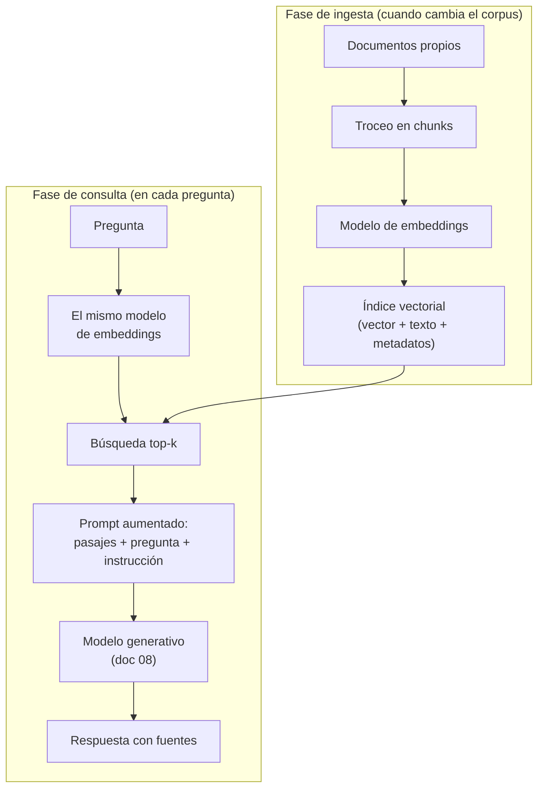

# 09. Bases vectoriales y RAG

Este documento resuelve el problema que ningún modelo, por grande que sea, resuelve solo:
responder preguntas sobre **documentos que el modelo nunca vio** — los propios — citando de dónde
salió cada respuesta. Las piezas son tres y se montan en orden: embeddings aplicados a frases y
documentos, un índice vectorial que los busca a escala, y el pipeline RAG que junta recuperación
con generación.

**Antes de leer**: [`01-Representacion-Del-Lenguaje.md`](01-Representacion-Del-Lenguaje.md)
(IAM-01: *embedding* y similitud coseno) y
[`08-Inferencia-Local.md`](08-Inferencia-Local.md) (IAM-08: servir un modelo y hablarle por API).
**Anterior**: [`07-Evaluacion-Y-Metricas.md`](07-Evaluacion-Y-Metricas.md) ·
**Siguiente**: [`10-Multimodalidad-Y-Generacion-No-Textual.md`](10-Multimodalidad-Y-Generacion-No-Textual.md).
Convenciones del cuerpo: [`Convenciones.md`](Convenciones.md) (citado §2, ejemplos §3, cifras §4).
Apartamiento declarado ([`Convenciones.md`](Convenciones.md) §5): el documento supera la
extensión orientativa porque sus tres laboratorios van transcriptos completos con sus salidas,
como exige el patrón de ejemplo operable; el eje de partición, si hiciera falta, es el que
declara el grafo de [`Cohesion-Global.md`](Cohesion-Global.md) (bases vectoriales / pipeline RAG).

## Índice

1. [Definición](#1-definición)
2. [Aplicación por escenario](#2-aplicación-por-escenario)
3. [Ejemplos concretos](#3-ejemplos-concretos)
4. [Bloque didáctico](#4-bloque-didáctico)
5. [Criterios de calidad](#5-criterios-de-calidad)
6. [Anexo: diagnóstico por etapas de un RAG que responde mal](#6-anexo-diagnóstico-por-etapas-de-un-rag-que-responde-mal)
7. [Referencias](#referencias)

---

## 1. Definición

### 1.1 El problema que estas piezas resuelven

Un modelo de lenguaje sabe lo que su corpus de entrenamiento contenía hasta cierta fecha, y nada
más. El reglamento interno de una cooperativa, los expedientes de un estudio jurídico o los
manuales de una fábrica no estaban en ese corpus, y preguntarle por ellos produce una de dos
salidas: una negativa honesta o una respuesta inventada con total fluidez — la alucinación que
define [`03-Del-Modelo-Base-Al-Asistente.md`](03-Del-Modelo-Base-Al-Asistente.md). Meter los
documentos enteros en el *prompt* funciona hasta que deja de caber: la ventana de contexto es
finita, cuesta memoria en proporción al largo del contexto — la caché KV de
[`08-Inferencia-Local.md`](08-Inferencia-Local.md) — y, aun cuando todo cabe, los modelos usan
peor la evidencia enterrada en el medio de un contexto largo que la que está al principio o al
final (Liu et al., 2023).

**RAG (*Retrieval-Augmented Generation*, generación aumentada por recuperación) es el pipeline que
recupera del corpus propio sólo los pasajes relevantes a la pregunta y los inyecta al *prompt*
antes de generar** (Lewis et al., 2020).

*Cómo se aplica*: ante una pregunta, buscá en tu corpus los fragmentos más afines, armá un *prompt*
que los contenga junto con la pregunta y la instrucción de responder sólo desde ellos, y mandá eso
al modelo; el [ejemplo 2](#32-ejemplo-2--mini-rag-sin-framework) ejecuta el ciclo completo en unas
sesenta líneas. *Un caso*: ante «¿cuántos libros puede llevarse un socio pleno?», el pipeline del
ejemplo 2 recupera el párrafo del reglamento que dice «hasta cinco ejemplares … por veintiún
días», lo inyecta, y el modelo responde esa cifra citando el archivo de origen — una cifra que,
sin recuperación, el mismo modelo declara no conocer.

La recuperación necesita una forma de «afinidad con la pregunta» que no dependa de palabras
exactas, y eso ya existe desde
[`01-Representacion-Del-Lenguaje.md`](01-Representacion-Del-Lenguaje.md): los *embeddings* y la
similitud coseno. Lo que este documento agrega son las dos piezas de ingeniería alrededor: el
modelo de *embeddings* dedicado (§1.2) y el almacén que busca vecinos a escala (§1.3).

### 1.2 Embeddings aplicados: el modelo dedicado

El documento 01 definió el *embedding* y mostró la similitud coseno sobre vectores juguete. Para
operarlos hace falta una distinción más: **el modelo que genera texto y el modelo que produce
vectores son artefactos distintos, entrenados con objetivos distintos**. Un modelo de *embeddings*
es un *bi-encoder*: codifica cada texto por separado en un solo vector, entrenado para que pares
de textos afines queden cerca (Reimers y Gurevych, 2019). El generativo, en cambio, está entrenado
para predecir el token siguiente; sus representaciones internas existen, pero no están optimizadas
para que «dos frases que dicen lo mismo» queden juntas.

*Cómo se aplica*: antes de indexar, elegí un modelo de *embeddings* publicado como tal y verificá
tres propiedades en su ficha — dimensión del vector, idiomas cubiertos y tamaño en memoria; para
comparar candidatos sin probarlos todos, el *benchmark* público MTEB (*Massive Text Embedding
Benchmark*) rankea modelos de
*embeddings* sobre decenas de tareas de recuperación y clasificación (Muennighoff et al., 2023),
con la lectura crítica de *benchmarks* que enseña
[`07-Evaluacion-Y-Metricas.md`](07-Evaluacion-Y-Metricas.md). *Un caso*: el modelo de los
laboratorios de §3, `paraphrase-multilingual-MiniLM-L12-v2`, declara 384 dimensiones, cincuenta
idiomas y unos 470 MB — entra en CTX-01 y maneja castellano; un modelo sólo inglés habría rankeado
peor las frases de los ejemplos.

Dos consecuencias operativas que explican fallas frecuentes. Primera: los vectores de dos modelos
de *embeddings* distintos viven en espacios distintos — un índice construido con un modelo **no se
consulta** con otro, ni siquiera de la misma familia; cambiar de modelo implica reindexar todo.
Segunda: la dimensión se fija al elegir el modelo y el índice la hereda; más dimensiones no
significa mejor recuperación, significa más memoria por vector y otro espacio.

La familia del banco de ensayo tiene su rama dedicada —Qwen3-Embedding, con variantes desde 0.6B
(Zhang et al., 2025)—, pero el banco no la sirve hoy (§3, nota previa); los laboratorios usan una
biblioteca local y el criterio de elección queda igual.

### 1.3 La base vectorial: del escaneo completo al índice

Con el corpus vectorizado, responder «¿qué fragmentos se parecen a esta pregunta?» es buscar los
*k* vecinos más cercanos (kNN, *k-nearest neighbors*) del vector de la pregunta. La forma obvia
—calcular el coseno contra todos los vectores y quedarse con los mejores— se llama búsqueda
exhaustiva o de fuerza bruta, es **exacta**, y para un corpus chico es además la respuesta
correcta: sobre los 15 fragmentos del ejemplo 2 no hay nada que optimizar.

El problema aparece con el tamaño. **Una base vectorial es un almacén que indexa embeddings para
búsqueda de vecinos a escala** (Malkov y Yashunin, 2020), y su pieza central es el índice ANN
(*approximate nearest neighbor*, vecinos más cercanos aproximados): una estructura que responde
mucho más rápido que la fuerza bruta a cambio de **no garantizar** los vecinos exactos. La medida
de ese sacrificio es el *recall*: la fracción de los verdaderos *k* vecinos que el índice
efectivamente devuelve.

*Cómo se aplica*: medilo — corré la misma tanda de consultas contra la fuerza bruta (la verdad) y
contra el índice, y contá cuántos de los vecinos verdaderos aparecen en cada respuesta del índice;
un *recall* de 0,95 significa que, en promedio, 19 de los 20 vecinos reales llegaron. *Un caso*:
con los 15 fragmentos del ejemplo 2 el índice exacto y uno aproximado devuelven lo mismo
(*recall* 1,0 trivial); la diferencia recién paga con decenas de miles de vectores, y por eso los
laboratorios de §3 usan un índice exacto y este párrafo deja la operación de medición enunciada
para cuando el corpus del lector crezca.

El índice ANN dominante es **HNSW** (*Hierarchical Navigable Small World*): un grafo por capas
donde las superiores tienen pocos nodos con saltos largos y las inferiores muchos nodos con saltos
cortos, de modo que una consulta entra por arriba, se acerca a grandes rasgos y refina al bajar —
la misma lógica con que un mapa se mira primero a nivel país y después a nivel calle (Malkov y
Yashunin, 2020). Las alternativas clásicas particionan el espacio en celdas (IVF, *inverted file*)
y comprimen vectores (cuantización de producto; Jégou et al., 2011), al costo de más parámetros
que calibrar; FAISS implementa ambas familias a escala de miles de millones de vectores (Johnson
et al., 2019).

### 1.4 Motores vectoriales: biblioteca, servidor o extensión

«Base vectorial» nombra una función, no un tipo de producto único. El espacio real tiene tres
formas, y elegir mal la forma cuesta más que elegir mal el producto:

| Forma | Ejemplos | Qué es | Cuándo conviene |
| --- | --- | --- | --- |
| Biblioteca embebida | FAISS, hnswlib | Índice dentro del proceso Python; persistencia a archivo manual | Corpus de un solo programa, laboratorios, *batch*; sin servidor que operar |
| Servidor dedicado | Qdrant, Chroma, Milvus, Weaviate | Proceso propio con API, colecciones, metadatos y filtrado | Varios clientes, corpus que crece, filtrado por metadatos en producción |
| Extensión de base relacional | pgvector sobre PostgreSQL | Columna de tipo vector e índices ANN dentro de la base que ya existe | Los datos ya viven en PostgreSQL y el equipo ya sabe operarlo |

(Documentación de los cuatro nombrados: FAISS, Qdrant, Chroma y pgvector — consultadas el
2026-11-07; referencias al pie.)

El criterio de esta guía: para aprender y para corpus de miles de fragmentos, biblioteca embebida
o incluso fuerza bruta con NumPy — cada pieza queda a la vista, que es el punto de una guía de
estudio. El servidor dedicado entra cuando aparecen requisitos de operación (concurrencia,
filtrado, persistencia administrada), y la extensión cuando la pregunta honesta es «¿por qué
montaría una base nueva si mis datos ya están en una?». Los laboratorios de §3 usan FAISS como
biblioteca; el pipeline no cambia si se reemplaza por cualquiera de las otras formas.

Más allá del índice, un motor vectorial agrega lo que la biblioteca no trae: colecciones con
nombre, *upsert* (insertar o actualizar por ID), metadatos por vector (*payload*) y filtrado por
esos metadatos en la misma consulta — «los fragmentos más afines, pero sólo del reglamento
vigente». Ese filtrado es lo primero que un RAG real agrega sobre el mínimo del ejemplo 2.

### 1.5 El pipeline RAG completo

Las piezas anteriores se montan en dos fases: una de **ingesta**, que corre cuando el corpus
cambia, y una de **consulta**, que corre en cada pregunta.



Cada flecha esconde una decisión con criterio propio:

- **Troceo** (*chunking*): los documentos se parten en fragmentos (*chunks*) porque el índice
  recupera unidades, y la unidad define qué se puede encontrar. Fragmentos chicos localizan con
  precisión pero pierden contexto alrededor; fragmentos grandes conservan contexto pero diluyen la
  señal y gastan ventana al inyectarse. No hay tamaño correcto universal: hay una medición sobre
  el corpus propio, que es exactamente el [ejemplo 3](#33-ejemplo-3--chunking-a-dos-tamaños).
- ***Top-k***: cuántos pasajes recuperados se inyectan. Pocos arriesgan dejar la evidencia afuera;
  muchos gastan ventana, suben el costo y entierran lo relevante en el medio del contexto, donde
  los modelos lo usan peor (Liu et al., 2023). Valores iniciales razonables: 3 a 5, y después se
  mide.
- **Recuperación híbrida**: la búsqueda vectorial captura afinidad semántica pero puede fallar en
  términos exactos — códigos, siglas, nombres propios. La búsqueda léxica clásica (BM25; Robertson
  y Zaragoza, 2009) captura exactamente eso y falla en paráfrasis. Los sistemas maduros combinan
  ambas y, cuando hace falta, agregan un *reranker*: un modelo que relee pregunta y candidato
  juntos y reordena los recuperados con más precisión que el coseno — más caro por candidato, por
  eso se aplica sólo sobre los ya recuperados.
- **Instrucción de la aumentación**: el *prompt* fija el contrato — responder sólo desde los
  pasajes, citar la fuente, y decir «no está en el corpus» cuando no está. Esa última cláusula es
  la diferencia entre un sistema auditable y uno que rellena huecos con memoria del modelo.

Sobre ese contrato se define la métrica propia de RAG: ***groundedness*** — si cada afirmación de
la respuesta está sostenida por los pasajes inyectados. *Cómo se aplica*: tomá la respuesta,
marcá cada afirmación fáctica y buscala en los pasajes que el pipeline inyectó; una afirmación sin
pasaje que la sostenga es alucinación en presencia de contexto, aunque resulte cierta en el mundo.
El protocolo de evaluación sistemática —con jueces humanos o LLM-juez contrastado— es materia de
[`07-Evaluacion-Y-Metricas.md`](07-Evaluacion-Y-Metricas.md). *Un caso*: en la corrida del
[ejemplo 2](#32-ejemplo-2--mini-rag-sin-framework), «veintiún días corridos» aparece literal en el
pasaje inyectado — sostenida; si la respuesta agregara «y el trámite es gratuito», cierto o no,
sería una afirmación sin sustento en lo recuperado.

### 1.6 Qué no es

La base vectorial no es «la memoria del modelo»: el modelo no sabe que el índice existe; sólo ve
los pasajes que el pipeline le pega en el *prompt*. RAG no es una forma de entrenamiento: los
pesos no cambian, y por eso el corpus puede actualizarse cada hora sin tocar el modelo — adaptar
los pesos es ajuste fino, otra decisión con otros costos
([`06-Ajuste-Fino-Y-Alineacion.md`](06-Ajuste-Fino-Y-Alineacion.md)). Y RAG no elimina la
alucinación: la acota y la vuelve **auditable**, porque cada respuesta puede confrontarse contra
los pasajes que la justificaron.

La decisión entre las tres estrategias de conocimiento, que
[`03-Del-Modelo-Base-Al-Asistente.md`](03-Del-Modelo-Base-Al-Asistente.md) deja planteada para
ESC-04, se resuelve con esta tabla:

| Criterio | Contexto largo (sin índice) | RAG | Ajuste fino |
| --- | --- | --- | --- |
| Frescura del conocimiento | La del *prompt* de hoy | La del corpus: se reindexa y listo | La del último entrenamiento |
| Trazabilidad de la fuente | Manual | Nativa: cada respuesta cita pasajes | Ninguna: el saber queda difuso en los pesos |
| Costo de actualizar | Reescribir el *prompt* | Reindexar lo que cambió | Reentrenar y redesplegar |
| Costo por consulta | Alto si el corpus es grande (todo entra siempre) | Medio (sólo *top-k* pasajes) | Bajo (nada extra en el *prompt*) |
| Qué enseña al modelo | Nada | Nada | Estilo, formato, vocabulario del dominio |
| Falla típica | Evidencia perdida en el medio del contexto | Recuperación que no trae el pasaje correcto | Conocimiento desactualizado con total confianza |

Regla práctica de esta guía: conocimiento que cambia o exige cita → RAG; comportamiento, tono o
formato que el *prompt* no logra fijar → ajuste fino; corpus que entra cómodo en la ventana y no
cambia → quizá no haga falta ninguna de las dos. Las estrategias se combinan — un modelo ajustado
al vocabulario del dominio puede ser el generador de un RAG.

---

## 2. Aplicación por escenario

Los identificadores son los del catálogo de
[`Marco-De-Referencia.md`](Marco-De-Referencia.md).

**ESC-03 — Preguntarle a un corpus propio.** Es el escenario dueño de este documento: todo §1 y
los tres laboratorios de §3 lo instancian de punta a punta. Los roles del marco se reparten el
trabajo: el curador de datos (ACT-05) decide qué documentos entran, con qué derecho y con qué
troceo — las decisiones de ingesta; el integrador (ACT-02) consume recuperación y generación por
API; el evaluador (ACT-04) mide *groundedness* y calidad de recuperación.

**ESC-01 — Entender y elegir un modelo.** Acá la elección se duplica: además del generativo, se
elige el modelo de *embeddings*, con criterios propios (§1.2: dimensión, idiomas, memoria, puntaje
MTEB leído con fecha). Es la elección más barata de equivocarse al principio y más cara de
corregir después, porque cambiarla implica reindexar (§1.2). El panorama concreto de familias
vive en [`11-Panorama-Y-Ecosistema-Abierto.md`](11-Panorama-Y-Ecosistema-Abierto.md).

**ESC-02 — Montar y servir localmente.** El RAG agrega al despliegue del documento 08 dos piezas
con vida propia: el servicio de *embeddings* (o la biblioteca local, como en §3) y el motor
vectorial con su persistencia. El operador (ACT-03) decide si el motor de inferencia también sirve
los *embeddings* — cuando lo soporta — o si conviven dos servicios; la nota previa de §3 muestra
que esa capacidad hay que **verificarla**, no asumirla.

**ESC-04 — Adaptar un modelo a un dominio.** La tabla de §1.6 es la decisión previa que el
catálogo de escenarios exige antes de ajustar: una parte considerable de los «necesito ajuste
fino» reales son un RAG bien troceado. El camino de ajuste vive en
[`06-Ajuste-Fino-Y-Alineacion.md`](06-Ajuste-Fino-Y-Alineacion.md).

**ESC-05 — Evaluar con evidencia.** Un RAG se evalúa por etapas, no como caja negra: la
recuperación se mide sola (¿el pasaje correcto llegó al *top-k*?) antes de mirar la generación
(¿la respuesta se sostiene en lo recuperado?). El anexo de §6 ordena ese diagnóstico; el protocolo
de medición formal es de [`07-Evaluacion-Y-Metricas.md`](07-Evaluacion-Y-Metricas.md).

**ESC-07 — Integrar en una aplicación.** El pipeline del ejemplo 2 son tres llamadas que cualquier
*backend* reproduce: vectorizar la pregunta, consultar el índice, llamar al generativo. La
integración .NET se referencia a la guía 16 del repositorio
([`Dot-Net-Integration-AI-Layer-Guide`](../Dot-Net-Integration-AI-Layer-Guide/Dot-Net-Integration-AI-Layer-Guide.md))
y no se duplica acá.

Por contexto. En **CTX-01** corre todo el pipeline de este documento: modelo de *embeddings*
chico, índice en memoria y, si no hay banco, un generativo chico local — RAG es de las
aplicaciones más agradecidas de la CPU, porque la recuperación es barata y el generativo recibe
*prompts* acotados. En **CTX-03** la generación va al banco por `$OLLAMA_HOST` y los *embeddings*
quedan donde el banco lo permita: el de esta guía no los sirve hoy, y §3 declara el camino local.
**CTX-05** es el hábitat natural del RAG: datos sensibles, todo el pipeline sin salida a internet
— la única descarga es el modelo de *embeddings*, una vez, desde una máquina autorizada. En
**CTX-06**, el índice es un artefacto derivado: se versiona el corpus más las versiones de modelo
y biblioteca, y el índice se reconstruye — un índice sin su receta de construcción no se puede
auditar ni regenerar.

---

## 3. Ejemplos concretos

Este documento es dueño de tres laboratorios operables, conforme al mapa de laboratorios del caso
(expediente 0001, folio 011 §4) y al patrón de [`Convenciones.md`](Convenciones.md) §3.

**Nota previa — el banco y los *embeddings* (verificado el 2026-11-07).** La API de Ollama expone
un endpoint de *embeddings* (`POST /api/embed`; documentación de la API consultada el 2026-11-07),
pero el banco de esta guía no lo tiene habilitado y no sirve ningún modelo de *embeddings*:

```bash
curl -s "${OLLAMA_HOST:-http://localhost:11434}/api/embed" \
  -d '{"model": "qwen3.5:4b", "input": "hola"}'
```

```text
{"error":"This server does not support embeddings. Start it with `--embeddings`"}
```

Habilitarlo es decisión del operador del banco (ACT-03) y quedó planteado como obstáculo del
expediente (folio 011 §5). Mientras tanto rige el camino alternativo que el caso dejó declarado:
**embeddings por biblioteca local**. Esta guía usa sentence-transformers (Reimers y Gurevych,
2019; documentación consultada el 2026-11-07) porque instala con `pip` y publica modelos
multilingües chicos, y declara el eje como **no fijo**: si el banco habilita `/api/embed`, los
laboratorios se adaptan cambiando la función que produce vectores y nada más — esa frontera está
marcada en el código del ejemplo 2.

Los tres laboratorios corren en **CTX-01** (CPU, sin GPU); el único paso que sale de la máquina es
la generación del ejemplo 2, contra el banco (**CTX-03**), que abre con el paso 0 de verificación
de [`08-Inferencia-Local.md`](08-Inferencia-Local.md). Salidas locales validadas el 2026-11-07 con
Python 3.12.16 en un contenedor `python:3.12-slim`; la primera corrida descarga el modelo de
*embeddings* (~470 MB) y las siguientes funcionan sin red.

Preparación común (una sola vez; versiones fijadas por regla de la casa,
[`Convenciones.md`](Convenciones.md) §3.2):

```bash
python3 -m venv .venv-iam09
. .venv-iam09/bin/activate
pip install torch==2.9.1 --index-url https://download.pytorch.org/whl/cpu
pip install sentence-transformers==5.1.2 faiss-cpu==1.12.0
```

La primera línea de torch evita descargar la variante con soporte de GPU, varias veces más pesada
e innecesaria en CTX-01.

### 3.1 Ejemplo 1 — embeddings reales y ranking por coseno

Qué demuestra: la operación del documento 01 §1.4, ahora sobre vectores de un modelo real; que la
afinidad cruza idiomas en un modelo multilingüe; y cómo se lee (y cómo no se lee) la escala de los
valores.

```python
# lab1_embeddings.py — embeddings reales con una biblioteca local
from sentence_transformers import SentenceTransformer
import numpy as np

modelo = SentenceTransformer("sentence-transformers/paraphrase-multilingual-MiniLM-L12-v2")

frases = [
    "La biblioteca presta libros a sus socios.",
    "Los socios pueden retirar ejemplares en préstamo.",
    "The library lends books to its members.",
    "El club de ajedrez se reúne los viernes.",
    "Mañana se espera lluvia intensa en la ciudad.",
]
consulta = "¿Cuántos libros me puedo llevar a casa?"

vectores = modelo.encode(frases + [consulta], normalize_embeddings=True)
print(f"Frases embebidas : {len(frases)} + 1 consulta")
print(f"Dimensión        : {vectores.shape[1]}")
print(f"Norma del primero: {np.linalg.norm(vectores[0]):.4f}")
print()

v_consulta = vectores[-1]
similitudes = vectores[:-1] @ v_consulta   # coseno: vectores ya normalizados
orden = np.argsort(-similitudes)
print(f"Ranking contra {consulta!r}:")
for i in orden:
    print(f"  {similitudes[i]:.3f}  {frases[i]}")
```

```text
$ python lab1_embeddings.py
Frases embebidas : 5 + 1 consulta
Dimensión        : 384
Norma del primero: 1.0000

Ranking contra '¿Cuántos libros me puedo llevar a casa?':
  0.396  La biblioteca presta libros a sus socios.
  0.366  The library lends books to its members.
  0.295  Los socios pueden retirar ejemplares en préstamo.
  0.062  Mañana se espera lluvia intensa en la ciudad.
  0.044  El club de ajedrez se reúne los viernes.
```

<details>
<summary>Protocolo de la cifra</summary>

- **Cifra**: ranking de similitud coseno contra la consulta — 0,396 / 0,366 / 0,295 / 0,062 / 0,044;
  dimensión 384; norma 1,0000
- **Modelo**: `sentence-transformers/paraphrase-multilingual-MiniLM-L12-v2` (384 dimensiones;
  ficha consultada el 2026-11-07)
- **Revisión del modelo**: `e8f8c211226b894fcb81acc59f3b34ba3efd5f42` (observada en descarga del 2026-11-10)
- **Motor**: sentence-transformers 5.1.2, torch 2.9.1+cpu, numpy 2.5.4, Python 3.12.16
- **Parámetros**: `normalize_embeddings=True`; el resto en su default
- **Semilla**: no aplica — la inferencia del bi-encoder es determinista
- **Entrada / dataset**: las cinco frases y la consulta transcriptas en el código
- **Contexto de hardware**: CTX-01 (CPU x86-64)
- **Fecha de la corrida**: 2026-11-07
</details>

Tres observaciones sobre la salida. La traducción inglesa (0,366) queda **por encima** de la
paráfrasis castellana (0,295): el espacio es multilingüe de verdad — el idioma pesa menos que el
significado, que es lo que un corpus mezclado necesita. Las dos frases ajenas quedan un orden de
magnitud abajo, y ese salto —no el valor absoluto— es la señal. Y el mejor puntaje es apenas
0,396: cada modelo de *embeddings* tiene su escala típica, así que un umbral de corte del estilo
«similitud mayor a 0,8» copiado de otro modelo o de un tutorial descarta todo; los umbrales se
calibran mirando rankings del corpus propio, como advierte el documento 01 §1.4.

A diferencia de los laboratorios con muestreo, esta salida es determinista para estas versiones:
si difiere, revisá primero versión del modelo y de la biblioteca (`pip show sentence-transformers`)
— un modelo distinto da vectores de otro espacio, no «parecidos». Y un descargo sobre la vigencia:
estas similitudes valen para la revisión fijada en el protocolo; otra
revisión del mismo modelo puede desplazar los valores y reordenar un empate fino.

### 3.2 Ejemplo 2 — mini-RAG sin framework

Qué demuestra: el pipeline completo de §1.5 con cada pieza a la vista — sin framework de
orquestación, decisión deliberada de esta guía: primero se construye a mano el artefacto que un
framework después esconde. Son ~60 líneas: ingesta, índice, recuperación y generación contra el
banco.

El corpus son tres archivos de texto inventados para el laboratorio (reglamento, horarios y
talleres de una biblioteca popular ficticia), colocados en `corpus/` y transcriptos completos en
el desplegable siguiente — las cifras de las salidas dependen de este texto exacto; cualquier
juego de tres documentos propios cortos sirve, y de hecho conviene repetir el laboratorio con
documentos propios: los datos sintéticos garantizan que el modelo no pueda responder «de
memoria». Paso 0 de [`08-Inferencia-Local.md`](08-Inferencia-Local.md) antes de correr: el banco
tiene que estar accesible.

<details>
<summary>Corpus del laboratorio (tres archivos, transcriptos para reproducibilidad)</summary>

`corpus/reglamento-prestamos.txt`:

```text
Reglamento de préstamos de la Biblioteca Popular Alborada. El servicio de préstamo a domicilio es exclusivo para socios con la cuota al día.

Los socios plenos pueden retirar hasta cinco ejemplares en simultáneo, por un plazo de veintiún días corridos, renovable una sola vez si ningún otro socio reservó el material.

La categoría adherente tiene un cupo reducido: dos obras por catorce días, sin renovación. Las obras de referencia y las revistas sólo se consultan en sala.

La devolución fuera de término genera una suspensión del servicio de un día por cada día de atraso, acumulable hasta un máximo de sesenta días.

Los préstamos interbibliotecarios se solicitan en mostrador con una semana de anticipación y quedan sujetos a la disponibilidad de la biblioteca prestadora.
```

`corpus/horarios-y-sedes.txt`:

```text
Horarios y sedes de la Biblioteca Popular Alborada. La sede central, en Mitre 450, atiende de lunes a viernes de 9 a 20 y los sábados de 9 a 13. La hemeroteca de la sede central cierra una hora antes que el resto del edificio.

El anexo de barrio, en Los Aromos 1215, abre los martes y jueves de 14 a 19.

Los días de lluvia intensa el anexo puede cerrar sin aviso previo, porque el acceso al edificio se inunda; la suspensión se publica en la cartelera digital de la sede central.

Las salas de estudio de ambas sedes se reservan por hasta tres horas diarias por socio, presentando el carnet en mostrador; los grupos de más de cuatro personas reservan con un día de anticipación.

Durante enero la sede central atiende en horario reducido, de 9 a 14, y el anexo permanece cerrado por receso.
```

`corpus/talleres-y-actividades.txt`:

```text
Talleres y actividades de la Biblioteca Popular Alborada. La inscripción a los talleres se realiza en mostrador o por correo electrónico.

El taller de lectura para adultos se reúne los miércoles a las 18 en la sala Sarmiento de la sede central; el cupo es de veinte participantes.

El taller de narración oral para niñas y niños funciona los sábados a las 10 en el anexo, con entrada libre hasta completar la sala.

El club de ajedrez se encuentra los viernes a las 19; los tableros los aporta la biblioteca y no hace falta experiencia previa.

Las actividades son gratuitas para socios; los no socios abonan un bono contribución por encuentro, salvo en los eventos abiertos a la comunidad.
```

</details>

```python
# lab2_minirag.py — mini-RAG sin framework: indexar, recuperar, generar
# Uso: python lab2_minirag.py "¿pregunta?" [--sin-contexto]
import json, os, sys, urllib.request
from pathlib import Path

import faiss
import numpy as np
from sentence_transformers import SentenceTransformer

OLLAMA = os.environ.get("OLLAMA_HOST", "http://localhost:11434")
MODELO_GEN = "qwen2.5:7b-instruct"
TOP_K = 3

# --- 1. Ingesta: un chunk por párrafo, con su fuente ---------------------
chunks, fuentes = [], []
for archivo in sorted(Path("corpus").glob("*.txt")):
    for parrafo in archivo.read_text(encoding="utf-8").split("\n\n"):
        parrafo = " ".join(parrafo.split())
        if parrafo:
            chunks.append(parrafo)
            fuentes.append(archivo.name)
print(f"Corpus: {len(set(fuentes))} documentos → {len(chunks)} chunks")

# --- 2. Indexación: embeddings + índice vectorial local ------------------
# Frontera del eje declarado no fijo: si el banco habilitara /api/embed,
# sólo esta función de vectorizado cambia; el resto del pipeline queda igual.
emb = SentenceTransformer("sentence-transformers/paraphrase-multilingual-MiniLM-L12-v2")
vectores = emb.encode(chunks, normalize_embeddings=True)
indice = faiss.IndexFlatIP(vectores.shape[1])   # producto interno = coseno (normalizados)
indice.add(vectores.astype(np.float32))
print(f"Índice: {indice.ntotal} vectores de dimensión {vectores.shape[1]}\n")

# --- 3. Recuperación ------------------------------------------------------
pregunta = sys.argv[1]
sin_contexto = "--sin-contexto" in sys.argv
v_pregunta = emb.encode([pregunta], normalize_embeddings=True).astype(np.float32)
sims, ids = indice.search(v_pregunta, TOP_K)
recuperados = []
print(f"Pregunta: {pregunta}")
for sim, i in zip(sims[0], ids[0]):
    print(f"  [{sim:.3f}] ({fuentes[i]}) {chunks[i][:90]}…")
    recuperados.append(f"[{fuentes[i]}] {chunks[i]}")

# --- 4. Aumentación y generación contra el banco --------------------------
if sin_contexto:
    prompt = pregunta
else:
    prompt = (
        "Respondé usando únicamente los pasajes siguientes y citá la fuente "
        "entre corchetes. Si la respuesta no está en los pasajes, decí "
        "«no está en el corpus».\n\n"
        + "\n\n".join(recuperados)
        + f"\n\nPregunta: {pregunta}"
    )
datos = json.dumps({
    "model": MODELO_GEN,
    "messages": [{"role": "user", "content": prompt}],
    "stream": False,
    "options": {"temperature": 0.0},
}).encode()
pedido = urllib.request.Request(f"{OLLAMA}/api/chat", data=datos,
                                headers={"Content-Type": "application/json"})
with urllib.request.urlopen(pedido, timeout=300) as resp:
    cuerpo = json.load(resp)
print(f"\nRespuesta de {MODELO_GEN} ({'sin' if sin_contexto else 'con'} contexto):")
print(cuerpo["message"]["content"].strip())
```

Corrida completa —fase local y generación contra el banco— verificada el 2026-11-07:

```text
$ python lab2_minirag.py "¿Cuántos libros puede llevarse un socio pleno y por cuánto tiempo?"
Corpus: 3 documentos → 15 chunks
Índice: 15 vectores de dimensión 384

Pregunta: ¿Cuántos libros puede llevarse un socio pleno y por cuánto tiempo?
  [0.421] (horarios-y-sedes.txt) Las salas de estudio de ambas sedes se reservan por hasta tres horas diarias por socio, pr…
  [0.421] (reglamento-prestamos.txt) Los socios plenos pueden retirar hasta cinco ejemplares en simultáneo, por un plazo de vei…
  [0.362] (reglamento-prestamos.txt) La categoría adherente tiene un cupo reducido: dos obras por catorce días, sin renovación.…

Respuesta de qwen2.5:7b-instruct (con contexto):
Un socio pleno puede retirar hasta cinco ejemplares en simultáneo, por un plazo de veintiún
días corridos, renovable una sola vez si ningún otro socio reservó el material.
[reglamento-prestamos.txt]
```

<details>
<summary>Protocolo de la cifra</summary>

- **Cifra**: 3 documentos → 15 chunks; top-3 recuperado con similitudes 0,421 / 0,421 / 0,362
- **Modelo**: *embeddings* `sentence-transformers/paraphrase-multilingual-MiniLM-L12-v2`;
  generación `qwen2.5:7b-instruct` servido por el banco (digest `845dbda0ea48`, Q4_K_M, 7.6B)
- **Revisión del modelo**: `e8f8c211226b894fcb81acc59f3b34ba3efd5f42` (observada en descarga del 2026-11-10)
- **Motor**: sentence-transformers 5.1.2 + faiss-cpu 1.12.0 (fase local); Ollama 0.32.0-rc0
  (generación)
- **Parámetros**: `normalize_embeddings=True`, `TOP_K=3`; generación con `temperature 0.0`, resto
  en default
- **Semilla**: no aplica en la fase local (determinista); la generación declara temperature 0.0
- **Entrada / dataset**: los tres archivos de `corpus/` descriptos arriba (sintéticos, creados
  para este laboratorio) y la pregunta transcripta
- **Contexto de hardware**: fase local CTX-01; generación CTX-03 contra `$OLLAMA_HOST`
  (Ollama 0.32.0-rc0)
- **Fecha de la corrida**: 2026-11-07
</details>

La lectura de la recuperación: el primer puesto no es el pasaje correcto — es la reserva de
salas de estudio, que comparte vocabulario (socio, cupos, plazos) pero no habla de libros: un
**distractor plausible**, la forma típica en que la recuperación vectorial se equivoca. El
pasaje correcto llega segundo, a menos de una milésima (ambos redondean a 0,421), y trae la
respuesta completa; como `TOP_K=3` lo inyectó igual, el modelo respondió bien. Rige acá el mismo
descargo de §3.1: un empate así de fino vale para la revisión del modelo de *embeddings* fijada
en el protocolo, y otra revisión puede reordenarlo. Con `TOP_K=1`
este caso habría fallado con el pasaje correcto a una milésima de distancia — la demostración
más barata de por qué *k* no se hereda de un tutorial sino que se mide, y de por qué imprimir
el *top-k* con sus similitudes es la herramienta de diagnóstico del anexo (§6).

El contraste que cierra el laboratorio — la misma pregunta sin recuperación:

```text
$ python lab2_minirag.py "¿Cuántos libros puede llevarse un socio pleno de la \
Biblioteca Popular Alborada y por cuánto tiempo?" --sin-contexto
[… ingesta y recuperación, idénticas; con --sin-contexto lo recuperado no se inyecta …]
Respuesta de qwen2.5:7b-instruct (sin contexto):
Para proporcionar una respuesta precisa, necesitaría más detalles sobre las políticas
específicas de la Biblioteca Popular Alborada. Sin embargo, puedo ofrecerte información
general sobre los préstamos en bibliotecas:

1. **Número de Libros**: Normalmente, un socio pleno puede llevarse entre 3 y 5 libros a
   la vez, aunque esto puede variar según las políticas de cada biblioteca.

2. **Duración del Préstamo**: El préstamo suele durar entre 15 y 30 días, pero también
   puede variar dependiendo de la política de la biblioteca. […]
```

El comportamiento esperado era que sin contexto el modelo no conociera el reglamento de una
biblioteca inventada: o lo dice, o enuncia generalidades sobre «las bibliotecas suelen…», o
inventa cifras. La corrida real (2026-11-07) dio las dos primeras a la vez: admite que necesita
«más detalles sobre las políticas específicas» y rellena con rangos genéricos («entre 3 y 5
libros», «entre 15 y 30 días») que no son el reglamento — plausibles, incorrectos e invisibles
como error para quien no tiene el documento a mano. La cifra correcta sólo aparece cuando la
recuperación la puso en el *prompt*, y esa diferencia es todo el argumento de RAG.

### 3.3 Ejemplo 3 — chunking a dos tamaños

Qué demuestra: que el tamaño del *chunk* es una decisión medible y no un default que se hereda —
el mismo corpus, troceado a dos tamaños, cambia qué recupera la misma pregunta.

```python
# lab3_chunking.py — el mismo corpus troceado a dos tamaños, mismas preguntas
from pathlib import Path

import faiss
import numpy as np
from sentence_transformers import SentenceTransformer

def trocear(texto, maximo):
    """Corta por oraciones, acumulando hasta `maximo` caracteres por chunk."""
    oraciones = [o.strip() + "." for o in texto.replace("\n", " ").split(".") if o.strip()]
    chunks, actual = [], ""
    for oracion in oraciones:
        if actual and len(actual) + len(oracion) > maximo:
            chunks.append(actual.strip())
            actual = ""
        actual += " " + oracion
    if actual.strip():
        chunks.append(actual.strip())
    return chunks

texto_total = "\n".join(p.read_text(encoding="utf-8") for p in sorted(Path("corpus").glob("*.txt")))
emb = SentenceTransformer("sentence-transformers/paraphrase-multilingual-MiniLM-L12-v2")

preguntas = [
    "¿Cuántos libros puede llevarse un socio pleno y por cuánto tiempo?",
    "¿Qué pasa con el anexo cuando llueve fuerte?",
]

for maximo in (200, 1000):
    chunks = trocear(texto_total, maximo)
    vectores = emb.encode(chunks, normalize_embeddings=True).astype(np.float32)
    indice = faiss.IndexFlatIP(vectores.shape[1])
    indice.add(vectores)
    largos = [len(c) for c in chunks]
    print(f"=== Chunks de hasta {maximo} caracteres: {len(chunks)} chunks, "
          f"largo medio {sum(largos)//len(largos)} ===")
    for pregunta in preguntas:
        v = emb.encode([pregunta], normalize_embeddings=True).astype(np.float32)
        sims, ids = indice.search(v, 1)
        mejor = chunks[ids[0][0]]
        print(f"P: {pregunta}")
        print(f"   [{sims[0][0]:.3f}] ({len(mejor)} car.) {mejor[:150]}…")
    print()
```

```text
$ python lab3_chunking.py
=== Chunks de hasta 200 caracteres: 15 chunks, largo medio 149 ===
P: ¿Cuántos libros puede llevarse un socio pleno y por cuánto tiempo?
   [0.421] (197 car.) Las salas de estudio de ambas sedes se reservan por hasta tres horas diarias por socio, presentando el carnet en mostrador; los grupos de más de cuatr…
P: ¿Qué pasa con el anexo cuando llueve fuerte?
   [0.633] (175 car.) Los días de lluvia intensa el anexo puede cerrar sin aviso previo, porque el acceso al edificio se inunda; la suspensión se publica en la cartelera di…

=== Chunks de hasta 1000 caracteres: 3 chunks, largo medio 749 ===
P: ¿Cuántos libros puede llevarse un socio pleno y por cuánto tiempo?
   [0.512] (914 car.) Los socios plenos pueden retirar hasta cinco ejemplares en simultáneo, por un plazo de veintiún días corridos, renovable una sola vez si ningún otro s…
P: ¿Qué pasa con el anexo cuando llueve fuerte?
   [0.530] (929 car.) Horarios y sedes de la Biblioteca Popular Alborada. La sede central, en Mitre 450, atiende de lunes a viernes de 9 a 20 y los sábados de 9 a 13. La he…
```

<details>
<summary>Protocolo de la cifra</summary>

- **Cifra**: troceo a 200 caracteres → 15 chunks (largo medio 149); a 1000 → 3 chunks (largo
  medio 749); top-1 por pregunta con las similitudes transcriptas
- **Modelo**: `sentence-transformers/paraphrase-multilingual-MiniLM-L12-v2`
- **Revisión del modelo**: `e8f8c211226b894fcb81acc59f3b34ba3efd5f42` (observada en descarga del 2026-11-10)
- **Motor**: sentence-transformers 5.1.2 + faiss-cpu 1.12.0, Python 3.12.16
- **Parámetros**: `normalize_embeddings=True`, top-1 por pregunta; troceo por oraciones con techo
  de 200 y 1000 caracteres (función transcripta)
- **Semilla**: no aplica — pipeline determinista
- **Entrada / dataset**: el mismo corpus sintético del ejemplo 2 y las dos preguntas transcriptas
- **Contexto de hardware**: CTX-01 (CPU x86-64)
- **Fecha de la corrida**: 2026-11-07
</details>

La segunda pregunta es la que paga el laboratorio. Con *chunks* chicos, el top-1 es exactamente la
oración de la lluvia (0,633, 175 caracteres): precisión quirúrgica. Con *chunks* grandes, el top-1
es el documento de horarios casi entero (929 caracteres): la oración relevante está **adentro**,
pero llega diluida entre direcciones y horarios que no responden nada — y todo eso se inyecta al
*prompt*, gastando ventana y dándole al generativo material para desviarse. La primera pregunta
muestra la otra cara: con *chunks* chicos el top-1 es el distractor de las salas de estudio
(0,421) — el mismo que en el ejemplo 2 le ganó por una milésima al pasaje correcto —, mientras
que el *chunk* grande que contiene la respuesta puntúa más alto (0,512) porque junta más
vocabulario afín, gana el primer puesto y trae de regalo el contexto vecino (la renovación, la
suspensión por atraso) que una respuesta completa agradece. Ninguno de los dos tamaños «gana»:
chico localiza, grande contextualiza, y la elección se mide con las preguntas reales del caso —
este laboratorio es la plantilla de esa medición. Un punto de partida habitual es un tamaño intermedio con solapamiento
entre *chunks* consecutivos, para que ninguna oración quede partida entre dos fragmentos sin
contexto; el criterio de corte —por oración, por párrafo, por sección— importa tanto como el
número.

---

## 4. Bloque didáctico

**Pregunta** — ¿Esta necesidad se resuelve con RAG, con ajuste fino o con un *prompt* más largo?
**Criterio que forma** — Elegir estrategia de conocimiento por frescura, trazabilidad y costo de
actualización, antes de montar nada.
**Respuesta explicativa** — Las tres inyectan saber por caminos distintos: el *prompt* largo lo
pega todo en cada consulta, RAG recupera sólo lo relevante desde un índice actualizable, y el
ajuste fino lo fija en los pesos hasta el próximo entrenamiento. Si el conocimiento cambia o la
respuesta debe citar fuente, RAG; si lo que falta es comportamiento (tono, formato, vocabulario),
ajuste fino; si el corpus entra cómodo en la ventana y es estable, quizá alcance el *prompt*. La
tabla de §1.6 baja la decisión a seis criterios comparables.
**Reenvío** — §1.6 y el contraste con/sin contexto del
[ejemplo 2](#32-ejemplo-2--mini-rag-sin-framework).

**Pregunta** — El RAG responde mal. ¿Qué se revisa primero: el modelo, el troceo o el *top-k*?
**Criterio que forma** — Diagnosticar por etapas con la evidencia intermedia, cambiando una
variable por vez, en vez de barajar componentes al tanteo.
**Respuesta explicativa** — El pipeline deja evidencia en cada etapa y la falla se localiza antes
de tocarse: si el pasaje correcto no aparece en el *top-k* impreso, el problema es de ingesta o
recuperación (troceo que partió la respuesta, modelo de *embeddings* que no rankea el dominio, *k*
corto) y cambiar el generativo no va a arreglar nada; si el pasaje llegó y la respuesta lo ignora
o lo contradice, el problema es de aumentación o generación (instrucción débil, contexto
desbordado, evidencia perdida en el medio). Por eso el ejemplo 2 imprime lo recuperado antes de
generar: esa línea es la herramienta de diagnóstico, no decoración.
**Reenvío** — El anexo de §6, que ordena el recorrido completo, y la salida de recuperación del
[ejemplo 2](#32-ejemplo-2--mini-rag-sin-framework).

**Pregunta** — Ya hay un modelo de chat servido. ¿Por qué no usarlo también para producir los
vectores del índice?
**Criterio que forma** — Exigir que los vectores salgan de un modelo de *embeddings* dedicado, y
que sea **el mismo** al indexar y al consultar.
**Respuesta explicativa** — El generativo está entrenado para continuar texto, no para que frases
afines queden cerca; un bi-encoder está entrenado exactamente para eso (§1.2) y es además mucho
más chico y rápido — vectorizar un corpus con un modelo de 7B es pagar de más por un resultado
peor. Y como cada modelo define su propio espacio, índice y consultas deben usar el mismo modelo,
misma versión: mezclar dos produce similitudes sin sentido que no avisan — el pipeline corre,
los rankings son basura.
**Reenvío** — §1.2 y la nota previa de §3 (qué modelo usan los laboratorios y por qué).

**Pregunta** — ¿Cuándo hace falta una base vectorial de verdad, con índice ANN, y cuándo alcanza
la fuerza bruta?
**Criterio que forma** — Dimensionar por tamaño del corpus y requisitos de operación, aceptando
que el índice aproximado se paga en *recall* y se calibra midiendo.
**Respuesta explicativa** — Con miles de vectores, la fuerza bruta es exacta, instantánea a escala
humana y no tiene parámetros que calibrar: es la opción correcta, no la ingenua. El índice ANN
(HNSW y compañía) entra cuando el escaneo completo se vuelve el cuello de botella —cientos de
miles o millones de vectores— y trae su contrato: respuestas aproximadas, cuyo *recall* se mide
contra la fuerza bruta sobre una muestra (§1.3). El motor servidor, a su vez, no se elige por el
índice sino por la operación: concurrencia, filtrado por metadatos, persistencia (§1.4).
**Reenvío** — §1.3 (la operación de medir *recall*), §1.4 y el índice exacto que usan los
ejemplos [2](#32-ejemplo-2--mini-rag-sin-framework) y
[3](#33-ejemplo-3--chunking-a-dos-tamaños).

---

## 5. Criterios de calidad

Cómo se distingue un RAG sólido de uno pobre — sobre el artefacto que ESC-03 produce y sobre el
informe que lo describe:

| Versión sólida | Versión pobre |
| --- | --- |
| El modelo de *embeddings*, su versión y su dimensión están declarados; índice y consultas usan el mismo | «Usamos embeddings»; el índice se construyó con un modelo que ya nadie recuerda |
| El tamaño de *chunk* y el *top-k* salieron de medir con preguntas reales del caso | Los defaults del tutorial, heredados sin medirse |
| La respuesta cita sus fuentes y «no está en el corpus» es una salida válida y frecuente | El sistema siempre responde algo, con la memoria del modelo rellenando los huecos |
| La recuperación se evalúa sola (¿llegó el pasaje correcto al *top-k*?) antes que la generación | Sólo se mira la respuesta final; las fallas se «arreglan» cambiando de modelo generativo |
| El índice es reproducible: corpus versionado + receta de construcción (modelo, versiones, troceo) | El índice es un binario sin procedencia que nadie puede regenerar ni auditar |
| Los umbrales de similitud, si existen, se calibraron sobre rankings del corpus propio | Umbral 0,8 copiado de otro modelo u otro espacio |

Las filas tercera y cuarta son las que separan un sistema auditable de un generador de confianza
injustificada: citar fuentes y medir la recuperación por separado son los dos hábitos que este
documento deja instalados, y los dos cuestan casi nada si se montan desde el primer día — el
ejemplo 2 los trae incorporados en veinte líneas de las sesenta.

---

## 6. Anexo: diagnóstico por etapas de un RAG que responde mal

Recorrido en orden; cada etapa se verifica con evidencia antes de pasar a la siguiente, y **se
cambia una sola variable por vez**. La pregunta de prueba debe tener respuesta conocida y
localizada en el corpus.

- [ ] **¿La respuesta está en el corpus?** Buscala a mano (un `grep` alcanza). Si no está, el
      sistema no puede encontrarla: el problema es de cobertura del corpus, no del pipeline.
- [ ] **¿El troceo la dejó entera?** Mirá el *chunk* que la contiene. Si la respuesta quedó
      partida entre dos fragmentos, ningún vecino la trae completa — se ajusta tamaño, criterio de
      corte o solapamiento ([ejemplo 3](#33-ejemplo-3--chunking-a-dos-tamaños)).
- [ ] **¿La recuperación la trae?** Imprimí el *top-k* con sus similitudes, como hace el ejemplo
      2. Si el pasaje correcto no aparece: probá subir *k*; reformulá la pregunta (si eso lo
      arregla, el modelo de *embeddings* no cubre bien el vocabulario del dominio — candidato a
      cambiarse, reindexando); considerá recuperación híbrida si la falla es por términos exactos
      (códigos, siglas; §1.5).
- [ ] **¿El índice es consistente?** Mismo modelo de *embeddings*, misma versión, al indexar y al
      consultar; si hay dudas sobre qué construyó el índice, se reconstruye desde la receta
      (CTX-06 en §2).
- [ ] **¿La aumentación conserva la evidencia?** Mirá el *prompt* final armado: ¿los pasajes
      entran completos en la ventana, con la pregunta y la instrucción? Un *top-k* generoso puede
      estar desbordando el contexto o enterrando el pasaje bueno en el medio (Liu et al., 2023).
- [ ] **¿La generación respeta el contrato?** Con el pasaje correcto a la vista del modelo:
      ¿responde desde él, cita la fuente, dice «no está en el corpus» cuando corresponde? Si acá
      falla, recién ahora se tocan instrucción, temperatura o modelo generativo
      ([`08-Inferencia-Local.md`](08-Inferencia-Local.md) para los parámetros;
      [`07-Evaluacion-Y-Metricas.md`](07-Evaluacion-Y-Metricas.md) para medirlo en serio).
- [ ] **¿La falla era reproducible?** Antes de declarar el arreglo, la misma pregunta debe fallar
      y dejar de fallar de forma estable — con muestreo activo, varias corridas
      ([`Convenciones.md`](Convenciones.md) §3.2).

---

## Referencias

Citado autor-año (APA 7.ª edición) conforme a [`Convenciones.md`](Convenciones.md) §2. Consulta
web de documentación de herramientas y fichas de modelos: 2026-11-07.

- Chroma. *Documentación oficial*. https://docs.trychroma.com/ (consultada el 2026-11-07)
- Jégou, H., Douze, M., y Schmid, C. (2011). Product quantization for nearest neighbor search.
  *IEEE TPAMI, 33*(1).
- Johnson, J., Douze, M., y Jégou, H. (2019). Billion-scale similarity search with GPUs. *IEEE
  Transactions on Big Data, 7*(3). arXiv:1702.08734
- Lewis, P., et al. (2020). Retrieval-augmented generation for knowledge-intensive NLP tasks.
  *NeurIPS 33*. arXiv:2005.11401
- Liu, N. F., et al. (2023). Lost in the middle: How language models use long contexts. *TACL,
  12* (2024). arXiv:2307.03172
- Malkov, Y. A., y Yashunin, D. A. (2020). Efficient and robust approximate nearest neighbor
  search using Hierarchical Navigable Small World graphs. *IEEE TPAMI, 42*(4). arXiv:1603.09320
- Meta AI Research. *FAISS* [repositorio de código]. GitHub.
  https://github.com/facebookresearch/faiss (consultada el 2026-11-07)
- Muennighoff, N., Tazi, N., Magne, L., y Reimers, N. (2023). MTEB: Massive Text Embedding
  Benchmark. *EACL*. arXiv:2210.07316
- Ollama. *Documentación oficial de la API*. https://docs.ollama.com/api (consultada el
  2026-11-07)
- pgvector. *pgvector* [repositorio de código]. GitHub. https://github.com/pgvector/pgvector
  (consultada el 2026-11-07)
- Qdrant. *Documentación oficial*. https://qdrant.tech/documentation/ (consultada el 2026-11-07)
- Reimers, N., y Gurevych, I. (2019). Sentence-BERT: Sentence embeddings using Siamese
  BERT-networks. *EMNLP*. arXiv:1908.10084 — documentación de sentence-transformers:
  https://sbert.net (consultada el 2026-11-07); ficha del modelo usado en §3:
  https://huggingface.co/sentence-transformers/paraphrase-multilingual-MiniLM-L12-v2
- Robertson, S., y Zaragoza, H. (2009). The probabilistic relevance framework: BM25 and beyond.
  *Foundations and Trends in Information Retrieval, 3*(4).
- Zhang, Y., et al. (2025). Qwen3 Embedding: Advancing text embedding and reranking through
  foundation models. arXiv:2506.05176
- Expediente 0001 «Guía de estudio IA-Model» (2026), folio 011 §2, §4 y §5 — alcance del núcleo
  09, mapa de laboratorios y obstáculo del banco (sin modelo de *embeddings*) que la nota previa
  de §3 instancia.
