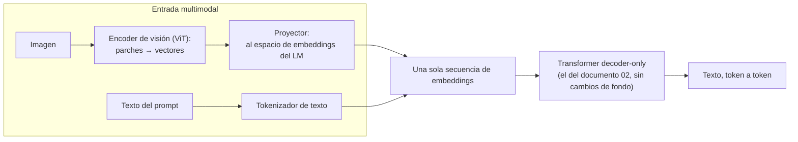

# 10. Multimodalidad y generación no textual

Este documento explica cómo un modelo de lenguaje llega a trabajar con imágenes y audio, y qué
pasa cuando lo que se genera ya no es texto. El hilo conductor es una sola pregunta: **qué cambia
y qué no cambia respecto del *transformer* que el lector ya conoce**. La respuesta corta —que la
entrada se vuelve multimodal mucho más fácil que la salida, y que generar imágenes exige otro
paradigma— se desarrolla con un laboratorio operable sobre el banco de ensayo y con ejemplos
ilustrativos marcados para lo que el entorno de referencia no reproduce.

**Antes de leer**: [02-Arquitectura-Transformer.md](02-Arquitectura-Transformer.md) (IAM-02): hace
falta saber qué es la atención y qué significa *decoder-only* autoregresivo; y
[03-Del-Modelo-Base-Al-Asistente.md](03-Del-Modelo-Base-Al-Asistente.md) (IAM-03): el muestreo y
la alucinación reaparecen acá con imagen en el medio. El grafo completo de prerrequisitos vive en
[Cohesion-Global.md](Cohesion-Global.md).
**Anterior** (ruta formativa): [09-Bases-Vectoriales-Y-RAG.md](09-Bases-Vectoriales-Y-RAG.md) ·
**Siguiente**: [11-Panorama-Y-Ecosistema-Abierto.md](11-Panorama-Y-Ecosistema-Abierto.md).
Convenciones del cuerpo: [Convenciones.md](Convenciones.md) (citado §2, ejemplos §3, cifras §4).

## Índice

1. [Definición](#1-definición)
2. [Aplicación por escenario](#2-aplicación-por-escenario)
3. [Ejemplos concretos](#3-ejemplos-concretos)
4. [Bloque didáctico](#4-bloque-didáctico)
5. [Criterios de calidad](#5-criterios-de-calidad)
6. [Anexo: lista de verificación para adoptar un modelo multimodal](#6-anexo-lista-de-verificación-para-adoptar-un-modelo-multimodal)
7. [Referencias](#referencias)

---

## 1. Definición

### 1.1 Multimodalidad: más tipos de dato, misma secuencia

**Multimodalidad.** Capacidad de un modelo de operar sobre más de un tipo de dato —texto, imagen,
audio— dentro de la misma conversación (Radford et al., 2021).

**Cómo se aplica.** Mirá la firma de entrada y de salida del modelo, no su publicidad: enumerá qué
tipos de dato acepta y qué tipos produce. Un modelo que acepta imagen y produce sólo texto es
multimodal de entrada; uno que produce imágenes es multimodal de salida, y vas a ver en §1.4 que
eso implica una maquinaria distinta.

**Un caso.** `qwen2.5vl:7b`, el modelo de visión del banco de ensayo, declara en su ficha las
capacidades `completion` y `vision`: acepta imágenes junto al texto, pero todo lo que devuelve es
texto. Es multimodal de entrada y unimodal de salida — la combinación más común del parque de
pesos abiertos descargables hoy, como muestra el catálogo de
[11-Panorama-Y-Ecosistema-Abierto.md](11-Panorama-Y-Ecosistema-Abierto.md).

La clave conceptual, que vale releer desde el documento 02: el *transformer* no procesa «texto».
Procesa **secuencias de *embeddings***, y el texto le llega como embeddings porque un tokenizador
lo convirtió antes. Nada en la atención exige que esos vectores provengan de palabras: si algo
convierte una imagen en una secuencia de vectores del mismo espacio, el mismo mecanismo la
atiende. Toda la multimodalidad de entrada descansa sobre esa observación (Vaswani et al., 2017;
Dosovitskiy et al., 2021).

### 1.2 El VLM: un transformer con otro «tokenizador» adelante

**VLM (modelo de visión y lenguaje).** Modelo que acepta imágenes y texto en la misma conversación
y responde en texto (Bai et al., 2025).

**Cómo se aplica.** Descomponelo en sus tres piezas y preguntate cuál es nueva: (1) un **encoder
de visión** —típicamente un *Vision Transformer* o ViT, que corta la imagen en parches y produce
un vector por parche (Dosovitskiy et al., 2021)—, (2) un **proyector** que traduce esos vectores
al espacio de embeddings del modelo de lenguaje, y (3) el modelo de lenguaje *decoder-only* de
siempre. Las piezas 1 y 2 son nuevas; la 3 es exactamente la del documento 02.

**Un caso.** LLaVA, uno de los primeros VLM de pesos abiertos reproducibles, se construyó
literalmente así: un encoder de visión preentrenado (el de CLIP), una proyección lineal entrenada
para alinearlo, y un modelo de lenguaje existente; el ajuste con instrucciones visuales hizo el
resto (Liu et al., 2023). La familia Qwen2.5-VL del banco sigue el mismo plano con un encoder
propio y ventanas de resolución dinámica (Bai et al., 2025).



Qué cambia y qué no, en limpio:

| Pieza | ¿Cambia en un VLM? | Detalle |
| --- | --- | --- |
| Generación autoregresiva | No | Sigue prediciendo el *token* siguiente de texto; muestreo y temperatura operan igual que en el documento 03 |
| Atención | No | Los parches de imagen son posiciones más de la secuencia; el texto los atiende como atiende a otros tokens |
| «Tokenización» | Sí | La imagen no pasa por el tokenizador de texto: pasa por encoder de visión + proyector |
| Presupuesto de ventana | Sí | Cada imagen consume cientos o miles de posiciones de la ventana de contexto según su resolución (Bai et al., 2025) |
| Qué puede fallar | Sí | A la alucinación textual se suma la percepción: el modelo puede describir con total fluidez algo que no está en la imagen (§3.2) |

El antecedente que hizo posible alinear visión y lenguaje en un mismo espacio es CLIP: entrenar un
encoder de imagen y uno de texto para que la foto de un perro y la frase «un perro» queden cerca
en el mismo espacio vectorial (Radford et al., 2021). Es la misma idea de cercanía semántica que
el documento 01 presenta para texto y el 09 explota para búsqueda, extendida a otra modalidad. Y
Flamingo demostró a escala que un modelo de lenguaje congelado puede aprender a mirar imágenes
intercaladas con texto sin reentrenarse entero (Alayrac et al., 2022).

### 1.3 Audio: dos caminos hacia la misma secuencia

El audio entra al mundo de los *transformers* por dos caminos distintos, y conviene no
confundirlos.

**Reconocimiento y transcripción (ASR).** El camino clásico: un *transformer*
*encoder–decoder* recibe el audio como espectrograma —una imagen del sonido, tiempo contra
frecuencia— y genera la transcripción token a token. Whisper, el sistema abierto de referencia, es
exactamente eso, entrenado con 680 000 horas de audio supervisado (Radford et al., 2023). Del lado
del modelo de lenguaje no hay novedad: la salida es texto autoregresivo.

**Audio como tokens (generación).** El camino más nuevo: un **códec neuronal** comprime la onda de
audio en una secuencia de tokens discretos de un vocabulario finito, igual que el tokenizador hace
con el texto (Défossez et al., 2022). Con el audio ya tokenizado, un modelo de lenguaje
autoregresivo común puede *continuar* audio como continúa texto: AudioLM genera continuaciones de
voz y de música coherentes prediciendo el token de audio siguiente (Borsos et al., 2023).

**Cómo se aplica** la distinción: ante un sistema de audio, preguntá qué hay en la secuencia que
el modelo genera. Si genera tokens de texto a partir de audio, es ASR (camino 1); si genera tokens
de audio, es generación con códec neuronal (camino 2). La respuesta te dice qué puede fallar: en
el camino 1, la transcripción; en el 2, la fidelidad acústica del códec además del contenido.

**Un caso.** Un lector que quiera dictarle notas de voz a un pipeline RAG como el de
[09-Bases-Vectoriales-Y-RAG.md](09-Bases-Vectoriales-Y-RAG.md) necesita el camino 1 (Whisper
transcribe, el RAG indexa texto); uno que quiera clonar una voz necesita el camino 2. Son
proyectos distintos aunque ambos digan «audio con IA».

### 1.4 Difusión: el paradigma que sí es otro

**Difusión.** Familia generativa que produce imágenes eliminando ruido de forma progresiva: parte
de ruido puro y lo refina en decenas de pasos hasta que emerge la imagen; no es un *transformer*
autoregresivo (Ho et al., 2020; Rombach et al., 2022).

**Cómo se aplica.** Compará el bucle de generación de ambos paradigmas contando qué produce cada
iteración. El *transformer* autoregresivo produce **un token nuevo por paso** y la salida crece de
izquierda a derecha; nunca vuelve atrás. El modelo de difusión produce **la imagen completa en
cada paso**, cada vez menos ruidosa: refina el todo, no extiende una secuencia. Si el proceso que
tenés delante revisa toda la salida en cada iteración, es difusión; si sólo agrega al final, es
autoregresivo.

**Un caso.** El ejemplo ilustrativo de §3.3 muestra ese bucle con números concretos: 30 pasos de
eliminación de ruido para una imagen, contra 200 pasos de un token cada uno para un párrafo de 200
tokens.

Dos precisiones evitan confusiones frecuentes. Primera: el **condicionamiento por texto** de un
generador de imágenes («un gato con sombrero») entra por embeddings de texto —los de un encoder
tipo CLIP— que guían cada paso de eliminación de ruido vía atención cruzada; el puente
texto→imagen reutiliza las piezas que este cuerpo ya presentó (Rombach et al., 2022). Segunda: paradigma
y arquitectura son ejes independientes. La red interna que predice el ruido puede ser una red
convolucional o un *transformer* —los *Diffusion Transformers* reemplazaron la U-Net convolucional
por un *transformer* de parches (Peebles y Xie, 2023)—, y aun así el **proceso generativo** sigue
siendo difusión, no autoregresión. «Usa un transformer adentro» no convierte a un modelo de
difusión en un modelo de lenguaje.

| | Autoregresivo (texto, docs 02–03) | Difusión (imagen) |
| --- | --- | --- |
| Qué produce cada paso | Un token nuevo | La salida completa, menos ruidosa |
| Cantidad de pasos | Uno por token generado | Fija (decenas), independiente del «tamaño» del contenido |
| Dónde vive el azar | Muestreo del token siguiente (temperatura) | Ruido inicial y ruido de cada paso (la semilla fija la imagen) |
| Falla característica | Alucinación fluida | Artefactos: manos, texto dentro de la imagen, geometrías imposibles |
| Ejemplo de referencia | La familia Qwen del banco | Stable Diffusion (difusión latente; Rombach et al., 2022) |

### 1.5 Qué no cubre este documento

La generación de imagen y de audio se trata acá a nivel conceptual: alcance vigente de la guía,
con la promoción a laboratorio operable diferida hasta que se declare viable en el banco (decisión
de la fila 2 del lote del expediente 0001, agregada como default). Los modelos multimodales
concretos del ecosistema —familias, licencias, tamaños— viven en la tabla de referencia de
[11-Panorama-Y-Ecosistema-Abierto.md](11-Panorama-Y-Ecosistema-Abierto.md), no acá. Y la
integración de un VLM en una aplicación .NET se referencia a la guía 16 del repositorio, como todo
ESC-07.

---

## 2. Aplicación por escenario

Los identificadores ESC/CTX/ACT son los del [Marco-De-Referencia.md](Marco-De-Referencia.md).

| Escenario | Qué aporta este tema |
| --- | --- |
| ESC-06 — Trabajar con más de una modalidad | Es el escenario dueño: distinguir entrada multimodal de salida multimodal (§1.1) decide el proyecto entero; el laboratorio 10-A es su práctica mínima |
| ESC-01 — Entender y elegir un modelo | La ficha de un modelo multimodal se lee con dos preguntas extra: qué modalidades acepta (`capabilities` en el motor, *model card* en origen) y cuánta ventana consume cada imagen; las cifras comparativas, vía la tabla del documento [11](11-Panorama-Y-Ecosistema-Abierto.md) |
| ESC-02 — Montar y servir | Un VLM se monta igual que un modelo de texto (el procedimiento es del documento [08](08-Inferencia-Local.md)); cambia el presupuesto: el encoder de visión suma parámetros y cada imagen suma posiciones de ventana, es decir memoria de caché KV |
| ESC-05 — Evaluar con evidencia | La imagen sembrada de §3.1 es la forma mínima de *eval* multimodal: verdad conocida de antemano contra la que se contrasta la salida; el protocolo general de evaluación es del documento [07](07-Evaluacion-Y-Metricas.md) |
| ESC-03 — RAG | La multimodalidad toca al RAG por la puerta de entrada: transcribir audio (ASR, §1.3) o describir imágenes con un VLM convierte corpus no textual en texto indexable; el pipeline es del documento [09](09-Bases-Vectoriales-Y-RAG.md) |
| ESC-07 — Integrar en una aplicación | Referencia a la guía 16 del repositorio; no se duplica |

Qué cambia por contexto: en **CTX-01** (CPU, 8–16 GB) un VLM de 7 B cuantizado carga, pero la
pasada del encoder de visión y la ventana ocupada por la imagen hacen la respuesta sensiblemente
más lenta que la de un modelo de texto del mismo tamaño; el laboratorio 10-A declara CTX-03 (el
banco) como contexto de corrida y CTX-01 como reproducible con paciencia. En **CTX-02** (GPU de
consumo) la generación de imágenes por difusión se vuelve practicable; mientras el banco no la
ofrezca, queda en el nivel ilustrativo de §3.3. En **CTX-04** (API de terceros) la multimodalidad
suele ser la razón de pagar el servicio: conviene igual entender §1 para saber qué se está
comprando. En **CTX-05** (datos sensibles) el VLM local es el único camino para describir imágenes
que no pueden salir de la red; el laboratorio 10-A es exactamente ese flujo.

---

## 3. Ejemplos concretos

Este documento es dueño de dos laboratorios operables (10-A y 10-B), ambos sobre la misma escena
sembrada. El tercer ejemplo es **[ilustrativo]**: muestra la mecánica de la difusión, que el
entorno de referencia no reproduce. Todo laboratorio contra el banco empieza por el **paso 0 de
verificación**, que se enseña en [08-Inferencia-Local.md](08-Inferencia-Local.md) y acá sólo se
corre:

```bash
curl -s "${OLLAMA_HOST:-http://localhost:11434}/api/tags" >/dev/null \
  && echo "banco accesible" || echo "banco NO accesible: revisá OLLAMA_HOST"
```

Entorno de los laboratorios: motor ollama 0.32.0-rc0, modelo `qwen2.5vl:7b` (8.3 B de parámetros,
cuantización Q4_K_M, digest
`sha256:5ced39dfa4bac325dc183dd1e4febaa1c46b3ea28bce48896c8e69c1e79611cc`, salida de
`ollama show qwen2.5vl:7b` en el banco), Python 3.11 sin dependencias externas. Contexto: CTX-03;
reproducible en CTX-01 con el mismo script apuntando a un Ollama local con el modelo descargado
(~6 GB), a costa de latencia.

### 3.1 Lab 10-A — describir una imagen sembrada propia

La trampa habitual al probar un VLM es mostrarle una foto cualquiera: la descripción que devuelve
*suena* bien y no hay contra qué contrastarla. Este laboratorio invierte el orden — primero se
decide la verdad, después se genera la imagen que la encarna, y recién entonces se pregunta. La
verdad sembrada de esta corrida: fondo blanco de 480×320, **un círculo rojo, un cuadrado azul y
dos triángulos verdes pequeños** arriba a la derecha con el vértice hacia abajo. Cuatro figuras,
tres formas, tres colores: cualquier desvío de la descripción es medible contra esta lista.

Primer paso, generar la imagen. El script no usa ninguna biblioteca externa: dibuja los píxeles y
serializa el PNG con la biblioteca estándar, para que la escena sea reproducible en CTX-01 sin
instalar nada.

```python
"""Genera escena.png: una escena sembrada de contenido conocido, sin dependencias externas.

Contenido exacto (la verdad de la escena, decidida antes de preguntar):
- fondo blanco de 480x320
- un círculo rojo (centro 120,160; radio 70)
- un cuadrado azul (esquina 230,90; lado 140)
- dos triángulos verdes pequeños arriba a la derecha, con el vértice hacia abajo
"""
import struct, zlib

W, H = 480, 320
px = bytearray(b"\xff" * (W * H * 3))  # fondo blanco

def put(x, y, r, g, b):
    if 0 <= x < W and 0 <= y < H:
        i = (y * W + x) * 3
        px[i:i+3] = bytes((r, g, b))

# círculo rojo
for y in range(H):
    for x in range(W):
        if (x - 120) ** 2 + (y - 160) ** 2 <= 70 ** 2:
            put(x, y, 220, 30, 30)

# cuadrado azul
for y in range(90, 230):
    for x in range(230, 370):
        put(x, y, 30, 60, 200)

# dos triángulos verdes (rellenos, con el vértice hacia abajo)
def triangulo(cx, base_y, medio_ancho, alto):
    for dy in range(alto):
        semi = medio_ancho * (alto - dy) // alto
        y = base_y - (alto - dy)
        for x in range(cx - semi, cx + semi + 1):
            put(x, y, 20, 150, 60)

triangulo(410, 80, 25, 45)
triangulo(445, 150, 25, 45)

# serializar PNG (RGB de 8 bits, sin filtro)
raw = b"".join(b"\x00" + bytes(px[y*W*3:(y+1)*W*3]) for y in range(H))
def chunk(tag, data):
    c = tag + data
    return struct.pack(">I", len(data)) + c + struct.pack(">I", zlib.crc32(c))
png = (b"\x89PNG\r\n\x1a\n"
       + chunk(b"IHDR", struct.pack(">IIBBBBB", W, H, 8, 2, 0, 0, 0))
       + chunk(b"IDAT", zlib.compress(raw, 9))
       + chunk(b"IEND", b""))
open("escena.png", "wb").write(png)
print(f"escena.png: {W}x{H}, {len(png)} bytes")
```

```console
$ python3 escena.py
escena.png: 480x320, 1946 bytes
```

Salida validada en CTX-01 (Python 3.11.2): el archivo pesa menos de 2 KB porque la escena es
geométrica y comprime bien; el tamaño exacto puede variar en unos pocos bytes con otra versión de `zlib`.

Segundo paso, preguntarle al VLM. La imagen viaja en el campo `images` del mensaje, codificada en
base64 — así es como la API de chat del motor acepta entrada visual (Ollama, s. f.):

```python
import base64, json, urllib.request, os

host = os.environ.get("OLLAMA_HOST", "http://localhost:11434")
img = base64.b64encode(open("escena.png", "rb").read()).decode()
body = json.dumps({
    "model": "qwen2.5vl:7b",
    "stream": False,
    "messages": [{
        "role": "user",
        "content": "Describí las figuras geométricas de la imagen: "
                   "cuántas hay, de qué forma y de qué color cada una.",
        "images": [img],
    }],
    "options": {"temperature": 0.2, "seed": 42},
}).encode()
req = urllib.request.Request(f"{host}/api/chat", body,
                             {"Content-Type": "application/json"})
with urllib.request.urlopen(req, timeout=300) as r:
    d = json.load(r)
print(d["message"]["content"])
print("--- tokens generados:", d.get("eval_count"))
```

```text
La imagen contiene tres figuras geométricas:

1. Un círculo rojo.
2. Un cuadrado azul.
3. Dos triángulos verdes (uno arriba del otro).
--- tokens generados: 45
```

<details>
<summary>Protocolo de la corrida</summary>

- **Cifra**: descripción generada y conteo de tokens de la corrida de referencia
- **Modelo**: qwen2.5vl:7b — digest `sha256:5ced39dfa4bac325dc183dd1e4febaa1c46b3ea28bce48896c8e69c1e79611cc`
- **Motor**: ollama 0.32.0-rc0
- **Parámetros**: temperature 0.2, seed 42 (los no listados, en su default)
- **Entrada**: `escena.png` generada por el script de arriba + el prompt transcripto
- **Contexto de hardware**: CTX-03 (banco compartido); 46 s de duración total de la corrida
- **Fecha de la corrida**: 2026-11-07
</details>

Tercer paso, contrastar contra la verdad sembrada, figura por figura: ¿nombró el círculo y lo
llamó rojo?, ¿el cuadrado azul?, ¿contó **dos** triángulos o los fundió en uno?, ¿el total que
declara coincide con las figuras que enumera? La corrida de referencia de arriba responde esas
preguntas sola: las cuatro figuras están bien enumeradas con su forma y su color — y el total
declarado dice «tres», porque el modelo contó formas distintas y no figuras. Ese desajuste entre
el encabezado y la lista es el conteo frágil en acción, servido por la propia salida. Qué es
estable y qué varía entre corridas: las formas y los colores de una escena así de nítida son
estables; la redacción, el orden de la
enumeración y los detalles finos (posiciones relativas, orientación de los triángulos) varían, y
el conteo es justamente la parte frágil — el laboratorio 10-B la ataca a propósito. Si la salida
difiere de lo esperado, el diagnóstico es el del documento 03: con semilla y temperatura fijas,
una diferencia grande apunta a versión del motor o del modelo (verificá el digest), no al azar del
muestreo.

### 3.2 Lab 10-B — la alucinación ahora tiene imagen

El documento 03 muestra que un modelo de lenguaje responde con fluidez aun cuando no sabe. Con un
VLM el riesgo se duplica: puede «ver» lo que la pregunta le sugiere. Este laboratorio reutiliza
`escena.png` y hace dos preguntas capciosas sobre contenido que **no existe** en la imagen:

```python
import base64, json, urllib.request, os

host = os.environ.get("OLLAMA_HOST", "http://localhost:11434")
img = base64.b64encode(open("escena.png", "rb").read()).decode()

preguntas = [
    "¿De qué color es la estrella de la imagen?",          # no hay estrella
    "¿Cuántos círculos amarillos hay en la imagen?",       # no hay nada amarillo
]
for p in preguntas:
    body = json.dumps({
        "model": "qwen2.5vl:7b", "stream": False,
        "messages": [{"role": "user", "content": p, "images": [img]}],
        "options": {"temperature": 0.2, "seed": 42},
    }).encode()
    req = urllib.request.Request(f"{host}/api/chat", body,
                                 {"Content-Type": "application/json"})
    with urllib.request.urlopen(req, timeout=300) as r:
        print(f"P: {p}\nR: {json.load(r)['message']['content']}\n")
```

```text
P: ¿De qué color es la estrella de la imagen?
R: La imagen no contiene una estrella. En su lugar, hay un círculo rojo y un
cuadrado azul. Además, hay dos triángulos verdes en el lado derecho superior
de la imagen.

P: ¿Cuántos círculos amarillos hay en la imagen?
R: No hay círculos amarillos en la imagen. La imagen contiene un círculo rojo
y un cuadrado azul, además de dos triángulos verdes.
```

<details>
<summary>Protocolo de la corrida</summary>

- **Cifra**: respuestas a las dos preguntas capciosas de la corrida de referencia
- **Modelo**: qwen2.5vl:7b — digest `sha256:5ced39dfa4bac325dc183dd1e4febaa1c46b3ea28bce48896c8e69c1e79611cc`
- **Motor**: ollama 0.32.0-rc0
- **Parámetros**: temperature 0.2, seed 42 (los no listados, en su default)
- **Entrada**: `escena.png` del laboratorio 10-A + las dos preguntas transcriptas
- **Contexto de hardware**: CTX-03 (banco compartido)
- **Fecha de la corrida**: 2026-11-07
</details>

Cómo se lee el resultado. La respuesta correcta a ambas preguntas es una negación («no hay
estrella», «ninguno»). Una respuesta que le asigne color a la estrella inexistente, o que cuente
círculos amarillos donde no los hay, es alucinación multimodal: la pregunta sembró el objeto y el
modelo lo completó — el fenómeno es el mismo sesgo hacia la respuesta fluida que describe la
literatura de alucinación textual (Ji et al., 2023), con la percepción como segunda fuente de
error. En la corrida de referencia el modelo negó ambas siembras y además describió lo que sí
hay: pasó la prueba. El resultado de este laboratorio **no se generaliza**: que el modelo del
banco pase o falle estas dos preguntas es un dato de esta escena y esta corrida, no un veredicto
sobre la familia; convertir la técnica en veredicto exige la batería y el protocolo del documento
[07](07-Evaluacion-Y-Metricas.md).

La técnica de fondo es la que conviene llevarse: **ante contenido que importa, preguntá por algo
que sabés que no está**. Si el modelo lo encuentra, ya sabés cuánto confiar en el resto de su
descripción.

### 3.3 La difusión por dentro — **[ilustrativo]**

Este ejemplo se lee, no se corre: el banco de ensayo no sirve modelos de difusión y el alcance
vigente de la guía la trata a nivel conceptual (§1.5). Los números son representativos de un
generador de difusión latente típico (Rombach et al., 2022), no la salida de una corrida.

La traza esquemática de generar «un gato con sombrero» a partir de la semilla 7:

```text
prompt  → encoder de texto → embeddings que condicionan todos los pasos
semilla → ruido inicial z_30 (un tensor latente, puro azar)

paso 30: z_30 = estática pura
paso 25: manchas; se insinúa una masa central
paso 18: silueta de un animal; el fondo se separa
paso 10: es un gato; aparece el volumen del sombrero
paso  3: detalles de pelaje y ala del sombrero
paso  0: z_0 → decodificador → imagen final 512×512
```

En cada paso, la red interna —U-Net convolucional o *Diffusion Transformer* (Peebles y Xie,
2023)— recibe el latente ruidoso, el número de paso y los embeddings del texto, y predice qué
ruido quitar; el muestreador aplica esa predicción y pasa al siguiente. Treinta iteraciones sobre
la imagen **completa**, contra una iteración **por token** del paradigma autoregresivo: generar
esta imagen costó 30 pasadas de red; generar su descripción de 200 tokens con un VLM costaría
200. La misma semilla con el mismo prompt y las mismas versiones reproduce la misma imagen — el
papel que en el documento 03 cumple `seed` sobre el muestreo de tokens, acá lo cumple sobre el
ruido inicial.

El audio generativo del camino 2 de §1.3 queda, con la misma marca de ilustrativo, en una frase:
reemplazá en la traza de arriba «latente de imagen» por «tokens de audio de un códec neuronal» y
el bucle de difusión por el bucle autoregresivo de siempre, y tenés AudioLM generando la
continuación de una voz (Borsos et al., 2023; Défossez et al., 2022).

---

## 4. Bloque didáctico

**Pregunta** — ¿Un VLM «ve» la imagen o lee una traducción de la imagen?
**Criterio que forma** — Saber ubicar dónde puede estar fallando un sistema multimodal: en la
percepción (encoder), en el puente (proyector) o en el lenguaje (decoder).
**Respuesta explicativa** — Lee una traducción: el encoder de visión convierte la imagen en una
secuencia de vectores y el modelo de lenguaje razona sobre esos vectores, nunca sobre los píxeles
(§1.2). Todo lo que el encoder no capturó —un detalle fino, un texto chico, el conteo exacto de
objetos parecidos— ya no existe para el resto del modelo, por fluida que sea la respuesta.
**Reenvío** — [§1.2](#12-el-vlm-un-transformer-con-otro-tokenizador-adelante) y el contraste
medible del [lab 10-A](#31-lab-10-a--describir-una-imagen-sembrada-propia).

**Pregunta** — ¿Por qué los modelos que generan imágenes no son «el mismo transformer» que genera
texto?
**Criterio que forma** — Distinguir paradigma generativo de arquitectura interna, para no comprar
equivalencias falsas («todo es transformers») ni diferencias falsas («la difusión no usa
atención»).
**Respuesta explicativa** — Porque cambia el bucle de generación, no necesariamente la red: la
difusión refina la salida completa durante un número fijo de pasos, mientras el modelo de lenguaje
extiende la secuencia un token por vez (§1.4). La red interna del generador de imágenes puede ser
un *transformer* (Peebles y Xie, 2023) y el proceso sigue sin ser autoregresivo.
**Reenvío** — la tabla comparativa de [§1.4](#14-difusión-el-paradigma-que-sí-es-otro) y la traza
de [§3.3](#33-la-difusión-por-dentro--ilustrativo).

**Pregunta** — Te entregan una descripción de imagen generada por un VLM, ¿cómo decidís cuánto
vale?
**Criterio que forma** — Exigir verdad de contraste antes de confiar en salida multimodal: la
fluidez no es evidencia.
**Respuesta explicativa** — Con las dos maniobras de los laboratorios: contrastar contra contenido
conocido de antemano (imagen sembrada, 10-A) y preguntar por algo que no está (10-B). Si no
podés sembrar la verdad —fotos reales de contenido desconocido—, muestreá: verificá a mano una
fracción de las descripciones antes de confiar en el lote, que es la lógica de evaluación del
documento 07 aplicada a visión.
**Reenvío** — [lab 10-A](#31-lab-10-a--describir-una-imagen-sembrada-propia) y
[lab 10-B](#32-lab-10-b--la-alucinación-ahora-tiene-imagen).

**Pregunta** — ¿Cuándo conviene un VLM local del banco y cuándo una API multimodal de terceros?
**Criterio que forma** — Cruzar la decisión con los contextos del marco en lugar de decidir por
moda o por inercia.
**Respuesta explicativa** — El eje es dónde pueden estar los datos y qué modalidad de salida hace
falta. Imágenes que no pueden salir de la red (CTX-05) fuerzan el VLM local; generación de imagen
de calidad sin GPU propia empuja a CTX-04, porque la difusión local exige al menos CTX-02;
volumen alto con imágenes públicas es una cuenta de costos, no de principios. La capacidad
conceptual para hacer esa cuenta —qué modelos existen, con qué licencia y qué piden de hardware—
está en el documento 11.
**Reenvío** — [§2](#2-aplicación-por-escenario) y
[11-Panorama-Y-Ecosistema-Abierto.md](11-Panorama-Y-Ecosistema-Abierto.md).

---

## 5. Criterios de calidad

Cómo se distingue un uso bueno de un uso pobre de la multimodalidad, en los artefactos que este
tema produce:

- **Una prueba de VLM vale lo que vale su verdad de contraste.** Versión buena: la verdad se
  decidió antes de preguntar (escena sembrada, etiquetas conocidas, muestreo verificado a mano).
  Versión pobre: fotos arbitrarias y descripciones que «suenan bien» — no hay forma de saber
  cuánto alucinó.
- **La elección de paradigma está fundada en la salida requerida.** Versión buena: «la salida es
  texto sobre imágenes, alcanza un VLM de entrada multimodal»; versión pobre: incorporar un
  generador de difusión a un proyecto que sólo necesita describir imágenes, o esperar que el VLM
  del banco genere imágenes.
- **El presupuesto de ventana y memoria contempla la imagen.** Versión buena: declara cuántas
  posiciones consume cada imagen a la resolución usada y dimensiona la caché KV con eso; versión
  pobre: dimensionar como si fuera un modelo de texto del mismo tamaño y descubrir el costo en
  producción.
- **Toda afirmación sobre un modelo multimodal concreto trae etiqueta, digest y fuente.** Versión
  buena: cifras propias con su protocolo, cifras ajenas vía la tabla del documento 11; versión
  pobre: «los VLM chicos cuentan mal» como verdad general extraída de una corrida (el propio lab
  10-B advierte contra esa generalización).
- **Los límites conocidos están declarados junto al resultado.** Versión buena: la descripción
  generada viaja con la advertencia de qué clase de contenido no fue verificado (conteos, texto en
  imagen, detalle fino); versión pobre: la descripción entra al corpus del RAG como si fuera
  transcripción literal de la realidad.

---

## 6. Anexo: lista de verificación para adoptar un modelo multimodal

Antes de incorporar un VLM —o cualquier modelo multimodal— a un flujo propio:

- [ ] **Modalidades confirmadas contra la ficha**, no contra el nombre: `ollama show <modelo>`
      lista `capabilities`; la *model card* de origen declara entradas y salidas previstas
      (¿acepta imagen?, ¿varias por mensaje?, ¿genera algo que no sea texto?).
- [ ] **Versión fijada**: etiqueta exacta y digest anotados; el protocolo de §3 depende de eso.
- [ ] **Costo por imagen medido en el despliegue propio**: latencia y memoria con una imagen de la
      resolución real del caso de uso, no con la del ejemplo.
- [ ] **Prueba sembrada corrida**: una escena de verdad conocida (lab 10-A) pasada por el flujo
      completo, con el contraste figura por figura registrado.
- [ ] **Prueba negativa corrida**: al menos una pregunta por contenido inexistente (lab 10-B),
      registrada con su resultado.
- [ ] **Límites declarados aguas abajo**: qué clase de contenido de la salida del modelo queda sin
      verificar, escrito donde el consumidor de esa salida lo vea.
- [ ] **Decisión local/terceros fundada en CTX**: si hay datos sensibles (CTX-05), consta que la
      imagen no sale de la red; si se eligió API (CTX-04), consta por qué.

---

## Referencias

Citado autor-año (APA 7.ª edición) conforme a [Convenciones.md](Convenciones.md). Consultas web:
2026-11-07.

- Alayrac, J.-B., et al. (2022). Flamingo: A visual language model for few-shot learning.
  *NeurIPS 35*. arXiv:2204.14198
- Bai, S., et al. (2025). *Qwen2.5-VL Technical Report*. arXiv:2502.13923.
  https://arxiv.org/abs/2502.13923
- Borsos, Z., et al. (2023). AudioLM: A language modeling approach to audio generation.
  *IEEE/ACM Transactions on Audio, Speech, and Language Processing, 31*. arXiv:2209.03143
- Défossez, A., Copet, J., Synnaeve, G., y Adi, Y. (2022). High fidelity neural audio
  compression. arXiv:2210.13438
- Dosovitskiy, A., et al. (2021). An image is worth 16x16 words: Transformers for image
  recognition at scale. *ICLR*. arXiv:2010.11929
- Ho, J., Jain, A., y Abbeel, P. (2020). Denoising diffusion probabilistic models. *NeurIPS 33*.
  arXiv:2006.11239
- Ji, Z., et al. (2023). Survey of hallucination in natural language generation. *ACM Computing
  Surveys, 55*(12). https://doi.org/10.1145/3571730
- Liu, H., Li, C., Wu, Q., y Lee, Y. J. (2023). Visual instruction tuning. *NeurIPS 36*.
  arXiv:2304.08485
- Ollama. (s. f.). *Documentación oficial de la API*. https://docs.ollama.com/api (consultada el
  2026-11-07)
- Peebles, W., y Xie, S. (2023). Scalable diffusion models with transformers. *ICCV*.
  arXiv:2212.09748
- Radford, A., et al. (2021). Learning transferable visual models from natural language
  supervision. *ICML*. arXiv:2103.00020
- Radford, A., Kim, J. W., Xu, T., Brockman, G., McLeavey, C., y Sutskever, I. (2023). Robust
  speech recognition via large-scale weak supervision. *ICML*. arXiv:2212.04356
- Rombach, R., et al. (2022). High-resolution image synthesis with latent diffusion models.
  *CVPR*. arXiv:2112.10752
- Vaswani, A., et al. (2017). Attention is all you need. *NeurIPS 30*. arXiv:1706.03762
- Expediente 0001 «Guía de estudio IA-Model» (2026): folio 011 (alcance del núcleo 10 y default
  de la fila 2 del lote) — origen de las decisiones de alcance marcadas en §1.5 y §3.3.
