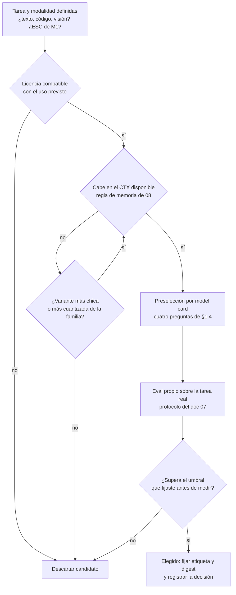

# 11. Panorama y ecosistema abierto

Los documentos 01 a 10 enseñan mecánica que envejece lento: la atención, la cuantización o el
pipeline RAG se explican igual este año que el próximo. Este documento es la excepción deliberada:
fotografía el parque de modelos de pesos abiertos **al 7 de noviembre de 2026**, con sus familias,
sus licencias y la tabla de modelos de referencia que el resto del cuerpo cita. Es la capa volátil
de la guía ([Convenciones.md](Convenciones.md) §6): cuando una cifra de acá contradiga lo que el
lector ve en la web, ganó la web, y le toca al mantenedor (ACT-06) revisar.

**Antes de leer**: [05 — Preentrenamiento y leyes de escala](05-Preentrenamiento-Y-Leyes-De-Escala.md),
[06 — Ajuste fino y alineación](06-Ajuste-Fino-Y-Alineacion.md),
[07 — Evaluación y métricas](07-Evaluacion-Y-Metricas.md),
[08 — Inferencia local](08-Inferencia-Local.md),
[09 — Bases vectoriales y RAG](09-Bases-Vectoriales-Y-RAG.md) y
[10 — Multimodalidad y generación no textual](10-Multimodalidad-Y-Generacion-No-Textual.md).
**Anterior**: [10 — Multimodalidad y generación no textual](10-Multimodalidad-Y-Generacion-No-Textual.md) ·
**Siguiente**: fin de la ruta formativa — volver a la raíz [IA-Model-Guide.md](IA-Model-Guide.md).
Convenciones del cuerpo: [Convenciones.md](Convenciones.md) (citado §2, ejemplos §3, cifras §4).

## Índice

1. [Definición](#1-definición)
2. [Aplicación por escenario](#2-aplicación-por-escenario)
3. [Ejemplos concretos](#3-ejemplos-concretos)
4. [Bloque didáctico](#4-bloque-didáctico)
5. [Criterios de calidad](#5-criterios-de-calidad)
6. [Anexo: lista de verificación de la elección de un modelo](#6-anexo-lista-de-verificación-de-la-elección-de-un-modelo)
7. [Referencias](#referencias)

---

## 1. Definición

### 1.1 El ecosistema abierto, y por qué este documento lleva fecha

**Ecosistema abierto.** El conjunto de modelos cuyos pesos pueden descargarse y ejecutarse
localmente, junto con los editores que los publican, las licencias que los rigen y la
infraestructura que los distribuye (el Hugging Face Hub como registro de facto, los formatos como
GGUF, los motores del documento [08](08-Inferencia-Local.md)).

**Cómo se aplica.** Preguntale al modelo tres cosas, en orden: ¿puedo **descargar** los pesos?,
¿con qué **licencia** los uso?, ¿con qué **hardware** los corro? Un modelo que falla la primera
pregunta queda fuera del ecosistema abierto — se consume por API de terceros (CTX-04) y se evalúa
con otros criterios. Las otras dos preguntas ordenan todo lo que sigue en este documento.

**Un caso.** `gpt-oss:20b` está en el banco de ensayo de esta guía: sus pesos se descargan del
registro de Ollama, la licencia es Apache-2.0 (OpenAI, 2025) y en cuantización MXFP4 ocupa unos
13 GB — corre en CTX-01 con 16 GB de RAM, justo. Las tres preguntas tienen respuesta; el modelo es
del ecosistema abierto. Los modelos frontera del mismo editor fallan la primera: sólo existen
detrás de una API.

El dominio entero se renueva en ciclos de meses. Entre febrero y octubre de 2026 aparecieron, como
mínimo, una generación nueva de Qwen, dos modelos frontera MIT de laboratorios chinos, el reemplazo
de la línea Llama de Meta y el pase de Gemma a Apache-2.0 (§1.5). Por eso la guía concentra acá
todo lo perecedero: los demás documentos no citan cifras ni rankings de modelos concretos salvo a
través de la tabla de §1.6, y este documento declara su fecha de corte junto a cada tabla.
La política de revisión — qué eventos disparan una actualización y el tope de seis meses sin
evento — vive en [Convenciones.md](Convenciones.md) §6.2.

### 1.2 Pesos abiertos no es *open source*

Los dos términos circulan como sinónimos y no lo son; la guía los separa a propósito (decisión
FP-06 del expediente, glosario de [Marco-De-Referencia.md](Marco-De-Referencia.md) §5.2).

**Pesos abiertos** (*open weights*). Un modelo cuyos pesos se publican para descarga y ejecución
local, con la licencia que sea — permisiva, restringida o de uso acotado.

**Cómo se aplica.** Buscá el archivo de pesos. Si existe un repositorio del que podés bajar los
tensores (Hugging Face, ModelScope, el registro de Ollama), es pesos abiertos; qué podés hacer con
ellos es la pregunta **siguiente**, la de la licencia, no esta.

**Un caso.** Muse Spark Open, de Meta, publica sus 816 mil millones de parámetros para descarga,
pero su licencia impone términos comerciales a partir de cierto umbral de ingresos (The Batch,
2026). Es pesos abiertos. No es *open source*.

***Open source* aplicado a modelos.** Según la Open Source AI Definition 1.0 (OSAID), un sistema
de IA es *open source* sólo si otorga las libertades de usar, estudiar, modificar y compartir, lo
que exige pesos con licencia aprobada, código del pipeline **y** información suficientemente
detallada sobre los datos de entrenamiento (OSI, 2024).

**Cómo se aplica.** Contrastá las tres patas contra lo publicado: ¿licencia de pesos aprobada por
la OSI?, ¿código de entrenamiento e inferencia disponible?, ¿descripción de datos que permita a un
tercero reconstruir un sistema sustancialmente equivalente? Con una pata ausente, el término
preciso es «pesos abiertos».

**Un caso.** Qwen3.5-35B-A3B publica pesos bajo Apache-2.0 — licencia aprobada por la OSI — y
código de inferencia, pero su corpus de preentrenamiento no está descripto al nivel que la OSAID
exige (Qwen Team, 2026; OSI, 2024). La prensa lo llama «open source»; esta guía lo registra como
pesos abiertos con licencia *open source*, que es lo que las tres patas dan.

La distinción no es pedantería: decide qué puede hacer el lector. Con pesos abiertos alcanza para
los escenarios ESC-02 a ESC-06 completos — montar, ajustar, evaluar —; la diferencia con *open
source* pleno aparece cuando se necesita auditar o reproducir el entrenamiento, que ningún modelo
del parque masivo permite hoy.

### 1.3 Las licencias del parque

Tres grandes grupos ordenan casi todas las licencias vigentes. La tabla de §1.5 asigna cada
familia a su grupo con la fuente citada.

| Grupo | Qué permite | Qué exige o restringe | Ejemplos (noviembre de 2026) |
| --- | --- | --- | --- |
| **Permisivas estándar** (Apache-2.0, MIT) | Uso, modificación, redistribución y uso comercial sin umbral | Conservar el aviso de licencia; Apache-2.0 suma concesión de patentes | Qwen3.5, Gemma 4, gpt-oss, GLM-5, DeepSeek-V4, Muse Glimmer |
| **Comunitarias con umbral** | Uso y modificación libres por debajo de un umbral de escala o ingresos | Acuerdo comercial separado por encima del umbral; a veces atribución obligatoria («Built with …») | Muse Model License (Meta), Llama 4 Community License, Kimi K3 License |
| **De uso acotado** | Descarga y uso bajo términos propios del editor | Políticas de uso aceptable, restricciones por campo de aplicación, términos revocables | Gemma Terms of Use (hasta Gemma 3), licencias «research-only» de variantes sueltas |

Dos reglas de lectura que evitan los errores más caros:

1. **La licencia es por artefacto, no por familia.** Dentro de una misma familia conviven licencias
   distintas: en Qwen2.5-Coder, las variantes 7B y 14B son Apache-2.0 y la 3B salió bajo la Qwen
   Research License (Hui et al., 2024). El campo `license` de la ficha del modelo concreto manda;
   el nombre de la familia no garantiza nada.
2. **La licencia de los pesos no cubre los datos ni las salidas.** Qué datasets pueden usarse para
   ajustar y con qué derechos es el territorio del documento [04](04-Datos-Y-Corpus.md); algunas
   licencias comunitarias además condicionan el uso de las salidas del modelo para entrenar a
   terceros. Leer la licencia completa — no la etiqueta del Hub — es parte del laboratorio 11.A.

### 1.4 La *model card*

***Model card*** (ficha de modelo). Documento estandarizado que acompaña a un modelo publicado y
declara sus usos previstos, sus datos, sus métricas de evaluación y sus límites (Mitchell et al.,
2019). En el Hugging Face Hub es el `README.md` del repositorio del modelo, con metadatos
máquina-legibles (licencia, idiomas, tamaños) en su frontmatter — la misma convención de doble
audiencia que esta guía usa consigo misma.

**Cómo se aplica.** Leela con cuatro preguntas y anotá dónde responde cada una: ¿qué es
exactamente (arquitectura, parámetros totales y activos, ventana de contexto)?, ¿qué declara saber
hacer (tabla de *benchmarks*, y de quién son las cifras)?, ¿cómo quiere ser usado (parámetros de
muestreo recomendados, plantilla de chat, modos)?, ¿qué calla (datos de entrenamiento, fecha de
corte, límites)? La cuarta pregunta es la que separa al lector formado: lo ausente informa tanto
como lo presente.

**Un caso.** El laboratorio 11.A de este documento aplica las cuatro preguntas a la ficha real de
Qwen3.5-35B-A3B, con los hallazgos fechados — incluida una contradicción interna real entre dos
secciones de la propia ficha.

Las cifras de una *model card* son **autorreportadas**: las publica quien vende el modelo, sobre
*benchmarks* que pueden estar contaminados ([07](07-Evaluacion-Y-Metricas.md)). La ficha sirve
para preseleccionar candidatos; el veredicto lo da el eval propio del lector, nunca la ficha.

### 1.5 Las familias del parque, con licencias citadas

Fotografía al **2026-11-07**. Una familia entra a esta tabla si publica pesos descargables y
aparece de forma sostenida en el parque que un lector hispanohablante va a encontrar al elegir;
las cifras son las declaradas por cada editor. Donde la fuente primaria (ficha del editor) no pudo
consultarse directamente, la fila lo marca: esa licencia se verifica en la ficha antes de usarla
en una decisión real.

| Familia (editor) | Modelo insignia abierto | Parámetros (totales / activos) | Contexto | Licencia | Fuente |
| --- | --- | --- | --- | --- | --- |
| Qwen (Alibaba) | Qwen3.5-35B-A3B | 35B / 3B (MoE) | 262.144, ext. 1M | Apache-2.0 | Ficha HF oficial (Qwen Team, 2026), consultada 2026-11-07 |
| DeepSeek | DeepSeek-V4-Pro · V4-Flash | 1,6T / 49B · 284B / 13B (MoE) | 1M | MIT | Ficha HF (DeepSeek-AI, 2026), consultada 2026-11-07 |
| Muse (Meta) | Muse Spark Open | 816B / 42B (MoE) | 1M | Muse Model License (umbral comercial) | Prensa (The Batch, 2026) — **primaria pendiente de verificación** |
| Muse (Meta) | Muse Glimmer | 30B | — | Apache-2.0 | Prensa (Constellation Research, 2026) — **primaria pendiente de verificación** |
| Gemma (Google) | Gemma 4 (E2B–31B) | E4B: 8B totales / 4,5B efectivos | 128K | Apache-2.0 (antes: Gemma Terms of Use) | Ficha HF oficial de gemma-4-E4B-it (Google, 2026), consultada 2026-11-07 |
| gpt-oss (OpenAI) | gpt-oss-120b · gpt-oss-20b | 117B / 5,1B · 21B / 3,6B (MoE) | 128K | Apache-2.0 | Ficha y anuncio del editor (OpenAI, 2025) |
| GLM (Z.ai / Zhipu) | GLM-5 | 744B / 40B (MoE) | 200K | MIT | Prensa (The Decoder, 2026) — **primaria pendiente de verificación** |
| Kimi (Moonshot AI) | Kimi K3 | 2,8T / 104B (MoE) | 1M | Kimi K3 License (`license: other` en el Hub) | Metadatos de la ficha HF citados por prensa (2026) — **primaria pendiente de verificación** |
| Llama (Meta) | Llama 4 (línea cerrada en 2026) | según variante | según variante | Llama 4 Community License | Meta (2025); sucedida por Muse |
| Mistral (Mistral AI) | línea chica histórica (7B, Small) | 7B–24B | según variante | Apache-2.0 en la línea chica | Jiang et al. (2023) |

Cuatro lecturas de la tabla, que son el panorama en sí:

- **La arquitectura dominante del segmento grande es MoE** — mezcla de expertos, documento
  [02](02-Arquitectura-Transformer.md) —: totales enormes, activos chicos. El lector que mira sólo
  los «parámetros totales» compara mal; la memoria la dictan los totales, la velocidad los activos
  ([08](08-Inferencia-Local.md)).
- **La licencia permisiva se volvió el estándar competitivo.** Google abandonó sus términos
  propios con Gemma 4; los laboratorios chinos (DeepSeek, Z.ai) publican frontera bajo MIT; Meta,
  que inauguró las licencias comunitarias con umbral, hoy convive con ambas vías. El grupo
  «comunitaria con umbral» no desapareció, pero dejó de ser la norma.
- **La frontera abierta y la cerrada se tocan en los *benchmarks* autorreportados**, no
  necesariamente en el uso real: la distancia la mide el eval propio
  ([07](07-Evaluacion-Y-Metricas.md)), no esta tabla.
- **Nada de la tabla cabe entero en CTX-01** salvo las variantes chicas de cada familia. El parque
  utilizable por el lector es el de §1.6, no este: esta tabla forma criterio sobre el espacio; la
  siguiente, sobre lo que efectivamente corre.

### 1.6 La tabla de modelos de referencia del cuerpo

Esta es la tabla única que [Convenciones.md](Convenciones.md) §6.3 anuncia: toda mención
comparativa de un modelo concreto en los documentos 01–10 enlaza acá. Releva el banco de ensayo
real de la guía — motor **ollama 0.32.0-rc0** — por `GET /api/tags` y `GET /api/version` el
**2026-11-07**; el digest identifica los pesos exactos (etiqueta sola no alcanza: el registro
puede moverla).

| Etiqueta exacta | Digest (prefijo) | Parámetros | Cuantización | Licencia | Rol en la guía |
| --- | --- | --- | --- | --- | --- |
| `qwen3.5:4b` | `d8b0f5e9760c` | 4,2B | Q4_K_M | Apache-2.0 (Qwen Team, 2026) | Generalista chico de referencia; reproduce en CTX-01 |
| `qwen3.5:35b-a3b` | `72aac7c28be8` | 34,7B (3B activos) | Q4_K_M | Apache-2.0 (Qwen Team, 2026) | Generalista grande MoE; sólo banco (CTX-03) |
| `gpt-oss:20b` | `f38aa0c53da5` | 20,9B (3,6B activos) | MXFP4 | Apache-2.0 (OpenAI, 2025) | Segundo generalista: contraste entre familias en los evals de [07](07-Evaluacion-Y-Metricas.md) |
| `gemma4:e4b-it-qat` | `ee6656371218` | 7,5B (4,5B efectivos)[^gemma-e4b] | Q4_0 (QAT) | Apache-2.0 (Google, 2026) | Multimodal chico ([10](10-Multimodalidad-Y-Generacion-No-Textual.md)); QAT: cuantizado durante el entrenamiento |
| `qwen3-coder:30b` | `06c1097efce0` | 30,5B (MoE) | Q4_K_M | Apache-2.0 (Qwen Team, 2025) | Código; sólo banco |
| `qwen2.5:7b-instruct` | `845dbda0ea48` | 7,6B | Q4_K_M | Apache-2.0 (Qwen Team, 2025) | Generación anterior: términos de comparación estables entre documentos |
| `qwen2.5:14b-instruct` | `7cdf5a0187d5` | 14,8B | Q4_K_M | Apache-2.0 (Qwen Team, 2025) | Ídem, talla media |
| `qwen2.5vl:7b` | `5ced39dfa4ba` | 8,3B | Q4_K_M | Apache-2.0 (Bai et al., 2025) | VLM de los laboratorios de [10](10-Multimodalidad-Y-Generacion-No-Textual.md) |
| `qwen2.5-coder:7b` | `dae161e27b0e` | 7,6B | Q4_K_M | Apache-2.0 (Hui et al., 2024) | Código, reproduce en CTX-01 |
| `qwen2.5-coder:14b` | `9ec8897f747e` | 14,8B | Q4_K_M | Apache-2.0 (Hui et al., 2024) | Código, talla media |
| `qwen2.5-coder:3b-base` | `b71a053ff1b3` | 3,1B | Q4_K_M | Qwen Research License (Hui et al., 2024) | Modelo **base** (no *instruct*): materia prima del ajuste de [06](06-Ajuste-Fino-Y-Alineacion.md) — y el ejemplo vivo de la regla «la licencia es por artefacto» |
| — (ecosistema, no en el banco) | — | — | — | — | Para comparativas documentales rige la tabla de §1.5 |

El inventario es responsabilidad del operador del banco (ACT-03); si una etiqueta de esta tabla no
aparece en el `/api/tags` del lector, el paso 0 y su diagnóstico están en
[08](08-Inferencia-Local.md).

[^gemma-e4b]: La fila de Gemma 4 en §1.5 dice «E4B: 8B totales / 4,5B efectivos» y esta dice
    7,5B: no es una errata. La ficha declara el total nominal del editor; el motor reporta el
    tamaño efectivo de los tensores cargados del artefacto que efectivamente corre. La diferencia
    es esperable y así se lee — es el mismo contraste ficha/artefacto que el paso 4 del
    laboratorio 11.A enseña a confrontar.

### 1.7 Criterio de selección

Elegir modelo es un procedimiento con orden fijo, no una lectura de rankings. El orden importa
porque cada filtro es más barato que el siguiente: la licencia se lee en minutos, el hardware se
calcula con la regla de memoria de [08](08-Inferencia-Local.md), y el eval propio — lo único
concluyente — cuesta horas. Filtrar tarde es pagar evals de candidatos que una licencia ya
descartaba.



Dos reglas acompañan al diagrama. El umbral de calidad se fija **antes** de correr el eval — un
umbral elegido después de ver los resultados justifica cualquier candidato —, y la decisión se
registra con etiqueta, digest y fecha, porque la próxima revisión de la capa volátil va a
preguntar contra qué se comparaba. El laboratorio 11.B recorre el procedimiento completo con un
caso real.

### 1.8 Destilación: de dónde salen las variantes chicas del parque

**Destilación** (*distillation*). Entrenar un modelo chico — el *estudiante* — para imitar la
salida de uno grande — el *maestro* —, transfiriendo parte de su capacidad a un tamaño que cuesta
menos servir (Hinton et al., 2015).

**Cómo se aplica.** Al leer el parque: cuando una familia publica variantes marcadas «distill», o
tamaños chicos que declaran haberse entrenado contra un maestro mayor, lo que se descarga no es
una versión recortada del grande sino un modelo distinto, entrenado para imitarlo. Le valen las
tres preguntas de §1.1 y las dos reglas de lectura de §1.3 sin cambios: la variante destilada es
un artefacto con su propia ficha y su propia licencia.

**Un caso.** DeepSeek publicó junto a su modelo de razonamiento R1 una serie de variantes
destiladas sobre bases Qwen y Llama, de 1,5B a 70B parámetros (DeepSeek-AI, 2025): parte del
comportamiento del maestro, en tallas que corren donde el maestro no cabe. En la elección de
§1.7, una variante destilada compite como cualquier candidato — se filtra por licencia y hardware
y se juzga por eval propio, no por el prestigio del maestro.

La mecánica del entrenamiento excede esta capa volátil; acá la destilación se lee como práctica
de publicación del ecosistema: multiplica las tallas disponibles de una misma capacidad.

---

## 2. Aplicación por escenario

Este documento es el territorio natural de **ESC-01** (entender y elegir un modelo para una
tarea): el criterio de §1.7 es ese escenario vuelto procedimiento, y los dos laboratorios de §3
lo practican. Los demás escenarios lo consumen como insumo:

| Escenario | Qué toma de este documento |
| --- | --- |
| ESC-01 — Elegir un modelo | Todo: licencias (§1.3), *model card* (§1.4), tablas (§1.5–1.6), criterio (§1.7) |
| ESC-02 — Montar y servir | La etiqueta y el digest elegidos; el montaje es de [08](08-Inferencia-Local.md) |
| ESC-03 — RAG | La elección del generador del pipeline; el pipeline es de [09](09-Bases-Vectoriales-Y-RAG.md) |
| ESC-04 — Ajuste fino | La licencia del modelo base **antes** de invertir en ajustarlo, y la decisión prompt/RAG/ajuste de [06](06-Ajuste-Fino-Y-Alineacion.md) |
| ESC-05 — Evaluar y decidir | La preselección de candidatos que el eval de [07](07-Evaluacion-Y-Metricas.md) compara |
| ESC-06 — Multimodal | Qué familias publican VLM abiertos; la mecánica es de [10](10-Multimodalidad-Y-Generacion-No-Textual.md) |
| ESC-07 — Integrar en una aplicación | La elección hecha; la integración .NET se referencia a la guía 16 del repositorio, no se repite |

Por contexto, lo que cambia es qué filtros del criterio muerden primero. En **CTX-01** el filtro
de hardware domina: el parque real son las variantes de 3–8B cuantizadas de §1.6, y la elección
suele ser entre dos o tres candidatos, no entre familias. En **CTX-02** y **CTX-03** el espacio se
abre hasta los MoE medianos (`qwen3.5:35b-a3b` en el banco) y el filtro dominante pasa a ser el
eval propio. En **CTX-04** — API de terceros, sin pesos — este documento aporta sólo el criterio
de lectura de fichas y la disciplina del eval: la licencia de pesos se reemplaza por términos de
servicio. En **CTX-05**, operación sin salida a internet, los pesos abiertos dejan de ser una
preferencia y pasan a ser condición de posibilidad, y la licencia se revisa con más cuidado, no
con menos: no hay proveedor detrás que responda por el uso. En **CTX-06**, el digest de §1.6 es
la clave: un modelo en CI se fija por digest como cualquier otro artefacto versionado.

---

## 3. Ejemplos concretos

Los dos laboratorios de este documento son los que el mapa del expediente le asigna como dueño
(«elección»: lectura de ficha + decisión guiada). Los laboratorios de montaje, medición y ajuste
que esta sección menciona pertenecen a otros documentos y se citan, no se repiten:
[8.A — montar y descargar](08-Inferencia-Local.md#3-ejemplos-concretos),
[7.A — mini-eval propio](07-Evaluacion-Y-Metricas.md#3-ejemplos-concretos),
[6.B — ajuste fino sobre modelo chico](06-Ajuste-Fino-Y-Alineacion.md#3-ejemplos-concretos).

### 3.1 Laboratorio 11.A — lectura guiada de una *model card* real

**Contexto**: CTX-01 (sólo exige navegador; el paso 4, opcional, usa el banco — CTX-03).
**Objetivo**: aplicar las cuatro preguntas de §1.4 a una ficha publicada y salir con una opinión
fundada, incluidos los silencios de la ficha.

La ficha elegida es la de **Qwen3.5-35B-A3B** en el Hugging Face Hub
(https://huggingface.co/Qwen/Qwen3.5-35B-A3B), porque el modelo está en el banco y el lector puede
confrontar lo declarado con lo que corre. Los hallazgos de abajo salen de la lectura real de la
ficha el **2026-11-07**; la ficha puede haber cambiado cuando el lector la abra — y detectar ese
cambio es parte del ejercicio, no un defecto.

**Paso 1 — ¿Qué es exactamente?** El frontmatter de la ficha declara `license: apache-2.0`; la
sección *Model Overview* declara 35B de parámetros totales con 3B activados, arquitectura híbrida
(Gated DeltaNet con MoE disperso: 256 expertos, 8 enrutados y 1 compartido por *token*) y ventana
de contexto de 262.144 *tokens* nativos, extensible a 1.010.000 con YaRN. Primera observación de
lector formado: es un modelo **de visión y lenguaje** unificado, no sólo de texto — dato que
cambia qué escenarios cubre y que una lectura apurada del nombre no revela.

**Paso 2 — ¿Qué declara saber hacer?** La tabla de *benchmarks* autorreporta, entre otros,
MMLU-Pro 85,3, GPQA Diamond 84,2 y SWE-bench Verified 69,2. Tres anotaciones al margen, que son
las que esta guía entrena: las cifras las publica el editor; varias celdas de la tabla están
vacías («no disponible»), y el silencio también se lee; y ninguna de estas cifras predice la tarea
del lector — eso lo hace el eval propio ([07](07-Evaluacion-Y-Metricas.md)).

**Paso 3 — ¿Cómo quiere ser usado?** La ficha recomienda parámetros de muestreo distintos por
modo (p. ej., modo *instruct* general: `temperature` 0,7, `top_p` 0,8, `top_k` 20). Y acá aparece
el hallazgo más formativo de la lectura: el *Quickstart* y las *Best Practices* de la **misma
ficha** recomiendan valores distintos para el mismo caso (*instruct* con razonamiento: `top_p`
0,95 contra 1,0; `presence_penalty` 1,5 contra 2,0), sin reconciliarlos. Una ficha es
documentación de editor, con las inconsistencias de cualquier documentación; copiar parámetros sin
contrastarlos contra la propia tarea es heredar también sus contradicciones.

**Paso 4 (opcional, contra el banco) — confrontar ficha y artefacto.** Lo declarado en la web se
compara con los pesos que efectivamente corren:

```bash
# Paso 0 de verificación del banco: ver 08-Inferencia-Local.md
curl -s "${OLLAMA_HOST:-http://localhost:11434}/api/show" \
  -d '{"model": "qwen3.5:35b-a3b"}' | python3 -c "
import json, sys
d = json.load(sys.stdin)
print('familia   :', d['details']['family'])
print('parámetros:', d['details']['parameter_size'])
print('cuant.    :', d['details']['quantization_level'])
print('licencia  :', ' '.join((d.get('license') or '').split())[:60])
"
```

Salida real contra el banco (2026-11-07):

```text
familia   : qwen35moe
parámetros: 34.7B
cuant.    : Q4_K_M
licencia  : Apache License Version 2.0, January 2004 http://www.apache.o
```

La familia que reporta el motor (`qwen35moe`) y la cuantización (`Q4_K_M`) confirman la fila de
§1.6; el texto embebido de la licencia coincide con el `license: apache-2.0` del frontmatter de
la ficha.

El lector cierra el laboratorio con tres frases escritas: qué es el modelo, qué evidencia
independiente existe de lo que declara (normalmente: ninguna todavía), y qué le falta a la ficha
para decidir. Si las tres frases salen solas, la lectura de fichas quedó incorporada.

### 3.2 Laboratorio 11.B — decisión guiada con la tabla

**Contexto**: CTX-01 para los pasos 1–3; el paso 4 corre contra el banco (CTX-03).
**Objetivo**: ejecutar el criterio de §1.7 de punta a punta sobre un caso concreto y dejar la
decisión registrada como la registraría un profesional.

**El caso.** Un equipo necesita un modelo local que resuma expedientes administrativos en español
(dos a cinco páginas, resumen de diez líneas), en una dependencia sin salida a internet (CTX-05
para producción) y con un servidor como el banco para elegir (CTX-03). Uso interno estatal:
cualquier licencia con umbral de ingresos comerciales es aceptable hoy, pero el equipo prefiere no
tener que re-analizarla si el sistema se transfiere.

**Paso 1 — tarea y modalidad.** Texto, español, resumen extractivo-abstractivo, documentos que
caben en 16K *tokens*. Sin visión, sin código. ESC-01 con destino ESC-02.

**Paso 2 — filtro de licencia.** Sobre la tabla de §1.5: la preferencia por «sin re-análisis ante
transferencia» favorece permisivas estándar. Quedan las familias Apache-2.0/MIT; una comunitaria
con umbral no se descarta por imposible sino por costo de análisis jurídico que nadie pidió pagar.

**Paso 3 — filtro de hardware y preselección.** El servidor de producción replica CTX-03, pero la
operación exige margen. Sobre la tabla de §1.6, candidatos con ventana suficiente y perfil
generalista: `qwen3.5:4b` (chico, margen sobrado), `qwen2.5:14b-instruct` (talla media de la
generación anterior) y `gpt-oss:20b` (MoE, pocos activos). Se leen las tres fichas con el método
del laboratorio 11.A y ninguna descalifica. Umbral fijado **antes de medir**: el resumen no omite
ningún punto resolutivo del expediente en 9 de 10 casos del set de prueba, juzgado por el
protocolo de [7.A](07-Evaluacion-Y-Metricas.md#3-ejemplos-concretos).

**Paso 4 — eval y humo previo.** El eval formal es el laboratorio 7.A aplicado a estos tres
candidatos; acá corre sólo la prueba de humo que confirma que los tres responden la tarea en
español antes de invertir en el eval:

```bash
for m in qwen3.5:4b qwen2.5:14b-instruct gpt-oss:20b; do
  echo "=== $m ==="
  curl -s "${OLLAMA_HOST:-http://localhost:11434}/api/generate" -d "{
    \"model\": \"$m\",
    \"prompt\": \"Resumí en una frase, en español: El organismo resolvió archivar el expediente 4411/26 por falta de mérito, notificando a las partes y dejando constancia de que la medida no obsta a su reapertura si surgieran hechos nuevos.\",
    \"stream\": false,
    \"options\": {\"temperature\": 0.3, \"seed\": 42}
  }" | python3 -c "import json,sys; d=json.load(sys.stdin); print(d['response'].strip()[:200]); print('tokens/s aprox:', round(d['eval_count']/(d['eval_duration']/1e9),1))"
done
```

Salida real contra el banco (2026-11-07, CPU; velocidades del banco, no de CTX-01):

```text
=== qwen3.5:4b ===
El organismo archivó el expediente 4411/26 por falta de mérito, notificando a las partes y reservándose la posibilidad de su reapertura ante nuevos hechos.
tokens/s aprox: 9.8
=== qwen2.5:14b-instruct ===
El organismo decidió archivar el expediente 4411/26 por falta de mérito, notificando a las partes e indicando que esta medida no impide su reapertura si surgen nuevos hechos.
tokens/s aprox: 4.1
=== gpt-oss:20b ===
El organismo archivó el expediente 4411/26 por falta de mérito, notificó a las partes y dejó claro que la medida no impide su reapertura ante nuevos hechos.
tokens/s aprox: 9.2
```

<details>
<summary>Protocolo de las cifras (tokens/s de la prueba de humo)</summary>

- **Cifras**: 9,8 · 4,1 · 9,2 tokens/s (generación; salida de arriba)
- **Modelos**: `qwen3.5:4b` (`d8b0f5e9760c`), `qwen2.5:14b-instruct` (`7cdf5a0187d5`),
  `gpt-oss:20b` (`f38aa0c53da5`) — digests de la tabla de §1.6
- **Motor**: ollama 0.32.0-rc0
- **Parámetros**: temperature 0.3, seed 42 (los no listados, en su default)
- **Entrada**: el prompt transcripto en el comando de arriba; sin dataset
- **Contexto de hardware**: banco de ensayo (CTX-03), CPU — no comparable con CTX-01
- **Fecha de la corrida**: 2026-11-07
</details>

Los tres responden la tarea en español sin omitir el punto resolutivo; nótese que `gpt-oss:20b`
(20,9B totales) corre a velocidad comparable al 4B — son sus 3,6B **activos** los que mandan
(§1.5, primera lectura) — mientras el denso de 14,8B es el más lento. El humo no decide nada:
habilita el eval formal de 7.A.

**Paso 5 — registro de la decisión.** Gane quien gane el eval, la decisión se asienta con la forma
que la próxima revisión va a necesitar:

```markdown
## Decisión de modelo — resumen de expedientes
- Fecha: 2026-11-07 · Decisor: <ACT-04 del equipo>
- Elegido: <etiqueta> — digest <sha256:…> (de la tabla de referencia de IAM-11 §1.6)
- Umbral prefijado: 9/10 sin omisión de punto resolutivo (protocolo 7.A)
- Resultado del eval: <adjuntar protocolo con cifras>
- Descartados y por qué: <candidato → filtro que no pasó>
- Revisar si: cambia la generación de la familia elegida, cambia el motor del
  banco, o un lote real baja del umbral (disparadores de Convenciones.md §6.2)
```

Lo formativo del laboratorio no es qué modelo gana — la respuesta tiene fecha de vencimiento —
sino que los cinco pasos salgan en ese orden y que el registro permita, dentro de un año, saber
por qué se eligió lo que se eligió.

---

## 4. Bloque didáctico

**Pregunta** — Una ficha anuncia «open source» y la licencia del repositorio dice Apache-2.0.
¿Alcanza para llamarlo *open source*?
**Criterio que forma** — Distinguir la licencia de los pesos de las tres patas de la OSAID, y
elegir el término según lo que se verificó, no según el anuncio.
**Respuesta explicativa** — No alcanza. Apache-2.0 sobre los pesos resuelve una pata; la OSAID
exige además código del pipeline e información suficiente sobre los datos de entrenamiento (OSI,
2024). Casi todo el parque de 2026 — Qwen3.5 incluido — cumple la primera y no la tercera: el
término que no miente es «pesos abiertos con licencia permisiva». La diferencia se vuelve material
exactamente cuando alguien necesita auditar o reproducir el entrenamiento.
**Reenvío** — §1.2, y la operación de tres preguntas aplicada en el laboratorio 11.A.

**Pregunta** — ¿Por qué el criterio de selección pone la licencia antes que la calidad, si lo que
importa es que el modelo funcione?
**Criterio que forma** — Ordenar filtros por costo: descartar barato antes de medir caro.
**Respuesta explicativa** — Porque la calidad es el filtro más caro de aplicar (horas de eval con
protocolo) y la licencia el más barato (minutos de lectura), y un candidato descartable por
licencia que llega al eval cobra ese costo igual. El orden del diagrama de §1.7 no opina sobre qué
importa más; opina sobre qué conviene saber primero. Un modelo excelente con licencia incompatible
es un descarte — carísimo si se descubre después del eval, o del despliegue.
**Reenvío** — §1.7, y el paso 2 del laboratorio 11.B, donde el filtro de licencia reduce el
espacio antes de tocar el banco.

**Pregunta** — La tabla de §1.5 va a estar desactualizada cuando la leas. ¿Para qué sirve una
tabla que nace venciéndose?
**Criterio que forma** — Separar el dato perecedero del método que lo produce, y saber cuál de los
dos se está estudiando.
**Respuesta explicativa** — La tabla enseña dos cosas de vidas distintas. El contenido (qué
familia, qué licencia, cuántos parámetros) vence en meses, y por eso lleva fecha de corte y fuente
por fila: es reconstruible. La estructura (qué columnas hacen comparable un parque de modelos, qué
grupo de licencia, totales contra activos) es el método, y sobrevive a cada generación. Quien
aprendió las columnas reconstruye la tabla de 2027 en una tarde; quien memorizó las filas tiene
datos viejos.
**Reenvío** — §1.1 para la política de la capa volátil, y la lista del anexo, que es la
estructura sin los datos.

**Pregunta** — Dos fichas declaran MMLU-Pro con tres puntos de diferencia. ¿Elegiste ya?
**Criterio que forma** — Tratar las cifras autorreportadas como preselección, nunca como
veredicto.
**Respuesta explicativa** — No. Las cifras las publicó cada editor sobre un *benchmark* público
que puede estar contaminado para cualquiera de los dos ([07](07-Evaluacion-Y-Metricas.md)), medido
con arneses posiblemente distintos, y nada garantiza que MMLU-Pro se parezca a tu tarea. Tres
puntos de autorreporte separan menos que la varianza entre corridas de un eval chico. Lo que las
dos cifras sí dicen: ambos candidatos pasan a la etapa donde se mide de verdad — el eval propio
con umbral prefijado del laboratorio 11.B.
**Reenvío** — §1.4 (paso 2 del método de lectura) y el laboratorio
[7.A](07-Evaluacion-Y-Metricas.md#3-ejemplos-concretos).

---

## 5. Criterios de calidad

Cómo se distingue una elección de modelo bien hecha — y una capa volátil bien mantenida — de sus
versiones pobres:

| Criterio | Versión buena | Versión pobre |
| --- | --- | --- |
| Identidad del elegido | Etiqueta exacta + digest + fecha | «Usamos Qwen» |
| Orden del criterio | Licencia y hardware filtran antes del eval; umbral fijado antes de medir | El eval corre primero y el umbral se acomoda al resultado |
| Trato de las cifras | Autorreportes como preselección; veredicto del eval propio con protocolo | Ranking de fichas copiado como decisión |
| Término usado | «Pesos abiertos», «licencia Apache-2.0», «*open source* según OSAID» — cada uno donde verificó | «Open source» para todo lo descargable |
| Registro | Decisión con descartados, motivos y disparadores de revisión (paso 5 de 11.B) | La decisión vive en la memoria de quien la tomó |
| Vigencia del documento | Fecha de corte visible, fuente por fila, filas sin primaria marcadas | Tabla sin fecha que se lee como eterna |

El último criterio se aplica a este propio documento: las filas de §1.5 cuya fuente primaria no
pudo consultarse están marcadas, y confirmarlas es tarea abierta del mantenedor (ACT-06) en la
próxima revisión.

---

## 6. Anexo: lista de verificación de la elección de un modelo

La estructura del criterio de §1.7, lista para usar en una elección real. Cada ítem lleva la
pregunta que lo decide; se recorre en orden y se abandona en el primer «no» sin arreglo.

```markdown
## Elección de modelo — lista de verificación
Fecha: ____ · Tarea: ____ · ESC/CTX: ____

[ ] 1. Tarea definida con modalidad y volumen
       ¿Qué entra, qué sale, cuántos tokens por pedido? ¿Texto solo, o visión/audio?
[ ] 2. Umbral de calidad escrito ANTES de medir
       ¿Qué resultado del eval hace que esto sirva? (protocolo del doc 07)
[ ] 3. Licencia leída completa — no la etiqueta del Hub
       ¿Permisiva, con umbral, acotada (§1.3)? ¿El uso previsto queda adentro,
       incluido el peor caso (transferencia, comercialización, salidas)?
[ ] 4. Hardware verificado contra el CTX real
       ¿Cabe con la regla de memoria del doc 08, con margen de operación?
       Si no: ¿variante más chica o más cuantizada de la misma familia?
[ ] 5. Ficha leída con las cuatro preguntas (§1.4)
       ¿Qué es, qué declara, cómo quiere usarse, qué calla?
[ ] 6. Eval propio corrido sobre la tarea real
       ¿Supera el umbral del punto 2? (laboratorio 7.A; humo previo: 11.B paso 4)
[ ] 7. Decisión registrada
       Etiqueta + digest + fecha + descartados con motivo + disparadores de
       revisión (plantilla del paso 5 de 11.B)
```

---

## Referencias

Citado autor-año (APA 7.ª edición) conforme a [Convenciones.md](Convenciones.md) §2. Consultas
web: 2026-11-07. Las marcadas «prensa» son fuentes secundarias: respaldan la existencia y los
términos anunciados de un lanzamiento, no reemplazan la ficha primaria, cuya verificación queda
declarada pendiente en §1.5.

- Bai, S., et al. (2025). *Qwen2.5-VL Technical Report*. arXiv:2502.13923
- Constellation Research. (2026). *Meta releases open weight Muse Glimmer model with open Muse
  Spark 1.2 on tap*. https://www.constellationr.com/insights/news/meta-releases-open-weight-muse-glimmer-model-open-muse-spark-12-tap
  (prensa; consultada el 2026-11-07)
- DeepSeek-AI. (2025). *DeepSeek-R1: Incentivizing Reasoning Capability in LLMs via Reinforcement
  Learning*. arXiv:2501.12948
- DeepSeek-AI. (2026). *DeepSeek-V4* [ficha de modelo]. Hugging Face.
  https://huggingface.co/deepseek-ai (consultada el 2026-11-07)
- Google. (2026). *Gemma 4 Technical Report*. arXiv:2607.02770
- Google. (2026). *gemma-4-E4B-it* [ficha de modelo]. Hugging Face.
  https://huggingface.co/google/gemma-4-E4B-it (consultada el 2026-11-07)
- Hinton, G., Vinyals, O., y Dean, J. (2015). Distilling the knowledge in a neural network.
  arXiv:1503.02531
- Hui, B., et al. (2024). *Qwen2.5-Coder Technical Report*. arXiv:2409.12186
- Jiang, A. Q., et al. (2023). *Mistral 7B*. arXiv:2310.06825
- Meta. (2025). *The Llama 4 herd*. https://ai.meta.com/blog/llama-4-multimodal-intelligence/
  (consultada el 2026-11-07)
- Mitchell, M., et al. (2019). Model cards for model reporting. *FAT\**. arXiv:1810.03993
- Open Source Initiative. (2024). *The Open Source AI Definition 1.0*.
  https://opensource.org/ai/open-source-ai-definition
- OpenAI. (2025). *Introducing gpt-oss*. https://openai.com/index/introducing-gpt-oss/ y
  *gpt-oss-20b* [ficha de modelo]. Hugging Face. https://huggingface.co/openai/gpt-oss-20b
  (consultadas el 2026-11-07)
- Qwen Team. (2025). *Qwen3 Technical Report*. arXiv:2505.09388
- Qwen Team. (2026). *Qwen3.5-35B-A3B* [ficha de modelo]. Hugging Face.
  https://huggingface.co/Qwen/Qwen3.5-35B-A3B (consultada el 2026-11-07)
- The Batch. (2026). *Meta releases Wonder, opens Spark*. DeepLearning.AI.
  https://www.deeplearning.ai/the-batch/meta-releases-wonder-opens-spark/ (prensa; consultada el
  2026-11-07)
- The Decoder. (2026). *Chinese AI lab Zhipu releases GLM-5 under MIT license*.
  https://the-decoder.com/chinese-ai-lab-zhipu-releases-glm-5-under-mit-license-claims-parity-with-top-western-models/
  (prensa; consultada el 2026-11-07)
- Banco de ensayo de la guía: inventario por `GET /api/tags` y versión por `GET /api/version`
  (ollama 0.32.0-rc0), corrida del 2026-11-07 — origen de los digests y cuantizaciones de §1.6.
