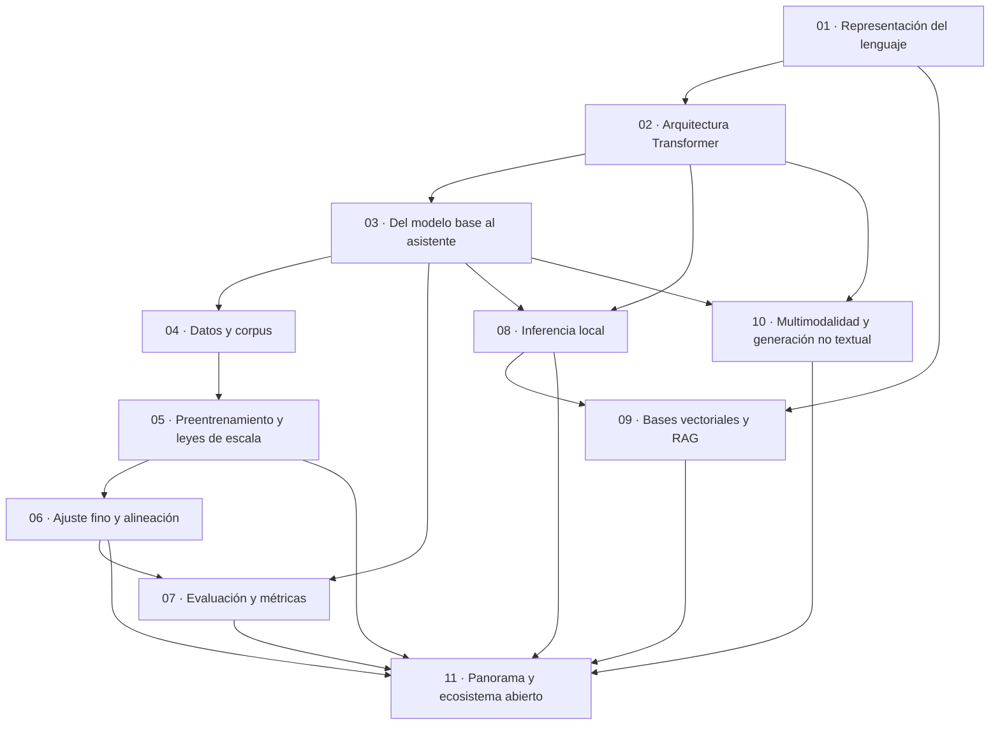

# Cohesión global de la guía

Este es el documento de cohesión que el pedido original exige de manera literal: «un documento de
cohesión global que describa las relaciones, dependencias, referencias y vínculos existentes entre
los distintos núcleos» (expediente 0001, folio 001, regla de descomposición conceptual). Acá viven
el **grafo de dependencias** entre los once documentos temáticos, la definición operativa de
**autocontenido** y **no-delta**, las **fronteras** que fijan qué tema es dueño de qué contenido y
de qué laboratorio, y las **lecturas declaradas**: las interpretaciones del pedido que el caso
asentó, con su estado.

Las marcas del tipo «fila N del lote» o los identificadores de hallazgo (`EM-02`, `ARQIA-03`, …)
son la trazabilidad de cada decisión hacia el expediente 0001; el lector que estudia puede
ignorarlas, quien mantiene la guía las necesita.

## Índice

1. [Propósito y cómo usar este documento](#1-propósito-y-cómo-usar-este-documento)
2. [Grafo de dependencias entre los once núcleos](#2-grafo-de-dependencias-entre-los-once-núcleos)
3. [Autocontenido y no-delta: definición operativa](#3-autocontenido-y-no-delta-definición-operativa)
4. [Fronteras entre núcleos](#4-fronteras-entre-núcleos)
5. [Mapa de laboratorios: dueño único](#5-mapa-de-laboratorios-dueño-único)
6. [Lecturas declaradas del pedido](#6-lecturas-declaradas-del-pedido)
7. [Mantenimiento de este mapa](#7-mantenimiento-de-este-mapa)
8. [Referencias](#8-referencias)

---

## 1. Propósito y cómo usar este documento

Tres públicos usan este mapa, cada uno para una cosa distinta:

- **El estudiante (ACT-01)** lo consulta cuando quiere entrar a un documento fuera de la ruta
  formativa: el grafo de §2 le dice qué necesita haber leído antes. Las dos rutas de lectura
  completas —formativa y de consulta— las publica la raíz [`IA-Model-Guide.md`](IA-Model-Guide.md)
  (IAM-M0), derivadas de este grafo (expediente 0001, hallazgo H-EDI-03).
- **El redactor o revisor de un documento temático** verifica acá dos cosas: que su documento no
  asuma material que el grafo no le da por leído (hallazgo ARQIA-07) y que no cruce una frontera
  de §4 — si un contenido tiene otro dueño, se cita por enlace, no se duplica.
- **El mantenedor (ACT-06)** usa §7: cuándo cambia este mapa y cómo se parte un documento que
  creció de más.

Este documento no enseña el dominio: todo el contenido vive en los temáticos. El vocabulario
(ESC/CTX/ACT, glosario, grafías) lo fija [`Marco-De-Referencia.md`](Marco-De-Referencia.md)
(IAM-M1); el aparato editorial (citado, ejemplos, protocolo de cifras, vigencia),
[`Convenciones.md`](Convenciones.md) (IAM-M3).

---

## 2. Grafo de dependencias entre los once núcleos

El grafo registra **dependencias directas**: una flecha `A --> B` significa «B declara a A como
prerrequisito en su envoltura» («Antes de leer»). Las dependencias transitivas se omiten — si el
lector siguió la ruta formativa, cada prerrequisito ya está cubierto al llegar. El grafo refleja
lo que las envolturas de los once documentos editados declaran, que coincide con el temario
consolidado del veredicto (expediente 0001, folio 011 §2).

La misma información, en tabla (la columna «Depende de» transcribe lo declarado en cada
envoltura):

| doc_id | Documento | Depende de | Por qué (una línea) |
| --- | --- | --- | --- |
| IAM-01 | [`01-Representacion-Del-Lenguaje.md`](01-Representacion-Del-Lenguaje.md) | — | Punto de entrada: token, vocabulario, embedding, ventana de contexto |
| IAM-02 | [`02-Arquitectura-Transformer.md`](02-Arquitectura-Transformer.md) | 01 | La atención opera sobre embeddings y tokens ya definidos |
| IAM-03 | [`03-Del-Modelo-Base-Al-Asistente.md`](03-Del-Modelo-Base-Al-Asistente.md) | 02 | Base/instruct y muestreo presuponen el decoder-only autoregresivo |
| IAM-04 | [`04-Datos-Y-Corpus.md`](04-Datos-Y-Corpus.md) | 03 | Los pares instrucción→respuesta de la alineación motivan los formatos de dataset |
| IAM-05 | [`05-Preentrenamiento-Y-Leyes-De-Escala.md`](05-Preentrenamiento-Y-Leyes-De-Escala.md) | 04 | Preentrenar es consumir un corpus: limpieza y contaminación vienen de antes |
| IAM-06 | [`06-Ajuste-Fino-Y-Alineacion.md`](06-Ajuste-Fino-Y-Alineacion.md) | 05 | El ajuste parte de un checkpoint preentrenado y de su economía |
| IAM-07 | [`07-Evaluacion-Y-Metricas.md`](07-Evaluacion-Y-Metricas.md) | 03, 06 | Sin fijar muestreo no hay corridas comparables; evaluar cierra el ciclo del ajuste |
| IAM-08 | [`08-Inferencia-Local.md`](08-Inferencia-Local.md) | 02, 03 | Parámetros/ventana dimensionan memoria; base vs instruct decide qué se descarga |
| IAM-09 | [`09-Bases-Vectoriales-Y-RAG.md`](09-Bases-Vectoriales-Y-RAG.md) | 01, 08 | Embeddings y coseno vienen de 01; servir y hablarle por API, de 08 |
| IAM-10 | [`10-Multimodalidad-Y-Generacion-No-Textual.md`](10-Multimodalidad-Y-Generacion-No-Textual.md) | 02, 03 | El VLM es un transformer con otro frente; muestreo y alucinación reaparecen con imagen |
| IAM-11 | [`11-Panorama-Y-Ecosistema-Abierto.md`](11-Panorama-Y-Ecosistema-Abierto.md) | 05, 06, 07, 08, 09, 10 | Elegir modelo con criterio exige todo el recorrido práctico previo |

Dos propiedades del grafo que el mantenedor debe conservar:

- **Es acíclico.** Ningún documento depende, ni por transitividad, de uno que dependa de él. Un
  ciclo nuevo es un defecto de diseño: se resuelve moviendo contenido, no agregando una flecha.
- **IAM-11 es el único sumidero deliberado.** Concentra la capa volátil (§4) y por eso depende de
  casi todo; ningún temático depende de él.

La **ruta formativa** que IAM-M0 publica es un orden topológico de este grafo elegido por el
veredicto (expediente 0001, folio 011 §2): M0 → M1 → 01 → 02 → 03 → 08 → 04 → 05 → 06 → 07 → 09 →
10 → 11. Los enlaces «Anterior/Siguiente» de las envolturas siguen ese orden, no el numérico: 03
enlaza a 08 como siguiente, y 08 a 04. IAM-M1 no es nodo del grafo: es lectura de apoyo permanente
(identificadores y glosario), declarada en la envoltura de IAM-01.

---

## 3. Autocontenido y no-delta: definición operativa

El pedido exige documentación «autocontenida y no delta» (folio 001, Reglas). Para que los doce
redactores y los revisores apliquen lo mismo, el caso fijó la definición operativa antes de
despachar la redacción (expediente 0001, hallazgo ARQIA-03):

**Autocontenido.** Un documento es autocontenido cuando un lector que cumple sus prerrequisitos
declarados puede seguirlo completo **sin abrir otro documento del cuerpo**. Operativamente:

- Toda noción que el documento usa está definida en él **o** pertenece a un prerrequisito que su
  envoltura declara («Antes de leer») **o** es un término del glosario de IAM-M1.
- Sus ejemplos operables corren con lo que el propio documento da (comandos, datos, versiones),
  conforme al patrón de [`Convenciones.md`](Convenciones.md) §3.
- Su sección Referencias lista todo lo que el documento cita: ninguna cita obliga a salir del
  archivo para resolverse (IAM-M3 §2.1).

No rompen la autocontención, porque son el mecanismo que la hace pagable (hallazgo RF-02): citar
el aparato editorial a IAM-M3 en lugar de repetirlo; citar un laboratorio cuyo dueño es otro
documento (§5) en lugar de duplicarlo; reenviar la profundización de un tema vecino a su dueño
(§4). Lo que sí la rompe: usar sin definir una noción que ni los prerrequisitos ni el glosario
cubren, o un ejemplo que sólo funciona si el lector ya hizo el de otro documento sin que la
envoltura lo declare.

**No-delta.** Ningún documento exige haber leído una **versión anterior** de sí mismo ni de otro:
cada edición reemplaza el texto completo y se entiende por sí sola. Operativamente: no hay
secciones «novedades» o «cambios respecto de»; la vigencia se lee en `last_review` y en la
política de IAM-M3 §6, no en un historial dentro del cuerpo. Corolario del caso: cada definición
vive **una sola vez** —en su documento dueño— y los demás la citan; corregirla es tocar un solo
archivo, no perseguir copias.

---

## 4. Fronteras entre núcleos

Donde dos documentos rozan el mismo tema, la frontera declara el dueño de cada lado. Regla
general: **el contenido vive una sola vez, en su dueño; los demás enlazan**. Estas son las
fronteras asentadas por el veredicto, verificadas sobre los once documentos editados:

| Frontera | Regla | Decisión |
| --- | --- | --- |
| Métricas de calidad vs. de servicio | Calidad (perplexity, métricas de tarea, benchmarks, LLM-juez, evals propios) → **IAM-07**. Servicio (latencia, tokens/s, memoria, efecto de la cuantización) → **IAM-08** | EM-05 |
| Embeddings | Concepto, similitud y coseno a mano → **IAM-01**. Embeddings aplicados, índices ANN/HNSW, motores vectoriales y el pipeline RAG → **IAM-09** | Folio 011 §2 |
| Datos y corpus | Núcleo propio (**IAM-04**), no apéndice repartido: formatos, limpieza, deduplicación, procedencia | EM-08 |
| Licencias | Práctica del primer día (qué licencia tienen los pesos y datasets que descargo, qué me deja hacer) → **IAM-04**. Panorama: open source vs. open weights, OSAID 1.0, model cards → **IAM-11** | EM-07, FP-06 |
| Contaminación | Del corpus de entrenamiento (deduplicación, filtrado) → **IAM-04**. De los benchmarks (caducidad, por qué un puntaje envejece) → **IAM-07**, como contenido de primera clase | EM-06 |
| «Entrenar» | Preentrenamiento: objetivo, loss, leyes de escala y demo juguete en CPU → **IAM-05**. Cadena operable de ajuste (SFT, LoRA/QLoRA, HF (PEFT/TRL) → GGUF → Ollama) → **IAM-06** | EM-01, EM-02 |
| Usar vs. servir el modelo | Muestreo, prompting, modos de razonamiento, alucinación → **IAM-03**. Motores, cuantización, montar/descargar/servir y la API → **IAM-08** | Folio 011 §2 |
| Mecánica común vs. otras modalidades | Atención, decoder-only, posición, MoE → **IAM-02**. Qué cambia (y qué no) con imagen, audio y difusión → **IAM-10** | FP-01 |
| Cifras de modelos vigentes | Toda cifra de un modelo del mercado (tamaños, ventanas, puntajes) se cita **vía la tabla de referencia de IAM-11**, la única pieza deliberadamente fechada (capa volátil). Los fundamentos de los demás documentos no citan cifras de modelos salvo por esa tabla | FP-04, FP-05, ARQIA-02 |
| Integración en aplicaciones (ESC-07) | Consumir el modelo desde .NET u otra aplicación → **guía 16 del repositorio**: se referencia, no se duplica | Folio 011 §3 |

Enlace cruzado obligatorio: cuando un documento llega a su frontera, lo dice y enlaza al dueño
(por ejemplo, IAM-07 remite las métricas de servicio a IAM-08 y viceversa). Un contenido duplicado
a ambos lados de una frontera es un defecto a resolver en favor del dueño de esta tabla.

---

## 5. Mapa de laboratorios: dueño único

Cada laboratorio operable existe **una sola vez**, en su documento dueño; los demás lo citan por
enlace (expediente 0001, folio 011 §4, PREGUNTA 4). El mapa, por verbo del pedido, sobre los
laboratorios efectivamente escritos:

| Verbo del pedido | Dueño | Laboratorios escritos |
| --- | --- | --- |
| Representar (tokens, similitud) | IAM-01 | Ejemplos 1–3: tokens reales, tokens vs. palabras, coseno a mano |
| Entender la arquitectura | IAM-02 | Lab 1 (atención en numpy), Lab 2 (`ollama show` de un modelo real) |
| Inferir (prompting, muestreo) | IAM-03 | Labs 03-A/B/C: base vs. instruct, zero vs. few-shot, streaming por API |
| Curar datos | IAM-04 | Labs 1–3: validar dataset, deduplicación, contaminación por n-gramas |
| Entrenar (preentrenamiento, demo) | IAM-05 | IAM-05-L1 (modelo juguete en CPU), IAM-05-L2 (la cuenta `C ≈ 6·N·D`) |
| Entrenar (ajuste fino operable) | IAM-06 | Labs 6.A (dataset SFT), 6.B (receta LoRA de HF al banco); DPO **[ilustrativo]** |
| Medir | IAM-07 | Labs 07-A (mini-eval propio con protocolo), 07-B (LLM-juez contrastado) |
| Montar, descargar, servir | IAM-08 | Labs 08-A (montar y servir), 08-B (tokens/s), 08-C (estimar memoria) |
| RAG y base vectorial | IAM-09 | Ejemplos 1–3: embeddings y ranking, mini-RAG sin framework, chunking a dos tamaños |
| Multimodal | IAM-10 | Labs 10-A (describir imagen sembrada), 10-B (alucinación con imagen); difusión **[ilustrativo]** |
| Elegir modelo | IAM-11 | Labs 11.A (model card real), 11.B (decisión guiada con la tabla de referencia) |

Condiciones vigentes sobre este mapa (folio 011 §4 y §5): los laboratorios de embeddings de IAM-09
corren por el camino alternativo mientras dure el obstáculo del banco (§6, lectura 8); el tramo
final del lab 6.B de IAM-06 —servir en el banco, pasos 5–6— queda condicionado a la decisión del
operador (ACT-03) sobre crear modelos en el banco compartido (IAM-06 §3.2); la generación de
imagen queda en nivel conceptual con ejemplo ilustrativo (fila 2 del lote). Todo
laboratorio corre en el banco y se declara reproducible en CTX-01, o marca su contexto (IAM-M3
§3).

---

## 6. Lecturas declaradas del pedido

El pedido original (expediente 0001, folio 001) trae frases que admiten más de una lectura. El
caso eligió una por cada una —siempre la que menos agrega— y las dejó declaradas con su estado:
nada quedó interpretado en silencio. El texto del pedido no se corrige: sus erratas quedan en el
testimonio y la grafía normalizada vive en IAM-M1 §6 (hallazgo H-EDI-08).

| # | Frase del pedido | Lectura adoptada | Estado | Decisión |
| --- | --- | --- | --- | --- |
| 1 | «quien nunca ha visto el tema» | ACT-01: sin conocimiento previo de IA, **con** terminal y programación básica; cada pieza que exija más lo marca al abrir | Supuesto declarado; fila 3 del lote del PO | FP-02 |
| 2 | «entrenarlos» | Ajuste fino **operable** (IAM-06, hasta servir el resultado en el banco) + demostración juguete del preentrenamiento (IAM-05); preentrenar a escala real queda documental | Asentada; el árbol de decisión la contesta, sin pregunta al PO | EM-02, EM-01 |
| 3 | «base de datos vectoriales» | Lectura **aplicada**: el pipeline RAG como el uso que les da sentido (IAM-09), además de la mecánica de índices | Agregado marcado, «propuesto, sin ratificar»; fila 4 del lote | FP-03, H-IR-05 |
| 4 | «modelos de qween» / banco Ollama | **Medio medido** de los ejemplos, no alcance de la guía: los laboratorios corren sobre el banco (`$OLLAMA_HOST`), las comparativas son documentales sobre el ecosistema abierto | Decisión del contrato con origen en MEDIOS; fila 4 del lote | H-IR-01, ARQIA-04, H-EDI-01, RF-03 |
| 5 | «estandares de la industria» | Panorama, licencias, model cards y criterio de selección (IAM-11) **sí**; gobernanza regulatoria (NIST AI RMF, ISO/IEC 42001, AI Act) **fuera de alcance** por no tener frase del pedido que la funde | Asentada; reversible si el PO la pide | RF-04 |
| 6 | «…modelos open sorce con el modelo.» (frase trunca) | Descriptiva del entorno, duplicada por la frase siguiente; no nombra un requisito adicional | Fila 5 del lote (cortesía) | ARQIA-08 |
| 7 | «modelos multimodales» | Comprensión multimodal operable con el VLM del banco; **generación** de imagen/audio a nivel conceptual con ejemplo ilustrativo (IAM-10) | Default de la fila 2 del lote; promoción diferida a viabilidad declarada en el banco | FP-01 |
| 8 | Embeddings en el banco | El banco no sirve un modelo de embeddings (`POST /api/embed` sin modelo que responda): rige el **camino alternativo declarado** —biblioteca local (sentence-transformers) con el eje marcado no fijo en IAM-09 §3 | Obstáculo abierto, pregunta directa a ACT-03 cursada por fuera del lote | Folio 011 §5 |
| 9 | Piso de hardware del lector | CTX-01: CPU x86-64, 8–16 GB RAM; todo ejemplo base corre ahí o marca su contexto | Default de la fila 1 del lote | H-IR-04 |

Para el mantenedor: las filas con estado «fila N del lote» dependen de la respuesta del PO al lote
de la resolución (folio 012). Si una respuesta contradice el default, el cambio entra por el dueño
del contenido afectado y este mapa se actualiza (§7); mientras tanto rige el default y nada queda
bloqueado.

---

## 7. Mantenimiento de este mapa

Este documento cambia sólo cuando cambia la estructura, no cuando cambia el contenido de un
temático:

- **Alta, baja o fusión de un documento temático**; o un cambio en los prerrequisitos declarados
  en una envoltura. El grafo de §2, la tabla y la ruta formativa de IAM-M0 se actualizan en el
  mismo cambio: una envoltura y este mapa en desacuerdo son un defecto de cohesión.
- **Partir un documento que creció de más** (condición de revisión del veredicto, folio 011 §2):
  si un temático supera el patrón de la casa o su tope de laboratorios, se parte **por el eje que
  el grafo declara** — las aristas entrantes y salientes dicen dónde está la costura natural.
  Partir un documento aprobado es aditivo; fundir dos escritos es retrabajo: ante la duda, se
  publica entero y se parte después.
- **Movimiento de una frontera de §4 o del dueño de un laboratorio de §5**: exige tocar los dos
  documentos involucrados y esta tabla en el mismo cambio, dejando reenvíos en el lado que cede el
  contenido.
- **Resolución de una lectura declarada de §6** (respuesta del PO al lote, cierre del obstáculo):
  se actualiza el estado acá y el contenido en su documento dueño.

Qué **no** dispara cambios acá: correcciones internas de un temático, refresco de la capa volátil
de IAM-11 (`last_review` propio, IAM-M3 §6), nuevas referencias. La cohesión se verifica en cada
ronda editorial contra tres invariantes: grafo acíclico, cada contenido con un solo dueño, y
ninguna envoltura en desacuerdo con §2.

---

## 8. Referencias

Las decisiones estructurales que este documento transcribe son decisiones del caso; se citan
conforme a IAM-M3 §2.2 («Decisión del caso»):

- Expediente 0001 de la guía, folio 001 (pedido original: regla de descomposición conceptual,
  «autocontenida y no delta», documento de cohesión global).
- Expediente 0001, folio 011 §2 (temario consolidado, dependencias y ruta formativa), §4
  (estructura documental y mapa de laboratorios), §5 (lote del PO y obstáculo del banco).
- Expediente 0001, folio 012 (resolución parcial: plan de elaboración y lote elevado).
- Documentos del cuerpo leídos para verificar las envolturas: IAM-01 … IAM-11 (ediciones del
  2026-11-07).
