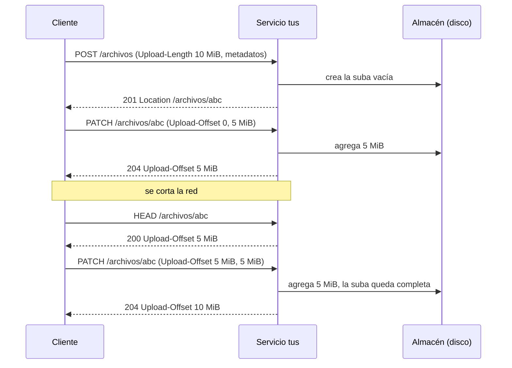

# Guía de desarrollo: un servicio de subas reanudables con tus en .NET 10

> **Para quién es.** Para quien programa en C# y nunca armó un servicio de archivos. No hace falta saber nada de
> tus: la guía lo explica desde cero, con definiciones, y cada pieza de código que muestra sale de la demo que
> acompaña a esta guía (carpeta [`Demos/`](Demos/)), que compila y se probó.
>
> **Qué vas a poder hacer al terminar.** Explicar qué es una suba reanudable y cómo funciona el protocolo tus;
> armar un servicio ASP.NET Core que recibe archivos con tus, los guarda y los sirve con autenticación; escribir un
> cliente de navegador y uno de .NET que retoman una suba cortada; publicar el servicio en un contenedor; y saber
> qué falta para llevarlo a producción.
>
> **Cómo leer los bloques de código.** Los bloques en C#, JavaScript, Razor, JSON, XML, CSS, YAML, `Dockerfile` y
> los de `scripts/probar.sh` son **copia literal** de líneas de la demo (cuando un bloque saltea líneas, el texto lo
> dice). Los bloques `bash` sin otra aclaración son comandos para escribir en la terminal, y los bloques `text` son
> ejemplos de pedidos o salidas de una corrida.

## Índice

- [1. Conceptos](#1-conceptos)
  - [1.1 El problema: subir archivos grandes por una red que se corta](#11-el-problema-subir-archivos-grandes-por-una-red-que-se-corta)
  - [1.2 Qué es tus](#12-qué-es-tus)
  - [1.3 Glosario](#13-glosario)
  - [1.4 El protocolo, pedido por pedido](#14-el-protocolo-pedido-por-pedido)
  - [1.5 Lo que tus no hace](#15-lo-que-tus-no-hace)
- [2. La demo](#2-la-demo)
  - [2.1 Qué hace](#21-qué-hace)
  - [2.2 Cómo está organizada](#22-cómo-está-organizada)
  - [2.3 Cómo correrla y probarla](#23-cómo-correrla-y-probarla)
- [3. El servidor, pieza por pieza](#3-el-servidor-pieza-por-pieza)
  - [3.1 El arranque: `Program.cs`](#31-el-arranque-programcs)
  - [3.2 La configuración](#32-la-configuración)
  - [3.3 El almacén: `TusDiskStore`](#33-el-almacén-tusdiskstore)
  - [3.4 El endpoint tus y sus eventos](#34-el-endpoint-tus-y-sus-eventos)
  - [3.5 La autenticación de la demo](#35-la-autenticación-de-la-demo)
  - [3.6 Consultar el estado de una suba](#36-consultar-el-estado-de-una-suba)
  - [3.7 La fila de archivo y el orden de las operaciones](#37-la-fila-de-archivo-y-el-orden-de-las-operaciones)
  - [3.8 La API con controllers y Scalar](#38-la-api-con-controllers-y-scalar)
- [4. Los clientes](#4-los-clientes)
  - [4.1 El cliente de navegador](#41-el-cliente-de-navegador)
  - [4.2 La página Blazor Interactive Server](#42-la-página-blazor-interactive-server)
  - [4.3 Cuando algo falla en la página](#43-cuando-algo-falla-en-la-página)
  - [4.4 El cliente .NET](#44-el-cliente-net)
- [5. El contenedor](#5-el-contenedor)
  - [5.1 El `Dockerfile`](#51-el-dockerfile)
  - [5.2 `compose.yaml` y el volumen](#52-composeyaml-y-el-volumen)
- [6. Cómo se verificó la demo](#6-cómo-se-verificó-la-demo)
  - [6.1 Compilación](#61-compilación)
  - [6.2 La prueba automática](#62-la-prueba-automática)
  - [6.3 El corte a mitad de un trozo](#63-el-corte-a-mitad-de-un-trozo)
  - [6.4 Las contrapruebas](#64-las-contrapruebas)
  - [6.5 El cliente .NET](#65-el-cliente-net)
  - [6.6 Lo medido aparte](#66-lo-medido-aparte)
  - [6.7 Lo que no se midió](#67-lo-que-no-se-midió)
- [7. Errores comunes](#7-errores-comunes)
- [8. Del ejemplo a producción](#8-del-ejemplo-a-producción)
- [9. Referencias](#9-referencias)

---

## 1. Conceptos

### 1.1 El problema: subir archivos grandes por una red que se corta

Imaginá un inspector que recorre una ruta y saca fotos y videos con el teléfono. La señal va y viene. Si la
aplicación sube cada archivo con un único pedido HTTP —la forma habitual de un formulario con un `<input
type="file">`—, un corte a mitad de camino **pierde todo lo enviado**: el pedido falla y hay que empezar de nuevo
desde el primer byte. Con un video de 200 MiB y una señal que se corta cada pocos minutos, el archivo nunca llega.

Lo que hace falta es una **suba reanudable**: el archivo viaja por partes, el servidor recuerda cuánto recibió, y
después de un corte el cliente pregunta «¿hasta dónde llegó?» y sigue desde ahí.

### 1.2 Qué es tus

**tus** es un protocolo abierto para subas reanudables sobre HTTP. No es una biblioteca ni un producto: es una
especificación que dice qué pedidos manda el cliente, con qué cabeceras, y qué responde el servidor. Su versión
estable es la **1.0.0**. Como es un estándar, cualquier cliente que lo hable (una biblioteca de JavaScript, una de
.NET, una aplicación móvil) puede subir a cualquier servidor que lo hable.

En .NET el servidor se arma con la biblioteca **tusdotnet**, que agrega a ASP.NET Core un endpoint que entiende el
protocolo. La demo usa la versión **2.12.0**, fijada en el proyecto.

### 1.3 Glosario

La palabra **extensión** aparece en esta guía con tres sentidos distintos; el glosario los separa en tres filas.

| Término | Qué significa en esta guía |
| --- | --- |
| **Suba** | Un archivo que se está subiendo o que ya se subió con tus. Tiene un identificador (id) y una URL propia |
| **Offset** | Cuántos bytes de la suba recibió el servidor hasta ahora. Una suba está **completa** cuando el offset alcanza el largo total |
| **Trozo** | Una parte del archivo que viaja en un solo pedido. La demo usa trozos de 5 MiB en el navegador y de 1 MiB en la consola |
| **Byte, KiB y MiB** | El byte es la unidad de tamaño. Un **KiB** son 1.024 bytes y un **MiB** son 1.048.576 bytes (1.024 KiB). La guía usa MiB para los tamaños que son múltiplos exactos de 1 MiB (5 MiB = 5.242.880 bytes) y escribe en bytes los que no lo son (el tope de 20.000.000 bytes de la prueba) |
| **Metadatos** | Datos que acompañan a la suba sin ser el archivo: en la demo, el nombre original (`filename`) y el tipo (`filetype`) |
| **Tipo de contenido** | La etiqueta que dice qué clase de datos lleva un archivo o una respuesta, como `image/jpeg` o `text/plain` (también se lo llama tipo MIME). Viaja en la cabecera `Content-Type` y tiene una sintaxis fija: `tipo/subtipo` |
| **Analizador** | El código que lee un texto con una sintaxis fija (por ejemplo, un tipo de contenido) y dice si es válido. En inglés, *parser* |
| **Base64** | Una forma de escribir bytes (o texto con acentos) usando sólo letras, dígitos, `+`, `/` y `=`. tus la usa para los valores de los metadatos |
| **Hexadecimal** | La escritura de números en base 16, con los dígitos `0` a `9` y las letras `a` a `f`. Cada dígito hexadecimal vale 4 bits |
| **Huella (SHA-256)** | Un número de 64 dígitos hexadecimales que se calcula a partir del contenido de un archivo. Si dos archivos tienen la misma huella, tienen el mismo contenido; así se comprueba que lo bajado es igual a lo subido |
| **Almacén** | El lugar donde el servidor guarda las subas y su estado. En la demo, una carpeta del disco (`TusDiskStore`) |
| **Proveedor de ids** | En tusdotnet, el objeto que el almacén usa para generar el id de cada suba nueva y para validar los ids que le piden. Si no se le pasa uno, `TusDiskStore` usa el de GUID (sección 3.3) |
| **GUID** | Un identificador de 128 bits que se genera al azar y prácticamente no se repite. En el formato **"N"** se escribe como 32 dígitos hexadecimales sin guiones, como `a407f36af21d4fd6ae8dce20adffd51e`. El almacén de tusdotnet usa ese formato para los ids de las subas |
| **Endpoint** | Una dirección del servidor que atiende pedidos, por ejemplo `/archivos` |
| **SDK de .NET** | El kit de desarrollo: el compilador y el comando `dotnet` con `build`, `run` y `publish`. Hace falta para compilar; para correr alcanza el runtime |
| **NuGet** | El repositorio de paquetes de .NET. `tusdotnet` y `Scalar.AspNetCore` se bajan de ahí, con la versión que fija el proyecto |
| **.NET MAUI** | El marco de .NET para hacer aplicaciones que corren en Android, iOS, macOS y Windows con una sola base de código (sección 9). La guía lo nombra como destino posible del cliente .NET (sección 4.4) |
| **Kestrel** | El servidor web que trae ASP.NET Core y que atiende los pedidos HTTP de la aplicación |
| **Proxy** | Un servidor intermedio que recibe los pedidos del cliente y los reenvía al servicio (un balanceador de carga, un servidor web puesto delante de la aplicación). Suele tener su propio límite de tamaño de cuerpo |
| **Pipeline** | El camino que recorre cada pedido HTTP dentro de la aplicación: primero una cadena de middleware y, al final, el endpoint elegido |
| **Middleware** | Un paso de la cadena por la que pasa **todo** pedido, en el orden en que se agregó con una línea `app.Use…` (por ejemplo, `UseAuthentication`). Cada middleware puede mirar el pedido, cortarlo o dejarlo seguir |
| **Ruteo** | El mecanismo que, para cada pedido, elige **un solo** endpoint según la ruta y el método HTTP. Los endpoints se registran con las líneas `app.Map…` |
| **Tramo de la ruta** | Cada parte de la ruta de una URL entre dos barras: en `/descargas/abc`, los tramos son `descargas` y `abc`. Una ruta como `descargas/{id}` toma un solo tramo como `id` |
| **Codificación de URL** | La forma de escribir en una URL un carácter que tiene otro significado, con `%` y su código hexadecimal: `%2F` es la barra `/`. Así una barra puede viajar dentro de un tramo sin separar tramos |
| **Código de estado** | El número de tres cifras con el que empieza una respuesta HTTP: los `2xx` son éxito (`200`, `201`, `204`), los `4xx` son errores del pedido (`400`, `401`, `404`, `409`, `413`) y los `5xx` son errores del servidor (`500`) |
| **Excepción** | Un error que el código «tira» y que corta lo que estaba haciendo hasta que alguien lo atrapa con `try`/`catch`. Si ningún código la atrapa durante un pedido, ASP.NET Core responde `500` |
| **Extensión de tus** | Una capacidad opcional del protocolo, que el servidor anuncia en la cabecera `Tus-Extension`. Por ejemplo, `creation` (crear subas con `POST`), `expiration` (vencimiento), `termination` (borrar con `DELETE`) y `concatenation` (unir subas) |
| **Método de extensión** | Una construcción de C#: un método estático que se escribe en otra clase, lleva `this` delante de su primer parámetro y se llama como si fuera del objeto. `MapTus` (de tusdotnet) y `ConsultarAsync` (de la demo) son métodos de extensión |
| **Extensión de archivo** | El final del nombre de un archivo, con el punto: `.jpg`, `.pdf`. La demo sólo acepta las de una lista |
| **Fila de archivo** | El registro que el producto guarda de un archivo ya subido: su nombre, su tipo, su tamaño y **la ruta relativa** para leerlo (`descargas/<id>`), nunca el nombre del servidor |
| **Idempotente** | Una operación que se puede repetir sin cambiar el resultado. Registrar dos veces la misma suba deja una sola fila |
| **Escritura atómica** | Una escritura que queda hecha entera o no queda hecha: nunca a medias. La demo escribe el archivo nuevo aparte y después lo pone en lugar del viejo de un solo paso |
| **Autenticación** | Saber quién hace el pedido. En la demo, una clave compartida en la cabecera `X-Clave-Demo` |
| **JWT** | *JSON Web Token*: un formato de credencial firmada que suele viajar en la cabecera `Authorization`. Es una de las formas habituales de autenticar una API en producción |
| **Inyección de dependencias** | El mecanismo de ASP.NET Core que entrega a cada clase los objetos que pide en su constructor, a partir de lo registrado en `Program.cs` |
| **Entorno** | El nombre del lugar donde corre la aplicación, leído de la variable `ASPNETCORE_ENVIRONMENT` (o de `DOTNET_ENVIRONMENT`, que tiene prioridad si existe): `Development` (desarrollo) o `Production` (producción), entre otros. El código puede comportarse distinto según el entorno |
| **Origen** | La combinación de esquema, dominio y puerto de una página: `http://localhost:5080` y `http://localhost:8090` son orígenes distintos |
| **CORS** | La regla del navegador que impide que una página de un origen llame a otro, salvo que el servidor lo permita |
| **Preflight** | El pedido `OPTIONS` que el navegador manda por su cuenta **antes** de un pedido entre orígenes distintos que no es «simple» (por ejemplo, un `PATCH` o uno con cabeceras propias), para preguntar si está permitido. Entre páginas del mismo origen no hay preflight |
| **Controller** | Una clase de ASP.NET Core que agrupa los endpoints de una API. Cada método público con un atributo como `[HttpGet]` es un endpoint |
| **OpenAPI** | Un documento en JSON que describe una API: rutas, parámetros y respuestas. ASP.NET Core lo genera solo |
| **Comentario XML** | Un comentario que empieza con `///` y describe una clase o un método con etiquetas como `<summary>`. El compilador los junta en un archivo si el proyecto lo pide |
| **Scalar** | Una página web que lee el documento OpenAPI y deja probar la API desde el navegador |
| **Blazor Interactive Server** | Un modo de Blazor en el que los componentes corren en el servidor; el navegador recibe sólo los cambios de la pantalla |
| **Circuito** | La conexión permanente entre el navegador y el servidor en Blazor Interactive Server. Viaja sobre **SignalR**, la biblioteca de .NET para mensajes en tiempo real |
| **Hub de SignalR** | Una clase propia que define los mensajes que el servidor y los navegadores se mandan por SignalR. La demo no necesita uno |
| **Interop de JavaScript** | El mecanismo con el que un componente Blazor llama a una función de JavaScript, y JavaScript llama de vuelta a un método de .NET |
| **`fetch`** | La función del navegador que manda un pedido HTTP desde JavaScript y devuelve la respuesta cuando llega. El cliente de navegador de la demo la usa para cada pedido tus y para las descargas |
| **`AbortController`** | Un objeto del navegador que permite cortar un `fetch` en curso: se le pasa su `signal` al pedido y después se llama a `abort()` |
| **Contenedor** | Un proceso aislado que corre con su propio sistema de archivos, armado desde una **imagen** (una plantilla de sólo lectura con el sistema de archivos y la configuración inicial) |
| **Contenedor efímero** | Un contenedor que se crea para una tarea y se borra al terminar, sin guardar nada adentro. La demo se compiló y se probó en uno (sección 6) |
| **Docker** | La herramienta que construye imágenes a partir de un `Dockerfile` y corre contenedores. `docker compose` levanta varios contenedores y volúmenes descritos en un `compose.yaml` |
| **Etiqueta** | Un nombre que apunta a una versión. En un repositorio de código, una etiqueta (como `2.12` en el de tusdotnet) marca un punto fijo de la historia, a diferencia de una **rama**, que avanza con cada cambio. En una imagen de contenedor, la etiqueta es lo que va después de `:` (`aspnet:10.0.15`) y el dueño de la imagen la puede mover a otro contenido |
| **Parche** | Una versión que sólo corrige errores y cambia el último número: de `10.0.15` a `10.0.16`. Una etiqueta como `10.0` pasa a apuntar al último parche cada vez que sale uno |
| **Digest** | La huella SHA-256 que identifica una imagen, escrita como `@sha256:…`. A diferencia de la etiqueta, no se puede mover a otro contenido: si cambia el contenido, cambia el digest (sección 9) |
| **Runtime** | Lo que hace falta para **correr** una aplicación .NET ya compilada, sin el compilador. La imagen `aspnet` trae el runtime de ASP.NET Core; la imagen `sdk` trae además el compilador |
| **Root** | El usuario administrador de Linux, que puede todo. Si un atacante toma un proceso que corre como root, puede tener ese mismo poder |
| **uid** | El número con el que Linux identifica a un usuario. El dueño de una carpeta se guarda como uid, no como nombre |
| **Volumen** | Un espacio de disco que Docker mantiene fuera del contenedor: sobrevive a borrar el contenedor |
| **Contraprueba** | Correr la misma prueba sobre una copia del código **sin** la protección que se quiere probar, para comprobar que la prueba falla. Si pasa igual, la prueba no sirve para medir esa protección |

### 1.4 El protocolo, pedido por pedido

Una suba con tus usa estos pedidos HTTP. Todos llevan la cabecera `Tus-Resumable: 1.0.0`, salvo `OPTIONS`: la
especificación dice que esa cabecera va «en cada pedido y cada respuesta, salvo en los pedidos `OPTIONS`».

| Pedido | De dónde viene | Para qué | Cabeceras que manda el cliente | Respuesta correcta |
| --- | --- | --- | --- | --- |
| `OPTIONS /archivos` | Núcleo | **Descubrir** qué versión y qué extensiones de tus soporta el servidor | — | `204` o `200`, con `Tus-Version`, `Tus-Extension` y `Tus-Max-Size` |
| `POST /archivos` | Extensión `creation` | **Crear** una suba vacía | `Upload-Length` (largo total en bytes) y `Upload-Metadata` | `201 Created` con `Location: /archivos/<id>` |
| `PATCH /archivos/<id>` | Núcleo | **Enviar** un trozo | `Upload-Offset` (desde qué byte) y `Content-Type: application/offset+octet-stream` | `204` con el nuevo `Upload-Offset` |
| `HEAD /archivos/<id>` | Núcleo | **Preguntar** cuánto llegó | — | `200` o `204`, con `Upload-Offset` |

El núcleo del protocolo sólo sabe consultar (`HEAD`) y enviar (`PATCH`) sobre una suba que ya existe; cómo se crea
la suba lo define la extensión `creation`, con `POST`. Hay otras extensiones: `termination`, por ejemplo, agrega
`DELETE /archivos/<id>` para borrar una suba. La demo la apaga a propósito (sección 3.4).

Las respuestas de error que importan:

- `409 Conflict` en un `PATCH`: el `Upload-Offset` que mandó el cliente no coincide con lo que tiene el servidor.
  El cliente pregunta con `HEAD` y sigue desde ahí.
- `413` en un `POST`: el archivo pasa el tamaño máximo del servidor.
- `404 Not Found`, `410 Gone` o `403 Forbidden` en un `HEAD`: la suba no existe (por ejemplo, porque venció) o no es
  de quien pregunta. La especificación admite cualquiera de los tres. Son los únicos códigos que autorizan al
  cliente a olvidar la suba y empezar otra (sección 4.1).

La cabecera `Upload-Metadata` es una lista de pares separados por coma. En cada par van la clave, un espacio y el
valor en Base64:

```text
Upload-Metadata: filename Zm90by5qcGc=,filetype aW1hZ2UvanBlZw==
```

(`Zm90by5qcGc=` es `foto.jpg` y `aW1hZ2UvanBlZw==` es `image/jpeg`.)

El recorrido completo de una suba que se corta y se retoma:



*Diagrama: una suba de 10 MiB en dos trozos, con un corte en el medio.*

El corte no tiene por qué caer justo entre dos trozos. Si la red se corta **en medio** de un `PATCH`, el servidor
guarda los bytes que alcanzaron a llegar y el `HEAD` informa ese número, que puede ser cualquiera. Por eso el
cliente siempre sigue desde el offset que le dice el servidor y nunca desde el que calculó él (la sección 6.3
muestra este caso medido).

### 1.5 Lo que tus no hace

Dos cosas que vas a necesitar y que el protocolo **no** resuelve:

1. **La descarga.** tus define cómo subir, no cómo bajar. El servicio de la demo agrega su propio endpoint de
   lectura, `GET /descargas/<id>` (sección 3.8).
2. **Saber quién sube.** tus no dice nada de autenticación. La demo la agrega con un esquema mínimo (sección 3.5).

---

## 2. La demo

### 2.1 Qué hace

Es una sola aplicación ASP.NET Core .NET 10 que junta tres cosas en un proceso:

- el **endpoint tus** en `/archivos`, que recibe las subas;
- una **API con controllers** en `/api/archivos` (registrar y listar archivos) y `/descargas/<id>` (bajar uno),
  documentada con OpenAPI y navegable con Scalar en `/scalar` (estas dos páginas sólo existen en el entorno
  `Development`, sección 3.8);
- una **página Blazor Interactive Server** en `/` para elegir un archivo, subirlo con barra de avance, pausarlo,
  retomarlo, bajarlo y ver la lista de archivos registrados, que se actualiza sola en todas las pestañas abiertas.

Además trae un **cliente de consola** que sube un archivo, simula un corte de red, retoma, registra la fila y
compara la huella del archivo bajado con la del original.

### 2.2 Cómo está organizada

```text
Demos/
├── TusDemo.slnx                        solución
├── Dockerfile                          imagen del servicio
├── compose.yaml                        servicio + volumen
├── scripts/probar.sh                   prueba automática (sección 6)
└── src/
    ├── TusDemo.Web/                    el servicio
    │   ├── Program.cs                  arranque y orden del pipeline
    │   ├── appsettings.json            configuración
    │   ├── Properties/launchSettings.json   puerto y entorno de "dotnet run"
    │   ├── Archivos/                   lógica de archivos
    │   │   ├── OpcionesArchivos.cs     la sección "Archivos" de la configuración
    │   │   ├── ConfiguracionTus.cs     el endpoint tus y sus eventos
    │   │   ├── EstadoDeSuba.cs         consulta al almacén: ¿existe?, ¿está completa?
    │   │   ├── ServicioDeArchivos.cs   registrar la fila después de la suba
    │   │   ├── RegistroDeArchivos.cs   la "tabla" de archivos (un JSON)
    │   │   ├── ArchivoRegistrado.cs    la fila y el pedido de registro
    │   │   └── AvisoDeArchivos.cs      aviso en el proceso cuando cambia la lista
    │   ├── Seguridad/ClaveDemoHandler.cs   autenticación por cabecera
    │   ├── Controllers/                ArchivosController y DescargasController
    │   ├── Components/                 App, Routes, Layout/MainLayout.razor y Pages/Home.razor
    │   └── wwwroot/                    app.css y js/tus-cliente.js (cliente tus del navegador)
    └── TusDemo.ClienteConsola/         cliente .NET (ClienteTus.cs y Program.cs)
```

### 2.3 Cómo correrla y probarla

**Con el SDK de .NET 10 instalado.** Desde la carpeta `Demos/` (la línea sale del `README.md` de la demo):

```bash
cd src/TusDemo.Web && dotnet run          # http://localhost:5080
```

`dotnet run` toma el puerto y el entorno de `Properties/launchSettings.json`:

```json
      "applicationUrl": "http://localhost:5080",
      "environmentVariables": {
        "ASPNETCORE_ENVIRONMENT": "Development"
      }
```

Abrí `http://localhost:5080`. La página trae la clave de la demo desde `appsettings.json`; para la API, usala en la
cabecera `X-Clave-Demo`. La interfaz de Scalar está en `http://localhost:5080/scalar`.

**Con Docker** (no hace falta el SDK). También desde `Demos/`:

```bash
docker compose up --build                  # http://localhost:8090
```

El servicio queda en `http://localhost:8090`.

**Recorrido para probar en el navegador.** La interacción de la página no la cubre la prueba automática (sección
6.7), así que conviene recorrerla a mano una vez:

1. Conseguí un archivo **de más de 5 MiB** con una extensión permitida (`.mp4`, `.mov`, `.jpg`, `.pdf`, `.txt`, entre
   otras; la lista está en la sección 3.2). El navegador sube de a 5 MiB, así que un archivo más grande viaja en
   varios trozos; cuanto más grande, más tiempo tenés para pausar.
2. Abrí `http://localhost:5080` (o `http://localhost:8090` con Docker), elegí el archivo, escribí una descripción
   si querés y tocá **Subir o retomar**. La barra empieza a avanzar.
3. Antes de que llegue al 100 %, tocá **Pausar**. La página muestra «Pausado. Elegí el mismo archivo y tocá «Subir
   o retomar» para seguir.»
4. **Recargá la página** (F5). La barra vuelve a cero porque la página es nueva, pero la URL de la suba quedó
   guardada en el navegador (sección 4.1).
5. Elegí **el mismo archivo** (mismo nombre, tamaño y fecha de modificación) y tocá **Subir o retomar**. La barra
   salta al porcentaje en el que había quedado y sigue desde ahí: eso es la retoma.
6. Antes de que termine, abrí una **segunda pestaña** en la misma dirección. Cuando la suba termina, la primera
   muestra «Listo: registrado como descargas/&lt;id&gt;.» y **las dos** pestañas muestran la fila nueva en la
   lista, sin recargar.
7. Tocá **Descargar** en esa fila: el navegador baja el archivo con su nombre original.

Si abrís las herramientas del navegador (F12, pestaña Red) durante el paso 5, vas a ver un `HEAD` y después
`PATCH` que empiezan en el offset que respondió el `HEAD`, no en cero.

**El cliente de consola.** Necesita el SDK de .NET aunque el servicio corra en Docker. Recibe cuatro argumentos, en
este orden (así lo dice el propio programa):

```csharp
// Uso: TusDemo.ClienteConsola <url-base> <clave> <archivo> [trozos-antes-del-corte]
```

| Argumento | Qué es | Ejemplo |
| --- | --- | --- |
| `<url-base>` | La dirección del servicio, sin `/archivos` | `http://localhost:5080` con `dotnet run`, `http://localhost:8090` con Docker |
| `<clave>` | La clave de la demo | `clave-de-demo-cambiar` |
| `<archivo>` | La ruta del archivo que se sube | `/ruta/a/video.mp4` |
| `[trozos-antes-del-corte]` | Optativo: cuántos trozos manda antes de simular el corte; si falta, 2 | `2` |

Con el servicio andando:

```bash
cd Demos/src/TusDemo.ClienteConsola
dotnet run -- http://localhost:5080 clave-de-demo-cambiar /ruta/a/video.mp4 2
```

- El `--` separa los argumentos de `dotnet run` de los del programa: todo lo que va después se le pasa al cliente
  tal cual.
- El archivo tiene que tener una **extensión permitida** (si no, el servicio responde `400` al crear la suba) y
  pesar **más de 2 MiB** (2.097.152 bytes). El cliente manda trozos de 1 MiB (1.048.576 bytes) y corta después de
  dos; un archivo más chico termina antes del corte, no hay nada que retomar y el programa termina con código de
  salida 1.
- El cliente declara siempre el tipo `text/plain`, sea cual sea el archivo; para el servicio alcanza con que sea un
  tipo de contenido válido (sección 3.4).

**Versiones fijas.** Paquetes: `tusdotnet` 2.12.0, `Microsoft.AspNetCore.OpenApi` 10.0.15 y `Scalar.AspNetCore`
3.3.0. Imágenes: `mcr.microsoft.com/dotnet/sdk:10.0.404` para compilar y `mcr.microsoft.com/dotnet/aspnet:10.0.15`
para correr. Se fijan para que la demo compile igual mañana: una etiqueta como `10.0` cambia de contenido con cada
parche.

---

## 3. El servidor, pieza por pieza

### 3.1 El arranque: `Program.cs`

`Program.cs` hace dos cosas: **registra servicios** (qué objetos existen y cómo se crean) y **arma el pipeline**
(qué recorrido hace cada pedido HTTP).

```csharp
// --- Configuración y servicios de archivos ---
builder.Services.Configure<OpcionesArchivos>(builder.Configuration.GetSection(OpcionesArchivos.Seccion));
builder.Services.AddSingleton(sp =>
{
    var raiz = sp.GetRequiredService<IOptions<OpcionesArchivos>>().Value.Raiz;
    Directory.CreateDirectory(raiz);
    return new TusDiskStore(raiz);          // una sola instancia para tus y para las descargas
});
builder.Services.AddSingleton<RegistroDeArchivos>();
builder.Services.AddSingleton<AvisoDeArchivos>();
builder.Services.AddSingleton<ServicioDeArchivos>();
```

- `Configure<OpcionesArchivos>` liga la sección `"Archivos"` de la configuración a la clase `OpcionesArchivos`
  (sección 3.2). Cualquier clase que pida `IOptions<OpcionesArchivos>` recibe esos valores.
- `AddSingleton` registra un objeto **único** para toda la aplicación. El almacén tiene que ser uno solo: el endpoint
  tus escribe en él y el controller de descargas lee de él. Dos instancias sobre la misma carpeta podrían pisarse.

```csharp
// --- Autenticación de la demo (cabecera X-Clave-Demo) ---
builder.Services.AddAuthentication(ClaveDemoHandler.Esquema)
    .AddScheme<AuthenticationSchemeOptions, ClaveDemoHandler>(ClaveDemoHandler.Esquema, null);
builder.Services.AddAuthorization();

// --- API con controllers y documento OpenAPI ---
builder.Services.AddControllers();
builder.Services.AddOpenApi();

// --- Interfaz Blazor Interactive Server ---
builder.Services.AddRazorComponents().AddInteractiveServerComponents();
```

- `AddAuthentication(ClaveDemoHandler.Esquema)` dice cuál es el esquema **por defecto**: con eso, cada pedido pasa
  por el `ClaveDemoHandler` y, si trae la clave, queda con un usuario autenticado (`HttpContext.User`).
- `AddControllers` habilita las clases controller; `AddOpenApi` genera el documento OpenAPI de esas rutas.
- `AddRazorComponents().AddInteractiveServerComponents()` habilita Blazor con el modo interactivo de servidor.

Después viene el pipeline:

```csharp
if (!app.Environment.IsDevelopment())
    app.UseExceptionHandler("/Error", createScopeForErrors: true);

app.UseAuthentication();
app.UseAuthorization();
app.UseAntiforgery();

app.MapStaticAssets();
// En producción no se publica la descripción de la API ni la consola de pruebas.
if (app.Environment.IsDevelopment())
{
    app.MapOpenApi();                // /openapi/v1.json
    app.MapScalarApiReference();     // interfaz de Scalar sobre ese documento
}
app.MapControllers();                // /api/archivos y /descargas
app.MapTus("/archivos", ConfiguracionTus.CrearAsync);   // endpoint del protocolo tus
app.MapRazorComponents<App>().AddInteractiveServerRenderMode();
```

Acá hay dos clases de líneas, y conviene no mezclarlas:

- **Las líneas `Use…` son middleware.** Forman una cadena por la que pasa **todo** pedido, en el orden escrito. Ese
  orden importa: `UseAuthentication` va primero porque los pasos siguientes necesitan saber quién pide;
  `UseAuthorization` decide si ese usuario puede entrar; `UseAntiforgery`, que protege los formularios de Blazor
  contra pedidos falsificados, va **después** de las dos. `UseExceptionHandler`, que sólo se agrega fuera de
  `Development`, atrapa los errores sin manejar y muestra la página `/Error`.
- **Las líneas `Map…` registran endpoints.** No forman una cadena: un pedido **no** pasa por `MapOpenApi`, después
  por `MapControllers` y después por `MapTus`. Para cada pedido, el **ruteo** elige un único endpoint según la ruta
  y el método (`/archivos` va a tus, `/api/archivos` a un controller, `/` a la página Blazor), y ese endpoint
  atiende el pedido al final de la cadena de middleware.
- `MapTus("/archivos", …)` es un **método de extensión** que trae tusdotnet: recibe la ruta y una función que arma
  la configuración de tus para cada pedido (sección 3.4).
- `MapOpenApi` y `MapScalarApiReference` están dentro de `if (app.Environment.IsDevelopment())`: la descripción de
  la API y la consola de pruebas sólo se publican en el entorno de desarrollo (sección 3.8).

### 3.2 La configuración

Los valores que cambian según dónde corre el servicio están en `appsettings.json`:

```json
  "Archivos": {
    "Raiz": "datos/tus",
    "Registro": "datos/registro.json",
    "TopeBytes": 524288000,
    "Extensiones": [ ".jpg", ".jpeg", ".png", ".heic", ".mp4", ".mov", ".m4a", ".aac", ".pdf", ".txt" ],
    "HorasDeVencimiento": 72,
    "TrozoBytes": 5242880,
    "ClaveDemo": "clave-de-demo-cambiar"
  }
```

| Valor | Para qué |
| --- | --- |
| `Raiz` | Carpeta del almacén de tus |
| `Registro` | Archivo JSON que hace de tabla de archivos |
| `TopeBytes` | Tamaño máximo de una suba (524.288.000 bytes = 500 MiB). Más grande recibe `413` |
| `Extensiones` | Extensiones de archivo aceptadas. Otra recibe `400` |
| `HorasDeVencimiento` | Horas sin actividad después de las cuales una suba incompleta vence |
| `TrozoBytes` | Tamaño de trozo que usa el cliente del navegador (5.242.880 bytes = 5 MiB) |
| `ClaveDemo` | Clave compartida de la demo (sección 3.5) |

Cada valor se puede reemplazar con una **variable de entorno**, escribiendo la ruta con doble guion bajo:
`Archivos__Raiz=/data/tus`. Así lo hace el contenedor (sección 5.1) sin tocar el archivo, y así lo hace también la
prueba automática, que levanta el servicio con un tope de 20.000.000 bytes, su propia clave y su propia carpeta de
datos:

```bash
Archivos__Raiz=$DATOS/tus Archivos__Registro=$DATOS/registro.json Archivos__ClaveDemo=$CLAVE \
Archivos__TopeBytes=20000000 ASPNETCORE_URLS=$URL ASPNETCORE_ENVIRONMENT=Development \
  bash -c 'cd src/TusDemo.Web && exec dotnet bin/Release/net10.0/TusDemo.Web.dll' > "$DATOS/servidor.log" 2>&1 &
```

La clase que recibe esos valores es una clase común con propiedades y valores por omisión:

```csharp
public sealed class OpcionesArchivos
{
    public const string Seccion = "Archivos";

    /// <summary>Carpeta donde el almacén de tus guarda los archivos y su estado.</summary>
    public string Raiz { get; set; } = "datos/tus";
```

Ojo con los valores por omisión: si la aplicación no encuentra `appsettings.json`, `Extensiones` queda vacía y el
servicio rechaza todos los archivos con `400`. Pasó al correr el `.dll` publicado desde otra carpeta (medido aparte,
sección 6.6; cómo evitarlo, sección 7).

### 3.3 El almacén: `TusDiskStore`

`TusDiskStore` es el almacén en disco que trae tusdotnet. Se crea con la carpeta donde guardar:

```csharp
    return new TusDiskStore(raiz);          // una sola instancia para tus y para las descargas
```

Por cada suba guarda el contenido y unos archivos chicos con su estado (largo declarado, metadatos, vencimiento).
El **nombre en disco es el id** que genera el propio almacén —un GUID en formato "N", 32 dígitos hexadecimales sin
guiones, como `a407f36af21d4fd6ae8dce20adffd51e` (un id de la prueba de la sección 6.2)—, nunca el nombre que manda
el usuario. Eso evita choques entre dos archivos que se llaman igual y que alguien arme una ruta con `../`.

Además de guardar, el almacén responde preguntas: `FileExistAsync` (¿existe?), `GetUploadLengthAsync` (¿cuál es el
largo declarado?), `GetUploadOffsetAsync` (¿cuánto llegó?) y `GetFileAsync` (dame el archivo, con su contenido y
sus metadatos). La demo las usa en la sección 3.6.

Antes de contestar, el almacén **valida el id** que le pasan, y si no tiene el formato que él genera **tira una
excepción** en lugar de responder «no existe». Así lo hace el código de tusdotnet en la etiqueta 2.12 del
repositorio, la que corresponde a la versión 2.12.0 que usa la demo (sección 9):

- `FileExistAsync`, `GetUploadLengthAsync` y `GetUploadOffsetAsync` arman la ruta a partir de
  `InternalFileId.Parse(_fileIdProvider, fileId)`.
- Ese `Parse` llama a `provider.ValidateId(fileId)` y, si da `false`, hace
  `throw new TusStoreException("Invalid file id")`.
- El **proveedor** de ids es el objeto que el almacén usa para generar y validar los ids. Si no se le pasa uno,
  `TusDiskStore` usa `new GuidFileIdProvider()`, que valida con `Guid.TryParseExact(fileId, _guildFormat, out var _)`,
  con el formato `"n"` por defecto.

Con tusdotnet 2.12.0 el efecto se midió: un id que no es un GUID termina en `500` si nadie lo filtra antes
(contraprueba A, sección 6.4). Por eso la demo valida el id antes de llamar al almacén (sección 3.6).

### 3.4 El endpoint tus y sus eventos

`ConfiguracionTus.CrearAsync` es la función que `MapTus` recibe. tusdotnet la llama **en cada pedido** y espera que
devuelva la configuración (`Task<DefaultTusConfiguration>`). Como recibe el `HttpContext` del pedido, puede **leer
los servicios registrados** en `Program.cs` con `httpContext.RequestServices` y `GetRequiredService`:

```csharp
    public static Task<DefaultTusConfiguration> CrearAsync(HttpContext httpContext)
    {
        var servicios = httpContext.RequestServices;
        var opciones = servicios.GetRequiredService<IOptions<OpcionesArchivos>>().Value;
        var almacen = servicios.GetRequiredService<TusDiskStore>();
        var log = servicios.GetRequiredService<ILoggerFactory>().CreateLogger("Tus");
        var extensiones = new HashSet<string>(opciones.Extensiones, StringComparer.OrdinalIgnoreCase);

        var configuracion = new DefaultTusConfiguration
        {
            Store = almacen,
            MaxAllowedUploadSizeInBytesLong = opciones.TopeBytes,
            Expiration = new SlidingExpiration(TimeSpan.FromHours(opciones.HorasDeVencimiento)),
            // Sin terminación (DELETE): borrar una suba completa y registrada dejaría una fila sin archivo.
            AllowedExtensions = TusExtensions.All.Except(TusExtensions.Termination),
            Events = new Events
            {
```

- `opciones`, `almacen` y `log` son la configuración de la sección 3.2, el almacén de la sección 3.3 y un registro
  de mensajes.
- `extensiones` es un `HashSet` (un conjunto que responde rápido «¿está o no está?») armado con
  `StringComparer.OrdinalIgnoreCase`, que **no distingue mayúsculas**: por eso `foto.JPG` pasa aunque la lista diga
  `.jpg`.
- `Store` es el almacén.
- `MaxAllowedUploadSizeInBytesLong` es el tope. El servidor lo anuncia en `Tus-Max-Size` y rechaza con `413` la
  suba más grande.
- `Expiration` con `SlidingExpiration` hace que una suba incompleta venza tras ese tiempo **sin actividad**: cada
  trozo que llega renueva el plazo. (La otra opción, `AbsoluteExpiration`, cuenta desde que se creó.)
- `AllowedExtensions` dice qué **extensiones de tus** atiende el servidor. Por defecto son todas;
  `TusExtensions.All.Except(TusExtensions.Termination)` las deja todas **menos** `termination`, la que agrega
  `DELETE /archivos/<id>`.

**Por qué se apaga `termination`.** Con `DELETE` habilitado, cualquier cliente con la clave podría borrar una suba
que ya terminó y que ya tiene su fila (sección 3.7). La fila quedaría apuntando a un archivo que no existe: la
pantalla mostraría un archivo que no se puede bajar. Con la extensión apagada, un `DELETE` sobre una suba completa
y registrada recibe `404` y la descarga sigue respondiendo `200` (medido, sección 6.2). Si un producto necesita
borrar, lo hace por su propia API, que borra la fila y el archivo juntos.

Lo interesante son los **eventos**: funciones que tusdotnet llama en momentos fijos del pedido, para que el
producto decida. Van todas dentro de `Events = new Events { … }`.

**`OnAuthorizeAsync`: ¿quién pide?** Se llama primero, en todo pedido tus.

```csharp
                // 1) Primero en todo pedido tus: ¿quién pide?
                //    OPTIONS (GetOptions) queda libre: es el pedido de descubrimiento del protocolo,
                //    que la especificación exime de Tus-Resumable y que los clientes mandan sin credenciales.
                OnAuthorizeAsync = ctx =>
                {
                    if (ctx.Intent == IntentType.GetOptions) return Task.CompletedTask;
                    if (ctx.HttpContext.User.Identity?.IsAuthenticated != true)
                        ctx.FailRequest(HttpStatusCode.Unauthorized);
                    return Task.CompletedTask;
                },
```

- `ctx.Intent` dice qué intenta el pedido: crear (`CreateFile`), escribir (`WriteFile`), consultar
  (`GetFileInfo`), borrar (`DeleteFile`), concatenar (`ConcatenateFiles`) o descubrir el servidor (`GetOptions`).
  Los clientes de la demo no concatenan, pero `concatenation` sigue habilitada (sólo se apaga `termination`), así
  que cualquier cliente con la clave puede mandar ese pedido. Con `termination` apagada, un `DELETE` recibe `404`
  (sección 6.2); si llega o no a `OnAuthorizeAsync` no se midió.
- `ctx.FailRequest(HttpStatusCode.Unauthorized)` corta el pedido con ese código.

**Por qué `OPTIONS` queda libre.** `OPTIONS` es el pedido de **descubrimiento** del protocolo: sirve para preguntar
qué versión y qué extensiones soporta el servidor, la especificación lo exime de `Tus-Resumable`, y clientes y
herramientas lo mandan sin credenciales. Con la primera línea del evento, un `OPTIONS` sin clave recibe `204` y
anuncia `Tus-Version: 1.0.0` (medido, sección 6.2). Sin esa línea, el mismo pedido recibió `401` (medido aparte,
sección 6.6). Responder `OPTIONS` sin clave no expone nada: la respuesta sólo describe el servidor, no trae datos de
ningún usuario.

No hay que confundir este `OPTIONS` con el **preflight** de CORS, aunque usen el mismo método HTTP:

- **En la demo no hay preflight.** La página y el servicio tienen el mismo origen, y el cliente JavaScript sólo
  manda `POST`, `HEAD` y `PATCH`; ningún `OPTIONS`.
- **Entre orígenes distintos**, el preflight lo contesta el middleware de CORS (`UseCors`) **antes de llegar a
  tusdotnet**, siempre que `UseCors` esté antes de `MapTus`. La documentación de ASP.NET Core lo dice así: cuando la
  política de CORS se aplica con `app.UseCors`, «ASP.NET Core responde el pedido OPTIONS del preflight». La
  configuración completa está en la sección 8.

**`OnBeforeCreateAsync`: ¿se puede crear esta suba?** Se llama antes de crear, con los metadatos ya leídos.

```csharp
                OnBeforeCreateAsync = ctx =>
                {
                    if (!ctx.Metadata.ContainsKey("filename") || !ctx.Metadata.ContainsKey("filetype"))
                    {
                        ctx.FailRequest("Faltan los metadatos filename y filetype");
                        return Task.CompletedTask;
                    }
                    var nombre = ctx.Metadata["filename"].GetString(Encoding.UTF8);
                    var extension = Path.GetExtension(nombre);
                    if (!extensiones.Contains(extension))
                    {
                        ctx.FailRequest($"Extensión no permitida: '{extension}'");
                        return Task.CompletedTask;
                    }
                    // filetype se devuelve después como Content-Type de la descarga: tiene que ser un tipo válido.
                    var tipo = ctx.Metadata["filetype"].GetString(Encoding.UTF8);
                    if (!System.Net.Http.Headers.MediaTypeHeaderValue.TryParse(tipo, out _))
                        ctx.FailRequest($"filetype no es un tipo de contenido válido: '{tipo}'");
                    return Task.CompletedTask;
                },
```

- `ctx.Metadata` es un diccionario con los pares de `Upload-Metadata`, ya decodificados de Base64 a bytes;
  `GetString(Encoding.UTF8)` los convierte a texto.
- `FailRequest` con un mensaje responde `400 Bad Request` con ese texto.
- Se revisan tres cosas, en orden: que vengan los dos metadatos, que la extensión de archivo esté en la lista y que
  `filetype` sea un tipo de contenido válido.

**Por qué se valida `filetype`.** Ese valor lo escribe el cliente, y el servicio lo devuelve después como
`Content-Type` de la descarga (sección 3.8). `MediaTypeHeaderValue.TryParse` intenta leer el texto como tipo de
contenido y devuelve `false` si no puede, sin tirar una excepción. Con esta validación, un `POST` con `filetype`
`no es un tipo` recibe `400` (medido, sección 6.2). Qué pasa sin ella se midió con dos contrapruebas (sección 6.4):

- Sin esta validación pero con la revisión de la descarga (sección 3.8), el `POST` se acepta y la descarga responde
  `200` con `application/octet-stream`: el respaldo salva la descarga, pero el valor inválido queda guardado.
- Sin ninguna de las dos, la descarga de esa suba responde `500`.

Validar el formato **no** dice que el archivo sea de ese tipo: un ejecutable puede declararse `image/jpeg` (sección
7).

**`OnFileCompleteAsync`: la suba terminó.** Se llama **una sola vez**, cuando llega el último byte.

```csharp
                OnFileCompleteAsync = async ctx =>
                {
                    var archivo = await ctx.GetFileAsync();
                    log.LogInformation("Suba completa {Id}", archivo.Id);
                    // Acá se encolaría un antivirus o la generación de miniaturas.
                }
```

Mientras este evento corre, el cliente está esperando la respuesta de su último trozo. Por eso un proceso lento
(un antivirus, un video que se recodifica) no se hace acá adentro: se **encola** y se hace después.

### 3.5 La autenticación de la demo

Para no depender de un proveedor de identidad, la demo usa el esquema más simple posible: el pedido trae una
cabecera `X-Clave-Demo` con una clave compartida. **Sirve para aprender dónde se engancha la autenticación; no es un
esquema de producción** (sección 8).

Un esquema de autenticación en ASP.NET Core es una clase que hereda de `AuthenticationHandler` y responde una
pregunta: ¿este pedido es de alguien?

```csharp
    protected override Task<AuthenticateResult> HandleAuthenticateAsync()
    {
        if (!Request.Headers.TryGetValue(Cabecera, out var valor))
            return Task.FromResult(AuthenticateResult.NoResult());

        var esperada = Encoding.UTF8.GetBytes(archivos.Value.ClaveDemo);
        var recibida = Encoding.UTF8.GetBytes(valor.ToString());
        if (esperada.Length == 0 || !CryptographicOperations.FixedTimeEquals(esperada, recibida))
            return Task.FromResult(AuthenticateResult.Fail("Clave inválida"));

        var identidad = new ClaimsIdentity([new Claim(ClaimTypes.Name, "demo")], Esquema);
        var ticket = new AuthenticationTicket(new ClaimsPrincipal(identidad), Esquema);
        return Task.FromResult(AuthenticateResult.Success(ticket));
    }
```

- `NoResult()`: el pedido no trae credenciales. No es un error; simplemente no hay usuario.
- `Fail(...)`: trajo credenciales equivocadas.
- `Success(ticket)`: el pedido queda con un usuario llamado `demo`.
- `CryptographicOperations.FixedTimeEquals` compara las dos claves en un tiempo que no depende de dónde difieren.
  Una comparación común (`==`) termina antes cuanto antes difiere, y un atacante podría medir esos tiempos para
  adivinar la clave de a un carácter.

Con eso, el evento `OnAuthorizeAsync` de tus y el atributo `[Authorize]` de los controllers preguntan lo mismo:
`User.Identity.IsAuthenticated`.

### 3.6 Consultar el estado de una suba

Antes de registrar o de servir un archivo hay que saber si existe y si está completo. La demo lo junta en un
**método de extensión** sobre el almacén: un método estático, escrito en otra clase, con `this TusDiskStore almacen`
como primer parámetro. Por ese `this` se lo llama como si fuera del objeto: `almacen.ConsultarAsync(id, ct)`.

La respuesta es un `record`, una clase chica que sólo lleva datos:

```csharp
public sealed record EstadoDeSuba(bool Existe, bool Completa, long Largo, string Nombre, string Tipo);
```

Y este es el método completo:

```csharp
    public static async Task<EstadoDeSuba> ConsultarAsync(this TusDiskStore almacen, string id, CancellationToken ct)
    {
        var noExiste = new EstadoDeSuba(false, false, 0, "", "");
        // El id llega del cliente. El almacén genera GUID de 32 hexadecimales sin guiones (formato "N")
        // y rechaza con una excepción cualquier otro formato. Validarlo acá convierte esa excepción en
        // "no existe" y evita que un id como "../otra-carpeta" llegue al disco.
        if (!Guid.TryParseExact(id, "N", out _))
            return noExiste;
        if (!await almacen.FileExistAsync(id, ct))
            return noExiste;

        long? largo = await almacen.GetUploadLengthAsync(id, ct);
        long recibido = await almacen.GetUploadOffsetAsync(id, ct);

        ITusFile archivo = await almacen.GetFileAsync(id, ct);
        var meta = await archivo.GetMetadataAsync(ct);
        string nombre = meta.TryGetValue("filename", out var n) ? n.GetString(Encoding.UTF8) : id;
        string tipo = meta.TryGetValue("filetype", out var t) ? t.GetString(Encoding.UTF8) : "application/octet-stream";

        return new EstadoDeSuba(true, largo is not null && recibido == largo, largo ?? 0, nombre, tipo);
    }
```

- **Validar el id primero.** El id viene en la URL o en el cuerpo del pedido, así que lo escribe el cliente.
  `Guid.TryParseExact(id, "N", out _)` acepta sólo un GUID en formato "N" (32 dígitos hexadecimales sin guiones),
  que es exactamente el formato de los ids que genera el almacén. Cualquier otra cosa (`zzz`, `x-<id>`, un texto con
  `../` o con `%2F`) se responde como «no existe» sin llamar al almacén.
- **Por qué este formato y no otro.** El almacén valida el id por su cuenta y, si no tiene su formato, tira una
  excepción (sección 3.3). Sin la validación de la demo, esa excepción llega hasta ASP.NET Core y la respuesta es
  `500 Internal Server Error`: un error del servidor ante un pedido mal formado del cliente. Con la validación, la
  respuesta es `404`. Se midió con una copia de la demo sin esta línea: `/descargas/x-<id>`, `/descargas/zzz` y
  `/descargas/..%2Fregistro` respondieron `500`, y con la línea, `404` (contraprueba A, sección 6.4). Una
  validación más floja, como «sólo letras y dígitos», dejaría pasar `zzz` hasta el almacén y volvería a dar `500`.
- **Y la ruta en disco.** En `FileExistAsync` y `GetUploadLengthAsync`, los dos métodos del almacén cuyo código se
  abrió (sección 3.3), la validación corre antes de armar la ruta, así que un id con `../` tampoco llegaría al disco
  por ellos aunque faltara la de la demo. La de la demo no está para cerrar esa puerta sola, sino para
  responder `404` en lugar de `500` y para no depender de un detalle interno de tusdotnet.
- **Completa** quiere decir `recibido == largo`. Una suba a medias existe, pero no se registra ni se sirve.
- **Nombre y tipo** salen de los metadatos de la suba, que se leen con `GetFileAsync` y `GetMetadataAsync`. Si
  falta `filename`, se usa el id; si falta `filetype`, `application/octet-stream` (el tipo genérico de «bytes»).

### 3.7 La fila de archivo y el orden de las operaciones

El almacén guarda bytes. El producto necesita además **su propio registro** de cada archivo. Ese registro es la
**fila de archivo**:

```csharp
public sealed record ArchivoRegistrado(
    long Id,
    string Documento,
    string Nombre,
    string Tipo,
    long Bytes,
    string Descripcion,
    DateTimeOffset FechaAlta,
    string UsuarioAlta);
```

La fila de la demo guarda dónde leer el archivo (`Documento`), su nombre, su tipo, su tamaño, una descripción, la
fecha de alta y el usuario que lo subió. Un producto real le agrega a qué pertenece el archivo (por ejemplo, el id
de la inspección o del pedido); la demo no lo necesita.

`Documento` guarda **la ruta relativa** para leer el archivo, `descargas/<id>`, y **nunca** la URL completa con el
nombre del servidor. Si mañana el servicio se muda de servidor, las filas siguen valiendo: el cliente arma la URL
juntando la dirección actual del servicio con `Documento`.

**El orden es la decisión central:** primero la suba completa, **después** la fila. Lo hace `ServicioDeArchivos`,
que devuelve uno de cuatro resultados:

```csharp
public enum ResultadoDeRegistro { Creado, YaExistia, NoExiste, Incompleto }
```

```csharp
    public async Task<(ResultadoDeRegistro Resultado, ArchivoRegistrado? Fila)> RegistrarAsync(
        string idSuba, string? descripcion, string usuario, CancellationToken ct)
    {
        var estado = await almacen.ConsultarAsync(idSuba, ct);
        if (!estado.Existe) return (ResultadoDeRegistro.NoExiste, null);
        if (!estado.Completa) return (ResultadoDeRegistro.Incompleto, null);

        var (fila, creada) = registro.RegistrarSiFalta(
            documento: $"descargas/{idSuba}",
            nombre: estado.Nombre,
            tipo: estado.Tipo,
            bytes: estado.Largo,
            descripcion: descripcion ?? "",
            usuario: usuario);

        if (!creada) return (ResultadoDeRegistro.YaExistia, fila);
        await aviso.AvisarAsync();
        return (ResultadoDeRegistro.Creado, fila);
    }
```

`RegistrarAsync` devuelve dos valores juntos (una **tupla**): el resultado y, si la hay, la fila.

¿Por qué en ese orden? Si la fila se creara al empezar la suba y el cliente nunca terminara, quedaría una fila
apuntando a un archivo a medias: la pantalla mostraría un archivo que no se puede abrir. Al revés, si la suba
termina y el registro falla, queda un archivo sin fila; el cliente **reintenta el registro** y, como el registro es
**idempotente**, el reintento no duplica.

La «tabla» de la demo es `RegistroDeArchivos`. Al arrancar lee el JSON a una lista en memoria, `_filas`:

```csharp
    private readonly List<ArchivoRegistrado> _filas;

    public RegistroDeArchivos(Microsoft.Extensions.Options.IOptions<OpcionesArchivos> opciones)
    {
        _ruta = opciones.Value.Registro;
        Directory.CreateDirectory(Path.GetDirectoryName(Path.GetFullPath(_ruta))!);
        _filas = File.Exists(_ruta)
            ? JsonSerializer.Deserialize<List<ArchivoRegistrado>>(File.ReadAllText(_ruta)) ?? []
            : [];
    }
```

Y `RegistrarSiFalta` inserta sólo si no hay ya una fila con el mismo `Documento`:

```csharp
    public (ArchivoRegistrado Fila, bool Creada) RegistrarSiFalta(
        string documento, string nombre, string tipo, long bytes, string descripcion, string usuario)
    {
        lock (_candado)
        {
            var existente = _filas.FirstOrDefault(f => f.Documento == documento);
            if (existente is not null) return (existente, false);

            var fila = new ArchivoRegistrado(
                Id: _filas.Count == 0 ? 1 : _filas.Max(f => f.Id) + 1,
                Documento: documento,
                Nombre: nombre,
                Tipo: tipo,
                Bytes: bytes,
                Descripcion: descripcion,
                FechaAlta: DateTimeOffset.UtcNow,
                UsuarioAlta: usuario);
            // Escritura atómica: primero la lista nueva a un temporal y después se reemplaza el
            // archivo con un Move. Si algo falla antes, ni el disco ni la memoria cambian.
            var nuevas = new List<ArchivoRegistrado>(_filas) { fila };
            var json = JsonSerializer.Serialize(nuevas);
            var temporal = _ruta + ".tmp";
            File.WriteAllText(temporal, json);
            File.Move(temporal, _ruta, overwrite: true);
            _filas.Add(fila);
            return (fila, true);
        }
    }
```

- **El candado.** `lock (_candado)` deja entrar a un solo pedido por vez. Sin él, dos registros simultáneos de la
  misma suba podrían no ver la fila del otro y crear dos. En la prueba, dos `POST /api/archivos` del mismo `idSuba`
  lanzados en paralelo dejaron una sola fila (sección 6.2). Eso **no** prueba que el candado haga falta ni que
  funcione: no se comprobó que los dos pedidos se solaparan en el tiempo ni se corrió la misma prueba sin el
  candado.
- **La escritura atómica.** La lista nueva se escribe primero en un archivo temporal (`registro.json.tmp`) y
  después `File.Move(temporal, _ruta, overwrite: true)` lo pone en lugar del viejo de un solo paso. Si el proceso se
  corta mientras escribe, el que queda a medias es el temporal; `registro.json` sigue entero y la aplicación vuelve
  a arrancar. Recién cuando el disco quedó bien se agrega la fila a `_filas`: si la escritura falla (disco lleno,
  permisos), ni el disco ni la memoria cambian.

En un producto real, la «tabla» es una tabla de la base de datos con un **índice único** sobre `Documento`, que da
la misma garantía que el candado. La demo no usa base de datos.

Cuando se crea una fila nueva, el servicio avisa con `aviso.AvisarAsync()`. `AvisoDeArchivos` es un evento de C#
dentro del proceso; cada página Blazor abierta se suscribe y se redibuja (sección 4.2).

### 3.8 La API con controllers y Scalar

La API sigue el estilo de **controllers**: una clase por recurso, con atributos que dicen la ruta y el método HTTP.

```csharp
[ApiController]
[Route("api/archivos")]
[Authorize]
[Produces("application/json")]
public sealed class ArchivosController(RegistroDeArchivos registro, ServicioDeArchivos servicio) : ControllerBase
```

- `[ApiController]` activa comportamientos de API: valida el cuerpo del pedido y responde `400` si no se puede leer.
- `[Route("api/archivos")]` es la ruta base de todos sus métodos.
- `[Authorize]` exige un usuario autenticado en todos sus métodos; sin clave, la respuesta es `401`.
- Los parámetros del constructor (`registro`, `servicio`) los entrega la **inyección de dependencias**: ASP.NET
  Core busca lo registrado en `Program.cs`.

El método que registra traduce cada resultado del servicio a un código HTTP:

```csharp
        return resultado switch
        {
            ResultadoDeRegistro.Creado => CreatedAtAction(nameof(Obtener), new { id = fila!.Id }, fila),
            ResultadoDeRegistro.YaExistia => Ok(fila),
            ResultadoDeRegistro.NoExiste => NotFound($"No existe la suba {pedido.IdSuba}"),
            _ => Conflict($"La suba {pedido.IdSuba} todavía no terminó")
        };
```

| Resultado | Código | Significado |
| --- | --- | --- |
| `Creado` | `201 Created` | Fila nueva, con la cabecera `Location` apuntando a `GET /api/archivos/<id>` |
| `YaExistia` | `200 OK` | Reintento: devuelve la fila que ya estaba |
| `NoExiste` | `404 Not Found` | No hay suba con ese id |
| `Incompleto` | `409 Conflict` | La suba existe pero no terminó |

La **descarga** vive en otro controller, en `/descargas`, porque `/archivos/<id>` es la ruta de tus (`HEAD` y
`PATCH`), y mezclar un `GET` propio en la misma ruta confunde a los dos:

```csharp
        var estado = await almacen.ConsultarAsync(id, ct);
        if (!estado.Existe) return NotFound();
        if (!estado.Completa) return Conflict("La suba todavía no terminó");

        // El tipo viene del cliente (metadato filetype): se usa sólo si es un tipo válido.
        // Se decide antes de abrir el archivo, así un tipo inválido no deja un stream abierto.
        var tipo = System.Net.Http.Headers.MediaTypeHeaderValue.TryParse(estado.Tipo, out _)
                   && Microsoft.Net.Http.Headers.MediaTypeHeaderValue.TryParse(estado.Tipo, out _)
            ? estado.Tipo
            : "application/octet-stream";

        var archivo = await almacen.GetFileAsync(id, ct);
        var contenido = await archivo.GetContentAsync(ct);
        return File(contenido, tipo, estado.Nombre);
```

- `File(contenido, tipo, nombre)` devuelve el contenido con su `Content-Type` y con el nombre original para que el
  navegador lo guarde así.
- **El tipo se revisa otra vez antes de usarlo**, con dos analizadores: el de `System.Net.Http.Headers` (el mismo
  que valida al crear la suba) y el de `Microsoft.Net.Http.Headers`. El segundo es el tipo con el que ASP.NET Core
  representa el `Content-Type` de una respuesta de archivo: la referencia de la API muestra el constructor
  `FileStreamResult(Stream, Microsoft.Net.Http.Headers.MediaTypeHeaderValue)` (sección 9). Que
  `File(contenido, tipo, nombre)`, que recibe el tipo como texto, lo analice con ese mismo tipo es *sin verificar*.
  Son bibliotecas distintas y no tienen por qué coincidir en todos los casos; pedir que el tipo pase los dos busca
  que `File` no falle. Si no pasa alguno, se sirve como `application/octet-stream`.
- **Lo que se midió de esta revisión.** Cubre una suba que haya llegado al almacén sin pasar por
  `OnBeforeCreateAsync`: con la validación al crear quitada, una suba con `filetype` `no es un tipo` se bajó con
  `200` y `application/octet-stream`; con esta revisión quitada también, la descarga respondió `500` (contrapruebas B
  y C, sección 6.4). Las contrapruebas quitan los dos analizadores juntos, así que no dicen cuál de los dos hace
  falta.
- **El tipo se decide antes de abrir el archivo.** `GetContentAsync` abre el archivo del disco; si la línea que
  arma la respuesta fallara después, el archivo quedaría abierto. Decidir el tipo primero evita ese caso.

**OpenAPI y Scalar.** Con `AddOpenApi` y `MapOpenApi`, ASP.NET Core publica la descripción de la API en
`/openapi/v1.json`, armada a partir de los atributos (`[HttpPost]`, `[ProducesResponseType]`) y de los
**comentarios XML** (`/// <summary>…`). Los comentarios llegan al documento sólo porque el proyecto le pide al
compilador que los junte en un archivo:

```xml
    <GenerateDocumentationFile>true</GenerateDocumentationFile>
    <NoWarn>$(NoWarn);1591</NoWarn>
```

- `GenerateDocumentationFile` genera ese archivo al compilar; sin esta propiedad, los `///` no aparecen en
  `/openapi/v1.json` ni en Scalar.
- Con la propiedad activa, el compilador avisa por cada clase o método público **sin** comentario (la advertencia
  1591). `NoWarn` la apaga para no llenar la compilación de avisos; con eso la demo compila con 0 advertencias.

`MapScalarApiReference` publica en `/scalar` una página que lee ese documento y permite probar cada endpoint. Para
probar desde Scalar, agregá la cabecera `X-Clave-Demo` en el pedido.

**Sólo en `Development`.** Las dos líneas `Map…` de OpenAPI y Scalar están dentro de
`if (app.Environment.IsDevelopment())` (sección 3.1): en producción, la descripción de la API y una consola para
probarla le muestran a cualquiera cómo atacar el servicio. El entorno sale de la variable `ASPNETCORE_ENVIRONMENT`
(o de `DOTNET_ENVIRONMENT`, que tiene prioridad si existe). Si no se fija ninguna de las dos, es `Production`; la
documentación de ASP.NET Core lo dice así: «If the `DOTNET_ENVIRONMENT` and `ASPNETCORE_ENVIRONMENT` environment
variables aren't set, the `Production` environment is the default environment», y sobre la prioridad:
«`DOTNET_ENVIRONMENT`, if present, is read during initial bootstrap and takes precedence over
`ASPNETCORE_ENVIRONMENT`» (sección 9). `dotnet run` la pone en `Development` por `launchSettings.json` (sección 2.3)
y la demo en Docker también, desde `compose.yaml` (sección 5.2). El enlace a Scalar de la barra superior sigue la
misma regla:

```razor
@inject IWebHostEnvironment Entorno
```

```razor
        @if (Entorno.IsDevelopment())
        {
            <a href="/scalar" target="_blank">API (Scalar)</a>
        }
```

`@inject IWebHostEnvironment Entorno` le pide a la inyección de dependencias el entorno actual, y el `@if` dibuja el
enlace sólo en `Development`.

---

## 4. Los clientes

### 4.1 El cliente de navegador

La demo trae un cliente tus **escrito a mano** en `wwwroot/js/tus-cliente.js`, de unas ciento cincuenta líneas,
para que se vea el protocolo completo. En un producto conviene la biblioteca `tus-js-client` (sección 8).

**El estado del módulo.** Arriba de todo hay dos constantes y dos variables que comparten todas las funciones:

```javascript
const VERSION_TUS = "1.0.0";
const MAX_CONFLICTOS = 5; // 409 seguidos que se toleran antes de abandonar
let controlador = null;   // AbortController de la suba en curso; permite pausar.
let enCurso = false;      // evita dos subas a la vez (doble clic)
```

**Recordar la suba para retomarla.** El cliente arma una huella del archivo (nombre, tamaño y fecha de
modificación) y con esa clave guarda la URL de la suba en el `localStorage` del navegador, que sobrevive a cerrar
la pestaña y a recargar la página:

```javascript
function huella(archivo) {
  return `tus::${archivo.name}::${archivo.size}::${archivo.lastModified}`;
}
```

**Base64 con acentos.** `btoa`, la función del navegador para Base64, sólo acepta caracteres de un byte. Para que un
nombre como `año.jpg` no falle, primero se pasa el texto a bytes UTF-8 con `TextEncoder`:

```javascript
// Base64 de un texto UTF-8 (los valores de Upload-Metadata van en Base64).
function base64(texto) {
  const bytes = new TextEncoder().encode(texto);
  let binario = "";
  for (const b of bytes) binario += String.fromCharCode(b);
  return btoa(binario);
}
```

**Preguntar cuánto llegó.** `consultarAvance` manda el `HEAD` y distingue dos clases de respuesta:

```javascript
// Devuelve el offset que tiene el servidor, o null si la suba ya no existe (404, 410) o no es
// de este usuario (403): sólo en esos casos se puede olvidar la URL guardada. Cualquier otro
// código (por ejemplo un 500 o un 503 pasajero) es un error y no borra nada.
async function consultarAvance(url, cabeceras, signal) {
  const r = await fetch(url, { method: "HEAD", headers: cabeceras, signal });
  if (r.status === 404 || r.status === 410 || r.status === 403) return null;
  if (!r.ok) throw new Error(`Consultar: ${r.status}`);
  return Number(r.headers.get("Upload-Offset"));
}
```

- Con `404`, `410` o `403` la suba ya no existe o no es de este usuario: devuelve `null`, y sólo en ese caso el
  cliente **olvida** la URL guardada y crea otra suba.
- Con cualquier otro error (un `500`, un `503` de un servicio que se está reiniciando) **tira una excepción** y no
  borra nada: la URL queda guardada y la próxima vez se retoma. Si olvidara la suba ante cualquier error, un corte
  pasajero del servidor haría perder todo lo subido, que es justo lo que tus quiere evitar.

**El comienzo de `trabajar`.** Es la función que hace la suba entera. Recibe el archivo, las opciones que manda la
página (`endpoint`, `clave`, `trozo`) y `dotnet`, una referencia a la página Blazor que permite llamar a sus
métodos (sección 4.2):

```javascript
async function trabajar(archivo, { endpoint, clave, trozo }, dotnet) {
  // El controlador se crea antes del primer pedido: pausar corta también el HEAD y el POST.
  controlador = new AbortController();
  const signal = controlador.signal;
  const cabeceras = { "Tus-Resumable": VERSION_TUS, "X-Clave-Demo": clave };
  const llave = huella(archivo);
  let url = localStorage.getItem(llave);
  let offset = 0;
```

- El `AbortController` se crea **antes del primer pedido**, y su `signal` va en el `HEAD`, en el `POST` y en cada
  `PATCH`. Así, tocar Pausar corta lo que esté en curso, sea la consulta, la creación o un trozo.
- `cabeceras` lleva lo que va en todo pedido: la versión de tus y la clave.
- `llave` es la huella del archivo, y `url` la suba guardada para esa huella (o `null` si no hay).

**Paso 1: ¿hay una suba anterior?** Si la hay, pregunta con `HEAD` cuánto llegó. Si el servidor ya no la tiene, la
olvida.

```javascript
  // 1) ¿Hay una suba anterior de este mismo archivo? Preguntar cuánto llegó.
  if (url) {
    const avance = await consultarAvance(url, cabeceras, signal);
    if (avance === null) { localStorage.removeItem(llave); url = null; }
    else offset = avance;
  }
```

**Paso 2: crear la suba, si no hay una.** Manda el largo y los metadatos en Base64, y guarda la URL **antes** de
enviar el primer trozo. Si la guardara después y la red se cortara justo en el primer trozo, no sabría qué suba
retomar.

```javascript
  // 2) Si no hay, crear una suba nueva con su largo y sus metadatos.
  if (!url) {
    const r = await fetch(endpoint, {
      method: "POST",
      headers: {
        ...cabeceras,
        "Upload-Length": String(archivo.size),
        "Upload-Metadata": `filename ${base64(archivo.name)},filetype ${base64(archivo.type || "application/octet-stream")}`,
      },
      signal,
    });
    if (r.status !== 201) throw new Error(`Crear: ${r.status} ${await r.text()}`);
    url = new URL(r.headers.get("Location"), endpoint).href; // Location puede ser relativa
    localStorage.setItem(llave, url); // guardar ANTES del primer trozo
  }
```

`new URL(relativa, base)` resuelve la cabecera `Location` contra la dirección del endpoint: tusdotnet la devuelve
relativa (`/archivos/<id>`).

**Paso 3: enviar trozo por trozo.** `archivo.slice(desde, hasta)` toma una parte del archivo sin leerlo entero en
memoria. Después de cada `PATCH`, el offset nuevo es **el que confirma el servidor**, no el que calcula el cliente:

```javascript
  // 3) Enviar trozo por trozo desde el offset que el servidor confirmó.
  await dotnet.invokeMethodAsync("Avance", offset, archivo.size);
  let conflictos = 0;
  while (offset < archivo.size) {
    const pedazo = archivo.slice(offset, offset + trozo);
    const r = await fetch(url, {
      method: "PATCH",
      headers: { ...cabeceras, "Upload-Offset": String(offset), "Content-Type": "application/offset+octet-stream" },
      body: pedazo,
      signal,
    });
    if (r.status === 409) { // el servidor tiene otro offset (o la suba está ocupada): esperar, preguntar y seguir
      conflictos++;
      if (conflictos >= MAX_CONFLICTOS) throw new Error(`Enviar: ${conflictos} respuestas 409 seguidas`);
      await esperarMs(500 * conflictos);
      const avance = await consultarAvance(url, cabeceras, signal);
      if (avance === null) throw new Error("La suba ya no existe");
      offset = avance;
      continue;
    }
    if (r.status !== 204) throw new Error(`Enviar: ${r.status} ${await r.text()}`);
    conflictos = 0;
    offset = Number(r.headers.get("Upload-Offset"));
    await dotnet.invokeMethodAsync("Avance", offset, archivo.size);
  }
```

- `dotnet.invokeMethodAsync("Avance", …)` llama al método `Avance` de la página para mover la barra.
- **El `409` tiene tope y espera.** Un `409` dice que el servidor tiene otro offset; el cliente espera, pregunta con
  `HEAD` y sigue desde ahí. La espera crece con cada `409` seguido (500 ms, 1 s, 1,5 s…), y al quinto
  (`MAX_CONFLICTOS`) abandona con un error en lugar de reintentar para siempre. Si en el medio el `HEAD` dice que la
  suba ya no existe, también abandona. Un `204` vuelve a poner la cuenta en cero.

Al terminar, el cliente borra la URL guardada (ya no hay nada que retomar) y devuelve el id de la suba, que es el
último tramo de la URL:

```javascript
  localStorage.removeItem(llave); // terminada: ya no hay nada que retomar
  return url.split("/").pop();    // el id de la suba es el último segmento de la URL
```

**Pausar.** `controlador` es el `AbortController` de la suba en curso: llamar a `abort()` corta el `fetch` que esté
andando. Pausar y que se corte la red son, para el cliente, lo mismo: la próxima vez retoma con `HEAD`.

```javascript
export function pausar() {
  controlador?.abort();
}
```

**La descarga.** El endpoint de descarga exige la cabecera `X-Clave-Demo`, y un enlace `<a href>` no puede mandar
cabeceras. Por eso `bajar` pide el archivo con `fetch`, lo convierte en un objeto en memoria (`blob`) y se lo
entrega al navegador como descarga con un enlace temporal:

```javascript
async function bajar(url, clave, nombre) {
  const r = await fetch(url, { headers: { "X-Clave-Demo": clave } });
  if (!r.ok) throw new Error(`Descargar: ${r.status}`);
  const blob = await r.blob();
  const enlace = document.createElement("a");
  enlace.href = URL.createObjectURL(blob);
  enlace.download = nombre;
  enlace.click();
  URL.revokeObjectURL(enlace.href);
}
```

La función que llama la página es `descargar`, que **arranca la descarga y vuelve enseguida**, igual que la suba
(sección 4.2):

```javascript
// La descarga necesita la cabecera de autenticación, así que no alcanza con un enlace:
// se pide con fetch y se entrega al navegador como un archivo. Arranca y vuelve enseguida
// (.NET no espera el fetch); si falla, se avisa con DescargaFallo.
export function descargar(url, clave, nombre, dotnet) {
  bajar(url, clave, nombre)
    .catch((e) => avisar(dotnet, "DescargaFallo", e?.message ?? String(e)));
}
```

`descargar` no espera a `bajar`: la deja corriendo y vuelve. Si la descarga falla (un `404`, una red caída), el
`.catch` avisa a la página con `DescargaFallo`. `avisar` es una función chica que llama a .NET y se traga el error
si la página ya se cerró, para no dejar errores sueltos en la consola del navegador:

```javascript
// Avisa a .NET sin dejar promesas rechazadas sueltas (por ejemplo, si el circuito ya se cerró).
function avisar(dotnet, metodo, ...args) {
  return dotnet.invokeMethodAsync(metodo, ...args).catch(() => {});
}
```

### 4.2 La página Blazor Interactive Server

`Components/Pages/Home.razor` es la pantalla. Con `@rendermode InteractiveServer`, el componente **corre en el
servidor**: sus variables viven allá, y el navegador recibe sólo los cambios de la pantalla por el circuito
(SignalR).

Eso tiene una consecuencia importante: **el archivo elegido está en el navegador, no en el servidor**. Si se usara
el componente `InputFile` de Blazor, los bytes viajarían por el circuito al servidor, que es justo lo que tus
evita. Por eso la página usa un `<input type="file">` común y le pasa una referencia al JavaScript, que sube
directo al endpoint tus.

**Lo que la página pide y lo que dibuja.** Arriba del archivo, las líneas `@inject` le piden servicios a la
inyección de dependencias. Cada una dice el tipo que pide y el nombre con el que el código lo usa:

```razor
@inject IJSRuntime JS
@inject IOptions<OpcionesArchivos> Opciones
@inject RegistroDeArchivos Registro
@inject ServicioDeArchivos Servicio
@inject AvisoDeArchivos Aviso
@inject NavigationManager Nav
```

- `JS` (`IJSRuntime`) es la puerta para llamar a JavaScript.
- `Opciones` trae la configuración de la sección 3.2; la página usa `Opciones.Value.ClaveDemo` y
  `Opciones.Value.TrozoBytes`.
- `Registro` (la «tabla» de la sección 3.7) da la lista de archivos con `Registro.Todos()`.
- `Servicio` (`ServicioDeArchivos`, sección 3.7) registra la fila cuando la suba termina.
- `Aviso` (`AvisoDeArchivos`) avisa cuando cambia la lista, para redibujarla.
- `Nav` (`NavigationManager`) conoce la dirección de la página: `Nav.ToAbsoluteUri("archivos")` arma la URL completa
  del endpoint tus con el mismo origen que la página.

El selector de archivo lleva `@ref="selector"`. Eso guarda en la variable `selector` (de tipo `ElementReference`)
una referencia al elemento HTML, que después se le pasa a JavaScript para que lea el archivo elegido:

```razor
    <label>Archivo <input type="file" @ref="selector" disabled="@subiendo" /></label>
```

Los dos botones se habilitan y deshabilitan según `subiendo`:

```razor
        <button @onclick="SubirAsync" disabled="@subiendo">Subir o retomar</button>
        <button @onclick="PausarAsync" disabled="@(!subiendo)">Pausar</button>
```

**Cargar el módulo de JavaScript.** En el primer dibujo, la página importa el módulo y crea una referencia a sí
misma (`yo`) para que JavaScript pueda llamarla:

```csharp
    protected override async Task OnAfterRenderAsync(bool primeraVez)
    {
        if (!primeraVez) return;
        modulo = await JS.InvokeAsync<IJSObjectReference>("import", "./js/tus-cliente.js");
        yo = DotNetObjectReference.Create(this);
    }
```

**Arrancar y volver.** Una llamada de .NET a JavaScript tiene un tiempo máximo de espera: según la documentación de
Blazor, por defecto es de un minuto. Una suba de un video puede durar mucho más. Por eso la función `subir` del
módulo **arranca la suba y vuelve enseguida**, y el avance y el final llegan después, cuando JavaScript llama a
métodos de la página marcados con `[JSInvokable]`. Así llama la página a `subir`:

```csharp
    private async Task SubirAsync()
    {
        // Doble clic: si ya hay una suba en curso, el segundo clic no hace nada.
        if (subiendo || modulo is null || yo is null) return;
        subiendo = true;
        mensaje = "Subiendo…";
        var opciones = new
        {
            endpoint = Nav.ToAbsoluteUri("archivos").ToString(),
            clave = Opciones.Value.ClaveDemo,
            trozo = Opciones.Value.TrozoBytes
        };
        // El módulo arranca la suba y vuelve enseguida; el avance y el final llegan por los
        // métodos [JSInvokable] de abajo. Así una suba larga no choca con el tiempo máximo de interop.
        try
        {
            await modulo.InvokeVoidAsync("subir", selector, opciones, yo);
        }
        catch (Exception e) when (EsFallaDeInterop(e))
        {
            AnotarFallaDeInterop("subir", e);
        }
    }
```

- `opciones` es un objeto anónimo con lo que JavaScript necesita: la dirección del endpoint tus (armada con el
  origen de la propia página), la clave y el tamaño de trozo. Viaja a JavaScript como un objeto con esas tres
  propiedades; así llegan `ClaveDemo` y `TrozoBytes` al navegador.
- `InvokeVoidAsync("subir", selector, opciones, yo)` llama a la función `subir` del módulo con el selector, las
  opciones y la referencia a la página.
- La primera línea es la **guarda de doble clic** y el `try`/`catch` es la **protección de la interop**: los dos se
  explican en la sección 4.3.

Del lado de JavaScript, `subir` arranca el trabajo sin esperarlo:

```javascript
// Arranca la suba y vuelve enseguida. El final se avisa con Terminado o Fallo.
export function subir(selector, opciones, dotnet) {
  if (enCurso) {
    avisar(dotnet, "Fallo", "EnCurso", "Ya hay una suba en curso.");
    return;
  }
  const archivo = selector.files[0];
  if (!archivo) {
    avisar(dotnet, "Fallo", "Error", "Elegí un archivo primero.");
    return;
  }
  enCurso = true;
  correr(archivo, opciones, dotnet);
}
```

Y `correr` hace la suba y, al final, avisa a la página con `Terminado` o con `Fallo`:

```javascript
async function correr(archivo, opciones, dotnet) {
  let id = null;
  let error = null;
  try {
    id = await trabajar(archivo, opciones, dotnet);
  } catch (e) {
    error = e;
  } finally {
    // Se libera antes de avisar a .NET, así el próximo clic ya encuentra la bandera limpia.
    enCurso = false;
    controlador = null;
  }
  if (error) await avisar(dotnet, "Fallo", error.name ?? "Error", error.message ?? String(error));
  else await avisar(dotnet, "Terminado", id);
}
```

`subir` llama a `correr` sin `await`: por eso vuelve enseguida, y la llamada de .NET termina aunque la suba siga
andando. El bloque `finally` corre siempre, haya error o no, y libera la suba en curso antes de avisar a .NET.

Del lado de .NET, `Terminado` es el que registra la fila:

```csharp
    [JSInvokable]
    public async Task Terminado(string idSuba)
    {
        // La suba terminó: recién ahora se inserta la fila.
        var (resultado, fila) = await Servicio.RegistrarAsync(idSuba, descripcion, "demo-web", CancellationToken.None);
```

`Terminado` llama al mismo `ServicioDeArchivos` que usa el controller: las dos puertas (la página y la API) siguen
el mismo orden.

**`InvokeAsync(StateHasChanged)`.** Los métodos `[JSInvokable]` y el aviso de cambios llegan desde afuera del ciclo
normal del componente. `StateHasChanged` pide redibujar, e `InvokeAsync` lo hace en el contexto del componente,
donde es seguro.

**La lista que se actualiza sola.** Al iniciar, la página se suscribe al aviso; al cerrarse, se desuscribe:

```csharp
    protected override void OnInitialized()
    {
        archivos = Registro.Todos();
        Aviso.Cambio += AlCambiarLaListaAsync;
    }
```

```csharp
    private async Task AlCambiarLaListaAsync()
    {
        archivos = Registro.Todos();
        await InvokeAsync(StateHasChanged);
    }
```

Cuando cualquier cliente registra un archivo —la página en otra pestaña, la API desde Scalar o el cliente de
consola—, `AvisoDeArchivos` llama a todas las páginas suscriptas, cada una relee la lista y el cambio viaja a su
navegador por el circuito. No hace falta un hub de SignalR propio: el circuito de Blazor ya es una conexión SignalR
abierta con cada navegador.

**Desuscribirse siempre.** `DisposeAsync` saca la suscripción. Si no, el servicio (que es único y vive toda la
aplicación) seguiría guardando una referencia a cada página cerrada: una pérdida de memoria.

```csharp
    public async ValueTask DisposeAsync()
    {
        Aviso.Cambio -= AlCambiarLaListaAsync;
        yo?.Dispose();
        if (modulo is not null)
        {
            try { await modulo.DisposeAsync(); }
            catch (JSDisconnectedException) { }
        }
    }
```

### 4.3 Cuando algo falla en la página

En Blazor Interactive Server, una excepción que nadie atrapa dentro de un manejador de evento (por ejemplo, el
`@onclick` de un botón) **mata el circuito**: la documentación de Blazor dice que trata «la mayoría de las
excepciones sin manejar como fatales para el circuito». La página queda congelada, los botones dejan de responder y
hay que recargar. La demo se defiende con cuatro piezas.

**1. El `try`/`catch` de la interop.** Toda llamada a JavaScript puede fallar de tres maneras: el script tira un
error (`JSException`), el circuito ya se cerró (`JSDisconnectedException`) o se agotó el tiempo
(`OperationCanceledException`). La página las reconoce con un método y, en lugar de dejarlas escapar, las anota
como mensaje:

```csharp
    // Fallas posibles de una llamada a JS: error del script, circuito cerrado o tiempo agotado
    // (TaskCanceledException deriva de OperationCanceledException).
    private static bool EsFallaDeInterop(Exception e) =>
        e is JSException or JSDisconnectedException or OperationCanceledException;

    // Una falla al subir o pausar deja la suba detenida; una falla al descargar no toca la suba en curso.
    private void AnotarFallaDeInterop(string accion, Exception e, bool detieneLaSuba = true)
    {
        mensaje = $"No se pudo {accion} en el navegador: {e.Message}";
        if (detieneLaSuba) subiendo = false;
    }
```

- `catch (Exception e) when (EsFallaDeInterop(e))` atrapa **sólo** esas tres. Un error distinto, que sería un
  defecto del programa, no se esconde.
- `detieneLaSuba` separa los casos. Si falla `subir` o `pausar`, la página vuelve a habilitar los botones
  (`subiendo = false`) para que el usuario no quede trabado. Si falla una descarga, no toca `subiendo`, porque la
  suba que esté en curso no tiene nada que ver.
- El comentario del código dice que una falla al subir o pausar «deja la suba detenida», pero **no siempre es
  así**. Si `subir` falla por tiempo agotado (`OperationCanceledException`), la función de JavaScript pudo haber
  arrancado igual y la suba puede seguir andando con `enCurso` en `true`. Si falla `pausar`, el `abort()` puede no
  haberse ejecutado y la suba sigue. En esos casos, el próximo clic en Subir llega a JavaScript, la bandera `enCurso`
  lo rechaza con `Fallo("EnCurso", …)` y la página vuelve a poner `subiendo = true` (punto 3, más abajo). Así lo
  dice el código; este caso no se probó (sección 6.7).

**2. La descarga que arranca y vuelve.** Bajar un archivo grande con `fetch` puede tardar más que el minuto de la
interop, y una descarga puede fallar (el archivo ya no está, se cayó la red). Si la página esperara a que la
descarga termine, cualquiera de las dos cosas terminaría en una excepción y en un circuito caído. Por eso
`descargar`, como `subir`, arranca y vuelve (sección 4.1), y el error llega aparte, por `DescargaFallo`:

```csharp
    [JSInvokable]
    public async Task DescargaFallo(string detalle)
    {
        mensaje = $"No se pudo descargar: {detalle}";
        await InvokeAsync(StateHasChanged);
    }

    private async Task DescargarAsync(ArchivoRegistrado archivo)
    {
        if (modulo is null || yo is null) return;
        var url = Nav.ToAbsoluteUri(archivo.Documento).ToString();
        // Igual que subir: el módulo arranca la descarga y vuelve enseguida; si falla, avisa con DescargaFallo.
        try
        {
            await modulo.InvokeVoidAsync("descargar", url, Opciones.Value.ClaveDemo, archivo.Nombre, yo);
        }
        catch (Exception e) when (EsFallaDeInterop(e))
        {
            AnotarFallaDeInterop("descargar", e, detieneLaSuba: false);
        }
    }
```

**3. La guarda de doble clic.** El atributo `disabled` del botón Subir le llega al navegador recién con el
**próximo** dibujo de la pantalla. Un doble clic rápido alcanza a mandar dos clics, y sin guarda arrancarían dos
subas del mismo archivo en paralelo: dos `POST`, dos subas distintas y, al final, dos filas. La demo pone dos
barreras:

- En .NET, `SubirAsync` empieza con `if (subiendo || modulo is null || yo is null) return;`: el segundo clic
  encuentra `subiendo` en `true` y no hace nada.
- En JavaScript, la bandera `enCurso` rechaza una segunda llamada a `subir` mientras haya una suba andando, y avisa
  a la página con `Fallo("EnCurso", …)`. La página lo trata aparte, porque la primera suba sigue viva:

```csharp
    [JSInvokable]
    public async Task Fallo(string tipo, string detalle)
    {
        if (tipo == "EnCurso")
        {
            // El módulo rechazó una segunda suba: la primera sigue y avisará con Terminado o Fallo.
            mensaje = "Ya hay una suba en curso: esperá que termine o pausala.";
            subiendo = true;
        }
        else
        {
            mensaje = tipo == "AbortError"
                ? "Pausado. Elegí el mismo archivo y tocá «Subir o retomar» para seguir."
                : $"Error: {detalle}";
            subiendo = false;
        }
        await InvokeAsync(StateHasChanged);
    }
```

**4. El aviso de error de Blazor.** Si a pesar de todo el circuito se cae, el usuario tiene que enterarse. Blazor
busca en la página un elemento con `id="blazor-error-ui"` y lo hace visible cuando hay un error en el circuito. La
demo lo pone al final del layout:

```razor
<div id="blazor-error-ui" data-nosnippet>
    Ocurrió un error.
    <a href="." class="reload">Recargar</a>
    <span class="dismiss">🗙</span>
</div>
```

Y lo oculta mientras no pase nada, con una regla de `app.css`:

```css
/* Blazor muestra este aviso solo cuando hay un error en el circuito. */
#blazor-error-ui { display: none; position: fixed; bottom: 0; left: 0; right: 0; padding: .6rem 1rem; background: #ffe9a8; }
```

`Recargar` vuelve a cargar la página, y con ella se arma un circuito nuevo. Sin este bloque, un circuito caído deja
una pantalla que no responde y sin ninguna explicación.

### 4.4 El cliente .NET

`TusDemo.ClienteConsola` muestra el mismo protocolo desde .NET, con `HttpClient`. Es el esqueleto que usaría una
aplicación móvil (.NET MAUI); la demo no lo probó en un teléfono.

```csharp
    public async Task<Uri> CrearAsync(Uri endpoint, long largo, string nombre, string tipo, CancellationToken ct)
    {
        using var req = new HttpRequestMessage(HttpMethod.Post, endpoint);
        req.Headers.Add("Tus-Resumable", Version);
        req.Headers.Add("Upload-Length", largo.ToString());
        req.Headers.Add("Upload-Metadata", $"filename {B64(nombre)},filetype {B64(tipo)}");
        using var res = await http.SendAsync(req, ct);
        if (res.StatusCode != HttpStatusCode.Created)
            throw new HttpRequestException($"Crear: {(int)res.StatusCode} {await res.Content.ReadAsStringAsync(ct)}");
        return new Uri(endpoint, res.Headers.Location!); // Location puede ser relativa
    }
```

`EnviarAsync` empieza siempre preguntando el avance con `HEAD`, así sirve igual para la primera vez y para retomar:

```csharp
    public async Task EnviarAsync(Uri suba, Stream origen, long largo, int trozo, CancellationToken ct,
        Action<long>? alEnviarTrozo = null)
    {
        var offset = await AvanceAsync(suba, ct);
        var buffer = new byte[trozo];
        while (offset < largo)
        {
            origen.Seek(offset, SeekOrigin.Begin);
            var n = await origen.ReadAsync(buffer.AsMemory(0, (int)Math.Min(trozo, largo - offset)), ct);
            using var req = new HttpRequestMessage(HttpMethod.Patch, suba) { Content = new ByteArrayContent(buffer, 0, n) };
            req.Headers.Add("Tus-Resumable", Version);
            req.Headers.Add("Upload-Offset", offset.ToString());
            req.Content.Headers.ContentType = new MediaTypeHeaderValue("application/offset+octet-stream");
            using var res = await http.SendAsync(req, ct);
            if (res.StatusCode == HttpStatusCode.Conflict) { offset = await AvanceAsync(suba, ct); continue; }
            if (res.StatusCode != HttpStatusCode.NoContent)
                throw new HttpRequestException($"Enviar: {(int)res.StatusCode}");
            offset = long.Parse(res.Headers.GetValues("Upload-Offset").First());
            alEnviarTrozo?.Invoke(offset);
        }
    }
```

- `origen.Seek(offset, …)` mueve la lectura del archivo local al byte desde el que hay que seguir.
- `alEnviarTrozo` es una función optativa que se llama **después** de cada trozo aceptado por el servidor.

**El programa.** Lee los cuatro argumentos de la sección 2.3, fija el trozo en 1 MiB y crea la suba con el tipo
`text/plain`:

```csharp
var baseUrl = new Uri(args[0].EndsWith('/') ? args[0] : args[0] + "/");
var clave = args[1];
var ruta = args[2];
var trozosAntesDelCorte = args.Length > 3 ? int.Parse(args[3]) : 2;
const int trozo = 1024 * 1024;
```

```csharp
var suba = await cliente.CrearAsync(new Uri(baseUrl, "archivos"), largo, Path.GetFileName(ruta), "text/plain", default);
var idSuba = suba.Segments[^1];
```

**El corte simulado.** El programa cancela el envío después de N trozos con un `CancellationTokenSource`, que es la
forma de .NET de pedir que una operación en curso se detenga:

```csharp
using var corte = new CancellationTokenSource();
var enviados = 0;
try
{
    await cliente.EnviarAsync(suba, origen, largo, trozo, corte.Token, _ =>
    {
        if (++enviados >= trozosAntesDelCorte) corte.Cancel();
    });
}
catch (OperationCanceledException)
{
    Console.WriteLine($"corte simulado después de {enviados} trozos");
}
```

La cancelación ocurre dentro de `alEnviarTrozo`, o sea **después** de que el servidor aceptó un trozo entero. Por
eso este corte cae siempre **entre** trozos, y el offset que queda es un múltiplo exacto de 1 MiB. El corte en
**medio** de un trozo se prueba aparte, con `curl` (sección 6.3).

Después pregunta el avance, retoma, registra la fila dos veces (para mostrar que no se duplica), baja el archivo y
compara las huellas SHA-256. En una aplicación móvil real, la URL de la suba se guarda en la base local **después
de crearla y antes del primer trozo**, para retomar aunque la aplicación se cierre.

---

## 5. El contenedor

### 5.1 El `Dockerfile`

```dockerfile
FROM mcr.microsoft.com/dotnet/sdk:10.0.404 AS build
WORKDIR /src
COPY src/TusDemo.Web/TusDemo.Web.csproj src/TusDemo.Web/
RUN dotnet restore src/TusDemo.Web/TusDemo.Web.csproj
COPY src/TusDemo.Web/ src/TusDemo.Web/
RUN dotnet publish src/TusDemo.Web/TusDemo.Web.csproj -c Release -o /app --no-restore

FROM mcr.microsoft.com/dotnet/aspnet:10.0.15
WORKDIR /app
COPY --from=build /app .
# La carpeta de datos es del usuario sin privilegios "app" (uid 1654) que traen las imágenes de .NET.
RUN mkdir -p /data && chown "$APP_UID" /data
USER $APP_UID
ENV Archivos__Raiz=/data/tus \
    Archivos__Registro=/data/registro.json
EXPOSE 8080
ENTRYPOINT ["dotnet", "TusDemo.Web.dll"]
```

- **Dos etapas.** La primera (`build`) tiene el SDK y compila; la segunda tiene sólo el runtime de ASP.NET Core y
  copia lo compilado. La imagen final no lleva el compilador: pesa menos y expone menos.
- **Primero el `.csproj`, después el código.** Docker guarda cada paso en una capa. Si sólo cambia el código y no
  el `.csproj`, el `dotnet restore` se reutiliza y no se bajan los paquetes de nuevo.
- **Usuario sin privilegios.** Las imágenes de .NET traen un usuario `app` con uid 1654, en la variable `APP_UID`.
  `USER $APP_UID` hace que el proceso no corra como root. Antes, todavía como root, se crea `/data` y se le da a ese
  usuario.
- **Puerto 8080.** Desde .NET 8, las imágenes de ASP.NET Core escuchan en el 8080 y no en el 80, que es un puerto
  que sólo root puede abrir.
- **Configuración por variables de entorno.** `Archivos__Raiz=/data/tus` reemplaza el valor de `appsettings.json`
  (sección 3.2).

### 5.2 `compose.yaml` y el volumen

```yaml
services:
  tus-demo:
    build: .
    image: tus-demo:local
    ports:
      - "8090:8080"
    volumes:
      - tus-datos:/data          # volumen nombrado: sobrevive a borrar el contenedor
    environment:
      Archivos__ClaveDemo: "clave-de-demo-cambiar"
      # La demo quiere mostrar Scalar (y /openapi/v1.json) también en Docker; fuera de Development no se publican.
      # Development también muestra la página de errores con la traza: sólo para aprender, nunca en producción.
      ASPNETCORE_ENVIRONMENT: "Development"
volumes:
  tus-datos:
```

- `ports: "8090:8080"` publica el 8080 del contenedor en el 8090 de tu máquina.
- `volumes: tus-datos:/data` monta un **volumen nombrado** en `/data`. Los archivos subidos quedan en el volumen, no
  en el contenedor: si lo borrás y lo creás de nuevo, siguen ahí (medido aparte, sección 6.6). En esa medición el
  usuario `app` pudo escribir en el volumen; que sea porque un volumen nombrado nuevo toma el dueño de la carpeta
  `/data` de la imagen es *sin verificar*.
- Si en lugar del volumen montás una carpeta de tu máquina (`./datos:/data`), esa carpeta tendría que pertenecer al
  uid 1654 para que el servicio pueda escribir (*sin verificar*: no se probó).
- `ASPNETCORE_ENVIRONMENT: "Development"` pone el contenedor en el entorno de desarrollo para que Scalar y
  `/openapi/v1.json` existan también en Docker (sección 3.8). Ese entorno además muestra la página de errores con
  el detalle técnico: sirve para aprender y **nunca** va en producción.

---

## 6. Cómo se verificó la demo

### 6.1 Compilación

La demo se compiló y se probó el **2026-11-27**, en un contenedor efímero con la imagen
`mcr.microsoft.com/dotnet/sdk:10.0.404`, sobre el código que muestra esta guía. La compilación terminó con **0
advertencias y 0 errores**, con `GenerateDocumentationFile` activo y la advertencia 1591 apagada (sección 3.8). El
script informó la versión de tusdotnet del proyecto: `2.12.0`.

### 6.2 La prueba automática

El script [`scripts/probar.sh`](Demos/scripts/probar.sh) compila, levanta el servicio y recorre los casos de la
tabla. Levanta el servicio con sus propios valores, por variables de entorno (sección 3.2): una carpeta de datos
temporal, la clave `clave-de-prueba` y un **tope de 20.000.000 bytes** (`Archivos__TopeBytes=20000000`) en lugar de
los 524.288.000 bytes (500 MiB) de `appsettings.json`. Por eso el caso del tope declara una suba de 30.000.000
bytes: es más grande que el tope de la prueba.

Resultado: **35 comprobaciones correctas y 0 fallas** (`== FALLAS: 0`). El script imprime 36 líneas `OK` porque una
de ellas no es una comprobación sino la preparación de un caso: que exista en disco la copia `x-<id>` (sección 6.4).

| # | Caso | Esperado | Obtenido |
| --- | --- | --- | --- |
| 1 | `OPTIONS /archivos` sin clave: cabecera `Tus-Version` | `1.0.0` | `1.0.0` |
| 2 | `OPTIONS /archivos` sin clave: código | `204` | `204` |
| 3 | `POST` sin clave | `401` | `401` |
| 4 | `POST` sin `Upload-Metadata` | `400` | `400` |
| 5 | `POST` con `filename` y sin `filetype` | `400` | `400` |
| 6 | `POST` con extensión `.exe` | `400` | `400` |
| 7 | `POST` que declara 30.000.000 bytes, con tope de 20.000.000 | `413` | `413` |
| 8 | `POST` válido | `Location` | `/archivos/a407f36af21d4fd6ae8dce20adffd51e` |
| 9 | `PATCH` con offset equivocado | `409` | `409` |
| 10 | `PATCH` del primer trozo (5 bytes) | `204` | `204` |
| 11 | `HEAD` después de 5 bytes | `Upload-Offset: 5` | `5` |
| 12 | `GET /descargas/<id>` de una suba incompleta | `409` | `409` |
| 13 | Registrar una suba incompleta | `409` | `409` |
| 14 | `GET /descargas/<id>` sin clave | `401` | `401` |
| 15 | `GET /descargas/<id>` de la suba completa | el contenido | `abcdefghij` |
| 16 | Registrar la suba completa | `201` | `201` |
| 17 | Registrar otra vez | `200`, sin fila nueva | `200` |
| 18 | `Documento` de la fila | `descargas/<id>` | `descargas/a407f36af21d4fd6ae8dce20adffd51e` |
| 19 | `GET /descargas/..%2Fregistro` | `404` | `404` |
| 20 | Registrar una suba que no existe (un GUID válido) | `404` | `404` |
| 21 | `/openapi/v1.json` | `200` | `200` |
| 22 | `/scalar`, siguiendo la redirección | `200` | `200` |
| 23 | Página Blazor | contiene «Subas reanudables» | la contiene |
| 24 | `POST` de 6.000.000 bytes | `Location` | `/archivos/acdd18d67b464565926e2c6a63a7df6b` |
| 25 | `HEAD` después de cortar un `PATCH` a mitad de camino | un offset entre 0 y 6.000.000 que no sea múltiplo de 1.048.576 | `1245184` |
| 26 | `PATCH` con el resto, desde ese offset | `204` | `204` |
| 27 | Huella SHA-256 de la descarga | igual a la del original | igual (`16fac051…`) |
| 28 | `DELETE /archivos/<id>` de una suba completa y registrada | que no responda `204` | `404` |
| 29 | `GET /descargas/<id>` después del `DELETE` | `200` | `200` |
| 30 | `POST` con `filetype` `no es un tipo` | `400` | `400` |
| — | Preparación: copiar en disco los archivos de la suba al id `x-<id>` | la copia existe | existe |
| 31 | `GET /descargas/x-<id>` | `404` | `404` |
| 32 | `GET /descargas/zzz` | `404` | `404` |
| 33 | `GET /descargas/0123456789abcdef0123456789abcdef` (GUID válido que no existe) | `404` | `404` |
| 34 | Dos `POST /api/archivos` del mismo `idSuba`, lanzados en paralelo | una sola fila | una fila (códigos `201` y `200`) |
| 35 | Cliente .NET con corte y retoma (sección 6.5) | misma huella | misma huella |

**Qué casos discriminan.** Una comprobación sirve para medir una protección sólo si un servicio **sin** esa
protección la falla. Por eso varios casos tienen contraprueba (sección 6.4), y otros no:

- **Los casos 19, 31 y 32 discriminan la validación del id.** Sin ella, los tres responden `500`; con ella, `404`
  (contraprueba A).
- **El caso 33 no la discrimina.** Un GUID válido que no existe responde `404` con la validación y sin ella: mide
  que «no existe» se responde con `404`, no que la validación esté.
- **El caso 30 discrimina la validación de `filetype` al crear.** Sin ella, el mismo `POST` se acepta (contraprueba
  B).
- **El caso 28 no tiene contraprueba.** No se corrió la demo con la extensión `termination` habilitada, así que no
  está medido que ese `DELETE` habría respondido otra cosa.
- **El caso 34 no prueba exclusión mutua.** Dejó una sola fila, pero no se comprobó que los dos registros se
  solaparan en el tiempo ni se corrió sin el candado de la sección 3.7.

**Por qué `..%2Fregistro` no llega a armar una ruta.** `%2F` es la barra `/` escrita con codificación de URL.
ASP.NET Core no la toma como separador dentro de un tramo de la ruta: la documentación de ruteo avisa que «Route
parameters are not always URL decoded» y pone `%2F` entre los valores codificados que pueden dar resultados
inesperados (sección 9). La medición coincide: sin la validación, el pedido respondió `500`, o sea que llegó al
controller y al almacén, que rechazó el id por no ser un GUID. Si `%2F` se hubiera tomado como barra, la ruta
habría tenido dos tramos después de `descargas`, no habría coincidido con `descargas/{id}` y el ruteo habría
respondido `404` sin llamar al controller. Si el valor llegó al controller como `..%2Fregistro` o ya decodificado
como `../registro` no se midió; en los dos casos no es un GUID, y la validación de la demo (o, sin ella, la del
almacén, sección 3.3) lo frena antes del disco.

### 6.3 El corte a mitad de un trozo

El cliente .NET corta siempre entre trozos (sección 4.4). Para probar que el servidor conserva los bytes de un
`PATCH` interrumpido **en el medio**, el script crea una suba de 6.000.000 bytes y manda **todo** el archivo en un
único `PATCH`, frenado y cortado por `curl`:

```bash
curl -s -o /dev/null -X PATCH "${H[@]}" "${K[@]}" -H 'Upload-Offset: 0' -H 'Content-Type: application/offset+octet-stream' \
  --data-binary @"$DATOS/grande.bin" --limit-rate 300k --max-time 4 "$URL$loc2"
```

- `--limit-rate 300k` limita el envío a 307.200 bytes (300 KiB) por segundo: el manual de `curl` dice que sus
  sufijos «are 1024-based. For example 1k is 1024». `--max-time 4` corta el pedido a los 4 segundos, con el cuerpo a
  medio mandar. `curl` terminó con el código de salida 28, que su manual describe como «Operation timeout».
- El `HEAD` siguiente devolvió `Upload-Offset: 1245184`, que no es múltiplo de 1.048.576 (1 MiB): el servidor
  guardó lo que llegó, aunque no coincida con ningún borde de trozo.
- Un `PATCH` con el resto del archivo desde ese offset respondió `204`, y la descarga tiene la misma huella SHA-256
  que el original:
  `16fac051cb186e066b49bbffcd8f9b8ce19469311622b874d254b4763ab48e5b`.

### 6.4 Las contrapruebas

Una contraprueba copia la demo, le **quita una validación**, compila la copia, la levanta y repite los pedidos. Si
el resultado cambia, la comprobación de la sección 6.2 mide esa validación; si no cambia, no la mide. Se corrieron
tres, en la misma corrida que la prueba automática, con un guion aparte que no es parte de la demo.

**A) Sin la validación del id.** En la copia, la línea `if (!Guid.TryParseExact(id, "N", out _))` de
`EstadoDeSuba.cs` (sección 3.6) se cambió por un control que sólo rechaza el texto vacío o en blanco. Para el caso
`x-<id>`, la prueba automática toma una suba real y completa y **copia sus archivos del disco** a un id que no es un
GUID. Las líneas que siguen son de la prueba de la demo (`probar.sh`), donde esos pedidos dan `404`: la primera hace
la copia, la siguiente es la preparación (fila «—» de la sección 6.2) y las tres últimas son los casos 31, 32 y 33.
El guion de contrapruebas hace la misma copia y los mismos pedidos sobre la copia sin la validación:

```bash
for f in "$DATOS/tus/$id"*; do cp "$f" "${f/$id/x-$id}"; done
ls "$DATOS/tus/x-$id" >/dev/null 2>&1 && ok "existe en disco una suba con id x-$id" || mal "no se pudo preparar la suba x-$id"
esperar "$(curl -s -o /dev/null -w '%{http_code}' "${K[@]}" "$URL/descargas/x-$id")" 404 "GET con un id con caracteres no permitidos y archivo existente"
esperar "$(curl -s -o /dev/null -w '%{http_code}' "${K[@]}" "$URL/descargas/zzz")" 404 "GET con un id alfanumérico que no es un GUID"
esperar "$(curl -s -o /dev/null -w '%{http_code}' "${K[@]}" "$URL/descargas/0123456789abcdef0123456789abcdef")" 404 "GET con un GUID válido que no existe"
```

| Pedido | Copia sin la validación | Demo (sección 6.2) |
| --- | --- | --- |
| `GET /descargas/x-<id>`, con los archivos copiados a ese id | `500` | `404` |
| `GET /descargas/zzz` | `500` | `404` |
| `GET /descargas/..%2Fregistro` | `500` | `404` |
| `GET /descargas/0123456789abcdef0123456789abcdef` (GUID válido que no existe) | `404` | `404` |

El `500` es coherente con el código de tusdotnet de la etiqueta 2.12 (sección 3.3): sin la validación de la demo,
el id llega al almacén, que lo valida con su proveedor de GUID y tira `TusStoreException("Invalid file id")`; si
nadie atrapa esa excepción, la respuesta es `500`. Que la excepción sea ésa no se midió: el guion sólo registró el
código de estado. Con la validación, la demo responde «no existe» antes de llamar al almacén, y el controller
devuelve `404`. El archivo copiado a `x-<id>` no se sirve en ningún caso: sin la validación, el almacén lo rechaza
igual, pero con un error del servidor.

**B) Sin validar `filetype` al crear.** En la copia, la condición de `OnBeforeCreateAsync` que revisa `filetype`
(sección 3.4) no rechaza nunca. Un `POST` con `filetype` `no es un tipo` se aceptó, y la descarga de esa suba
respondió `200` con `Content-Type: application/octet-stream`: la revisión de la descarga (sección 3.8) usó el
respaldo.

**C) Sin validar `filetype` ni al crear ni al descargar.** La copia de B, con la revisión de la descarga quitada
también (el tipo se usa tal cual). La descarga de la misma clase de suba respondió `500`.

B y C juntas dicen que la validación al crear rechaza el valor (caso 30) y que la revisión al descargar es la que
convierte el `500` en un `200`. Como C quita los dos analizadores de la descarga a la vez, no dice cuál de los dos
hace falta.

### 6.5 El cliente .NET

El script arma un archivo de texto con 5.000.000 bytes al azar escritos en Base64, que queda de 6.754.388 bytes, y
corre el cliente de consola contra el servicio con trozos de 1 MiB. Esta es su salida (se omiten la línea de
creación y la de la fila, que son largas):

```text
corte simulado después de 2 trozos
HEAD después del corte: Upload-Offset=2097152 de 6754388
HEAD al terminar: Upload-Offset=6754388
registro: 201 y repetido: 200
sha256 original=3F3C2C978B6E38835C999847F9756B88DF31B3AC00D68FDC9D1AD7F077FC70AB
sha256 bajado  =3F3C2C978B6E38835C999847F9756B88DF31B3AC00D68FDC9D1AD7F077FC70AB
RESULTADO: OK, mismo contenido
```

El offset después del corte, 2.097.152, es exactamente 2 × 1.048.576: el corte cayó entre trozos, como explica la
sección 4.4.

### 6.6 Lo medido aparte

Estas cosas se midieron el mismo día, en una corrida anterior, y **no** en la de las secciones 6.1 a 6.5:

| Caso | Obtenido |
| --- | --- |
| `OPTIONS /archivos` sin clave, con el código de la demo sin la línea de `GetOptions` en `OnAuthorizeAsync` (todavía no estaba; sección 3.4) | `401` |
| Usuario de la imagen del `Dockerfile` (sección 5.1) | `1654` |
| `id -u` del proceso en el contenedor | `1654` |
| Subir un archivo, borrar el contenedor, crearlo de nuevo con el mismo volumen nombrado y leer | el archivo sigue ahí |
| Correr el `.dll` publicado desde otra carpeta | no se leyó `appsettings.json`, `Extensiones` quedó vacía y toda suba se rechazó con `400` |

El `Dockerfile` no cambió después de esa corrida.

### 6.7 Lo que no se midió

- **La interacción en el navegador.** La página Blazor se comprobó sólo por su respuesta HTTP. Subir, pausar,
  retomar, descargar, la guarda de doble clic, el manejo de fallas de la interop y el aviso `blazor-error-ui` no se
  automatizaron: probalos a mano con el recorrido de la sección 2.3.
- **Un preflight de CORS.** No se midió ninguno: la página y el servicio comparten origen y el cliente JavaScript
  no manda `OPTIONS`. Lo único medido sobre `OPTIONS` es el descubrimiento: con `curl` en la sección 6.2 y aparte
  en la 6.6.
- **El entorno `Development` dentro de Docker.** Que `compose.yaml` publique Scalar en el contenedor no se probó con
  la imagen.
- **El candado y la extensión `termination`.** No tienen contraprueba (sección 6.2).
- **Cuál de los dos analizadores de la descarga hace falta** (sección 6.4, contraprueba C).

---

## 7. Errores comunes

| Error | Qué pasa | Cómo se evita |
| --- | --- | --- |
| Exigir credenciales en `OPTIONS` | El descubrimiento con `OPTIONS` sin clave recibe `401` (medido aparte, sin la línea de `GetOptions`, sección 6.6) | En `OnAuthorizeAsync`, dejar pasar `IntentType.GetOptions` (sección 3.4) |
| Poner `UseCors` después de `MapTus`, o no ponerlo, con la página en otro origen | El preflight no lo contesta CORS y el navegador corta el `PATCH` | `UseCors` con métodos y cabeceras de tus, antes de `MapTus` (sección 8) |
| Correr el `.dll` desde otra carpeta | La aplicación no encuentra `appsettings.json` (la causa sería que toma como raíz de contenido la carpeta actual, *sin verificar*) y arranca con los valores por omisión (en la demo, sin extensiones permitidas: rechaza todo con `400`). Pasó al probar la demo (sección 6.6) | Correr desde la carpeta del proyecto, con `dotnet run`, o fijar la raíz de contenido |
| Crear la fila al empezar la suba | Si el cliente no termina, queda una fila que apunta a un archivo a medias | Registrar después de la suba completa (sección 3.7) |
| Dejar habilitada la extensión `termination` | Un `DELETE` borra una suba ya registrada y la fila queda sin archivo | `AllowedExtensions = TusExtensions.All.Except(TusExtensions.Termination)` (sección 3.4) |
| Guardar la URL completa en `Documento` | Mudar el servicio obliga a reescribir la base | Guardar `descargas/<id>` |
| Escribir el JSON (o cualquier archivo de estado) directamente encima del viejo | Un corte a mitad de la escritura lo deja truncado y la aplicación no vuelve a arrancar | Escribir a un temporal y reemplazar con `File.Move` (sección 3.7) |
| Armar la ruta en disco con el nombre del usuario | Choques entre nombres iguales y riesgo de `../` | Usar el id del almacén y validar el id que llega (sección 3.6) |
| Pasarle al almacén un id sin validar su formato | El almacén tira una excepción y el pedido responde `500` en lugar de `404` (contraprueba A, sección 6.4) | Validar con `Guid.TryParseExact(id, "N", out _)` antes de consultarlo (sección 3.6) |
| Probar una validación con un caso que también pasa sin ella | La prueba da verde aunque alguien borre la protección | Hacer la contraprueba (sección 6.4) |
| Servir sin comprobar que la suba terminó | Se entrega un archivo truncado como si estuviera bien | Comparar offset y largo antes de servir (sección 3.6) |
| Usar `filetype` sin validarlo como `Content-Type` | Con `no es un tipo` y sin ninguna validación, la descarga respondió `500` (contraprueba C, sección 6.4) | Validarlo al crear y otra vez al servir (secciones 3.4 y 3.8) |
| Confiar en `filetype` como tipo real | Lo declara el cliente: un ejecutable puede llegar como `image/jpeg` | Verificar el contenido en un proceso posterior a `OnFileCompleteAsync` |
| Olvidar la suba ante cualquier error del `HEAD` | Un `500` pasajero hace empezar de cero y se pierde lo subido | Olvidarla sólo con `404`, `410` o `403` (sección 4.1) |
| Reintentar los `409` sin tope ni espera | El cliente martilla al servidor para siempre | Tope de reintentos y espera creciente (sección 4.1) |
| Trozos sin tope detrás de un proxy | Kestrel acepta por defecto hasta 30.000.000 bytes por pedido y los proxys tienen su propio límite: un trozo más grande recibe `413` o se corta la conexión | Trozos menores que el límite más chico del camino |
| Trabajo lento en `OnFileCompleteAsync` | El cliente espera la respuesta de su último trozo y, si el proceso falla, no se puede reintentar | Encolar y procesar después |
| Llamar a JavaScript y esperar a que la suba o la descarga termine | Una operación larga pasa el tiempo máximo de la interop y la llamada falla | Arrancar y volver; avisar con `[JSInvokable]` (secciones 4.2 y 4.3) |
| Llamar a JavaScript sin `try`/`catch` desde un botón | Una falla de la interop mata el circuito y la página se congela | Atrapar `JSException`, `JSDisconnectedException` y `OperationCanceledException` (sección 4.3) |
| Confiar sólo en `disabled` para evitar el doble clic | Dos clics rápidos arrancan dos subas del mismo archivo | Guarda en .NET y bandera en JavaScript (sección 4.3) |
| No poner `blazor-error-ui` | Si el circuito se cae, la pantalla deja de responder sin aviso | El bloque en el layout y su regla de CSS (sección 4.3) |
| No desuscribirse del aviso | Cada página cerrada queda en memoria | Desuscribir en `DisposeAsync` |
| Publicar OpenAPI y Scalar en producción | Cualquiera ve la descripción de la API y tiene una consola para probarla | Mapearlos sólo en `Development` (sección 3.8) |
| Montar una carpeta de tu máquina sin ajustar el dueño | El usuario `app` no podría escribir en `/data` (*sin verificar*, sección 5.2) | Volumen nombrado, o carpeta del uid 1654 |

---

## 8. Del ejemplo a producción

La demo es deliberadamente chica. Estas cosas **no** las hace: no usa base de datos ni índice único (usa un JSON
con un candado y escritura atómica); no lee la dirección del servicio de un parámetro de instalación (la página usa
su propio origen y la consola recibe la URL por argumento); no tiene una tarea periódica que busque archivos sin
fila; no fija las imágenes por su huella; no se probó con un cliente móvil real ni con `tus-js-client`; no sirve a
páginas de otro origen (CORS); y no pasa por un proxy con límite de tamaño de cuerpo.

Lo que cambia en un producto:

1. **Autenticación real.** Reemplazar `ClaveDemoHandler` por el esquema del producto (JWT, cookies). La clave nunca
   viaja a la página, como sí hace la demo.
2. **Base de datos.** Reemplazar el JSON por una tabla con índice único sobre `Documento`.
3. **Dirección del servicio por configuración.** Los clientes que no comparten origen con el servicio (una
   aplicación móvil, otra página) leen la dirección de su configuración de instalación, nunca escrita en el código.
4. **Varias instancias.** Si corren varias copias del servicio, todas tienen que ver el mismo almacén; si no, una
   suba creada en una no existe en la otra.
5. **Limpieza de vencidas y de huérfanos.** Las subas incompletas vencen, pero alguien tiene que borrarlas.
   `TusDiskStore` implementa `ITusExpirationStore`; el producto programa una tarea periódica que las borre, y otra
   que encuentre subas completas que nunca llegaron a tener fila.
6. **Biblioteca de cliente.** En el navegador, `tus-js-client` agrega reintentos automáticos (`retryDelays`) y
   retoma con `findPreviousUploads` y `resumeFromPreviousUpload`. No fija trozos por defecto: hay que darle
   `chunkSize` si hay un proxy con límite.
7. **CORS, si la página y el servicio están en orígenes distintos.** El navegador va a mandar un preflight antes de
   cada `PATCH` y de cada pedido con cabeceras propias (`Tus-Resumable`, `Upload-*`, la de autenticación), y además
   no deja que la página lea `Location` ni `Upload-Offset` si el servidor no las expone. La configuración completa,
   como la muestra la wiki de tusdotnet, es `builder.Services.AddCors();` y una sola llamada a `app.UseCors(p => p…)`
   con estas partes:
   - `WithOrigins(…)`: los orígenes permitidos, uno por uno.
   - `WithHeaders(…)`: las cabeceras que la página puede mandar, con `CorsHelper.GetAllowedHeaders()` de tusdotnet
     **más la cabecera de autenticación del producto** (por ejemplo `Authorization`; en la demo sería
     `X-Clave-Demo`), que esa lista no trae.
   - `WithMethods(CorsHelper.GetAllowedMethods())`: los métodos de tus, entre ellos `PATCH`.
   - `WithExposedHeaders(CorsHelper.GetExposedHeaders())`: las cabeceras de respuesta que la página puede leer,
     entre ellas `Location` y `Upload-Offset`.

   `UseCors` va antes de `UseAuthentication` y, sobre todo, **antes de `MapTus`**: así el middleware de CORS
   contesta el preflight y el pedido nunca llega a tusdotnet ni a `OnAuthorizeAsync` (sección 3.4). Sin
   `WithHeaders` y `WithMethods`, el preflight falla y el navegador ni siquiera manda el `PATCH`.
8. **Verificación del contenido.** Antivirus y tipo real del archivo, encolados desde `OnFileCompleteAsync`.
9. **OpenAPI y Scalar fuera de producción.** La demo ya los mapea sólo en `Development` (sección 3.8). Si un
   producto los quiere en otro entorno, van detrás de autorización.
10. **Entorno de producción.** `ASPNETCORE_ENVIRONMENT` en `Production` (o sin fijar): sin página de errores con
    detalle técnico y sin Scalar. El `compose.yaml` de la demo pone `Development` sólo para aprender.
11. **Imágenes fijadas por digest.** En producción, las imágenes base se fijan por su huella (`@sha256:…`), no sólo
    por la etiqueta.

---

## 9. Referencias

Las páginas de esta lista se abrieron el 2026-11-27, salvo la única que se marca como «no se pudo abrir». Las citas
entre comillas son literales de la página.

**El protocolo y las bibliotecas de tus**

- tus, «Resumable upload protocol 1.0.0» (`protocol.md`), donde dice: «The `Tus-Resumable` header MUST be included
  in every request and response except for `OPTIONS` requests»; sobre `HEAD`, «The Server SHOULD acknowledge
  successful `HEAD` requests with a `200 OK` or `204 No Content` status»; y sobre `OPTIONS`, «A successful response
  indicated by the `204 No Content` or `200 OK` status MUST contain the `Tus-Version` header»:
  <https://github.com/tus/tus-resumable-upload-protocol/blob/main/protocol.md> (consultado el 2026-11-27)
- tusdotnet, repositorio: <https://github.com/tusdotnet/tusdotnet> (consultado el 2026-11-27)
- tusdotnet, wiki, «Cross domain requests (CORS)», donde dice: «CorsHelper returns the headers and methods required
  by the tus protocol»:
  <https://github.com/tusdotnet/tusdotnet/wiki/Cross-domain-requests-(CORS)> (consultado el 2026-11-27)
- tusdotnet, código del almacén en la etiqueta 2.12 (sección 3.3): `InternalFileId.cs`, con
  `throw new TusStoreException("Invalid file id")`; `GuidFileIdProvider.cs`, con
  `Guid.TryParseExact(fileId, _guildFormat, out var _)`; `TusDiskStore.Core.cs`, con
  `InternalFileId.Parse(_fileIdProvider, fileId)` en `FileExistAsync`, `GetUploadLengthAsync` y
  `GetUploadOffsetAsync`; y `TusDiskStore.cs`, con
  `private static readonly GuidFileIdProvider _defaultFileIdProvider = new();`:
  <https://github.com/tusdotnet/tusdotnet/blob/2.12/Source/tusdotnet/Stores/InternalFileId.cs>,
  <https://github.com/tusdotnet/tusdotnet/blob/2.12/Source/tusdotnet/Stores/FileIdProviders/GuidFileIdProvider.cs>,
  <https://github.com/tusdotnet/tusdotnet/blob/2.12/Source/tusdotnet/Stores/TusDiskStore.Core.cs>
  y <https://github.com/tusdotnet/tusdotnet/blob/2.12/Source/tusdotnet/Stores/TusDiskStore.cs>
  (consultados el 2026-11-27)
- tusdotnet en NuGet (la versión 2.12.0 figura como la más nueva): <https://www.nuget.org/packages/tusdotnet>
  (consultado el 2026-11-27)
- tus-js-client, repositorio: <https://github.com/tus/tus-js-client> (consultado el 2026-11-27)
- tus-js-client, referencia de la API (`docs/api.md`), sobre `chunkSize`: «The default value (`Infinity`) means that
  tus-js-client will try to upload the entire file in one request»:
  <https://github.com/tus/tus-js-client/blob/main/docs/api.md> (consultado el 2026-11-27)
- Scalar.AspNetCore en NuGet (la versión 3.3.0 figura como la más nueva):
  <https://www.nuget.org/packages/Scalar.AspNetCore> (consultado el 2026-11-27)

**ASP.NET Core y .NET**

- Microsoft Learn, CORS en ASP.NET Core: «ASP.NET Core responds to the preflight OPTIONS request» cuando la política
  se aplica con `app.UseCors`:
  <https://learn.microsoft.com/aspnet/core/security/cors?view=aspnetcore-10.0> (consultado el 2026-11-27)
- Microsoft Learn, entornos de ejecución: «If the `DOTNET_ENVIRONMENT` and `ASPNETCORE_ENVIRONMENT` environment
  variables aren't set, the `Production` environment is the default environment» y «`DOTNET_ENVIRONMENT`, if
  present, is read during initial bootstrap and takes precedence over `ASPNETCORE_ENVIRONMENT`»:
  <https://learn.microsoft.com/aspnet/core/fundamentals/environments?view=aspnetcore-10.0> (consultado el
  2026-11-27)
- Microsoft Learn, ruteo: «Route parameters are not always URL decoded»:
  <https://learn.microsoft.com/aspnet/core/fundamentals/routing?view=aspnetcore-10.0> (consultado el 2026-11-27)
- Microsoft Learn, referencia de la API, constructores de `FileStreamResult`, entre ellos
  `FileStreamResult(System.IO.Stream fileStream, Microsoft.Net.Http.Headers.MediaTypeHeaderValue contentType)`:
  <https://learn.microsoft.com/dotnet/api/microsoft.aspnetcore.mvc.filestreamresult.-ctor?view=aspnetcore-10.0>
  (consultado el 2026-11-27)
- Microsoft Learn, comentarios XML en el documento OpenAPI: «If you configure your project to generate the XML
  documentation file, the generated OpenAPI document includes metadata from XML documentation comments»:
  <https://learn.microsoft.com/aspnet/core/fundamentals/openapi/openapi-comments?view=aspnetcore-10.0> (consultado
  el 2026-11-27)
- Microsoft Learn, manejo de errores en Blazor: «Blazor treats most unhandled exceptions as fatal to the circuit
  where they occur» y, sobre la interop, «The default timeout period is one minute»:
  <https://learn.microsoft.com/aspnet/core/blazor/fundamentals/handle-errors?view=aspnetcore-10.0> (consultado el
  2026-11-27)
- Microsoft Learn, puerto 8080 en las imágenes de ASP.NET Core: «Since port 80, the previous default port, is a
  privileged port, the default was updated to port 8080»:
  <https://learn.microsoft.com/dotnet/core/compatibility/containers/8.0/aspnet-port> (consultado el 2026-11-27)
- Microsoft Learn, opciones de Kestrel: «The default maximum request body size is 30,000,000 bytes»:
  <https://learn.microsoft.com/aspnet/core/fundamentals/servers/kestrel/options?view=aspnetcore-10.0> (consultado el
  2026-11-27)
- Microsoft Learn, referencia de la API `KestrelServerLimits.MaxRequestBodySize`: «Defaults to 30,000,000 bytes»:
  <https://learn.microsoft.com/dotnet/api/microsoft.aspnetcore.server.kestrel.core.kestrelserverlimits.maxrequestbodysize?view=aspnetcore-10.0>
  (consultado el 2026-11-27)
- Microsoft Learn, qué es .NET MAUI: «you can develop apps that can run on Android, iOS, macOS, and Windows from a
  single shared code-base»:
  <https://learn.microsoft.com/dotnet/maui/what-is-maui?view=net-maui-10.0> (consultado el 2026-11-27)
- .NET Blog, contenedores sin root: «All of our Linux images — starting with .NET 8 — will contain an `app` user»;
  el usuario tiene uid 1654 y la variable `APP_UID`:
  <https://devblogs.microsoft.com/dotnet/securing-containers-with-rootless/> (consultado el 2026-11-27)

**Herramientas**

- Docker, referencia de `docker image pull` (fuente de la documentación oficial, en el repositorio de la CLI):
  «Pull an image by digest (immutable identifier)»:
  <https://github.com/docker/cli/blob/master/docs/reference/commandline/image_pull.md> (consultado el 2026-11-27)
- Manual de `curl`: sobre `--limit-rate`, «The supported suffixes (k, M, G, T, P) are 1024-based. For example 1k is
  1024»: <https://github.com/curl/curl/blob/master/docs/cmdline-opts/limit-rate.md>; código de salida 28,
  «Operation timeout»: <https://github.com/curl/curl/blob/master/docs/libcurl/libcurl-errors.md> (consultados el
  2026-11-27, fuentes del manual oficial en el repositorio de curl)
