# Metodología del entorno de desarrollo

Guía de estudio para que un equipo que escribe código en Windows con Visual Studio, en Linux y en contenedores obtenga **el mismo resultado del mismo commit**, y pueda demostrar después con qué entorno se construyó cada artefacto. Parte de un caso real —un sistema .NET heredado que compilaba en Windows y fallaba en Linux por la codificación de sus archivos— y lo usa como hilo para recorrer, capa por capa, qué hay que fijar (codificación del fuente, SDK y compiladores, dependencias, imagen de contenedor, proceso de build), cómo se hace cumplir lo fijado y cómo se registra. Cubre .NET, Node.js y Python por separado y, sobre todo, lo que pasa cuando los tres conviven en una sola solución.

Todo lo que la guía presenta como salida de un comando se ejecutó el 2026-10-07 (los que lista el Anexo E, el 2026-10-09) en el laboratorio [`Examples/`](Examples/) y la salida está versionada; toda afirmación sobre una herramienta remite a su documentación oficial con fecha de consulta (Anexo D). Lo que es criterio de esta guía y lo que no se pudo verificar están rotulados.

> **Versión 1.1.0.** Fecha: 2026-10-09 (primera versión integrada: 2026-10-07; [control de cambios](#control-de-cambios)). Fuentes: documentación oficial de Microsoft (.NET, NuGet, MSBuild, Visual Studio, WSL), Node.js y npm, Python Packaging Authority y PEP, Astral (uv), git, EditorConfig, Unicode, Docker, Dev Containers, SLSA, CISA, SPDX, CycloneDX, GitHub, GitLab y Azure DevOps (223 fuentes, Anexo D), más 74 experimentos ejecutables (Anexo E).

## Índice

- **[0. Cómo usar esta guía](#0-cómo-usar-esta-guía)**: alcance, dos maneras de leerla, marcas de procedencia y cómo reproducir el laboratorio.
- **[1. El caso: el mismo código, dos resultados](#1-el-caso-el-mismo-código-dos-resultados)**: qué pasó, por qué Windows lo tapaba, qué resolvió la corrección y qué dejó abierto.
- **[2. Marco de referencia: escenarios, contextos y actores](#2-marco-de-referencia-escenarios-contextos-y-actores)**: el vocabulario estable que usan todos los capítulos.
- **[3. El entorno como pila de capas](#3-el-entorno-como-pila-de-capas)**: fijar, congelar, reproducible, determinista, hermético; qué fija cada mecanismo; ¿lo resuelve un contenedor?; mapa «estoy acá → qué aplico».
- **[4. Codificación y finales de línea](#4-codificación-y-finales-de-línea)**: cómo supone la codificación cada lector, por qué el identificador rompe y el literal se corrompe, cuándo un fin de línea cambia el binario.
- **[5. Una política de texto para el repositorio](#5-una-política-de-texto-para-el-repositorio)**: decidir, declarar, verificar y migrar; cómo no volver a tener commits de BOM.
- **[6. Fijar el toolchain](#6-fijar-el-toolchain)**: SDK y compilador de .NET, Node y su gestor de paquetes, intérprete de Python; declarar frente a hacer cumplir.
- **[7. Congelar las dependencias](#7-congelar-las-dependencias)**: lock files, restauración estricta, CPM, plataformas, hashes y registros.
- **[8. Contenedores, devcontainers y estaciones Windows](#8-contenedores-devcontainers-y-estaciones-windows)**: qué congela un contenedor y qué no; etiqueta o digest; cómo convive con Visual Studio.
- **[9. Procedencia: saber con qué se construyó](#9-procedencia-saber-con-qué-se-construyó)**: metadatos, builds deterministas, SBOM, procedencia SLSA y firma.
- **[10. Compuertas y gobierno del entorno](#10-compuertas-y-gobierno-del-entorno)**: la compuerta única y su alcance, la CI como árbitro, qué mira el revisor, cómo se descongela y qué hacer sin protección de rama.
- **[11. Una sola solución con .NET, Node.js y Python](#11-una-sola-solución-con-net-nodejs-y-python)**: capítulo central; qué se rompe primero, política raíz, punto único de versiones, frontera de la build, imagen única o por componente, SBOM y procedencia que cubran los tres.
- **[12. Hoja de ruta: del caso a un equipo con criterio](#12-hoja-de-ruta-del-caso-a-un-equipo-con-criterio)**: el orden en que conviene adoptar todo lo anterior.
- **[Anexo A. Plantillas comentadas](#anexo-a-plantillas-comentadas)**: `.editorconfig`, `.gitattributes`, `global.json`, `Directory.Build.props`, `Directory.Packages.props`, `nuget.config`, `package.json`, `pyproject.toml`, `devcontainer.json`, Dockerfile, hook, CI, bots, `CODEOWNERS`, ADR, registro del entorno y `.gitignore`; verificadas juntas.
- **[Anexo B. Listas de verificación por actor](#anexo-b-listas-de-verificación-por-actor)**: desarrollador, arquitecto, DevOps, revisor.
- **[Anexo C. Glosario](#anexo-c-glosario)**: un término, una definición, la sección donde se trata.
- **[Anexo D. Bibliografía](#anexo-d-bibliografía)**: las fuentes citadas como [Bnn], con URL y fecha de consulta.
- **[Anexo E. Laboratorio](#anexo-e-laboratorio)**: índice de experimentos, carpetas, salidas y cómo correrlos.
- **[Anexo F. Trazas, límites y lo que no se verificó](#anexo-f-trazas-límites-y-lo-que-no-se-verificó)**: qué pedido cubre cada sección; hechos, interpretaciones y pendientes, separados.
- **[Control de cambios](#control-de-cambios)**: qué cambió en cada versión de la guía.

---

## 0. Cómo usar esta guía

### 0.1 Qué promete y qué no cubre

La guía forma criterio para fijar el entorno de desarrollo y de build **por capas**, en tres ecosistemas y en su combinación: qué archivo del repositorio declara cada cosa, qué herramienta lo hace cumplir, qué queda libre si no se declara y cómo se registra lo que se usó. Cada recomendación dice en qué escenario aplica y en cuál no.

Quedan fuera: el despliegue y la operación en producción (la guía termina en el artefacto y su procedencia; verificar antes de instalar es tema de la [guía de Despliegue](../Despliegue/)), otros ecosistemas (Java, Go, Rust), las comparativas comerciales de productos de CI, la herramienta única «para todo» y los enfoques que reemplazan el entorno completo: sistemas de build herméticos que gestionan las herramientas como fuente (Bazel, de donde sale la definición de §3.1 [B04]) o gestores declarativos de todo el sistema. **[criterio]** La guía parte de un repositorio que se edita con Visual Studio en Windows y se construye con las CLI de cada ecosistema, y conserva esas herramientas: archivos nativos, una compuerta y, donde hace falta, una imagen por digest; comparar un enfoque de entorno completo pide otra evidencia, que ésta no reunió.

### 0.2 Dos maneras de leerla

| Lectura | Recorrido | Para quién |
|---|---|---|
| **Recorrido** | §1 → §12 en orden. En §3, las secciones 3.1, 3.2, 3.4, 3.5 y 3.7 (las tablas de 3.3 y 3.6 son de consulta: se vuelve a ellas al terminar §10). Al cierre de cada capítulo, su **Práctica**, sobre la ruta mínima de abajo o un experimento vecino | Quien llega con el problema del caso y quiere entenderlo de raíz |
| **Consulta** | Entrar por el mapa de [§3.6](#36-mapa-conceptual-estoy-acá--qué-aplico) («estoy acá → qué aplico») y saltar al capítulo; o directo a un anexo | Quien ya tiene la política armada y busca un criterio o una plantilla |

Los capítulos 4 a 11 tienen la misma estructura, para que se aprenda una sola forma de leerlos: **Definición** → **Cómo funciona** → **Qué propone la industria** (.NET, Node.js, Python) → **Aplicación por escenario y contexto** → **Ejemplos concretos** (con snippet y experimento) → **Preguntas guía** (con respuesta) → **Criterios de calidad** (cómo se distingue una versión buena de una pobre) → **Plantilla** (remite al Anexo A) → **Práctica** (dos consignas sobre experimentos que ya existen, con la respuesta esperada o, en las de diseño, el criterio para evaluarla).

**Ruta mínima del Recorrido.** Un experimento por capítulo, el que sostiene la idea central; los demás se corren al consultar. Cada carpeta de [`Examples/`](Examples/) dice cómo correrlo. Sólo N0 tiene tiempo medido: alrededor de un minuto y medio con las imágenes ya descargadas; los demás dependen sobre todo de la primera descarga de imágenes.

| Capítulo | Experimento | Qué tiene que quedar claro |
|---|---|---|
| §3 | E0-6 | La primera capa que difiere explica el «en mi máquina anda» |
| §4 | E1-01 | El mismo `.cs` en cp1252: literal corrupto, identificador que no compila |
| §5 | E2-2 | Una migración de cien archivos que se revisa con un script |
| §6 | E3-1 | Qué SDK elige cada `global.json` y cuál falla |
| §7 | E4-2 | CPM sin lock no garantiza la versión pedida; el lock calla el aviso |
| §8 | E5-1 | El contenedor no arregla los bytes del fuente |
| §9 | E6-2 | Qué hace falta para que dos builds den el mismo hash |
| §10 | E7-1 | El hook se saltea; la CI no |
| §11 | E8-1 | Qué se rompe primero en un repo con los tres ecosistemas |
| §12 | los de cada paso | La hoja de ruta, validación por validación (Práctica integradora) |

### 0.3 Marcas de procedencia

| Marca | Significado |
|---|---|
| [B12] | Afirmación respaldada por la fuente B12 del [Anexo D](#anexo-d-bibliografía), consultada en la fecha que indica su fila. |
| E4-2 | Resultado del experimento E4-2, ejecutado en la fecha que indica el [Anexo E](#anexo-e-laboratorio), donde están la carpeta, el comando y la salida. |
| `Examples/…` | Ruta relativa a esta guía donde vive el experimento o el archivo citado. |
| **[criterio]** | Recomendación propia de esta guía, no una norma ni un dato externo. Se puede discutir; está fundada en la evidencia que la rodea. |
| **[no verificado]** | Afirmación que no se pudo comprobar (casi siempre, porque requería Windows o una plataforma alojada); se dice qué faltaría para verificarla. |
| **[observado]** | Comportamiento medido en el laboratorio que la documentación del fabricante no describe; se dice siempre con qué versión se observó, porque puede cambiar sin aviso. |
| **[interpretación]** | Inferencia de un hecho que no se observó directamente: compatible con la evidencia citada, pero no medida. El Anexo F las lista. |

Son las únicas cuatro marcas de juicio, siempre en negrita; `[Bnn]`, IDs y rutas no la llevan. El motivo o el matiz va fuera del corchete: **[no verificado]** (requiere una plataforma alojada), **[criterio]** (sobre la base del fabricante). Sin motivo escrito, **[no verificado]** quiere decir «requiere Windows» (§0.4); todo otro motivo se escribe.

Un bloque de salida es un extracto literal de la salida registrada; puede omitir líneas que no hacen al punto (se marca con `...`) o acortar una línea (con `…`), pero nunca altera lo que muestra. Un snippet sin experimento asociado se marca como ilustrativo.

### 0.4 El laboratorio

Todo corre en contenedores: no hace falta instalar .NET, Node ni Python. Con Docker alcanza.

```bash
# Desde la carpeta de esta guía. Cada línea en su propio subshell, para que el cd no se acumule.
( cd Examples/N0-modelo-de-capas-y-reproducibilidad && bash correr-todo.sh )   # ~1,5 minutos con imágenes en caché
( cd Examples/A-plantillas && bash verificar.sh )                              # las plantillas del Anexo A, juntas
```

[`Examples/README.md`](Examples/README.md) lista todas las carpetas. Si las credenciales de Docker Hub guardadas en la máquina están vencidas, un `DOCKER_CONFIG` temporal descarga en modo anónimo, con los *plugins* enlazados para que `buildx` no cambie de versión (con uno vacío, el v0.35.0 del usuario cae al 0.13.1 del sistema **[observado]**, §8.5): `D=$(mktemp -d); ln -s ~/.docker/cli-plugins "$D/"; export DOCKER_CONFIG=$D`. **Ningún experimento se corrió en Windows**: lo que la guía dice de una estación Windows con Visual Studio sale de la documentación de Microsoft y está rotulado; el [Anexo F](#anexo-f-trazas-límites-y-lo-que-no-se-verificó) lo lista.

> **Desde Windows.** Los scripts del laboratorio, de la migración (§5.2.6) y de la compuerta (§10) son de shell POSIX. Hay dos vías, ninguna probada en esta guía **[no verificado]**: Docker Desktop con contenedores Linux, corriendo los mismos `docker run` desde una terminal de WSL 2 con el clon en el sistema de archivos de WSL [B130][B132], o desde Git Bash con `MSYS_NO_PATHCONV=1` delante, porque convierte en ruta de Windows argumentos como `-w /w` [B209]; o Git Bash con los prerrequisitos de la compuerta instalados en Windows ([A.11](#a11-hook-versionado-y-esqueleto-de-la-compuerta)). Las expresiones `$PWD` y `$(id -u)` de los comandos son de shell POSIX: en PowerShell no valen.

---

## 1. El caso: el mismo código, dos resultados

### 1.1 Qué pasó

Un equipo mantiene un sistema .NET heredado de una organización: lo desarrolla con Visual Studio en Windows y lo compila también en Linux y en contenedores de desarrollo (devcontainers) Linux. Unos cien archivos `.cs` y `.razor` estaban guardados en Windows-1252 (cp1252). En Windows compilaban y se veían bien. En Linux, un proyecto de servicios no compilaba —un identificador que empezaba con una mayúscula acentuada daba un error del compilador— y, en los que compilaban, los acentos aparecían como `?`. La corrección fue convertir los cien archivos a UTF-8 con BOM, que en Windows no cambió nada visible.

La corrección funcionó, pero dejó tres preguntas que motivan esta guía:

1. **¿Cómo se mantiene un criterio de codificación unificado** para que no aparezcan, de ahí en más, commits cuyo único cambio es poner o quitar un BOM?
2. **¿Cómo se congelan** los paquetes NuGet y las versiones de compilador y SDK —y, en general, de cada herramienta— cuando unos trabajan en Windows y otros en Linux? ¿Sirven los contenedores para eso?
3. **¿Cómo se sabe con qué entorno se ensambló** una pieza ya construida?

Y una cuarta, que amplía el alcance: qué propone hoy la industria para .NET, Node.js y Python, y qué pasa cuando los tres se integran en una única solución.

### 1.2 El mismo fenómeno, reproducido

El caso real no se puede mostrar (es de un repositorio privado). El laboratorio lo reproduce con un ejemplo sintético: un `.cs` en cp1252 con un identificador `Çaudal` y un literal `"Atención"`, compilado con el SDK oficial de .NET en Linux.

Para reproducirlo, desde la carpeta de esta guía:

```bash
cd Examples/N1-codificacion-y-finales-de-linea
docker run --rm -u "$(id -u):$(id -g)" -v "$PWD":/w -w /w python:3.12-slim python generar.py      # crea work/
docker run --rm -u "$(id -u):$(id -g)" -e HOME=/tmp -v "$PWD":/w -w /w mcr.microsoft.com/dotnet/sdk:8.0 sh e1-roslyn.sh
```

```text
== cp1252-lf | sólo literal
  build OK
  Texto  : Atenci�n: se�al recibida en �andubay
...
  U+     : FFFD 006E 003A
...
== cp1252-lf | con identificador no ASCII
  Alarma.cs(4,23): error CS1056: Unexpected character '�' [/w/work/dotnet/cp1252-lf/App.csproj]
...
== utf8-lf | con identificador no ASCII
  build OK
  Texto  : Atención: señal recibida en Ñandubay
...
  U+     : 00F3 006E 003A
...
== cp1252-lf | el mismo programa con una consola no UTF-8 (LC_ALL=es_AR.ISO-8859-1): U+FFFD se ve como '?'
  Texto  : Atenci?n: se?al recibida en ?andubay
```

*Extracto de E1-01 (`Examples/N1-codificacion-y-finales-de-linea/salidas/e1-roslyn-sdk8.txt`), SDK 8.0.425; igual con SDK 10.0.400.*

Esas líneas contienen todo el caso. El compilador no «lee cp1252 como UTF-8» a secas: intenta UTF-8, falla y vuelve a leer con la **página de códigos ANSI del sistema**, 1252 en un Windows en español y UTF-8 tolerante en Linux [B14][B19], donde cada byte inválido se vuelve el carácter de reemplazo U+FFFD (`�`). Un identificador no puede contener U+FFFD —no es una letra— y la compilación falla; un literal sí, y la corrupción pasa sin aviso hasta que alguien la ve. El `?` que vio el equipo es, probablemente, ese U+FFFD pasado por una salida que no es UTF-8, como en la última línea (interpretación compatible con el caso, no observada en el sistema original). El [§4](#4-codificación-y-finales-de-línea) explica el mecanismo.

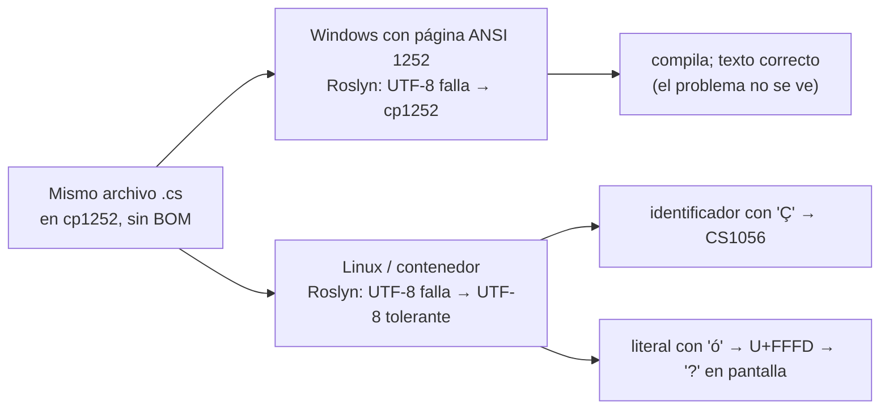

### 1.3 Por qué Windows lo tapaba y Linux lo revelaba

El compilador es el mismo en las dos plataformas y es determinista: con las mismas entradas da la misma salida [B18]. La diferencia es que una de sus entradas —la página de códigos por defecto— **no está en el repositorio**: la aporta la máquina. Ese es el patrón que se va a repetir en toda la guía con otras capas: el SDK que eligió cada máquina, la versión de un paquete que resolvió un rango el día de la build, la imagen a la que apuntaba una etiqueta, la ruta donde se compiló. **Lo que el repositorio no declara, lo aporta quien construye**, y dos quienes aportan dos cosas distintas.

Linux no «rompió» el código: lo hizo visible. Un contenedor, que fija el sistema operativo, además lo vuelve **reproducible** —todos ven el mismo error—, pero no lo arregla: el cp1252 falla igual adentro (E5-1). El arreglo está en los bytes del archivo.

### 1.4 Qué resolvió la corrección y qué dejó abierto

Convertir los cien archivos a UTF-8 con BOM es una corrección legítima: con BOM, el compilador lee el archivo como UTF-8 en cualquier plataforma y con cualquier configuración [B14]. Lo que el commit no dejó es **una política escrita en el repositorio**:

- nada dice qué codificación y qué fin de línea corresponden a cada tipo de archivo, así que el próximo editor o plantilla que escriba otra cosa la escribe sin que nadie se entere ([§5](#5-una-política-de-texto-para-el-repositorio));
- nada verifica en cada commit que se siga cumpliendo ([§10](#10-compuertas-y-gobierno-del-entorno));
- el BOM, que sirve a C#, rompe otros lectores si se generaliza: scripts con `#!`, `JSON.parse`, `tomllib` ([§11.2](#112-cómo-funciona));
- el SDK, los paquetes y la imagen siguen sin fijar, que son las otras dos preguntas del caso ([§6](#6-fijar-el-toolchain) a [§8](#8-contenedores-devcontainers-y-estaciones-windows));
- y no queda registro de con qué se construyó cada artefacto ([§9](#9-procedencia-saber-con-qué-se-construyó)).

El caso reaparece en cada capítulo como ejemplo: se explica en §4, se resuelve en §5, se previene en §10 y se generaliza en §11, donde el mismo código heredado rompe además a Python y corrompe en silencio lo que lee Node.

---

## 2. Marco de referencia: escenarios, contextos y actores

Este marco fija, una sola vez, el vocabulario que el resto de la guía usa por su identificador. Un **escenario** es dónde se edita, restaura o construye el código; un **contexto** es la composición tecnológica de la solución; un **actor** es un rol con decisiones propias. Una misma persona puede ocupar varios roles.

### 2.1 Escenarios

| ID | Escenario | Qué lo caracteriza | Riesgo típico |
|---|---|---|---|
| **ESC-01** | Estación Windows con Visual Studio | Edición, restauración y build nativas; el IDE trae su SDK y su MSBuild; git y la página de códigos son los del usuario. | Es donde el problema del caso **no se ve**. Las configuraciones locales (`core.autocrlf`, codificación al guardar) suplen lo que el repo no declara. |
| **ESC-02** | Estación Linux o macOS | Editor o IDE en Linux; SDK, Node y Python en el host o con gestores de versión. | Donde el problema **aparece**; versiones instaladas a mano que divergen. |
| **ESC-03** | Windows con WSL 2 | Herramientas Linux sobre Windows; el repo puede vivir en el disco de Windows o en el de Linux. | Dos configuraciones de git; finales de línea según dónde se clonó; E/S lenta entre sistemas de archivos [B130][B131]. |
| **ESC-04** | Devcontainer | El editor corre contra un contenedor definido en `devcontainer.json`; el repo se monta o se clona dentro [B119]. | Creer que el contenedor fija todo; archivos escritos por Windows montados en Linux; imagen por etiqueta que cambia. |
| **ESC-05** | Integración continua (CI) | Build en una máquina efímera sin estado, disparada por un push o un PR; produce lo que se publica. | Que resuelva distinto que los desarrolladores; que nadie la reproduzca en local; que no deje registro. |

macOS no se separa de ESC-02 (estación Linux) porque, para estos temas, se comporta como Linux: fuera de Windows, .NET devuelve UTF-8 como página por defecto [B19], y la prueba que acompaña un arreglo del compilador de C# deja escrito que en Linux y macOS el *fallback* es UTF-8 [B15].

### 2.2 Contextos

| ID | Contexto | Mecanismos que entran en juego |
|---|---|---|
| **CTX-NET** | Solución .NET sola | Roslyn, MSBuild, Razor; `global.json`; NuGet (*Central Package Management*, CPM; `packages.lock.json`; `nuget.config`); build determinista; Source Link. |
| **CTX-NODE** | Proyecto Node.js solo | Cargador de módulos y `fs`; `.nvmrc`, `engines`, `devEngines`, `packageManager`; `package-lock.json` y `npm ci`; procedencia de npm. |
| **CTX-PY** | Proyecto Python solo | PEP 263 y 686; `requires-python`, `.python-version`; uv/Poetry/pip-tools y sus locks; `pylock.toml`. |
| **CTX-POLI** | Solución políglota (.NET + Node.js + Python en un repo) | Todo lo anterior a la vez: una política de texto raíz por extensión, un archivo de versión nativo por ecosistema, un lock por ecosistema, una frontera de build, una o varias imágenes, SBOM y procedencia que cubran los tres. |

Una variante transversal, sin ser contexto: **código heredado** (con historia previa a la política, como el del caso) frente a **repositorio nuevo**. Cambia sobre todo la migración (§5) y la adopción tardía de lock files (§7).

### 2.3 Actores

| ID | Actor | Decide | No decide | Necesita de la guía |
|---|---|---|---|---|
| **ACT-DEV** | Desarrollador | Su escenario de trabajo; configurar editor y git para respetar la política; regenerar el lock al agregar una dependencia. | La política de texto, las versiones fijadas, la imagen. | Qué archivos mandan; cómo verificar en local antes del push; cómo diagnosticar un archivo mal codificado. |
| **ACT-ARQ** | Líder técnico / arquitecto | La política de texto, las versiones de toolchain, la estrategia de dependencias, si hay devcontainer, la estrategia de imagen (única o por componente) y la estructura del repo políglota. | Cómo se implementa la compuerta en la CI concreta. | Criterios para elegir entre alternativas y sus consecuencias por escenario. |
| **ACT-OPS** | DevOps / ingeniería de plataforma | La construcción, el digest y la actualización de las imágenes de CI y del devcontainer; SBOM y procedencia; las compuertas; la protección de rama. | Las versiones de lenguaje o de dependencias de negocio. | Qué registrar; cómo hacer que la compuerta sea la misma en local y en CI. |
| **ACT-REV** | Revisor de PR | Aprobar o rechazar el cambio concreto, en especial los que tocan locks, archivos de versión, imagen, `.gitattributes`, `.editorconfig`. | La política en sí: la aplica, no la define. | Qué mirar en un diff de entorno y cómo reconocer un cambio invisible de BOM o EOL. |

Quien **consume** el artefacto (quien lo despliega o lo audita) no decide sobre el entorno de desarrollo, pero define qué tiene que poder verificarse; aparece como destinatario en [§9](#9-procedencia-saber-con-qué-se-construyó).

### 2.4 Matriz capítulo × escenario

`●` central en ese escenario · `○` aplica con matices · `—` no aplica.

| Capítulo | ESC-01 Windows + Visual Studio | ESC-02 Linux | ESC-03 WSL | ESC-04 Devcontainer | ESC-05 CI |
|---|---|---|---|---|---|
| §3 Capas | ● | ● | ● | ● | ● |
| §4 Codificación (fenómeno) | ● (lo oculta) | ● (lo revela) | ● | ● | ● |
| §5 Política de texto | ● | ● | ● | ○ | ● (la hace cumplir) |
| §6 Toolchain | ● | ● | ● | ○ (la imagen lo trae) | ● |
| §7 Dependencias | ● | ● | ● | ● | ● (modo estricto) |
| §8 Contenedores | ○ (convivencia) | ○ | ● | ● | ● |
| §9 Procedencia | ○ (diagnóstico) | ○ (reconstruir) | ○ (reconstruir) | ○ | ● |
| §10 Compuertas | ○ (hook) | ○ | ○ | ○ | ● |
| §11 Políglota | ● | ● | ● | ● | ● |

La procedencia (§9) se **produce** sólo en la CI **[criterio]**: vale la del artefacto que se publica, que sale de ahí. En las estaciones y el devcontainer, §9 sirve para diagnosticar (metadatos embebidos) y para reconstruir un artefacto publicado y comparar hashes; una build local no demuestra nada ante un tercero.

| Actor | Lidera | Aplica | Verifica |
|---|---|---|---|
| ACT-DEV | — | §5, §6, §7, §8 | su build local antes del push |
| ACT-ARQ | §3, §5, §6, §7, §11 | §12, pasos 1–3, 5–7, 9 y 10 | coherencia entre capítulos |
| ACT-OPS | §8, §9, §10 | §12, pasos 4–9 | compuertas y procedencia |
| ACT-REV | — | §10 (lista del revisor) | diffs de §5, §6, §7, §8 |

ACT-ARQ decide además la imagen (§8) y el alcance de SBOM y procedencia (§9), que implementa ACT-OPS (§11.4).

---

## 3. El entorno como pila de capas

El pedido del caso usa una sola palabra, «congelar», para tres cosas que se fijan con archivos, herramientas y comandos distintos: la versión de los paquetes NuGet, la del compilador y el SDK, y el entorno completo dentro de un contenedor. Este capítulo separa esas cosas en capas, da a cada una su fuente de verdad y fija el vocabulario que el resto de la guía usa con un único sentido. La columna «Capítulo» de §3.2 es el mapa.

### 3.1 Definiciones

La columna «No confundir con» existe porque casi todos estos términos circulan con más de un sentido; la guía elige uno y lo sostiene. El [Anexo C](#anexo-c-glosario) los reúne con el resto.

| Término | Definición adoptada | Fuente | No confundir con |
|---|---|---|---|
| **Entorno de construcción** | Todo lo que, además del código fuente, influye en los bytes del artefacto: dependencias y sus versiones, toolchain, flags de build, variables de entorno que la build lee (por ejemplo el *locale*), sistema operativo y su configuración. | [B01] | «La máquina del desarrollador»: la máquina es una forma de aportar el entorno. |
| **Capa** | Parte del entorno que se declara en un mismo tipo de archivo, la lee una misma herramienta y falla de un mismo modo cuando no se declara. | **[criterio]** | Capa de imagen de Docker (*layer*). |
| **Fuente de verdad** | El archivo versionado en el repo que define el valor de una capa. Si no existe, el valor lo aporta quien construye. | **[criterio]** | Una wiki o un README: no los lee ninguna herramienta. |
| **Declarar / hacer cumplir** | Declarar es escribir el valor en la fuente de verdad; hacer cumplir es que una herramienta **falle** si el entorno real no coincide. `engines` de npm declara y sólo advierte [B63]; `npm ci` [B91], `dotnet restore --locked-mode` [B83] y `uv sync --locked` [B97] hacen cumplir. | [B63][B83][B91][B97] | Que el archivo exista no implica que alguien lo verifique. |
| **Rango** | Conjunto de versiones aceptables. Cuál se elige lo decide la política de resolución de cada ecosistema, y no es la misma: NuGet elige la **más baja** que satisface el mínimo [B83]; npm con `^` y uv eligen la **más alta** compatible (E0-3a, E0-3c). `Version="13.0"` en un `.csproj` es un mínimo, no una versión exacta [B84]. | [B83][B84][B94][B106] | «Versión». |
| **Fijar** (*pin*) | Declarar **una** versión exacta de **una** entrada: `[13.0.1]` en NuGet [B84], `==` en Python [B106], `version` + `rollForward: disable` en `global.json` [B56], una imagen por digest [B113]. No dice nada de las dependencias transitivas. | [B56][B84][B106][B113] | Congelar. |
| **Congelar** (*lock*) | Registrar en un archivo generado por la herramienta el **resultado completo** de la resolución (directas y transitivas, versión exacta, origen y hash) para que una instalación posterior repita el mismo árbol: `packages.lock.json` [B83], `package-lock.json` [B93], `uv.lock` [B99], `pylock.toml` [B101]. | [B83][B93][B99][B101] | «Congelar el entorno»: un lock congela una sola capa. |
| **Restauración estricta** | Instalación que usa el lock y **falla** si no coincide con lo declarado, en lugar de reescribirlo. | [B83][B91][B97] | `dotnet restore` o `npm install` comunes, que reescriben el lock (E4-1, E4-4). |
| **Determinista** | Propiedad de **una herramienta**: con entradas idénticas produce salidas idénticas. El compilador de C# lo es por defecto (`Deterministic=true`), y entre sus entradas cuenta la ruta del directorio actual y la página de códigos por defecto [B18]. | [B18] | Reproducible. |
| **Reproducible** | Propiedad de **una build completa**: con el mismo fuente, el mismo entorno y las mismas instrucciones, cualquiera obtiene copias idénticas bit a bit de los artefactos [B01]. | [B01] | «Funciona igual». |
| **Hermética** | Propiedad del **sistema de build**: aísla la build del host, trata las herramientas como fuente y usa el control de versiones para identificar cambios en las entradas [B04]. SLSA la usa en un sentido más estrecho («sin acceso a la red») y no la exige en ningún nivel vigente [B06][B07]. | [B04][B06][B07] | Contenedor. |
| **Deriva** (*drift*) | Diferencia entre el entorno que el repo declara y el que efectivamente construye, que aparece **sin un commit que la explique**: una etiqueta de imagen que se movió, un SDK que actualizó Visual Studio, un rango que resolvió una versión nueva. | **[criterio]**; no se encontró definición normativa | Una actualización deliberada por PR. |
| **Registro del entorno** | Lo que se graba durante la build sobre el entorno usado, para que otros puedan reconstruirla [B02]. | [B02] | Procedencia. |
| **Procedencia** (*provenance*) | Atestación que identifica el artefacto por su digest y describe cómo se produjo; en SLSA (*Supply-chain Levels for Software Artifacts*), desde el nivel L2 la genera y firma una plataforma de build alojada [B07][B09]. | [B07][B09] | Un registro sin firmar: sirve para diagnosticar, no prueba nada ante un tercero. |

### 3.2 Las seis capas

El orden no es arbitrario: cada capa consume a la anterior, y la falla de una capa inferior no se arregla en una superior. Un lock file no compensa un fuente en una codificación que el compilador no lee.

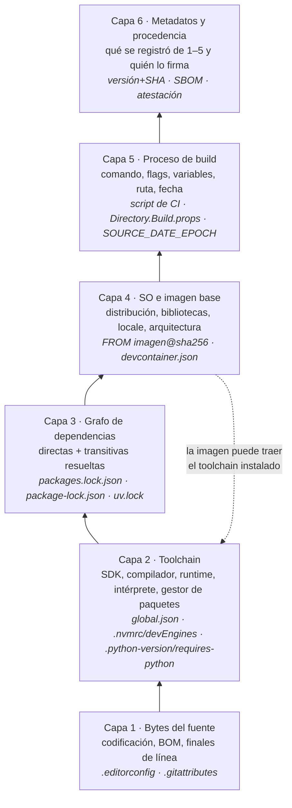

La flecha punteada es la única excepción al apilamiento: la imagen suele **traer** el toolchain, y la capa 4 aporta el valor de la capa 2. No por eso es su fuente de verdad: si el repo no lo declara, lo decide quien eligió la imagen, y dos imágenes oficiales dan dos compiladores distintos (E0-2).

| Capa | Qué contiene | Fuente de verdad en el repo (.NET · Node.js · Python) | Si el repo calla, la aporta… | Cómo se rompe | Experimento | Capítulo |
|---|---|---|---|---|---|---|
| 1 · Bytes | Codificación, BOM, finales de línea | `.editorconfig` y `.gitattributes`, iguales para los tres | El editor y el git de cada estación | Compila en una plataforma y falla en otra; commits de BOM o EOL | E0-1 | §4, §5 |
| 2 · Toolchain | SDK/compilador, runtime, intérprete, gestor | `global.json` · `.nvmrc`, `devEngines` · `.python-version`, `requires-python` | El SDK más alto instalado [B58]; lo que haya en el `PATH`; lo que traiga la imagen | Mismo fuente, otra DLL (E0-2) | E0-2 | §6 |
| 3 · Grafo | Versiones exactas de directas y transitivas, con hash | `packages.lock.json` (+ CPM) · `package-lock.json` · `uv.lock` | El resolvedor, el día en que corre | Un rango resuelve otra versión; el lock se regenera en silencio | E0-3a/b/c | §7 |
| 4 · SO e imagen | Distribución, bibliotecas, *locale*, arquitectura | `FROM …@sha256:…`, `devcontainer.json` | El host o la etiqueta el día de la descarga | Misma etiqueta, otros bytes (E0-4) | E0-4 | §8 |
| 5 · Proceso | Comando, flags, configuración, variables, ruta, fecha | Script de build; `Directory.Build.props`; `SOURCE_DATE_EPOCH` [B03] | Lo que cada persona tipea o configura en su IDE | Rutas absolutas y fechas incrustadas en el binario | E0-5 | §9 |
| 6 · Metadatos | Registro de 1–5 asociado al artefacto; SBOM; atestación | Lo generan la CI y sus herramientas | Nadie: si no se graba en la build, se pierde | No se puede contestar «¿con qué se construyó?» | E0-6 | §9 |

La capa 6 tiene una sutileza que aparece recién al integrar ecosistemas ([§11](#11-una-sola-solución-con-net-nodejs-y-python)): un SBOM (*software bill of materials*, inventario de componentes) puede describir **el artefacto** que se entrega, **las dependencias declaradas** en los locks o **el entorno de build** completo, y en una build políglota los tres documentos son distintos (E8-6).

### 3.3 Qué fija cada mecanismo y qué deja libre

*Tabla de consulta: usa mecanismos que se explican en §6 a §10.*

La pregunta del caso se contesta por filas: ningún mecanismo fija más de una o dos capas y casi todos dejan libre algo que se cree cubierto; por eso se lee «Qué deja libre» antes que «Qué fija».

| Mecanismo | Capa que fija | Qué deja libre | ¿Declara o hace cumplir? | Evidencia |
|---|---|---|---|---|
| `global.json` con `version` + `rollForward: disable` | 2 (SDK exacto; con él, el compilador en la CLI; en Visual Studio depende del SDK, §6.2.2) | El runtime con que corre la app; capas 3–5 | Hace cumplir: `dotnet` y el resolvedor de MSBuild fallan **en toda máquina** que no tenga ese SDK exacto | [B56], E3-1 |
| `global.json` con `rollForward` permisivo, o sin `global.json` | 2 como rango (o nada) | Qué SDK concreto: el más alto instalado | Hace cumplir el piso, no el valor | [B56], E0-2 |
| `TargetFramework` (`net8.0`) | API y runtime mínimo | El SDK y el compilador: la misma DLL `net8.0` sale distinta con SDK 8 y 10 | — | E0-2 |
| `PackageReference Version="x"` | 3, sólo directas, como mínimo | Transitivas; cambia si se publica algo que encaja mejor | Declara | [B83][B84] |
| CPM (`Directory.Packages.props`) | 3, versiones directas en un lugar | El grafo resuelto: no es un lock | Declara | [B85], E4-2 |
| `packages.lock.json` + `--locked-mode` | 3, grafo completo con hash | Capas 1, 2, 4, 5 | Hace cumplir con `--locked-mode` | [B83], E4-1 |
| `package-lock.json` + `npm ci` | 3, árbol completo con `integrity` | Versión de Node y npm; capas 4–5 | `npm ci` hace cumplir | [B91][B93], E0-3a |
| `engines` | 2 como rango | Todo, salvo `engine-strict` | Declara (advierte) | [B63], E0-2b |
| `devEngines` | 2 como rango (Node, npm) | — | Hace cumplir (falla por defecto) | [B63], E3-3 |
| `requires-python` | 2 como requisito del paquete | Qué intérprete concreto | Declara; lo validan pip y uv | [B71][B73] |
| `uv.lock` + `--locked` | 3, grafo universal | Versión de uv; capas 4–5 | Hace cumplir | [B97], E0-3c |
| Imagen por etiqueta (`sdk:8.0`) | 4 (y 2) **el día de la descarga** | Todo lo demás, y la propia capa 4 a futuro | Ni siquiera declara un valor estable | [B113], E0-4 |
| Imagen por digest (`sdk@sha256:…`) | 4 (y 2 si viene en la imagen) | Capas 1, 3, 5, 6; renuncia a parches automáticos | Hace cumplir | [B113], E5-2 |
| `devcontainer-lock.json` | Las *features* del devcontainer | La imagen base; capas 1, 3, 5, 6 | Registra integridad | [B121], E5-5 |
| `Deterministic=true` | 5, en parte | Ruta, página de códigos, versión del compilador | Hace cumplir dentro del compilador | [B18], E0-5 |
| `ContinuousIntegrationBuild=true` | 5, normaliza rutas | Sólo actúa sobre las raíces `SourceRoot`, que aporta un repo git | Hace cumplir | [B143][B144], E0-5b |
| `SOURCE_DATE_EPOCH` | 5, la fecha incrustada | Todo lo que no lea la variable | Convención | [B03] |

### 3.4 Reproducible, determinista, hermética: cuál necesita un equipo

Las tres palabras describen objetos distintos y no se implican como suele suponerse. E0-5 muestra la distancia entre las dos primeras: con el mismo SDK y el mismo directorio, dos compilaciones dieron el mismo hash, aun en dos contenedores; con **otro directorio**, cambió, porque la DLL guarda la ruta del `.pdb`: compilador determinista, build no reproducible entre máquinas. Recién con `ContinuousIntegrationBuild=true` en un repo git la ruta quedó normalizada (`/_/obj/…`) y los hashes coincidieron.

**[criterio]** Para un equipo como el del caso:

| Necesidad | Propiedad suficiente | Por qué no hace falta más |
|---|---|---|
| Que la build no se rompa al pasar de Windows a Linux o al devcontainer | Capas 1–4 **declaradas y verificadas** | El problema del caso es de entradas distintas, no de bytes de salida. |
| Saber con qué se construyó un artefacto ya publicado | Registro del entorno por capa, grabado por la CI | Alcanza con poder reconstruir el entorno. |
| Demostrar que un binario sale de un commit dado | Build **reproducible** del artefacto publicado + procedencia firmada | Es el único caso en que la igualdad bit a bit paga su costo. |
| Aislar la build del host y de la red | Hermética | Exige un sistema de build que gestione las herramientas como fuente o un *mirror* de paquetes; para un equipo chico excede el beneficio salvo requisito externo. Ningún nivel vigente de SLSA la exige [B07]. |

### 3.5 ¿Lo resuelve un contenedor?

En parte, y sólo en las capas que aporta: la 4 y, si la trae la imagen, la 2, **sólo por digest**; la 5, para quien usa la misma definición. No fija la 1 (el `.cs` en cp1252 falla igual adentro, E5-1), ni la 3 (sin lock y restauración estricta resuelve rangos como en cualquier lado), ni la 6. La tabla capa por capa, con su evidencia, está en [§8.2.1](#821-qué-fija-un-contenedor-y-qué-no).

### 3.6 Mapa conceptual: «estoy acá → qué aplico»

*Tabla de consulta: usa mecanismos que se explican en §4 a §11.*

Cuatro puertas de entrada al resto de la guía, según lo que el lector tenga delante.

**Por síntoma.**

| Si ves… | Capa | Andá a |
|---|---|---|
| `CS1056: Unexpected character '�'`, textos con `?` o `�`, compila en Windows y no en Linux | 1 | [§4](#4-codificación-y-finales-de-línea), [§5](#5-una-política-de-texto-para-el-repositorio) |
| Un PR donde «cambió» una línea entera y el texto es igual | 1 | [§5](#5-una-política-de-texto-para-el-repositorio), [§10](#10-compuertas-y-gobierno-del-entorno) |
| `bash\r: No such file or directory`, `^M`, scripts que no arrancan en el contenedor | 1 | [§4](#4-codificación-y-finales-de-línea), [§8](#8-contenedores-devcontainers-y-estaciones-windows) |
| `A compatible .NET SDK was not found`, o compila en una máquina y no en otra con el mismo código | 2 | [§6](#6-fijar-el-toolchain) |
| `NU1004`, `EUSAGE`, «needs to be updated», un lock que cambió sin que nadie tocara dependencias | 3 | [§7](#7-congelar-las-dependencias) |
| «Usamos la misma imagen» y aun así hay diferencias | 4 | [§8](#8-contenedores-devcontainers-y-estaciones-windows) |
| Dos builds del mismo commit con hash distinto | 5 | [§9](#9-procedencia-saber-con-qué-se-construyó) |
| Nadie sabe con qué SDK o paquetes se construyó lo que está en producción | 6 | [§9](#9-procedencia-saber-con-qué-se-construyó) |
| La CI está en rojo y el `main` igual quedó roto | gobierno | [§10](#10-compuertas-y-gobierno-del-entorno) |
| .NET, Node y Python en el mismo repo y cada uno «anda» por separado | todas | [§11](#11-una-sola-solución-con-net-nodejs-y-python) |

**Por escenario.**

| Estoy en… | Lo mínimo que aplico | Lo que no me toca |
|---|---|---|
| ESC-01 Windows + Visual Studio | Respetar `.editorconfig` (Visual Studio lo lee de fábrica [B44]); activar el hook **con sus prerrequisitos** ([A.11](#a11-hook-versionado-y-esqueleto-de-la-compuerta)); con `rollForward: disable`, tener el SDK exacto de `global.json` (instalador independiente si VS trae otro [B56]); correr la compuerta antes del push desde Git Bash **[no verificado]** | Decidir la política; la procedencia |
| ESC-02 Linux | Lo mismo; VS Code con la extensión EditorConfig [B50]; gestor de versiones configurado para leer los archivos nativos | Ídem |
| ESC-03 WSL 2 | Repo en el sistema de archivos del lado donde corren las herramientas [B130]; `core.hooksPath` en el git de ese lado | Ídem |
| ESC-04 Devcontainer | Etiqueta fija de SDK y SO verificada por `global.json`, o la misma receta que la imagen de CI (§8.2.2); `devcontainer-lock.json`; `--frozen-lockfile` | Creer que reemplaza a la política |
| ESC-05 CI | Compuerta completa sobre clon limpio; restauración estricta; `ContinuousIntegrationBuild`; `SOURCE_DATE_EPOCH`; SBOM y procedencia | — |

**Por contexto.**

| Mi solución es… | Qué cambia respecto de la regla general | Archivos mínimos | Andá a |
|---|---|---|---|
| CTX-NET (sólo .NET) | El BOM de la familia .NET es convención del equipo (§5.2.3); `rollForward` coherente con usar o no lock de NuGet (§6.4); Visual Studio como estación principal | `.editorconfig`, `.gitattributes`, `global.json`, `Directory.Build.props`, `Directory.Packages.props`, `nuget.config` | §5.2.3, §6.2.2, §7.2.1, §9.2.1 |
| CTX-NODE (sólo Node.js) | Node no tiene archivo de versión propio: `.nvmrc` para los gestores y `devEngines` para que npm falle; JSON sin BOM | `.nvmrc`, `package.json`, `package-lock.json`, `.npmrc` | §6.2.3, §7.2.2, §9.2.2 |
| CTX-PY (sólo Python) | `requires-python` + `.python-version` dentro del proyecto uv; `open()` con `encoding=` | `pyproject.toml`, `.python-version`, `uv.lock` | §6.2.4, §7.2.3, §9.2.2 |
| CTX-POLI (los tres en un repo) | Excepciones de texto por lector; un archivo nativo y un lock por ecosistema donde los busca su herramienta; frontera de la build; imagen única o por componente | todo lo anterior y una compuerta con inventario de proyectos | §11 |

**Por artefacto que se va a tocar.**

| Archivo | Capa | Capítulo | Plantilla |
|---|---|---|---|
| `.editorconfig`, `.gitattributes`, `.git-blame-ignore-revs` | 1 | §5 | A.1, A.2, A.15 |
| `global.json`, `.nvmrc`, `package.json` (`engines`, `devEngines`), `.python-version`, `pyproject.toml` | 2 | §6 | A.3, A.7, A.8 |
| `Directory.Packages.props`, `nuget.config`, `*.lock*`, `.npmrc`, índices de paquetes de uv | 3 | §7 | A.5, A.6, A.7, A.8 |
| `Dockerfile`, `devcontainer.json`, `devcontainer-lock.json` | 4 | §8 | A.9, A.10 |
| `Directory.Build.props`, scripts de build | 5 | §9 | A.4 |
| Registro del entorno, SBOM, atestación | 6 | §9 | A.17 |
| Workflow de CI, hooks, `CODEOWNERS`, configuración de bots, ADR, `.gitignore` | gobierno | §10 | A.11–A.14, A.16, A.18 |

### 3.7 Preguntas guía

**¿Qué capas hay que registrar para afirmar con qué entorno se construyó un artefacto?**
Las seis, de dos formas. Las capas 1 a 4 se registran sobre todo **por referencia**: el commit identifica los archivos que las declaran (`.gitattributes`, `global.json`, locks, `FROM` con digest), si existen y el árbol está limpio. Lo que el repo no declara —el SDK usado, el digest real de la imagen, la ruta, las variables— se **graba** durante la build, porque después no se puede reconstruir [B02] (A.17); ante un tercero, además, se firma (§9). *Aplica* a todo artefacto que salga de la CI; para builds locales alcanza con que el repo declare.

**¿«Congelar» y «fijar» son lo mismo?**
No. Fijar es elegir una versión para una entrada; congelar es guardar el resultado completo de una resolución, transitivas incluidas. No se reemplazan: lo fijado puede no existir, y el lock registra lo que se resolvió en su lugar (§7.2.1). *Aplica* cada vez que alguien propone «congelar versiones»: preguntar de qué capa y si incluye las transitivas.

**¿Por qué el mismo commit da resultados distintos en dos máquinas?**
Porque el commit fija sólo lo que el repo versiona; lo demás lo aporta la máquina. El diagnóstico es comparar registros por capa (E0-6, con un `diff` de dos manifiestos de capas) y buscar la **primera capa, de abajo hacia arriba**, donde difieren: si los bytes del fuente ya difieren, comparar locks es inútil. *Aplica* al primer diagnóstico de todo «en mi máquina anda»: entre dos estaciones, entre la estación y la CI o entre dos corridas de la CI.

**¿Un contenedor reemplaza al `global.json` o al lock?**
No: la fuente de verdad tiene que estar en archivos que lean todas las herramientas, con o sin contenedor; la estación Windows no usa la imagen y el grafo se resuelve igual adentro (§3.5). *Aplica* cuando se propone el devcontainer como reemplazo de la política; *no aplica* a la imagen de la CI, que sí es parte de lo que se fija (§8.2.2).

**¿Un rango es siempre peligroso?**
No. El rango es correcto en la declaración —NuGet desaconseja poner techos a paquetes ajenos [B84]— siempre que haya un lock que congele el resultado y un modo estricto en la CI. Lo peligroso es el rango **sin lock**, porque cada ecosistema lo resuelve con otra política (la más baja en NuGet, la más alta en npm y uv). *Aplica* al declarar dependencias en cualquier ecosistema: rango en el manifiesto y lock con modo estricto en la CI; para .NET, lo que se decide en §6.4.

**El caso de §1 llega a tu equipo: el `.cs` en cp1252 compila en la estación Windows y falla en la CI Linux. ¿Por qué capa empezás y qué descartás?**
Por la capa 1, la más baja donde las dos máquinas difieren: los bytes del archivo no son UTF-8 válido y cada compilador los decodifica con la página ANSI de su sistema (§1.2). El SDK, los paquetes y la imagen se descartan por ahora: aunque estuvieran fijados, el archivo fallaría igual en Linux (E5-1). *Aplica* a todo fallo que aparece en un sistema operativo y no en otro con el mismo commit.

---

## 4. Codificación y finales de línea

Un archivo de texto no dice en qué codificación está escrito. Cada programa que lo lee la **supone**, y lo hace con reglas propias: el compilador de C# prueba UTF-8 y, si falla, usa la página ANSI del sistema; Node.js lee sus módulos como UTF-8: reemplaza lo que no entiende en literales y falla en un identificador; Python exige UTF-8 o una declaración explícita en el fuente y, ante un byte inválido, se niega a compilar. Este capítulo explica el fenómeno lector por lector; la política que lo controla es el [§5](#5-una-política-de-texto-para-el-repositorio).

### 4.1 Definición

| Término | Definición | Fuente |
|---|---|---|
| **Codificación** (*encoding*) | Regla que traduce caracteres a bytes. `ó` (U+00F3) es el byte `F3` en Windows-1252 y los bytes `C3 B3` en UTF-8. EditorConfig llama `charset` a esto. | [B12], E1-09 |
| **Windows-1252 (cp1252)** | Codificación de un byte por carácter, página ANSI de Windows para idiomas de Europa occidental. Coincide con ISO-8859-1 (Latin-1) salvo en los bytes `80–9F`, que en cp1252 son casi todos imprimibles (`€`, comillas tipográficas). .NET moderno sólo la trae registrando `CodePagesEncodingProvider`. | E1-12, [B19] |
| **Página de códigos ANSI del sistema** | La que Windows usa para las API «-A»; .NET la expone como `Encoding.GetEncoding(0)`. En Windows es la de la región del sistema (1252 en español); en Linux y macOS .NET devuelve UTF-8. Windows permite fijarla en UTF-8 con la opción *Beta: Use Unicode UTF-8 for worldwide language support*. | [B19][B22], E1-02 |
| **BOM** (*byte order mark*) | U+FEFF al principio del texto. En UTF-8 son `EF BB BF` y no indican orden de bytes: funcionan sólo como **firma**. El estándar Unicode dice que no es obligatorio en UTF-8 [B13]; la FAQ advierte que interfiere con formatos que esperan ASCII al inicio, como el `#!` de los scripts [B12]. Visual Studio lo llama «UTF-8 con firma». | [B12][B13] |
| **Carácter de reemplazo** | U+FFFD (`�`, bytes `EF BF BD`). Lo produce un decodificador UTF-8 tolerante ante bytes inválidos. Se pierde el dato original. | [B23], E1-01 |
| **Mojibake** | Texto legible pero equivocado por decodificar con otra codificación: `ó` en lugar de `ó`. No pierde bytes; es reversible. | E1-01, E1-07 |
| **Fin de línea** (EOL) | LF (`0A`) en Linux y macOS; CRLF (`0D 0A`) en la convención de Windows. | [B36] |
| **Lector** | Todo programa que convierte los bytes en caracteres: compilador, generador de código, intérprete, cargador de módulos, función de E/S, editor. git almacena bytes y sólo interpreta EOL. | **[criterio]** |

### 4.2 Cómo funciona

#### 4.2.1 Qué hace el compilador de C# con un archivo sin BOM

El compilador lee cada fuente con `EncodedStringText.Create`: si el archivo empieza con BOM, el BOM manda; si no, y el proyecto **no** indica página de códigos, intenta UTF-8 estricto y, si falla, decodifica con un *fallback* que el código define como «la página ANSI por defecto; si no, 1252; si no, Latin-1» [B14]. En Linux, `GetEncoding(0)` devuelve UTF-8 [B19] (E1-02): el segundo intento vuelve a ser UTF-8, ahora tolerante, y cada byte de cp1252 se convierte en U+FFFD. La prueba con que el equipo del compilador corrigió en abril de 2026 una regresión de ese *fallback* afirma que en Windows es la página ANSI real «aun cuando la opción de configuración regional UTF-8 está activada», y en Linux y macOS, donde no hay página ANSI, UTF-8 [B15].

```csharp
// Roslyn, EncodedStringText.cs (commit 9c298328ef91 [B14]), recortado y comentado.
bool detectEncoding = defaultEncoding == null;           // ¿el proyecto fijó CodePage?
if (detectEncoding)
{
    try { return Decode(stream, s_utf8Encoding /* estricto: lanza ante bytes inválidos */, …); }
    catch (DecoderFallbackException) { /* sigue abajo */ }
}
// La página ANSI del sistema: 1252 en un Windows en español, UTF-8 en Linux.
return Decode(stream, defaultEncoding ?? getEncoding.Value /* CreateFallbackEncoding() */, …);
```

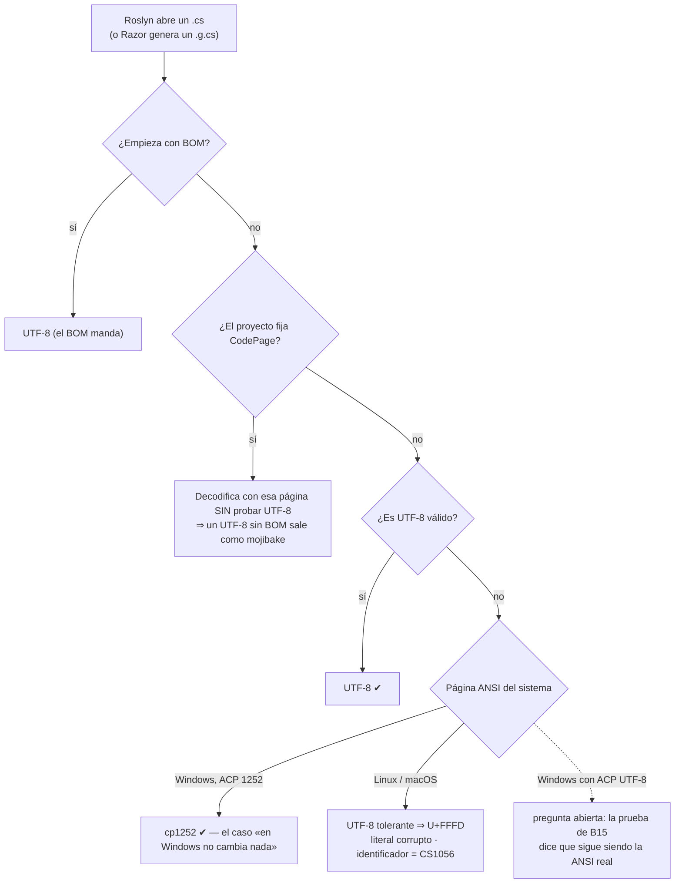

Queda abierta la estación Windows con la opción beta de UTF-8 activada [B22]. Una lectura de [B19] sugiere que se comportaría como Linux; la prueba que el compilador agregó en [B15] afirma lo contrario para el compilador, que registra el proveedor de páginas de códigos antes de pedir la página ANSI. **[no verificado]**. La guía no recomienda activar esa opción como remedio del caso.

#### 4.2.2 Por qué el identificador rompe y el literal sólo se corrompe

La especificación de C# admite en un identificador cualquier letra Unicode (`\p{L}`, `\p{Nl}`) [B21]. `Ç` es una letra mayúscula (`Lu`); U+FFFD, un símbolo (`So`) (E1-12). Tras la decodificación tolerante el compilador ve U+FFFD, no puede formar un token y emite `CS1056`; en un literal cualquier carácter vale, y la compilación termina bien. **Un build verde en Linux no prueba que la codificación esté bien; prueba que no hay identificadores no ASCII** **[criterio]**: sin un identificador acentuado, los textos corruptos del caso habrían llegado a producción.

#### 4.2.3 `CodePage`: un remedio con dos trampas

La propiedad `CodePage` le dice al compilador qué página usar. La documentación afirma que el compilador «primero intenta» UTF-8 [B17], pero el código y el experimento dicen otra cosa: con `CodePage` presente **no** prueba UTF-8 [B14], y un `.cs` en UTF-8 sin BOM compilado con `-p:CodePage=1252` produce `Atención` (E1-01). Sólo los archivos con BOM quedan a salvo. Segunda trampa: con SDK 8.0.425, `CodePage=1252` falla con `CS2016: Code page '1252' is invalid or not installed` cuando el servidor de compilación (`VBCSCompiler`) recién arrancó, y no falla si ya compiló un archivo con *fallback* ni con `-p:UseSharedCompilation=false`, que compila sin servidor; con SDK 10.0.400 compila (E1-03). El mismo `CS2016` se reportó en Windows con Visual Studio 2026 y se corrigió en el compilador en noviembre de 2025 [B16]. **[criterio]** `CodePage` sirve para compilar *hoy* un árbol homogéneamente cp1252 en Linux, pero no es política: rompe el primer archivo UTF-8 sin BOM que alguien agregue.

#### 4.2.4 Cómo supone la codificación cada lector

| Lector | UTF-8 sin BOM | cp1252 sin BOM | UTF-8 con BOM | CRLF | ¿Se puede declarar? | Evidencia |
|---|---|---|---|---|---|---|
| Roslyn (C#), Linux/macOS | correcto | literal → U+FFFD; identificador → `CS1056` | correcto | se conserva dentro de literales verbatim/crudos | `CodePage` (para **todo** el proyecto, y apaga el intento UTF-8) | E1-01/02, [B14] |
| Roslyn (C#), Windows con ACP 1252 | correcto | correcto | correcto | ídem | ídem | [B14][B19] **[no verificado]** |
| Razor (generador) | correcto | literal y HTML → U+FFFD, sin error; identificador → `RZ1005`/`CS1056` | correcto | **[no verificado]** (no medido) | no documentado | E1-04 |
| Node `require`/`import` | correcto | literal → U+FFFD, sin error; identificador → `SyntaxError` | correcto (U+FEFF es espacio en blanco en ECMAScript) | template literal: CRLF → LF | no: el cargador lee siempre UTF-8 | E1-05, [B23][B24] |
| Node `fs.readFileSync(f,'utf8')` | correcto | U+FFFD, sin error | **conserva** U+FEFF | se conserva | por llamada; `TextDecoder({fatal:true})` rechaza bytes inválidos | E1-05, [B25] |
| `JSON.parse` (Node) | correcto | — | **`SyntaxError`** | — | — | E1-05; RFC 8259 permite ignorarlo, no obliga [B26] |
| JSON en cp1252 leído con `readFileSync` + `JSON.parse` | — | **U+FFFD sin error** (`{ 'a�o': 2026 }`) | — | — | — | E8-1 |
| Python, código fuente | correcto | **`SyntaxError: Non-UTF-8 code`** | correcto | normalizado a LF | `# -*- coding: cp1252 -*-` (PEP 263) | E1-06, [B27][B28] |
| Python `open()` sin `encoding=` | ≤ 3.14: según *locale*; ≥ 3.15: UTF-8 [B29] | ≤ 3.14: según *locale*; ≥ 3.15: **`UnicodeDecodeError`**, salvo bytes que formen UTF-8 válido (modo UTF-8 estricto) [B29][B220] | conserva `` con `utf-8`; lo quita `utf-8-sig` | modo texto → `\n` | por llamada; modo UTF-8 para el proceso | E1-06/07, [B30][B31] |
| Python `json.load(open(…, encoding="utf-8"))` | correcto | **`UnicodeDecodeError`** | **`JSONDecodeError: Unexpected UTF-8 BOM`** | correcto | `utf-8-sig` | E8-1, E2-5 |
| git | bytes | bytes, ningún aviso | cambio de 3 bytes en la línea 1 | diff de **todas** las líneas | `working-tree-encoding` (§5) | E1-08, [B36] |
| Script con `#!/bin/sh` | correcto | — | depende de quién lo lance (abajo) | **falla**: `not found`, `required file not found`, `ENOENT` | no | E1-11, E8-1 |

El BOM en un script daña en silencio. El kernel sólo reconoce un script si empieza con `#!` [B173]; con el BOM delante, `execve` devuelve `ENOEXEC`. Si lo lanzó un shell (bash, dash) o una función de la familia `execvp` (como el `child_process` de Node), se reintenta con `/bin/sh`: la primera línea falla y el resto corre **con ese shell** aunque el shebang pidiera otro intérprete; si es shell válido sale con 0 (E1-11), y si no, falla más abajo, lejos de la causa (E8-1: un `.py` con BOM da rc=2). Si lo lanzó un programa que llama a `execve` directo, como `subprocess.run` de Python, falla con `Exec format error` (E1-11, E8-1). El mismo archivo «anda» o no según el orquestador.

Tres lecturas que forman criterio:

- **El BOM tiene valor sólo para quien adivina.** Roslyn y los editores lo usan como firma; los parsers estrictos (`JSON.parse`, `json`, `tomllib`) y el kernel lo tratan como un carácter más.
- **Sólo Python rechaza el fuente en cp1252 en toda plataforma**, aun con el byte en un comentario [B33], salvo un cp1252 cuyos bytes forman UTF-8 válido, que se lee con otro texto. Roslyn, Razor y Node, en Linux y macOS, fallan sólo con el carácter en un identificador (`CS1056`, `RZ1005`, `SyntaxError`) y corrompen sin error literales y HTML (E1-01, E1-04, E1-05); en Windows con ACP 1252, Roslyn lo lee bien (§4.2.1).
- **Sólo Python permite declarar la codificación por archivo.** C# la declara para toda la compilación, Node no la declara, git la declara por ruta pero para convertir.

#### 4.2.5 Finales de línea: cuándo son ruido y cuándo cambian el programa

En casi todo el código CRLF y LF son equivalentes: cambia el diff, no el programa. JavaScript y Python normalizan su fuente (ECMA-262 en los template literals [B24]; Python, todo el fuente [B28]). C# **no**: los literales verbatim y crudos incluyen los saltos de línea del archivo, y la especificación advierte que traducir `\n` ↔ `\r\n` «cambia el comportamiento de la aplicación» [B21]. Un `@"a⏎b"` compila a `61-0A-62` con LF y a `61-0D-0A-62` con CRLF (E2-1): con `core.autocrlf=true` en Windows y LF en Linux, **el mismo commit produce dos binarios distintos**. Las otras excepciones son los scripts de shell (un CR tras el shebang impide ejecutarlos) y los datos leídos sin traducción (`fs.readFileSync`, Python con `newline=""`).

#### 4.2.6 Quién reescribe los bytes

El commit «con cambios de BOM» no lo produce el compilador: lo produce un programa que **escribe** el archivo con otra codificación o EOL que la que tenía.

| Actor | Qué hace por defecto | Evidencia |
|---|---|---|
| `dotnet new` | Crea `Program.cs` y `.csproj` **con BOM**; en SDK 8 con CRLF, en SDK 10 con LF; su `.editorconfig` no declara `charset`, y el de SDK 8 declara `end_of_line = crlf` para `*.cs`. | E1-10, E2-6 |
| VS Code | Guarda nuevos en UTF-8 sin BOM (`files.encoding` = `utf8`); detecta el BOM antes que nada y lo conserva; no adivina otras codificaciones (`files.autoGuessEncoding` = `false`); EOL del sistema operativo (`files.eol` = `auto`); lee `.editorconfig` sólo con la extensión EditorConfig. | [B48][B49][B50] |
| Visual Studio | Detecta la codificación al abrir y la muestra; cambia la codificación con *Save with Encoding*; respeta `charset` y `end_of_line` del `.editorconfig`; aplica el formato de EditorConfig a lo nuevo y a lo existente sólo con *Format Document* o *Code Cleanup* (para `charset` sobre un archivo existente, **[no verificado]**). | [B45][B46] |
| git con `core.autocrlf=true` | CRLF al hacer checkout, LF al indexar; `git status` queda limpio aunque el disco tenga CRLF. Pro Git lo aconseja en Windows. | E1-08, [B37][B40] |

**[interpretación]** El ciclo típico de un commit de BOM en un equipo mixto: una plantilla crea el archivo con BOM, alguien lo edita en VS Code, que lo conserva, y el BOM aparece o desaparece cuando una herramienta **reescribe el archivo entero** con su default: una conversión masiva, un formateador, un generador, un hook genérico. La política (§5) declara la codificación donde todos esos programas la lean, y una compuerta la verifica.

### 4.3 Qué propone la industria

| Ecosistema | Qué dice el fabricante o el estándar | Naturaleza |
|---|---|---|
| .NET | `Encoding.Default` es UTF-8 en .NET moderno «para compatibilidad multiplataforma» y se desaconseja depender de la codificación por defecto del sistema [B20]. El compilador prueba UTF-8 primero [B17]. Las plantillas del SDK crean `.cs`, `.razor`, `.cshtml` y `.sln` con BOM (E2-6); no se encontró un documento de .NET que recomiende o desaconseje el BOM en `.cs` **[no verificado]** (sin documento del fabricante). | fabricante |
| Node.js | UTF-8 es la codificación del cargador de módulos y de `Buffer`; no hay forma de declarar otra [B23]. ECMA-262 trata U+FEFF como espacio en blanco [B24]; RFC 8259 prohíbe **emitir** BOM en JSON transmitido por red y permite ignorarlo al leer [B26]. Convención: UTF-8 sin BOM, LF (Prettier usa `lf` por defecto desde la 2.0 [B53]). | fabricante, estándar, convención |
| Python | El fuente es UTF-8 por defecto (PEP 3120 [B33]); otra codificación exige PEP 263 [B27]; PEP 8 pide UTF-8 sin declaración [B34]. `open()` sin `encoding=` usa `locale.getencoding()`, que en Windows es la página ANSI [B35]; PEP 597 agrega `EncodingWarning` para detectarlo [B31]; PEP 686 (*Final*) activa el modo UTF-8 por defecto desde Python 3.15 [B29], publicada el 2026-10-09 [B205] según el calendario de [B32]; en 3.14 y anteriores, como el 3.12 del laboratorio, `open()` sigue dependiendo del *locale*. | fabricante, estándar |
| git y EditorConfig | git trata como texto cualquier superconjunto de ASCII y no lo interpreta; `working-tree-encoding` existe para lo que **no puede** estar en UTF-8 [B36]. EditorConfig 0.17.2 ofrece `utf-8` y `utf-8-bom`, y dice textualmente que el uso de `utf-8-bom` «se desaconseja» [B43]: es la única toma de posición normativa sobre el BOM en código. | fabricante, estándar de facto |

### 4.4 Aplicación por escenario y contexto

| Escenario | Qué pasa con la capa 1 |
|---|---|
| ESC-01 Windows + Visual Studio | El cp1252 compila y se ve bien: el problema **no se ve**. Un `core.autocrlf=true` deja CRLF en disco y un literal verbatim distinto del de Linux. |
| ESC-02 Linux | El cp1252 falla en identificadores y se corrompe en literales: el problema **aparece**. |
| ESC-03 WSL 2 | Dos gits (Windows y WSL) con configuraciones distintas sobre los mismos archivos [B131]. |
| ESC-04 Devcontainer | El contenedor fija que la página ANSI sea UTF-8: el problema se vuelve **reproducible**, no se arregla (E5-1). Un `.sh` con CRLF o BOM montado desde Windows no corre. |
| ESC-05 CI | Si corre en Linux, es la primera en revelar el cp1252; si corre en Windows, lo oculta como ESC-01. |

Por contexto: en CTX-NET (sólo .NET) el riesgo es el cp1252 heredado y los literales multilínea; en CTX-NODE (sólo Node.js), el BOM en JSON leídos con `fs`; en CTX-PY (sólo Python), `open()` sin `encoding=`; en CTX-POLI (los tres en un repo) se suman todos, y la codificación correcta de cada archivo pasa a ser la que acepta **su lector más estricto** ([§11](#11-una-sola-solución-con-net-nodejs-y-python)).

### 4.5 Ejemplos concretos

**Diagnóstico sin editor**, en cualquier shell POSIX (lo que hace `Examples/N1-codificacion-y-finales-de-linea/e1-diagnostico.sh`, E1-09):

```sh
head -c3 Archivo.cs | od -An -tx1                     # ¿BOM? ef bb bf
iconv -f UTF-8 -t UTF-8 Archivo.cs >/dev/null \
  && echo "UTF-8 válido" || echo "NO es UTF-8"         # falla en el primer byte inválido
tr -cd '\r' < Archivo.cs | wc -c                      # cantidad de CR (0 = LF puro)
find . -type f \( -name '*.cs' -o -name '*.razor' \) -exec sh -c \
  'iconv -f UTF-8 -t UTF-8 "$1" >/dev/null 2>&1 || echo "no-UTF-8: $1"' _ {} \;
git ls-files --eol                                    # EOL en índice y disco, y atributos aplicados
```

```text
ó en cp1252: f3     ó en UTF-8: c3 b3     ó mal leído: c3 83 c2 b3 (mojibake) o ef bf bd (U+FFFD)
```

`file` ayuda, pero es heurístico: en E1-13, con `file` 5.46, un cp1252 sin bytes `80–9F` salió como «ISO-8859 text», uno con esos bytes como «Non-ISO extended-ASCII text», y uno cuyos bytes no ASCII forman por casualidad UTF-8 válido —texto que ya tenía mojibake—, como UTF-8. No detecta cp1252. Y un editor que «muestra bien» el archivo ya adivinó: no es diagnóstico.

**Python: hacer explícito lo que hoy depende del entorno.**

```python
with open("datos.txt", encoding="utf-8") as f: ...                  # independiente del locale (E1-07)
with open("export.csv", encoding="utf-8-sig", newline="") as f: ...  # CSV de Windows con BOM
# En la CI, detectar las llamadas sin encoding= (PEP 597):  python -X warn_default_encoding -m pytest
```

**Node: leer un JSON que puede traer BOM o bytes inválidos.**

```js
import { readFileSync } from "node:fs";
// TextDecoder descarta el BOM inicial (ignoreBOM:false por defecto) y, con fatal:true, rechaza bytes no UTF-8.
const config = JSON.parse(new TextDecoder("utf-8", { fatal: true }).decode(readFileSync("config.json")));
```

Experimentos del capítulo: E1-01 a E1-13 (Anexo E).

### 4.6 Preguntas guía

**¿Por qué un `.cs` en cp1252 compila en Windows y falla o corrompe literales en Linux?**
Porque el compilador no sabe en qué codificación está un archivo sin BOM: prueba UTF-8 y, si los bytes no son UTF-8 válido, usa la página ANSI del sistema, que es 1252 en un Windows en español y UTF-8 en Linux (§4.2.1). *Aplica* a todo fuente sin BOM con bytes por encima de `7F` que no sea UTF-8 válido. *No aplica* a archivos ASCII puro ni a archivos con BOM.

**¿Alcanza con que compile en Linux para saber que la codificación está bien?**
No. Compila si el cp1252 está sólo en literales; la corrupción aparece en ejecución. Para saberlo hay que **inspeccionar los bytes** (`iconv`), no compilar. *Aplica* en ESC-02 (Linux) y ESC-05 (CI): un verde no cierra el diagnóstico de codificación.

**¿Qué cambia el BOM para cada lector?**
Para Roslyn es decisivo: con BOM se lee UTF-8 en cualquier plataforma y con cualquier `CodePage`. Para Node, inocuo en módulos y dañino en datos (`fs` lo conserva, `JSON.parse` falla); para Python, inocuo en el fuente y visible en datos sin `utf-8-sig`; para git, un cambio invisible en la línea 1; para un script, peor que fatal: puede correr con otro intérprete y salir con 0. *Criterio*: el BOM se decide **por extensión y por lector**, nunca globalmente.

**¿Alcanza con `-p:CodePage=1252` para compilar el heredado en Linux?**
Como paliativo transitorio, si **todo** el árbol es cp1252. No como política: rompe cualquier archivo UTF-8 sin BOM y en SDK 8 puede fallar con `CS2016` (§4.2.3). *Aplica* sólo como paliativo mientras se prepara la migración de §5.2.6; *no aplica* a un árbol mixto. Con SDK 8, `-p:UseSharedCompilation=false` evita el `CS2016` (E1-03).

**¿Por qué un cambio de EOL puede cambiar el binario y no sólo el diff?**
Porque los literales verbatim y crudos de C# incluyen los saltos de línea del archivo; JavaScript y Python normalizan su fuente, C# no (§4.2.5). *Aplica* a cualquier literal multilínea de C# y a todos los scripts de shell.

**¿Un contenedor resuelve el problema?**
No por sí solo. Fija el SDK y el SO, y con ellos fija que la página ANSI sea UTF-8: hace el problema **reproducible**, pero no cambia los bytes del archivo. La respuesta está en la capa 1. *Aplica* cuando se propone el devcontainer (ESC-04) como solución al caso.

**Un compañero en Windows dice que el `.razor` heredado «se ve bien», y en la CI Linux esa pantalla muestra `?` sin ningún error de compilación. ¿Qué pasa y cómo lo confirmás?**
El archivo está en cp1252 y los acentos caen en texto HTML o en literales: Razor los decodifica como U+FFFD sin fallar (E1-04), y la salida los muestra como `?` o `�`. Se confirma por bytes, no con el editor: `iconv -f UTF-8 -t UTF-8` falla en el primer byte inválido (§4.5). Si el acento cayera en un identificador, la CI habría fallado con `RZ1005` o `CS1056`. *Aplica* a todo `.razor`, `.cshtml` o `.cs` heredado que compila en Linux y muestra texto roto.

### 4.7 Criterios de calidad

Un equipo que entiende la capa 1:

- diagnostica por **bytes** (`head -c3`, `iconv`, `git ls-files --eol`), no por lo que muestra un editor ni por si compila;
- sabe qué lector consume cada tipo de archivo y cuál de ellos es el más estricto;
- lee la salida de una consola como una codificación más: un `?` no prueba que el dato guardado sea `?`;
- no usa `CodePage` ni `core.autocrlf` como política;
- abre los archivos de texto en Python con `encoding=` explícito.

Señales de una versión pobre: «compila en Linux, así que está bien»; «agreguemos BOM a todo»; «cada uno configure su editor»; un `?` en la pantalla tratado como el dato real.

### 4.8 Plantilla

Este capítulo no tiene plantilla propia: la política que controla la capa 1 es la de [§5](#5-una-política-de-texto-para-el-repositorio) y sus plantillas, [A.1](#a1-editorconfig) y [A.2](#a2-gitattributes). El guion de diagnóstico de §4.5 está completo en `Examples/N1-codificacion-y-finales-de-linea/e1-diagnostico.sh`.

### 4.9 Práctica

1. **Predecí antes de correr.** Antes de E1-01, anotá cuál de estas variantes compila en Linux y qué imprime el literal: cp1252 con el acento sólo en el literal; cp1252 con un identificador `Çaudal`; UTF-8 sin BOM. Compará con `Examples/N1-codificacion-y-finales-de-linea/salidas/e1-roslyn-sdk8.txt`. *Respuesta esperada*: compilan la primera, que imprime `Atenci�n`, y la tercera, que imprime bien; la segunda falla con `CS1056` (§4.2.2).
2. **Diagnosticá por bytes.** Con `work/` generado, corré `e1-diagnostico.sh` y armá una tabla archivo → ¿BOM? → ¿UTF-8 válido? → cantidad de CR. *Respuesta esperada*: la clasificación de `salidas/e1-diagnostico.txt`.

---

## 5. Una política de texto para el repositorio

La corrección del caso convirtió cien archivos, pero no dejó escrito en el repositorio **qué** codificación y qué fin de línea corresponden a cada tipo de archivo, ni **quién** lo verifica la próxima vez que un editor guarde en cp1252 o una plantilla agregue un BOM. Este capítulo responde a la primera pregunta del caso —un criterio unificado, sin commits de BOM— con un ciclo de cuatro pasos: decidir, declarar, verificar, migrar.

### 5.1 Definición

| Término | Definición | Fuente |
|---|---|---|
| **Política de texto** | Para cada tipo de archivo: codificación canónica, presencia o ausencia de BOM y fin de línea en el índice y en el disco. Se declara en archivos versionados y se hace cumplir con una compuerta. | **[criterio]** |
| **Índice** y **working tree** | El índice es lo que git guarda y compara; el working tree es lo que está en disco y leen el editor y el compilador. Con atributos de texto, git normaliza al pasar del working tree al índice (*clean*) y puede convertir al volver (*smudge*). | [B36] |
| **Normalizar / renormalizar** | Normalizar: que git guarde LF en el índice para los archivos de texto. Renormalizar: volver a pasar todos los archivos versionados por el *clean* después de cambiar la política, con `git add --renormalize .`. | [B36][B38] |
| **`working-tree-encoding`** | Atributo de git que guarda el archivo en UTF-8 en el índice y lo reescribe en otra codificación en el disco. | [B36] |
| **Commit mecánico** | Commit que sólo cambia codificación, BOM y fin de línea: decodificado y sin BOM ni CR, el texto antes y después es idéntico. Se puede **verificar con un script**. | **[criterio]**, E2-2 |
| **Aislar de `blame`** | Listar el SHA del commit mecánico en `.git-blame-ignore-revs` para que `git blame` atribuya cada línea al commit anterior que la cambió. | [B39][B42] |

La política no es una preferencia del editor de cada uno: tiene que viajar con el repositorio y cumplirse igual en los cinco escenarios (ESC-01 a ESC-05: Windows con Visual Studio, Linux, WSL 2, devcontainer y CI).

### 5.2 Cómo funciona

#### 5.2.1 Quién lee cada archivo y quién manda

Tres cosas hablan de los bytes del texto, y cada una la lee un actor distinto. La confusión nace de suponer que una alcanza para todo.

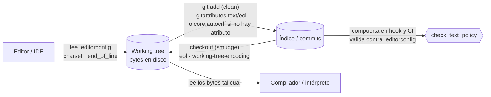

| Archivo o ajuste | Quién lo lee | Cuándo actúa | Viaja con el repo |
|---|---|---|---|
| `.editorconfig` | Editores (Visual Studio de fábrica [B44][B45]; VS Code con la extensión [B50]), `dotnet format` [B51], la compuerta | Al guardar | Sí |
| `.gitattributes` | git | En `add`/commit y en checkout | Sí |
| `core.autocrlf`, `core.eol` | git, desde la configuración **de cada máquina** | Igual, pero sólo donde el atributo no dice nada | **No** |
| Compilador o intérprete | — | Al construir | Lee el working tree tal cual |

**Precedencia.** El atributo gana: si `eol` está especificado para una ruta, el working tree usa ese valor y `core.autocrlf`/`core.eol` sólo deciden cuando no lo está [B36]. GitHub lo resume desde el punto de vista del equipo: un `.gitattributes` commiteado «sobrescribe `core.autocrlf` para todos los contribuyentes» [B41]. E2-1 lo verifica: con `* text=auto eol=lf`, el checkout da LF bajo `core.autocrlf=true`, `input` y `false`, y `*.cmd text eol=crlf` da CRLF en los tres casos.

**`.editorconfig` y git no se hablan.** git no lee `.editorconfig`: en E2-1 un `.editorconfig` que pide CRLF y BOM no cambia nada de lo que git guarda o materializa. Por eso la política se declara **dos veces**, una para cada lector, y las dos declaraciones tienen que coincidir.

#### 5.2.2 Decidir el fin de línea

Hay dos políticas defendibles para el disco:

- **`* text=auto`** sin `eol` (la de `dotnet/runtime` y la base que propone GitHub [B41]): el índice queda en LF y el disco lo decide cada máquina; con `core.autocrlf=true` aparece CRLF en Windows.
- **`* text=auto eol=lf`**: índice y disco en LF en todas las máquinas.

**[criterio]** Las dos dejan el índice en LF y ninguna produce commits de EOL (E2-1); cambia el disco de Windows. La segunda conviene si hay literales multilínea de C# o datos leídos sin traducción cuyo contenido importa en las pruebas: con CRLF en la estación y LF en la CI, **la misma prueba da distinto** (§4.2.5). Si no, la primera vale igual, y es la de los repositorios del fabricante relevados. En las dos, las excepciones las exige el consumidor: `*.cmd` y `*.bat` con CRLF para `cmd.exe`, `*.sh` con LF. Visual Studio declara soportar `end_of_line` [B45], así que LF en Windows no debería requerir configuración local **[no verificado]**. A.2 usa la segunda.

#### 5.2.3 Decidir la codificación y el BOM, por extensión

UTF-8 para todo el texto no tiene alternativa seria: JSON intercambiado entre sistemas debe ser UTF-8 [B26], Python asume UTF-8 [B33][B34] y el compilador de C# prueba UTF-8 primero [B17]. La decisión real es **dónde va BOM**. En una parte de los archivos la toma un lector, que falla con la opción equivocada (E2-5, E8-1). En la familia .NET ningún lector decide —Roslyn y Razor leen UTF-8 con y sin BOM (§4.2.4)— y lo que se elige es una **convención del equipo**, que tiene que quedar declarada igual:

| Tipo de archivo | Política | Lo decide | Por qué | Evidencia |
|---|---|---|---|---|
| `*.sh`, scripts con shebang | UTF-8 **sin** BOM, **LF obligatorio** | un lector: el kernel y el shell | Con BOM, `execve` falla o el script corre con otro intérprete; con CRLF no arranca | E2-5, E1-11, [B12] |
| `*.json` (incl. `package.json`, `appsettings.json`) | UTF-8 sin BOM | un lector: `JSON.parse`, `json.load`, `JsonDocument.Parse(bytes)` | Fallan con BOM; `require()` y `File.ReadAllText` lo toleran | E2-5 |
| `*.py`, `pyproject.toml` | UTF-8 sin BOM | un lector: `tomllib` | El intérprete lo tolera, pero `tomllib` falla con BOM; PEP 8 pide UTF-8 sin declaración | E2-5, [B34] |
| `*.ps1` | UTF-8 **con** BOM si el equipo usa Windows PowerShell 5.1 y hay texto no ASCII | un lector: Windows PowerShell 5.1 | Lee un script sin BOM como ANSI; PowerShell 7 usa UTF-8 sin BOM | [B54] |
| `*.cmd`, `*.bat` | UTF-8 sin BOM, **CRLF** | un lector para el CRLF (`cmd.exe`); convención para el BOM | Convención de repositorios de referencia; «sin BOM» es **[criterio]** | E2-6 |
| `*.js`, `*.ts`, `*.css`, `*.md`, `*.yml` | UTF-8 sin BOM, LF | convención (Node, Prettier [B53]) | Una plantilla web del SDK trae un `.js` con BOM: se normaliza | E2-6 |
| `*.cs` | UTF-8; **con o sin** BOM, una sola de las dos, **declarada** | convención del equipo | El compilador no necesita BOM, pero con BOM el archivo queda a salvo de `CodePage` y de la página ANSI de cada máquina (§4.2.3); `dotnet format` hace cumplir cualquiera de las dos; `dotnet new console` y las plantillas de ítem (`class`, `interface`) crean **con** BOM (SDK 8 y 10) y las plantillas web, `.cs` sin BOM; los repositorios del fabricante difieren (`dotnet/roslyn` y `dotnet/eShop` con BOM, `dotnet/aspnetcore` sin) | E2-6, E2-8 |
| `*.razor`, `*.cshtml` | UTF-8 **con** BOM | convención: las plantillas y el fabricante | Las plantillas del SDK 8 y 10 los crean así (10 de 10 y 12 de 12 `.razor`, y `razorcomponent`), ningún comando lo repone, y es la convención de `dotnet/aspnetcore` y `dotnet/aspire` [B222] | E2-6 |
| `*.sln` | UTF-8 **con** BOM | convención: la CLI | `dotnet sln add` repone el BOM aunque se lo quiten | E2-6 |
| `*.slnx` | UTF-8 **sin** BOM | un lector: la CLI | `dotnet sln add` le quita el BOM (SDK 10.0.400); desde .NET 10, `dotnet new sln` crea `.slnx` [B55] | E2-6 |
| `*.csproj`, `*.props`, `*.targets` | UTF-8; **con o sin** BOM, la misma convención que `*.cs` | convención del equipo | `dotnet new console` crea el `.csproj` **con** BOM y las plantillas web, sin; la CLI conserva el que tienen al editarlos; los repositorios del fabricante difieren (`dotnet/sdk` con BOM, `dotnet/msbuild` y `dotnet/runtime` sin) | E2-6, E2-8 |
| Lock files | UTF-8 sin BOM, LF, **sin exigir salto final** | la herramienta que los escribe | NuGet escribe `packages.lock.json` sin salto final; un hook que lo agrega pelea con la herramienta | E7-2, E8-1, EA-1 |

**[criterio] Para la familia .NET (`*.cs` y los archivos de proyecto).** Como ningún lector decide, se elige según el estado del repositorio y se declara; lo inaceptable es no declarar, porque entonces cada editor decide y vuelven los commits de BOM.

- **Repositorio nuevo**: UTF-8 **sin** BOM (variante A de la plantilla). EditorConfig desaconseja `utf-8-bom` [B43] y `dotnet format` corrige lo que traigan las plantillas. El costo es **recurrente**: todo archivo que crea una plantilla del SDK, de proyecto o de ítem, llega con BOM y se normaliza antes de su commit; la compuerta lo señala (E2-6, EA-1). Las de Visual Studio, **[no verificado]**.
- **Heredado todavía en cp1252**, el que va a correr la migración de §5.2.6: elegir A o B **antes** del commit de política, porque la migración produce de una vez lo que diga `.editorconfig`. Sin otra razón, A; con BOM (B) si durante la transición alguna parte se va a compilar con `CodePage`.
- **Heredado ya convertido a UTF-8 con BOM**, como el del caso: `utf-8-bom` para `*.cs` y los archivos de proyecto (variante B). Cumple lo mismo, protege cada archivo aunque alguien fije `CodePage` y evita un segundo commit masivo sólo para quitar firmas.

`*.razor`, `*.cshtml` y `*.sln` van con BOM en las dos variantes: los dos primeros, por la convención de las plantillas y del fabricante [B222]; `.sln`, porque `dotnet sln add` lo repone (E2-6).

#### 5.2.4 Declarar: tres detalles que la sintaxis no avisa

- **`text=auto` no convierte un archivo que ya estaba en git con CRLF** [B36]. En E2-3, un heredado commiteado con CRLF antes de la política sigue `i/crlf` aunque alguien lo edite. Declarar sin renormalizar deja la política a medias.
- **git no expande llaves.** `*.{cmd,bat} text eol=crlf` no coincide con ningún archivo: los `.cmd` y `.bat` quedan en LF sin aviso (E5-7). La receta de la documentación de VS Code tiene esa forma y falla igual [B128]. En `.gitattributes`, un patrón por extensión; en `.editorconfig` las llaves sí funcionan [B43] (EA-1 comprueba ambas cosas).
- **En `.editorconfig` los comentarios van en línea propia**: un `#` después de un valor pasa a formar parte del valor [B43].

#### 5.2.5 Verificar: la compuerta de texto

Declarar no alcanza: Visual Studio no reformatea lo existente hasta que se lo pide, VS Code sin la extensión ni siquiera lee `.editorconfig`, y las plantillas del SDK producen BOM y CRLF aunque el repositorio diga otra cosa (E2-6). La compuerta del laboratorio (`Examples/N2-politica-de-texto-y-remediacion/tools/check_text_policy.py`) verifica, **sobre el índice**, que es lo que se commitea:

1. que cada archivo de texto sea UTF-8 válido (`src/B.cs: no es UTF-8 válido (byte 0xf3 en offset 75; ¿cp1252?)`);
2. que el BOM coincida con el `charset` que `.editorconfig` resuelve para esa ruta —**lee** la política con la implementación de referencia de EditorConfig, no la repite—;
3. que git no vea CRLF en el índice.

Corre en tres alcances: todo, `--staged` para el hook y `--base <rama>` para un PR. En E2-3, un PR con un `.cs` en cp1252, dos BOM indebidos y un heredado editado con CRLF da cuatro violaciones y código 1; el hook rechaza el commit y `git commit --no-verify` lo saltea. Por eso la misma compuerta corre en la CI: el hook es comodidad, la CI es el árbitro ([§10](#10-compuertas-y-gobierno-del-entorno)).

| Herramienta existente | Qué cubre | Límite |
|---|---|---|
| editorconfig-checker 4.0.2 [B201] | Lee el mismo `.editorconfig` para todas las extensiones: no UTF-8, BOM distinto del `charset` resuelto y fin de línea incorrecto; binarios para Windows, paquetes de npm y PyPI e imagen de contenedor (E2-7) | Revisa el **working tree**, no el índice; su detector puede informar `windows-1252` como `iso-8859-1` [B201]; no da el diagnóstico «¿cp1252?»; como hook del framework pre-commit no se probó |
| `dotnet format whitespace --verify-no-changes` | `charset` y EOL de los `.cs` según `.editorconfig`; falla con `CHARSET` en los dos sentidos (E2-6) | Su documentación no menciona `charset` [B51]; no se probó sobre `.razor`, `.json`, `.sh` |
| `pre-commit-hooks` (`fix-byte-order-marker`, `mixed-line-ending`) | Quita BOM; detecta finales mezclados [B52] | Quita **todos** los BOM: pelea con una política que los exige en `.razor`/`.sln` (E7-2) |
| `git ls-files --eol` | EOL en índice y disco, atributo efectivo | No mira codificación ni BOM |

**[criterio]** La guía mantiene su verificador porque mira el **índice** —lo que se commitea— y da el diagnóstico «¿cp1252?». Necesita `python3` y el paquete `EditorConfig==0.17.1` donde corre, y la compuerta dice cuál falta (A.11). Sin Python, el paso de texto de la **misma** compuerta puede ser editorconfig-checker, fijado por versión, más `dotnet format whitespace --verify-no-changes` para los `.cs`, con los límites de la tabla; la regla de una sola compuerta en hook y CI no cambia (§10.2.2).

#### 5.2.6 Migrar un código heredado

El procedimiento separa tres commits porque cada uno se revisa de una forma distinta. E2-2 lo corre completo sobre un heredado sintético en cp1252 con CRLF que en Linux falla con `CS1056`.

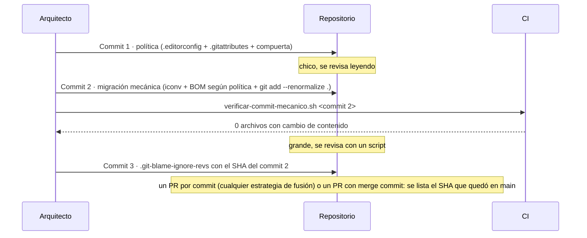

1. **Congelar el resto del trabajo.** El commit mecánico toca todo; las ramas abiertas van a tener conflicto en cada línea. Conviene hacerlo con las ramas fusionadas; para las que no se puedan cerrar, correr el mismo script de migración en la rama antes de traer `main` **[criterio]**. GitHub recomienda commitear lo pendiente antes de renormalizar [B41].
2. **Commit de política.** Trae la compuerta; su workflow (A.12) y el hook se activan después de migrar (§12, paso 4). Apenas se commitea, `git status` puede mostrar como modificado un archivo que nadie tocó: su CRLF del índice ya no coincide con la política. No es un cambio real y `git status` no lista todos los afectados (E2-2): para saber qué falta, `git ls-files --eol` o la compuerta.
3. **Commit mecánico.** Convertir sólo lo que no es UTF-8 válido, ajustar el BOM según la política y renormalizar:

   ```bash
   # Invocación (desde la raíz, con la política ya commiteada): tools/migrar-a-utf8.sh CP1252 [pathspec...]
   # Requiere bash, iconv, git y el CLI editorconfig (E2-2). Por cada archivo que git considera texto:
   iconv -f UTF-8 -t UTF-8 "$f" >/dev/null 2>&1 \
     || iconv -f CP1252 -t UTF-8 "$f" > "$tmp"                    # sólo lo que NO es UTF-8
   charset=$(editorconfig "$PWD/$f" | sed -n 's/^charset=//p')   # BOM según la política
   # ...agrega o quita EF BB BF según charset...
   git add --renormalize .                                        # CRLF -> LF en el índice
   ```

   Límite explícito: un cp1252 cuyos bytes casualmente formen UTF-8 válido no se detecta. En código en español es improbable, pero el diff se mira igual.
4. **Verificar que es mecánico.** `tools/verificar-commit-mecanico.sh <sha> CP1252` decodifica cada archivo antes y después, quita BOM y CR y compara: `verificados 7 archivo(s); 0 con cambio de contenido`. Una migración que además cambia `=> 42` por `=> 43` se rechaza (`CONTENIDO src/Sensor.cs`, código 1). Así el revisor aprueba un diff de cien archivos sin leerlo línea por línea **[criterio]**.
5. **Refrescar los working trees.** Los archivos en disco pueden seguir con CRLF hasta el próximo checkout. Cada desarrollador lo hace una vez, **con el árbol limpio y después de traer la migración**: `git reset --hard` sobrescribe los archivos con la versión del commit [B204], y un cambio sin commitear se pierde sin aviso.

   ```bash
   if git diff --quiet && git diff --cached --quiet; then   # sin exit: se pega en la terminal
     git pull --ff-only &&                          # trae los commits de política y migración
     git rm -rq --cached . && git reset -q --hard   # rematerializa el disco con la política
   else
     echo "commiteá o guardá con git stash antes de seguir" >&2
   fi
   ```

   Si `git ls-files --eol` ya muestra en disco lo que pide la política (`w/lf`, y `w/crlf` en `.cmd` y `.bat`), el paso no hace falta.
6. **Aislar de `blame`** en un commit **posterior**, porque el SHA no existe hasta que se crea: sin el archivo, `git blame` atribuye todas las líneas al migrador; con él, vuelven a sus autores (E2-2). `git config blame.ignoreRevsFile .git-blame-ignore-revs` lo activa en local [B39]; GitHub lo aplica solo si el archivo está en la raíz [B42]. El SHA listado es el que quedó en `main`, que un `--amend` o un rebase cambian. La fusión por *squash* funciona con un PR por commit —política, migración, `.git-blame-ignore-revs`— y el SHA del *squash* ya fusionado: con git 2.47.3, `blame` vuelve a los autores (E2-2). Juntar los tres en un PR los aplasta en uno, y la verificación mecánica deja de aplicarse a un commit sólo mecánico **[criterio]**.

```yaml
# §5.2.6 como contrato, para agentes y revisores.
entradas:
  repositorio: clon con las ramas abiertas fusionadas o identificadas
  politica: .editorconfig y .gitattributes decididos (§5.2.3, A.1, A.2)
  codificacion_origen: CP1252
salidas:
  - "commit 1: política (.editorconfig, .gitattributes, compuerta)"
  - "commit 2: migración mecánica (tools/migrar-a-utf8.sh CP1252)"
  - "commit 3: .git-blame-ignore-revs con el SHA del commit 2 tal como quedó en main"
validaciones:
  - comando: tools/verificar-commit-mecanico.sh <sha-commit-2> CP1252
    esperado: "0 con cambio de contenido"
  - comando: python3 tools/check_text_policy.py
    esperado: "0 violación(es)"
  - comando: git diff --quiet && git diff --cached --quiet   # en cada estación, antes del paso 5
    esperado: código de salida 0
```

> **Desde Windows.** La migración la ejecuta una sola persona (ACT-ARQ); el resto sólo hace el paso 5, que es git puro. Los tres scripts necesitan `bash`, `iconv`, `git` y el CLI `editorconfig` (`pip install EditorConfig==0.17.1`), o la imagen de `Examples/N2-politica-de-texto-y-remediacion/tools/Dockerfile`, que los trae. Desde Windows, las vías de §0.4 **[no verificado]**. Un `.sh` agregado desde Windows entra sin bit de ejecución: `git update-index --chmod=+x` antes del commit (§8.2.5).

#### 5.2.7 `working-tree-encoding` o convertir

`working-tree-encoding` resuelve otro problema: git lo documenta para archivos que **no pueden** guardarse en UTF-8, advierte que JGit y libgit2 no lo soportan, que la conversión puede no ser reversible y que cuesta en cada checkout, y lo recomienda «sólo si no se puede guardar el archivo en UTF-8» [B36]. Para el caso no sirve: un `.cs` en cp1252 con `working-tree-encoding=CP1252` queda UTF-8 en el índice y vuelve a cp1252 en el disco, que es lo que lee el compilador, y Linux falla con el mismo `CS1056` (E2-4). Un fuente que se lee en UTF-8 se **convierte una vez**.

### 5.3 Qué propone la industria

| Ecosistema | Práctica | Naturaleza |
|---|---|---|
| .NET | El fabricante no fija codificación para los fuentes; Visual Studio soporta `charset` y `end_of_line` [B45] y, desde 2025, permite elegir con qué codificación guarda (ajuste por máquina) [B47]. `dotnet new editorconfig` del SDK 8 genera `end_of_line = crlf` para `*.cs`, una trampa para un equipo con Linux; la del SDK 10 ya no (E2-6). Herramienta de verificación: `dotnet format whitespace --verify-no-changes`. | fabricante |
| Node.js | UTF-8 sin BOM y LF; `nodejs/node` lo declara así para todo, salvo un `.bat` con CRLF; Prettier normaliza a LF [B53]. | convención |
| Python | UTF-8 sin declaración es la norma de la biblioteca estándar [B34] y el default del lenguaje [B33]; `pyproject.toml` con BOM rompe `tomllib`. | fabricante |
| git | `.gitattributes` con `text`/`eol`; `git add --renormalize .` para introducir la política [B36]; Pro Git aconseja `core.autocrlf=true` en Windows e `input` en Linux [B40] —consejo **por máquina**, que en un repo compartido cede ante el atributo [B41]. | fabricante |
| Transversal | Un `.editorconfig` raíz con secciones por extensión y un `.gitattributes` raíz alcanzan para los tres ecosistemas; una compuerta que **lee** el `.editorconfig` cubre a los tres con un solo chequeo. | **[criterio]** |

### 5.4 Aplicación por escenario y contexto

| Escenario | Qué cambia |
|---|---|
| ESC-01 Windows + Visual Studio | El problema no se ve; Visual Studio respeta el `.editorconfig` (sobre archivos existentes, **[no verificado]**); el hook es la primera red; `core.autocrlf=true` deja de importar donde hay `eol`. |
| ESC-02 Linux | VS Code necesita la extensión EditorConfig; sin ella, la compuerta es la única defensa. |
| ESC-03 WSL 2 | Dos configuraciones de git sobre el mismo repo; con `eol` en los atributos, ninguna decide. |
| ESC-04 Devcontainer | El bind mount muestra los bytes que escribió el host; con `eol=lf` en el atributo, el clon de Windows ya tiene LF (E5-3). |
| ESC-05 CI | El árbitro: la compuerta en modo `--base` y `dotnet format whitespace --verify-no-changes`. |

Por contexto: en CTX-NET (sólo .NET), el BOM de `.cs` y `.csproj` es convención y se elige por estado del repositorio (§5.2.3); en CTX-NODE y CTX-PY no hay excepciones de BOM: todo sin BOM y LF; en CTX-POLI (los tres), la tabla completa de §5.2.3, con las excepciones al final del `.editorconfig` (§11.2.2).

| Actor | Le toca |
|---|---|
| ACT-ARQ | Decidir la tabla de §5.2.3, escribir los dos archivos, programar y firmar la migración. |
| ACT-DEV | Activar el hook (`git config core.hooksPath .githooks`), usar un editor que lea `.editorconfig`, refrescar el working tree una vez después de la migración. |
| ACT-OPS | Correr la compuerta en la CI con la misma versión de la herramienta que el hook. |
| ACT-REV | Rechazar cualquier diff que cambie BOM o EOL fuera de un commit mecánico verificado; mirar con lupa los cambios a `.gitattributes`/`.editorconfig`. |

### 5.5 Ejemplos concretos

El núcleo de la plantilla (completa en [A.1](#a1-editorconfig) y [A.2](#a2-gitattributes)):

```ini
# .editorconfig — lo leen los editores al guardar y la compuerta al verificar; git NO.
root = true

[*]
charset = utf-8
end_of_line = lf
insert_final_newline = true

[*.{cmd,bat}]
end_of_line = crlf

[*.{razor,cshtml,sln}]
charset = utf-8-bom

# Heredado ya convertido con BOM, como el del caso: variante B de A.1,
# [*.{cs,csproj,props,targets}] con charset = utf-8-bom.
```

```gitattributes
# .gitattributes — lo lee git; gana sobre core.autocrlf de cada máquina. Sin llaves.
* text=auto eol=lf
*.cmd text eol=crlf
*.bat text eol=crlf
*.sh  text eol=lf
*.png binary
```

EA-1 muestra qué resuelve cada archivo para rutas de ejemplo (extracto de `Examples/A-plantillas/salidas/EA-1-plantillas.txt`):

```text
src/App/Program.cs           editorconfig: charset=utf-8 end_of_line=lf ...      gitattributes: text: auto eol: lf
Pages/X.razor                editorconfig: charset=utf-8-bom end_of_line=lf ...  gitattributes: text: auto eol: lf
build.cmd                    editorconfig: charset=utf-8 end_of_line=crlf ...    gitattributes: text: set eol: crlf
src/App/packages.lock.json   editorconfig: ... insert_final_newline=unset         gitattributes: text: set eol: lf
-- compuerta de texto de N2 sobre las propias plantillas:
POLITICA-TEXTO: 25 archivo(s) revisado(s), 0 violación(es)
```

Experimentos del capítulo: E2-1 a E2-8, E5-7 y EA-1 (Anexo E).

### 5.6 Preguntas guía

**¿UTF-8 con o sin BOM para C# y Razor?**
Para Razor, con BOM: es lo que producen las plantillas y lo que declaran `dotnet/aspnetcore` y `dotnet/aspire` [B222]. Para C# y los `.csproj`, ningún lector decide: es convención del equipo, una sola y declarada. *Aplica*: repositorio nuevo → sin BOM, normalizando lo que crea `dotnet new`; heredado todavía en cp1252 → la variante que se declare antes de migrar; heredado ya convertido con BOM, como el del caso → `utf-8-bom` para `*.cs` y los archivos de proyecto, y no tocar más.

**¿Y para JS/TS, Python, JSON, shell, `.sln` y `.csproj`?**
Sin BOM en todo lo que no sea .NET: el BOM rompe shebangs, `JSON.parse`, `json.load` y `tomllib`. `.sln` con BOM porque la CLI lo repone y `.slnx` sin BOM porque la CLI lo quita; `.csproj`, `.props` y `.targets`, con la misma convención que `.cs`. *Aplica*: cuando un repo mezcla ecosistemas, la regla es por extensión, nunca global.

**¿Qué manda cuando `.editorconfig`, `.gitattributes` y `core.autocrlf` difieren?**
No compiten: actúan en momentos distintos. El editor obedece al `.editorconfig` al guardar; git al `.gitattributes` al commitear y materializar, y usa `core.autocrlf` sólo donde el atributo calla. Si `.editorconfig` dice CRLF y `.gitattributes` dice `eol=lf`, el editor escribe CRLF, git guarda LF y el próximo checkout trae LF: el archivo «cambia solo». *Aplica* cada vez que aparece un diff de EOL que nadie hizo: buscar dónde se contradicen los dos archivos.

**¿Por qué no alcanza con pedirles a todos `core.autocrlf=true`?**
Porque es configuración de cada máquina y no viaja: basta un desarrollador o una imagen de CI con otro valor para que el mismo archivo entre distinto (E2-1). Además deja CRLF en Windows y LF en Linux, y eso cambia el binario. *Aplica*: es un ajuste personal razonable en repositorios **sin** `.gitattributes`; en uno con política, sobra.

**¿Cómo convierto cien archivos heredados sin mezclar cambios funcionales ni ensuciar `blame`?**
Tres commits —política, migración mecánica verificada por script, `.git-blame-ignore-revs`— y el `.git-blame-ignore-revs` con el SHA que quedó en `main` (§5.2.6). *Aplica* siempre que la conversión toque más archivos de los que un revisor puede leer.

**¿Cómo detecto en un PR que alguien reintrodujo cp1252, BOM o CRLF?**
Con una compuerta que mire el índice y lea la política del `.editorconfig`, la misma como hook y en la CI, porque el hook se saltea con `--no-verify` (E2-3). *Aplica* a todo PR en la CI (ESC-05) y a cada commit si el hook está activo.

**¿Cuándo `working-tree-encoding` y cuándo convertir?**
`working-tree-encoding` sólo cuando el consumidor exige una codificación que no es UTF-8 y se quiere que git vea texto; nunca para fuentes que el compilador lee en UTF-8, porque el disco sigue en la codificación vieja (E2-4). *Aplica* a archivos que consume un programa que sólo lee otra codificación; *no aplica* al caso.

**Tu equipo va a migrar el heredado del caso, todavía en cp1252, y la mitad trabaja con Visual Studio. ¿Declarás `*.cs` con o sin BOM antes de correr la migración?**
Cualquiera de las dos, pero decidida antes del commit de política, porque la migración produce de una vez lo que diga `.editorconfig`. Ningún lector de .NET falla por una u otra (§4.2.4). Sin BOM sigue la recomendación de EditorConfig y obliga a normalizar lo que crea `dotnet new console`; con BOM protege cada archivo si durante la transición alguien compila con `CodePage` (§4.2.3). *Aplica* a todo heredado de CTX-NET o CTX-POLI antes del paso 2 de §12.

### 5.7 Criterios de calidad

Una política buena:

- está declarada en **los dos** archivos (`.editorconfig` y `.gitattributes`) y las dos declaraciones coinciden;
- decide el BOM **por extensión**, con el motivo de cada excepción comentado;
- usa `eol` explícito en `.gitattributes`, un patrón por extensión, sin llaves;
- tiene una compuerta que la **lee** y corre igual en hook y CI;
- si hubo migración, quedó en un commit mecánico verificado por script, con su `.git-blame-ignore-revs`.

Señales de una versión pobre:

- la política vive en una wiki o en `core.autocrlf` (§5.2.1);
- `* text=auto` sin renormalizar, o `*.{cmd,bat}` en `.gitattributes` (§5.2.4);
- un hook genérico que quita todos los BOM (§5.2.5);
- la conversión mezclada con cambios funcionales, un `.git-blame-ignore-revs` con un SHA que no está en `main`, o política, migración e ignore-revs en un solo *squash* (§5.2.6);
- comentarios al final de una línea del `.editorconfig` (§5.2.4);
- el `.editorconfig` de `dotnet new` (SDK 8) commiteado sin revisar su `end_of_line = crlf` (§5.3).

### 5.8 Plantilla

[A.1 `.editorconfig`](#a1-editorconfig), [A.2 `.gitattributes`](#a2-gitattributes), [A.15 `.git-blame-ignore-revs`](#a15-git-blame-ignore-revs). Los scripts de migración y verificación mecánica están en `Examples/N2-politica-de-texto-y-remediacion/tools/` (`migrar-a-utf8.sh`, `verificar-commit-mecanico.sh`, `check_text_policy.py` y el `Dockerfile` de la imagen que los corre).

### 5.9 Práctica

1. Antes de mirar la salida de E2-2, decí cuántos archivos debería reportar `verificar-commit-mecanico.sh` con cambio de contenido y qué pasa si la migración además cambia `=> 42` por `=> 43`. *Respuesta esperada*: cero; con el cambio funcional, `CONTENIDO src/Sensor.cs` y código 1 (§5.2.6, paso 4).
2. Con la tabla de §5.2.3, escribí la política de un repo con `.sh`, `appsettings.json`, `.razor`, `.cs` y `.csproj` heredados ya convertidos con BOM. Compará con A.1, variante B. *Respuesta esperada*: `[*]` sin BOM y LF; `.razor`, `.cs`, `.csproj`, `.props` y `.targets` con `utf-8-bom`; `.sh` sin BOM y LF también en `.gitattributes`.

---

## 6. Fijar el toolchain

El caso pide congelar «versiones de compiladores, sdk» en la misma frase que los paquetes NuGet. Este capítulo trata la primera mitad: la herramienta que transforma el fuente (SDK, compilador, runtime, intérprete) y la que trae las dependencias (gestor de paquetes). Se fija con otros archivos que el grafo de dependencias, falla de otro modo y, además, **condiciona** al grafo: en .NET, cambiar de SDK cambia el lock aunque el código no cambie (E3-6). Por eso va antes que [§7](#7-congelar-las-dependencias).

### 6.1 Definición

| Término | Definición | Fuente |
|---|---|---|
| **Toolchain** | Herramientas que transforman el fuente y resuelven dependencias: SDK, compilador, runtime o intérprete, gestor de paquetes. Capa 2. | **[criterio]** |
| **SDK de .NET** | Trae la CLI `dotnet`, MSBuild, el compilador de C# y un runtime. Versión `x.y.znn`: `x.y` es .NET, `z` la **banda de características** (trimestral), `nn` el parche mensual. | [B59] |
| **Runtime** | Lo que ejecuta el programa. En .NET se elige **al ejecutar**, no lo fija el SDK. | [B58], E3-2 |
| **TFM** | *Target framework moniker* (`net8.0`): API contra la que se compila; fija la versión de C# por defecto y el runtime mínimo. | [B57][B58] |
| **Gestor de versiones** | Instala varias versiones de un runtime y elige por directorio: nvm, fnm, pyenv, uv, mise, asdf. Es un medio para **obtener** el toolchain, no el toolchain. | **[criterio]** |
| **Fijación exacta / rango / piso** | Exacta: una sola versión (`rollForward: disable`). Rango: un conjunto acotado (`latestPatch` en la banda 4xx; `>=24 <25`). Piso: sólo un mínimo (`latestMajor`; `>=3.13`); un piso no fija nada. | **[criterio]** |

### 6.2 Cómo funciona

#### 6.2.1 Tres preguntas que «la versión» mezcla

«Estamos en .NET 8» responde tres preguntas, cada una fijada en otro archivo. **Con qué herramienta se compila**: el SDK, que elige `global.json`; sin él, `dotnet` usa el más alto instalado aunque el proyecto apunte a una versión anterior [B58]. **Contra qué API y con qué lenguaje**: el TFM del `.csproj`. **Con qué runtime corre**: lo decide la máquina que ejecuta. E3-2 las separa con un proyecto `net8.0`: con SDK 8.0.425 compila C# 4.11.0 y con 10.0.400 el 5.9.0, ambos en C# 12.0 por el TFM, y el binario del SDK 10 pide runtime 8.0 y **no arranca** donde sólo hay runtime 10. En Node y Python el intérprete es herramienta y runtime; lo que se separa es el **runtime** del **gestor de paquetes**.

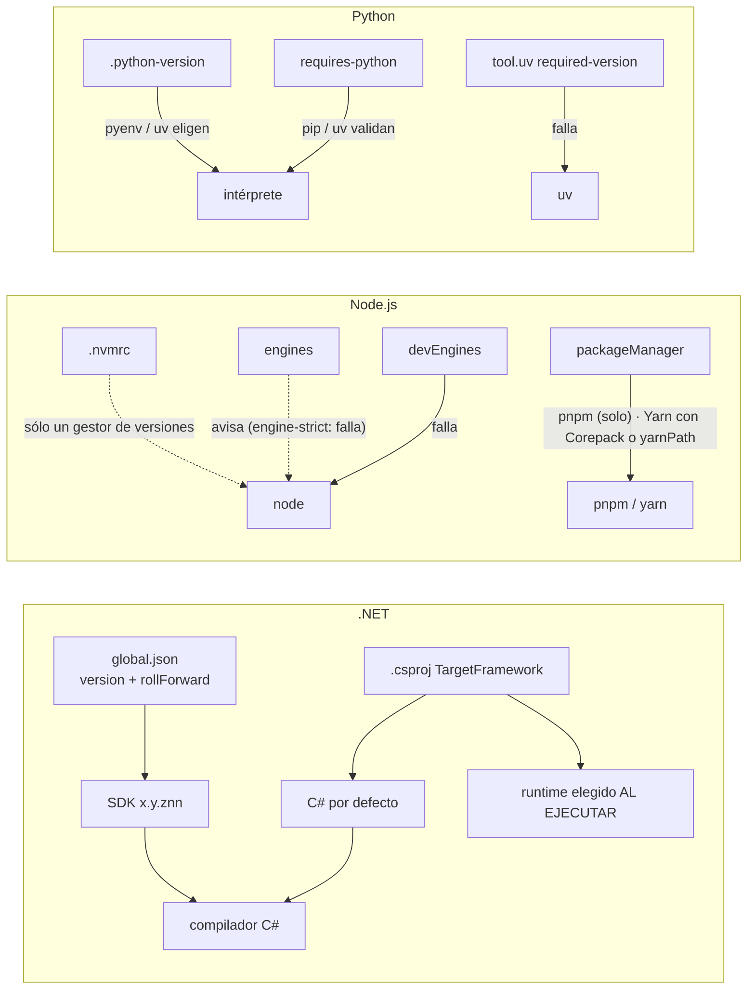

Flechas punteadas: declaraciones que nadie hace cumplir por defecto. Flechas llenas: mecanismos que fallan.

#### 6.2.2 .NET: qué fija `global.json` y qué no

`global.json` selecciona el SDK; Microsoft lo dice en la primera línea de su página: elegir el SDK es independiente de elegir el runtime [B56]. Lo leen el *muxer* `dotnet` (desde el directorio actual hacia arriba) y el resolvedor de SDK de MSBuild (desde la solución o el proyecto) [B56]. Sus propiedades: `version` (versión **completa**, sin comodines), `rollForward`, `allowPrerelease`, y desde el SDK 10 `paths` y `errorMessage` [B56].

| `rollForward` | Comportamiento [B56] | E3-1 |
|---|---|---|
| (ausente, con `version`) | `patch`: la pedida o el parche más alto de la **misma banda** | `8.0.400` acepta 8.0.425; `8.0.300` **no** |
| `disable` | coincidencia exacta | única fijación exacta |
| `latestPatch` / `latestFeature` | el más alto instalado dentro de la banda / del `x.y` | rango |
| `latestMajor` | el más alto instalado, con la pedida como piso | pidió 8.0.100 y usó 10.0.400: no fija nada |

Si nada satisface la política, `dotnet` falla **antes de compilar** con `A compatible .NET SDK was not found` (E3-1); no descarga nada. `global.json` **no** fija el runtime (lo decide el `runtimeconfig.json` generado y la política de *roll forward* del runtime, por defecto `Minor` [B58]), **ni** la versión de C# (la fija el TFM salvo `LangVersion`; Microsoft desaconseja `latest` porque «cambia de máquina en máquina» [B57], y E3-2 lo reproduce), **ni** los paquetes. Pero el SDK sí aporta paquetes implícitos cuya versión depende de él: un proyecto sin `PackageReference` y con `IsTrimmable`, con lock generado por SDK 8.0.425, falla en modo estricto con SDK 10.0.400 (`NU1004 … changed from [8.0.31, ) to [8.0.30, )`, E3-6). Por eso Microsoft recomienda `rollForward: disable` cuando se usan lock files [B56][B83], y hay un issue abierto con el mismo `NU1004` entre dos parches del SDK 8 [B90]. Esa recomendación tiene un costo —el SDK exacto en **toda** máquina—, que §6.4 pone al lado de la alternativa.

**¿Fijar el SDK fija el compilador?** En la CLI, sí: `dotnet build` compila con el Roslyn del SDK (E3-2). En Visual Studio la build corre con el MSBuild del IDE y depende del SDK: los *targets* del 8.0.425 no traen selección automática —sólo `BuildWithNetFrameworkHostedCompiler`, y `Microsoft.Net.Sdk.Compilers.Toolset` no tiene versiones 8.x [B60]—, así que compila el Roslyn del IDE; los del 10.0.400 usan el del SDK si hay `DOTNET_HOST_PATH`, descargan el *toolset* si el MSBuild es anterior a 18.9 y, si no, caen en el del IDE (E3-2, inspección de los *targets* de las imágenes oficiales). Qué corre en un Visual Studio real **[no verificado]** (requiere Visual Studio): el binario que vale es el de la CI, y el registro del entorno incluye la versión del compilador, no sólo la del SDK (§9.6).

**Visual Studio en Windows (ESC-01).** Visual Studio instala **una sola copia** del SDK y la reemplaza al actualizarse; si `global.json` pide la anterior, la build deja de encontrarla, y Microsoft recomienda el SDK independiente para conservarla [B56][B59]. Cada banda exige un Visual Studio mínimo (10.0.100 → VS 17.14; 10.0.2xx–4xx → VS 18.0) [B59]: fijar una banda nueva obliga a todo el equipo a actualizar el IDE. Que Visual Studio respete `global.json` es una inferencia documentada (la build pasa por el resolvedor de MSBuild, y `allowPrerelease` describe un comportamiento «si estás en Visual Studio» [B56]), no una frase directa. Usar el SDK del IDE y fijar uno exacto con lock files, las dos recomendaciones de Microsoft, tiran en direcciones opuestas: §6.4 presenta la elección.

#### 6.2.3 Node.js: `.nvmrc`, `engines`, `devEngines`, `packageManager`

Node no tiene un archivo propio para fijar su versión. **`.nvmrc`** es la convención de nvm, que no cambia de versión solo al entrar al directorio ni soporta Windows nativo [B69]; fnm lee `.nvmrc`, `.node-version` y, en su defecto, `engines.node` [B70]. Ni `node` ni `npm` lo leen: con `.nvmrc` = 24 en Node 22, `npm install` termina sin aviso (E3-3). **`engines`** es «sólo un aviso» salvo `engine-strict` [B63][B64]: `EBADENGINE` con código 0, o 1 con `engine-strict=true` (E3-3). **`devEngines`** alinea las herramientas de quienes **desarrollan** el proyecto (runtime, gestor, SO, CPU), con `onFail` por defecto `error`, evaluado antes de `install`, `ci` y `run` [B63]: falla con `EBADDEVENGINES` sin tocar `.npmrc` (E3-3, EA-1). **`packageManager`** lo lee Corepack, que rechaza otro gestor y descarga la versión exacta [B67] (E3-3); pero Corepack figura como experimental en Node 24 [B65] y **dejó de distribuirse con Node desde la 25.0.0** [B66][B67] (E3-3: Node 22 y 24 lo traen, Node 26 no).

**[criterio]** Quién hace cumplir `packageManager` depende del gestor. npm no lo usa: alcanza `devEngines`. pnpm lo hace cumplir por sí mismo [B81]: en la 10 descarga la versión declarada y, con `packageManagerStrictVersion=true`, falla [B206]; desde la 11 esos ajustes se unifican en `pmOnFail` —por defecto `download`; con `error`, falla—, que gobierna también `devEngines.packageManager` [B196] (E3-3: pnpm 12.10.1 sin Corepack, con `pmOnFail=error`, `ERR_PNPM_BAD_PM_VERSION`). Yarn depende de Corepack o de `yarnPath`, el binario versionado en el repo que deja `yarn set version --yarn-path` [B207]. En la compuerta, pnpm con `pmOnFail=error` (en la 10, `packageManagerStrictVersion=true`); en la imagen y en la CI, el gestor instalado con versión fijada. Estado de las líneas al 2026-10-07: v26 *Current*, v24 y v22 LTS, v20 fuera de soporte; desde Node 27 el ciclo pasa a ser anual con todas las mayores a LTS [B68].

#### 6.2.4 Python: `requires-python`, `.python-version`, `required-version`

**`requires-python`** pertenece al **paquete**: se publica como metadato y lo validan los instaladores [B71][B72]; pip falla si el intérprete no coincide, salvo `--ignore-requires-python` [B73][B74] (E3-4), y en uv acota la resolución del lock, calculada para todo el rango [B77]. **`.python-version`** es una preferencia **del entorno**, convención de pyenv que también lee uv [B78][B75]: uv lo busca en el directorio y sus padres **sin pasar el límite del proyecto**, y por defecto **descarga** el intérprete que falte (`python-downloads = "automatic"`) [B75][B76]. En E3-4, `3.13` descargó 3.13.16 («la 3.13 más reciente», no una fijación exacta); `3.11` contra `requires-python >=3.13` falla, y también falla sin 3.13 instalado y con descargas prohibidas. **`[tool.uv] required-version`** hace fallar uv si su versión no coincide [B76] (E3-4): el equivalente de `devEngines.packageManager`.

#### 6.2.5 Gestores de versión

| Gestor | Lee | Windows nativo | ¿Hace cumplir? |
|---|---|---|---|
| nvm | `.nvmrc` [B69] | No (WSL, Git Bash) | No: hay que correr `nvm use` |
| fnm | `.node-version`, `.nvmrc`, `engines.node` [B70] | Sí, documentado [B70] | Con `--use-on-cd` cambia al entrar |
| pyenv | `.python-version` [B78] | No (pyenv-win es otro proyecto) | No: elige, no valida |
| uv | `.python-version`, `requires-python` [B75] | Sí, documentado [B82] | Sí: valida contra `requires-python` y `required-version` |
| mise | `mise.toml`; los archivos nativos **sólo si se habilitan** por herramienta [B79] | Documentado [B79] | `mise.lock` para modo estricto [B79] |
| asdf | `.tool-versions`; los de otros gestores sólo con `legacy_version_file = yes` [B80] | **[no verificado]** (no ejercitado) | **[no verificado]** (no ejercitado) |

Ninguno es necesario en .NET: `global.json` cumple esa función. **[criterio]** El gestor de versiones es una comodidad del desarrollador en ESC-02 (Linux) y ESC-03 (WSL 2), configurado para leer los archivos nativos; nunca la fuente de verdad. Un `mise.toml` con versiones propias es una segunda verdad que gana en silencio (E8-2, [§11](#11-una-sola-solución-con-net-nodejs-y-python)).

### 6.3 Qué propone la industria

| Ecosistema | Práctica | Naturaleza |
|---|---|---|
| .NET | `rollForward: disable` cuando hay lock files; en CI sin lock, un rango [B56] (el lock por defecto es **[criterio]**, §7.2.1); no usar `LangVersion=latest` [B57]; `dotnet sdk check`, Dependabot y, desde el SDK 11, `CheckSdkVulnerabilities` para que la build avise (en 8.0.425 y 10.0.400 no hace nada **[observado]**) [B58]; compilar con `dotnet build` antes que con `msbuild` [B59]. | fabricante |
| Node.js | Producción sólo en LTS [B68]; `devEngines` para el equipo, `engines` para quien consume el paquete [B63]; Corepack ya no viene con Node [B66]. | fabricante |
| Python | `requires-python` como contrato del paquete [B71]; `.python-version` y `required-version` en proyectos uv [B75][B76]; prohibir descargas implícitas en CI (`python-downloads = "never"`) [B76]. | fabricante |
| Transversal | **Archivos nativos por ecosistema + un chequeo común + la imagen construida desde esos archivos.** Los nativos son lo único que leen todas las herramientas de cada ecosistema, incluido Visual Studio; un único script (E3-5) los hace cumplir igual en la estación, el devcontainer y la CI, y emite las versiones reales para la procedencia. | **[criterio]** |

Tres choques de integración: `global.json` exige versión completa y `.nvmrc`/`.python-version` aceptan una línea (`3.12` = «la más reciente»): **[criterio]** en CI, el parche fijado donde el ecosistema lo permite. `allowPrerelease` vale `true` fuera de Visual Studio y depende del IDE adentro: `false` evita que terminal e IDE elijan SDK distintos [B56]. Y la build .NET que invoca `npm` o `python` usa los del `PATH`, que `global.json` no cubre (E8-3).

### 6.4 Aplicación por escenario y contexto

| Escenario | Qué rige | Riesgo | Recomendación |
|---|---|---|---|
| ESC-01 Windows + Visual Studio | `global.json`, TFM, `LangVersion`; npm hace cumplir `devEngines` y `engine-strict`, y uv `requires-python` (pip, sólo al instalar el paquete) | SDK reemplazado al actualizar VS; VS mínimo por banda; `.nvmrc`/`.python-version` ignorados por el IDE **[no verificado]** | SDK independiente si se fija una versión que VS no trae; correr el chequeo antes del push |
| ESC-02 Linux | Lo mismo, más los gestores | Versiones instaladas a mano; `latestMajor` toma lo último | Gestor como comodidad, chequeo como verificación |
| ESC-03 WSL 2 | Toolchain de Linux | Dos instalaciones del SDK (Windows y WSL) | Tratar cada lado como una estación; el `global.json` es el mismo |
| ESC-04 Devcontainer | La imagen trae el toolchain | Imagen por etiqueta que cambia de parche y hasta de banda (E3-7) | Etiqueta fija de SDK y SO verificada por `global.json`, o la receta de la imagen de CI (§8.2.2) |
| ESC-05 CI | La imagen o las acciones de *setup* | Instalar «la última» sin mirar el repo | Leer las versiones de los archivos del repo; política exacta; sin descargas implícitas; chequeo como compuerta |

**[criterio] La elección de `rollForward`** va atada a si el repo usa lock files de NuGet, que es el camino por defecto de esta guía (§7.2.1). Las dos políticas, completas:

| Política | Qué exige | Qué cuesta | Qué detecta |
|---|---|---|---|
| **Con lock** (por defecto): `disable` + `packages.lock.json` en los ejecutables + `RestoreLockedMode` en CI + `NU1603` como error + la compuerta que compara `requested` con `resolved` | El SDK **exacto** en toda máquina: cada estación (en Windows, el instalador independiente si Visual Studio trae otro [B56]), la imagen del devcontainer y la de CI | Una estación con otro parche **no compila** (`A compatible .NET SDK was not found`, E3-1) hasta instalar el exacto; cada actualización de Visual Studio puede reemplazar su SDK [B59], y el SDK independiente ya no se actualiza con Visual Studio: su parche mensual es un PR del equipo [B56]; subir el SDK es un PR que mueve `global.json`, las imágenes y los locks (§10.2.6). Con SDK 10, `paths: [".dotnet", "$host$"]` y `errorMessage` admiten un SDK local instalado por script [B56] (en Visual Studio, **[no verificado]**) | El SDK, el grafo completo y el `contentHash`; la aproximación de una versión inexistente, en la compuerta (§7.2.1) |
| **Sin lock**: `latestPatch` (o `latestFeature`) + `NU1603` como error + el SDK registrado por la CI | Un SDK de la banda en cada estación | El SDK concreto varía entre máquinas, y la CI tiene que registrarlo (§9); se pierde el `contentHash` frente a un paquete re-publicado o una caché caliente (E4-3) | Versiones inexistentes que NuGet aproxima (`NU1603`, E4-2); no detecta un paquete re-publicado con otro contenido |

Lo que se limita a la CI es el **modo estricto del lock** (`RestoreLockedMode`, §7.4), no la selección del SDK: con `disable`, una estación desalineada queda bloqueada igual. Mezclar lock files con `rollForward` permisivo hace que otro parche del SDK rompa el lock en la CI con `NU1004` (E3-6). La política elegida y su costo van en un ADR (§10.2.6).

Por contexto: en CTX-NET (sólo .NET) la decisión central es la de arriba; en CTX-NODE, `.nvmrc` más `devEngines`, y el gestor según §6.2.3; en CTX-PY, `.python-version` más `required-version`; en CTX-POLI, además, que la build .NET que invoca `npm` o `python` usa los del `PATH` (§11.2.5).

### 6.5 Ejemplos concretos

```jsonc
// global.json — política estricta, para repos con packages.lock.json (Anexo A.3).
{
  "sdk": {
    "version": "8.0.425",          // versión completa: no acepta "8.0" ni comodines
    "rollForward": "disable",      // coincidencia exacta; Microsoft la recomienda con lock files
    "allowPrerelease": false       // terminal y Visual Studio eligen el mismo SDK
  }
}
```

```jsonc
// package.json ANOTADO, no copiable: npm rechaza los comentarios (EJSONPARSE). Copiable en A.7.
{
  "engines":    { "node": ">=24 <25" },                                   // avisa (salvo engine-strict)
  "devEngines": {
    "runtime":        { "name": "node", "version": ">=24 <25", "onFail": "error" },  // falla
    "packageManager": { "name": "npm",  "version": ">=10",     "onFail": "error" }
  }
}
```

```toml
# pyproject.toml (uv) — contrato del paquete + versión del gestor (Anexo A.8).
[project]
requires-python = "==3.12.*"
[tool.uv]
required-version = "==0.12.23"
python-downloads = "never"
# .python-version contiene 3.12.15: con el parche, para que uv no elija "la 3.12 más reciente".
```

Los tres juntos, verificados en EA-1: `devEngines` pasa en Node 24.21.0 y falla con `EBADDEVENGINES` en Node 22.23.2; uv usa 3.12.15 sin descargar nada. El chequeo común (`Examples/N3-fijacion-del-toolchain/05-chequeo-de-toolchain/`, E3-5) pasa en las imágenes alineadas, falla en `node:22` y `python:3.11`, y deja una línea `toolchain:` con las versiones reales.

Experimentos del capítulo: E3-1 a E3-7 (Anexo E); en E3-7, las etiquetas `sdk:8.0` y `sdk:10.0` del host derivaron de 8.0.424 a 8.0.425 y de 10.0.302 a 10.0.400, un cambio de **banda**.

### 6.6 Preguntas guía

**¿Qué fija `global.json` y qué no? ¿Fija el compilador de C# y el runtime?**
Fija el SDK que eligen `dotnet` y el resolvedor de MSBuild y, en la CLI, por arrastre, el compilador, los analizadores incorporados y los *targets*; en Visual Studio el compilador depende del SDK (§6.2.2). No fija el TFM, ni la versión de C#, ni el runtime de ejecución, ni los paquetes que el proyecto referencia (aunque el SDK aporte algunos implícitos). *Aplica* siempre que haya más de una máquina, y al diagnosticar «compila igual pero se comporta distinto»: compilador y runtime se miran y se registran por separado.

**¿Qué hace `rollForward` si la versión no está?**
`disable` falla; `patch` (el default) busca otro parche de la misma banda; `latest*` toma lo más alto instalado en su alcance; si nada satisface, `dotnet` falla antes de compilar y no descarga nada. *Criterio*: §6.4.

**¿`engines` impide instalar?**
Sólo avisa, salvo `engine-strict=true`. Para el equipo propio, `devEngines`, que falla por defecto. `engines` queda para lo que se publica como paquete. *Aplica*: `devEngines` en la aplicación que desarrolla el equipo; `engines` en lo que se publica a npm.

**¿Cuál es el estado de Corepack y `packageManager`?**
Corepack es experimental y no viene con Node desde la 25. `packageManager` lo hace cumplir pnpm por sí mismo (10: `packageManagerStrictVersion` [B206]; ≥ 11: `pmOnFail` [B196]); con Yarn, Corepack o `yarnPath` [B207]. No basar la compuerta en Corepack. *Aplica* a toda imagen de Node 25 o posterior y a todo equipo que use pnpm o Yarn.

**¿`requires-python` o `.python-version`?**
Los dos: el primero es el contrato del paquete y acota la resolución; el segundo fija el intérprete de trabajo. uv los cruza y falla si se contradicen (E3-4). *Aplica* a todo proyecto uv (CTX-PY, CTX-POLI); en un paquete que se publica, `requires-python` es además lo que ven sus consumidores.

**¿Qué respeta y qué ignora una estación Windows con Visual Studio?**
Respeta `global.json`, TFM y `LangVersion`, que pasan por MSBuild. No hay evidencia de que lea `.nvmrc` ni `.python-version` **[no verificado]**; `engines`, `devEngines` y `requires-python` se cumplen igual porque los aplican npm y uv (pip, sólo al instalar el paquete). En ESC-01, el chequeo común es lo único que cubre a Node y Python. *Aplica* a ESC-01 (Windows con Visual Studio) en CTX-NODE, CTX-PY o CTX-POLI.

**Visual Studio se actualizó el lunes y desde entonces nadie del equipo Windows compila: `A compatible .NET SDK was not found`. La CI sigue verde. ¿Qué pasó y qué decidís?**
El repo tiene `rollForward: disable` y la actualización reemplazó el SDK del IDE por otro parche [B59]; la CI no se enteró porque su imagen trae el SDK exacto. Hay dos salidas legítimas: instalar el SDK exacto con el instalador independiente en cada estación (y dejarlo escrito en la lista B.1), o subir `global.json`, las imágenes y los locks en un PR coordinado. Pasar a `latestPatch` sólo vale adoptando entera la política sin lock de §6.4. *Aplica* a todo repo con `disable` y estaciones con Visual Studio.

### 6.7 Criterios de calidad

Un toolchain bien fijado:

- tiene un **archivo nativo por ecosistema**, con versión completa donde el ecosistema lo admite;
- distingue lo que **declara** de lo que **hace cumplir**, y para cada declaración hay algo que falla (el propio `dotnet`, `devEngines`, `required-version`, el chequeo común);
- construye la imagen **desde** esos archivos, no al revés;
- declara `allowPrerelease: false` y no usa `LangVersion=latest`;
- deja escrita la elección de `rollForward` y su motivo (un ADR, §10).

Señales de una versión pobre:

- `global.json` sin `rollForward` creyendo que fija la versión exacta, `"version": "8.0"` o `latestMajor` como «fijación» (§6.2.2);
- confiar en que `engines` bloquea, o un `.nvmrc` que nada verifica (§6.2.3);
- `corepack enable` en una imagen de Node 26 (§6.2.3);
- la CI que descarga «la última 3.x» de Python (§6.2.4);
- subir el SDK con lock files activos y `rollForward` permisivo (§6.4).

### 6.8 Plantilla

[A.3 `global.json`](#a3-globaljson), [A.4 `Directory.Build.props`](#a4-directorybuildprops) (`LangVersion`), [A.7 Node](#a7-node-packagejson-y-npmrc), [A.8 Python](#a8-python-pyprojecttoml-y-python-version). El chequeo común completo: `Examples/N3-fijacion-del-toolchain/05-chequeo-de-toolchain/`.

### 6.9 Práctica

1. Antes de correr E3-1, predecí qué SDK elige cada uno de los siete `global.json` contra los SDK 8.0.425 y 10.0.400 y cuáles fallan. *Respuesta esperada*: la de `Examples/N3-fijacion-del-toolchain/README.md`, sección «01 — `global.json` y `rollForward`» (E3-1); `8.0.300` sin `rollForward` falla y `latestMajor` toma 10.0.400.
2. Escribí el ADR de `rollForward` de tu equipo con la plantilla de A.16: política elegida de la tabla de §6.4, costo aceptado y quién instala qué en cada estación. *Criterio de corrección*: nombra una fila de §6.4, dice qué se pierde con ella y quién instala el SDK exacto en cada estación Windows.

---

## 7. Congelar las dependencias

Declarar una versión no congela nada. Congela un **lock file** con el grafo completo y sus hashes, más un **comando de restauración que falle** si el lock no coincide con lo declarado; sin ese comando, el lock es una sugerencia que la herramienta reescribe. En npm y uv el fabricante pide versionar el lock [B93][B99]; en NuGet es *opt-in* [B83], y esta guía lo adopta por defecto, con su costo y una alternativa sin lock (§6.4, §7.2.1).

### 7.1 Definición

| Término | Definición | Ejemplo |
|---|---|---|
| **Rango declarado** | Lo que se escribe en el manifiesto: un conjunto de versiones aceptables. | `Version="8.0.0"` (NuGet: `>= 8.0.0`) [B83]; `"^3.0.0"` (npm); `"tqdm>=4.66"` |
| **Grafo resuelto** | El cierre completo (directas + transitivas) con una versión concreta para cada una, en un momento dado. | `Logging 8.0.0` → `Options 8.0.0` → `Primitives 8.0.0` |
| **Lock file** | Archivo generado por la herramienta que persiste el grafo resuelto, con el origen y un **hash del contenido** de cada paquete. | `packages.lock.json`, `package-lock.json`, `pnpm-lock.yaml`, `yarn.lock`, `uv.lock`, `poetry.lock`, `pylock.toml` |
| **Restauración estricta** | Instala **sólo** desde el lock y **falla** si no coincide con el manifiesto. | `dotnet restore --locked-mode`, `npm ci`, `pnpm install --frozen-lockfile`, `yarn install --immutable`, `uv sync --locked` |
| **Resolución libre** | Si el manifiesto cambió, vuelve a resolver y **reescribe** el lock. Es el default en desarrollo. | `dotnet restore`, `npm install`, `uv sync`, `uv run` |
| **Integridad** | Verificar que los bytes descargados son los que registró el lock. | `contentHash` (NuGet), `integrity` (npm), `sha256` (uv, `pylock.toml`, `--hash` de pip) |
| **Mapeo de fuentes** | Regla que dice de qué registro puede venir cada paquete. | `packageSourceMapping` en `nuget.config` [B86] |
| **Lock universal** | Contiene el grafo para todas las plataformas, con marcadores; lo opuesto es un lock **por plataforma**. | `uv.lock` es universal [B98]; `pip-compile` y `pip lock` son por plataforma [B103][B104] |

Fijar versiones directas controla la **entrada** del resolvedor; congelar el grafo guarda la **salida**; el hash agrega que el contenido no cambió aunque nombre y versión sean los mismos.

### 7.2 Cómo funciona

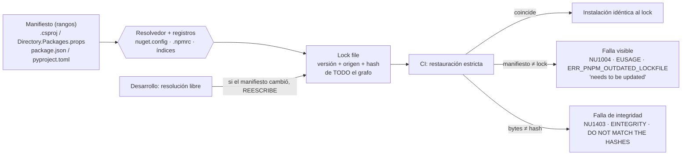

#### 7.2.1 .NET: lock, CPM y mapeo de fuentes

**Por qué hace falta un lock en NuGet.** La documentación admite que el mismo `PackageReference` puede resolver distinto en dos días: con versiones flotantes, cuando se publica una versión que encaja mejor con el mínimo, o cuando un feed (no nuget.org) borra una versión [B83]. E4-2 muestra un cuarto: si la versión pedida no existe, NuGet resuelve la siguiente disponible (pedida 8.0.2, resuelta 9.0.0) y lo avisa con `NU1603` [B195]. En el mismo proyecto con `packages.lock.json`, ese aviso **no apareció**, y el lock registró `requested [8.0.2, )` con `resolved 9.0.0` (SDK 8.0.425 y 10.0.400). Con `NU1603` tratado como error, el restore sin lock se detiene y el restore con lock termina con 0: el lock desarma esa defensa (E4-2). **[criterio]** Por eso van las dos: `NU1603` como error en todo proyecto (A.4), que corta a los que no tienen lock, y una compuerta que compara la cota inferior de `requested` con `resolved` en las entradas `Direct` y `CentralTransitive` de los que lo tienen (A.11; EA-1: `pide [8.0.2, ) y resolvió 9.0.0`). También marca una subida legítima, que se resuelve subiendo la `PackageVersion`.

**`packages.lock.json`** se activa con `RestorePackagesWithLockFile=true`; lista directas, transitivas y, con CPM, transitivas fijadas centralmente, cada una con `resolved` y `contentHash` [B83]. Sin modo estricto, si el proyecto cambió, el restore **reescribe** el lock: en E4-1, cambiar una versión en el `.csproj` y correr `dotnet restore` actualizó cinco entradas con código 0 y sin mensaje. Con `--locked-mode` (o `RestoreLockedMode=true`) falla con `NU1004`; con un `contentHash` alterado, `NU1403` [B83][B88]. Tres reglas del fabricante:

- el lock que gobierna es el del proyecto en la punta de la cadena; el de una biblioteca que no se distribuye o de un proyecto común del que dependen otros «no debería» versionarse —conservarlo «no hace daño», pero no fija lo que resuelve quien lo referencia— [B83];
- el SDK se fija porque aporta paquetes implícitos (§6, E3-6) [B83];
- la poda de paquetes del SDK 10 (`PrunePackageReference`) cambia el grafo la próxima vez que se regenera [B83].

**Ejecutable quiere decir `Exe` o `WinExe`**, el tipo de las apps WinForms y WPF [B215]: una regla que mire sólo `Exe` las deja sin lock y con la CI en verde (A.4b, EA-1). Un proyecto de prueba no recibe lock por esa regla: su `OutputType=Exe` llega de un paquete que el restore no evalúa (SDK 8.0.425 **[observado]**).

**El conjunto de RID (*runtime identifier*, la plataforma de destino: `win-x64`, `linux-x64` [B203]) es parte del lock**: un lock generado sin RID falla en modo estricto si se restaura con `-r linux-x64`; declarando `<RuntimeIdentifiers>win-x64;linux-x64</RuntimeIdentifiers>` el lock gana una sección por RID y pasa (E4-1). Hay antecedentes del mismo tipo en los gestores de issues de NuGet y del SDK [B90].

**Central Package Management (CPM).** `Directory.Packages.props` con `ManagePackageVersionsCentrally=true` y `PackageVersion`; los `.csproj` referencian sin `Version` (`NU1008` si la llevan) [B85]. Con *transitive pinning*, una `PackageVersion` gobierna también a la transitiva; no permite bajar versiones (`NU1109`) y, en bibliotecas, vuelve explícitas esas transitivas en el paquete [B85] (E4-2). **CPM y lock no son alternativas**: CPM decide qué se pide; el lock registra qué se obtuvo, con hash. CPM solo no garantiza la versión pedida (E4-2: pidió 8.0.2, obtuvo 9.0.0).

**`nuget.config` en la raíz con `<clear />`** evita que la configuración del usuario o de la máquina agregue fuentes [B87], como `.gitattributes` evita depender de `core.autocrlf`. El mapeo de fuentes exige que **todo** paquete, transitivas incluidas, coincida con un patrón (`NU1100` si no) [B86] (E4-3), con dos huecos documentados: un paquete ya presente en la carpeta global no consulta ninguna fuente, y el mapeo no aplica a consultas de metadatos [B86]. En E4-3, con la caché caliente, un impostor se coló e imprimió `IMPOSTOR`; el `contentHash` del lock lo detectó (`NU1403`): defensas complementarias.

#### 7.2.2 Node.js: npm, pnpm, Yarn

`package-lock.json` se commitea; desde npm 9 usa `lockfileVersion: 3`, con `resolved` e `integrity` por entrada [B93]. `npm install` respeta el lock si satisface los rangos y, si no, **lo actualiza** [B92] (E4-4: `is-odd 3.0.1 → 2.0.0`, código 0). `npm ci` exige el lock, falla si no coincide (`EUSAGE`), borra `node_modules` y **nunca** escribe el lock ni `package.json` [B91]; un `integrity` alterado da `EINTEGRITY` (E4-4). El lock es multiplataforma: registró las 25 variantes de `@esbuild/*` con su `os`/`cpu` e instaló sólo la de Linux (E4-4). `npm-shrinkwrap.json` ya no se lee ni se escribe desde npm 12 [B93]. pnpm (`--frozen-lockfile`) y Yarn (`--immutable`) activan el modo estricto **por defecto** cuando detectan CI [B95][B96]; **[criterio]** en la compuerta, pedirlo explícitamente para que el mismo comando se comporte igual en la estación.

#### 7.2.3 Python: uv, Poetry, pip-tools, pip y PEP 751

`uv.lock` es TOML, lo administra uv, se commitea y es **universal**: en E4-5 incluyó `colorama` con `marker = "sys_platform == 'win32'"`, una dependencia que sólo existe en Windows [B98][B99]. `uv run` y `uv sync` bloquean y sincronizan solos: en desarrollo, un cambio en `pyproject.toml` reescribe el lock (E4-5). `--locked` falla si el lock no está al día; `--frozen` lo usa **sin verificar** [B97]: **[criterio]** en CI, `--locked`. Poetry: `install` con lock desactualizado falla y `check --lock` lo verifica [B105] (E4-5). `uv pip compile` da un `requirements.txt` **por plataforma** salvo `--universal` [B98]; `pip-compile` no tiene esa opción y su README pide compilar en cada entorno de destino [B104]. En E4-5, `uv pip compile` sin `--universal`, corrido en Linux, **omitió** `colorama`: «funciona en Linux, en Windows falta un paquete». El modo hash de pip es todo o nada y exige `==` [B102].

**PEP 751 (`pylock.toml`)** está *Final* (resuelta el 2025-03-31) y su especificación vive en packaging.python.org [B100][B101]. Al 2026-10-07, uv la exporta y conserva `uv.lock` como formato propio [B99]; pip 26.2.1 instala desde `pylock.toml` y tiene `pip lock`, ambos **experimentales**, con un lock que vale sólo para la plataforma actual [B103] (E4-5). **[criterio]** Hoy `pylock.toml` es un formato de **intercambio**, no el reemplazo del lock de la herramienta del proyecto.

### 7.3 Qué propone la industria

| Aspecto | NuGet | npm | pnpm | Yarn | uv | Poetry | pip-tools / pip |
|---|---|---|---|---|---|---|---|
| Lock | `packages.lock.json` (opt-in) | `package-lock.json` | `pnpm-lock.yaml` | `yarn.lock` | `uv.lock` | `poetry.lock` | `requirements.txt` compilado / `pylock.toml` |
| Restauración estricta | `--locked-mode` / `RestoreLockedMode` | `npm ci` | `--frozen-lockfile` (default en CI) | `--immutable` (default en CI) | `uv sync --locked`, `uv lock --check` | `check --lock`; `install` falla con lock viejo | `pip install --require-hashes -r` |
| Reescribe sin avisar | `dotnet restore` | `npm install` | `pnpm install` fuera de CI | `yarn install` fuera de CI | `uv sync`, `uv run` | `poetry lock` (a pedido) | `pip-compile` (a pedido) |
| Error de deriva | `NU1004` | `EUSAGE` | `ERR_PNPM_OUTDATED_LOCKFILE` | `YN0028` | «needs to be updated» | «changed significantly» | — |
| Error de integridad | `NU1403` | `EINTEGRITY` | `ERR_PNPM_TARBALL_INTEGRITY` | `YN0018` | «Hash mismatch» | «did not match any known checksums» | «DO NOT MATCH THE HASHES» |
| Multiplataforma | sólo los RID declarados | sí | sí | sí | sí, universal | sí, marcadores | no: `pip-compile` por entorno; `uv pip compile` sólo con `--universal` |
| Registros en el repo | `nuget.config` (`<clear />`, mapeo) [B87][B86]; hueco: la caché caliente (E4-3) | `.npmrc` del proyecto, un registro por *scope* [B109][B198]; hueco: un paquete interno sin *scope* va al registro por defecto | — | — | `[[tool.uv.index]]`, estrategia `first-index` [B110]; `explicit = true` protege sólo lo asignado a ese índice | — | `--index-url` único; agregar índices con la búsqueda combinada de pip reabre la confusión [B110] |
| Evidencia | E4-1, E4-2, E4-3 | E4-4 | E4-4 | E4-4 | E4-5 | E4-5 | E4-5 |

Los cinco mensajes nuevos de esas dos filas son **[observado]** (Yarn 4.10.3, pnpm 10.18.0, uv 0.12.23, Poetry 2.5.1; Anexo F).

El riesgo de confusión de dependencias está en el momento de bloquear o actualizar: una vez bloqueado, el hash del lock —y en npm y uv también el origen— fija lo que se instala.

**Integración en una solución** (detalle en [§11](#11-una-sola-solución-con-net-nodejs-y-python)): no hay lock común. **[criterio]** Un lock por ecosistema junto a su manifiesto; una compuerta que llama a los tres comandos estrictos; los registros de los tres declarados en el repo; el toolchain fijado antes que el lock (la versión de npm decide `lockfileVersion`, la de uv el formato de `uv.lock`); y un bot que entienda los tres locks. Dependabot soporta NuGet, npm, pnpm, Yarn, pip, Poetry y uv, con versiones máximas (npm ≤ v11, pnpm ≤ v10, uv v0.11) por debajo de las vigentes al 2026-10-07 (npm 12, pnpm 12, uv 0.12) [B107]; Renovate tiene `lockFileMaintenance`, deshabilitado por defecto [B108].

### 7.4 Aplicación por escenario y contexto

| Escenario | Qué cambia |
|---|---|
| ESC-01 Windows + Visual Studio | Todo restore sin modo estricto actualiza el lock si cambió el proyecto [B83]; que Visual Studio dispare ese restore al editar el proyecto **[no verificado]**. Si el RID o el SDK difieren de los de la CI, `NU1004` aparece recién en la CI. |
| ESC-02 Linux | Riesgo de compilar un `requirements.txt` por plataforma. |
| ESC-03 WSL 2 | Igual que ESC-02 para el grafo; la ubicación del clon afecta finales de línea, no el lock. |
| ESC-04 Devcontainer | El contenedor no reemplaza la restauración estricta. Una caché de NuGet, npm o uv montada como volumen reintroduce el hueco de la caché caliente (E4-3) **[criterio]**. |
| ESC-05 CI | Único lugar donde la restauración estricta es obligatoria; agentes efímeros y cachés limpias [B87]. |

Por contexto: en CTX-NET la decisión es lock sí o no (§6.4) y, con lock, sólo en los ejecutables, `Exe` y `WinExe` (A.4); en CTX-NODE y CTX-PY el lock no es opcional; en CTX-POLI, un lock por ecosistema junto a su manifiesto y una sola compuerta que corre los tres comandos estrictos.

**[criterio] Modo estricto sólo en CI.** Con la condición de CI unificada de [A.4](#a4-directorybuildprops), `RestoreLockedMode` se activa donde está `CI=true` (GitHub Actions [B190], GitLab [B191]) o `TF_BUILD=True` (Azure Pipelines); en la estación, el restore sigue libre y el desarrollador commitea manifiesto y lock juntos. EA-1 lo verifica: sin variable, `RestoreLockedMode` vacío; con `CI=true`, `true`; y en ese modo, un cambio de versión en `Directory.Packages.props` sin regenerar el lock da `error NU1004: The package reference Newtonsoft.Json version has changed from [13.0.3, ) to [13.0.1, )`.

| Actor | Le toca |
|---|---|
| ACT-ARQ | CPM sí o no, *transitive pinning*, qué proyectos llevan lock, herramienta Python, registros y mapeo. |
| ACT-DEV | Cambiar manifiesto y lock juntos; correr la compuerta antes del push. |
| ACT-OPS | Restauración estricta y cachés limpias en CI; bot de actualización. |
| ACT-REV | La pregunta de §7.6 sobre quién actualiza el lock y qué mira el revisor. |

### 7.5 Ejemplos concretos

```xml
<!-- Directory.Packages.props (raíz): versiones directas en un lugar (Anexo A.5). -->
<Project>
  <PropertyGroup>
    <ManagePackageVersionsCentrally>true</ManagePackageVersionsCentrally>
    <CentralPackageTransitivePinningEnabled>true</CentralPackageTransitivePinningEnabled>
  </PropertyGroup>
  <ItemGroup>
    <PackageVersion Include="Microsoft.Extensions.Logging" Version="8.0.0" />
    <!-- Transitiva subida a propósito (p. ej., un parche de seguridad). No se puede bajar: NU1109. -->
    <PackageVersion Include="Microsoft.Extensions.Options" Version="8.0.2" />
  </ItemGroup>
</Project>
```

```bash
# Compuerta de restauración estricta para los tres ecosistemas (misma en local y en CI, §10).
dotnet restore src/App --locked-mode  # NU1004 / NU1403; sin .sln en la raíz, el proyecto (la compuerta de A.11 los busca)
( cd web && npm ci )                  # EUSAGE / EINTEGRITY
( cd tools/gen && uv sync --locked )  # "needs to be updated, but --locked was provided"
```

**El `.nupkg` propio también importa.** Un mismo código empaquetado dos veces con SDK 8 da `.nupkg` con hash distinto (fechas y un nombre aleatorio dentro del zip, E6-2), y con SDK 10 también, según [B147]; si un feed interno re-empaqueta «la misma versión», los locks de sus consumidores fallan con `NU1403` (E4-3). Desde .NET 11 los paquetes son deterministas por defecto si se fija la fecha [B147] ([§9](#9-procedencia-saber-con-qué-se-construyó)). **[criterio]** Nunca re-publicar una versión existente.

Experimentos del capítulo: E4-1 a E4-5 (Anexo E; salidas en `Examples/N4-congelamiento-de-dependencias/salidas/`).

### 7.6 Preguntas guía

**¿Fijar versiones directas (CPM) o congelar el grafo (lock)? ¿Las dos?**
CPM controla la entrada y la centraliza; el lock controla la salida con hash. CPM sin lock no garantiza la versión pedida (E4-2); lock sin CPM congela, pero cada actualización es proyecto por proyecto. La alternativa sin lock —versiones existentes, sin flotantes, `NU1603` como error, registros con mapeo y el SDK registrado— detiene la aproximación de E4-2 que el lock por sí solo deja pasar en silencio, y pierde el `contentHash` contra la caché caliente (E4-3) **[criterio]**. *Aplica*: en una solución con varios proyectos que se despliega, las dos, con el lock en los ejecutables **[criterio]**; el lock de un proyecto común no gobierna a quien lo referencia [B83]; en un único ejecutable, el lock es lo imprescindible; sin lock, la política de §6.4.

**¿Qué comando falla y cuál regenera en silencio?**
Fallan los de la fila «Restauración estricta» de §7.3; regeneran los de «Reescribe sin avisar». El que regenera es el correcto **cuando se quiere** cambiar el grafo; el que falla es el correcto **en toda verificación**. El error frecuente es usar en CI el comando de desarrollo. *Aplica* al escribir cualquier paso de la CI o de la compuerta (ESC-05).

**¿Qué pasa con el lock al restaurar en Windows y en Linux?**
Depende de si es universal: npm, pnpm, Yarn y uv sí (E4-4, E4-5); NuGet sólo para los RID declarados (E4-1); `uv pip compile` sin `--universal` no, y `pip-compile` nunca (E4-5, [B104]). *Aplica* siempre que una estación Windows con Visual Studio (ESC-01) conviva con Linux, el devcontainer o la CI (ESC-02, ESC-04, ESC-05): generar el lock de forma independiente de la máquina y verificarlo en CI en la plataforma de producción.

**¿Protege el lock contra paquetes republicados o registros comprometidos?**
Contra **cambios de contenido** de una versión bloqueada, sí, si la verificación ocurre (`NU1403`, `EINTEGRITY`, «DO NOT MATCH THE HASHES»). No contra un paquete que ya era malicioso cuando se bloqueó, ni contra la versión mala que entra al actualizar: eso es trabajo de la revisión y de la auditoría de vulnerabilidades. El mapeo de fuentes ataca la **confusión de dependencias**, cada ecosistema con su hueco: en NuGet, la caché caliente (E4-3); en npm, los paquetes internos sin *scope*; en pip, la búsqueda combinada en varios índices; en uv, lo que no se asignó a un índice `explicit` (§7.3). Hash y mapeo son complementarios. *Aplica* en cuanto hay un feed o registro privado.

**¿Quién actualiza el lock, cuándo, y qué mira el revisor?**
**[criterio]** (sobre la base del fabricante) Lo actualiza el desarrollador al cambiar una dependencia, en el mismo commit que el manifiesto, y un bot en cadencia fija. El revisor mira: (a) que manifiesto y lock cambien juntos y la compuerta pase; (b) qué paquetes **nuevos** aparecen, no sólo los que suben; (c) cambios de origen (`resolved`, `source`, índice); (d) un hash que cambia **sin** cambio de versión —la señal de republicación, que se rechaza hasta explicarla—. Los locks no se editan ni se resuelven a mano en un conflicto: se regeneran con la herramienta (uv lo dice explícitamente [B99]). *Aplica* a ACT-DEV y ACT-REV en todo PR que toque un lock.

**¿Un contenedor reemplaza al lock?**
No: sin modo estricto, el grafo se resuelve de nuevo en cada build también adentro (§3.5); todos los experimentos de este capítulo corrieron en contenedores. *Aplica* cuando se propone el devcontainer (ESC-04) o la imagen de CI como sustituto del congelamiento.

**Llega un PR que cambia `packages.lock.json` sin tocar `Directory.Packages.props` ni ningún `.csproj`, y la compuerta está en verde. ¿Qué mirás y qué decidís?**
Que la compuerta pase dice que el lock coincide con lo declarado, no por qué cambió. Si no cambió ninguna dependencia declarada, alguien lo regeneró —con otro SDK, que aporta otros paquetes implícitos (E3-6), o con otro conjunto de RID (E4-1)— o lo editó. Se mira el diff: paquetes nuevos, orígenes nuevos y hashes que cambian sin cambio de versión; se pregunta con qué SDK se generó, y un hash que cambia sin versión se rechaza hasta explicarlo. *Aplica* a ACT-REV en CTX-NET y CTX-POLI.

### 7.7 Criterios de calidad

Un grafo bien congelado:

- tiene un lock por ecosistema —en .NET, en los ejecutables, o la política sin lock de §6.4 escrita en un ADR—, commiteado junto a su manifiesto y generado por la herramienta;
- se restaura en la CI **sólo** con el comando estricto, pedido explícitamente;
- declara los registros en el repo (`nuget.config` con `<clear />`, `.npmrc` del proyecto, índices de uv);
- es independiente de la plataforma de quien lo genera (universal o RID declarados);
- cambia sólo por PR, con el revisor mirando paquetes nuevos, orígenes y hashes.

Señales de una versión pobre:

- lock commiteado y CI con `dotnet restore`, `npm install`, `uv sync` a secas o `uv sync --frozen` (§7.2);
- `Version="X"` leído como exacto (§7.1);
- `requirements.txt` compilado en Linux usado en Windows, o lock sin RID y CI que restaura con `-r` (§7.2.1, §7.2.3);
- SDK subido sin regenerar el lock (§6.2.2);
- el lock de una biblioteca o de un proyecto común tratado como garantía para quien la referencia, o una app `WinExe` sin lock (§7.2.1);
- `NU1603` como simple advertencia, o un lock sin la compuerta que compara `requested` con `resolved` (§7.2.1);
- mapeo de fuentes con caché compartida como única defensa (§7.2.1);
- un conflicto de lock «arreglado» a mano (§7.6);
- `pip lock` como mecanismo estable (§7.2.3).

### 7.8 Plantilla

[A.4 `Directory.Build.props`](#a4-directorybuildprops), [A.5 `Directory.Packages.props`](#a5-directorypackagesprops), [A.6 `nuget.config`](#a6-nugetconfig), [A.7 Node](#a7-node-packagejson-y-npmrc), [A.8 Python](#a8-python-pyprojecttoml-y-python-version).

### 7.9 Práctica

1. Leé la salida del paso 5 de E4-2 en sus dos variantes, con y sin lock, y decí qué habría detenido la aproximación 8.0.2 → 9.0.0 en cada una. *Respuesta esperada*: sin lock, `NU1603` como error; con lock, la compuerta de A.11, que compara `requested` con `resolved` (§7.2.1).
2. En una copia de E4-4, cambiá una versión en `package.json` sin regenerar el lock y corré `npm install` y `npm ci`. ¿Cuál falla y cuál reescribe? *Respuesta esperada*: `npm install` reescribe el lock con código 0; `npm ci` falla con `EUSAGE` (§7.2.2).

---

## 8. Contenedores, devcontainers y estaciones Windows

El caso pregunta si congelar SDK, compilador y paquetes «se puede hacer mediante contenedores». La respuesta que este capítulo sostiene con evidencia: **un contenedor congela lo que trae la imagen —sistema operativo, bibliotecas y, si viene instalado, el toolchain— y sólo si la imagen se nombra por digest; no congela los bytes del código que se le monta, ni el grafo si no hay lock, ni la configuración de git de quien lo usa.** El contenedor reproduce fielmente lo que el repositorio declara, y también lo que olvidó declarar.

### 8.1 Definición

| Término | Definición | Fuente |
|---|---|---|
| **Imagen** | Plantilla de sólo lectura con el sistema de archivos del contenedor: distribución, bibliotecas y lo instalado encima. | [B113] |
| **Etiqueta** (*tag*) | Nombre legible que apunta a una imagen. **Es mutable**: el publicador la mueve. | [B113] |
| **Digest** | Hash `sha256:` del manifiesto de la imagen: el mismo digest es siempre el mismo manifiesto. Si es un índice multiplataforma, como los de las imágenes oficiales, cada arquitectura resuelve su propia imagen **[observado]** (`docker buildx imagetools inspect`, 2026-10-09). Al usarlo, Docker no baja versiones actualizadas, «que pueden incluir actualizaciones de seguridad». | [B113][B114] |
| **Bind mount** | Montaje de una carpeta del host en el contenedor; ambos ven y escriben los mismos archivos. | [B133] |
| **Devcontainer** | Contenedor de desarrollo definido por un `devcontainer.json` (especificación abierta en containers.dev) al que un editor o una CLI se conectan para editar, compilar y depurar. | [B119][B138] |
| **Feature** | Instalador versionado que se aplica sobre la imagen y se referencia en `devcontainer.json`. | [B120] |
| **`devcontainer-lock.json`** | Registra, por *feature*, versión exacta, recurso resuelto e integridad. **No registra la imagen base.** | [B121], E5-5 |
| **Imagen de desarrollo / de CI / de ejecución** | Tres roles: la del desarrollador (SDK + herramientas), la que compila en CI (mínima), la que corre la aplicación (runtime sin SDK). | **[criterio]**, [B115] |

### 8.2 Cómo funciona

#### 8.2.1 Qué fija un contenedor y qué no

| Capa | ¿La fija? | Evidencia |
|---|---|---|
| 1 · Bytes, EOL, bit de ejecución | **No.** Llegan del host por bind mount o por clon. | E5-1: el `.cs` en cp1252 falla con `CS1056` dentro de la imagen por digest y compila tras convertirlo en el repo. E5-3: CRLF y modo `100644` de un clon «Windows» rompen el script en Linux. |
| 2 · Toolchain | **Sí**, si viene en la imagen y la imagen va por digest. | E5-6: dos imágenes «de .NET 10» trajeron SDK 10.0.400 y 10.0.100-rc.2. |
| 3 · Grafo | **No.** | §7. |
| 4 · SO | **Sí, por digest**; por etiqueta, no. | E5-2. |
| 5 · Proceso | **En parte**: iguala ruta y variables para quien usa la misma definición. | E5-6: misma imagen y misma ruta → mismo hash. |
| 6 · Metadatos | **No.** | §9. |
| Configuración de git del usuario | **Depende de la herramienta**: un `docker run` no ve el `~/.gitconfig` del host; la extensión Dev Containers de VS Code lo **copia** al iniciar [B127]. | E5-1 |
| Dueño de los archivos (UID) | **No lo normaliza**: en host Linux, lo que escribe root en el bind mount queda de root. | E5-4; `updateRemoteUserUID` (sólo Linux) lo alinea [B119] |

La fila de git explica por qué ninguna política puede vivir en `core.autocrlf`: llega o no según quién levante el contenedor.

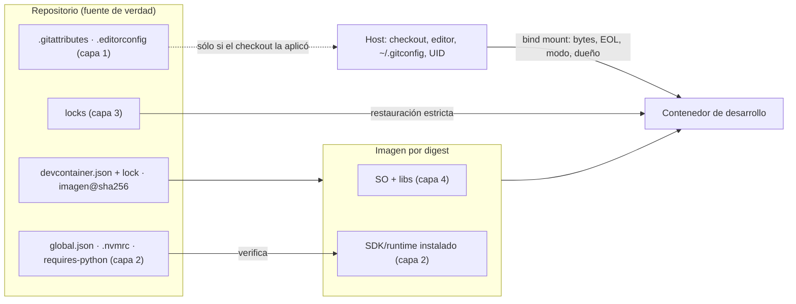

#### 8.2.2 Etiqueta o digest

Docker documenta que las etiquetas son mutables y que fijar por digest garantiza la misma imagen —para la misma plataforma; igualar estaciones de otra arquitectura pide `--platform` o el digest por plataforma **[criterio]**—, al costo de renunciar a las correcciones de seguridad automáticas; propone mitigarlo con Docker Scout o con Dependabot, que según Docker abre PR con etiqueta y digest nuevos [B113]. La página de ecosistemas de GitHub no menciona digests para `docker` [B107] y el laboratorio no lo observó **[no verificado]** (requiere la plataforma). Las imágenes de .NET distinguen etiquetas *fijas* (`8.0.11`: la versión de .NET no cambia) y *flotantes* (`8.0`), y **ambas** se rehacen cuando cambia la base del SO: «para pedir un parche específico del sistema operativo hace falta fijar por digest» [B115]. Se reconstruyen dentro de las 12 horas de una actualización de su base, con cada versión de .NET, ante CVE críticos y una vez por mes, típicamente el segundo martes [B115].

E5-2 lo midió: la etiqueta `mcr.microsoft.com/dotnet/sdk:8.0` presente en el laboratorio (construida el 2026-09-19) y la que publicaba el registro el 2026-10-07 (construida el 2026-10-06) tienen digests distintos y **el mismo** SDK 8.0.425; entre una y otra cambiaron `openssl` (3.0.20 → 3.0.22), `libexpat1`, `libpcre2-8-0`, Perl y `tzdata`. Quien usa la etiqueta recibe esa actualización de OpenSSL en el próximo `pull`, **sin un commit que lo diga**; quien fijó el digest viejo sigue con el OpenSSL anterior hasta que alguien lo actualice.

**[criterio] Política recomendada.**

1. **Digest en toda imagen que el repo nombra para construir lo publicado**: el `FROM` de la imagen de CI y de los Dockerfile de build, y `container.image` de la CI. Se escribe `repo:etiqueta@sha256:…`: la etiqueta queda como referencia humana y manda el digest.

   **Qué decide cada capa sobre el artefacto.** Los bytes de un artefacto .NET gestionado los decide la capa 2 exacta: el mismo SDK con `ContinuousIntegrationBuild` dio la misma DLL y el mismo PDB en tres sistemas operativos y tres rutas; otro SDK, otra (E5-8). La capa 4 decide la ejecución (E5-2), lo nativo **[interpretación]** y lo que se publica como imagen. Por eso hay dos caminos de CI **[criterio]**: **imagen propia por digest** si la CI comparte base con el devcontainer (§8.2.6), publica algo nativo o una imagen, o un tercero verifica su procedencia (§12, paso 8b); o **runner alojado** con acciones de *setup* por SHA que leen `global.json`, `.nvmrc` y `.python-version` [B181], que alcanza para registrar con qué se construyó (§12, paso 8a): su imagen flota y su versión queda sólo en el log «Set up job» [B216] mientras dure la retención, 90 días por defecto y hasta 400 en repositorios privados [B218]. Las demás reglas de imagen remiten acá.
2. **En el devcontainer, «mismo SDK», no «misma imagen»** (§8.6): o una etiqueta **fija** de SDK y SO (`mcr.microsoft.com/dotnet/sdk:8.0.425-bookworm-slim`, o la versión semántica de `devcontainers/dotnet`, que su README recomienda para fijar versión y SO y reserva el digest para las imágenes `dev-*`, que se actualizan en el lugar [B118]) más `global.json`, que detecta la deriva de la capa 2 (E5-6); o la **misma receta** que la imagen de CI (`build.dockerfile`), cuyas bases por digest mantiene el bot de la CI. Un digest en la `image` de `devcontainer.json` sólo con un bot que lo actualice: en un repositorio privado el ecosistema `devcontainers` de Dependabot no está soportado [B107].
3. **Actualización como PR**, no como accidente: un bot o un trabajo programado propone el digest nuevo y el PR pasa por las mismas compuertas (§10). Ningún ecosistema de Dependabot cubre el `container:` de un workflow [B107]; Renovate lo reconoce [B213], pero que mueva su digest **[no verificado]** (requiere la plataforma): lo mueve el PR que abre el workflow que publica la imagen **[criterio]**.
4. **Cadencia alineada con el publicador**: como mínimo mensual y fuera de calendario ante un CVE.
5. **Etiqueta flotante sólo donde se quiere deriva**: nunca en una imagen que el repo nombra para construir lo publicado (la del runner alojado no la nombra el repo: punto 1).

El costo real del digest no es «quedarse sin parches» sino **asumir la responsabilidad de aplicarlos**. Un equipo que fija digests y no tiene el punto 3 está peor que uno que usa etiquetas: congeló vulnerabilidades.

#### 8.2.3 `devcontainer.json`: imagen, Dockerfile o *features*

| Opción | Qué se congela | Cuándo conviene |
|---|---|---|
| `"image"` | La imagen, si va por digest [B119] | Base oficial suficiente, o imagen **preconstruida** por el equipo |
| `"build": { "dockerfile" }` | Sólo el `FROM` por digest; cada `apt-get install` resuelve al construir, en cada máquina **[criterio]** | Hace falta algo que no existe como *feature* |
| `"features"` | Con `devcontainer-lock.json`, versión y digest del **instalador**; lo que el instalador baja depende de sus opciones: la *feature* de Node instala `"lts"` por defecto [B137] | Componer runtimes sin escribir Dockerfile, con versión explícita |
| Imagen preconstruida | Todo lo instalado, por digest de la imagen publicada; containers.dev lo presenta como forma de fijar herramientas [B136] | Equipos de más de una persona o CI que use el mismo entorno |

Con la CLI de referencia (`@devcontainers/cli` 0.89.0), `up` y `build` generan el lock por defecto y `--frozen-lockfile` falla si no coincide: cambiar `node:1` por `node:1.6` sin regenerar dio `Error: Lockfile does not match.` (E5-5) [B122]. La CLI monta por defecto **la raíz del repositorio git**, no sólo la carpeta abierta (E5-5b): en un monorepo eso expone todo el árbol al contenedor.

#### 8.2.4 Convivencia con estaciones Windows

| Herramienta | Qué hace con contenedores | Evidencia |
|---|---|---|
| **Visual Studio** (2022 y 2026) | *Container Tools*: agrega un Dockerfile o la compilación de contenedores del SDK, y ejecuta y depura la aplicación dentro de un contenedor. Es soporte para **contenerizar la aplicación**, no para **desarrollar dentro** de un devcontainer. | [B125] |
| **Visual Studio y `devcontainer.json`** | El único soporte documentado es para **proyectos C++ con CMake Presets** (VS 2022 17.4), sólo contenedores Linux. No se encontró documentación oficial que abra una solución .NET dentro de un devcontainer. | [B123][B124] — hallazgo negativo |
| **JetBrains Rider** | Documenta abrir un proyecto con `devcontainer.json` y arrancar el contenedor desde el IDE. No se verificó compilar ni depurar una solución .NET así. | [B139] |
| **VS Code + Dev Containers** | Implementación completa; en Windows requiere Docker Desktop y contenedores Linux; copia el `.gitconfig` local; advierte un costo de rendimiento del bind mount en Windows. | [B126][B127] |
| **WSL 2** | Sistema de archivos Linux aparte; git y `.gitconfig` separados de Windows; Microsoft recomienda guardar el código del lado donde trabajan las herramientas. | [B130][B131] |
| **Docker Desktop con WSL 2** | Rendimiento mucho mayor si lo montado vive en el sistema de archivos Linux; eventos `inotify` sólo en ese caso. | [B132] |

El dato que ordena la convivencia es la segunda fila: **quien trabaja con Visual Studio sobre una solución .NET no tiene hoy, según la documentación consultada, una forma soportada de entrar en el devcontainer**. Por lo tanto el devcontainer no puede ser el lugar donde vive la política: tiene que ser un consumidor más de la política que vive en el repositorio.

**[criterio] Reglas de convivencia.**

1. **El repo declara, las estaciones obedecen, la CI arbitra.** `.gitattributes` y `.editorconfig`, `global.json`, los locks con restauración estricta: los mismos para Visual Studio en Windows, para el devcontainer y para la CI.
2. **El devcontainer es una comodidad que reproduce la CI, no un requisito.** Quien no puede o no quiere usarlo trabaja nativo; la compuerta de CI **detecta** si su commit no cumple, y lo **impide** sólo con protección de rama o con la compuerta en la publicación (§10.2.7).
3. **Lo que tiene que ser idéntico entre la estación Windows (ESC-01) y el devcontainer (ESC-04)**: los archivos de las capas 1–3, el SDK que admite `global.json` y el comando de build. Lo que **no** va a ser idéntico, y conviene decirlo: SO, rutas y, sin normalización, el hash de los binarios (§9).
4. **La imagen también es una fuente de SDK** que puede no coincidir con lo declarado: `global.json` la detecta (E5-6).
5. **El artefacto que se publica sale de la CI**, nunca de una estación.

#### 8.2.5 Un repo de Windows montado en Linux

E5-3 simula una estación Windows clonando con `core.autocrlf=true` y `core.fileMode=false` y monta el clon en la imagen del SDK.

| Síntoma | Causa | Corrección | Evidencia |
|---|---|---|---|
| `fatal: detected dubious ownership in repository` | git en el contenedor corre como otro usuario; `safe.directory` sólo se honra en configuración global o de sistema | `git config --global --add safe.directory /w` en el contenedor, o correr con el UID del dueño | E5-3, [B37] |
| `M build.sh`, `M notas.txt` sin cambios reales | el checkout «Windows» escribió CRLF; el git del contenedor no tiene `core.autocrlf` | `eol` en `.gitattributes` | E5-3 |
| `./build.sh: Permission denied` | en NTFS git usa `core.fileMode=false` y no registra el bit | `git update-index --chmod=+x build.sh` | E5-3, [B37] |
| `pipefail^M: invalid option name`, `/usr/bin/env: 'bash\r'` | CRLF en un script | `*.sh text eol=lf` | E5-3 |
| Con la política, el **mismo** clon queda con LF, `git status` vacío y el script corre | la política vive en el repo y le gana a la configuración local | — | E5-3 |
| `obj/` del contenedor es de root; el host no puede borrarlo | el bind mount conserva UID; la imagen del SDK corre como root | `--user $(id -u):$(id -g)`, o `remoteUser` + `updateRemoteUserUID` | E5-4, [B119] |
| Restauraciones lentas; *watchers* que no ven cambios | bind mount desde el disco de Windows | repo en WSL 2, volumen con nombre para `node_modules` o clonar en volumen | [B129][B132] — no medido |

Casi todos los problemas de «montar un repo de Windows en Linux» son problemas de capa 1 que la estación Windows tapaba. El contenedor no los causa: los revela, igual que Linux reveló el cp1252 del caso.

#### 8.2.6 ¿Imagen de desarrollo igual a imagen de CI?

E5-6 compiló el mismo proyecto `net10.0`:

| Build | Imagen | SDK | Hash de la DLL |
|---|---|---|---|
| CI, dos contenedores | `dotnet/sdk:10.0@sha256:e1ffd2a9…` | 10.0.400 | `7d4068f0…` las dos veces |
| Dev | `devcontainers/dotnet:1-10.0@sha256:f9abf00d…` | 10.0.100-rc.2 | `facbe3a4…` |
| CI con `global.json` (10.0.400) | CI | 10.0.400 | `7d4068f0…` |
| Dev con `global.json` | dev | — | **falla**: `Requested SDK version: 10.0.400` |

Dos imágenes que un equipo llamaría «la de .NET 10» dieron SDK y binarios distintos, y `global.json` lo detectó sin que nadie mirara versiones. No se encontró una recomendación oficial de usar la misma imagen; containers.dev presenta la especificación también como ayuda a la CI [B138] y mantiene una acción que corre la CI dentro del devcontainer [B134]. **[criterio]** Hace falta **compartir la base que trae el toolchain** y que el repo verifique la coincidencia: la CI dentro del devcontainer preconstruido (stacks simples) o la imagen de desarrollo `FROM` el mismo `sdk@sha256` de la CI, con herramientas agregadas (multi-runtime, §11); no imágenes elegidas por un nombre parecido. Con el runner alojado (§8.2.2) no hay base compartida: sólo la compuerta prueba que las versiones coinciden.

### 8.3 Qué propone la industria

| Ecosistema | Práctica | Naturaleza |
|---|---|---|
| Transversal | Fijar imágenes por digest y actualizarlas por PR automatizado [B113]. Dependabot: `docker` y `devcontainers`, sólo actualizaciones de versión, y `devcontainers` **no soportado en repositorios privados** [B107]; que mueva digests lo documenta Docker [B113] y no GitHub [B107] **[no verificado]** (requiere la plataforma; §8.2.2). Renovate: `pinDigests` [B108]. | fabricante |
| Transversal | Código en el sistema de archivos de WSL 2 o en volumen, no en `C:\` montado [B129][B130][B132]. | fabricante |
| .NET | `sdk` para compilar, `aspnet`/`runtime` para ejecutar; digest para fijar el parche del SO; desde .NET 10 las etiquetas multiplataforma usan Ubuntu, antes Debian [B115] (por eso `sdk:8.0` y `sdk:10.0` difieren también en distribución, E0-6). Imágenes `devcontainers/dotnet` con versión semántica propia separada de .NET [B118]. | fabricante |
| Node.js | Variantes Debian (`bookworm`, `trixie`, `slim`) salvo razón para Alpine, que usa musl y cuyos builds de Node en amd64 son «Experimental»; usuario `node` (uid 1000); `npm ci` en imágenes; desde Node 26 la imagen no trae Yarn v1 [B116]. | fabricante |
| Python | `slim` con la versión de Debian explícita; Alpine (musl) «suele tener problemas» según los supuestos de libc [B117]. | fabricante |

### 8.4 Aplicación por escenario y contexto

| Escenario | Qué aporta el contenedor | Qué no |
|---|---|---|
| ESC-01 Windows + Visual Studio | Contenerizar y depurar la app (Container Tools) | Desarrollo .NET dentro de un devcontainer (§8.2.4) |
| ESC-02 Linux | Misma imagen que la CI para reproducir un rojo | — |
| ESC-03 WSL 2 | Buen rendimiento con el repo del lado Linux | Si el repo está en `C:\` |
| ESC-04 Devcontainer | Capa 2 por etiqueta fija verificada con `global.json`, o la receta de la imagen de CI; *features* con lock | Capas 1, 3, 6 |
| ESC-05 CI | La imagen por digest que construye lo que se publica, o el runner alojado (§8.2.2) | Reemplazar a `global.json` o a los locks |

Por contexto: en CTX-NET, la convivencia de §8.2.4; en CTX-NODE y CTX-PY, la imagen oficial del runtime con `npm ci` o `uv sync --locked`; en CTX-POLI, la imagen trae los tres toolchains o la build se parte por componente (§11.2.6).

### 8.5 Ejemplos concretos

```jsonc
// .devcontainer/devcontainer.json — sólo .NET + Node; etiqueta FIJA de SDK y SO (§8.2.2).
// La variante políglota, construida con la receta de la imagen de CI, está en A.9.
{
  "name": "solucion",
  "image": "mcr.microsoft.com/dotnet/sdk:8.0.425-bookworm-slim",
  "features": {
    // Sin "version", la feature instala "lts", que cambia aunque el lock de features no cambie.
    "ghcr.io/devcontainers/features/node:1": { "version": "24.21.0" }
  },
  // La imagen corre como root: sin safe.directory, git rechaza el repo montado (8.2.5).
  "postCreateCommand": "git config --global --add safe.directory ${containerWorkspaceFolder} && git config core.hooksPath .githooks && dotnet --version && node --version"
}
```

```bash
# ¿A qué digest apunta HOY una etiqueta? (sin bajar la imagen; E5-2, buildx v0.35.0; ver §0.4)
docker buildx imagetools inspect mcr.microsoft.com/dotnet/sdk:8.0 --format '{{.Manifest.Digest}}'
# Registrar el bit de ejecución en el repo, no en el sistema de archivos de quien clona (E5-3)
git update-index --chmod=+x build.sh
# Levantar el devcontainer exigiendo el lock versionado (E5-5)
npx -y @devcontainers/cli@0.89.0 up --workspace-folder . --frozen-lockfile
```

Experimentos del capítulo: E5-1 a E5-8 y E5-5b (Anexo E).

### 8.6 Preguntas guía

**¿Qué capas congela realmente un devcontainer?**
La 4 y la parte de la 2 que trae la imagen, **sólo** por digest; las *features*, con lock y versión explícita. Quedan abiertas la 1, la 3, la 5 para las estaciones que no lo usan, y la 6. *Aplica cuando* alguien propone «pasemos todo a devcontainers» como solución al caso: el `.cs` en cp1252 falla igual adentro.

**¿Etiqueta o digest?**
Digest en toda imagen que el repo nombra para construir lo publicado, con un bot que proponga el digest nuevo, o el runner alojado (§8.2.2); en el devcontainer, etiqueta fija de SDK y SO, o la receta de la imagen de CI. Etiqueta flotante sólo donde se acepta deriva. El digest convierte los parches en trabajo explícito (E5-2). *Aplica* a toda referencia a una imagen en el repo; en un repositorio privado, revisar antes qué ecosistemas del bot están soportados [B107].

**Si la etiqueta `8.0.425` es «fija», ¿no alcanza?**
No para el SO: garantiza la versión de .NET, pero se rehace ante cambios de la base [B115]. *Aplica* según el objetivo: «mismo SDK» (alcanza) o «misma imagen» (no).

**¿Cómo conviven Visual Studio sin contenedores y el devcontainer, y qué tiene que ser idéntico?**
Con las reglas de §8.2.4: idéntico es lo que el repo declara (bytes, SDK admitido por `global.json`, locks, comando de build), no el SO, las rutas ni el hash del binario. La señal de alarma es una regla que sólo se cumple «si usás el devcontainer». *Aplica* a CTX-NET y CTX-POLI con estaciones Windows.

**¿Dónde guardo el repo si trabajo en Windows con contenedores?**
En el sistema de archivos de WSL 2 o en un volumen. *No aplica* si quien edita es Visual Studio nativo: Microsoft recomienda el sistema de archivos de Windows para herramientas de Windows [B130]. Quien alterna los dos mundos sobre la misma carpeta paga el costo en uno.

**¿El lock de devcontainer reemplaza a los locks de NuGet, npm o uv?**
No: registra las *features* y nada más; ni siquiera la imagen base. *Aplica* cuando alguien versiona `devcontainer-lock.json` y da por congeladas las dependencias.

**Tu repo es privado, el devcontainer apunta a `sdk:8.0@sha256:…` y nadie lo tocó en cinco meses. ¿Está bien congelado?**
Está congelado, no mantenido: el sistema de desarrollo no recibió parches desde que se fijó el digest (E5-2 muestra un mes de diferencia en OpenSSL), y en un repositorio privado el ecosistema `devcontainers` de Dependabot no está soportado [B107]. Para desarrollar alcanza «mismo SDK»: etiqueta fija de SDK y SO más `global.json`, o la receta de la imagen de CI, cuyo bot sí la actualiza. *Aplica* a ESC-04 en repositorios privados.

### 8.7 Criterios de calidad

Un entorno contenerizado bien hecho:

- nombra por digest toda imagen que el repo usa para construir lo publicado (o corre en el runner alojado, §8.2.2), con un mecanismo (bot o trabajo) que propone el digest nuevo como PR; en el devcontainer usa una etiqueta fija verificada por `global.json` o la receta de la imagen de CI;
- construye la imagen desde los archivos nativos de versión y deja que `global.json`, `devEngines` y `requires-python` la verifiquen;
- versiona `devcontainer-lock.json` y fija la `version` de cada *feature*;
- no corre como root sobre bind mounts en host Linux;
- no exige el devcontainer a quien usa Visual Studio sobre una solución .NET.

Señales de una versión pobre:

- «con devcontainer ya no hace falta `.gitattributes`» (§8.2.1);
- «usamos `sdk:8.0`, así que todos tenemos lo mismo» (§8.2.2);
- digests sin actualización, o un digest en el devcontainer de un repo privado que ningún bot actualiza (§8.2.2);
- *feature* de Node sin `version`, o creer que el lock de devcontainer fija la imagen (§8.2.3);
- Alpine «porque es más chica» con Node o Python nativos (§8.3);
- imágenes de dev y CI elegidas por nombre (§8.2.6).

### 8.8 Plantilla

[A.9 `devcontainer.json`](#a9-devcontainerjson), [A.10 Dockerfile multi-runtime](#a10-dockerfile-de-la-imagen-multi-runtime), [A.13 bots](#a13-dependabotyml).

### 8.9 Práctica

1. Con la salida de E5-2, decí qué cambió entre los dos digests de `sdk:8.0` y si cambió el SDK. *Respuesta esperada*: el mismo SDK 8.0.425; cambiaron OpenSSL, `libexpat1`, `libpcre2-8-0`, Perl y `tzdata` (§8.2.2).
2. Antes de correr E5-1, predecí si el `.cs` en cp1252 compila dentro de la imagen fijada por digest. *Respuesta esperada*: no, `CS1056`; compila recién al convertir el archivo en el repo (§8.2.1).

---

## 9. Procedencia: saber con qué se construyó

Los capítulos 4 a 8 contestan cómo **fijar** el entorno. Éste contesta la pregunta que el caso marca como la más importante: cómo **demostrar después** con qué entorno se ensambló un artefacto que ya está publicado o en producción. Fijar es una decisión previa a la build; demostrar es una evidencia que se produce durante la build y se consulta mucho después, a veces por alguien sin acceso al repositorio.

### 9.1 Definición

| Término | Definición | Fuente |
|---|---|---|
| **Artefacto** | Lo que sale de la build y se distribuye: DLL, `.nupkg`, tarball de npm, rueda de Python, imagen. Se identifica por su **digest**, nunca sólo por nombre y versión. | [B09] |
| **Metadatos embebidos** | Datos de origen grabados **dentro** del artefacto: versión informativa con el SHA del commit, URL del repo, mapa de Source Link en el PDB, `<repository commit=…>` en el `.nuspec`. | [B142][B144], E6-1 |
| **SBOM** | Inventario de los componentes del artefacto y sus relaciones, con nombre, versión, identificador, hash y licencia. Responde **qué contiene**. | [B157][B155][B156] |
| **Procedencia** | Atestación que identifica el artefacto por digest y describe **cómo, dónde y por quién** se produjo: tipo de build, parámetros, dependencias resueltas (incluida la imagen del builder), identidad de la plataforma. | [B09] |
| **Atestación** | Afirmación firmada y verificable con forma *in-toto Statement*: `subject` (artefacto + digest), `predicateType`, `predicate`. | [B09][B163] |
| **Plataforma de build alojada** | Servicio de CI que ejecuta la build en infraestructura propia y **él mismo** genera y firma la procedencia. Es lo que separa SLSA Build L1 de L2. | [B07] |
| **Verificación por reconstrucción** | Reconstruir el artefacto desde el commit y el entorno registrado y comparar el digest con el publicado: no depende de confiar en la firma de nadie. | **[criterio]**, [B01] |
| **`SOURCE_DATE_EPOCH`** | Variable con un *timestamp* UNIX que las herramientas **deben** usar en lugar de «ahora» para las fechas que incrustan. | [B03] |

### 9.2 Cómo funciona

«¿Con qué se construyó esto?» mezcla cuatro preguntas con mecanismos distintos: **¿de qué commit sale?** (metadatos embebidos); **¿qué tiene adentro?** (SBOM, generado del lock o de la salida); **¿con qué herramientas, dónde y quién lo afirma?** (procedencia; sin firma es un registro editable sin rastro, E6-5); **¿puedo comprobarlo sin creerle a nadie?** (sólo con una build reproducible: reconstruir y comparar hashes, E6-2).

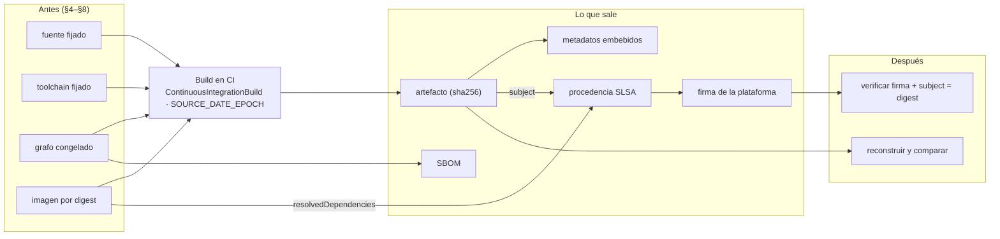

#### 9.2.1 .NET: qué graba el SDK y qué hay que agregar

Desde el SDK 8, Source Link viene incluido y el SHA del commit se agrega a `InformationalVersion` en todas las builds [B142][B143]. E6-1 lo muestra con `dotnet pack`: `AssemblyInformationalVersion = 1.4.0+9e618f99…`, la URL del repo como `AssemblyMetadata`, el mapa de Source Link en el PDB y `<repository type="git" url="…" commit="…" />` en el `.nuspec` y el `.snupkg` (con `PublishRepositoryUrl=true`). El SDK **no** registra con qué SDK, imagen ni máquina se compiló, y eso va **al lado** del artefacto (registro del entorno, A.17), no adentro: un `AssemblyMetadata` con el digest de la imagen cambia el hash de la DLL según dónde se construya, y la reconstrucción en el devcontainer deja de coincidir **[observado]** (SDK 8.0.425). Y el SHA embebido **miente** con cambios sin commitear: en E6-1, un `Program.cs` modificado cambió la DLL con el mismo SHA. En una estación, es una pista.

**Build determinista.** El compilador de C# es determinista por defecto, pero entre sus entradas están la ruta del directorio actual, la versión del compilador y los datos de Source Link [B18]. `ContinuousIntegrationBuild=true` habilita `DeterministicSourcePaths`, que mapea las rutas a valores independientes de dónde está el código; la build totalmente determinista pide `Deterministic` y `ContinuousIntegrationBuild` juntos, y las raíces mapeadas son los `SourceRoot` que aporta un repo git [B143][B144]. Microsoft lo condiciona a la CI porque en una estación el depurador deja de encontrar los fuentes [B144]. E6-2 compiló dos clones del mismo commit en rutas distintas:

```text
(1) mismo commit, rutas y contenedores distintos, ContinuousIntegrationBuild=true
   dll f31631a0f0ed | f31631a0f0ed   pdb 845000f56f1c | 845000f56f1c   nupkg 1244a78c9155 | d85f524589c2   => DISTINTOS
(8) SDK 11 + SOURCE_DATE_EPOCH
   dll ab2e246cc61b | ab2e246cc61b   pdb a2b7293dce42 | a2b7293dce42   nupkg 9f7b9596c45d | 9f7b9596c45d   => IGUALES
--- mapa de SourceLink en el PDB con PathMap a mano: no se normaliza
   pm_a   {"documents":{"/w/a/*":"https://raw.githubusercontent.com/ejemplo-lab/pieza/9e618f99…/*"}}
   pm_b   {"documents":{"/home/x/otra/*":"https://raw.githubusercontent.com/ejemplo-lab/pieza/9e618f99…/*"}}
```

*Extracto de `Examples/N6-procedencia-y-trazabilidad/salidas/e2-determinismo-dotnet.txt`.* Con `ContinuousIntegrationBuild`, DLL y PDB son idénticos; sin él, con `Deterministic=false`, con `PathMap` a mano (que normaliza la ruta del PDB pero no el mapa de Source Link) o con otro SDK, no. **[criterio]** En proyectos SDK modernos no se configura `PathMap` a mano.

**El `.nupkg` no es la DLL.** Con DLL y PDB idénticos, el `.nupkg` salió distinto: el zip guarda las fechas del disco y un `<GUID>.psmdcp` de nombre aleatorio (E6-2). **Desde .NET 11** los paquetes son deterministas por defecto, salvo las fechas, que se fijan con `DeterministicTimestamp` o `SOURCE_DATE_EPOCH` [B147]: con SDK 8 y la variable, distinto; con SDK 11 (preview.7 y RC1, la última publicada al 2026-10-07 [B62]) y la variable, idéntico (E6-2, E6-2b). **[criterio]** En SDK 8 o 10 se compara **por contenido** (DLL, PDB, `.nuspec`), no por el hash del zip.

#### 9.2.2 Node.js y Python

`package.json` tiene `repository` con `url` y `directory` [B63]; no hay campo estándar para el SHA en el tarball, y `package-lock.json` nunca se publica [B63]: el grafo viaja en el SBOM o en la procedencia. **Con npm 11.19.0, `npm pack` dio el mismo tarball** desde dos rutas con fechas de archivo distintas, con `mtime` fijo 1985-10-26T08:15:00Z en las dos entradas del paquete de prueba (E6-3) **[observado]**; no se probaron otro usuario, otro *umask* ni otra versión, y su documentación no lo menciona [B150]: conviene que la compuerta lo **compruebe**. `npm publish --provenance` firma con Sigstore **sólo** desde GitHub Actions o GitLab con runners en la nube y `repository` público [B148]: no aplica tal cual a un paquete privado.

En Python, los metadatos núcleo no tienen campo para el commit [B72]; una versión local PEP 440 (`1.4.0+g9e618f9`) sirve en índices privados pero PyPI no debe aceptarla [B106]; `direct_url.json` registra el commit de una instalación desde un VCS, no de la construcción [B153]. setuptools 84 dio ruedas **distintas** sin `SOURCE_DATE_EPOCH` e **idénticas** con ella; hatchling es reproducible por defecto [B152] (E6-4). PEP 770 reserva `.dist-info/sboms/` para el SBOM [B151], pero uno con `timestamp` y `serialNumber` vuelve no reproducible la rueda (E6-4), salvo con `cyclonedx-py --output-reproducible`. **[criterio]** Lo incrustado tiene que ser reproducible; un SBOM con fecha viaja **al lado**. PyPI acepta atestaciones (PEP 740) firmadas por un proveedor de *Trusted Publishing* [B154].

#### 9.2.3 SBOM: qué es, qué formato, qué alcance

CISA y agencias coautoras publicaron el 2026-07-29 los «2026 Minimum Elements for a SBOM», que reemplazan a los de 2021 y agregan el **contexto de generación**: la fase en que se generó, porque el contenido cambia según ella [B157]. **[criterio]** Un SBOM del lock (antes de la build) dice lo **declarado**; uno de la salida (después), lo **entregado** (E6-6: `dotnet-CycloneDX` lista el paquete NuGet; `sbom-tool`, además los archivos de salida con hash).

| Formato | Versión vigente | Estatus | En el laboratorio |
|---|---|---|---|
| SPDX | 3.0.1 [B155] | ISO/IEC 5962:2021 normaliza la versión **2.2.1** [B194] | `npm sbom` emite 2.3; `sbom-tool` 2.2 por defecto y 3.0 a pedido [B164] |
| CycloneDX | 1.7 (2025-10-21) [B156] | ECMA-424 [B156] | `npm sbom` 1.5; `cyclonedx-py` 1.6; CycloneDX para .NET 1.7 |

**[criterio]** El formato lo elige el consumidor, y conviene **uno solo** por solución aunque cada ecosistema lo genere con su herramienta. Sin un consumidor que pida otro, CycloneDX: es el que emitieron las tres vías que el laboratorio usó para cubrir una solución políglota (syft, los exportadores nativos y su unión con `cyclonedx-cli`, E8-6). SPDX cuando el consumidor lo exige o cita la norma ISO, sabiendo que la versión normalizada es la 2.2.1 [B194] y que BuildKit emite SPDX (E8-6).

| | SBOM | Procedencia |
|---|---|---|
| Pregunta | ¿Qué contiene? | ¿Cómo, dónde y quién la construyó? |
| Fuente | Lock, salida, imagen | La plataforma de build |
| Formato | SPDX, CycloneDX | in-toto Statement + `https://slsa.dev/provenance/v1` |
| Firma | Opcional | Requisito desde SLSA Build L2; L1 exige `builder.id` [B09] |
| Uso | Vulnerabilidades, licencias, inventario | Origen, manipulación, auditoría |

#### 9.2.4 Procedencia SLSA y firma

**[criterio] Para el caso** (repositorio privado, equipo chico, artefactos internos), la tercera pregunta se contesta con el **registro del entorno** y el SBOM que la CI graba junto al artefacto (§3.4, §9.6, A.17). Lo que sigue es para el paso 8b de §12 (consumidor externo que verifique, requisito contractual o repositorio público).

La versión aprobada de SLSA es la **v1.2** [B05]; agrega un *Source Track* y no enumera cambios al Build Track [B11]. Niveles del Build Track [B07]:

| Nivel | Exige | Protege contra |
|---|---|---|
| L1 | La plataforma genera automáticamente la procedencia (puede ser sin firma) | Errores de proceso; habilita inventario |
| L2 | L1 + plataforma **alojada** que **genera y firma** | Manipulación **después** de la build |
| L3 | L2 + aislamiento entre ejecuciones y secreto de firma inaccesible a los pasos del usuario | Manipulación **durante** la build |

Ningún nivel exige builds reproducibles, candidatas a un futuro L4 [B07][B08]. El `builder.id` es «el único determinante» del nivel, y el consumidor acepta sólo pares firmante/`builder.id` conocidos [B09].

**Una procedencia real (E6-5).** BuildKit la genera en formato in-toto [B160] con un builder `docker-container` o el almacén de containerd, predeterminado en Docker Engine 29 [B162] (el driver `docker` sobre el almacén clásico la rechaza). Para la DLL construida `FROM` el SDK por digest trae `predicateType=https://slsa.dev/provenance/v1`, `subject` con los sha256 de DLL y PDB, **la imagen del SDK por digest** en `resolvedDependencies`, el commit en `vcs:revision` y `builder.id` **vacío**, que no alcanza L1. Lo completa el parámetro `builder-id=` de `--provenance` [B208], con el valor que escribe quien invoca la build: identifica a la plataforma sólo junto al firmante. La DLL salió idéntica a la de otra build independiente. El default de BuildKit pasó de SLSA v0.2 a v1 en la v0.28.0 [B161], aunque la página de Docker todavía dice v0.2 [B160]: **[criterio]** pedir `--provenance=mode=max,version=v1`.

**La firma.** Sin firma, la procedencia es un JSON: E6-5 cambió `builder.id` y siguió válida. Firmada con cosign (DSSE [B163]): el original da `Verified OK`; con un byte más en el artefacto, `provided artifact digests do not match digests in statement`; con el predicado editado, `accepted signatures do not match threshold`. **[criterio]** Una clave de la CI usada por un paso del pipeline **no** es L2, que pide que firme la plataforma: a lo sumo, L1 firmado por un inquilino. `verify-blob-attestation` comprueba firma, `subject` y tipo de predicado, no su contenido (`builder.id`, repositorio, commit): eso pide una política aparte [B10].

Qué ofrece cada plataforma está en §9.3. Sin Enterprise Cloud, las atestaciones nativas de GitHub no están disponibles en un repo privado [B158], y las de npm y PyPI no aplican a paquetes privados. Quedan tres caminos, con su nivel sin inflar:

- **GitLab**: los metadatos del runner más un paso de firma [B159].
- **BuildKit + cosign con clave propia**, en un job aparte que no ejecuta código del PR, detrás de un entorno con aprobación: L1 firmado por un inquilino.
- **cosign sin clave**, con el token OIDC de la CI: certificado efímero de Fulcio atado al workflow y registro en el log público Rekor [B197]; en un repo privado esa identidad queda publicada, salvo con una instancia propia de Sigstore. **[no verificado]** (no ejercitado en el laboratorio).

**Dónde se guarda.** SLSA pide publicar las atestaciones en al menos un lugar (junto al release, junto al artefacto o, su hash, en un log de transparencia) y que el consumidor verifique firma, `subject` y parámetros esperados [B10]. **[criterio]** Procedencia y SBOM junto al artefacto, con el mismo nombre base, donde se publica.

### 9.3 Qué propone la industria

| Aspecto | .NET | Node.js | Python | Contenedor / transversal |
|---|---|---|---|---|
| Commit en el artefacto | `InformationalVersion` `+<SHA>` (SDK ≥ 8) [B142]; `.nuspec` | No estándar; `repository` [B63] | Sin campo; versión local sólo fuera de PyPI [B106] | `BUILDX_GIT_INFO` en la procedencia [B160] |
| Determinismo del binario | `Deterministic` + `ContinuousIntegrationBuild` en CI [B18][B144] | — | — | — |
| Determinismo del paquete | `.nupkg`: no en SDK 8/10; sí en SDK 11 con la fecha fijada [B147] | `npm pack`: sí con npm 11.19.0 (E6-3), `mtime` fijo **[observado]** | setuptools con `SOURCE_DATE_EPOCH`; hatchling por defecto [B152] | `SOURCE_DATE_EPOCH` [B03] |
| Símbolos | `.snupkg` o PDB incrustado [B146]; considerar Source Link y builds deterministas [B145] | — | — | — |
| SBOM | CycloneDX (dotnet tool) o `sbom-tool` [B164] | `npm sbom` [B149] | `cyclonedx-py`; PEP 770 [B151] | BuildKit `--sbom=true` [B160] |
| Procedencia en el registro | *Trusted Publishing* sin atestaciones documentadas [B165] | `--provenance` [B148] | PEP 740 [B154] | atestación en la imagen [B160] |

Procedencia firmada por plataforma, para el paso 8b (§9.2.4):

| Plataforma | Mecanismo | Nivel | Restricción |
|---|---|---|---|
| GitHub Actions | `actions/attest@v4`, permisos `id-token: write` y `attestations: write`; `gh attestation verify` [B158], con el workflow firmante fijado por el consumidor (`--signer-workflow`; con *reusable workflows*, obligatorio [B221]) | L2 por sí sola; L3 con *reusable workflows* [B158] | En planes Free, Pro y Team, sólo repos **públicos**; privados o internos requieren Enterprise Cloud [B158] |
| GitLab CI/CD | `RUNNER_GENERATE_ARTIFACTS_METADATA=true`: in-toto con predicado SLSA [B159] | L2 con firma por componente; L3 con aislamiento del runner [B159] | La firma es un paso adicional |
| npm | `npm publish --provenance` [B148] | Sigstore + log público | Repo público, runners en la nube |
| PyPI | PEP 740 vía *Trusted Publishing* [B154] | in-toto + SLSA | Proveedores admitidos por PyPI |
| nuget.org | *Trusted Publishing* por OIDC [B165] | — | Su documentación no describe atestaciones de procedencia **[no verificado]** (como ausencia) |

### 9.4 Aplicación por escenario y contexto

| Escenario | Qué aplica | Qué no |
|---|---|---|
| ESC-01 Windows + Visual Studio | Metadatos embebidos para diagnosticar | Nada de lo que se construye acá es trazable: `ContinuousIntegrationBuild` debe quedar apagado y el SHA no ve los cambios sin commitear |
| ESC-02 / ESC-03 | Reconstruir un artefacto publicado y comparar hashes | — |
| ESC-04 Devcontainer | Con la receta de la imagen de CI, el lugar natural para reconstruir | No es donde se genera la procedencia que se entrega (§9.2.4) |
| ESC-05 CI | Siempre: `ContinuousIntegrationBuild`, `SOURCE_DATE_EPOCH`, registro del entorno y SBOM junto al artefacto. Si un consumidor la verifica: procedencia firmada, con su nivel declarado | — |

Por contexto: en CTX-NET, metadatos del SDK y `ContinuousIntegrationBuild` (§9.2.1); en CTX-NODE, `npm pack`, `npm sbom` y la procedencia de npm (§9.2.2); en CTX-PY, ruedas con `SOURCE_DATE_EPOCH` y PEP 770 (§9.2.2). En CTX-POLI (los tres ecosistemas en un repo) aparecen tres SBOM distintos según el **alcance** —artefacto, dependencias declaradas, entorno de build— y una procedencia de BuildKit que nombra por digest las imágenes de los tres toolchains, sin firma ni `builder.id` ([§11](#11-una-sola-solución-con-net-nodejs-y-python)).

### 9.5 Ejemplos concretos

```xml
<!-- Directory.Build.props — extracto de trazabilidad (completo en Anexo A.4). -->
<PropertyGroup Condition="'$(CI)' == 'true' Or '$(TF_BUILD)' == 'true' Or '$(GITHUB_ACTIONS)' == 'true'">
  <ContinuousIntegrationBuild>true</ContinuousIntegrationBuild>   <!-- rutas /_/ y build determinista -->
</PropertyGroup>
<PropertyGroup>
  <PublishRepositoryUrl>true</PublishRepositoryUrl>                <!-- repo y commit en el .nuspec -->
  <IncludeSymbols>true</IncludeSymbols>
  <SymbolPackageFormat>snupkg</SymbolPackageFormat>
</PropertyGroup>
```

```sh
# Al principio del job de CI, para los tres ecosistemas: la fecha del COMMIT, no la de la build;
# dos builds del mismo commit incrustan la misma [B03]. En GitHub Actions cada run: es un shell
# propio: la variable llega a los pasos siguientes por el archivo GITHUB_ENV [B212].
echo "SOURCE_DATE_EPOCH=$(git log -1 --pretty=%ct)" >> "$GITHUB_ENV"
# Dentro de un mismo script (build.sh), alcanza con export:
export SOURCE_DATE_EPOCH=$(git log -1 --pretty=%ct)
```

```yaml
# GitHub Actions (repo público o plan Enterprise Cloud): procedencia firmada por la plataforma [B158].
permissions: { id-token: write, contents: read, attestations: write }
steps:
  - run: dotnet pack -c Release -o out          # CI=true lo define Actions [B190]
  - uses: actions/attest@1e69f48acb82d1966a394da916b4c1698aa569d6 # v4.2.2 (git ls-remote, 2026-10-09)
    with: { subject-path: 'out/*.nupkg' }
# Consumidor (sólo con -R acepta cualquier workflow y rama del repo [B221]):
#   gh attestation verify Pieza.1.4.0.nupkg -R <org>/<repo> \
#     --signer-workflow <org>/<repo>/.github/workflows/<publicar>.yml --source-ref refs/heads/main
```

**Ilustrativo**: no ejecutado (requiere GitHub con repo público o Enterprise Cloud); el SHA de `actions/attest` v4.2.2 se resolvió con `git ls-remote` el 2026-10-09.

```sh
# Sin plataforma que firme (E6-5): cosign sobre la procedencia de BuildKit. NO es SLSA L2; con builder.id vacío, tampoco L1.
cosign attest-blob --predicate predicado.json --type slsaprovenance1 --key cosign.key \
  --bundle Pieza.dll.sigstore.json --use-signing-config=false --tlog-upload=false -y Pieza.dll
cosign verify-blob-attestation --key cosign.pub --bundle Pieza.dll.sigstore.json \
  --type slsaprovenance1 --insecure-ignore-tlog Pieza.dll        # falla si cambia 1 byte o se edita lo firmado; NO verifica builder.id ni commit
```

Experimentos del capítulo: E6-1 a E6-6 y E6-2b (Anexo E).

### 9.6 Preguntas guía

**¿Qué metadatos mínimos deben viajar con un artefacto?**
**[criterio]** Seis: (1) el digest del artefacto; (2) el commit y si el árbol estaba limpio; (3) el toolchain efectivo, incluida la versión del compilador (en .NET, `#error version` provoca el `CS8304` con la versión del compilador [B57]); (4) la imagen de build: su digest o, con runner alojado, su versión, que vive sólo en el log mientras dure la retención (§8.2.2); (5) el grafo resuelto, como SBOM o referencia al lock; (6) quién la construyó y cuándo. Una procedencia firmada por la plataforma da 1, 2 y 6, y deja el entorno como opcional [B202]; la de BuildKit da además 4, sin firma (§9.2.4); el SBOM da 5; el 3, y el 4 si nadie lo trae, los agrega el registro del entorno (A.17). *Aplica* a todo lo que sale de la CI hacia otro equipo, un cliente o producción.

**¿SBOM o procedencia?**
Los dos: el SBOM contesta «¿usamos la biblioteca vulnerable?»; la procedencia, «¿esto salió de nuestra CI y de qué commit?». *Aplica*: SBOM en todo artefacto que salga de la CI; procedencia firmada cuando un consumidor la verifica (§12, paso 8b).

**¿Cómo verifico que dos builds del mismo commit dan el mismo binario?**
Clonar dos veces en rutas distintas, construir con el mismo toolchain y comparar sha256 (E6-2): en un artefacto .NET gestionado alcanza el mismo SDK (E5-8); para lo nativo, también la misma imagen **[interpretación]**. Lo rompen: la ruta sin `ContinuousIntegrationBuild`, `Deterministic=false`, otro SDK, `PathMap` a mano, cambios sin commitear; en paquetes, las fechas; en Python, cualquier archivo incrustado con fecha. *Aplica* en Linux, WSL, devcontainer o CI (ESC-02 a ESC-05) con el mismo SDK que la CI; en una estación Windows con Visual Studio no se espera el mismo hash (§8.2.4).

**¿Qué nivel SLSA es razonable para un equipo chico?**
**[criterio]** Primero, el registro del entorno y el SBOM, que no dependen de ningún nivel. L1 cuando la CI genere la procedencia con un `builder.id` que la identifique: la de BuildKit tal como sale en E6-5, con `builder.id` vacío, no lo alcanza (§9.2.4). L2 cuando un consumidor la verifique y la plataforma lo ofrezca para el repositorio; L3 sólo con un requisito externo. Sin declarar L2 por firmar con una clave propia. *Aplica* a ACT-OPS al declarar un nivel ante un cliente o un auditor.

**¿El SHA en `InformationalVersion` alcanza?**
No: lo escribe el proceso que se quiere auditar, no ve los cambios sin commitear y se puede editar. Es una pista de diagnóstico (por ejemplo, en el log de arranque). *Aplica* al diagnosticar en cualquier escenario; nunca como prueba ante un tercero.

**¿Meto el SBOM dentro del paquete?**
Sólo si es reproducible (E6-4). En Python lo estandariza PEP 770; en .NET y npm, el SBOM viaja al lado. *Aplica* en CTX-PY (PEP 770); en CTX-NET y CTX-NODE el SBOM viaja al lado.

**Un cliente pide «procedencia SLSA L2» del binario que le entregan. El repo es privado, el plan es Team y la CI ya graba el registro del entorno y un SBOM. ¿Qué le contestás?**
Que hoy podés entregar registro del entorno y SBOM, y procedencia L1 cuando la CI la genere con un `builder.id` que la identifique. Las atestaciones nativas de GitHub, que darían L2, requieren Enterprise Cloud en un repositorio privado [B158], y una firma con clave propia no es L2 (§9.2.4). Las salidas honestas son cambiar de plan o de plataforma, o declarar el nivel alcanzado. *Aplica* a todo pedido de nivel SLSA sobre lo que sale de la CI (ESC-05).

### 9.7 Criterios de calidad

Un artefacto trazable:

- sale de la CI, con `ContinuousIntegrationBuild` y `SOURCE_DATE_EPOCH` = fecha del commit;
- lleva o tiene al lado: digest, commit, toolchain, imagen (digest, o versión del runner, §8.2.2), SBOM con alcance declarado y procedencia;
- si un consumidor la verifica, su procedencia la firma la plataforma, o se declara con honestidad qué nivel se alcanzó;
- se puede reconstruir desde el commit y comparar (por contenido mientras el empaquetado no sea determinista);
- nunca se re-publica con la misma versión.

Señales de una versión pobre:

- `ContinuousIntegrationBuild` sin condición, que rompe la depuración local, o `PathMap` a mano (§9.2.1);
- comparar hashes de `.nupkg` en SDK 8 o 10 (§9.2.1);
- el SHA embebido como prueba de origen (§9.2.1);
- confundir SBOM con procedencia (§9.2.3);
- llamar procedencia a un JSON sin firma, declarar L2 con una clave propia o L1 con una procedencia sin `builder.id` (§9.2.4);
- dar por verificado el predicado porque `verify-blob-attestation` pasó (§9.2.4);
- contar con atestaciones de GitHub en un repo privado de un plan Team, o `npm publish --provenance` en un paquete privado (§9.2.4).

### 9.8 Plantilla

[A.17 Registro del entorno](#a17-registro-del-entorno), [A.4 `Directory.Build.props`](#a4-directorybuildprops) (trazabilidad .NET), [A.12 workflow de CI](#a12-workflow-de-ci) (`SOURCE_DATE_EPOCH`). Los guiones completos de SBOM y procedencia están en `Examples/N6-procedencia-y-trazabilidad/` y, para los tres ecosistemas, en `Examples/N8-integracion-poliglota/e6-sbom-unificado/`.

### 9.9 Práctica

1. Con la salida de E6-2, decí qué cambia entre la corrida (1) y la (8) y por qué el `.nupkg` difiere aunque DLL y PDB coinciden. *Respuesta esperada*: en (8), el SDK 11 con `SOURCE_DATE_EPOCH` fija las fechas del zip; en (1), el zip guarda fechas del disco y un nombre aleatorio (§9.2.1).
2. Con la procedencia de E6-5, marcá cuáles de los seis metadatos de §9.6 trae y cuáles faltan. *Respuesta esperada*: trae (1) el digest del artefacto, (2) el commit, sin decir si el árbol estaba limpio, y (4) la imagen del SDK por digest; (5) aparece como SBOM de la imagen, con 2 paquetes, y hay que juzgar si ese alcance cubre el grafo; de (6) trae el cuándo (`startedOn`) y no el quién (`builder.id` vacío); falta (3), el toolchain efectivo como dato propio.

---

## 10. Compuertas y gobierno del entorno

El caso pide además «una mecánica» que mantenga el criterio. Los capítulos 5 a 8 dejan el entorno **declarado** en archivos del repositorio; éste se ocupa de que la declaración **se haga cumplir** todos los días y cambie sólo cuando alguien lo **decide**. Tres hallazgos lo ordenan: el hook local es una comodidad, no una compuerta (E7-1); los hooks genéricos pueden contradecir la política del repo (E7-2); y sin protección de rama la CI avisa pero no impide (E7-5).

### 10.1 Definición

| Término | Definición | Fuente |
|---|---|---|
| **Compuerta** (*gate*) | Chequeo automático que da verde o rojo y que **puede bloquear** un paso (commit, merge, publicación). Si nada se bloquea cuando da rojo, es un aviso. | **[criterio]** |
| **Compuerta única** | Un solo programa versionado que se invoca igual en todos lados (hook, CI, servidor, publicación); sólo cambia el **alcance**. | **[criterio]** |
| **Hook** | Programa que git ejecuta en un punto del flujo. `pre-commit` corre en la máquina del desarrollador y se saltea con `--no-verify`; `pre-receive` corre en el servidor y, si falla, ninguna referencia se actualiza. | [B175] |
| **Árbitro** | El lugar cuyo veredicto vale cuando local y CI no coinciden: la CI sobre un clon limpio. | **[criterio]** |
| **Protección de rama** | Regla de la plataforma que impide escribir en una rama sin chequeos requeridos o revisiones; es lo que convierte el rojo de la CI en un bloqueo. | [B177] |
| **Dueño del código** | Revisor que la plataforma pide automáticamente cuando un PR toca ciertas rutas (`CODEOWNERS`); su aprobación es obligatoria sólo si la protección de rama lo exige. | [B178] |
| **Cambio invisible** | Diff cuyo texto, normalizado (sin BOM, LF, decodificado), es idéntico al anterior: el «commit de BOM» del caso. | **[criterio]** |
| **Descongelar** | Mover deliberadamente una versión congelada en un cambio revisable que mueve juntos todo lo que depende de ella y deja registro de por qué. | **[criterio]** |
| **Enfriamiento** | Plazo que un bot espera desde que sale una versión antes de proponerla. | [B182][B108] |
| **ADR** | *Architecture Decision Record*: registro de solo agregado con contexto, opciones, decisión, compromisos y estado. | [B184] |
| **Acto irreversible** | Publicar, etiquetar, desplegar: donde una compuerta todavía sirve aunque la rama no esté protegida. | **[criterio]** |

### 10.2 Cómo funciona

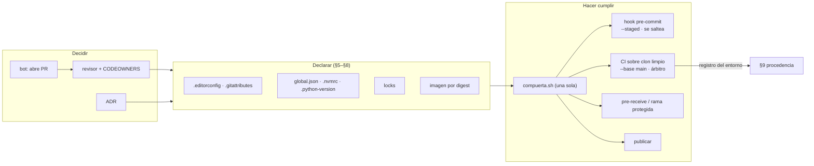

La tesis: **la declaración no cambia por accidente** (la compuerta lo detecta) y **cuando cambia, cambia por decisión** (un PR revisado, con su ADR si corresponde).

#### 10.2.1 Dónde se verifica cada cosa

| Qué | Local (hook) | CI (árbitro) | Servidor / publicación | Revisión humana |
|---|---|---|---|---|
| Texto: UTF-8, BOM, LF en el índice (§5) | ● rápido, lo que está en stage | ● lo del PR; en `main`, todo | ● | ○ los cambios invisibles los ve mejor una herramienta |
| Toolchain = lo declarado (§6) | ○ informa | ● en la imagen de CI, exacto | ● | ● **por qué** se subió |
| Grafo: restauración estricta (§7) | ○ lento y con red | ● siempre | ● | ● qué paquetes y desde qué fuente |
| Imagen por digest (§8) | — | ○ | — | ● ¿sigue el digest? ¿coincide con `global.json`? |
| La compuerta misma, `CODEOWNERS`, workflows | — | — | — | ● del rol dueño de la política |
| Decisión de descongelar | — | — | — | ● ADR / descripción del PR |

**[criterio]** Lo que una máquina puede decidir lo decide la compuerta; la revisión humana se reserva para el **porqué**. Un revisor que cuenta bytes de BOM no está mirando si la subida de SDK era necesaria.

#### 10.2.2 La compuerta única

Si el hook ejecuta una cosa y la CI otra, divergen: verde en la máquina y rojo en el PR, sin poder reproducirlo. Las herramientas empujan a lo mismo: pre-commit indica correr su configuración en la CI [B180], y las acciones de *setup* de GitHub leen la versión de los **mismos** archivos del repo (`global-json-file`, `node-version-file`, `required-version` de uv) [B181]. La compuerta del laboratorio (`Examples/N7-compuertas-y-gobierno/compuerta/compuerta.sh`) tiene tres pasos, uno por capítulo:

| Paso | Hace cumplir | Herramienta | Falla con (observado) |
|---|---|---|---|
| texto | `.editorconfig` + `.gitattributes` | `check_text_policy.py` sobre el índice | `no es UTF-8 válido (byte 0xf1 …; ¿cp1252?)`, `falta el BOM que .editorconfig declara` |
| toolchain | `global.json`, `.nvmrc`, `.python-version` | `dotnet --version`, `node --version`, `uv run python` | `global.json pide 10.0.400; el entorno resuelve 'ninguno'` |
| grafo | los tres locks, donde estén | `dotnet restore --locked-mode` y `requested` = `resolved`, `npm ci`, `uv lock --check` | `NU1004`, `NU1403`, `pide [8.0.2, ) y resolvió 9.0.0`, `EUSAGE`, «needs to be updated» |

Dos decisiones de diseño **[criterio]**: **un archivo presente sin su herramienta es rojo** (si el repo tiene `uv.lock` y la imagen no tiene `uv`, la compuerta falla; una compuerta que saltea en silencio existe en el papel, no en la práctica); y **la salida es una línea por paso**, con el commit y el alcance, que sirve a la vez de registro del entorno para §9. Tres alcances: `--staged` (hook), `--base origin/main` (PR), sin argumentos (`main`, servidor, publicación). El alcance acota sólo el texto: toolchain y grafo miran el disco, y un lock modificado sin marcar pasa el hook y la CI lo rechaza (`NU1004`; git 2.39.5, SDK 8.0.425 **[observado]**). La misma compuerta sirvió sin cambios para un repo .NET (E7-1), uno Node y uno Python (E7-7).

**Alcance declarado.** La compuerta de A.11 busca `global.json` y `.nvmrc` en la raíz, y los `.python-version` y los locks en todo lo versionado (`git ls-files`): sirve con los proyectos en la raíz (E7-1, E7-7) o en subcarpetas, como recomienda §11.2.3 (EA-1); un manifiesto sin lock queda para la revisión. «Compuerta única» es un solo programa por repositorio: `verificar.sh` (N8) es la de la solución de referencia, con sus rutas escritas, y no se copia. Y **una herramienta que falta no es una violación**: la compuerta dice «falta `python3`» o «falta el paquete EditorConfig», para que nadie apague el hook por un falso rojo.

#### 10.2.3 Hooks locales y frameworks de hooks

El hook `pre-commit` aborta el commit si falla y se saltea con `--no-verify` [B175]. Vive en `.git/hooks`, que **no se versiona**; `core.hooksPath` apunta git a una carpeta versionada (`.githooks/`), y cada clon ejecuta **una vez** `git config core.hooksPath .githooks` [B37][B175]. En E7-1, tras clonar, un archivo en cp1252 entra sin aviso; con el hook activo, se rechaza; con `--no-verify`, entra. **El hook es para el desarrollador** (el error a los diez segundos y no a los diez minutos en el PR), nunca la única defensa.

pre-commit es un framework de hooks multi-lenguaje, vigente en 4.6.2; el lenguaje de los hooks locales que usan un ejecutable del sistema se llama `unsupported` (antes `system`) desde la 4.4 [B180]. Sus hooks genéricos de texto traen una política propia: en E7-2, sobre un repo .NET con la política de §5, `fix-byte-order-marker` quitó el BOM de un `.razor` que la política exige [B52], y `end-of-file-fixer` agregó a `packages.lock.json` un salto final que NuGet vuelve a quitar: diffs sin contenido de ida y vuelta. **[criterio]** Un framework de hooks es un buen **orquestador** (instala, fija versiones, corre en paralelo); la política la hace cumplir un chequeo que **lee** `.editorconfig`, y los hooks genéricos se recortan con `exclude` alineados a ella.

#### 10.2.4 La CI como árbitro

Tres condiciones observables la convierten en árbitro: **clon limpio** (sin hooks ni configuración local; en E7-1 da el diagnóstico del hook); **la misma imagen** por digest o el toolchain instalado desde los archivos del repo [B181]; y **restauración estricta** (`--locked-mode` en CI/CD, recomienda NuGet [B83]). Y **todo lo que ejecuta la compuerta es parte del entorno**: fijar una acción a un SHA completo es la única forma de usarla como versión inmutable, hay políticas que lo exigen, y Dependabot no da alertas de vulnerabilidad para acciones fijadas por SHA, aunque sí las actualiza [B183]. Vale también para el `rev` de pre-commit (SHA, `autoupdate --freeze`) [B180] y para la imagen de CI.

#### 10.2.5 Revisión humana: qué mirar en un cambio de entorno

| Archivo tocado | Qué preguntar | Por qué |
|---|---|---|
| `.editorconfig`, `.gitattributes` | ¿Cambia la política para todo el repo? ¿El commit de renormalización viene aparte, verificado y en `.git-blame-ignore-revs`? | §5 |
| `global.json`, `.nvmrc`, `.python-version` | ¿Se subió a propósito? ¿Se movió la imagen de CI y del devcontainer **en el mismo PR**? ¿Se regeneraron los locks? ¿Hay ADR? | §6; E7-3: `global.json` sin imagen = CI roja |
| Locks | ¿Lo regeneró la herramienta? ¿Viene con su manifiesto? ¿Aparecen paquetes, fuentes o hashes nuevos? | §7; E7-3: un lock editado a mano da `NU1403` |
| Manifiestos | ¿Qué dependencia cambió y por qué? ¿Rangos flotantes nuevos? | §7 |
| `nuget.config`, `.npmrc`, índices de uv | ¿Registro nuevo? ¿Desaparece el mapeo? | §7 |
| `Dockerfile`, `devcontainer.json` y su lock | ¿Lo que construye artefactos publicados sigue por digest, o en el runner alojado (§8.2.2)? ¿El devcontainer usa etiqueta fija o la receta de la CI, y su SDK coincide con `global.json`? | §8.2.2 |
| `CODEOWNERS`, workflows, `.githooks/`, `.pre-commit-config.yaml`, la compuerta, los bots | ¿Cambia la compuerta o quién revisa? ¿Lo aprueba el dueño de la política? | quien puede cambiar la compuerta puede apagarla |
| Cualquier diff «de línea entera» | ¿Es un cambio invisible? | §4, §5 |

Los cambios invisibles necesitan una herramienta: en E7-3 un IDE guardó un `.cs` con BOM y la web muestra la línea entera cambiada con el texto idéntico; `Examples/N7-compuertas-y-gobierno/03-revisor-cambios-de-entorno/cambios-de-entorno.py` normaliza y reporta `Program.cs: mismo texto; cambia sólo ['BOM']`, y la compuerta lo rechaza. **El revisor no lo busca a ojo: decide si es la normalización acordada.** `CODEOWNERS` asigna los archivos de entorno; su aprobación es obligatoria sólo con protección de rama, y en GitLab requiere Premium o Ultimate [B178][B185].

#### 10.2.6 Descongelar sin perder trazabilidad

**Todo lo que depende de la versión que se mueve, se mueve en el mismo PR** **[criterio]** (apoyado en E7-4 y [B83]):

| Se descongela | Se mueve junto | Registro |
|---|---|---|
| Un paquete (parche/menor) | manifiesto + lock regenerado | el PR (o el del bot) |
| Un paquete mayor o una fuente nueva | manifiesto + lock + `nuget.config` | ADR corto |
| SDK / runtime / intérprete | archivo de versión + imagen de CI y devcontainer + locks regenerados | ADR |
| Imagen base | digest en `Dockerfile`/`devcontainer.json`, sobre una etiqueta **fija** de SDK: con una flotante, el PR del digest puede traer otro SDK (E3-7) | PR del bot, o ADR si cambia la distribución |
| Política de texto | `.editorconfig`/`.gitattributes` + commit de renormalización aparte + `.git-blame-ignore-revs` | ADR |

E7-4 lo muestra: cambiar un paquete sin regenerar el lock da `NU1004` en el hook; tras `dotnet restore`, el commit lleva `.csproj` y lock juntos y la compuerta da verde. Subir `global.json` a 10.0.400 con `rollForward: disable` deja la compuerta en rojo en la imagen vieja (toolchain y grafo) y en verde en la nueva; el commit final lleva `global.json`, la receta de la imagen y `docs/adr/0002-sdk-10.md`.

**Cadencia.** Un congelamiento sin actualización se vuelve deuda. .NET 8 (LTS) y .NET 9 (STS) terminan su soporte el **10 de noviembre de 2026**; .NET 10 sigue hasta el 14 de noviembre de 2028; los parches salen cada mes y para tener soporte hay que estar en el último [B61]. Node publica mayores cada seis meses (desde Node 27, anuales) [B68]; Python una por año, en octubre [B187]. **[criterio]** Parches de SDK e imagen, mensuales con bot; mayores, por ADR antes del fin de soporte; paquetes, semanales con enfriamiento.

**Bots.** Automatizan la **propuesta**, no la decisión. Dependabot soporta `dotnet-sdk` (para `global.json`), `nuget`, `npm`, `uv`, `pip`, `docker`, `devcontainers`, `github-actions` y `pre-commit`, con `groups` y `cooldown`; por defecto espera 3 días en las actualizaciones de versión y no abre más de cinco PR a la vez [B182]; su tabla declara versiones máximas de gestor por debajo de las vigentes [B107], y cómo se comporta con las más nuevas **[no verificado]** (requiere la plataforma). Microsoft sugiere Dependabot para el SDK de `global.json` y `CheckSdkVulnerabilities` para que la build avise [B58], pero la propiedad existe desde el SDK 11 (§6.3): con SDK 8 o 10 avisa `dotnet sdk check` en un job programado (8.0.425: `going out of support soon` **[observado]**). Renovate ofrece `minimumReleaseAge`, `lockFileMaintenance` y `pinDigests` [B108]. **[criterio]** Con un bot, **cada descongelamiento llega como PR**, con la misma compuerta, el mismo revisor y la misma traza; el enfriamiento deja que otros descubran una versión rota o maliciosa antes.

**El ADR de entorno.** Microsoft lo describe como registro de solo agregado: no se editan los aceptados; si la decisión cambia, uno nuevo reemplaza al anterior [B184]. La plantilla del [Anexo A.16](#a16-adr-de-entorno) agrega una sección **superficie del cambio** con los archivos que se mueven juntos. **[criterio]** ADR para subir o bajar SDK/runtime/intérprete, cambiar `rollForward`, la política de texto, la compuerta o quién revisa, y para toda excepción temporal (con fecha de vencimiento); no para un parche propuesto por un bot.

#### 10.2.7 Límites: compuertas sin protección de rama

En GitHub, las ramas protegidas, los dueños de código requeridos y los *rulesets* están en repositorios **públicos** con Free y en privados con Pro (cuentas personales), Team o Enterprise (organizaciones) [B176][B177][B179]: para una organización, el mínimo es Team. En GitLab, las ramas protegidas y «Pipelines must succeed» están en Free —ésta impide fusionar un *merge request* sin pipeline exitosa, incluso sin ninguna [B199]—, y la aprobación obligatoria de dueños es Premium/Ultimate [B185]. En Azure DevOps la validación de build obligatoria decide si el PR se completa, con permisos de *bypass* explícitos [B186].

E7-5 muestra qué significa «la CI avisa pero no impide»: un commit con cp1252, hecho con `--no-verify`, se empuja a `main` y se acepta; la CI corre **después**, da rojo, y `main` ya quedó roto. Dónde todavía se puede impedir:

| Control | Qué impide | Qué no impide | Evidencia |
|---|---|---|---|
| Rama protegida con chequeo requerido (GitHub, si el plan la ofrece) | El merge o el push sin el chequeo aprobado | Un PR que edita la compuerta o el workflow para que salgan 0: el evento `pull_request` corre el código del *merge commit* del PR [B200]; un job `skipped`, que satisface el chequeo; a los administradores, salvo que se los incluya [B177]; un estado con el mismo nombre publicado por otra fuente, si no se fijó la app esperada [B177] | [B177][B200] |
| Rama protegida sin push directo + «Pipelines must succeed» (GitLab, también en Free) | Fusionar sin una pipeline exitosa | Un MR que edita `.gitlab-ci.yml` o la compuerta, si la aprobación de dueños no es obligatoria (Premium/Ultimate) | [B185][B199] |
| Validación de build obligatoria (Azure DevOps) | Completar el PR sin una build exitosa | A quien tiene permiso de *bypass* | [B186] |
| `pre-receive` en un servidor propio | El push completo (`pre-receive hook declined`, `main` intacto) | A quien puede deshabilitarlo: el administrador del servidor y, en GHES, los de organización o repositorio si se les delegó [B214]; su tiempo está acotado en GHES (abajo) | E7-5, [B175][B214] |
| Compuerta en el **acto irreversible**: publicar sólo desde `main`, corriendo la compuerta sobre ese commit en un clon limpio, sin reescribir una versión publicada | Publicar desde un estado que no cumple | Que `main` quede rojo un rato | E7-5 |
| Regla escrita + revisión periódica de que `main` está en verde | Nada en el momento; detecta | Todo | **[criterio]** |

**[criterio]** «Impide» vale de verdad cuando, además del chequeo requerido, la revisión de dueños es obligatoria sobre los archivos que pueden desarmarla (los de A.14: compuerta, workflows, registros y propiedades de restauración), la aprobación del último push la hace alguien distinto de quien lo empujó, los administradores están incluidos en la regla y el chequeo exige como fuente la app de GitHub Actions [B177].

En GitHub Enterprise Server, los `pre-receive` de un repositorio comparten un presupuesto acumulado de **5 segundos** y se desaconseja llamar servicios externos [B188]; la compuerta del laboratorio tardó 1,5–2,3 s en un repo de juguete (E7-5b), que no se generaliza. **[criterio]** Ahí el `pre-receive` corre sólo el paso de texto, rápido y sin red. Sin chequeos requeridos, la fusión automática de Renovate puede fusionar PR con pruebas fallidas [B108]: **sin protección de rama, ningún bot fusiona solo**. Y lo honesto es **declarar el límite**, no escribir que «la CI bloquea»: un `main` rojo unas horas cuesta poco; una versión publicada desde un estado no verificado, no.

#### 10.2.8 Roles

| Actor | Decide | Puede cambiar | Aprueba |
|---|---|---|---|
| ACT-ARQ | Política de texto, toolchain, dependencias, estrategia de imagen (única o por componente); cuándo se descongela una mayor | `.editorconfig`, `.gitattributes`, `global.json`, `Directory.Packages.props`; escribe los ADR | Todo PR que toque esos archivos |
| ACT-OPS | Construcción, digest y mantenimiento de las imágenes de CI y devcontainer; compuerta, bots, protección de rama | `compuerta.sh`, workflows, `Dockerfile`, `devcontainer.json`, configuración de bots, `CODEOWNERS` | PR que toquen la compuerta o la imagen |
| ACT-REV | El PR concreto | — | — |
| ACT-DEV | Activar el hook en su clon; regenerar el lock | Manifiesto y lock **juntos** | — |

**[criterio]** Quien puede cambiar la compuerta no debería poder aprobarse ese cambio; y las excepciones también son cambios: quién tiene permiso de *bypass* (GitHub permite a los administradores saltear la protección salvo que se configure lo contrario [B177]; en GHES, quien puede deshabilitar un `pre-receive` [B214]) y cómo queda registrado su uso.

### 10.3 Qué propone la industria

| Ecosistema | Fabricante | Convención | **[criterio]** |
|---|---|---|---|
| .NET | `--locked-mode` en CI [B83]; `rollForward: disable` sólo con lock files [B56]; `dotnet sdk check`, Dependabot y, desde el SDK 11, `CheckSdkVulnerabilities` [B58]; `setup-dotnet` con `global-json-file` [B181] | Dependabot `nuget` + `dotnet-sdk`; ADR para subir de banda | Lock por defecto (§7.2.1); compuerta que compara `dotnet --version` con `global.json` |
| Node.js | `npm ci` en CI [B91]; `setup-node` con `node-version-file` [B181] | Bots con enfriamiento | La misma compuerta lee `.nvmrc` y corre `npm ci` (E7-7) |
| Python | `uv lock --check` o `--locked` [B97]; `setup-uv` lee `required-version` [B181] | pre-commit [B180]; Dependabot `uv` | La misma compuerta lee `.python-version` y corre `uv lock --check` (E7-7) |
| Transversal | Acciones por SHA [B183]; ramas protegidas [B177][B186]; ADR [B184] | `CODEOWNERS` [B178]; pre-commit como orquestador | Compuerta única; compuerta en el acto irreversible |

### 10.4 Aplicación por escenario y contexto

| Escenario | Qué hace cumplir | Qué cambia |
|---|---|---|
| ESC-01 Windows + Visual Studio | El hook (si se activa) y, sobre todo, la CI | El hook necesita los prerrequisitos de A.11; a mano, desde Git Bash en la raíz: `bash tools/ci/compuerta.sh` **[no verificado]**, igual que la integración de git de Visual Studio con `core.hooksPath`. El problema del caso no se ve acá: la CI en Linux lo revela. |
| ESC-02 Linux | Hook + CI | — |
| ESC-03 WSL 2 | Hook + CI | `core.hooksPath` en el git de **ese** lado. |
| ESC-04 Devcontainer | Hook dentro del contenedor + CI | Con la misma imagen que la CI, el hook da el veredicto de la CI sobre lo que está en disco (`--staged` acota sólo el texto, §10.2.2); `postCreateCommand` activa el hook (A.9) **[criterio]**. |
| ESC-05 CI | Árbitro; registro del entorno para §9 | Sin protección de rama, sólo avisa: compensar en la publicación. |

Por contexto, la misma compuerta corre los pasos cuyos archivos existen y deja `n/a` los demás (E7-1, E7-7); en CTX-POLI (los tres ecosistemas en un repo) corre sus tres pasos para los tres a la vez, sobre los proyectos que encuentra (§10.2.2), y un manifiesto sin lock queda en `n/a`: lo ve la revisión (EA-1, paso 8); la imagen tiene que traer las tres herramientas, y la regla «archivo presente sin herramienta = rojo» evita que el `uv.lock` quede sin verificar en una imagen de .NET.

### 10.5 Ejemplos concretos

```sh
#!/bin/sh
# .githooks/pre-commit — el hook no tiene lógica propia: si la tuviera, local y CI dirían cosas distintas.
exec "$(git rev-parse --show-toplevel)/tools/ci/compuerta.sh" --staged
```

```yaml
# .pre-commit-config.yaml — framework como orquestador, alineado con .editorconfig.
# Reemplaza a .githooks/ (A.11), no se suma: con core.hooksPath, pre-commit install se niega (10.6).
# Adaptado a la política de A.1: la versión ejecutada en E7-2 excluía sólo .razor/.cshtml/.sln
# y packages.lock.json; .ps1, package-lock.json y uv.lock se agregan por la misma regla.
minimum_pre_commit_version: "4.4.0"     # "unsupported" no existe en versiones viejas
repos:
  - repo: https://github.com/pre-commit/pre-commit-hooks
    rev: 3e8a8703264a2f4a69428a0aa4dcb512790b2c8c  # frozen: v6.0.0
    hooks:
      - id: fix-byte-order-marker
        exclude: '\.(razor|cshtml|sln|ps1)$'   # .editorconfig: charset = utf-8-bom
      - id: end-of-file-fixer
        exclude: '(packages\.lock\.json|package-lock\.json|uv\.lock)$'
  - repo: local
    hooks:
      - id: compuerta-entorno
        name: compuerta del entorno
        entry: tools/ci/compuerta.sh --staged
        language: unsupported
        pass_filenames: false
        always_run: true
```

```bash
# publicar.sh <remoto> <commit> <version> — compuerta en el acto irreversible
# (extracto de E7-5; la ruta de la compuerta, adaptada a A.11).
tmp=$(mktemp -d); git clone -q "$remoto" "$tmp/r" && cd "$tmp/r" || exit 2   # clon limpio, no el árbol de quien publica
git merge-base --is-ancestor "$commit" origin/main || exit 1     # sólo desde main
git rev-parse -q --verify "refs/tags/v$version" && exit 1        # no reescribir lo publicado
git checkout -q "$commit" && tools/ci/compuerta.sh > compuerta.txt || exit 1
git tag -a "v$version" -m "v$version" && git push origin "v$version"
# compuerta.txt viaja con el artefacto como registro de entorno (§9)
```

Experimentos del capítulo: E7-1 a E7-7 y E7-5b (Anexo E).

### 10.6 Preguntas guía

**¿Qué se verifica en local, qué en CI y qué en revisión humana?**
En local, lo rápido y corregible antes del commit. En la CI, todo, sobre un clon limpio. En revisión humana, el **porqué** de los cambios que mueven la declaración y lo que una herramienta marca pero no puede juzgar. *Aplica* cada vez que alguien propone «agregar un chequeo»: si lo puede decidir una máquina, va a la compuerta, no a la lista del revisor.

**¿Alcanza con un hook?**
No (§10.2.3, E7-1). *Aplica* a todo equipo: el hook es para ACT-DEV; la defensa es la CI (ESC-05).

**¿Uso pre-commit o un script propio?**
Como orquestador, pre-commit es útil; como guardián de la política de texto, sus hooks genéricos pueden contradecirla (E7-2). Si se adopta, la política la sigue haciendo cumplir un chequeo que lee `.editorconfig`: el del laboratorio o editorconfig-checker (§5.2.5). Las dos entradas se excluyen: con `core.hooksPath` (A.9, A.11), `pre-commit install` se niega (4.6.2 **[observado]**); **[criterio]** el `postCreateCommand` activa una sola. *Aplica* al elegir cómo se instalan los hooks en las estaciones y el devcontainer (ESC-01 a ESC-04).

**¿Cómo se descongela algo sin perder trazabilidad?**
Con un PR que mueve juntos todo lo que depende de la versión, que pasa por la compuerta en la imagen **nueva** y que deja registro (E7-4). El bot propone, la compuerta verifica, el revisor decide. *Aplica* a ACT-ARQ y ACT-OPS en cada subida de SDK, runtime, imagen o paquete mayor.

**¿Por qué un lock que cambia sin su manifiesto es sospechoso?**
Porque la herramienta sólo lo reescribe cuando cambia lo declarado. Si cambió solo, o se regeneró con otro SDK o gestor (E3-6), o se editó a mano; la restauración estricta detecta lo segundo con `NU1403` (E7-3), y lo primero lo tiene que preguntar el revisor. *Aplica* a ACT-REV en CTX-NET y CTX-POLI.

**¿Qué hago si la plataforma no ofrece protección de rama?**
Declararlo, no esconderlo, y compensar: compuerta en el acto irreversible, `pre-receive` si el servidor es propio, revisión periódica de que `main` está en verde, y ninguna fusión automática de bots (E7-5). *Aplica* a repositorios privados en planes sin protección de rama (§10.2.7).

**¿Hay que fijar también las herramientas de la compuerta?**
Sí: acciones por SHA, `rev` de pre-commit por SHA, imagen de CI por digest (o runner alojado, §8.2.2), versiones de `EditorConfig`, `uv`, `pre-commit` en las recetas. Una compuerta que cambia sola produce rojos y verdes que nadie reproduce. *Aplica* a ACT-OPS al escribir la compuerta y su workflow.

**El hook de un compañero en Windows rechaza su commit con «la política de .editorconfig/.gitattributes no se cumple», pero su `.cs` es UTF-8 válido. ¿Qué mirás antes de dejarlo usar `--no-verify`?**
Si la estación tiene los prerrequisitos de A.11: una compuerta que no distingue «falta herramienta» de «violación» informa lo segundo. Se instala lo que falta (receta de A.11) o se corrige la compuerta para que lo diga; `--no-verify` sólo traslada el problema a la CI. *Aplica* a ESC-01 (Windows con Visual Studio).

### 10.7 Criterios de calidad

Un gobierno del entorno que funciona:

- tiene **una** compuerta versionada, invocada igual por hook, CI y publicación, y que falla si falta una herramienta;
- fija por SHA o digest todo lo que ejecuta la compuerta, salvo la imagen del runner alojado, que se registra (§8.2.2);
- asigna los archivos de entorno a sus dueños y separa a quien cambia la compuerta de quien lo aprueba;
- mueve las versiones sólo por PR (de un bot o con ADR), con todo lo que depende de ellas en el mismo PR;
- declara con honestidad qué bloquea y qué sólo avisa en su plataforma.

Señales de una versión pobre, por quién las ve:

- **En la compuerta**: el hook como única defensa (§10.2.3); lógica distinta en hook y CI (§10.2.2); hooks genéricos de BOM sin cruzar con `.editorconfig` (§10.2.3); `dotnet restore` o `npm install` en la CI (§10.2.4); `n/a` para un archivo que existe en una subcarpeta, o «violación» cuando falta una herramienta (§10.2.2).
- **En la revisión**: `global.json` subido sin mover la imagen (§10.2.6); un lock que cambió sin su manifiesto aprobado sin preguntar, o un diff de línea entera aceptado sin mirar si sólo cambió el BOM (§10.2.5).
- **En la plataforma y el gobierno**: documentar «la CI bloquea el merge» sin protección de rama, o que la rama protegida «impide» sin decir qué no impide (§10.2.7); acciones por etiqueta móvil mientras se exige digest en la imagen (§10.2.4); un bot sin agrupación ni enfriamiento decidido, o ningún ADR que explique por qué `rollForward` es `disable` (§10.2.6).

### 10.8 Plantilla

[A.11 hook y compuerta](#a11-hook-versionado-y-esqueleto-de-la-compuerta), [A.12 workflow de CI](#a12-workflow-de-ci), [A.13 `dependabot.yml`](#a13-dependabotyml), [A.14 `CODEOWNERS`](#a14-codeowners), [A.16 ADR de entorno](#a16-adr-de-entorno). La compuerta completa: `Examples/N7-compuertas-y-gobierno/compuerta/`.

### 10.9 Práctica

1. Revisá el PR de E7-4 que sube el SDK con la lista B.4. ¿Lo aprobás? *Respuesta esperada*: sí, porque mueve juntos `global.json`, la receta de la imagen y el ADR, y la compuerta pasa en la imagen nueva (§10.2.6).
2. Con la tabla de §10.2.7, escribí qué impide y qué no impide la configuración de tu plataforma y tu plan, y qué control compensatorio agregás donde no impide nada. *Criterio de corrección*: cada fila dice «impide» o «sólo avisa» en tu plan, qué no impide y su control compensatorio.

**Volver al mapa.** Tapá las columnas «Qué deja libre» y «Evidencia» de §3.3, escribilas para cada mecanismo y compará; si no podés, volvé a su capítulo. *Criterio de corrección*: coincide con la tabla, y tres filas se reconocen respaldadas sólo por una fuente.

---

## 11. Una sola solución con .NET, Node.js y Python

Los capítulos 4 a 10 contestaron cada pregunta por ecosistema. Éste junta las partes en un repositorio que tiene, a la vez, una consola .NET, un frontend construido con Node.js y un generador de código en Python, y mira qué se rompe **en las uniones**: texto, versiones, la build que cruza ecosistemas, la imagen, el SBOM y la procedencia. Es el capítulo central de la guía: la integración no la documenta ningún fabricante (§11.3) y por eso hay que diseñarla.

### 11.1 Definición

| Término | Definición |
|---|---|
| **Solución políglota** (CTX-POLI) | Repositorio cuyo artefacto necesita, para construirse, toolchains de más de un ecosistema. En el laboratorio, la DLL .NET embebe un bundle que produce Node y compila un `.cs` que genera Python. |
| **Monorepo** | Varios proyectos versionados juntos. No implica una herramienta: npm y uv lo llaman *workspace* [B112][B111]; .NET lo expresa con una solución y archivos `Directory.*.props`. |
| **Frontera de la build** | El punto donde la build de un ecosistema invoca a otro: **dentro** de una herramienta (un target de MSBuild que ejecuta `npm`) o **fuera** de todas (un script que llama a cada una). |
| **Orquestador** | Quien decide el orden de los pasos y los ejecuta: MSBuild, un script versionado, un sistema de build general o la CI. |
| **Imagen multi-runtime** / **por componente** | Una imagen con los tres toolchains, o una imagen oficial por ecosistema con las salidas pasadas entre etapas. |
| **Archivo nativo de versión** | El que **la propia herramienta del ecosistema** lee: `global.json`, `.nvmrc`/`engines`, `.python-version`/`requires-python`. Se opone al de un gestor de terceros (`mise.toml`, `.tool-versions`). |
| **Alcance de un SBOM** | Qué describe: el **artefacto** que se entrega, las **dependencias declaradas** en los locks, o el **entorno** que lo construyó. |

La solución de referencia del laboratorio (`Examples/N8-integracion-poliglota/solucion/`):

```text
solucion/
├── .editorconfig  .gitattributes          política de texto raíz (§11.2.2)
├── global.json  .nvmrc                    versiones nativas (§11.2.3)
├── Directory.Packages.props  nuget.config CPM y fuentes NuGet
├── src/Saludo/        Saludo.csproj (targets que llaman a npm y uv), Program.cs, packages.lock.json
├── web/               package.json, package-lock.json, .npmrc (engine-strict), build.mjs
├── tools/gen/         pyproject.toml, uv.lock, .python-version, gen.py (genera Datos.g.cs)
├── verificar.sh       compuerta única: texto + toolchain + restauración estricta
├── build.sh           orquestador: compuerta → Python → Node → .NET → registro
└── registrar-entorno.sh
```

El flujo es cruzado a propósito: Python escribe `Datos.g.cs`, Node escribe `dist/app.js`, y .NET compila el primero y embebe el segundo. Ninguna parte se construye sola, y la pregunta «¿quién llama a quién?» tiene que contestarse.

### 11.2 Cómo funciona

#### 11.2.1 Qué se rompe primero

E8-1 aplica a la solución las dos políticas «globales» que un equipo adopta sin pensar por extensión —la corrección del caso aplicada a todo («UTF-8 con BOM para todo») y el checkout de una estación Windows con `core.autocrlf=true` y sin `.gitattributes` («CRLF para todo»)— más el heredado del caso (cp1252), y corre quince lectores de los tres ecosistemas sobre los mismos bytes:

| Lector | A. Política por extensión | B. BOM para todo | C. CRLF para todo | D. Heredado cp1252 |
|---|---|---|---|---|
| `./tools/hola.sh` (`#!/bin/sh`) | OK | OK **con error en stderr** | **FALLA** `cannot execute: required file not found` | OK |
| `./tools/saluda.py` (`#!/usr/bin/env python3`) | OK | **FALLA** `#!/usr/bin/env: No such file or directory` | **FALLA** `'python3\r': No such file or directory` | OK |
| `uv run python gen.py` | OK | OK | OK | OK |
| Python `json.load(open(…, encoding="utf-8"))` | OK | **FALLA** `Unexpected UTF-8 BOM` | OK | **FALLA** `UnicodeDecodeError … 0xf1` |
| Python `tomllib` sobre `pyproject.toml` | OK | **FALLA** `Invalid statement` | OK | OK |
| `uv sync --locked` · `uv python find` | OK | OK | OK | OK |
| Node `JSON.parse(readFileSync(…))` | OK | **FALLA** `Unexpected token ''` | OK | OK **con U+FFFD** |
| Node `require("…json")` · `npm ci` · `npm run build` | OK | OK | OK | OK |
| `dotnet --version` · `dotnet restore --locked-mode` | OK | OK | OK | OK |
| `dotnet build` | OK | OK | OK | **FALLA** `CS1056: Unexpected character '�'` |
| Compuerta: `.nvmrc` contra `node -v` | OK | **FALLA** (los bytes del BOM entran en la comparación) | OK | OK |

*Fuente: E8-1, `Examples/N8-integracion-poliglota/salidas/E8-1-choque-de-convenciones.txt`.*

La tabla cambia la pregunta del caso. **Lo primero que se rompe no es la compilación de C#, sino lo que un humano no ve**: los scripts con shebang, los parsers estrictos de JSON y TOML, y las comparaciones de texto del propio equipo; las herramientas de paquetes (`npm`, `uv`, `dotnet`) toleran el BOM. Dos «OK» esconden daño: el `.sh` con BOM corre con otro intérprete y sale con 0 si lo lanza un shell (§4.2.4), y Node lee el JSON en cp1252 **sin quejarse**, con U+FFFD. Con código heredado, el ecosistema más permisivo es el que más tarde avisa: el caso rompe a C# en Linux, a Python en el primer `open` estricto y **corrompe en silencio** lo que lee Node.

#### 11.2.2 Política de texto raíz, por extensión

La regla es la de §5, y E8-1 la confirma en conjunto (la columna A pasa los quince lectores): **UTF-8 sin BOM y LF como regla general, con excepciones por extensión que exige quien lee el archivo**, no el lenguaje: `.sh` sin BOM y con LF (el kernel); `.cmd`/`.bat` con CRLF (`cmd.exe`); `.razor`/`.cshtml` con BOM (las plantillas y el fabricante) y `.sln` con BOM (la CLI lo repone); `.ps1` con BOM si se usa Windows PowerShell 5.1 [B54]; locks sin exigir salto final (NuGet no lo pone; `package-lock.json` y `uv.lock` sí). En `.editorconfig`, `unset` anula una propiedad de `[*]` y la sección posterior gana, así que las excepciones van al final [B43].

Los archivos que **genera** un ecosistema para otro también entran en la política. En el laboratorio, Python escribe un `.cs` con `encoding="utf-8"` y `newline="\n"` explícitos, porque en Python 3.14 y anteriores —el 3.12 del laboratorio— `open()` sin codificación usa `locale.getencoding()`, que en Windows es la página ANSI [B35]; desde 3.15 usa UTF-8 estricto [B29][B205][B220], y un archivo en otra codificación falla en vez de leerse. **Un generador sin codificación explícita reproduciría el caso disparador desde adentro de la build.** Y la tentación de marcar los locks como `linguist-generated` para «limpiar» el PR choca con §7 y §10: GitHub los oculta por defecto en el diff [B192], y el revisor tiene que verlos.

#### 11.2.3 Punto único de verdad de las versiones

La pregunta del caso («congelar… versiones de compiladores, sdk») se multiplica por tres. §6 recomendó archivos nativos + compuerta + imagen construida desde ellos; E8-2 lo pone a prueba con los tres ecosistemas juntos y encuentra una condición nueva: **los archivos nativos no se buscan igual.**

| Archivo | Quién lo busca | Desde dónde | Hasta dónde |
|---|---|---|---|
| `global.json` | `dotnet` y el resolvedor de MSBuild | directorio actual / solución o proyecto | ancestros [B56] |
| `.nvmrc` | nvm, fnm, mise (si se habilita), la compuerta | según el gestor | — |
| `.python-version` | uv | directorio actual y padres | **no** pasa el límite del proyecto o *workspace* [B75] |

Con `.python-version` (3.12.15) en la **raíz** y el proyecto uv en `tools/gen/`, `uv run` desde `tools/gen/` usó 3.12.14 **sin aviso**, por `requires-python` (E8-2): el archivo «único» no gobernaba al único proyecto Python. **[criterio]** Un archivo nativo por ecosistema, **donde lo busca su herramienta**: `global.json` y `.nvmrc` en la raíz; `.python-version` dentro del proyecto uv (o la raíz como *workspace* de uv [B111], al costo de un `pyproject.toml` en la raíz de una solución .NET).

**La compuerta es lo que hace «único» al punto de verdad.** Lee los tres archivos y los compara con lo instalado: si alguien sube `.nvmrc` y no reconstruye la imagen, falla con `node esperado 24.21.0, encontrado 22.23.2` (E8-2, `verificar.sh`); Node no lo habría detectado, porque no lee `.nvmrc`. **mise y asdf, como lectores y no como fuente**: mise 2026.10.3 no lee los archivos nativos salvo que se lo habilite, y un `mise.toml` con `node = "24"` **gana** sin avisar que contradice a `.nvmrc` (E8-2) [B79]. Las *features* de devcontainer tampoco los leen: por defecto, la de .NET usa `latest`, la de Node `lts` y la de Python `os-provided` [B137]: tres versiones flotando si no se fijan y verifican.

#### 11.2.4 Un lock y un registro de paquetes por ecosistema

No hay lock común (§7). Se unifica el procedimiento: los tres archivos que declaran los registros de paquetes, **en el repo** —`nuget.config` con `<clear />` y mapeo [B87][B86]; `.npmrc` del proyecto con el registro y los *scopes* [B109]; índices de uv con la estrategia `first-index` y `explicit = true` para los internos, que protege sólo lo asignado a ese índice [B110]—, ninguno dependiente del usuario y cada uno con el hueco de §7.3, y la compuerta corriendo los tres comandos estrictos. El `.npmrc` del proyecto tiene la prioridad más alta de npm, pero sólo en la raíz donde se corre [B109]: en un *workspace*, el de un miembro se ignora con un aviso (npm 10.9.8, verificación del laboratorio N8 sin script versionado; Anexo F).

#### 11.2.5 La frontera de la build: quién llama a quién

Ningún fabricante documenta la **build** integrada de los tres ecosistemas; cada uno documenta cómo agrupar sus proyectos y, a veces, cómo invocar a otro. La excepción parcial es Aspire 13, que orquesta apps .NET, JavaScript y Python para **ejecutar y publicar** —no para compilar una DLL que embeba las salidas de los otros— y cuyos Dockerfiles toman Node de `.nvmrc` y Python de `.python-version` [B167] **[no verificado]** (no ejercitado en el laboratorio). El laboratorio implementa dos diseños sobre el mismo `.csproj`.

**A. MSBuild llama a todos.** Targets del `.csproj` ejecutan `npm ci`, `npm run build` y `uv run --locked python gen.py` antes de compilar. Es lo que obtiene quien abre la solución en Visual Studio (ESC-01) y aprieta F5. E8-3 mide sus consecuencias:

1. **La imagen del SDK sola no alcanza**: `error MSB3073: The command "npm ci --no-audit --no-fund" exited with code 127`. La frontera implica que la imagen de .NET necesita también Node y Python.
2. **`Inputs`/`Outputs` la hacen incremental**: la segunda build sin cambios saltea `ConstruirWeb` y `GenerarDatos`; tocar `uv.lock` rehace sólo el paso Python [B170].
3. **MSBuild usa el Node que esté primero en el `PATH`**: con Node 24 antepuesto y `.nvmrc` = 22.23.2, si `web/.npmrc` tiene `engine-strict=true`, `npm ci` falla con `EBADENGINE` y la build cae; sin `engine-strict`, el bundle sale `construido con node v24.21.0`. `global.json` no cubre a Node ni a Python. Dentro de esta frontera hace cumplir la versión de Node lo que evalúa npm: `devEngines.runtime`, que falla por defecto en `npm ci` y `npm run` sin configuración adicional (`EBADDEVENGINES` con npm 10.9.8 en E8-3, que corre el npm del `PATH` y no el del Node antepuesto; con npm 11.19, E3-3), o, alternativamente, `engines` + `engine-strict`.
4. **`Exec` corre `cmd.exe` en Windows y `sh` en el resto** [B168]: los comandos del target tienen que valer en ambos intérpretes; `npm ci` y `uv run …` sí, una tubería de bash no.

**B. El orquestador llama a todos.** `build.sh` corre la compuerta, después Python, Node y .NET, cada uno una vez, y construye .NET con `-p:ConstruirPoliglota=false`, que apaga los targets de A. Si alguien construye la parte .NET sola sin las salidas de los otros, un target corta con un error que dice qué hacer.

**El proyecto JavaScript de Visual Studio (`.esproj`).** Es la forma documentada de tener proyectos Angular, React o Vue en una solución de Visual Studio, y en *Build* y *Restore* corre `npm install` (`ShouldRunNpmInstall`, `true` por defecto) y `npm run build` [B169]. E8-4 lo construyó en Linux: con el MSBuild del SDK 8, la versión 1.0.6887863 del SDK de JavaScript **no carga** (queda acoplada a la versión del SDK de .NET; `global.json` fija SDK de proyecto en `msbuild-sdks` [B56]); con SDK 10 corre `npm install` y, ante un `package.json` que ya no coincide con el lock, **reescribe el lock** con la build en verde: el «regenera en silencio» que §7 prohíbe. Con `ShouldRunNpmInstall=false` y un target propio que corre `npm ci` antes del interno `RunNpmInstall`, la misma deriva falla con `EUSAGE`.

**`RunNpmInstall` no es un contrato.** El enganche que sugiere la documentación (antes de `BeforeRestore`) no ejecutó `npm ci` en la versión probada, y `RunNpmInstall` es un nombre interno de `Sdk.targets`, no un contrato: se revisa al subir de versión. En Linux, además, el SDK intenta `cmd.exe` para `npm audit` y deja un directorio llamado literalmente `obj\Debug`.

**[criterio] Criterio de elección.**

| Si… | Frontera | Por qué |
|---|---|---|
| Hay desarrolladores en Visual Studio que esperan que F5 «haga todo» | A en la estación, **con** `npm ci`, `uv run --locked`, `devEngines` (o `engine-strict`) e `Inputs`/`Outputs` | Comodidad sin perder el modo estricto |
| La CI publica el artefacto | B en la CI | Cada ecosistema corre una vez, con su comando estricto, entre la compuerta y el registro del entorno |
| Se usa `.esproj` | Apagar `ShouldRunNpmInstall` y enganchar `npm ci` | El default reescribe el lock |
| Cada componente se publica por separado | B, un job o etapa por componente | No hay una build .NET que deba llamar a nadie |

**Los dos caminos tienen que producir lo mismo**, y en el laboratorio lo hacen cuando ruta **y configuración** coinciden: `build.sh` en `Release` y `dotnet build -c Release` dieron la misma DLL (`4dd5d90f…`); el `dotnet build` sin `-c` de F5 compila en `Debug` y da otra (verificación del laboratorio N8; Anexo F). **[criterio]** La igualdad se comprueba en la CI, no en la estación (F5 compila en `Debug` y sin `ContinuousIntegrationBuild`, §9.4), como **prueba de regresión del `.csproj`**: en la misma imagen, `dotnet build -c Release -p:ContinuousIntegrationBuild=true` con `ConstruirPoliglota=true` y `build.sh`, comparando las DLL. Demuestra que los targets de A no divergen de B, no que la estación reproduzca a la CI.

#### 11.2.6 Una imagen con tres runtimes o una por componente

E8-5 construye las dos variantes con las mismas versiones:

| Imagen | Tamaño | Trae |
|---|---|---|
| `dotnet/sdk:8.0` (oficial) | 867 MB | SDK 8.0.425 |
| `node:22-bookworm-slim` (oficial) | 227 MB | Node 22.23.2, npm 10.9.8 |
| `python:3.12-slim` (oficial, copia local de cinco semanas) | 127 MB | Python **3.12.14** |
| `lab-n8-poliglota:local` (única) | 1156 MB | SDK 8.0.425, Node 22.23.2, Python 3.12.15, uv 0.12.23 |

La imagen única parte del SDK por digest, copia Node y npm desde la imagen oficial de Node por digest y `uv` desde su imagen por digest (`COPY --from` acepta una imagen [B141]; Astral recomienda ese método fijado a versión y digest [B140]), e instala con uv el Python que pide `.python-version`. Resultados que deciden:

- **La variante por componente falla si una imagen oficial no coincide**: con la copia local de `python:3.12-slim` (3.12.14) y `.python-version` = 3.12.15, `No interpreter found for Python 3.12.15`. La etiqueta del registro ya apuntaba al digest de 3.12.15: la copia local había quedado atrás, la misma deriva de §8. Con Node pasa lo mismo: la copia local de `node:22-bookworm-slim` trae 22.23.2 y nodejs.org publicó 22.23.3 el 2026-09-23 [B174]; el laboratorio no se rompe porque fija digest y `.nvmrc`.
- **Con las mismas versiones, las dos variantes dan la misma DLL byte a byte** (`cf57904b…`), igual a la de BuildKit en E8-6.
- **El tamaño no decide**: 1156 MB frente a 1221 MB sumando las tres oficiales.

| Imagen única | Imagen por componente |
|---|---|
| Para el **devcontainer**, la frontera A (los tres runtimes en el mismo proceso) y la CI de un solo artefacto (§11.2.7) | Para la CI de componentes que se publican por separado |
| La compuerta corre entera en un lugar, igual que en la estación | Cada etapa verifica su ecosistema; la compuerta completa necesita juntarlos |
| Un Dockerfile propio que nadie más publica ni parchea | Cada imagen la parchea su fabricante; hay que fijar **cuatro** digests (SDK, Node, Python, uv) y subirlos con control |
| Una libc compartida (SDK 8 y Node bookworm: Debian 12, glibc 2.36) | Una libc por imagen (la copia local de `python:3.12-slim` era Debian 13, glibc 2.41) |

**[criterio]** Las dos se fijan igual: cada base por digest, cada versión leída de los archivos nativos y la compuerta como prueba de que la imagen corresponde al repo. La imagen de desarrollo `FROM` la base de la CI (§8.2.6) sale por construcción **si la CI usa la imagen única**, y no existe si corre en el runner alojado (§8.2.2); con CI por componente, el Python de desarrollo lo instala uv y el de la CI viene de `python:3.12.15-slim`: misma versión, dos orígenes, que se declaran.

#### 11.2.7 CI: imagen única o matriz

GitHub Actions ofrece `jobs.<id>.container`, que corre todos los pasos del job en una imagen [B135], y `strategy.matrix`, un job por combinación [B171]. **[criterio]** Imagen única cuando el artefacto es uno: el job corre `./build.sh`, el mismo comando que la estación y el devcontainer. Por componente sólo si los componentes se publican por separado, con una etapa previa que corre la compuerta completa en la imagen única: el Dockerfile por componente del laboratorio corre sólo los comandos estrictos, no la compuerta de texto. El runner alojado con los tres *setup-* también sirve, sin la base del devcontainer (§8.2.2).

**La matriz no reemplaza a la compuerta.** Sirve para probar varias versiones de un runtime; por **sistema operativo** es la forma barata de detectar lo que mostró el caso —el cp1252 compila en un runner Windows y falla en uno Linux— **[no verificado]** (no hubo runner Windows), pero los *job containers* exigen runner Linux [B172]: la celda Windows instala los toolchains en el runner y depende más de la compuerta. Dentro de un *job container* el shell por defecto de `run` es `sh`, no `bash` [B135].

#### 11.2.8 SBOM y procedencia que cubran los tres

E8-6 prueba tres caminos:

1. **Una herramienta multi-ecosistema** sobre el repo: syft 1.54.1 produce un CycloneDX 1.7 con los tres ecosistemas a la vez (`pkg:nuget/Newtonsoft.Json@13.0.3`, `pkg:npm/is-odd@3.0.1`, `pkg:npm/is-number@6.0.0`, `pkg:pypi/packaging@25.0`); sus catalogadores leen los tres locks [B166].
2. **El exportador nativo de cada ecosistema, unido después**: `uv export --format cyclonedx1.5` (en *preview* [B99]), `npm sbom` [B149] y la herramienta CycloneDX para .NET dan tres CycloneDX 1.5; `cyclonedx-cli merge --hierarchical` los une y escribe CycloneDX **1.7**: la unión cambia la versión del formato.
3. **BuildKit sobre la build por componentes**: la **procedencia** (`--provenance=mode=max`) lista como materiales, por digest, **las cuatro imágenes que traen los toolchains de los tres ecosistemas** (SDK, Node, Python, uv): la respuesta más directa a «con qué entorno se ensambló el artefacto» cuando la build corre en contenedores. El **SBOM del artefacto** sólo contiene NuGet, porque es lo único que viaja: el bundle de Node está embebido en la DLL y Python sólo generó código. Con `BUILDKIT_SBOM_SCAN_STAGE=true` en cada etapa aparece un SBOM por etapa: 603 entradas en la de Python (512 son crates de Rust del binario de uv) y 290 en la de Node [B160].

**La lección es de alcance.** El SBOM del artefacto (qué se entrega), el de las dependencias declaradas (qué terceros entraron) y el del entorno de build (las imágenes) son tres documentos distintos, con 2, 4 y casi 900 componentes en el mismo laboratorio. **[criterio]** Una solución políglota necesita al menos los dos primeros y la procedencia; el SBOM del entorno sirve para auditar la cadena de suministro y no se confunde con el del producto.

**Para contestar «con qué entorno se ensambló» hacen falta tres partes** **[criterio]**, porque la procedencia de BuildKit no está firmada y su `builder.id` sale vacío (§9.2.4), y la que firma la plataforma, como la de `actions/attest`, exige en sus dependencias sólo el commit y deja el entorno como opcional [B202]:

- (a) la procedencia de la plataforma, firmada, que nombra commit y workflow;
- (b) los materiales del entorno —digest de la imagen del job o de cada etapa (con runner alojado, su versión, §8.2.2), toolchain efectivo—, que registra un paso del pipeline (A.17);
- (c) su vínculo: un predicado propio firmado en la misma corrida, rotulado como afirmación del pipeline y no de la plataforma (la vara de §9.2.4), o la atestación de la imagen del job, enlazada por su digest.

#### 11.2.9 El modelo integrado

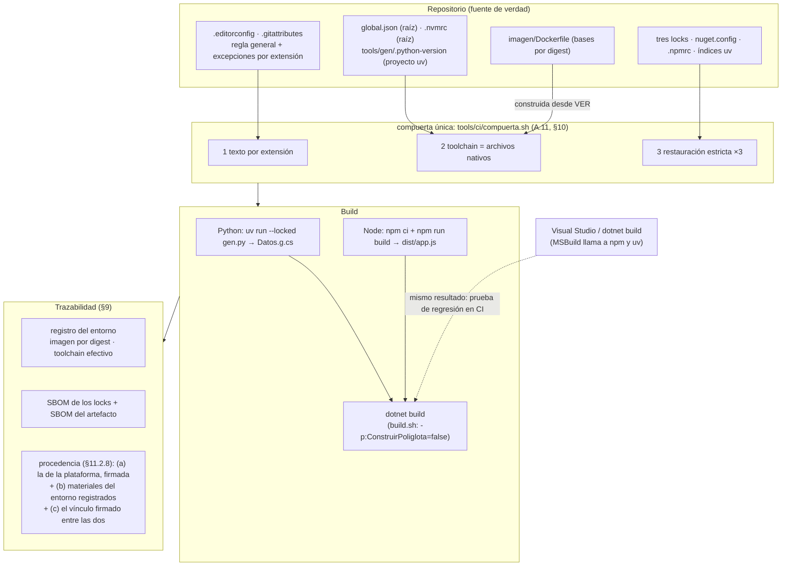

### 11.3 Qué propone la industria

| Ecosistema | Agrupación que documenta el fabricante | Cómo invoca a otros |
|---|---|---|
| .NET | Solución (`.sln`/`.slnx`), `Directory.Packages.props`, `global.json` buscado hacia arriba [B56][B85] | Target de MSBuild con `Exec` [B168]; `.esproj` que corre `npm install` y `npm run build` [B169]; Aspire 13 para ejecutar y publicar apps JavaScript y Python [B167] |
| Node.js | *Workspaces* declarados en el `package.json` raíz; el ejemplo muestra un `package-lock.json` en la raíz [B112] | Scripts de `package.json` |
| Python | *Workspaces* de uv: un solo `uv.lock`, `requires-python` como intersección; desaconsejados si los miembros tienen requisitos en conflicto [B111] | No define mecanismo |
| Multi-runtime | mise y asdf (convención extendida), leyendo los nativos sólo si se habilitan [B79][B80] | — |
| Contenedores | *Features* oficiales para .NET, Node y Python, con defaults flotantes [B137] | — |

**[criterio]** La integración es un **diseño propio** del equipo: cada fabricante garantiza su parte y ninguno garantiza la unión. Las estrategias de §11.2 se apoyan en mecanismos documentados de cada ecosistema y se validan con experimentos, pero su combinación es criterio de esta guía.

| Decisión | Opción | Recomendación **[criterio]** | Evidencia |
|---|---|---|---|
| Codificación | BOM para todo | No | E8-1 B |
| | Sin BOM, excepciones por extensión | **Sí** | E8-1 A |
| Fuente de versiones | Archivos nativos + compuerta | **Sí** | E8-2 |
| | `mise.toml` / `.tool-versions` propio | Sólo leyendo los nativos | E8-2 |
| | *Features* de devcontainer | Con versión explícita + compuerta | [B137] |
| Frontera | MSBuild llama a todos | En la estación, en modo estricto | E8-3 |
| | Orquestador externo | **En CI** | E8-3 |
| | `.esproj` | Con `ShouldRunNpmInstall=false` + `npm ci` | E8-4 |
| Imagen | Única | **Devcontainer**, frontera A y **CI cuando el artefacto es uno** (§11.2.7) | E8-5 |
| | Por componente | **CI** cuando los componentes se publican por separado, con la compuerta completa corrida antes en la imagen única | E8-5 |
| | Runner alojado + *setup-* por SHA | CI que registra el entorno (8a); no comparte base con el devcontainer (§8.2.2) | E5-8 |
| SBOM y procedencia | Multi-ecosistema / nativos + unión / BuildKit | SBOM de los locks: uno de los dos primeros; procedencia: (a)+(b)+(c) de §11.2.8 con imagen única, y por componente, además, BuildKit `mode=max` como materiales | E8-6 |

### 11.4 Aplicación por escenario y contexto

| Escenario | Qué cambia en CTX-POLI | Recomendación **[criterio]** |
|---|---|---|
| ESC-01 Windows + Visual Studio | MSBuild es el orquestador; el Node y el Python del `PATH` construyen sus partes; `.esproj` corre `npm install` | Frontera A en modo estricto; `devEngines` (o `engine-strict=true`); correr la compuerta (`bash tools/ci/compuerta.sh`) desde **Git Bash**, que usa el `PATH` de Windows, el mismo que la build de Visual Studio **[no verificado]**. Por WSL la compuerta compara los archivos nativos con los runtimes de Linux: verifica las capas 1 y 3, no la 2 de Windows |
| ESC-02 Linux | Gestores de versión por ecosistema o mise | mise leyendo los nativos; compuerta antes del push |
| ESC-03 WSL 2 | Dos instalaciones de cada runtime (Windows y WSL) | Cada lado es una estación; la compuerta es la misma |
| ESC-04 Devcontainer | La imagen trae los tres runtimes | Imagen única construida desde los nativos con la receta de A.10, la misma que la CI (bases por digest en su Dockerfile) |
| ESC-05 CI | Build que se publica | Frontera B; imagen única si el artefacto es uno, etapas por componente si se publican por separado (§11.2.7), o runner alojado (§8.2.2); registro del entorno y SBOM de locks y de artefacto; procedencia firmada si un consumidor la verifica (§12, paso 8b) |

| Actor | Decide o hace |
|---|---|
| ACT-ARQ | Dónde vive la frontera; imagen única o por componente; dónde va cada archivo nativo; *workspaces* sí o no; alcance de los SBOM |
| ACT-DEV | Corre la compuerta antes del push; no agrega versiones en archivos de gestores de terceros; cambia manifiesto y lock juntos en cada ecosistema |
| ACT-OPS | Construye y mantiene el Dockerfile multi-runtime o las cuatro bases por digest, según la estrategia que decide ACT-ARQ; el job con `build.sh`; SBOM y procedencia |
| ACT-REV | Además de la lista de §10: secciones nuevas en `.editorconfig`; cambios en `msbuild-sdks`; targets de MSBuild que agreguen `npm install` o `pip install`; digests de las bases |

### 11.5 Ejemplos concretos

**La frontera dentro de MSBuild, estricta e incremental** (extracto de `solucion/src/Saludo/Saludo.csproj`):

```xml
<PropertyGroup>
  <!-- true en la estación (F5) y en la prueba de regresión de la CI (§11.2.5); build.sh pasa false -->
  <ConstruirPoliglota Condition="'$(ConstruirPoliglota)' == ''">true</ConstruirPoliglota>
</PropertyGroup>
<Target Name="ConstruirWeb" Condition="'$(ConstruirPoliglota)' == 'true'"
        Inputs="@(WebEntrada)" Outputs="$(WebSalida)">
  <!-- npm ci, no npm install: instala el lock o falla. Exec usa cmd.exe en Windows y sh en Linux. -->
  <Exec Command="npm ci --no-audit --no-fund" WorkingDirectory="$(WebDir)" />
  <Exec Command="npm run build" WorkingDirectory="$(WebDir)" />
</Target>
<Target Name="GenerarDatos" Condition="'$(ConstruirPoliglota)' == 'true'"
        Inputs="@(GenEntrada)" Outputs="$(DatosSalida)">
  <Exec Command="uv run --locked python gen.py dist/Datos.g.cs" WorkingDirectory="$(GenDir)" />
</Target>
```

**El `.esproj` sin reescribir el lock** (E8-4):

```xml
<Project Sdk="Microsoft.VisualStudio.JavaScript.Sdk/1.0.6887863">
  <PropertyGroup>
    <ShouldRunNpmInstall>false</ShouldRunNpmInstall>  <!-- documentada: apaga el npm install -->
  </PropertyGroup>
  <!-- RunNpmInstall es un target interno de Sdk.targets 1.0.6887863: revisar al subir de versión -->
  <Target Name="NpmCiEstricto" BeforeTargets="RunNpmInstall">
    <Exec Command="npm ci --no-audit --no-fund" WorkingDirectory="$(MSBuildProjectDirectory)" />
  </Target>
</Project>
```

**La compuerta propia de la solución de referencia: tres capas, tres ecosistemas, con sus rutas escritas** (extracto de `solucion/verificar.sh`; para otro repositorio, la compuerta de A.11, que encuentra los proyectos donde estén):

```bash
echo "== 2. Toolchain (N3): lo instalado contra los archivos del repo"
esperado_sdk=$(python3 -c 'import json;print(json.load(open("global.json"))["sdk"]["version"])')
esperado_node=$(tr -d '[:space:]' < .nvmrc)
esperado_py=$(tr -d "[:space:]" < tools/gen/.python-version)
...
echo "== 3. Restauración estricta (N4): un lock por ecosistema"
dotnet restore src/Saludo --locked-mode -v q --nologo || fallas=$((fallas+1))
(cd web && npm ci --no-audit --no-fund --loglevel=error) || fallas=$((fallas+1))
(cd tools/gen && uv sync --locked -q) || fallas=$((fallas+1))
```

La imagen multi-runtime completa está en [A.10](#a10-dockerfile-de-la-imagen-multi-runtime); la procedencia y el SBOM de la build por componentes:

```bash
# Una vez por máquina: un builder docker-container, que exporta procedencia y SBOM (§9.2.4).
docker buildx inspect n8-attest >/dev/null 2>&1 || docker buildx create --name n8-attest --driver docker-container
docker buildx build --builder n8-attest --target artefacto \
  --build-arg PY_IMAGE=python:3.12.15-slim@sha256:05cda9777409a9c3ffddd94a4c476b79f0769a0b4857f0c7ed9226b6800b0d6f \
  --provenance=mode=max,version=v1 --sbom=true \
  -f imagen/Dockerfile.por-componente --output type=local,dest=salida solucion
# salida/provenance.json : SLSA v1; materiales = SDK, Node, Python y uv por digest; builder.id vacío
# salida/sbom.spdx.json  : sólo lo que viaja (NuGet)
```

E8-6 agrega además `ARG BUILDKIT_SBOM_SCAN_STAGE=true` en las etapas de Python y Node para obtener un SBOM por etapa (§11.2.8).

Experimentos del capítulo: E8-1 a E8-6 (Anexo E).

### 11.6 Preguntas guía

**¿Qué se rompe primero cuando .NET, Node y Python comparten repo?**
Lo que nadie mira (§11.2.1): los scripts con shebang y los lectores estrictos de datos, no el compilador; con cp1252, C# en Linux falla si el carácter está en un identificador (como en E8-1) y corrompe sin error si está en un literal; falla Python, y Node corrompe sin error los datos que lee (§4.2.4). Después vienen las versiones: cada herramienta busca su archivo en otro lugar. *Aplica* siempre que un commit lo lean herramientas de más de un ecosistema, incluidos los scripts de CI; la señal temprana es una compuerta de texto por extensión que corra antes que cualquier build.

**¿Una imagen con los tres runtimes o una por componente?**
La frontera dice si hace falta la imagen única: si MSBuild llama a npm y uv (frontera A), los tres runtimes tienen que estar en la misma imagen (E8-3). La cantidad de artefactos dice si la CI puede partirse (§11.2.7). Con las mismas versiones, las dos dan la misma DLL (E8-5). *Aplica*: devcontainer y estación → imagen única; CI → la misma imagen única si el artefacto es uno, y por componente sólo si los componentes se publican por separado, con cuatro digests fijados y la compuerta completa corrida antes en la imagen única (§11.2.7).

**¿Cómo se fija el toolchain de tres ecosistemas desde un único punto de verdad?**
Con **un archivo nativo por ecosistema, donde lo busca su herramienta, más una compuerta que los lee a todos**. Un `mise.toml` con versiones propias es una segunda verdad que gana en silencio. La imagen se construye **desde** esos archivos (`--build-arg PYTHON_VERSION=$(cat tools/gen/.python-version)`), nunca al revés. *Aplica* a CTX-POLI en todos los escenarios; en ESC-01 la compuerta es lo único que verifica Node y Python.

**¿Cómo se generan SBOM y procedencia que cubran los tres?**
Primero decidiendo el alcance: locks, artefacto, entorno. Para los locks, una herramienta multi-ecosistema o los exportadores nativos unidos. Para el entorno, el registro del entorno de la CI y, si la build corre por componentes con BuildKit, su procedencia, que nombra por digest las imágenes de los tres toolchains pero sale sin firma y sin `builder.id`. La procedencia que firma la plataforma nombra el commit, no el entorno: atar las dos cosas es un paso propio (§11.2.8). *Aplica* a la CI (ESC-05) en CTX-POLI.

**¿Dónde vive la frontera entre la build .NET y las demás?**
En dos lugares, elegidos a conciencia: dentro de MSBuild para que F5 construya todo en la estación Windows (ESC-01), fuera de MSBuild para que la CI corra cada ecosistema una vez, en modo estricto, entre la compuerta y el registro del entorno. Los dos caminos tienen que dar lo mismo, y eso se prueba en la CI (§11.2.5). Riesgos de la frontera dentro de MSBuild: usa el runtime del `PATH`, `Exec` cambia de shell según el sistema operativo, y el `.esproj` trae `npm install`. *Aplica* a CTX-POLI con estaciones Windows y CI.

**¿Alcanza con que los tres locks estén commiteados?**
No. Cada uno necesita su comando estricto y su configuración de registros en el repo; y el lock que se regenera en silencio puede venir de una herramienta inesperada, como el SDK de proyectos JavaScript de Visual Studio (E8-4). *Aplica* a CTX-POLI y a todo repo con `.esproj`.

**¿Qué cambia si el equipo trabaja sólo en Windows con Visual Studio?**
El fenómeno del caso no se ve en C#, pero la solución políglota igual lo expone: Python falla en el primer `open` estricto de un cp1252, Node lo lee corrompido, y los scripts que corren en la CI Linux fallan por CRLF. Además, en ESC-01 MSBuild es el orquestador por defecto y construye el frontend con el Node del `PATH` de cada máquina. *Aplica* a equipos Windows con CI Linux: la combinación del caso.

**Tu equipo copió A.10 para la imagen de CI y, por la tabla de §11.3, duda entre imagen única y por componente. El artefacto es una sola DLL. ¿Qué usás en la CI?**
La única. Con un solo artefacto, el job corre `build.sh`, el mismo comando que la estación y el devcontainer, y la compuerta completa corre en un lugar (§11.2.7). La variante por componente no corre la compuerta de texto y trae otro origen de Python (§11.2.6); conviene cuando los componentes se publican por separado. *Aplica* a la CI (ESC-05) en CTX-POLI.

### 11.7 Criterios de calidad

Una solución políglota bien integrada:

- tiene **una** política de texto raíz con excepciones por extensión justificadas por su lector, y los generadores de código escriben con codificación y EOL explícitos;
- tiene **un archivo nativo por ecosistema** en el lugar donde lo busca su herramienta, y una compuerta que los compara con lo instalado;
- tiene **un lock y un archivo de registros por ecosistema** en el repo, verificados por los tres comandos estrictos (que no ven un manifiesto sin lock, §10.2.2);
- elige su frontera de build por escenario, con modo estricto en ambas, y comprueba en la CI, con una prueba de regresión del `.csproj`, que las dos producen el mismo artefacto;
- fija por digest cada imagen base y construye la imagen desde los archivos nativos;
- declara el alcance de cada SBOM, graba el registro del entorno y, si un consumidor la verifica, deja en la CI una procedencia firmada que dice qué nombra y qué no.

Señales de una versión pobre:

- «todo a UTF-8 con BOM», o creer que un `.sh` «anda» porque el paso terminó en verde (§11.2.1);
- locks marcados `linguist-generated` (§11.2.2);
- `.python-version` en la raíz con el proyecto uv en una subcarpeta, o versiones en `mise.toml` además de los nativos (§11.2.3);
- un target de MSBuild con `npm install`, el `.esproj` con sus defaults en CI o comandos de bash en un `Exec` (§11.2.5);
- asumir que `global.json` fija Node y Python (§11.2.5);
- bases por etiqueta (§11.2.6);
- confundir el SBOM del artefacto con el de la build (§11.2.8);
- una compuerta que dice `n/a` para los proyectos de las subcarpetas, o `n/a` en el grafo de un ecosistema cuyo manifiesto está versionado (§10.2.2).

### 11.8 Plantilla

Todas las del [Anexo A](#anexo-a-plantillas-comentadas), que forman juntas un repositorio políglota mínimo verificado por EA-1 (con sus locks generados, paso 8), incluida la imagen multi-runtime de [A.10](#a10-dockerfile-de-la-imagen-multi-runtime), que EA-1 construye y donde corre la compuerta completa, el devcontainer de A.9, que usa su receta, y el registro del entorno de A.17. La CI de A.12 corre la compuerta, compila y registra el entorno; el SBOM y la publicación los agrega cada equipo (§9.2.3). La solución de referencia completa, con sus dos fronteras de build, está en `Examples/N8-integracion-poliglota/solucion/`.

### 11.9 Práctica

1. Antes de mirar la columna B de E8-1 («UTF-8 con BOM para todo»), predecí qué lectores fallan. *Respuesta esperada*: cinco —el shebang de `saluda.py`, `json.load`, `tomllib`, `JSON.parse` y la comparación de `.nvmrc`—; `hola.sh` corre, con un error en stderr: el daño silencioso de §4.2.4.
2. Con EA-1, predecí qué paso de la compuerta de A.11 pone en rojo un `.cs` en cp1252 dentro de `src/App/` y qué dice. *Respuesta esperada*: sólo el de texto, con `no es UTF-8 válido (byte 0xc7 …; ¿cp1252?)`; toolchain y grafo siguen en verde, porque la compuerta encuentra los proyectos en sus subcarpetas (§10.2.2).

---

## 12. Hoja de ruta: del caso a un equipo con criterio

Los capítulos anteriores se pueden **consultar** en cualquier orden; para aprenderlos conviene el orden de §0.2, y para adoptarlos, el de esta tabla. El orden que sigue respeta las dependencias entre capas (no se congela un grafo con un toolchain flotando; no se fija una imagen antes de saber qué toolchain tiene que traer) y pone primero lo que más dolió en el caso. **[criterio]**

| Paso | Qué se hace | Quién | Lo que queda verificable | Capítulo |
|---|---|---|---|---|
| 1 | Inventariar la capa 1: qué archivos no son UTF-8 válido, cuáles tienen BOM, cuáles CRLF (`iconv`, `head -c3`, `git ls-files --eol`). | ACT-ARQ | Una lista, no una impresión | §4.5 |
| 2 | Decidir la tabla por extensión y escribir `.editorconfig` y `.gitattributes`; elegir la convención de la familia .NET (`*.cs`, `*.csproj`) según el estado del repo: nuevo, heredado todavía en cp1252 o ya convertido con BOM (§5.2.3). | ACT-ARQ | Commit 1 (política) | §5.2.3, A.1, A.2 |
| 3 | Migrar en un commit mecánico verificado por script; `.git-blame-ignore-revs` después, con el SHA que quedó en `main`; un PR por commit o uno con merge commit. | ACT-ARQ, ACT-REV | `0 con cambio de contenido` | §5.2.6 |
| 4 | Activar la compuerta, commiteada en el paso 2, en la CI y en el hook versionado, con los prerrequisitos de cada estación declarados (A.11). Desde acá, el problema del caso no puede volver sin que alguien lo vea. | ACT-OPS | CI roja ante cp1252, BOM o CRLF indebidos | §5.2.5, §10.2.2 |
| 5 | Elegir un SDK con soporte (al 2026-10-09, .NET 8 termina el 2026-11-10 [B61]) y fijar el toolchain: `global.json` (con la elección de `rollForward` escrita en un ADR), `devEngines`, `.python-version` + `required-version`; agregar el paso de toolchain a la compuerta. | ACT-ARQ, ACT-OPS | `A compatible .NET SDK was not found` / `EBADDEVENGINES` cuando corresponde | §6 |
| 6 | Congelar el grafo: lock en npm y uv; en .NET, lock en los ejecutables con `disable` (por defecto) o la política sin lock de §6.4, según el ADR del paso 5; CPM; registros en el repo; restauración estricta en la compuerta, activada en CI. | ACT-ARQ, ACT-OPS | `NU1004` / `EUSAGE` / «needs to be updated» ante deriva; sin lock, `NU1603` como error | §6.4, §7 |
| 7 | Elegir dónde corre la CI (§8.2.2): imagen propia construida **desde** los archivos de los pasos 5–6, con bases por digest que mueve un PR (base compartida con el devcontainer, artefactos nativos o imágenes, 8b), o runner alojado con acciones de *setup* por SHA que los leen (alcanza para 8a; su imagen se consulta mientras dure la retención del log). El devcontainer, si se ofrece, con la misma receta o con etiqueta fija de SDK y SO verificada por `global.json`. | ACT-ARQ, ACT-OPS | La compuerta pasa en la CI y falla si se desalinea | §8.2.2, A.12 |
| 8a | En la CI, para todo equipo: `ContinuousIntegrationBuild`, `SOURCE_DATE_EPOCH`, registro del entorno (SDK, compilador y runtimes efectivos, imagen —digest o, con runner alojado, `NO DECLARADA` con su motivo—, commit y árbol limpio; A.17) y SBOM con alcance declarado. | ACT-OPS | Artefacto, registro del entorno y SBOM publicados juntos | §9 |
| 8b | Si hay un consumidor externo que la verifique, un requisito contractual o un repositorio público: procedencia firmada por la plataforma si el plan lo permite, o con el nivel declarado honestamente. | ACT-OPS | Procedencia verificable con su par firmante/`builder.id` | §9.2.4 |
| 9 | Gobierno: `CODEOWNERS`, bots con enfriamiento y agrupación, ADR para descongelar, compuerta en la publicación si no hay protección de rama. | ACT-ARQ, ACT-OPS | Ningún cambio de versión sin PR | §10 |
| 10 | Si conviven .NET, Node y Python: revisar la tabla por extensión con los lectores de los tres, ubicar cada archivo nativo donde lo busca su herramienta, elegir la frontera de la build por escenario y comprobar que ambas dan el mismo artefacto. | ACT-ARQ | EA-1 y E8-1…E8-6 como referencia | §11 |

Los pasos 1 a 4 resuelven la primera pregunta del caso; 5 a 7, la segunda; 8a, la tercera; 8b, la misma pregunta cuando quien la hace es un tercero; 9 hace que las tres respuestas sigan valiendo dentro de un año; 10 es la ampliación a la solución integrada. Visual Studio en Windows queda dentro en todos (§8.2.4): lo que no tiene, el devcontainer, no se le exige, porque el árbitro es la CI.

```yaml
# La hoja de ruta como contrato, para agentes y revisores.
entradas:
  repositorio: el del caso (heredado; CTX-NET o CTX-POLI)
  plataforma: la CI disponible y su plan (protección de rama, atestaciones)
salidas:
  - ".editorconfig, .gitattributes y .git-blame-ignore-revs (pasos 1-3)"
  - "tools/ci/ con la compuerta y .githooks/pre-commit (paso 4)"
  - "global.json, devEngines, .python-version + required-version y el ADR de rollForward (paso 5)"
  - "locks y registros por ecosistema (paso 6)"
  - "imagen de CI con bases por digest, o runner alojado con acciones por SHA (paso 7)"
  - "registro del entorno y SBOM junto al artefacto (8a); procedencia si corresponde (8b)"
  - "CODEOWNERS, configuración de los bots y ADR de descongelamiento (paso 9)"
  - "tabla por extensión revisada con los lectores de los tres ecosistemas (paso 10)"
validaciones:
  - "paso 1: e1-diagnostico.sh -> codificación, BOM y CR de cada archivo"
  - "paso 2: editorconfig y git check-attr resuelven lo decidido por extensión (EA-1, paso 1)"
  - "paso 3: tools/verificar-commit-mecanico.sh <sha> CP1252 -> 0 con cambio de contenido"
  - "paso 4: un .cs en cp1252 en un PR -> compuerta en rojo"
  - "paso 5: un SDK distinto del de global.json -> A compatible .NET SDK was not found"
  - "paso 6: manifiesto cambiado sin regenerar el lock -> NU1004 / EUSAGE / needs to be updated"
  - "paso 7: imagen desalineada con los archivos nativos -> compuerta en rojo"
  - "paso 8a: registro del entorno junto al artefacto (A.17), sin campos vacíos; imagen NO DECLARADA sólo con runner alojado"
  - "paso 8b: la procedencia verifica con su par firmante/builder.id"   # [no verificado]: requiere plataforma alojada
  - "paso 9: un PR que toca la compuerta pide la aprobación de su dueño (CODEOWNERS)"   # [no verificado]: requiere plataforma alojada
  - "paso 10: los quince lectores de E8-1 pasan con la política por extensión (columna A)"
```

**Práctica integradora** (sin experimentos nuevos).

1. Para cada validación del contrato, nombrá el experimento que la mostró y predecí el mensaje. *Respuesta esperada*: paso 1, E1-09 (codificación, BOM y CR por archivo); 2, EA-1 paso 1; 3, E2-2 (`0 con cambio de contenido`); 4, E2-3 (`¿cp1252?`); 5, E3-1 (`A compatible .NET SDK was not found`); 6, E4-1, E4-4 y E4-5 (`NU1004`, `EUSAGE`, «needs to be updated»); 7, E7-4 (rojo en la imagen vieja); 8a, EA-1 paso 9 (A.17); 10, E8-1 columna A; 8b y 9 no tienen experimento: requieren una plataforma alojada (Anexo F).
2. ¿Qué deja sin detectar empezar por el devcontainer (paso 7) antes de fijar el toolchain (paso 5)? *Respuesta esperada*: con imagen por etiqueta y sin `global.json`, el SDK cambia sin que el repo se entere (E5-6, §3.5), y la capa 1 sigue rota adentro (E5-1).

---

## Anexo A. Plantillas comentadas

Todas las plantillas de este anexo viven juntas en `Examples/A-plantillas/repo/`, en las rutas donde las buscan sus herramientas, y **EA-1** (`Examples/A-plantillas/verificar.sh`) las verifica en conjunto; cada plantilla dice qué paso la comprueba. El esqueleto de compuerta de A.11 **falla a propósito** hasta que se lo reemplaza: copiar las plantillas no instala una red que no detecta nada. Las versiones y digests son los del laboratorio al 2026-10-07: **se reemplazan** por los del proyecto. Cada plantilla trae las preguntas que guían sus campos.

### A.1 `.editorconfig`

Preguntas que guían los campos: ¿qué lector es el más estricto para cada extensión? ¿El repo es nuevo, heredado todavía en cp1252 o heredado ya convertido con BOM (variante B para `*.cs`)? ¿Se acepta normalizar, antes de cada commit, lo que crean las plantillas del SDK (con BOM)? ¿Hay scripts `.ps1` que corre Windows PowerShell 5.1? ¿Qué archivos genera una herramienta y no el editor?

```ini
# Política de texto del repositorio (guía §5, §11.2.2; Anexo A.1).
# La leen los editores al guardar (Visual Studio de fábrica; VS Code con la
# extensión EditorConfig) y la compuerta al verificar. Git NO la lee.
# Los comentarios van siempre en línea propia: un # después de un valor
# pasa a formar parte del valor.
root = true

# Regla general para .NET, Node.js y Python: UTF-8 sin BOM, LF.
[*]
charset = utf-8
end_of_line = lf
insert_final_newline = true

# Excepciones que exige quien LEE el archivo. Van al final: la última gana.
[*.{cmd,bat}]
end_of_line = crlf

# Con BOM: .razor y .cshtml, porque así los crean las plantillas y así los declaran
# dotnet/aspnetcore y dotnet/aspire; .sln, porque dotnet sln add lo repone.
# .slnx queda en [*]: dotnet sln add le quita el BOM (SDK 10).
[*.{razor,cshtml,sln}]
charset = utf-8-bom

# Windows PowerShell 5.1 lee un .ps1 sin BOM como ANSI.
[*.ps1]
charset = utf-8-bom

# Variante B (heredado YA convertido a UTF-8 con BOM, como el del caso, o elegida
# antes de migrar): descomentar. Cubre los archivos de proyecto, que siguen la
# convención de *.cs (5.2.3); los .props y .targets de este anexo (Directory.Build.*,
# Directory.Packages.props) se guardan entonces con BOM. Con la variante A, cada
# archivo que crea una plantilla del SDK, de proyecto o de ítem, llega con BOM y se
# normaliza antes de su commit (dotnet format en los .cs; la compuerta lo señala).
# [*.{cs,csproj,props,targets}]
# charset = utf-8-bom

# Los lock files los escribe la herramienta; NuGet no pone salto final.
[{packages.lock.json,package-lock.json,uv.lock}]
insert_final_newline = unset
```

Verificado en EA-1 (paso 1): `Program.cs` → `utf-8`, `lf`; `X.razor` y `App.sln` → `utf-8-bom`; `build.cmd` → `crlf`; `packages.lock.json` → `insert_final_newline=unset`. Fuentes: [B43] (llaves, `unset`, la última sección gana, sin comentarios en línea), §5.2.3 (tabla por extensión). EA-1 paso 1b: un `dotnet new console` dentro del repo deja dos violaciones con la variante A (`Program.cs` y el `.csproj` con BOM) y ninguna después de normalizarlos. Paso 1c: con la variante B, la solución que crea el SDK, convertida con BOM, no deja ninguna una vez guardados con BOM los `.props` y `.targets` de A.4 y A.5.

### A.2 `.gitattributes`

Preguntas: ¿hay literales multilínea o datos cuyo fin de línea importe en las pruebas de la estación (entonces `eol=lf`; si no, `* text=auto` también vale, §5.2.2)? ¿Qué archivos exige su consumidor con CRLF? ¿Qué binarios podría confundir git con texto?

```gitattributes
# Finales de línea (guía §5; Anexo A.2). Lo lee git y le gana a
# core.autocrlf/core.eol de cada máquina. Un patrón por extensión:
# git NO expande llaves como *.{cmd,bat}.
* text=auto eol=lf

*.cmd text eol=crlf
*.bat text eol=crlf
*.sh  text eol=lf

# Locks: texto y LF; sin linguist-generated (el revisor tiene que verlos).
packages.lock.json text eol=lf
package-lock.json  text eol=lf
uv.lock            text eol=lf

*.png binary
*.jpg binary
*.pdf binary
*.zip binary
```

Verificado en EA-1: `build.cmd` → `eol: crlf`; `tools/x.sh` → `eol: lf`; el resto → `text: auto`, `eol: lf`. Al introducirlo en un repo existente: `git add --renormalize .` en el commit mecánico (§5.2.6). Fuentes: [B36], E5-7 (llaves).

### A.3 `global.json`

Preguntas: ¿hay lock files de NuGet (entonces `disable`)? ¿Quién instala el SDK exacto en cada estación Windows? ¿Qué SDK trae la imagen de CI? ¿Qué versión de Visual Studio exige esa banda [B59]? ¿Está escrito el motivo en un ADR?

```json
{
  "sdk": {
    "version": "8.0.425",
    "rollForward": "disable",
    "allowPrerelease": false
  }
}
```

8.0.425 es el SDK del caso; .NET 8 sale de soporte el 2026-11-10 [B61][B62]: un repo nuevo parte de la última 10.0.4xx. Variante tolerante, sin lock files: `"version": "8.0.400", "rollForward": "latestPatch"` (el parche más alto de la banda 4xx). Costo de `disable`: §6.4. La variante tolerante va con la política sin lock: `NU1603` como error y el SDK registrado en la CI. Con SDK 10 o posterior se puede agregar `"errorMessage"` con instrucciones de instalación [B56]. Fuentes: [B56], E3-1, E3-6.

### A.4 `Directory.Build.props`

Preguntas: ¿qué variable define cada CI que usa el equipo? ¿Se quiere restauración estricta sólo en CI? ¿Qué se registra al lado del artefacto (A.17) y no adentro?

```xml
<Project>
  <!-- Anexo A.4. Una sola definición de "estoy en CI" para todo el repo.
       CI=true lo definen GitHub Actions y GitLab; TF_BUILD=True, Azure Pipelines.
       Las comparaciones de MSBuild no distinguen mayúsculas. -->
  <PropertyGroup Condition="'$(CI)' == 'true' Or '$(TF_BUILD)' == 'true' Or '$(GITHUB_ACTIONS)' == 'true'">
    <!-- Rutas normalizadas (/_/) y build totalmente determinista. -->
    <ContinuousIntegrationBuild>true</ContinuousIntegrationBuild>
    <!-- Restauración estricta: si el lock no coincide, NU1004 en vez de reescribirlo. -->
    <RestoreLockedMode>true</RestoreLockedMode>
  </PropertyGroup>

  <PropertyGroup>
    <!-- NU1603 como error en las dos políticas de la guía (6.4): corta el restore de un
         proyecto sin lock cuando NuGet aproxima una versión que no existe. Con lock no se
         dispara (E4-2): esa aproximación la detecta la compuerta (requested = resolved). -->
    <WarningsAsErrors>$(WarningsAsErrors);NU1603</WarningsAsErrors>
    <!-- Capa 2: el TFM fija la versión de C#. Sólo si hace falta otra, y nunca "latest":
    <LangVersion>12.0</LangVersion> -->
    <!-- Capa 6: URL del repo y commit en el .nuspec; símbolos aparte. -->
    <PublishRepositoryUrl>true</PublishRepositoryUrl>
    <IncludeSymbols>true</IncludeSymbols>
    <SymbolPackageFormat>snupkg</SymbolPackageFormat>
    <!-- NO configurar PathMap a mano: no normaliza el mapa de SourceLink. -->
    <!-- Con qué SDK e imagen se construyó va AL LADO del artefacto (registro del entorno, A.17),
         no adentro: un dato incrustado que cambia con la imagen cambia el hash de la DLL. -->
  </PropertyGroup>
</Project>
```

`Directory.Build.targets` (raíz), para que el lock quede sólo en los ejecutables:

```xml
<Project>
  <!-- Anexo A.4b. El lock que gobierna es el del proyecto en la punta de la cadena.
       Va en .targets y no en .props: cuando se evalúa Directory.Build.props,
       OutputType todavía no está definido y la condición no se cumple nunca.
       WinExe: WinForms y WPF (el SDK cambia Exe por WinExe en esas aplicaciones).
       Un proyecto de prueba no recibe lock por esta regla: su OutputType=Exe llega desde
       un paquete que el restore no evalúa; si se lo quiere congelar, se declara
       RestorePackagesWithLockFile en su .csproj. -->
  <PropertyGroup Condition="'$(OutputType)' == 'Exe' Or '$(OutputType)' == 'WinExe'">
    <RestorePackagesWithLockFile>true</RestorePackagesWithLockFile>
  </PropertyGroup>
</Project>
```

Verificado en EA-1 (paso 2): sin variable, `ContinuousIntegrationBuild` y `RestoreLockedMode` vacíos; con `CI=true` (GitHub Actions [B190], GitLab [B191]) o `TF_BUILD=True` (Azure Pipelines; MSBuild compara sin distinguir mayúsculas [B189]), los dos en `true`; en ese modo, un cambio de versión sin regenerar el lock da `NU1004`. `LangVersion` se omite: un valor fijo para todo el repo deja a un proyecto `net10.0` en C# 12 sin aviso [B57]. EA-1 paso 2b: con `Directory.Build.targets`, `packages.lock.json` aparece en el ejecutable y no en la biblioteca, y en modo CI el restore pasa y falla con `NU1004` ante un cambio sin regenerar; paso 2c: un `WinExe` (WinForms con `EnableWindowsTargeting`) también recibe su lock [B215]. Fuentes: [B83], [B143], [B144], E6-1, E6-2.

### A.5 `Directory.Packages.props`

Preguntas: ¿la solución tiene más de un proyecto? ¿Se publica como biblioteca (cuidado con *transitive pinning*, que vuelve explícitas las transitivas en el paquete [B85])? ¿Qué transitiva se sube a propósito y por qué?

```xml
<Project>
  <!-- Anexo A.5. Versiones directas en un solo lugar (CPM). -->
  <PropertyGroup>
    <ManagePackageVersionsCentrally>true</ManagePackageVersionsCentrally>
    <CentralPackageTransitivePinningEnabled>true</CentralPackageTransitivePinningEnabled>
  </PropertyGroup>
  <ItemGroup>
    <PackageVersion Include="Newtonsoft.Json" Version="13.0.3" />
  </ItemGroup>
</Project>
```

Los `.csproj` referencian sin `Version` (`NU1008` si la llevan). Fuentes: [B85], E4-2.

### A.6 `nuget.config`

Preguntas: ¿hay un feed privado? ¿Qué prefijos de paquete son internos? ¿La CI o la imagen definen `NUGET_PACKAGES` (que tiene precedencia sobre `globalPackagesFolder` [B89])?

```xml
<?xml version="1.0" encoding="utf-8"?>
<configuration>
  <!-- Anexo A.6. Fuentes declaradas en el repo, no en el perfil del usuario. -->
  <packageSources>
    <clear />
    <add key="nuget.org" value="https://api.nuget.org/v3/index.json" />
  </packageSources>
  <packageSourceMapping>
    <packageSource key="nuget.org">
      <package pattern="*" />
    </packageSource>
  </packageSourceMapping>
</configuration>
```

Con un feed interno, se agrega su `<add key="interno" …/>` y un `<packageSource key="interno"><package pattern="MiOrg.*" /></packageSource>`; el mapeo se saltea si el paquete ya está en una caché compartida, por eso conviene una carpeta global por repo y agentes de CI efímeros [B86][B87]. Fuentes: E4-3.

### A.7 Node: `package.json` y `.npmrc`

Preguntas: ¿qué línea de Node usa el equipo (sólo LTS en producción [B68])? ¿Se publica como paquete (`engines` para consumidores) o es la aplicación (`devEngines` para el equipo)? ¿Hay registros privados por *scope*?

```json
{
  "name": "web",
  "version": "1.0.0",
  "private": true,
  "engines": { "node": ">=24 <25" },
  "devEngines": {
    "runtime": { "name": "node", "version": ">=24 <25", "onFail": "error" },
    "packageManager": { "name": "npm", "version": ">=10", "onFail": "error" }
  },
  "scripts": { "build": "node -e \"console.log('build ' + process.version)\"" }
}
```


```ini
# Anexo A.7. Registro declarado en el repo, no en ~/.npmrc.
registry=https://registry.npmjs.org/
# engines deja de ser sólo un aviso.
engine-strict=true
```

`.nvmrc` en la raíz, con la versión completa (`24.21.0`), para los gestores de versión y para la compuerta. Verificado en EA-1 (paso 3): Node 24.21.0 pasa; Node 22.23.2 falla con `EBADDEVENGINES`. Fuentes: [B63], [B64], [B109], E3-3.

### A.8 Python: `pyproject.toml` y `.python-version`

Preguntas: ¿qué rango soporta el proyecto (`requires-python`)? ¿Qué parche exacto usa el equipo (`.python-version`, **dentro** del proyecto uv)? ¿Qué versión de uv escribe el lock? ¿Se permiten descargas implícitas de intérpretes?

```toml
[project]
name = "gen"
version = "1.0.0"
# Contrato del paquete: lo validan pip y uv y acota la resolución del lock.
requires-python = "==3.12.*"
dependencies = []

[tool.uv]
# Versión del gestor que escribe uv.lock.
required-version = "==0.12.23"
# En CI y en la imagen: sin descargas implícitas de intérpretes.
python-downloads = "never"
package = false
```

`tools/gen/.python-version`:

```text
3.12.15
```

Verificado en EA-1 (paso 4): uv 0.12.23 usa 3.12.15 sin descargar; `uv lock --check` pasa. Fuentes: [B71], [B75], [B76], E3-4, E8-2.

### A.9 `devcontainer.json`

Preguntas que guían los campos: ¿la imagen de desarrollo comparte la receta de la CI (solución políglota) o basta una etiqueta fija de SDK y SO (sólo .NET)? ¿Hay un bot que actualice cada digest en un repo privado? ¿El host es Linux (entonces `remoteUser` + `updateRemoteUserUID` [B119])?

```jsonc
// Anexo A.9. El devcontainer se construye con la MISMA receta que la imagen de CI (A.10):
// sus bases van por digest y las actualiza el bot de la CI (A.13, ecosistema docker).
// Variante sólo .NET sin receta propia (§8.5): "image": "mcr.microsoft.com/dotnet/sdk:8.0.425-bookworm-slim".
{
  "name": "solucion",
  "build": {
    "dockerfile": "../imagen/Dockerfile",
    "context": "../imagen",
    // Igual a tools/gen/.python-version: la compuerta compara lo instalado con el archivo.
    "args": { "PYTHON_VERSION": "3.12.15" }
  },
  // Hook versionado activado una vez por clon. El contenedor corre como root: sin
  // safe.directory, git rechaza el repo montado (dubious ownership, guía 8.2.5).
  "postCreateCommand": "git config --global --add safe.directory ${containerWorkspaceFolder} && git config core.hooksPath .githooks && dotnet --version && node --version && uv --version"
}
```

Con `build.dockerfile` no hay *features* ni `devcontainer-lock.json`: lo que se congela es la receta, y sus bases van por digest. EA-1 paso 10: `devcontainer up` (CLI 0.89.0) en host Linux da `outcome: success` con el hook activado. Fuentes: [B119], [B136], E5-3.

### A.10 Dockerfile de la imagen multi-runtime

Preguntas: ¿la frontera de la build obliga a tener los tres runtimes en el mismo proceso (§11.2.5)? ¿Comparten libc la base del SDK y la de Node? ¿De qué archivo sale cada versión?

```dockerfile
# Imagen de desarrollo y CI con los TRES runtimes (plantilla del Anexo A).
# Cada runtime se toma de su imagen OFICIAL fijada por digest; no se instala nada
# "latest" desde apt. Las versiones deben coincidir con los archivos del repo
# (global.json, .nvmrc, tools/gen/.python-version): lo comprueba la compuerta (A.11), no esta imagen.
# SDK por etiqueta FIJA + digest: el PR de digest del bot trae parches del SO, no otro SDK (guía 10.2.6).

ARG SDK_IMAGE=mcr.microsoft.com/dotnet/sdk:8.0.425-bookworm-slim@sha256:ec9c0a0dc5f60adc2065762050638dd5ed5facfc53716d4580a42d86027c8e80
ARG NODE_IMAGE=node:24-bookworm-slim@sha256:d6aa754f16b3197301076f047b5def2f02ea1dbbc2ca920407d46d7ec7f87b20
ARG UV_IMAGE=ghcr.io/astral-sh/uv:0.12.23@sha256:61d393e44e249f2e4b526b6c7ddcecce245946826e608e11c93ad4f5bba55b21

FROM ${NODE_IMAGE} AS node
FROM ${UV_IMAGE} AS uv

# Base: el SDK de .NET (Debian 12, la misma familia que node:24-bookworm-slim,
# así el binario de Node encuentra la glibc que espera).
FROM ${SDK_IMAGE}

# Node + npm copiados de la imagen oficial (no de apt, que trae otra versión).
COPY --from=node /usr/local/bin/node /usr/local/bin/node
COPY --from=node /usr/local/lib/node_modules/npm /usr/local/lib/node_modules/npm
RUN ln -s ../lib/node_modules/npm/bin/npm-cli.js /usr/local/bin/npm \
 && ln -s ../lib/node_modules/npm/bin/npx-cli.js /usr/local/bin/npx

# uv como gestor e instalador del intérprete de Python.
COPY --from=uv /uv /uvx /usr/local/bin/

# Python: la versión EXACTA llega como argumento leído de .python-version.
ARG PYTHON_VERSION
ENV UV_PYTHON_INSTALL_DIR=/opt/uv-python \
    UV_PYTHON_PREFERENCE=only-managed \
    UV_CACHE_DIR=/tmp/uv-cache \
    UV_LINK_MODE=copy \
    DOTNET_NOLOGO=1 \
    DOTNET_CLI_TELEMETRY_OPTOUT=1 \
    NPM_CONFIG_UPDATE_NOTIFIER=false
# EditorConfig: lo importa el paso de texto de la compuerta (A.11).
RUN test -n "$PYTHON_VERSION" \
 && uv python install "$PYTHON_VERSION" \
 && ln -s "$(uv python find "$PYTHON_VERSION")" /usr/local/bin/python3 \
 && uv pip install --system --break-system-packages --python /usr/local/bin/python3 EditorConfig==0.17.1 \
 && chmod -R a+rX /opt/uv-python \
 && rm -rf /tmp/uv-cache
# Después de construir la imagen no se descargan más intérpretes (N3: deriva).
ENV UV_PYTHON_DOWNLOADS=never
```

Se construye con `docker build --build-arg PYTHON_VERSION=$(cat tools/gen/.python-version) imagen/`. En un Dockerfile, `#` sólo abre un comentario al principio de la línea: un comentario después de una instrucción rompe la build. La plantilla vive en `Examples/A-plantillas/repo/imagen/Dockerfile` y EA-1 la construye y corre adentro la plantilla `web/` (Node 24.21.0, npm 11.19.0, glibc 2.36 en las dos bases) y la compuerta completa de A.11. La de `Examples/N8-integracion-poliglota/imagen/Dockerfile`, usada en E8-3, E8-5 y E8-6, difiere en `NODE_IMAGE` (N8 fija Node 22.23.2 en su `.nvmrc`), en la referencia del SDK (el mismo 8.0.425 por la etiqueta flotante `sdk:8.0`) y en que no instala `EditorConfig`: N8 no corre la compuerta adentro. Fuentes: [B140], [B141].

### A.11 Hook versionado y esqueleto de la compuerta

Preguntas: ¿la compuerta tiene un solo punto de entrada? ¿Cómo se activa el hook en cada clon (una vez, o en el `postCreateCommand` del devcontainer)? ¿`.githooks/` o pre-commit? Se excluyen (§10.6).

```sh
#!/bin/sh
# Anexo A.11. El hook no tiene lógica propia: delega en la compuerta única.
exec "$(git rev-parse --show-toplevel)/tools/ci/compuerta.sh" --staged
```


```sh
#!/bin/sh
# Anexo A.11 (esqueleto). FALLA A PROPÓSITO hasta que se lo reemplaza por la compuerta completa:
# Examples/N7-compuertas-y-gobierno/compuerta/compuerta.sh (proyectos en la raíz o en subcarpetas).
# Alcance: --staged (hook), --base <rev> (PR), sin argumentos (todo).
echo "compuerta: esqueleto sin reemplazar; copiá la compuerta completa (Anexo A.11)" >&2
exit 1
```

**Qué se copia y adónde.** A `tools/ci/`: `compuerta.sh` de `Examples/N7-compuertas-y-gobierno/compuerta/`, que encuentra los proyectos en la raíz o en subcarpetas, y `check_text_policy.py` de `Examples/N2-politica-de-texto-y-remediacion/tools/`. A `.githooks/`: el hook de arriba, **no** el `pre-commit` de N7, que asume `tools/compuerta.sh`. Creados desde Windows, entran sin bit de ejecución (§8.2.5; en un Windows real, **[no verificado]**) y git ignora un hook sin él: antes del commit, `git update-index --chmod=+x tools/ci/compuerta.sh .githooks/pre-commit`. Activación, una vez por clon: `git config core.hooksPath .githooks` [B37].

**Prerrequisitos de cada estación**, para que el hook no dé un falso rojo: `bash` (en Windows, el de Git for Windows); `python3` con el paquete `EditorConfig==0.17.1`; y, para los pasos de toolchain y grafo, las herramientas que el repo declara (`dotnet`, `node`/`npm`, `uv`). En Windows **[no verificado]**: `py -m pip install EditorConfig==0.17.1` y, desde Git Bash en la raíz del clon, `python3 -c "import editorconfig"` y `bash tools/ci/compuerta.sh --staged`. Python no recomienda su comando `python3` [B219]: si Git Bash no lo encuentra, un alias, editorconfig-checker para el texto (§5.2.5) o la CI como único árbitro.

### A.12 Workflow de CI

Preguntas: ¿imagen propia por digest, de la receta del devcontainer (A.10), o runner alojado (§8.2.2)? Si es privada, ¿el job puede descargarla y quién mueve su digest? ¿La revisión de dueños es obligatoria sobre `.github/` y `tools/ci/` (§10.2.7)? ¿Cada acción va por SHA? ¿El PR tiene la historia que necesita `--base`? ¿`SOURCE_DATE_EPOCH` llega a los pasos que construyen?

```yaml
# .github/workflows/ci.yml — Anexo A.12. Ejemplo NO ejecutado en el laboratorio (requiere GitHub).
# A.17 lee el digest de esta ruta; con otro nombre, WORKFLOW_FILE=<ruta>.
name: compuerta
on:
  pull_request:
  push:
    branches: [main]
permissions:
  contents: read
  packages: read          # descargar la imagen privada de GHCR (nace privada)
jobs:
  compuerta:
    runs-on: ubuntu-24.04
    # Imagen construida desde imagen/Dockerfile (A.10), la misma receta que el devcontainer (A.9),
    # publicada en el registro de imágenes del equipo. El digest se declara sólo acá: lo lee
    # registrar-entorno.sh (A.17) y lo mueve el PR que abre el workflow que publica la imagen.
    container:
      image: ghcr.io/org/imagen-ci@sha256:0000000000000000000000000000000000000000000000000000000000000000
      credentials:
        username: ${{ github.actor }}
        password: ${{ secrets.GITHUB_TOKEN }}
    steps:
      # Acción fijada por SHA completo; la etiqueta va como comentario.
      - uses: actions/checkout@3d3c42e5aac5ba805825da76410c181273ba90b1 # v7.0.1
        with:
          fetch-depth: 0
      # Cada run: es un shell propio: la variable llega a los pasos siguientes por GITHUB_ENV.
      - run: echo "SOURCE_DATE_EPOCH=$(git log -1 --pretty=%ct)" >> "$GITHUB_ENV"
      # bash explícito: no depende del bit de ejecución registrado en git.
      - run: bash tools/ci/compuerta.sh --base "origin/${{ github.base_ref }}"
        if: github.event_name == 'pull_request'
      - run: bash tools/ci/compuerta.sh
        if: github.event_name == 'push'
      # 8a: construir, registrar el entorno y, aparte, el SBOM con alcance declarado (9.2.3).
      - run: dotnet build src/App -c Release -o out
      - run: bash tools/ci/registrar-entorno.sh out/App.dll > out/registro-entorno.txt
```

**Ilustrativo**: validado como YAML y con sus `run:` corridos en la imagen de A.10 (EA-1, paso 9); no ejecutado en GitHub. SHA de `actions/checkout` resuelto con `git ls-remote` el 2026-10-07 [B193]. En GHCR un paquete nuevo nace privado [B210] y los permisos no declarados quedan en `none` [B211]: de ahí `packages: read` y `credentials` [B135]; `GITHUB_ENV`, [B212]; quién mueve el digest, §8.2.2. Fuentes: [B135], [B183].

Variante con runner alojado, que alcanza para 8a (§8.2.2); reemplaza `container:`, el `checkout` y el paso de `SOURCE_DATE_EPOCH`, que se repite al final:

```yaml
    steps:
      - uses: actions/checkout@3d3c42e5aac5ba805825da76410c181273ba90b1 # v7.0.1
        with: { fetch-depth: 0 }
      - uses: actions/setup-dotnet@a98b56852c35b8e3190ac28c8c2271da59106c68 # v6.0.0
        with: { global-json-file: global.json }
      - uses: actions/setup-node@949feb2413d6458794dcd2491c4babbbce0c15c1 # v7.1.0
        with: { node-version-file: .nvmrc }
      - uses: actions/setup-python@5fda3b95a4ea91299a34e894583c3862153e4b97 # v7.0.0
        with: { python-version-file: tools/gen/.python-version }
      - uses: astral-sh/setup-uv@c18668ad3cf93ea998bef934396af7bb5c839dc7 # v10.2.0
        with: { working-directory: tools/gen }
      - run: python -m pip install EditorConfig==0.17.1
      - run: echo "SOURCE_DATE_EPOCH=$(git log -1 --pretty=%ct)" >> "$GITHUB_ENV"
```

**Ilustrativo** **[no verificado]** (requiere GitHub): entradas de [B181]; SHA de [B217].

### A.13 `dependabot.yml`

Preguntas: ¿qué ecosistemas tiene el repo y en qué directorio vive cada manifiesto? ¿Qué enfriamiento se elige a propósito? ¿Qué se agrupa? ¿El repo es privado (el ecosistema `devcontainers` no está soportado ahí [B107])? ¿Qué Dockerfile tiene bases por digest (ecosistema `docker`)?

```yaml
# Anexo A.13. El bot propone; la compuerta verifica; el revisor decide.
version: 2
updates:
  - package-ecosystem: "dotnet-sdk"
    directory: "/"
    schedule:
      interval: "monthly"
  - package-ecosystem: "nuget"
    directory: "/"
    schedule:
      interval: "weekly"
    cooldown:
      default-days: 7
    groups:
      parches-nuget:
        update-types: ["patch"]
  - package-ecosystem: "npm"
    directory: "/web"
    schedule:
      interval: "weekly"
    cooldown:
      default-days: 7
  - package-ecosystem: "uv"
    directory: "/tools/gen"
    schedule:
      interval: "weekly"
  - package-ecosystem: "docker"
    directory: "/imagen"
    schedule:
      interval: "monthly"
  - package-ecosystem: "github-actions"
    directory: "/"
    schedule:
      interval: "monthly"
```

Validado en EA-1 contra el esquema **comunitario** de SchemaStore (GitHub no publica uno oficial); el comportamiento real del bot sólo se ve en la plataforma. Para las bases por digest de `imagen/Dockerfile` (A.10), el ecosistema `docker`: Docker documenta que Dependabot actualiza etiqueta y digest [B113]; la página de GitHub no menciona digests [B107] y el laboratorio no lo observó **[no verificado]** (requiere la plataforma). Renovate documenta `pinDigests` [B108]. `devcontainers` no se incluye: no está soportado en repositorios privados [B107], y el devcontainer de A.9 hereda las bases de A.10. Fuentes: [B182], [B107].

### A.14 `CODEOWNERS`

Preguntas: ¿quién es dueño de cada capa? ¿La aprobación del dueño es obligatoria en el plan del equipo (en GitHub, para una organización privada, desde Team; en GitLab, Premium) [B176][B177][B185]? ¿Quién aprueba los cambios a la compuerta, que no sea quien los escribe?

```text
# Anexo A.14. Último patrón que coincide gana.
*                          @org/desarrollo
/.editorconfig             @org/arquitectura
/.gitattributes            @org/arquitectura
/global.json               @org/arquitectura @org/plataforma
/.nvmrc                    @org/arquitectura
**/.python-version         @org/arquitectura
/Directory.Build.props     @org/arquitectura
/Directory.Build.targets   @org/arquitectura
/Directory.Packages.props  @org/arquitectura
/nuget.config              @org/arquitectura
**/.npmrc                  @org/arquitectura
**/pyproject.toml          @org/arquitectura
**/packages.lock.json      @org/arquitectura
**/package-lock.json       @org/arquitectura
**/uv.lock                 @org/arquitectura
/.devcontainer/            @org/plataforma
/imagen/                   @org/plataforma
/.githooks/                @org/plataforma
/.pre-commit-config.yaml   @org/plataforma
/.github/                  @org/plataforma
/tools/ci/                 @org/plataforma
```

Gana el último patrón que coincide [B178]; con estos archivos se desarma la compuerta (§10.2.7).

### A.15 `.git-blame-ignore-revs`

Preguntas: ¿cuál es el SHA **definitivo** del commit mecánico, ya fusionado? ¿Está el archivo en la raíz (GitHub lo aplica solo ahí [B42])?

```text
# Anexo A.15. Commits mecánicos (sólo codificación, BOM o EOL).
# Se agrega en un commit POSTERIOR, con el SHA definitivo tras fusionar
# (con squash, un PR por commit: el SHA es el del squash ya en main; guía 5.2.6).
# 0123456789abcdef0123456789abcdef01234567  migración cp1252 -> UTF-8
```

En local: `git config blame.ignoreRevsFile .git-blame-ignore-revs` [B39]. Fuente: E2-2.

### A.16 ADR de entorno

Preguntas: ¿qué capa cambia y qué la motiva? ¿Qué se mueve junto en el mismo PR? ¿Con qué evidencia se cierra?

```markdown
# ADR-NNNN: <decisión de entorno>

- Estado: propuesto | aceptado | reemplazado por ADR-MMMM
- Fecha: AAAA-MM-DD
- Decide: <rol dueño de la política>

## Contexto
¿Qué capa cambia (texto, toolchain, grafo, imagen, compuerta)? ¿Qué lo motiva
(fin de soporte, CVE, característica nueva)? ¿Qué evidencia hay?

## Opciones
Cada opción con lo que fija y lo que deja libre.

## Decisión y compromisos
Qué se elige y qué se acepta perder.

## Superficie del cambio
Archivos que se mueven JUNTOS en el mismo PR (p. ej. global.json + imagen de CI
+ devcontainer + lock files regenerados).

## Verificación
Compuerta en verde en la imagen nueva; registro de entorno adjunto.
```

Un ADR aceptado no se edita: si la decisión cambia, uno nuevo lo reemplaza y se vinculan [B184]. Versión del laboratorio con un ejemplo real (subir de SDK 8 a 10): `Examples/N7-compuertas-y-gobierno/04-descongelamiento-controlado/ADR-plantilla-entorno.md`.

### A.17 Registro del entorno

Preguntas: ¿qué no declara el repo y hay que grabar (§3.7)? ¿De dónde sale el digest de la imagen? ¿Qué artefactos se registran?

```sh
#!/bin/sh
# Anexo A.17. Registro del entorno (guía 9.6; 12, paso 8a). Lo corre la CI después de construir,
# en la misma imagen: tools/ci/registrar-entorno.sh <artefacto>... > registro-entorno.txt
# Sin firma: sirve para diagnosticar y reconstruir, no prueba nada ante un tercero (9.2.4).
set -eu
echo "commit=$(git rev-parse HEAD) arbol_limpio=$(git diff --quiet HEAD && echo si || echo NO)"
# El digest se declara UNA vez, en el container: del workflow (A.12); el registro lo lee de ahí.
W=${WORKFLOW_FILE:-.github/workflows/ci.yml}
[ -f "$W" ] || { echo "registro: no existe $W (indicá la ruta del workflow en WORKFLOW_FILE)" >&2; exit 1; }
img=$(sed -n 's/^ *\(container\|image\): *\([^ ]*@sha256:[0-9a-f]\{64\}\).*/\2/p' "$W" | head -1)
echo "imagen=${img:-NO DECLARADA (runner alojado: capa 4 en el log «Set up job», mientras dure su retención)}"
sdk=$(dotnet --version); raiz=$(dirname "$(readlink -f "$(command -v dotnet)")")
echo "dotnet_sdk=$sdk compilador_csharp=$(dotnet exec "$raiz/sdk/$sdk/Roslyn/bincore/csc.dll" -version)"
echo "node=$(node --version) npm=$(npm --version)"
echo "python=$(python3 -c 'import platform;print(platform.python_version())') uv=$(uv --version | cut -d' ' -f2)"
git ls-files '*packages.lock.json' '*package-lock.json' '*uv.lock' | while read -r f; do
  echo "sha256 $f=$(sha256sum "$f" | cut -d' ' -f1)"; done
for a in "$@"; do echo "sha256 $a=$(sha256sum "$a" | cut -d' ' -f1)"; done
```

Salida en EA-1 (paso 9; digest de relleno de A.12):

```text
commit=386d768e… arbol_limpio=si
imagen=ghcr.io/org/imagen-ci@sha256:0000000000000000000000000000000000000000000000000000000000000000
dotnet_sdk=8.0.425 compilador_csharp=4.11.0-3.25569.22 (3fb752d4)
node=v24.21.0 npm=11.19.0
python=3.12.15 uv=0.12.23
sha256 src/App/packages.lock.json=696d9560…
sha256 tools/gen/uv.lock=bcf2758b…
sha256 web/package-lock.json=72ab32c8…
sha256 out/App.dll=c7ab264a…
```

El compilador sale de `csc -version`, el dato de `#error version` (`CS8304`, §9.6); sin `container:`, la capa 4 queda en el log del runner [B216] mientras dure su retención [B218]; sin el archivo del workflow, el registro falla (EA-1, paso 9b). Fuentes: [B02], §9.6.

### A.18 `.gitignore`

Preguntas: ¿qué genera cada ecosistema dentro del árbol?

```gitignore
# Anexo A.18. Lo generado no se versiona: la compuerta y los revisores miran lo versionado.
bin/
obj/
node_modules/
dist/
.venv/
__pycache__/
```

Sin él, `git add -A` versiona `obj/` y la compuerta revisa archivos generados (EA-1); `dotnet new gitignore` da uno más completo para .NET.

---

## Anexo B. Listas de verificación por actor

Cada ítem remite al capítulo donde se fundamenta. Se pueden copiar a la descripción de un PR o a la definición de «hecho» del equipo.

### B.1 Desarrollador (ACT-DEV)

- [ ] Mi editor lee `.editorconfig` (Visual Studio de fábrica; VS Code con la extensión EditorConfig). (§5.2.1)
- [ ] Tengo los prerrequisitos del hook (`bash`, `python3` con `EditorConfig==0.17.1`, y las herramientas que el repo declara) y lo activé una vez en este clon: `git config core.hooksPath .githooks`; en Windows, con la receta de A.11. (A.11, §10.4)
- [ ] Si `global.json` usa `rollForward: disable`, tengo instalado ese SDK exacto (si Visual Studio trae otro, el independiente); si no, un SDK de la banda. (§6.4)
- [ ] Cuando agrego o cambio una dependencia, commiteo manifiesto y lock **juntos**, generados por la herramienta. (§7.6)
- [ ] No agrego versiones en `mise.toml` o `.tool-versions`: los archivos nativos mandan. (§11.2.3)
- [ ] Corro la compuerta antes del push (en Windows, desde Git Bash); si da rojo en la CI y verde en mi máquina, el árbitro es la CI. (§10.2.4)
- [ ] Si un archivo se ve «raro», diagnostico por bytes (`head -c3`, `iconv`), no por el editor. (§4.5)
- [ ] Abro archivos de texto en Python con `encoding=` explícito. (§4.5)
- [ ] Después de una migración de codificación, con el árbol limpio (commit o `git stash`) y la migración ya traída, refresqué mi working tree una vez. (§5.2.6, paso 5)

### B.2 Líder técnico / arquitecto (ACT-ARQ)

- [ ] La tabla de codificación y EOL por extensión está decidida, con el motivo de cada excepción, y declarada en `.editorconfig` **y** `.gitattributes`. (§5.2.3)
- [ ] Para `*.cs` y los archivos de proyecto se eligió la variante según el estado del repo (nuevo → sin BOM; heredado todavía en cp1252 → la decidida antes del commit de política; heredado ya con BOM → `utf-8-bom`) y está declarada. (§5.2.3)
- [ ] Hay un archivo nativo de versión por ecosistema, en el lugar donde lo busca su herramienta. (§6, §11.2.3)
- [ ] La política de §6.4 (con lock y `disable`, o sin lock con `latestPatch` y `NU1603` como error) está escrita en un ADR con su costo. (§6.4)
- [ ] Con la política con lock, cada ejecutable (`Exe` o `WinExe`) tiene su lock (`Directory.Build.targets`, A.4), `NU1603` es error y la compuerta compara `requested` con `resolved`; los proyectos comunes no lo necesitan. CPM centraliza las versiones directas. (§7.2.1)
- [ ] Los registros de paquetes están declarados en el repo, con mapeo de fuentes si hay feeds privados. (§7.3)
- [ ] La frontera de la build está elegida por escenario y las dos rutas producen el mismo artefacto en `Release`. (§11.2.5)
- [ ] El alcance de cada SBOM está declarado. (§9.2.3, §11.2.8)

### B.3 DevOps / plataforma (ACT-OPS)

- [ ] Toda imagen que el repo nombra para construir lo publicado va por digest (o la CI corre en el runner alojado, con su versión registrada, §8.2.2), y un bot o un trabajo propone el digest nuevo por PR con cadencia al menos mensual; el devcontainer usa la misma receta o una etiqueta fija verificada por `global.json`. (§8.2.2)
- [ ] La imagen se construye **desde** los archivos nativos de versión, y la compuerta lo verifica. (§6.3, §11.2.6)
- [ ] La compuerta es una sola, versionada, con tres alcances; un archivo sin su herramienta da rojo. (§10.2.2)
- [ ] La CI corre sobre clon limpio, con restauración estricta y acciones fijadas por SHA. (§10.2.4)
- [ ] `SOURCE_DATE_EPOCH` = fecha del commit llega a los pasos que construyen (en GitHub Actions, por `GITHUB_ENV`), y la CI define `CI=true` o `TF_BUILD` para `ContinuousIntegrationBuild`. (§9.5, A.4)
- [ ] Se graban el registro del entorno (A.17) y el SBOM junto al artefacto; si un consumidor la verifica, la procedencia lleva el nivel SLSA que la plataforma realmente da. (§9.2.4, §12 pasos 8a y 8b)
- [ ] Se sabe qué protege el plan de la plataforma (ramas protegidas, dueños requeridos, atestaciones) y, si no protege, hay compuerta en la publicación y ningún bot fusiona solo. (§10.2.7)
- [ ] Los bots tienen enfriamiento y agrupación elegidos a propósito. (§10.2.6)

### B.4 Revisor de PR (ACT-REV)

- [ ] ¿Algún diff de «línea entera» sin cambio de texto? Si cambia sólo BOM o EOL fuera de un commit mecánico verificado, se rechaza. (§10.2.5)
- [ ] ¿Cambió un lock sin su manifiesto? Preguntar con qué SDK o versión de gestor se generó. (§10.6)
- [ ] En un lock: ¿paquetes **nuevos**? ¿orígenes nuevos? ¿un hash que cambia **sin** cambio de versión? (§7.6)
- [ ] Si se subió `global.json`, `.nvmrc` o `.python-version`: ¿se movieron en el mismo PR la imagen de CI, el devcontainer y los locks? ¿Hay ADR? (§10.2.6)
- [ ] ¿Lo que construye artefactos publicados sigue por digest, o en el runner alojado? ¿El devcontainer usa etiqueta fija o la receta de la CI, y su SDK coincide con `global.json`? (§8.2.2)
- [ ] ¿Los `.sh` y el hook nuevos entran como `100755` (`git ls-files -s`)? (§8.2.5, A.11)
- [ ] ¿Cambia la compuerta, un workflow, `CODEOWNERS` o la configuración de un bot? Lo aprueba el dueño de la política, no el autor. (§10.2.8)
- [ ] En una solución políglota: ¿targets de MSBuild nuevos con `npm install` o `pip install`? ¿cambios en `msbuild-sdks`? ¿secciones nuevas en `.editorconfig`? (§11.4)

---

## Anexo C. Glosario

| Término | Definición breve | Sección |
|---|---|---|
| ACP (página de códigos ANSI) | Codificación que Windows usa para las API «-A»; 1252 en español; UTF-8 en Linux para .NET. | §4.1, §4.2.1 |
| ADR | Registro de decisión de solo agregado. | §10.1 |
| Acto irreversible | Publicar, etiquetar, desplegar. | §10.1 |
| Aislar de `blame` | Listar el SHA de un commit mecánico en `.git-blame-ignore-revs` para que `git blame` atribuya las líneas a sus autores. | §5.1 |
| Alcance de un SBOM | Artefacto, dependencias declaradas o entorno de build. | §11.1 |
| Árbitro | La CI sobre clon limpio. | §10.1 |
| Archivo nativo de versión | El que lee la herramienta del propio ecosistema (`global.json`, `.nvmrc`/`engines`, `.python-version`/`requires-python`), frente al de un gestor de terceros. | §11.1 |
| Artefacto | Lo que sale de la build y se distribuye, identificado por digest. El caso lo llama «pieza». | §9.1 |
| Atestación | Afirmación firmada con forma in-toto: `subject`, `predicateType`, `predicate`. | §9.1 |
| BOM | U+FEFF al inicio; en UTF-8, `EF BB BF`, sólo firma. Alias: «UTF-8 con firma». | §4.1 |
| Bind mount | Carpeta del host montada en el contenedor. | §8.1 |
| BuildKit | Motor de build de Docker; genera SBOM y procedencia SLSA de lo que construye. | §9.2.4 |
| Cambio invisible | Diff idéntico tras normalizar BOM, EOL y codificación. | §10.1 |
| Capa | Parte del entorno con un mismo archivo de declaración, una misma herramienta y un mismo modo de falla. | §3.1 |
| Carácter de reemplazo | U+FFFD (`�`): byte inválido decodificado en modo tolerante; el dato se pierde. | §4.1 |
| CI | Integración continua (ESC-05). | §2.1 |
| Codificación (*encoding*, `charset`) | Regla que traduce caracteres a bytes. | §4.1 |
| Commit mecánico | Commit que sólo cambia codificación, BOM y EOL, verificable por script. | §5.1 |
| Compuerta (*gate*) | Chequeo que puede bloquear un paso; si no bloquea, es aviso. | §10.1 |
| Compuerta única | Un solo programa invocado igual en hook, CI, servidor y publicación. | §10.1 |
| Congelar (*lock*) | Guardar el resultado completo de una resolución, con hash. | §3.1 |
| Corepack | Herramienta de Node que hace cumplir `packageManager`; experimental y fuera de la distribución de Node desde la 25. | §6.2.3 |
| CPM | *Central Package Management* de NuGet: versiones directas en `Directory.Packages.props`. | §7.2.1 |
| CycloneDX | Formato de SBOM normalizado como ECMA-424. | §9.2.3 |
| Declarar / hacer cumplir | Escribir el valor en el repo / que una herramienta falle si no coincide. | §3.1 |
| Deriva (*drift*) | Diferencia entre lo declarado y lo usado sin un commit que la explique. | §3.1 |
| Descongelar | Mover una versión congelada en un PR revisable con todo lo que depende de ella. | §10.1 |
| Determinista | Propiedad de una herramienta: mismas entradas, misma salida. | §3.1 |
| Devcontainer | Contenedor de desarrollo definido por `devcontainer.json`. | §8.1 |
| `devcontainer-lock.json` | Lock de las *features* de un devcontainer; no registra la imagen base. | §8.1 |
| Digest | Hash `sha256:` que nombra una imagen de forma inmutable. | §8.1 |
| Dueño del código | Revisor que la plataforma pide cuando un PR toca ciertas rutas (`CODEOWNERS`). | §10.1 |
| Enfriamiento (*cooldown*) | Días que un bot espera antes de proponer una versión nueva. | §10.1 |
| Entorno de construcción | Todo lo que, además del fuente, influye en los bytes del artefacto. | §3.1 |
| Escenario / contexto / actor | ESC-nn, CTX-… y ACT-…: dónde se trabaja, qué combina la solución, qué rol decide. | §2 |
| Etiqueta (*tag*) | Nombre mutable de una imagen. | §8.1 |
| *Feature* | Instalador versionado aplicado sobre la imagen de un devcontainer. | §8.1 |
| Fijar (*pin*) | Declarar una versión exacta de una entrada. | §3.1 |
| Fin de línea (EOL) | LF o CRLF; en plural, «finales de línea». | §4.1 |
| Frontera de la build | Punto donde la build de un ecosistema invoca a otro. | §11.1 |
| Fuente de verdad | Archivo versionado que define el valor de una capa. | §3.1 |
| Gestor de versiones | nvm, fnm, pyenv, uv, mise, asdf: obtienen el toolchain. | §6.1 |
| Grafo resuelto | Directas y transitivas con una versión concreta cada una, en un momento dado. | §7.1 |
| Hermética | Propiedad del sistema de build que lo aísla del host. | §3.1 |
| Hook | Programa que git ejecuta en un punto del flujo. | §10.1 |
| Imagen de desarrollo / de CI / de ejecución | La del desarrollador, la que compila en CI y la que corre la aplicación. | §8.1 |
| Imagen multi-runtime / por componente | Una imagen con los tres toolchains, o una oficial por ecosistema con las salidas pasadas entre etapas. | §11.1 |
| in-toto | Formato de atestación (`subject`, `predicateType`, `predicate`) que usa la procedencia SLSA. | §9.1 |
| Índice (git) / working tree | Lo que git guarda y compara / lo que está en disco. No confundir con el índice de paquetes. | §5.1 |
| Índice de paquetes | Registro del que se descargan paquetes (en Python, *index*); sinónimo de registro de paquetes. | §7.1 |
| Integridad | Comprobar que los bytes descargados son los que registró el lock. | §7.1 |
| Lector | Programa que convierte bytes en caracteres. | §4.1 |
| Lock file | Archivo generado que persiste el grafo resuelto con hashes. Alias: «lock». | §7.1 |
| Lock universal | Lock válido para todas las plataformas, con marcadores. | §7.1 |
| Manifiesto | Sin complemento, el del paquete (`package.json`, `.csproj`, `pyproject.toml`); «de la imagen», lo que nombra un digest; «de capas», el de E0-6. | §7.1, §8.1 |
| Mapeo de fuentes | Regla que dice de qué registro viene cada paquete. | §7.1 |
| Metadatos embebidos | Datos de origen grabados dentro del artefacto (SHA del commit, URL del repo). | §9.1 |
| Mojibake | Texto legible pero mal decodificado (`ó`); reversible. | §4.1 |
| Monorepo | Varios proyectos versionados juntos; no implica una herramienta. | §11.1 |
| Normalizar / renormalizar | Que git guarde LF en el índice / volver a aplicarlo a todo tras cambiar la política. | §5.1 |
| Orquestador | Quien decide el orden de los pasos de la build y los ejecuta. | §11.1 |
| Plataforma de build alojada | CI que genera y firma la procedencia (SLSA L2). | §9.1 |
| Política de texto | Para cada tipo de archivo: codificación, BOM y fin de línea, declarados y verificados. | §5.1 |
| Procedencia (*provenance*) | Atestación de cómo, dónde y por quién se construyó un artefacto. | §3.1, §9.1 |
| Protección de rama | Regla de la plataforma que convierte el rojo de la CI en bloqueo. | §10.1 |
| Rango | Conjunto de versiones aceptables; cada ecosistema elige distinto dentro de él. | §3.1 |
| Registro de paquetes / de imágenes | De dónde se bajan paquetes (alias: índice, *feed*) o imágenes; con su complemento cuando el contexto no lo deja claro. | §7.1, A.12 |
| Registro del entorno | Lo que se graba en la build sobre el entorno usado; sin firma. | §3.1, A.17 |
| Reproducible | Propiedad de una build: cualquiera obtiene los mismos bytes. | §3.1 |
| Resolución libre | Instalación que, si el manifiesto cambió, vuelve a resolver y reescribe el lock. | §7.1 |
| Restauración estricta | Instalación que falla si el lock no coincide, en vez de reescribirlo. Alias: «modo estricto». | §3.1, §7.1 |
| RID | *Runtime identifier*: plataforma de destino de .NET (`win-x64`, `linux-x64`); forma parte del lock de NuGet. | §7.2.1 |
| Runtime | Lo que ejecuta el programa; en .NET se elige al ejecutar, no lo fija el SDK. | §6.1 |
| SBOM | Inventario de componentes de un artefacto. | §9.1 |
| SDK de .NET | CLI, MSBuild, compilador y runtime; versión `x.y.znn` con banda de características. | §6.1 |
| SLSA | *Supply-chain Levels for Software Artifacts*: niveles de garantía de la build y su procedencia. | §9.2.4 |
| Solución políglota | Repo que necesita toolchains de más de un ecosistema (CTX-POLI). | §11.1 |
| Source Link | Mapa en el PDB de cada archivo fuente a su URL en el repositorio y el commit. | §9.2.1 |
| `SOURCE_DATE_EPOCH` | Fecha que las herramientas incrustan en lugar de «ahora». | §9.1 |
| SPDX | Formato de SBOM; la versión 2.2.1 está normalizada como ISO/IEC 5962:2021. | §9.2.3 |
| TFM | *Target framework moniker* (`net8.0`). | §6.1 |
| Toolchain | SDK, compilador, runtime, intérprete, gestor de paquetes. | §6.1 |
| VS | Visual Studio (no VS Code). | §6.2.2 |
| Verificación por reconstrucción | Reconstruir y comparar digest, sin confiar en firmas. | §9.1 |
| Windows-1252 (cp1252) | Codificación de un byte, página ANSI de Windows en Europa occidental. | §4.1 |
| `working-tree-encoding` | Atributo de git que guarda UTF-8 en el índice y otra codificación en disco. | §5.1 |

---

## Anexo D. Bibliografía

Las fuentes B01–B193 se consultaron el **2026-10-07**; B194–B223, el **2026-10-09**. Cuando una fila agrupa varias páginas del mismo documento, se listan todas. Las fuentes de código (Roslyn, VS Code) se citan por archivo y commit cuando el comportamiento no estaba documentado en prosa; el cargador de Node, por la rama v22.x consultada.

| ID | Fuente | URL | Consulta |
|---|---|---|---|
| B01 | Reproducible Builds — Definition | https://reproducible-builds.org/docs/definition/ | 2026-10-07 |
| B02 | Reproducible Builds — Recording the build environment | https://reproducible-builds.org/docs/recording/ | 2026-10-07 |
| B03 | Reproducible Builds — `SOURCE_DATE_EPOCH` (especificación y guía) | https://reproducible-builds.org/specs/source-date-epoch/ · https://reproducible-builds.org/docs/source-date-epoch/ | 2026-10-07 |
| B04 | Bazel — Hermeticity | https://bazel.build/basics/hermeticity | 2026-10-07 |
| B05 | SLSA — Specification (v1.2 aprobada; v1.1 retirada) | https://slsa.dev/spec/ | 2026-10-07 |
| B06 | SLSA v1.0 — What's new (builds herméticas postergadas) | https://slsa.dev/spec/v1.0/whats-new | 2026-10-07 |
| B07 | SLSA v1.2 — Build requirements; Build track basics | https://slsa.dev/spec/v1.2/build-requirements · https://slsa.dev/spec/v1.2/build-track-basics | 2026-10-07 |
| B08 | SLSA v1.2 — Future directions | https://slsa.dev/spec/v1.2/future-directions | 2026-10-07 |
| B09 | SLSA v1.2 — Build provenance | https://slsa.dev/spec/v1.2/build-provenance | 2026-10-07 |
| B10 | SLSA v1.2 — Distributing provenance; Verifying artifacts | https://slsa.dev/spec/v1.2/distributing-provenance · https://slsa.dev/spec/v1.2/verifying-artifacts | 2026-10-07 |
| B11 | SLSA v1.2 — What's new | https://slsa.dev/spec/v1.2/whats-new | 2026-10-07 |
| B12 | Unicode — FAQ: UTF-8, UTF-16, UTF-32 & BOM | https://www.unicode.org/faq/utf_bom.html | 2026-10-07 |
| B13 | The Unicode Standard 18.0, cap. 2 §2.6 | https://www.unicode.org/versions/Unicode18.0.0/core-spec/chapter-2/ | 2026-10-07 |
| B14 | dotnet/roslyn — `EncodedStringText.cs` y `CommandLineParser.cs` (commit `9c298328ef91`, 2026-04-24; histórico `5a5e8027cb`) | https://github.com/dotnet/roslyn/blob/9c298328ef910c8c592a6ac73c4a03af64a266b3/src/Compilers/Core/Portable/EncodedStringText.cs · https://github.com/dotnet/roslyn/blob/9c298328ef910c8c592a6ac73c4a03af64a266b3/src/Compilers/Core/Portable/CommandLine/CommandLineParser.cs | 2026-10-07 |
| B15 | dotnet/roslyn — PR #83320, «Fix regression in CreateFallbackEncoding» (arreglo de #82159; prueba `CreateFallbackEncoding_IsNotUtf8OnWindows`) | https://github.com/dotnet/roslyn/pull/83320 | 2026-10-07 |
| B16 | dotnet/roslyn — issue #81381 y PR #81382 (`CS2016` con `CodePage`) | https://github.com/dotnet/roslyn/issues/81381 · https://github.com/dotnet/roslyn/pull/81382 | 2026-10-07 |
| B17 | Microsoft Learn — C# compiler options: advanced (`CodePage`, `PathMap`) | https://learn.microsoft.com/en-us/dotnet/csharp/language-reference/compiler-options/advanced | 2026-10-07 |
| B18 | Microsoft Learn — C# compiler options: code generation (`Deterministic`) | https://learn.microsoft.com/en-us/dotnet/csharp/language-reference/compiler-options/code-generation | 2026-10-07 |
| B19 | Microsoft Learn — `CodePagesEncodingProvider.GetEncoding` | https://learn.microsoft.com/en-us/dotnet/api/system.text.codepagesencodingprovider.getencoding | 2026-10-07 |
| B20 | Microsoft Learn — `Encoding.Default` | https://learn.microsoft.com/en-us/dotnet/api/system.text.encoding.default | 2026-10-07 |
| B21 | Microsoft Learn — C# language specification: lexical structure | https://learn.microsoft.com/en-us/dotnet/csharp/language-reference/language-specification/lexical-structure | 2026-10-07 |
| B22 | Microsoft Learn — Use UTF-8 code pages in Windows apps | https://learn.microsoft.com/en-us/windows/apps/design/globalizing/use-utf8-code-page | 2026-10-07 |
| B23 | Node.js — Buffer (v22) y cargador CommonJS (`lib/internal/modules/cjs/loader.js`, `helpers.js`, rama v22.x) | https://nodejs.org/docs/latest-v22.x/api/buffer.html · https://github.com/nodejs/node/tree/v22.x/lib/internal/modules | 2026-10-07 |
| B24 | ECMA-262 — Lexical grammar (§12.2, §12.9.6) | https://tc39.es/ecma262/multipage/ecmascript-language-lexical-grammar.html | 2026-10-07 |
| B25 | WHATWG Encoding Standard — `TextDecoder` | https://encoding.spec.whatwg.org/#interface-textdecoder | 2026-10-07 |
| B26 | RFC 8259 — JSON, §8.1 | https://www.rfc-editor.org/rfc/rfc8259#section-8.1 | 2026-10-07 |
| B27 | PEP 263 — Defining Python source code encodings | https://peps.python.org/pep-0263/ | 2026-10-07 |
| B28 | Python — Lexical analysis | https://docs.python.org/3/reference/lexical_analysis.html | 2026-10-07 |
| B29 | PEP 686 — Make UTF-8 mode default | https://peps.python.org/pep-0686/ | 2026-10-07 |
| B30 | PEP 540 — Add a new UTF-8 mode | https://peps.python.org/pep-0540/ | 2026-10-07 |
| B31 | PEP 597 — Add optional EncodingWarning | https://peps.python.org/pep-0597/ | 2026-10-07 |
| B32 | PEP 790 — Python 3.15 release schedule | https://peps.python.org/pep-0790/ | 2026-10-07 |
| B33 | PEP 3120 — Using UTF-8 as the default source encoding | https://peps.python.org/pep-3120/ | 2026-10-07 |
| B34 | PEP 8 — Source file encoding | https://peps.python.org/pep-0008/#source-file-encoding | 2026-10-07 |
| B35 | Python — `open()` y `locale.getencoding()` | https://docs.python.org/3/library/functions.html#open · https://docs.python.org/3/library/locale.html#locale.getencoding | 2026-10-07 |
| B36 | git — gitattributes (2.56.0) | https://git-scm.com/docs/gitattributes | 2026-10-07 |
| B37 | git — git-config (`core.autocrlf`, `core.eol`, `core.hooksPath`, `safe.directory`, `core.fileMode`) | https://git-scm.com/docs/git-config | 2026-10-07 |
| B38 | git — git-add (`--renormalize`) | https://git-scm.com/docs/git-add | 2026-10-07 |
| B39 | git — git-blame (`--ignore-revs-file`) | https://git-scm.com/docs/git-blame | 2026-10-07 |
| B40 | Pro Git — Customizing Git: Git Configuration | https://git-scm.com/book/en/v2/Customizing-Git-Git-Configuration | 2026-10-07 |
| B41 | GitHub Docs — Configuring Git to handle line endings | https://docs.github.com/en/get-started/git-basics/configuring-git-to-handle-line-endings | 2026-10-07 |
| B42 | GitHub Docs — Viewing and understanding files (`.git-blame-ignore-revs`) | https://docs.github.com/en/repositories/working-with-files/using-files/viewing-and-understanding-files | 2026-10-07 |
| B43 | EditorConfig Specification 0.17.2 | https://spec.editorconfig.org/ | 2026-10-07 |
| B44 | EditorConfig — sitio oficial (editores con soporte nativo) | https://editorconfig.org/ | 2026-10-07 |
| B45 | Microsoft Learn — Visual Studio: portable custom editor settings with EditorConfig | https://learn.microsoft.com/en-us/visualstudio/ide/create-portable-custom-editor-options | 2026-10-07 |
| B46 | Microsoft Learn — Visual Studio: encodings and line breaks | https://learn.microsoft.com/en-us/visualstudio/ide/encodings-and-line-breaks | 2026-10-07 |
| B47 | Visual Studio Blog — Set the default file encoding (2025-04-28) | https://devblogs.microsoft.com/visualstudio/set-the-default-file-encoding/ | 2026-10-07 |
| B48 | VS Code Docs — Basic editing (`files.encoding`) | https://code.visualstudio.com/docs/editing/codebasics | 2026-10-07 |
| B49 | microsoft/vscode — `files.contribution.ts` y `encoding.ts` (commit `521857c60832`, último de `main` al 2026-10-07) | https://github.com/microsoft/vscode/blob/521857c60832c41416f78e035c8977ad14d0ba9b/src/vs/workbench/contrib/files/browser/files.contribution.ts · https://github.com/microsoft/vscode/blob/521857c60832c41416f78e035c8977ad14d0ba9b/src/vs/workbench/services/textfile/common/encoding.ts | 2026-10-07 |
| B50 | EditorConfig for VS Code (extensión) | https://marketplace.visualstudio.com/items?itemName=EditorConfig.EditorConfig | 2026-10-07 |
| B51 | Microsoft Learn — `dotnet format` | https://learn.microsoft.com/en-us/dotnet/core/tools/dotnet-format | 2026-10-07 |
| B52 | pre-commit/pre-commit-hooks (v6.0.0) | https://github.com/pre-commit/pre-commit-hooks | 2026-10-07 |
| B53 | Prettier — Options: End of Line | https://prettier.io/docs/options#end-of-line | 2026-10-07 |
| B54 | Microsoft Learn — PowerShell `about_Character_Encoding` | https://learn.microsoft.com/en-us/powershell/module/microsoft.powershell.core/about/about_character_encoding | 2026-10-07 |
| B55 | Microsoft Learn — .NET 10: `dotnet new sln` crea `.slnx` | https://learn.microsoft.com/en-us/dotnet/core/compatibility/sdk/10.0/dotnet-new-sln-slnx-default | 2026-10-07 |
| B56 | Microsoft Learn — `global.json` overview | https://learn.microsoft.com/en-us/dotnet/core/tools/global-json | 2026-10-07 |
| B57 | Microsoft Learn — Configure C# language version | https://learn.microsoft.com/en-us/dotnet/csharp/language-reference/configure-language-version | 2026-10-07 |
| B58 | Microsoft Learn — Select the .NET version to use | https://learn.microsoft.com/en-us/dotnet/core/versions/selection | 2026-10-07 |
| B59 | Microsoft Learn — .NET SDK, MSBuild, and Visual Studio versioning | https://learn.microsoft.com/en-us/dotnet/core/porting/versioning-sdk-msbuild-vs | 2026-10-07 |
| B60 | NuGet — `Microsoft.Net.Sdk.Compilers.Toolset` | https://www.nuget.org/packages/Microsoft.Net.Sdk.Compilers.Toolset | 2026-10-07 |
| B61 | .NET — Support policy | https://dotnet.microsoft.com/en-us/platform/support/policy/dotnet-core | 2026-10-07 |
| B62 | .NET — Release metadata (índice y `8.0`, `10.0`, `11.0`) | https://builds.dotnet.microsoft.com/dotnet/release-metadata/releases-index.json · https://builds.dotnet.microsoft.com/dotnet/release-metadata/11.0/releases.json | 2026-10-07 |
| B63 | npm Docs v11 y v12 — `package.json` (`engines`, `devEngines`, `repository`) | https://docs.npmjs.com/cli/v11/configuring-npm/package-json · https://docs.npmjs.com/cli/v12/configuring-npm/package-json | 2026-10-07; v12, 2026-10-09 |
| B64 | npm Docs v11 y v12 — config (`engine-strict`) | https://docs.npmjs.com/cli/v11/using-npm/config · https://docs.npmjs.com/cli/v12/using-npm/config | 2026-10-07; v12, 2026-10-09 |
| B65 | Node.js v24 — Corepack (Stability 1) | https://nodejs.org/docs/latest-v24.x/api/corepack.html | 2026-10-07 |
| B66 | Node.js — v25.0.0 release notes («stop distributing Corepack») | https://nodejs.org/en/blog/release/v25.0.0 | 2026-10-07 |
| B67 | nodejs/corepack — README | https://github.com/nodejs/corepack | 2026-10-07 |
| B68 | Node.js — Previous releases; calendario de versiones | https://nodejs.org/en/about/previous-releases · https://github.com/nodejs/Release/blob/main/schedule.json | 2026-10-07 |
| B69 | nvm — README | https://github.com/nvm-sh/nvm/blob/master/README.md | 2026-10-07 |
| B70 | fnm — commands y README | https://github.com/Schniz/fnm/blob/master/docs/commands.md · https://github.com/Schniz/fnm/blob/master/README.md | 2026-10-07 |
| B71 | PyPA — `pyproject.toml` specification (`requires-python`) | https://packaging.python.org/en/latest/specifications/pyproject-toml/ | 2026-10-07 |
| B72 | PyPA — Core metadata specifications | https://packaging.python.org/en/latest/specifications/core-metadata/ | 2026-10-07 |
| B73 | PyPA — Dropping support for older Python versions | https://packaging.python.org/en/latest/guides/dropping-older-python-versions/ | 2026-10-07 |
| B74 | pip — `pip install` | https://pip.pypa.io/en/stable/cli/pip_install/ | 2026-10-07 |
| B75 | uv — Python versions | https://docs.astral.sh/uv/concepts/python-versions/ | 2026-10-07 |
| B76 | uv — Settings reference | https://docs.astral.sh/uv/reference/settings/ | 2026-10-07 |
| B77 | uv — Configuring projects | https://docs.astral.sh/uv/concepts/projects/config/ | 2026-10-07 |
| B78 | pyenv — README | https://github.com/pyenv/pyenv/blob/master/README.md | 2026-10-07 |
| B79 | mise — Configuration (archivos idiomáticos, `mise.lock`), README y release v2026.10.3 | https://mise.jdx.dev/configuration.html · https://github.com/jdx/mise/blob/main/README.md · https://github.com/jdx/mise/releases/tag/v2026.10.3 | 2026-10-07 |
| B80 | asdf — Configuration | https://asdf-vm.com/manage/configuration.html | 2026-10-07 |
| B81 | pnpm — `self-update` (`packageManager`) | https://pnpm.io/cli/self-update | 2026-10-07 |
| B82 | uv — Installation | https://docs.astral.sh/uv/getting-started/installation/ | 2026-10-07 |
| B83 | Microsoft Learn — NuGet PackageReference in project files (locking dependencies, version control) | https://learn.microsoft.com/en-us/nuget/consume-packages/package-references-in-project-files | 2026-10-07 |
| B84 | Microsoft Learn — NuGet package versioning: version ranges | https://learn.microsoft.com/en-us/nuget/concepts/package-versioning#version-ranges | 2026-10-07 |
| B85 | Microsoft Learn — Central Package Management | https://learn.microsoft.com/en-us/nuget/consume-packages/central-package-management | 2026-10-07 |
| B86 | Microsoft Learn — Package Source Mapping | https://learn.microsoft.com/en-us/nuget/consume-packages/package-source-mapping | 2026-10-07 |
| B87 | Microsoft Learn — NuGet security best practices | https://learn.microsoft.com/en-us/nuget/concepts/security-best-practices | 2026-10-07 |
| B88 | Microsoft Learn — NU1403 | https://learn.microsoft.com/en-us/nuget/reference/errors-and-warnings/nu1403 | 2026-10-07 |
| B89 | Microsoft Learn — `nuget.config` reference | https://learn.microsoft.com/en-us/nuget/reference/nuget-config-file | 2026-10-07 |
| B90 | Issues NuGet/Home #10901, dotnet/sdk #3383 y #48795 | https://github.com/NuGet/Home/issues/10901 · https://github.com/dotnet/sdk/issues/3383 · https://github.com/dotnet/sdk/issues/48795 | 2026-10-07 |
| B91 | npm Docs — `npm ci` (v11 y v12) | https://docs.npmjs.com/cli/v11/commands/npm-ci · https://docs.npmjs.com/cli/v12/commands/npm-ci | 2026-10-07 |
| B92 | npm Docs v11 — `npm install` | https://docs.npmjs.com/cli/v11/commands/npm-install | 2026-10-07 |
| B93 | npm Docs — `package-lock.json` (v11 y v12) | https://docs.npmjs.com/cli/v11/configuring-npm/package-lock-json · https://docs.npmjs.com/cli/v12/configuring-npm/package-lock-json | 2026-10-07 |
| B94 | npm Docs — About semantic versioning | https://docs.npmjs.com/about-semantic-versioning | 2026-10-07 |
| B95 | pnpm — `pnpm install` | https://pnpm.io/cli/install | 2026-10-07 |
| B96 | Yarn — `yarn install` | https://yarnpkg.com/cli/install | 2026-10-07 |
| B97 | uv — Locking and syncing | https://docs.astral.sh/uv/concepts/projects/sync/ | 2026-10-07 |
| B98 | uv — Resolution | https://docs.astral.sh/uv/concepts/resolution/ | 2026-10-07 |
| B99 | uv — Project structure; Exporting a lockfile | https://docs.astral.sh/uv/concepts/projects/layout/ · https://docs.astral.sh/uv/concepts/projects/export/ | 2026-10-07 |
| B100 | PEP 751 — A file format to record Python dependencies | https://peps.python.org/pep-0751/ | 2026-10-07 |
| B101 | PyPA — `pylock.toml` specification | https://packaging.python.org/en/latest/specifications/pylock-toml/ | 2026-10-07 |
| B102 | pip — Secure installs (modo hash) | https://pip.pypa.io/en/stable/topics/secure-installs/ | 2026-10-07 |
| B103 | pip — `pip lock` | https://pip.pypa.io/en/stable/cli/pip_lock/ | 2026-10-07 |
| B104 | jazzband/pip-tools — README | https://github.com/jazzband/pip-tools | 2026-10-07 |
| B105 | Poetry — Commands | https://python-poetry.org/docs/cli/ | 2026-10-07 |
| B106 | PyPA — Version specifiers (incluye versiones locales) | https://packaging.python.org/en/latest/specifications/version-specifiers/ | 2026-10-07 |
| B107 | GitHub Docs — Dependabot supported ecosystems and repositories | https://docs.github.com/en/code-security/dependabot/ecosystems-supported-by-dependabot/supported-ecosystems-and-repositories | 2026-10-07 |
| B108 | Renovate — Configuration options | https://docs.renovatebot.com/configuration-options/ | 2026-10-07 |
| B109 | npm Docs v11 — `.npmrc` | https://docs.npmjs.com/cli/v11/configuring-npm/npmrc | 2026-10-07 |
| B110 | uv — Package indexes | https://docs.astral.sh/uv/concepts/indexes/ | 2026-10-07 |
| B111 | uv — Workspaces | https://docs.astral.sh/uv/concepts/projects/workspaces/ | 2026-10-07 |
| B112 | npm Docs v11 — Workspaces | https://docs.npmjs.com/cli/v11/using-npm/workspaces | 2026-10-07 |
| B113 | Docker Docs — Building best practices (pin base image versions) | https://docs.docker.com/build/building/best-practices/ | 2026-10-07 |
| B114 | Docker Docs — `docker image pull` (pull by digest) | https://docs.docker.com/reference/cli/docker/image/pull/ | 2026-10-07 |
| B115 | dotnet/dotnet-docker — Supported tags; Image update policy | https://github.com/dotnet/dotnet-docker/blob/main/documentation/supported-tags.md · https://github.com/dotnet/dotnet-docker | 2026-10-07 |
| B116 | nodejs/docker-node — README y Best practices | https://github.com/nodejs/docker-node · https://github.com/nodejs/docker-node/blob/main/docs/BestPractices.md | 2026-10-07 |
| B117 | Docker Hub — imagen oficial `python` | https://hub.docker.com/_/python | 2026-10-07 |
| B118 | devcontainers/images — `dotnet` | https://github.com/devcontainers/images/tree/main/src/dotnet | 2026-10-07 |
| B119 | Dev Containers — `devcontainer.json` reference | https://containers.dev/implementors/json_reference/ | 2026-10-07 |
| B120 | Dev Containers — Features (especificación y catálogo) | https://containers.dev/implementors/features/ · https://containers.dev/features | 2026-10-07 |
| B121 | devcontainers/spec — Lockfile | https://github.com/devcontainers/spec/blob/main/docs/specs/devcontainer-lockfile.md | 2026-10-07 |
| B122 | devcontainers/cli — README | https://github.com/devcontainers/cli | 2026-10-07 |
| B123 | Dev Containers — Supporting tools and services | https://containers.dev/supporting | 2026-10-07 |
| B124 | C++ Team Blog — Dev containers for C++ in Visual Studio | https://devblogs.microsoft.com/cppblog/dev-containers-for-c-in-visual-studio/ | 2026-10-07 |
| B125 | Microsoft Learn — Visual Studio Container Tools overview | https://learn.microsoft.com/visualstudio/containers/overview | 2026-10-07 |
| B126 | VS Code Docs — Developing inside a container | https://code.visualstudio.com/docs/devcontainers/containers | 2026-10-07 |
| B127 | VS Code Docs — Sharing Git credentials with your container | https://code.visualstudio.com/remote/advancedcontainers/sharing-git-credentials | 2026-10-07 |
| B128 | VS Code Docs — Dev Containers tips and tricks | https://code.visualstudio.com/docs/devcontainers/tips-and-tricks | 2026-10-07 |
| B129 | VS Code Docs — Improve container disk performance | https://code.visualstudio.com/remote/advancedcontainers/improve-performance | 2026-10-07 |
| B130 | Microsoft Learn — WSL: working across file systems | https://learn.microsoft.com/windows/wsl/filesystems | 2026-10-07 |
| B131 | Microsoft Learn — WSL: Git | https://learn.microsoft.com/windows/wsl/tutorials/wsl-git | 2026-10-07 |
| B132 | Docker Docs — Docker Desktop WSL 2 best practices | https://docs.docker.com/desktop/features/wsl/best-practices/ | 2026-10-07 |
| B133 | Docker Docs — Bind mounts | https://docs.docker.com/engine/storage/bind-mounts/ | 2026-10-07 |
| B134 | devcontainers/ci | https://github.com/devcontainers/ci | 2026-10-07 |
| B135 | GitHub Docs — Running jobs in a container | https://docs.github.com/en/actions/how-tos/write-workflows/choose-where-workflows-run/run-jobs-in-a-container | 2026-10-07 |
| B136 | Dev Containers — Prebuilding | https://containers.dev/guide/prebuild | 2026-10-07 |
| B137 | devcontainers/features — README de `dotnet`, `node` y `python` | https://github.com/devcontainers/features/blob/main/src/dotnet/README.md · https://github.com/devcontainers/features/tree/main/src/node · https://github.com/devcontainers/features/blob/main/src/python/README.md | 2026-10-07 |
| B138 | Dev Containers — portada de la especificación | https://containers.dev/ | 2026-10-07 |
| B139 | JetBrains Rider — Dev Containers | https://www.jetbrains.com/help/rider/Start-Dev-Container-inside-IDE.html · https://www.jetbrains.com/help/rider/Getting-Started-with-Dev-Containers.html | 2026-10-07 |
| B140 | uv — Using uv in Docker | https://docs.astral.sh/uv/guides/integration/docker/ | 2026-10-07 |
| B141 | Docker Docs — Multi-stage builds | https://docs.docker.com/build/building/multi-stage/ | 2026-10-07 |
| B142 | Microsoft Learn — .NET 8: Source Link included in the SDK | https://learn.microsoft.com/en-us/dotnet/core/compatibility/sdk/8.0/source-link | 2026-10-07 |
| B143 | dotnet/sourcelink — README y docs | https://github.com/dotnet/sourcelink/blob/main/README.md · https://github.com/dotnet/sourcelink/blob/main/docs/README.md | 2026-10-07 |
| B144 | Microsoft Learn — MSBuild reference for .NET SDK projects (`ContinuousIntegrationBuild`, `SourceRevisionId`) | https://learn.microsoft.com/en-us/dotnet/core/project-sdk/msbuild-props | 2026-10-07 |
| B145 | Microsoft Learn — Library guidance: Source Link | https://learn.microsoft.com/en-us/dotnet/standard/library-guidance/sourcelink | 2026-10-07 |
| B146 | Microsoft Learn — Symbol packages (`.snupkg`) | https://learn.microsoft.com/en-us/nuget/create-packages/symbol-packages-snupkg | 2026-10-07 |
| B147 | Microsoft Learn — Deterministic NuGet packages | https://learn.microsoft.com/en-us/nuget/create-packages/deterministic-packages | 2026-10-07 |
| B148 | npm Docs — Generating provenance statements | https://docs.npmjs.com/generating-provenance-statements | 2026-10-07 |
| B149 | npm Docs v11 — `npm sbom` | https://docs.npmjs.com/cli/v11/commands/npm-sbom | 2026-10-07 |
| B150 | npm Docs v11 y v12 — `npm pack` | https://docs.npmjs.com/cli/v11/commands/npm-pack · https://docs.npmjs.com/cli/v12/commands/npm-pack | 2026-10-07; v12, 2026-10-09 |
| B151 | PEP 770 — Improving measurability of Python packages with SBOM | https://peps.python.org/pep-0770/ | 2026-10-07 |
| B152 | Hatch — Build configuration; wheel builder (`sbom-files`) | https://hatch.pypa.io/latest/config/build/ · https://hatch.pypa.io/latest/plugins/builder/wheel/ | 2026-10-07 |
| B153 | PyPA — Direct URL data structure | https://packaging.python.org/en/latest/specifications/direct-url-data-structure/ | 2026-10-07 |
| B154 | PyPI Docs — Attestations; producing attestations | https://docs.pypi.org/attestations/ · https://docs.pypi.org/attestations/producing-attestations/ | 2026-10-07 |
| B155 | SPDX — Specification 3.0.1; especificaciones publicadas | https://spdx.github.io/spdx-spec/v3.0.1/ · https://spdx.dev/use/specifications/ | 2026-10-07 |
| B156 | CycloneDX — Specification overview (1.7; ECMA-424) | https://cyclonedx.org/specification/overview/ | 2026-10-07 |
| B157 | CISA y coautores — 2026 Minimum Elements for a Software Bill of Materials (v2.1, 2026-07-29) | https://www.cisa.gov/sites/default/files/2026-07/2026_cisa_sbom_minimum_elements_508c.pdf | 2026-10-07 |
| B158 | GitHub Docs — Artifact attestations (concepto, uso y disponibilidad por plan) | https://docs.github.com/en/actions/concepts/security/artifact-attestations · https://docs.github.com/en/actions/how-tos/secure-your-work/use-artifact-attestations/use-artifact-attestations · https://raw.githubusercontent.com/github/docs/main/data/reusables/gated-features/attestations.md | 2026-10-07 |
| B159 | GitLab Docs — SLSA; configuring runners (`RUNNER_GENERATE_ARTIFACTS_METADATA`) | https://docs.gitlab.com/ci/pipeline_security/slsa/ · https://docs.gitlab.com/ci/runners/configure_runners/ | 2026-10-07 |
| B160 | Docker Docs — Build attestations (SBOM, SLSA provenance) y build variables (`BUILDX_GIT_INFO`) | https://docs.docker.com/build/metadata/attestations/ · https://docs.docker.com/build/metadata/attestations/sbom/ · https://docs.docker.com/build/metadata/attestations/slsa-provenance/ · https://docs.docker.com/build/building/variables/ | 2026-10-07 |
| B161 | moby/buildkit — release v0.28.0 (procedencia por defecto SLSA v1) | https://github.com/moby/buildkit/releases/tag/v0.28.0 | 2026-10-07 |
| B162 | Docker Docs — containerd image store | https://docs.docker.com/engine/storage/containerd/ | 2026-10-07 |
| B163 | Sigstore — cosign: verifying attestations | https://docs.sigstore.dev/cosign/verifying/attestation/ | 2026-10-07 |
| B164 | microsoft/sbom-tool | https://github.com/microsoft/sbom-tool | 2026-10-07 |
| B165 | Microsoft Learn — nuget.org Trusted Publishing | https://learn.microsoft.com/en-us/nuget/nuget-org/trusted-publishing | 2026-10-07 |
| B166 | Anchore — syft: supported packages | https://oss.anchore.com/docs/capabilities/all-packages/ | 2026-10-07 |
| B167 | Aspire Blog — Aspire 13 | https://devblogs.microsoft.com/aspire/aspire13/ | 2026-10-07 |
| B168 | Microsoft Learn — MSBuild `Exec` task | https://learn.microsoft.com/en-us/visualstudio/msbuild/exec-task | 2026-10-07 |
| B169 | Microsoft Learn — JavaScript in Visual Studio; JavaScript Project System MSBuild reference; versiones del SDK | https://learn.microsoft.com/en-us/visualstudio/javascript/javascript-in-visual-studio · https://learn.microsoft.com/en-us/visualstudio/javascript/javascript-project-system-msbuild-reference · https://api.nuget.org/v3-flatcontainer/microsoft.visualstudio.javascript.sdk/index.json | 2026-10-07 |
| B170 | Microsoft Learn — MSBuild incremental builds | https://learn.microsoft.com/en-us/visualstudio/msbuild/incremental-builds | 2026-10-07 |
| B171 | GitHub Docs — Running variations of jobs (matrix) | https://docs.github.com/en/actions/how-tos/write-workflows/choose-what-workflows-do/run-job-variations | 2026-10-07 |
| B172 | GitHub Docs — Docker container OS support (fragmento reutilizable) | https://github.com/github/docs/blob/main/data/reusables/actions/docker-container-os-support.md | 2026-10-07 |
| B173 | Linux man-pages — `execve(2)` y `exec(3)` | https://man7.org/linux/man-pages/man2/execve.2.html · https://man7.org/linux/man-pages/man3/exec.3.html | 2026-10-07 |
| B174 | Node.js — índice de distribuciones | https://nodejs.org/dist/index.json | 2026-10-07 |
| B175 | git — githooks | https://git-scm.com/docs/githooks | 2026-10-07 |
| B176 | GitHub Docs — GitHub's plans | https://docs.github.com/en/get-started/learning-about-github/githubs-plans | 2026-10-07 |
| B177 | GitHub Docs — About protected branches | https://docs.github.com/en/repositories/configuring-branches-and-merges-in-your-repository/managing-protected-branches/about-protected-branches | 2026-10-07 |
| B178 | GitHub Docs — About code owners | https://docs.github.com/en/repositories/managing-your-repositorys-settings-and-features/customizing-your-repository/about-code-owners | 2026-10-07 |
| B179 | GitHub Docs — About rulesets | https://docs.github.com/en/repositories/configuring-branches-and-merges-in-your-repository/managing-rulesets/about-rulesets | 2026-10-07 |
| B180 | pre-commit — documentación y PyPI (4.6.2) | https://pre-commit.com/ · https://pypi.org/pypi/pre-commit/json | 2026-10-07 |
| B181 | GitHub Actions — `setup-dotnet`, `setup-node`, `setup-uv` | https://github.com/actions/setup-dotnet · https://github.com/actions/setup-node · https://github.com/astral-sh/setup-uv | 2026-10-07 |
| B182 | GitHub Docs — Dependabot options reference | https://docs.github.com/en/code-security/dependabot/working-with-dependabot/dependabot-options-reference | 2026-10-07 |
| B183 | GitHub Docs — Secure use reference (fijar acciones por SHA) | https://docs.github.com/en/actions/reference/security/secure-use | 2026-10-07 |
| B184 | Microsoft Learn — Architecture decision record (Azure Well-Architected) | https://learn.microsoft.com/en-us/azure/well-architected/architect-role/architecture-decision-record | 2026-10-07 |
| B185 | GitLab Docs — Protected branches | https://docs.gitlab.com/user/project/repository/branches/protected/ | 2026-10-07 |
| B186 | Microsoft Learn — Azure DevOps branch policies | https://learn.microsoft.com/en-us/azure/devops/repos/git/branch-policies | 2026-10-07 |
| B187 | PEP 602 — Annual release cycle for Python | https://peps.python.org/pep-0602/ | 2026-10-07 |
| B188 | GitHub Enterprise Server 3.22 — pre-receive hooks | https://docs.github.com/en/enterprise-server@3.22/admin/enforcing-policies/enforcing-policy-with-pre-receive-hooks/about-pre-receive-hooks | 2026-10-07 |
| B189 | Microsoft Learn — MSBuild conditions (comparación sin distinguir mayúsculas) | https://learn.microsoft.com/en-us/visualstudio/msbuild/msbuild-conditions | 2026-10-07 |
| B190 | GitHub Docs — Variables reference (`CI`, `GITHUB_ACTIONS`) | https://docs.github.com/en/actions/reference/workflows-and-actions/variables | 2026-10-07 |
| B191 | GitLab Docs — Predefined CI/CD variables (`CI`) | https://docs.gitlab.com/ci/variables/predefined_variables/ | 2026-10-07 |
| B192 | GitHub Docs — Customizing how changed files appear (`linguist-generated`) | https://docs.github.com/en/repositories/working-with-files/managing-files/customizing-how-changed-files-appear-on-github | 2026-10-07 |
| B193 | `actions/checkout` — repositorio y etiquetas (`git ls-remote`, v7.0.1 → `3d3c42e5…`) | https://github.com/actions/checkout | 2026-10-07 |
| B194 | IEC Webstore — ISO/IEC 5962:2021, «Information technology - SPDX® Specification V2.2.1» (2021-08-24) | https://webstore.iec.ch/publication/70993 | 2026-10-09 |
| B195 | Microsoft Learn — NuGet Warning NU1603 | https://learn.microsoft.com/en-us/nuget/reference/errors-and-warnings/nu1603 | 2026-10-09 |
| B196 | pnpm — Settings: CLI (`pmOnFail`, desde v11.0.0) | https://pnpm.io/settings/cli | 2026-10-09 |
| B197 | Sigstore — Signing overview (firma sin clave, Rekor, instancia propia) | https://docs.sigstore.dev/cosign/signing/overview/ | 2026-10-09 |
| B198 | npm Docs v11 — scope (un *scope*, un registro) | https://docs.npmjs.com/cli/v11/using-npm/scope | 2026-10-09 |
| B199 | GitLab Docs — Auto-merge («Pipelines must succeed»; Free, Premium, Ultimate) | https://docs.gitlab.com/user/project/merge_requests/auto_merge/ | 2026-10-09 |
| B200 | GitHub Docs — Events that trigger workflows (`pull_request`, `pull_request_target`) | https://docs.github.com/en/actions/reference/workflows-and-actions/events-that-trigger-workflows | 2026-10-09 |
| B201 | editorconfig-checker — README (v4.0.2) | https://github.com/editorconfig-checker/editorconfig-checker | 2026-10-09 |
| B202 | slsa-framework/github-actions-buildtypes — `workflow/v1` (`resolvedDependencies`) | https://github.com/slsa-framework/github-actions-buildtypes/blob/main/workflow/v1/README.md | 2026-10-09 |
| B203 | Microsoft Learn — .NET Runtime Identifier (RID) catalog | https://learn.microsoft.com/en-us/dotnet/core/rid-catalog | 2026-10-09 |
| B204 | git — git-reset (`--hard`) | https://git-scm.com/docs/git-reset | 2026-10-09 |
| B205 | Python — Python 3.15.0 (release, 2026-10-09; PEP 686 activo) | https://www.python.org/downloads/release/python-3150/ | 2026-10-09 |
| B206 | pnpm 10.x — Settings (`managePackageManagerVersions`, `packageManagerStrict`, `packageManagerStrictVersion`) | https://pnpm.io/10.x/settings | 2026-10-09 |
| B207 | Yarn — `yarn set version` (`--yarn-path`, `yarnPath`) | https://yarnpkg.com/cli/set/version | 2026-10-09 |
| B208 | Docker Docs — SLSA definitions (`builder.id`, parámetro `builder-id`) | https://docs.docker.com/build/metadata/attestations/slsa-definitions/ | 2026-10-09 |
| B209 | Git for Windows — Release notes, *Known issues* (conversión de rutas, `MSYS_NO_PATHCONV`) | https://github.com/git-for-windows/build-extra/blob/main/ReleaseNotes.md | 2026-10-09 |
| B210 | GitHub Docs — Working with the Container registry (visibilidad privada por defecto) | https://docs.github.com/en/packages/working-with-a-github-packages-registry/working-with-the-container-registry | 2026-10-09 |
| B211 | GitHub Docs — Workflow syntax (`permissions`: lo no declarado queda en `none`) | https://docs.github.com/en/actions/reference/workflows-and-actions/workflow-syntax | 2026-10-09 |
| B212 | GitHub Docs — Workflow commands (`GITHUB_ENV`) | https://docs.github.com/en/actions/reference/workflows-and-actions/workflow-commands | 2026-10-09 |
| B213 | Renovate — manager `github-actions` (depType `container` y `service`) | https://docs.renovatebot.com/modules/manager/github-actions/ | 2026-10-09 |
| B214 | GitHub Enterprise Server 3.22 — Managing pre-receive hooks on your instance (delegación a administradores) | https://docs.github.com/en/enterprise-server@3.22/admin/enforcing-policies/enforcing-policy-with-pre-receive-hooks/managing-pre-receive-hooks-on-your-instance | 2026-10-09 |
| B215 | Microsoft Learn — Breaking change: `OutputType` set to `WinExe` for WPF and WinForms apps (SDK 5.0.100) | https://learn.microsoft.com/en-us/dotnet/core/compatibility/sdk/5.0/automatically-infer-winexe-output-type | 2026-10-09 |
| B216 | actions/runner-images — README (versión de la imagen en el log «Set up job») | https://github.com/actions/runner-images | 2026-10-09 |
| B217 | GitHub Actions — `setup-python`; etiquetas y SHA de las cuatro acciones de *setup* (`setup-dotnet` v6.0.0, `setup-node` v7.1.0, `setup-python` v7.0.0, `setup-uv` v10.2.0; `git ls-remote`; las otras tres URL, como B181) | https://github.com/actions/setup-python | 2026-10-09 |
| B218 | GitHub Docs — Configuring the retention period for GitHub Actions artifacts and logs in your organization (90 días; entre 1 y 400 en privados) | https://docs.github.com/en/organizations/managing-organization-settings/configuring-the-retention-period-for-github-actions-artifacts-and-logs-in-your-organization | 2026-10-09 |
| B219 | Python — Using Python on Windows (`python3` «not meant to be widely used or recommended»; `py`) | https://docs.python.org/3/using/windows.html | 2026-10-09 |
| B220 | Python — `os`, Python UTF-8 Mode (manejador estricto; activo por defecto desde 3.15) | https://docs.python.org/3/library/os.html#utf8-mode | 2026-10-09 |
| B221 | GitHub CLI — `gh attestation verify` (`--signer-workflow`, `--signer-repo`, `--source-ref`) | https://cli.github.com/manual/gh_attestation_verify | 2026-10-09 |
| B222 | `.editorconfig` de `dotnet/aspnetcore` y `dotnet/aspire` (`[*.{razor,cshtml}] charset = utf-8-bom`, `[*] charset = utf-8`) | https://github.com/dotnet/aspnetcore/blob/main/.editorconfig · https://github.com/dotnet/aspire/blob/main/.editorconfig | 2026-10-09 |
| B223 | astral-sh/uv — release 0.13.0 (2026-10-09; Python por defecto 3.15) | https://github.com/astral-sh/uv/releases/tag/0.13.0 | 2026-10-09 |

---

## Anexo E. Laboratorio

Todo está en [`Examples/`](Examples/); [`Examples/README.md`](Examples/README.md) explica requisitos y cómo correr cada carpeta. Fecha de las corridas: 2026-10-07; el 2026-10-09, E1-04, E1-05, E1-11 (Node), E1-13, §1.2, E2, E3-1 a E3-6, E4-2, E4-4, E5-8, E7, E8-3, E8-5, E8-6 (§11.5) y EA-1. Linux x86_64 con Docker. Los IDs siguen el esquema `E<n>-<m>` de la guía; donde una carpeta o un archivo usan otra numeración (`E1-N1-01` en los scripts de N1; carpetas `e1-…` a `e6-…` de N2 que no coinciden con el ID; `V7-01`, la medición de tiempo de E7-5b), la fila lo dice. Las rutas son relativas a esta guía.

| ID | Qué demuestra | Carpeta / script | Salida |
|---|---|---|---|
| E0-1 | cp1252 falla en Linux con `CS1056`; UTF-8 compila | `Examples/N0-modelo-de-capas-y-reproducibilidad/capa1-bytes/` | `…/salidas/E0-1-capa1-bytes.txt` |
| E0-2 | SDK y compilador por imagen; `global.json` rechaza SDK; misma DLL `net8.0` distinta con SDK 8 y 10 | `…/N0-…/capa2-toolchain/` | `E0-2-capa2-toolchain.txt` |
| E0-2b | `engines` advierte; `--engine-strict` falla | `…/N0-…/capa2-toolchain/engines-npm.sh` | `E0-2b-engines-npm.txt` |
| E0-3a/b/c | Rango → versión según ecosistema; lock + modo estricto falla ante deriva (npm, NuGet, uv) | `…/N0-…/capa3-grafo/` | `E0-3a…c-*.txt` |
| E0-4 | Etiqueta `sdk:8.0` movida con el mismo SDK | `…/N0-…/capa4-imagen/` | `E0-4-capa4-imagen.txt` |
| E0-5 / E0-5b | Determinista ≠ reproducible; `ContinuousIntegrationBuild` y `SourceRoot`; `PathMap` | `…/N0-…/capa5-proceso/` | `E0-5*.txt` |
| E0-6 | Manifiesto por capa y `diff` entre dos imágenes | `…/N0-…/capa6-procedencia/` | `E0-6-capa6-procedencia.txt` |
| E1-01 | Roslyn con cp1252, UTF-8, BOM, CRLF y `CodePage` (SDK 8 y 10) | `Examples/N1-codificacion-y-finales-de-linea/e1-roslyn.sh` | `…/salidas/e1-roslyn-sdk8.txt`, `-sdk10.txt` |
| E1-02 | `GetEncoding(0)` = UTF-8 en Linux | `…/N1-…/sonda-codepage/` | `e1-sonda-codepage-sdk8.txt` |
| E1-03 | `CS2016` con `CodePage` según SDK y servidor de compilación | `…/N1-…/e1-roslyn-codepage-servidor.sh` | `e1-roslyn-codepage-servidor.txt` |
| E1-04 | Razor con cp1252 → U+FFFD en literales; `RZ1005`/`CS1056` en identificadores | `…/N1-…/e1-razor.sh` | `e1-razor-sdk8.txt` |
| E1-05 | Node: módulos, `fs`, `JSON.parse`, `TextDecoder`; identificador cp1252 → `SyntaxError` | `…/N1-…/e1-node.mjs` | `e1-node.txt`, `e1-node-24.txt` |
| E1-06 / E1-07 | Python: fuente, `open()`, *locale*, `utf-8-sig` | `…/N1-…/e1-python.sh`, `e1-python-locale.sh` | `e1-python.txt`, `e1-python-locale.txt` |
| E1-08 | git: BOM, CRLF, `text=auto`, `working-tree-encoding`, `autocrlf`, `--renormalize` | `…/N1-…/e1-git.sh` | `e1-git.txt` |
| E1-09 | Diagnóstico por bytes | `…/N1-…/e1-diagnostico.sh` | `e1-diagnostico.txt` |
| E1-10 | BOM y EOL de las plantillas del SDK | `…/N1-…/e1-plantillas-dotnet.sh` | `e1-plantillas-dotnet.txt` |
| E1-11 | Shebang con BOM y con CRLF según quién lo lance (dash, bash, `subprocess` de Python, `spawnSync` de Node) | `…/N1-…/e1-shebang.sh`, `e1-shebang-node.mjs` | `e1-shebang.txt`, `e1-shebang-node.txt` |
| E1-12 / E1-13 | Categorías Unicode; cp1252 frente a Latin-1; `file`; un cp1252 que forma UTF-8 válido sale como UTF-8 | `…/N1-…/e1-unicode.py`, `e1-file.sh` | `e1-unicode.txt`, `e1-file.txt` |
| E2-1 | Precedencia `.gitattributes` / `core.autocrlf` / `.editorconfig`; EOL en el binario | `Examples/N2-politica-de-texto-y-remediacion/e1-precedencia/` | `…/salidas/e1-precedencia.txt` |
| E2-2 | Migración en tres commits; verificación mecánica; `blame`; fusión por *squash* con un PR por commit | `…/N2-…/e2-migracion/` | `e2-migracion.txt` |
| E2-3 | Compuerta en PR y hook; `--no-verify` | `…/N2-…/e3-compuerta/` | `e3-compuerta.txt` |
| E2-4 | `working-tree-encoding` | `…/N2-…/e4-working-tree-encoding/` | `e4-working-tree-encoding.txt` |
| E2-5 | BOM frente a cada lector (shebang, JSON, TOML, `.csproj`) | `…/N2-…/e5-bom-por-lector/` | `e5-bom-por-lector.txt` |
| E2-6 | Plantillas del SDK 8 y 10, de proyecto y de ítem; `dotnet format`; `dotnet sln add` con y sin BOM | `…/N2-…/e6-plantillas-dotnet/` | `e6-plantillas-dotnet.txt` |
| E2-7 | editorconfig-checker contra el `.editorconfig` de §5.5 | `Examples/N2-politica-de-texto-y-remediacion/e7-editorconfig-checker/` | `…/salidas/e7-editorconfig-checker.txt` |
| E2-8 | `.gitattributes`, `charset`, locks y `rollForward` en seis repos `dotnet/*` (2026-10-07) | `…/N2-…/e8-repos-de-referencia/` | `e8-repos-de-referencia.txt` |
| E3-1 | Siete `global.json` contra dos SDK | `Examples/N3-fijacion-del-toolchain/01-dotnet-global-json/` | `Examples/N3-fijacion-del-toolchain/salidas/E3-1.txt` (también pegada en `N3-…/README.md`) |
| E3-2 | SDK → compilador; TFM → C#; runtime al ejecutar; `LangVersion=latest`; inspección de los *targets* del SDK 8 y 10 (compilador en Visual Studio) | `…/N3-…/02-dotnet-sdk-compilador-runtime/` | `Examples/N3-fijacion-del-toolchain/salidas/E3-2.txt` (también pegada en `N3-…/README.md`) |
| E3-3 | `engines`, `engine-strict`, `devEngines`, Corepack (Node 22/24/26); pnpm 12 y `pmOnFail` sin Corepack | `…/N3-…/03-node-engines-packagemanager/` | `Examples/N3-fijacion-del-toolchain/salidas/E3-3.txt` (también pegada en `N3-…/README.md`) |
| E3-4 | `requires-python` y `.python-version` con pip y uv | `…/N3-…/04-python-requires-vs-python-version/` | `Examples/N3-fijacion-del-toolchain/salidas/E3-4.txt` (también pegada en `N3-…/README.md`) |
| E3-5 | Chequeo común de toolchain | `…/N3-…/05-chequeo-de-toolchain/` | `Examples/N3-fijacion-del-toolchain/salidas/E3-5.txt` (también pegada en `N3-…/README.md`) |
| E3-6 | Otro SDK rompe `--locked-mode` de NuGet | `…/N3-…/06-dotnet-sdk-y-lock/` | `Examples/N3-fijacion-del-toolchain/salidas/E3-6.txt` (también pegada en `N3-…/README.md`) |
| E3-7 | Deriva de etiquetas `sdk:8.0`/`sdk:10.0` en el host (inspección, no reproducible en otra máquina) | `docker image inspect` (ver `…/N3-…/README.md`) | — |
| E4-1 | Lock de NuGet: estricto, reescritura, `contentHash`, RID | `Examples/N4-congelamiento-de-dependencias/e1-nuget-lock/` | `…/salidas/e1-nuget-lock.txt` |
| E4-2 | CPM y *transitive pinning*; versión inexistente con y sin lock y con `NU1603` como error, SDK 8 y 10 | `…/N4-…/e2-nuget-cpm-pinning/` | `e2-nuget-cpm-pinning.txt` |
| E4-3 | Mapeo de fuentes, caché caliente, impostor | `…/N4-…/e3-nuget-source-mapping/` | `e3-nuget-source-mapping.txt` |
| E4-4 | npm, pnpm y Yarn (multiplataforma) | `…/N4-…/e4-npm-lock/` | `e4-npm-lock.txt` |
| E4-5 | uv, pip-tools, modo hash, `pylock.toml`, Poetry | `…/N4-…/e5-python-lock/` | `e5-python-lock.txt` |
| E5-1 | Qué fija y qué no un contenedor por digest | `Examples/N5-entornos-en-contenedores/e1-que-fija-el-contenedor/` | `…/salidas/E5-1-*.txt` |
| E5-2 | Etiqueta movida, mismo SDK, otro OpenSSL | `…/N5-…/e2-etiqueta-vs-digest/` | `E5-2-*.txt` |
| E5-3 | Clon «Windows» montado en Linux | `…/N5-…/e3-clon-windows-en-linux/` | `E5-3-*.txt` |
| E5-4 | UID en bind mount | `…/N5-…/e4-uid-en-bind-mount/` | `E5-4-*.txt` |
| E5-5 / E5-5b | Devcontainer por digest; lock de *features*; defaults de la CLI | `…/N5-…/e5-devcontainer-por-digest/` | `E5-5-*.txt`, `E5-5b-cli-flags.txt` |
| E5-6 | Imagen dev frente a CI; `global.json` como árbitro | `…/N5-…/e6-imagen-dev-vs-ci/` | `E5-6-*.txt` |
| E5-7 | git no expande llaves en `.gitattributes` | `…/N5-…/e7-llaves-en-gitattributes/` | `E5-7-*.txt` |
| E5-8 | La capa 4 no cambia la DLL ni el PDB de un artefacto .NET gestionado: mismo SDK en tres bases, mismo hash; otro SDK, otro | `…/N5-…/e8-capa4-y-artefacto/` | `E5-8-capa4-y-artefacto.txt` |
| E6-1 | Metadatos del SDK de .NET y cuándo mienten | `Examples/N6-procedencia-y-trazabilidad/e1-metadatos-dotnet/` | `…/salidas/e1-metadatos-dotnet.txt` |
| E6-2 / E6-2b | Determinismo de DLL, PDB y `.nupkg`; SDK 11 | `…/N6-…/e2-determinismo-dotnet/` | `e2-determinismo-dotnet.txt`, `e2b-nupkg-sdk11-rc1.txt` |
| E6-3 | `npm pack` y `npm sbom` | `…/N6-…/e3-node-pack-y-sbom/` | `e3-node-pack-y-sbom.txt` |
| E6-4 | Ruedas de Python, `SOURCE_DATE_EPOCH`, SBOM PEP 770 | `…/N6-…/e4-python-wheel-y-sbom/` | `e4-python-wheel-y-sbom.txt` |
| E6-5 | Procedencia de BuildKit, reconstrucción, firma con cosign | `…/N6-…/e5-procedencia-slsa-firmada/` | `e5-procedencia-slsa-firmada.txt` |
| E6-6 | SBOM .NET con CycloneDX y `sbom-tool` | `…/N6-…/e6-sbom-dotnet/` | `e6-sbom-dotnet.txt` |
| E7-1 | Misma compuerta en hook y CI | `Examples/N7-compuertas-y-gobierno/01-misma-compuerta-local-y-ci/` | `…/salidas/E7-01-*.txt` |
| E7-2 | Hooks genéricos contra la política | `…/N7-…/02-pre-commit-y-politica/` | `E7-02-*.txt` |
| E7-3 | Lista del revisor; cambio invisible; `NU1403`; SDK sin imagen | `…/N7-…/03-revisor-cambios-de-entorno/` | `E7-03-*.txt` |
| E7-4 | Descongelar paquete y SDK | `…/N7-…/04-descongelamiento-controlado/` | `E7-04-*.txt` |
| E7-5 / E7-5b | Sin protección de rama; `publicar.sh`; `pre-receive`; tiempo de la compuerta | `…/N7-…/05-sin-proteccion-de-rama/` | `E7-05-*.txt`, `V7-01-tiempo-de-la-compuerta.txt` |
| E7-6 | Esquemas de `dependabot.yml` y `renovate.json` | `…/N7-…/06-actualizacion-automatica/` | `E7-06-*.txt` |
| E7-7 | Misma compuerta en Node y Python | `…/N7-…/07-misma-compuerta-otros-ecosistemas/` | `E7-07-*.txt` |
| E8-1 | Choque de convenciones con quince lectores | `Examples/N8-integracion-poliglota/e1-choque-de-convenciones/` | `…/salidas/E8-1-*.txt` |
| E8-2 | Punto único de versiones; mise; límite de uv | `…/N8-…/e2-punto-unico-de-versiones/` | `E8-2-*.txt` |
| E8-3 | Frontera de la build; `devEngines` sin `onFail` | `…/N8-…/e3-frontera-de-la-build/` | `E8-3-*.txt` |
| E8-4 | `.esproj` de Visual Studio | `…/N8-…/e4-esproj-de-visual-studio/` | `E8-4-*.txt` |
| E8-5 | Imagen única frente a por componente | `…/N8-…/e5-imagen-unica-vs-varias/` | `E8-5-*.txt` |
| E8-6 | SBOM multi-ecosistema, nativos unidos, BuildKit con procedencia; el comando de §11.5 tal como está escrito | `…/N8-…/e6-sbom-unificado/` | `E8-6-*.txt` |
| EA-1 | Todas las plantillas del Anexo A, juntas; `dotnet new console`, variante B, lock en `Exe` y `WinExe`, imagen A.10 con la compuerta completa adentro, registro del entorno, `devcontainer up` | `Examples/A-plantillas/verificar.sh` | `Examples/A-plantillas/salidas/EA-1-plantillas.txt` |

---

## Anexo F. Trazas, límites y lo que no se verificó

Primero, qué pedido cubre cada sección; después, separados, los hechos que acotan el alcance, lo no verificado y las interpretaciones.

**Qué pedido cubre cada sección.** Los identificadores del campo `traces` del encabezado: P-nn son los pedidos de contenido del caso; R-nn, los requisitos de forma del pedido, con su número (R-04 y R-05 regían el proceso de trabajo, no la guía).

| ID | Pedido | Sección |
|---|---|---|
| P-01 | Código en cp1252 que en Linux falla al compilar y corrompe acentos; en Windows funciona | §1, §4.2.1–§4.2.2 |
| P-02 | Desarrollo simultáneo con Visual Studio en Windows, Linux y devcontainers | §2.1, §8.2.4 |
| P-03 | Criterio de codificación unificado, sin commits de BOM | §5, §10.2.5, A.1, A.2, A.15 |
| P-04 | Congelar paquetes NuGet | §7, A.5, A.6 |
| P-05 | Congelar versiones de compilador y SDK | §6 |
| P-06 | ¿Se puede con contenedores? | §3.5, §8 |
| P-07 | Integrarlo con herramientas en Windows y Linux | §0.4, §3.6, §8.2.4, §10.4, §11.4, §12 |
| P-08 | Saber con qué entorno se ensambló cada artefacto | §3.2 (capa 6), §9 |
| P-09 | Estrategias de la industria para .NET, Node.js y Python | n.3 («Qué propone la industria») de §4–§11 |
| P-10 | Qué pasa al integrarlos en una única solución | §11 |
| R-01 | Secciones jerárquicas, definiciones, ejemplos, diagramas | índice; n.1 de cada capítulo; diagramas |
| R-02 | Autocontenida | toda la guía; Anexo C |
| R-03 | Snippets y preguntas guía que forman criterio | §3.7; n.5, n.6 y n.9 de §4–§11; Anexo A |
| R-06, R-07 | Sin inventar; toda afirmación con evidencia | marcas de §0.3; Anexos D, E y F |
| R-PROF | Marco de referencia, mapa conceptual, estructura común, anexos | §2, §3.6, §4–§11, Anexos A–C |
| R-PRIV | Sin identificadores del caso privado | §1 (ejemplo sintético) |

**Hechos que acotan el alcance.**

- Ningún experimento corrió en Windows, en WSL 2 ni con Docker Desktop. Todo lo dicho sobre ESC-01 y ESC-03 sale de documentación de Microsoft, Docker o VS Code.
- Las imágenes oficiales se movieron durante la investigación (E0-4, E3-7, E5-2): reproducir hoy los experimentos que usan etiquetas puede dar otro número de parche. Los que usan digest no.
- Docker Hub respondió con errores de autenticación o de cuota en algunas consultas; varios experimentos usan una configuración de Docker vacía para descargar en modo anónimo.
- Tres mediciones de la verificación del laboratorio N8 no tienen script versionado: el `.npmrc` de un miembro de *workspace* ignorado por npm 10.9.8, la DLL de `Debug` distinta de la de `Release` en la frontera A, y la versión de BuildKit del builder (v0.33.1). Tampoco los mensajes de deriva e integridad de Yarn 4.10.3, pnpm 10.18.0, uv 0.12.23 y Poetry 2.5.1 de la tabla de §7.3.

**No verificado (requiere Windows o una plataforma alojada).**

- La rama Windows del mecanismo de Roslyn (ACP 1252), y la estación con ACP UTF-8, que queda como pregunta abierta porque la prueba de [B15] contradice la deducción de [B19] (§4.2.1).
- Qué escribe Visual Studio al guardar un archivo existente con `charset`/`end_of_line` del `.editorconfig`; qué escribe VS Code al guardar un cp1252 abierto como UTF-8.
- Que Visual Studio respete `global.json` (inferencia documentada, no frase directa), el mecanismo `Microsoft.Net.Sdk.Compilers.Toolset` en un Visual Studio real, y si el IDE lee `.nvmrc` o `.python-version`.
- El comportamiento de la integración de git de Visual Studio con `core.hooksPath` y hooks `sh`.
- **Hallazgo negativo a revalidar**: que Visual Studio no ofrezca desarrollo .NET dentro de un devcontainer (sólo C++/CMake documentado). Rider documenta abrir devcontainers; no se probó compilar ni depurar .NET así.
- fnm, uv y mise en Windows nativo (documentados, no probados); asdf en Windows.
- El comportamiento real de Dependabot y Renovate (sólo se validó la sintaxis); si Dependabot `docker` actualiza un `FROM …@sha256` (Docker lo documenta [B113]; GitHub no lo menciona [B107]); cómo se comporta Dependabot con gestores más nuevos que los de su tabla.
- `actions/attest`, la procedencia de npm, las atestaciones de PyPI y los metadatos del runner de GitLab: requieren una plataforma alojada. Tampoco se observó el log «Set up job» del runner alojado ni su retención: lo dicen [B216] y [B218].
- Una matriz de CI con runner Windows.
- El modo UTF-8 por defecto de Python 3.15.0, publicada el 2026-10-09 [B205]: el laboratorio usa 3.12.
- Qué compilador usa realmente Visual Studio con el SDK 8 y el 10 (§6.2.2; sólo se inspeccionaron los *targets*).
- Los prerrequisitos y comandos de la compuerta y la migración desde Git Bash en Windows (§5.2.6, §10.4, A.11).
- La firma sin clave con cosign (§9.2.4).

**Interpretaciones declaradas.**

- Que el `?` del caso real sea U+FFFD mostrada por una salida no UTF-8 (compatible con E1-01, no observado en el sistema original).
- Que la intermitencia de `CS2016` en SDK 8 se deba al registro tardío del proveedor de páginas de códigos en el servidor de compilación.
- Que el ciclo típico de un «commit de BOM» sea el descrito en §4.2.6, marcado **[interpretación]** (inferido de los defaults documentados).
- Que el `.esproj` sea un SDK pensado para Windows (inferido de sus síntomas en Linux).

**Datos volátiles** (cada uno a la fecha de su fuente; revisar antes de aplicar): SDK de .NET 10.0.401 vigente y .NET 11 en RC1 [B62]; SDK 8.0.425, el del caso, y fin de soporte de .NET 8 y 9 el 2026-11-10 [B61]; `CheckSdkVulnerabilities` sólo desde el SDK 11 (§6.3); Node 24 LTS activa, Node 26 *Current*, Node 20 sin soporte [B68]; Python 3.15.0 publicada el 2026-10-09 [B205]; uv 0.12.23 en el laboratorio y uv 0.13.0 publicada el 2026-10-09, que pasa el Python por defecto a 3.15 [B223]; npm 12 [B93]; pnpm 12 (E3-3); pre-commit 4.6.2 [B180]; `actions/checkout` v7.0.1 [B193]; SLSA v1.2 [B07]; CycloneDX 1.7 [B156]; SPDX 3.0.1 [B155].

---

## Control de cambios

| Versión | Fecha | Cambios |
|---|---|---|
| 1.0.0-borrador | 2026-10-07 | Primera versión integrada: caso, marco, mapa de capas, capítulos 4 a 11, hoja de ruta y anexos A–F, con 71 experimentos. |
| 1.0.0-rc.1 | 2026-10-09 | Revisión integral, ciclo 1 (abajo). |
| 1.0.0 | 2026-10-09 | Revisión integral, ciclo 2 (abajo). |
| 1.1.0 | 2026-10-09 | Revisión integral, ciclo 3; versión vigente (abajo). |

**1.0.0-rc.1.** *Fallback* de Roslyn, BOM de .NET, migración con *squash*, costo de `disable`, `NU1603` con lock, digest y bot, SLSA sin `builder.id`, ramas protegidas, frontera políglota; ruta mínima, Prácticas, mapa, glosario, trazas, B194–B204, E2-7, E2-8; cuatro marcas de juicio (§0.3).

**1.0.0.** Dos defensas contra `NU1603`, lock de `WinExe`, compuerta en subcarpetas, devcontainer en Linux, variante B, pnpm 10, Python 3.15.0, procedencia para 8b, dos caminos de CI, `pre-receive`; A.17, A.18, Prácticas de §11 y §12, B205–B217.

**1.1.0.** Qué decide cada capa sobre el artefacto (E5-8), aplicado en todo el texto; `CheckSdkVulnerabilities`, BOM de `.slnx` y `.razor`, Python 3.15 con cp1252, digest de índice, registro y dueños de la compuerta, `gh attestation verify`; §3.5 comprimida, fila §3 en la ruta mínima, motivo por defecto de **[no verificado]**, B218–B223.
