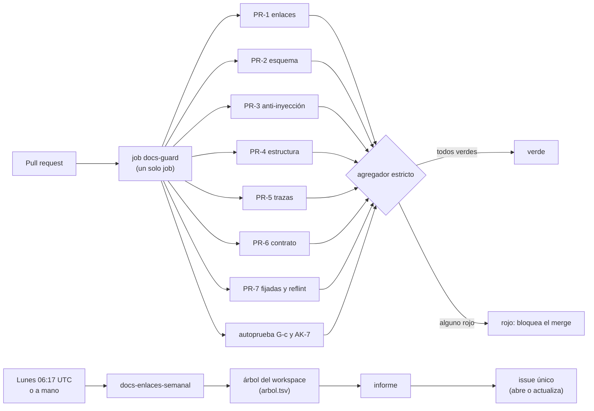

# docs-guard: controles documentales

Herramientas de la compuerta documental de Lab-Documentos. Las corre el workflow
[`docs-guard.yml`](../../.github/workflows/docs-guard.yml) en cada pull request, y el carril programado
[`docs-enlaces-semanal.yml`](../../.github/workflows/docs-enlaces-semanal.yml) una vez por semana. En local se corren
con [`scripts/ci-local.sh`](../../scripts/ci-local.sh), que da los mismos pasos en el mismo orden.

## Índice

1. [Definiciones](#1-definiciones)
2. [Cómo se usa](#2-cómo-se-usa)
3. [Los dos carriles](#3-los-dos-carriles)
4. [Controles del carril PR](#4-controles-del-carril-pr)
5. [Qué bloquea y qué avisa](#5-qué-bloquea-y-qué-avisa)
6. [Pares rojo/verde y fixture AK-7](#6-pares-rojoverde-y-fixture-ak-7)
7. [Datos de configuración](#7-datos-de-configuración)
8. [Carril programado](#8-carril-programado)
9. [Cómo agregar un control](#9-cómo-agregar-un-control)
10. [Origen](#10-origen)

## 1. Definiciones

| Término | Significado |
| --- | --- |
| Compuerta | Control que corre en la CI y termina con un código de salida: 0 en orden, 1 bloquea, 2 error de uso |
| Grupo `PR-n` | Conjunto de controles del carril PR (`PR-1` a `PR-7`). No confundir con `G1`–`G4`, la guarda de merge |
| `AI-n` | Chequeo anti-inyección: AI-1 comentarios HTML, AI-2 caracteres invisibles, AI-3 frases dirigidas al agente, AI-4 URL fuera de la lista de dominios, AI-5 HTML oculto |
| `AK-n` | Control anti-inyección del sistema. Acá viven AK-3 (excepciones con huella), AK-4 (lista de dominios), AK-5 (job sin secretos) y AK-7 (fixture permanente en rojo) |
| Par rojo/verde | Un fixture con el defecto (el control tiene que dar rojo) y otro sin él (tiene que dar verde) |
| Línea de base | Cantidad de hallazgos de un control sobre el corpus que vigila, antes de empezar a bloquear |
| Cuerpo nuevo | Carpeta con un `README.md` cuyo frontmatter tiene `corpus_id`. Ahí todo documento exige frontmatter y `reflint` bloquea |
| RUTA | Carpeta que se verifica, relativa a la raíz del repositorio. Por defecto, la guía del sistema documentador |

## 2. Cómo se usa

```bash
scripts/ci-local.sh                 # todos los grupos sobre la RUTA por defecto, con agregador
scripts/ci-local.sh ai Guides/X     # un grupo sobre otra carpeta
python3 -I tools/docs-guard/dg.py esquema Guides/X   # un control suelto
```

Requiere bash, curl, Python 3 (sólo biblioteca estándar) y Node.js. Las herramientas externas se bajan a la caché
`$DOCS_GUARD_CACHE` (por defecto, `$RUNNER_TEMP/docs-guard` o `/tmp/docs-guard`): lychee con versión y SHA-256 fijos,
mermaid y jsdom por `npm ci` sobre [`mermaid/package-lock.json`](mermaid/package-lock.json), markdownlint-cli2 con
versión fija.

Ejemplo de salida del agregador:

```text
== agregador docs-guard
  enlaces      verde
  esquema      verde
  ai           verde
  estructura   verde
  trazas       verde
  contrato     verde
  fijadas      verde
  autoprueba   verde
== docs-guard: verde
```

## 3. Los dos carriles



El carril PR bloquea y no usa red para verificar (sólo para bajar herramientas). El carril programado sólo avisa: usa
red, clona los repos hermanos y escribe un issue.

## 4. Controles del carril PR

| Grupo | Paso de `ci-local.sh` | Controles | Herramienta |
| --- | --- | --- | --- |
| PR-1 | `enlaces` | Enlaces internos y anclas; relativos que salen del repositorio | lychee `--offline --include-fragments`; `dg.py fuera` |
| PR-2 | `esquema` | Frontmatter contra [`esquemas/`](esquemas/), registro cerrado de prefijos, esquema del RRD | `dg.py esquema` |
| PR-3 | `ai` | AI-1 a AI-5, con excepciones con huella | `dg.py ai` |
| PR-4 | `estructura` | Markdown estructural (MD013 apagado); mermaid que parsea | markdownlint-cli2; [`mermaid/mermaid-parse.mjs`](mermaid/mermaid-parse.mjs) |
| PR-5 | `trazas` | Cada `traces: [ID@MAYOR.MENOR]` contra el registro generado de `doc_id` y de los encabezados que empiezan con un ID | `dg.py trazas` |
| PR-6 | `contrato` | Diff del contrato OpenAPI (`contracts/openapi.json` frente a `contracts/.generado/openapi.json`) | `dg.py contratos` y `dg.py contrato` |
| PR-7 | `fijadas` | Piezas fijadas con su SHA-256 (`BASE-FIJADA.md`); formato de referencias con ancla `ref-…`; URL y citas por dominio con referencia completa (`url-fecha`) | `dg.py fijadas`; `dg.py reflint`; `dg.py url-fecha` |
| — | `autoprueba` | Par rojo/verde de cada control y fixture AK-7 | los mismos controles sobre [`fixtures/`](fixtures/) |
| — | `avisos` | `url-fecha` y `cita-linea` sobre lo heredado | `dg.py avisos` (nunca bloquea) |

**Esquemas de frontmatter.** Un documento con `doc_id` se valida contra
[`cuerpo.schema.json`](esquemas/cuerpo.schema.json): los diez campos (`doc_id`, `doc_type`, `title`, `status`,
`origin`, `confidence` si `origin` no es `human`, `owner`, `last_review`, `audience`, `traces`) más `description` de
hasta 160 caracteres, con vocabulario cerrado. Una página de ayuda (`roles` o `translation_of`) se valida contra
[`ayuda.schema.json`](esquemas/ayuda.schema.json). El README de un cuerpo nuevo, contra
[`readme-cuerpo.schema.json`](esquemas/readme-cuerpo.schema.json) (`corpus_id` y `version` viven sólo ahí). Un
`_requisitos.md` o un `doc_type: rrd` debe tener la tabla `ID | Audiencia | Tarea | Pieza | Criterio | Decisión`, con
IDs `RD-nn`, criterio Dado/Cuando/Entonces y decisión `aceptado`, `rechazado`, `diferido` o `pendiente`.

**Trazas a otro sistema.** Un ID cuyo prefijo es `externo` en [`prefijos.txt`](prefijos.txt) (por ejemplo `CU-` o
`RN-`) se declara en el sistema que se documenta. Si la página no tiene un `source.lock` en su carpeta o en una
superior, la traza no se puede verificar y el control **avisa**. Con `source.lock`, la traza tiene que resolver contra
las fuentes que se pasen con `--fuente DIR`, y si no resuelve **bloquea**.

**Anclas de nivel 2 (E1-U3).** Una ficha de regla (`doc_type: ficha`) lleva una tabla `| Rol | Ancla | Afirma |`. Cada
ancla es `` `ruta#Símbolo@SHA` ``: un archivo del código, un símbolo (`Clase.Miembro` en `.cs`; `Elemento.Atributo` en
`.xaml`, con el elemento nombrado por `x:Name` o `AutomationId`) y el SHA del `source.lock` más cercano. La afirmación
es `` = `v` `` (valor del símbolo), `` contiene `t` `` o `` no contiene `t` `` (texto de su declaración), o vacía (sólo
existencia). `dg.py trazas --fuente DIR` las comprueba contra el árbol del código en ese SHA y **bloquea**; con
`--deriva` compara contra otra revisión y sólo **avisa**. Sin `--fuente` (el job de `docs-guard`, que no baja código)
no se comprueban y el control lo dice en una línea: las verifica el workflow que declara el `source.lock`. El ejemplo
es la [mini demo MovilidadUrbana](../../Guides/Documentacion-Tecnica/Sistema-De-Documentacion-E-Integracion/Examples/MovilidadUrbana-Mini-Demo/README.md).

**Contrato extraído en otro job.** Si `contracts/openapi.json` tiene un `source.lock` con `workflow:` en su carpeta o
en una superior, `dg.py contratos` no lo marca como «sin extracción»: lo extrae y compara ese workflow, que compila el
código. Sin `source.lock` y sin `contracts/.generado/openapi.json`, sigue bloqueando.

**`url-fecha` ampliado (E1-U4f, E-F7, D28).** Una fuente externa citada en el texto lleva referencia completa: en
el mismo bloque (un párrafo, una fila de tabla o un encabezado) aparece la fecha de consulta («consultado el
AAAA-MM-DD»; también vale la de una observación propia, «medido el» o «verificado el») o una cita enlazada al anexo
de referencias (`](…#ref-…)`). El control ve dos formas: la URL con esquema (`https://…`) y la cita por dominio dentro
de un code span (`` `docusaurus.io/docs/…` ``), que el aviso heredado no veía. Un dominio es una cadena en minúsculas
con al menos dos etiquetas y un dominio de primer nivel genérico de la lista o de país de dos letras, salvo los que
coinciden con extensiones de archivo (`README.md`, `ci-local.sh`, `Program.cs` no son dominios). No son citas, y no
se marcan: direcciones locales (`localhost`, `127.…`), dominios reservados para ejemplos (`example.com`, `.test`),
plantillas con «…», direcciones de clonado que terminan en `.git` e imágenes de contenedor con etiqueta
(`mcr.microsoft.com/dotnet/sdk:10.0`). Bloquea en el cuerpo nuevo salvo en un documento `status: obsoleto`, que avisa:
la conversión a APA se hace en el documento que lo reemplaza. Los fixtures son `fixtures/url-fecha/rojo` (cuatro
citas incompletas), `verde` (las mismas formas completas y las excepciones) y `obsoleto` (verde con avisos).

**IDs del RRD.** Las filas `RD-nn` de un `_requisitos.md` (o `doc_type: rrd`) entran al registro: una página puede
trazar al requerimiento que la pide.

**`AGENTS.md` de la raíz (CL-03, E1-U4e).** Si el repositorio que se verifica tiene `AGENTS.md` en la raíz, los grupos
`enlaces`, `ai` y `estructura` lo revisan junto con la RUTA: sus enlaces y anclas tienen que resolver. Como un puntero
para agentes se dirige al agente por oficio, queda fuera de AI-3 por una excepción con huella en
[`excepciones.txt`](excepciones.txt) (AK-3); los otros cuatro chequeos AI lo siguen mirando. Si falta, `enlaces` sólo
avisa, porque otros repositorios usan el mismo script por el workflow reutilizable.

## 5. Qué bloquea y qué avisa

Un control bloquea sólo si cumple las cinco condiciones de la regla de bloqueo: es determinista y no usa red; el
defecto lo introduce el mismo PR; tiene par rojo/verde; su línea de base sobre lo que vigila es 0; no tiene falsos
positivos conocidos o los canaliza por excepciones con huella.

| Control | Bloquea | Motivo |
| --- | --- | --- |
| PR-1, PR-2, PR-4, PR-5, PR-6, PR-7 `fijadas` | Sí | Cumplen las cinco condiciones; línea de base 0 sobre la RUTA por defecto |
| AI-1, AI-2, AI-5 | Sí | Ídem |
| AI-4 | Sí, salvo en el anexo de referencias | En el anexo (archivo con «Referencias» en el nombre o `doc_type: anexo-referencias`) sólo avisa |
| AI-3 | No: avisa | Tiene falsos positivos conocidos en textos que explican cómo se arma un agente. Pasa a bloquear cuando su línea de base con excepciones sea 0 en el cuerpo nuevo (`--ai3-bloquea`) |
| `reflint` | Sí en el cuerpo nuevo; avisa en lo heredado | Lo heredado no siguió la norma de citación |
| `url-fecha` (PR-7) | Sí en el cuerpo nuevo, salvo en un documento `status: obsoleto`; avisa en lo heredado | Línea de base 0 en el cuerpo nuevo desde E1-U4f; alta en lo heredado |
| `cita-linea` | No: avisa | Línea de base alta en lo heredado |
| Trazas a un sistema externo sin `source.lock` | No: avisa | No hay SHA contra el que resolverlas |

## 6. Pares rojo/verde y fixture AK-7

[`fixtures/`](fixtures/) tiene, por cada control que bloquea, una carpeta `rojo/` con el defecto y una `verde/` sin
él. El paso `autoprueba` los corre en cada pull request: si un control no da rojo sobre su `rojo/` o no da verde
sobre su `verde/`, la compuerta misma está rota y la corrida da rojo. Dos carpetas `aviso/` comprueban lo contrario:
que AI-3 y AI-4 en el anexo **no** bloquean. `fixtures/anclas/` tiene su par con una fuente de prueba (`fuente/`) y un
`source.lock` con un SHA ficticio, y además `real-rn-loc-01/`: la ficha 1.0 de RN-LOC-01 de la mini demo, sin
corregir, que el workflow `mini-demo-movilidad` corre contra el código real y exige en rojo (defecto 60/80).

[`fixtures/ak7/inyeccion.md`](fixtures/ak7/inyeccion.md) es el fixture permanente de AK-7: una página con las cinco
formas de inyección. Tiene que dar rojo en cada corrida, con AI-1, AI-2, AI-4 y AI-5 detectados y AI-3 como aviso. Si
alguna vez pasa en verde, el control anti-inyección dejó de funcionar.

## 7. Datos de configuración

| Archivo | Qué es | Quién lo cambia |
| --- | --- | --- |
| [`dominios.txt`](dominios.txt) | Lista de dominios permitidos (AK-4), un dominio por línea con su motivo | Clase P con aprobación explícita: un PR que agrega el dominio y una persona que lo aprueba |
| [`prefijos.txt`](prefijos.txt) | Registro cerrado de prefijos de ID, con ámbito `interno` o `externo` | PR que agrega el prefijo |
| [`excepciones.txt`](excepciones.txt) | Excepciones con huella (AK-3): `sha256 ruta control`. Valen mientras el archivo no cambie | Clase H: la aprueba una persona |
| [`esquemas/`](esquemas/) | Esquemas JSON del frontmatter (subconjunto de draft-07 que valida `dg.py`) | PR con su par rojo/verde |
| [`arbol.tsv`](arbol.tsv) | Tabla repo → ruta del workspace del carril programado; sólo repos públicos | PR |

Ejemplo de excepción: `AGENTS.md` es un archivo de instrucciones (clase H) y menciona frases dirigidas al agente a
propósito. Se exceptúa de AI-3 con la huella del archivo:

```text
3f5a…c2  AGENTS.md  AI-3
```

## 8. Carril programado

[`semanal.sh`](semanal.sh) arma el árbol del workspace con los repos de [`arbol.tsv`](arbol.tsv) (clon anónimo,
historia sin blobs) y escribe un informe con:

1. el árbol: commit, segundos y tamaño de cada clon (mide el armado del árbol y el costo de mantener los repos al día);
2. `lychee --root-dir` con red sobre la carpeta elegida: enlaces entre repos (rutas `/LAB/…`, `/PROG2/…`) y externos;
3. el atraso de cada `base_commit` y de cada `sha:` de un `source.lock` contra `main` del repo que lo contiene;
4. la deriva de las piezas fijadas (`BASE-FIJADA.md`) en todo el árbol;
5. la frescura: documentos con `last_review` de más de 365 días;
6. la línea de base de AI-3 sobre la carpeta elegida, con las excepciones vigentes (cuándo AI-3 puede pasar a bloquear).

El informe no lleva rutas del equipo que lo corre: se recortan antes de escribir el issue.

El workflow corre los lunes y a mano (`workflow_dispatch`, con la carpeta como entrada), y abre o actualiza un único
issue titulado «docs-enlaces-semanal: informe del carril programado». Declara `issues: write` sólo para eso. En un
pull request que toca el carril corre en seco: arma el árbol y el informe, pero no toca issues.

```bash
tools/docs-guard/semanal.sh /tmp/arbol /tmp/informe.md Guides
```

## 9. Cómo agregar un control

1. Escribir el control en `dg.py` (biblioteca estándar) o como herramienta con versión fijada.
2. Agregar `fixtures/<control>/rojo/` y `fixtures/<control>/verde/`, y la línea correspondiente en `autoprueba`.
3. Medir su línea de base sobre la RUTA por defecto. Si no es 0, sanearla primero o dejarlo como aviso.
4. Agregar el paso a `scripts/ci-local.sh` y a `docs-guard.yml`, con su `id` en el agregador.

## 10. Origen

Expediente 0002 de DocAsCode, unidad E1-U2: los grupos PR-1 a PR-7 y el carril programado del modelo integrado.
Los controles se portaron de los prototipos que las comisiones dejaron como evidencia (`traces-resolve.sh`,
`mermaid-parse.mjs`, `ocultos.mjs`, `url-fecha.mjs`, `cita-linea.mjs`, `cuerpo.schema.json`, `ayuda.schema.json`,
`agent_channels.py`, `reflint.py`, `deriva-vendor.sh`) y se reescribieron sin dependencias para el runner.
